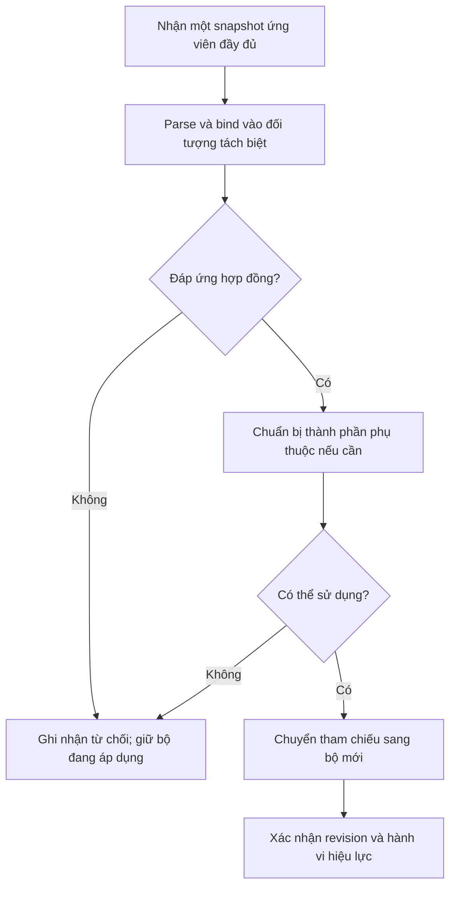

# Ứng xử khi cấu hình mới không hợp lệ

Trong chương **Cập nhật cấu hình** của module **SPRING_CLOUD_KUBERNETES**, một thay đổi chỉ được xem là áp dụng thành công khi ứng dụng có thể sử dụng bộ cấu hình mới theo đúng hợp đồng. Việc Kubernetes chấp nhận ConfigMap, watcher gửi được thông báo hay endpoint refresh trả thành công chưa đủ để chứng minh điều đó.

Giả sử `orders-service` đang chạy ổn định với read timeout `2s`. Một bản cập nhật đưa vào `two-seconds`, hoặc đưa connect timeout lớn hơn giới hạn mà ứng dụng cho phép. Cần biết ứng dụng sẽ từ chối khởi động, tiếp tục dùng bộ giá trị cũ, ngừng nhận việc hay cần được khôi phục bằng rollout. Không nên để kết quả phụ thuộc tình cờ vào bean nào được tạo trước.

Bài học xây dựng chính sách phản ứng và một ví dụ **kiểm tra ứng viên trước khi đổi cấu hình hiệu lực**. Các tên resource, giá trị timeout và giới hạn đều là dữ liệu minh họa. Phần tích hợp tham chiếu Spring Cloud Kubernetes và Spring Cloud Context 5.1.0; khi thực hành, dùng bộ Spring Boot, Spring Cloud và starter tương thích theo BOM dự án.

## 1. Phân loại lỗi trước khi quyết định phản ứng

“Cấu hình không hợp lệ” có nhiều mức khác nhau:

| Loại lỗi | Ví dụ | Tầng có thể phát hiện |
| --- | --- | --- |
| Manifest/resource không hợp lệ | Sai cấu trúc trường của ConfigMap | API Kubernetes hoặc kiểm tra trước triển khai |
| Không đọc được nguồn | Sai namespace, thiếu quyền, lỗi kết nối API | Client Kubernetes và cơ chế nạp cấu hình |
| Không chuyển đổi được kiểu | `read-timeout=two-seconds` | Binder hoặc parser |
| Thiếu dữ liệu bắt buộc | Không có read timeout trong một snapshot đầy đủ | Binding và validation |
| Giá trị ngoài miền cho phép | Timeout bằng 0 hoặc âm | Validation hợp đồng |
| Các khóa không nhất quán | Connect timeout vượt read timeout theo chính sách của ứng dụng minh họa | Kiểm tra quan hệ giữa thuộc tính |
| Không phù hợp phiên bản | Khóa mới bị bộ đọc cũ bỏ qua hoặc từ chối | Kiểm tra tương thích ứng dụng–cấu hình |
| Khởi tạo tài nguyên thất bại | Định dạng URL hợp lệ nhưng không dựng được client theo cấu hình đó | Bước chuẩn bị client/pool |
| Hành vi vận hành không đạt | Timeout hợp lệ về kiểu nhưng gây nhiều lỗi dưới tải thực tế | Canary, kiểm tra hành vi và quan sát |

Một ConfigMap có thể lưu chuỗi `two-seconds` hoàn toàn hợp lệ về mặt resource, trong khi binder của ứng dụng không chuyển được chuỗi đó sang `Duration`. Kubernetes không biết hợp đồng thuộc tính Java của ứng dụng. Cấu trúc ConfigMap được mô tả trong [ConfigMaps](https://kubernetes.io/docs/concepts/configuration/configmap/).

Cũng cần tách lỗi dữ liệu với lỗi phân phối. Retry có thể giúp với một sự cố mạng ngắn. Nó không làm `two-seconds` trở thành thời lượng hợp lệ, không tạo quyền RBAC đang thiếu và không bổ sung một khóa bắt buộc bị quên.

## 2. Chính sách phụ thuộc ứng dụng đã có cấu hình dùng được hay chưa

### Khi khởi động: chưa có bộ giá trị tốt để giữ lại

Nếu cấu hình bắt buộc không hợp lệ và không có một nguồn dự phòng được thiết kế rõ ràng, ứng dụng nên dừng khởi tạo hoặc chưa được coi là sẵn sàng nhận việc.

Không tự dùng những fallback như timeout bằng 0, credential rỗng hoặc endpoint local chỉ để quá trình khởi động đi tiếp. Một giá trị dự phòng chỉ có ý nghĩa khi chính nó là phần hợp đồng đã được kiểm tra.

Với đường nạp ConfigMap của Spring Cloud Kubernetes, có thể cấu hình:

```yaml
spring:
  cloud:
    kubernetes:
      config:
        fail-fast: true
        retry:
          enabled: false
```

Đây chỉ là fragment cho chính sách lỗi nạp nguồn, không phải toàn bộ cấu hình tích hợp.

`fail-fast` xử lý những lỗi nạp thuộc phạm vi cơ chế đó. Nó không thay validation cho kiểu, miền giá trị hay quy tắc nghiệp vụ. Cần kiểm tra riêng hành vi khi resource không tồn tại và khi resource tồn tại nhưng thiếu khóa. Xem [Using a ConfigMap PropertySource](https://docs.spring.io/spring-cloud-kubernetes/reference/property-source-config/configmap-propertysource.html).

Đối với bean cấu hình được bind lúc startup, đăng ký `@ConfigurationProperties`, bật validation phù hợp bằng `@Validated` và khai báo ràng buộc cho những thuộc tính bắt buộc là một cách phát hiện lỗi sớm. Spring Boot trình bày cơ chế này tại [Configuration Properties Validation](https://docs.spring.io/spring-boot/reference/features/external-config.html#features.external-config.typesafe-configuration-properties.validation).

### Khi đang chạy: quyết định theo khả năng tiếp tục phục vụ

| Tình trạng | Phản ứng có thể chọn |
| --- | --- |
| Ứng viên mới sai, cấu hình đang áp dụng vẫn hợp lệ và được phép dùng | Từ chối ứng viên; tiếp tục dùng bộ cũ; phát tín hiệu cập nhật thất bại |
| Ứng viên mới sai, một chức năng có thể tạm ngừng độc lập | Ngừng chức năng đó theo thiết kế, giữ những phần còn hoạt động |
| Cấu hình cũ không còn được phép sử dụng | Ngừng nhận công việc chịu ảnh hưởng hoặc đưa instance ra khỏi luồng phục vụ |
| Target/client cũ đã bị hủy trong lúc refresh | Không giả định còn đường quay lại trong bộ nhớ; thực hiện quy trình phục hồi |
| Giá trị mới qua validation nhưng gây suy giảm hành vi | Dừng mở rộng canary và khôi phục một bộ đã biết tốt |

Ví dụ, giữ timeout cũ thêm vài phút có thể là chính sách chấp nhận được của một client. Giữ credential đã bị thu hồi hoặc chính sách truy cập đã bị vô hiệu hóa có thể không chấp nhận được. Quyết định giữ bộ cũ cần có giới hạn thời gian và phạm vi, không phải một fallback vô thời hạn.

Ở phần còn lại, ví dụ chọn chính sách: **nếu đang có cấu hình timeout hợp lệ, dữ liệu cập nhật sai không thay bộ đang được dùng**.

## 3. Giữ riêng dữ liệu mong muốn và dữ liệu đã áp dụng

Một mô hình dễ quan sát gồm ba trạng thái:

- **Ứng viên nhận được:** snapshot mà bên cấp cấu hình muốn ứng dụng xem xét.
- **Kết quả kiểm tra:** đã chấp nhận, bị từ chối hay bị bỏ qua vì cũ/trùng.
- **Bộ đang áp dụng:** đối tượng mà luồng nghiệp vụ thật sự sử dụng.



Điều quan trọng là chưa sửa đối tượng đang phục vụ trong lúc parse hoặc validation.

Không làm theo trình tự “set từng field lên bean đang chạy, kiểm tra ở cuối, nếu sai thì cố set ngược”. Reader khác có thể đã dùng những giá trị trung gian, và một số tác dụng như tạo connection mới không thể xóa bằng cách gán lại field.

### Tại sao refresh mặc định chưa bảo đảm giữ bộ tốt cũ?

`ContextRefresher.refresh()` của phiên bản tham chiếu cập nhật Environment rồi refresh scope. Đây không phải một giao dịch có bước tự khôi phục toàn bộ trạng thái nếu target hoặc client tạo lại thất bại. Xem [ContextRefresher 5.1.0](https://github.com/spring-cloud/spring-cloud-commons/blob/v5.1.0/spring-cloud-context/src/main/java/org/springframework/cloud/context/refresh/ContextRefresher.java).

Với `@RefreshScope`, target cũ có thể đã bị hủy và target mới chỉ được tạo khi có lần sử dụng tiếp theo. Validation hoặc khởi tạo có thể thất bại tại lần sử dụng ấy. Không suy rằng một phản hồi refresh thành công chứng minh tất cả bean đã hoạt động với dữ liệu mới. Cơ chế target được mô tả tại [Spring Cloud Context: Refresh Scope](https://docs.spring.io/spring-cloud-commons/reference/spring-cloud-commons/application-context-services.html#refresh-scope).

Nếu yêu cầu là giữ bộ tốt cũ, cần hiện thực ranh giới kiểm tra rồi chuyển trạng thái một cách chủ động, hoặc chọn rollout với snapshot riêng.

## 4. Định nghĩa hợp đồng cho ví dụ

Giả sử ứng dụng có một nhóm thuộc tính:

| Thuộc tính | Hợp đồng minh họa |
| --- | --- |
| `catalog.runtime.revision` | Mã phát hành không rỗng, dạng chữ thường/số/dấu chấm/dấu gạch nối |
| `catalog.runtime.connect-timeout` | Từ 1 ms đến 2 s |
| `catalog.runtime.read-timeout` | Từ 1 ms đến 10 s |
| Quan hệ | Connect timeout không lớn hơn read timeout |

Quan hệ giữa hai timeout là **chính sách riêng của ví dụ**, không phải ràng buộc phổ quát của mọi HTTP client hoặc Spring.

Bên phát hành còn cung cấp một số thứ tự tăng dần gọi là `generation`. Đây là metadata của quy trình phát hành, không phải thuộc tính chuẩn của Spring Cloud Kubernetes. Nó giúp phân biệt sự kiện trùng và sự kiện cũ.

Một resource ban đầu có thể là:

```yaml
apiVersion: v1
kind: ConfigMap
metadata:
  name: catalog-runtime-c42
  namespace: commerce-prod
  annotations:
    configuration.example/generation: "42"
data:
  catalog.runtime.revision: "cfg-42"
  catalog.runtime.connect-timeout: "500ms"
  catalog.runtime.read-timeout: "2s"
```

Adapter đọc resource phải chuyển annotation generation thành số hợp lệ và chuyển `data` thành snapshot đầu vào. Tên annotation là quy ước của ví dụ; không có tự động wiring từ nó tới mã Java.

Các trường hợp sau đều cần được kiểm tra:

| Ứng viên | Điều xảy ra |
| --- | --- |
| Read timeout là `two-seconds` | Lỗi chuyển đổi kiểu |
| Thiếu read timeout | Lỗi bắt buộc |
| Read timeout là `0ms` | Lỗi miền giá trị |
| Connect timeout `1500ms`, read timeout `1s` | Lỗi quan hệ theo chính sách |
| Đủ dữ liệu, connect `500ms`, read `3s` | Qua phần validation của ví dụ; vẫn cần kiểm tra hành vi |

Mỗi ứng viên là một **snapshot đầy đủ** của nhóm thuộc tính. Không ghép một khóa mới với các khóa còn sót từ lần trước. Nếu hệ thống nhận bản vá thay vì snapshot, phải có quy tắc dựng snapshot hoàn chỉnh trước khi kiểm tra.

## 5. Ví dụ Java: bind riêng, kiểm tra rồi chuyển tham chiếu

Mã dưới đây tập trung vào cổng chấp nhận cấu hình. Nó không tự cài watcher, không sửa Spring Environment và không thay hành vi mặc định của `/actuator/refresh`.

Đường sử dụng dự kiến là:

```text
Adapter đọc snapshot Kubernetes
        → RuntimeConfigGate.applyOrKeep(...)
        → Luồng nghiệp vụ lấy RuntimeConfigGate.current()
```

Nhóm `catalog.runtime.*` trong thiết kế này phải được tiêu thụ qua gate. Không đồng thời tự động rebind cùng nhóm vào các bean khác rồi cho rằng mọi thành phần đều được gate bảo vệ.

Ví dụ cần Spring Boot Binder và một Jakarta Validation provider, chẳng hạn qua starter validation tương thích. `Validator` được inject hoặc cung cấp từ hạ tầng validation của ứng dụng.

Đặt mã sau trong `RuntimeConfigGate.java`, thêm package theo dự án:

```java
import java.time.Duration;
import java.util.List;
import java.util.Map;
import java.util.concurrent.atomic.AtomicReference;

import jakarta.validation.Validator;
import jakarta.validation.constraints.AssertTrue;
import jakarta.validation.constraints.NotBlank;
import jakarta.validation.constraints.NotNull;
import jakarta.validation.constraints.Pattern;

import org.springframework.boot.context.properties.bind.BindException;
import org.springframework.boot.context.properties.bind.Bindable;
import org.springframework.boot.context.properties.bind.Binder;
import org.springframework.boot.context.properties.source.MapConfigurationPropertySource;

public final class RuntimeConfigGate {

    public enum Outcome {
        APPLIED,
        REJECTED_GENERATION,
        REJECTED_BINDING,
        REJECTED_VALIDATION,
        IGNORED_STALE
    }

    public record Candidate(
            @NotBlank
            @Pattern(regexp = "[a-z0-9][a-z0-9.-]{0,63}")
            String revision,
            @NotNull Duration connectTimeout,
            @NotNull Duration readTimeout) {

        @AssertTrue(message = "timeout-policy")
        public boolean isTimeoutPolicyValid() {
            if (connectTimeout == null || readTimeout == null) {
                return true;
            }

            return connectTimeout.compareTo(Duration.ofMillis(1)) >= 0
                    && connectTimeout.compareTo(Duration.ofSeconds(2)) <= 0
                    && readTimeout.compareTo(Duration.ofMillis(1)) >= 0
                    && readTimeout.compareTo(Duration.ofSeconds(10)) <= 0
                    && connectTimeout.compareTo(readTimeout) <= 0;
        }
    }

    public record Applied(long generation, Candidate settings) {
    }

    private final Validator validator;
    private final AtomicReference<Applied> active =
            new AtomicReference<>();

    private long highestSeenGeneration;

    public RuntimeConfigGate(Validator validator) {
        this.validator = validator;
    }

    public void initialize(
            long generation, Map<String, String> fullSnapshot) {

        if (applyOrKeep(generation, fullSnapshot) != Outcome.APPLIED) {
            throw new IllegalStateException(
                    "Initial runtime configuration is not valid");
        }
    }

    public synchronized Outcome applyOrKeep(
            long generation, Map<String, String> fullSnapshot) {

        if (generation <= 0) {
            return Outcome.REJECTED_GENERATION;
        }

        if (generation <= highestSeenGeneration) {
            return Outcome.IGNORED_STALE;
        }

        highestSeenGeneration = generation;

        Candidate candidate;
        try {
            var source = new MapConfigurationPropertySource(
                    Map.copyOf(fullSnapshot));
            var binder = new Binder(List.of(source));
            var result = binder.bind(
                    "catalog.runtime", Bindable.of(Candidate.class));

            if (!result.isBound()) {
                return Outcome.REJECTED_BINDING;
            }

            candidate = result.get();
        }
        catch (BindException ex) {
            return Outcome.REJECTED_BINDING;
        }

        if (!validator.validate(candidate).isEmpty()) {
            return Outcome.REJECTED_VALIDATION;
        }

        active.set(new Applied(generation, candidate));
        return Outcome.APPLIED;
    }

    public Applied current() {
        Applied applied = active.get();
        if (applied == null) {
            throw new IllegalStateException(
                    "No valid runtime configuration is active");
        }
        return applied;
    }
}
```

### Điều ví dụ bảo đảm trong phạm vi của nó

`Binder` chuyển snapshot thành đối tượng mới. `MapConfigurationPropertySource` tạo nguồn binding từ map đầu vào, thay vì lấy dữ liệu trực tiếp từ Environment đang phục vụ. Hai API này được mô tả tại [Binder](https://docs.spring.io/spring-boot/api/java/org/springframework/boot/context/properties/bind/Binder.html) và [MapConfigurationPropertySource](https://docs.spring.io/spring-boot/api/java/org/springframework/boot/context/properties/source/MapConfigurationPropertySource.html).

Gọi Binder bằng tay không có nghĩa mọi annotation validation tự được thực thi. Mã chủ động gọi `validator.validate(candidate)`; nếu bỏ bước này, một chuỗi thời lượng parse được nhưng vi phạm giới hạn có thể đi tiếp. Cách sử dụng Validator được Spring trình bày tại [Java Bean Validation](https://docs.spring.io/spring-framework/reference/core/validation/beanvalidation.html).

Chỉ có một lệnh `active.set(...)`, sau khi binding và validation đã đạt. Các nhánh từ chối không sửa đối tượng đang áp dụng. Dữ liệu `Candidate` và `Applied` là record bất biến chứa String, Duration và số generation; consumer không nhận setter để sửa từng field.

Luồng nghiệp vụ lấy bộ giá trị một lần cho mỗi đơn vị công việc:

```java
RuntimeConfigGate.Applied applied = gate.current();
Duration connectTimeout = applied.settings().connectTimeout();
Duration readTimeout = applied.settings().readTimeout();
// Dùng cùng applied cho toàn bộ quyết định của đơn vị công việc.
```

Không gọi `current()` lại cho từng khóa nếu cần chúng thuộc cùng một bộ dữ liệu.

Record trong ví dụ là đối tượng ứng viên được tạo mới qua Binder. Nó không phải record `@ConfigurationProperties` đang được yêu cầu rebind bằng refresh scope.

### Giới hạn cần giữ rõ

- Map đầu vào phải không null, không có key/value null và đã được adapter tách từ một snapshot hoàn chỉnh. Lỗi lập trình hoặc lỗi adapter không được gom thành lỗi binding bằng một `catch (Exception)` tổng quát.
- Mã kiểm tra khóa bắt buộc, kiểu, miền và quan hệ đã khai báo. Nó chưa tự từ chối mọi khóa lạ; nếu hợp đồng yêu cầu, cần bổ sung allowlist hoặc BindHandler phù hợp để bắt cả lỗi gõ sai khóa.
- `initialize(...)` phải được gọi một lần trong đường khởi tạo bắt buộc, trước khi ứng dụng được cho phép nhận việc. Chỉ tạo gate mà không gọi initialize chưa cung cấp cấu hình ban đầu.
- Gate chỉ quản lý nhóm dữ liệu này. Nó không tạo giao dịch cho toàn bộ Spring Environment hoặc mọi bean khác.
- Mã chưa dựng HTTP client. Nếu client đã chép timeout vào singleton từ trước, đổi `active` không sửa client ấy.
- Nếu cần thay client/pool, phải chuẩn bị cả thành phần mới trước khi chuyển bộ tham chiếu đang dùng và quản lý tài nguyên cũ sau đó. Không đóng client cũ trước khi biết ứng viên mới có thể hoạt động.

Các kiểm tra gọi dịch vụ ngoài cần có timeout và chính sách riêng. Không giữ khóa `synchronized` của ví dụ trong một phép kiểm tra mạng dài; nếu bổ sung bước chuẩn bị bất đồng bộ, cần thiết kế lại điều phối và kiểm tra generation tại thời điểm commit.

## 6. Sự kiện trùng, sai thứ tự và rollback bằng bản phát hành mới

Trong ví dụ, generation được pipeline cấp theo thứ tự tăng dần cho luồng cấu hình này. Nó không phải thời gian máy và không được suy bằng cách parse số từ tên resource hoặc từ `resourceVersion`.

`highestSeenGeneration` được tăng trước khi kiểm tra nội dung. Vì vậy, sau khi đã nhìn thấy ứng viên 43, gate không nhận lại sự kiện 42, kể cả 43 bị từ chối. Sửa nội dung phải tạo generation mới.

| Thứ tự nhận | Nội dung | Kết quả | Bộ đang áp dụng |
| --- | --- | --- | --- |
| 42 | `500ms` / `2s`, hợp lệ | `APPLIED` | 42 |
| 43 | Read timeout `two-seconds` | `REJECTED_BINDING` | Vẫn 42 |
| 43 lần nữa | Nội dung đã sửa nhưng tái dùng số 43 | `IGNORED_STALE` | Vẫn 42 |
| 44 | Bộ đầy đủ `500ms` / `3s` | `APPLIED` | 44 |
| 42 đến muộn | Bộ cũ | `IGNORED_STALE` | Vẫn 44 |

Tái sử dụng generation cho nội dung khác phá hợp đồng phát hành của ví dụ. Adapter và pipeline cần thống nhất quy tắc này.

Nếu muốn khôi phục giá trị của 42 sau khi 44 đã áp dụng, phát hành một ứng viên 45 chứa các giá trị tốt của 42 và một revision phục hồi rõ ràng. Đây là phát hành dữ liệu cũ bằng một thứ tự mới, giúp phân biệt rollback có chủ đích với sự kiện trễ.

### Đây mới là thứ tự trong một tiến trình

Gate không lưu generation hoặc bộ đang áp dụng ra đĩa. Sau khi tiến trình khởi động lại, trạng thái trong bộ nhớ không còn.

Không dùng thành công của cơ chế giữ bộ cũ để che một tình huống nguy hiểm: các Pod đang chạy vẫn giữ 42, nhưng nguồn startup duy nhất đã bị sửa thành 43 sai. Khi Pod bị tạo lại hoặc autoscale, instance mới không có bộ 42 để giữ.

Nếu cần khả năng khôi phục sau restart, phải giữ một nguồn khởi động hợp lệ có danh tính rõ ràng, chẳng hạn snapshot ConfigMap được ghim theo Pod template. Có thể giữ ứng viên mới tách biệt với snapshot ổn định cho tới khi được chấp nhận theo quy trình.

Ở nhiều replica, các instance có thể đang áp dụng các generation khác nhau. Gate trong một JVM không cung cấp đồng thuận hoặc commit nguyên tử cho cả cluster. Bên điều phối phải quan sát kết quả theo Pod trước khi kết luận đợt cập nhật đã hoàn tất.

## 7. Khi dùng refresh tiêu chuẩn thay cho gate riêng

Không phải ứng dụng nào cũng cần viết cổng chấp nhận cấu hình. Có thể chọn thay đổi qua rollout nếu cấu hình quan trọng hoặc khó thay tài nguyên khi đang chạy.

Nếu dùng ConfigMap PropertySource cùng Configuration Watcher và refresh tiêu chuẩn, cần kiểm tra hành vi lỗi thực tế của bean và phiên bản đang dùng:

1. Nguồn được nạp lại có đọc đúng dữ liệu mới không?
2. Validation có thực thi khi rebind hoặc khi target mới được tạo không?
3. Bean cũ còn sử dụng được hay đã kết thúc vòng đời?
4. Consumer đang giữ proxy hay giữ một bản sao/client đã khởi tạo?
5. Sau lỗi, có thể phục hồi bằng lần refresh tiếp theo hay cần rollout?

Configuration Watcher hỗ trợ thông báo qua HTTP hoặc Spring Cloud Bus; nó không xác nhận thay ứng dụng rằng mọi nhóm thuộc tính và client đã chấp nhận revision mới. Xem [Configuration Watcher](https://docs.spring.io/spring-cloud-kubernetes/reference/spring-cloud-kubernetes-configuration-watcher.html).

Không thêm một listener chỉ ghi log exception rồi báo “đã dùng cấu hình cũ” nếu Environment hoặc bean thực tế đã bị thay một phần. Lời khẳng định giữ bộ cũ phải được chứng minh bằng trạng thái hiệu lực và hành vi.

Tương tự, không triển khai gate riêng song song với đường tự động cập nhật cùng nhóm thuộc tính mà không xác định đường nào có quyền quyết định. Hai đường cập nhật có thể khiến một phần ứng dụng dùng giá trị gate chấp nhận, phần khác dùng ứng viên đã bị gate từ chối.

## 8. Readiness và liveness phải phản ánh hai câu hỏi khác nhau

Khi một ứng viên bị từ chối, không tự động đánh đồng “cập nhật thất bại” với “tiến trình cần bị khởi động lại”.

| Tình trạng thực tế | Readiness theo chính sách ví dụ | Liveness theo chính sách ví dụ |
| --- | --- | --- |
| Chưa có bộ cấu hình bắt buộc hợp lệ | Không nhận việc | Không dùng liveness để thay cho validation startup |
| Ứng viên sai nhưng bộ đang áp dụng vẫn hợp lệ và được phép dùng | Có thể tiếp tục nhận việc; báo riêng việc chưa áp dụng bản mới | Tiếp tục phản ánh khả năng hoạt động của tiến trình |
| Bộ cũ hết thời gian được phép sử dụng | Không nhận công việc chịu ảnh hưởng | Quyết định restart chỉ khi nó thực sự có thể giúp phục hồi |
| Cấu hình đã làm ứng dụng không thể phục vụ an toàn | Đưa instance khỏi luồng phục vụ | Đánh giá khả năng phục hồi của tiến trình, tránh vòng restart vô ích |
| Tạo target mới thất bại, không còn thành phần hoạt động | Không nhận việc cần thành phần đó | Không coi giữ bộ cũ là đang có hiệu lực nếu target cũ đã mất |

Kubernetes dùng readiness để xác định khả năng nhận lưu lượng theo cơ chế điều phối, còn thất bại liveness có thể dẫn đến restart container. Tác dụng và ngưỡng của từng probe được mô tả tại [Configure Liveness, Readiness and Startup Probes](https://kubernetes.io/docs/tasks/configure-pod-container/configure-liveness-readiness-startup-probes/).

Nếu mọi Pod bị đánh dấu liveness thất bại chỉ vì cùng nhận một ứng viên sai, chúng có thể cùng restart rồi cùng thất bại startup với nguồn sai đó. Kết quả là mất cả những instance vốn còn chạy được bằng cấu hình tốt cũ.

### Tách sức khỏe phục vụ khỏi tình trạng cập nhật

Nếu ứng dụng có một HealthIndicator tên `runtimeConfig` phản ánh **bộ đang áp dụng có dùng được hay không**, có thể đưa nó vào readiness:

```yaml
management:
  endpoint:
    health:
      group:
        readiness:
          include: readinessState,runtimeConfig
```

Fragment này chỉ có ý nghĩa sau khi ứng dụng đã hiện thực indicator đúng tên và đúng chính sách. Mã gate ở mục 5 chưa cung cấp indicator.

Thông tin “ứng viên gần nhất bị từ chối” có thể xuất riêng qua metric, trạng thái chẩn đoán hoặc cảnh báo. Không gộp nó vào cùng một giá trị DOWN rồi vô tình làm mọi Pod mất readiness khi chúng vẫn phục vụ hợp lệ bằng bộ cũ.

Spring Boot không mặc định đưa mọi health indicator vào nhóm readiness/liveness. Cần kiểm tra health group và endpoint mà probe thật sự gọi; xem [Actuator: Kubernetes Probes](https://docs.spring.io/spring-boot/reference/actuator/endpoints.html#actuator.endpoints.kubernetes-probes).

Nếu giữ bộ cũ có hạn sử dụng, indicator phải xét chính hạn đó. “Có một object trong AtomicReference” không đủ chứng minh object còn được phép phục vụ mãi.

## 9. Báo lỗi đủ để sửa nhưng không lộ dữ liệu

Một bản ghi về lần từ chối nên cho biết:

- Ứng dụng, namespace và Pod nhận ứng viên.
- Generation/revision ứng viên, nếu metadata đã hợp lệ.
- Nhóm thuộc tính bị lỗi.
- Giai đoạn lỗi: đọc nguồn, binding, validation, chuẩn bị client hoặc áp dụng.
- Mã lý do cố định và tên thuộc tính được phép hiển thị.
- Generation/revision thực tế vẫn đang phục vụ.
- Thời điểm phát hiện và bên chịu trách nhiệm sửa.

Ví dụ định dạng do ứng dụng chủ động cung cấp:

```text
event=runtime_config_rejected
candidateGeneration=43
activeGeneration=42
activeRevision=cfg-42
stage=binding
reason=INVALID_DURATION
property=catalog.runtime.read-timeout
```

Đây không phải output tự động của Spring Cloud Kubernetes hoặc của lớp gate. Adapter và lớp quan sát cần bổ sung phần báo cáo phù hợp.

Không log nguyên snapshot, nội dung Secret hoặc toàn bộ exception chứa rejected value mà chưa kiểm soát việc che dữ liệu. Với Bean Validation, có thể chọn tên đường dẫn thuộc tính và mã ràng buộc thay vì xuất `getInvalidValue()`.

### Những tín hiệu cần phân biệt

| Tín hiệu | Ý nghĩa |
| --- | --- |
| Số lần nhận ứng viên | Luồng phân phối có đang hoạt động không |
| Số lần áp dụng thành công | Bao nhiêu ứng viên đã qua cổng chấp nhận |
| Số lần từ chối theo giai đoạn/lý do | Lỗi tập trung ở đâu |
| Số sự kiện cũ/trùng bị bỏ qua | Chất lượng và thứ tự luồng sự kiện |
| Generation mong muốn và đang áp dụng | Có độ lệch cần xử lý không |
| Thời gian từ khi xuất hiện độ lệch | Đã giữ cấu hình cũ bao lâu trong đợt cập nhật |
| Tỷ lệ lỗi và độ trễ nghiệp vụ | Bộ được chấp nhận có tạo hành vi mong muốn không |

Nhãn metric nên có tập giá trị giới hạn, chẳng hạn result và reason. Tránh đưa mỗi revision, Pod UID hoặc chuỗi lỗi tùy ý thành một tập nhãn tăng không giới hạn; có thể giữ chi tiết đó ở log/sự kiện.

Cảnh báo cần chỉ ra ứng viên nào bị từ chối và hệ thống đang dùng bộ nào. Chỉ báo “refresh failed” khiến người trực không biết còn an toàn để phục vụ hay phải ngừng nhận việc.

## 10. Quy trình phục hồi theo loại lỗi

Một quy trình xử lý thực tế có thể gồm các bước sau.

### Bước 1: dừng mở rộng thay đổi

Ngừng phát tán cùng ứng viên sang thêm Pod hoặc ứng dụng. Giữ các instance tốt nếu chúng còn được phép hoạt động.

Không liên tục gọi refresh hoặc restart tất cả Pod khi chưa biết dữ liệu nào đang sai. Hành động đó có thể phá bộ giá trị tốt còn nằm trong tiến trình.

### Bước 2: xác định trạng thái thực tế

Đối chiếu dữ liệu mong muốn, bản ứng dụng đang chạy, nguồn nạp, giá trị hiệu lực và revision đã áp dụng theo từng Pod.

Các lệnh đọc trạng thái minh họa:

```powershell
kubectl get pods -n commerce-prod -l app=orders-service
kubectl rollout status deployment/orders-service -n commerce-prod
kubectl rollout history deployment/orders-service -n commerce-prod
kubectl describe deployment orders-service -n commerce-prod
```

Các lệnh chưa được chạy trong bài. Chúng hỗ trợ quan sát triển khai; để biết timeout thực sự được dùng vẫn cần bằng chứng từ ứng dụng và client.

### Bước 3: chọn cách sửa phù hợp

| Lỗi | Hướng phục hồi |
| --- | --- |
| Sai định dạng hoặc ngoài miền | Phát hành snapshot sửa lỗi đầy đủ bằng generation mới |
| Thiếu khóa | Bổ sung vào snapshot theo đúng hợp đồng phiên bản |
| Sai nguồn/namespace/quyền đọc | Sửa tham chiếu hoặc quyền cho đúng danh tính và thao tác cần thiết |
| Sai phiên bản hợp đồng | Khôi phục cặp ứng dụng–cấu hình tương thích hoặc phát hành bộ chuyển tiếp |
| Target/client đã hỏng sau refresh | Khôi phục nguồn hợp lệ và tạo lại theo cơ chế được hỗ trợ; rollout nếu cần |
| Qua validation nhưng suy giảm hành vi | Quay về bộ đã kiểm tra tốt và điều tra bằng canary |

Không mở quyền đọc mọi Secret chỉ để xử lý một lỗi đọc ConfigMap. RBAC phải đáp ứng đúng yêu cầu của client ứng dụng và watcher; đây là vấn đề phân phối, không phải sửa dữ liệu timeout.

### Bước 4: sửa cả nguồn quản lý chuẩn

Nếu cấu hình được quản lý bằng GitOps hoặc pipeline, sửa nguồn chuẩn và tạo bản phát hành khôi phục ở đó. Một bản vá trực tiếp có thể bị bộ điều phối ghi đè trở lại nếu nguồn chuẩn vẫn chứa ứng viên sai.

Khi giữ snapshot theo tên, tham chiếu trong Pod template phải trỏ đúng bộ đã kiểm tra. Quyền đọc snapshot khôi phục cũng phải còn tồn tại.

### Bước 5: xác nhận trên phạm vi nhỏ

Áp dụng cho một instance hoặc nhóm nhỏ. Kiểm tra:

1. Kết quả binding và validation.
2. Revision đã áp dụng.
3. Khả năng sử dụng của bean/client.
4. Hành vi nghiệp vụ.
5. Readiness và tín hiệu từ chối đã được xử lý đúng.

Một instance có thể hoàn tất bước 1 nhưng thất bại bước 3. Một instance có thể qua cả ba bước đầu nhưng không đạt độ trễ dưới tải.

### Bước 6: mở rộng và kết thúc sự cố

Chỉ mở rộng khi các tiêu chí đạt. Đối chiếu các Pod còn lệch revision và xác định rõ trường hợp nào được phép ở lại bộ cũ.

Kết thúc sự cố khi nguồn chuẩn đã sửa, các instance trong phạm vi cần cập nhật đã có trạng thái chấp nhận được và bộ cấu hình khôi phục vẫn sẵn sàng nếu cần quay lại.

### Giới hạn của rollback Deployment

`kubectl rollout undo` phục hồi Pod template theo revision triển khai; nó không phục hồi nội dung lịch sử của một ConfigMap mutable đã bị sửa tại chỗ.

Khi Deployment báo `ProgressDeadlineExceeded`, Kubernetes không tự rollback chỉ vì trạng thái đó. Bên điều phối cao hơn phải quyết định hành động. Xem [Deployments](https://kubernetes.io/docs/concepts/workloads/controllers/deployment/).

Vì vậy, không viết kế hoạch “cấu hình sai thì Kubernetes tự quay lại”. Cần biết chính xác ai phát hiện, ai quyết định và cặp image–cấu hình nào sẽ được khôi phục.

## 11. Kiểm tra những nhánh thất bại trước khi dùng ở môi trường thật

Bộ kiểm tra cần chứng minh hành vi khi sai, không chỉ chứng minh ứng viên tốt được chấp nhận.

| Kịch bản | Kết quả cần kiểm tra |
| --- | --- |
| Startup nhận bộ hợp lệ | Khởi tạo được bộ hiệu lực trước khi nhận việc |
| Startup nhận dữ liệu sai | Không có instance được coi là sẵn sàng hợp lệ chỉ nhờ fallback ngầm |
| Runtime nhận chuỗi sai kiểu | Từ chối ứng viên; bộ đang áp dụng không đổi |
| Runtime thiếu một khóa bắt buộc | Không ghép ngầm với giá trị còn từ lần trước |
| Hai timeout vi phạm quan hệ | Từ chối theo hợp đồng đã khai báo |
| Một khóa lạ hoặc gõ sai | Được xử lý theo chính sách khóa lạ đã chọn, không tự giả định Binder kiểm tra tất cả |
| Sự kiện bị gửi trùng | Không áp dụng lại cùng generation |
| Sự kiện cũ đến sau bản mới | Không làm lùi cấu hình hiệu lực |
| Ứng viên sai rồi có bản sửa hợp lệ | Phục hồi được bằng một generation mới |
| Reader chạy đồng thời lúc chuyển bộ | Mỗi đơn vị công việc dùng một snapshot nhất quán |
| Client mới khởi tạo thất bại | Không phá client tốt cũ trong thiết kế có chuẩn bị trước |
| Pod restart khi nguồn mong muốn đang sai | Hành vi startup đúng với kế hoạch giữ snapshot tốt |
| Nhiều Pod nhận kết quả khác nhau | Có thể phát hiện độ lệch theo từng instance |
| API Kubernetes tạm thời không truy cập được | Phân biệt lỗi đọc nguồn với lỗi validation, không tự áp dụng dữ liệu rỗng |
| Thông báo lỗi liên quan Secret | Không làm lộ giá trị trong log, endpoint hoặc metric |

Đây là các kịch bản đề xuất để triển khai kiểm thử, không phải kết quả đã thực thi.

Với lớp gate minh họa, cần kiểm tra trực tiếp rằng đối tượng `Applied` đang dùng vẫn là bộ trước đó sau một lần từ chối. Với tích hợp Kubernetes, phải kiểm tra thêm nguồn đọc, RBAC, wiring adapter và các consumer thực tế.

Đừng suy từ một unit test của Binder rằng Configuration Watcher đã gửi đúng mọi instance, hay một client singleton đã bắt đầu dùng timeout mới.

## 12. Giữ bộ tốt cũ phải là một chính sách có thể chứng minh

Một thiết kế xử lý ứng viên sai nên giải thích được các điểm sau:

- Điều kiện hợp lệ được viết ở đâu và có được thực thi trên đường áp dụng không.
- Startup sẽ làm gì khi chưa có bộ dùng được.
- Runtime sẽ giữ bộ nào, và giữ trong bao lâu.
- Những thành phần nào có thể đã bị thay hoặc hủy trước khi lỗi được phát hiện.
- Cách phân biệt dữ liệu mong muốn với dữ liệu thật sự phục vụ.
- Cách khôi phục sau restart, sau sự kiện trễ và khi nhiều phiên bản cùng chạy.
- Bằng chứng cho thấy consumer hoặc client dùng bộ giá trị đã được chấp nhận.

ConfigMap, Secret và Configuration Watcher cung cấp các thành phần của đường phân phối. DiscoveryClient, Spring Cloud LoadBalancer và probe giúp khám phá, định tuyến và điều phối theo chức năng của chúng. Không thành phần nào tự quyết định thay ứng dụng rằng một timeout, credential hay chính sách mới là hợp lệ.

Phản ứng đúng với cấu hình sai bắt đầu từ một ranh giới rõ ràng: **kiểm tra trước khi biến ứng viên thành trạng thái đang phục vụ; nếu không có ranh giới ấy, phải biết những gì đã thay đổi và khôi phục chúng bằng một quy trình cụ thể**.
