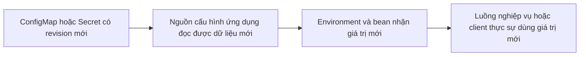

# Tiêu chí chọn refresh động hay rolling restart

Trong chương **Cập nhật cấu hình** của module **SPRING_CLOUD_KUBERNETES**, quyết định quan trọng là cấu hình mới sẽ đi vào hành vi của ứng dụng bằng cách nào. Refresh động giữ tiến trình đang chạy và cập nhật phần trạng thái được thiết kế để thay đổi. Rolling restart thay các Pod theo từng đợt để ứng dụng khởi tạo lại với cấu hình mới.

Cả hai đều có chi phí và đều có thể xuất hiện thời điểm các replica dùng cấu hình khác nhau. Hãy chọn theo vòng đời tài nguyên, mức nhất quán nghiệp vụ, khả năng quan sát và đường lui khi cập nhật lỗi; đừng chỉ dựa vào mong muốn tránh khởi động lại JVM.

## 1. Mục tiêu và tình huống xuyên suốt

Sau bài học, bạn có thể:

- Phân biệt cập nhật ConfigMap/Secret, nạp lại thuộc tính Spring và áp dụng cấu hình vào tài nguyên đang phục vụ.
- Nhận diện thay đổi phù hợp với refresh động và thay đổi cần tái khởi tạo ứng dụng.
- Thiết kế kiểm tra theo từng Pod, phát hiện cấu hình lệch và rollback có thể kiểm chứng.
- Chọn đúng phần cần dùng trong Spring Cloud Kubernetes: Config PropertySource, Configuration Watcher, DiscoveryClient; tránh kéo thêm Spring Cloud LoadBalancer khi yêu cầu chỉ là cập nhật cấu hình.

Giả sử `orders-service` có ba replica. Mỗi Pod cần khoảng 45 giây để khởi động và làm nóng. Nhóm vận hành muốn thay giới hạn số mặt hàng của một đơn từ 20 lên 50. Sau đó, họ cần đổi thông tin xác thực cơ sở dữ liệu.

Hai thay đổi đều bắt đầu bằng dữ liệu cấu hình, nhưng tác động khác nhau:

- Giới hạn mặt hàng có thể được đọc như một chính sách độc lập ở đầu mỗi yêu cầu.
- Thông tin xác thực gắn với connection pool, các kết nối đang mở và thời điểm hệ quản trị cơ sở dữ liệu chấp nhận mật khẩu mới.

Vì vậy, không nên đặt một chính sách “mọi ConfigMap đều refresh” hoặc “mọi Secret đều restart” cho toàn bộ hệ thống. Đơn vị quyết định là **nhóm thuộc tính cùng vòng đời và các tài nguyên tiêu thụ chúng**.

## 2. Ba lớp phải đi qua trước khi hành vi thực sự thay đổi



Đừng gộp các lớp này thành một sự kiện duy nhất:

| Lớp kiểm tra | Ví dụ bằng chứng | Điều chưa được chứng minh |
| --- | --- | --- |
| Tài nguyên Kubernetes | ConfigMap có `revision: r2` | Pod đã đọc được `r2` |
| Nguồn đầu vào | File mount đã chứa `r2`, hoặc API trả về `r2` | Thuộc tính hiệu lực của Spring đã đổi |
| Trạng thái Spring | Bean chính sách trả về `r2` | Mọi kết nối/client phụ thuộc đã được tái tạo đúng |
| Hành vi ứng dụng | Đơn 30 mặt hàng được chấp nhận theo `r2` | Tất cả replica đều đã áp dụng |

Một lệnh cập nhật ConfigMap thành công chỉ xác nhận thay đổi ở Kubernetes. Một phản hồi thành công từ endpoint refresh cũng không thay thế được kiểm tra nghiệp vụ trên từng replica.

Nên đưa một revision do nhóm triển khai quản lý vào cấu hình, chẳng hạn `orders.policy.revision=r2`. `metadata.resourceVersion` phục vụ theo dõi phiên bản tài nguyên Kubernetes; đừng dùng nó như bằng chứng rằng tất cả thành phần nghiệp vụ đã chuyển sang cùng một cấu hình.

## 3. Đường cấp cấu hình quyết định khả năng refresh

| Cách đưa cấu hình vào ứng dụng | Khi nguồn thay đổi | Hệ quả khi chọn chiến lược |
| --- | --- | --- |
| `env` hoặc `envFrom` từ ConfigMap/Secret | Môi trường của tiến trình đang chạy giữ giá trị cũ | Thay Pod để nhận giá trị mới |
| Volume ConfigMap thông thường | File được đồng bộ sau một độ trễ | Cần thêm cơ chế đọc lại và áp dụng |
| Mount bằng `subPath` | Không nhận cập nhật tự động của ConfigMap | Chuyển cách mount hoặc thay Pod |
| Đọc Kubernetes API qua Spring Cloud Kubernetes | Có thể lấy lại dữ liệu từ API | Cần kiểm chứng PropertySource và bean hỗ trợ refresh |
| ConfigMap bất biến, tên theo revision | Tạo đối tượng mới thay vì sửa dữ liệu cũ | Đổi tham chiếu trong Pod template để rollout |

Đồng bộ volume có tính eventual; không có cam kết rằng mọi file ở mọi Pod đổi ngay khi API xác nhận cập nhật. Các quy tắc về biến môi trường, volume và `subPath` được mô tả trong [tài liệu ConfigMap của Kubernetes](https://kubernetes.io/docs/concepts/configuration/configmap/).

Khi dùng `spring.config.import: "kubernetes:"`, Spring Cloud Kubernetes cung cấp nguồn thuộc tính từ Kubernetes. Nguồn có độ ưu tiên cao hơn, chẳng hạn biến môi trường hay tham số dòng lệnh, vẫn có thể che giá trị vừa đổi. Ví dụ, nếu `orders.policy.max-items` đang bị ghi đè từ môi trường thì sửa cùng thuộc tính trong ConfigMap không tạo ra kết quả mong muốn. Xem [Kubernetes PropertySource implementations](https://docs.spring.io/spring-cloud-kubernetes/reference/property-source-config.html).

## 4. Các điều kiện bắt buộc trước khi chọn refresh động

Refresh là một khả năng của thiết kế ứng dụng, không chỉ là một cờ bật trong hạ tầng. Chỉ chọn khi trả lời được tất cả các câu sau bằng bằng chứng thực hành.

### 4.1. Giá trị mới có thực sự đến được nơi sử dụng không?

Hãy lần theo đường đi từ nguồn cấu hình đến dòng mã tiêu thụ cuối cùng:

```text
ConfigMap -> PropertySource -> Environment -> bean -> trạng thái nội bộ -> yêu cầu
```

Một singleton có `@Value` được gán khi khởi tạo không mặc nhiên đổi trường dữ liệu sau khi ConfigMap thay đổi. Tương tự, một client được xây dựng từ timeout lúc startup có thể giữ timeout cũ dù đối tượng cấu hình đã được cập nhật.

Spring Cloud Context hỗ trợ refresh cho các bean theo cơ chế tương ứng, trong đó `@RefreshScope` sử dụng proxy và tái tạo đối tượng đích khi được truy cập sau khi cache bị vô hiệu hóa. Không được suy rằng đặt annotation trên một lớp cấu hình sẽ tự áp dụng cho mọi bean bên trong. Tài liệu cũng nêu giới hạn với `HikariDataSource`, thao tác xóa thuộc tính và ứng dụng AOT/native. Xem [Spring Cloud Context](https://docs.spring.io/spring-cloud-commons/reference/spring-cloud-commons/application-context-services.html).

Với bean `@ConfigurationProperties`, cần kiểm tra kiểu binding, tính mutable/immutable, cách đăng ký bean và phiên bản Spring Cloud đang dùng. Đặc biệt, đừng coi một record được constructor binding là bằng chứng rằng instance đang được inject sẽ tự nhận giá trị mới.

### 4.2. Tài nguyên có thể chuyển đổi an toàn khi đang có tải không?

Giới hạn đơn hàng được chụp một lần ở đầu yêu cầu thường dễ kiểm soát. Đổi client HTTP, executor, consumer hoặc connection pool khó hơn vì phải quyết định:

- Yêu cầu đang xử lý tiếp tục dùng tài nguyên cũ đến bao giờ?
- Tài nguyên mới được kiểm tra kết nối trước hay sau khi công bố?
- Ai đóng tài nguyên cũ, và có đóng nhầm tài nguyên mà luồng khác đang dùng không?
- Khi tạo tài nguyên mới thất bại, có còn đường phục vụ với tài nguyên cũ không?

Nếu chỉ cập nhật một số mà không thực hiện các bước vòng đời cần thiết, bean “đã nhận cấu hình” vẫn có thể vận hành sai.

### 4.3. Các thuộc tính liên quan có được áp dụng cùng nhau không?

Giả sử chính sách có `min-items`, `max-items` và `revision`. Không nên để một yêu cầu đọc `min-items` trước refresh và `max-items` sau refresh.

Một hướng thiết kế là tạo đối tượng chính sách bất biến, kiểm tra ràng buộc chéo, rồi cho mỗi yêu cầu giữ một snapshot duy nhất. Việc thay snapshot trong một tiến trình không tạo giao dịch nguyên tử cho toàn bộ cụm; đó là hai phạm vi khác nhau.

### 4.4. Cấu hình lỗi có bị chặn trước khi gây gián đoạn không?

Kiểm tra kiểu dữ liệu là chưa đủ. `max-items=500000` có thể hợp lệ về kiểu `int` nhưng gây chi phí truy vấn hoặc bộ nhớ vượt khả năng phục vụ.

Nên xác định miền giá trị, ràng buộc chéo, kiểm tra phụ thuộc và điều kiện hủy thay đổi. Với tài nguyên quan trọng, cần thử cấu hình ở một nhóm canary trước khi phát tán rộng. Refresh hàng loạt có thể làm tất cả replica cùng gặp lỗi dù không Pod nào bị thay thế.

### 4.5. Có đo được trạng thái áp dụng và có đường lui không?

Cần phân biệt ít nhất hai thông tin:

- Revision mong muốn ở nguồn cấu hình.
- Revision thực sự được ứng dụng dùng để xử lý yêu cầu.

Nếu hệ thống chỉ có log “đã nhận sự kiện”, chưa đủ căn cứ để kết luận refresh thành công. Khi một trong các điều kiện trên chưa được chứng minh, rolling restart thường là điểm xuất phát dễ kiểm soát hơn, với điều kiện rollout và health check đã được thiết kế phù hợp.

## 5. Ma trận lựa chọn theo loại thay đổi

Bảng sau là khuyến nghị thiết kế cho tình huống bài học; mỗi dòng vẫn cần được kiểm chứng trên ứng dụng thực tế.

| Thay đổi | Hướng ưu tiên | Căn cứ quyết định |
| --- | --- | --- |
| Thông báo giao diện, giới hạn đơn hàng đơn giản | Refresh nếu có snapshot và validation | Không cần tái tạo hạ tầng |
| Feature flag cho phép hai hành vi cùng tồn tại | Refresh hoặc dịch vụ quản lý flag chuyên dụng | Có thể chấp nhận độ lệch ngắn giữa replica |
| Timeout của HTTP client | Tùy vòng đời client | Đổi thuộc tính chưa chắc đổi client đang dùng |
| Kích thước connection pool, URL cơ sở dữ liệu | Rolling restart, trừ khi có cơ chế chuyển pool đã kiểm chứng | Có kết nối và giao dịch đang hoạt động |
| Credential của hệ thống bên ngoài | Quy trình rotation phối hợp với cơ chế cập nhật | Cần thời gian chồng lấn credential và kiểm tra xác thực |
| Cổng lắng nghe, cấu trúc bean, điều kiện tạo bean | Rolling restart | Gắn với quá trình khởi tạo ứng dụng |
| Image, thư viện, JVM option | Rolling rollout | Cần tiến trình hoặc container mới |
| Thay đổi schema giao thức giữa các dịch vụ | Triển khai theo giai đoạn tương thích | Cả refresh lẫn rolling đều có thể có phiên bản cùng tồn tại |
| Ứng dụng Spring AOT/native dùng cơ chế Context Refresh | Rolling rollout | Cơ chế refresh này không được hỗ trợ cho AOT/native |

Đối với logging, có thể dùng endpoint quản lý mức log nếu đó là nhu cầu duy nhất, thay vì mở một quy trình refresh rộng. Với rate limit toàn hệ thống, thay đổi một biến cục bộ ở ba replica chưa bảo đảm tổng hạn mức của cả cụm; phải xem thuật toán và nơi lưu trạng thái hạn mức.

Spring Cloud LoadBalancer phân phối lời gọi theo cơ chế client. Nó không cung cấp giao dịch cập nhật cấu hình, không xác nhận mọi replica đã refresh và không thay thế Deployment controller.

## 6. Nhất quán giữa replica: cả hai phương án đều có giai đoạn chuyển tiếp

Ví dụ sau minh họa thời điểm ba Pod áp dụng revision mới khi dùng refresh:

| Thời điểm minh họa | Pod A | Pod B | Pod C |
| --- | --- | --- | --- |
| Trước thay đổi | r1 | r1 | r1 |
| Sau khi A xử lý refresh | r2 | r1 | r1 |
| B đã áp dụng, C đang gặp lỗi | r2 | r2 | r1 |
| Sau khi xử lý C thành công | r2 | r2 | r2 |

Rolling rollout cũng có thể phục vụ đồng thời Pod r1 và Pod r2. Vì vậy, yêu cầu “không được có hai cách tính phí cùng tồn tại” không tự được giải quyết bằng cách đổi từ refresh sang rolling.

Có ba cách thiết kế thường hữu ích:

1. **Chấp nhận chuyển tiếp:** chính sách hiển thị hoặc tính năng ít rủi ro được phép lệch trong một khoảng đã quy định.
2. **Gắn phiên bản với nghiệp vụ:** đơn hàng lưu revision chính sách đã chọn; các lần xử lý tiếp theo dùng cùng revision thay vì đọc lại “mới nhất”.
3. **Chuẩn bị rồi kích hoạt:** phát tán dữ liệu mới trước, xác nhận khả năng đọc ở các thành phần, sau đó kích hoạt bằng một giao thức điều phối phù hợp. Chỉ thêm trường `effectiveAt` mà không kiểm soát đồng hồ, cache và thành phần chậm chưa đủ bảo đảm.

Nếu không cho phép r1 và r2 cùng phục vụ, cần đánh giá blue/green, cơ chế chặn lưu lượng hoặc một nguồn quyết định tập trung. Phải định nghĩa rõ thời điểm cắt chuyển và số phận yêu cầu đang chạy.

## 7. Phương án A: refresh một chính sách nhỏ, có thể quan sát

Phần này minh họa **đối tượng tiêu thụ cấu hình** và cách xác minh. Điều kiện thực hành: ứng dụng JVM có Spring MVC, Actuator, Spring Cloud Context và starter `spring-cloud-starter-kubernetes-client-config`; các dependency dùng BOM tương thích của dự án. Ứng dụng chạy trong namespace `lab`, có Deployment và Service tên `orders-service`.

Các đoạn Java trong bài minh họa API Spring Boot 3.5.x, có thể phối hợp với release train Spring Cloud 2025.0.x theo [bảng tương thích chính thức](https://spring.io/projects/spring-cloud/). Khi áp dụng cho release khác, chọn BOM và kiểm tra API của release đó. Không tự ghép phiên bản starter riêng lẻ để chạy ví dụ.

Dùng một biến thể triển khai riêng cho phần này. Không đồng thời đặt biến môi trường ghi đè các khóa `orders.policy.*` và không trộn cấu hình của phương án rolling ở phần sau.

### 7.1. Chụp chính sách thành một đối tượng bất biến

Đặt các lớp trong package được ứng dụng Spring Boot quét. Ví dụ lớp `OrderPolicy`:

```java
package example.orders;

import org.springframework.beans.factory.annotation.Value;
import org.springframework.cloud.context.config.annotation.RefreshScope;
import org.springframework.stereotype.Component;

@Component
@RefreshScope
public class OrderPolicy {
    private final PolicySnapshot snapshot;

    public OrderPolicy(
            @Value("${orders.policy.revision}") String revision,
            @Value("${orders.policy.max-items}") int maxItems) {
        if (revision.isBlank()) {
            throw new IllegalArgumentException("policy revision is required");
        }
        if (maxItems < 1 || maxItems > 200) {
            throw new IllegalArgumentException("max-items must be in [1, 200]");
        }
        this.snapshot = new PolicySnapshot(revision, maxItems);
    }

    public PolicySnapshot snapshot() {
        return snapshot;
    }

    public record PolicySnapshot(String revision, int maxItems) {
    }
}
```

Một endpoint nội bộ chỉ trả về những trường không nhạy cảm để kiểm tra:

```java
package example.orders;

import org.springframework.web.bind.annotation.GetMapping;
import org.springframework.web.bind.annotation.RestController;

@RestController
public class PolicyController {
    private final OrderPolicy policy;

    public PolicyController(OrderPolicy policy) {
        this.policy = policy;
    }

    @GetMapping("/internal/policy")
    public OrderPolicy.PolicySnapshot currentPolicy() {
        return policy.snapshot();
    }
}
```

Trong xử lý đơn hàng thực tế, gọi `policy.snapshot()` **một lần ở đầu thao tác**, giữ kết quả trong biến cục bộ rồi dùng cùng snapshot cho cả kiểm tra và ghi nhận revision. Nếu gọi lại nhiều lần, bạn có thể lấy các snapshot thuộc hai thời điểm khác nhau.

Validation trong constructor giúp từ chối chính sách ngoài miền cho phép, nhưng không tạo ra giao thức “thử cấu hình mới, lỗi thì giữ bean cũ”. Nếu refresh đã vô hiệu hóa đối tượng cũ, lần tạo đối tượng mới vẫn có thể thất bại. Muốn giữ phiên bản tốt gần nhất cần thiết kế cơ chế công bố snapshot riêng và kiểm tra nó dưới tải.

### 7.2. Đưa chính sách vào readiness, giữ liveness độc lập

Để Pod không được coi là sẵn sàng chỉ vì JVM đang chạy, thêm health indicator kiểm tra khả năng sử dụng chính sách:

```java
package example.orders;

import org.springframework.boot.actuate.health.Health;
import org.springframework.boot.actuate.health.HealthIndicator;
import org.springframework.stereotype.Component;

@Component
public class PolicyHealthIndicator implements HealthIndicator {
    private final OrderPolicy policy;

    public PolicyHealthIndicator(OrderPolicy policy) {
        this.policy = policy;
    }

    @Override
    public Health health() {
        try {
            policy.snapshot();
            return Health.up().build();
        } catch (RuntimeException ex) {
            return Health.down().build();
        }
    }
}
```

Tên health contributor của lớp trên là `policy`. Với ví dụ này, cấu hình ứng dụng như sau:

```yaml
spring:
  application:
    name: orders-service
  config:
    import: "kubernetes:"
  lifecycle:
    timeout-per-shutdown-phase: 25s
  cloud:
    kubernetes:
      config:
        name: orders-service
      secrets:
        enabled: false

server:
  shutdown: graceful

management:
  endpoints:
    web:
      exposure:
        include: health,refresh
  endpoint:
    health:
      probes:
        enabled: true
      group:
        readiness:
          include: readinessState,policy
```

Không thêm `policy` hoặc tình trạng cơ sở dữ liệu vào nhóm liveness trong ví dụ này. Chính sách chưa dùng được cần làm Pod ngừng nhận yêu cầu mới; biến cùng lỗi đó thành nguyên nhân khởi động lại liên tục có thể khiến sự cố khó phục hồi hơn.

Endpoint `/internal/policy` và endpoint quản trị phải nằm trong phạm vi truy cập đã kiểm soát. Exposure của Actuator chỉ là một phần cấu hình khả dụng endpoint; cần thiết kế cả quyền truy cập. Không mở `/actuator/refresh`, `/actuator/env` hoặc `/actuator/configprops` ra Internet để tiện kiểm tra. Xem [Actuator endpoints](https://docs.spring.io/spring-boot/3.5/reference/actuator/endpoints.html).

### 7.3. Cấp ConfigMap và thử trên từng Pod

Nguồn cấu hình của biến thể API:

```yaml
apiVersion: v1
kind: ConfigMap
metadata:
  name: orders-service
  namespace: lab
  labels:
    spring.cloud.kubernetes.config: "true"
data:
  application.yaml: |-
    orders:
      policy:
        revision: r1
        max-items: 20
```

Spring Cloud Kubernetes hỗ trợ nội dung `application.yaml` trong ConfigMap khi xây dựng PropertySource. Việc chọn tên, profile và nhiều nguồn cần nhất quán với ứng dụng. Xem [Using a ConfigMap PropertySource](https://docs.spring.io/spring-cloud-kubernetes/reference/property-source-config/configmap-propertysource.html).

Trước khi gắn Configuration Watcher, thử thủ công để biết chính ứng dụng có cập nhật đúng không. Trong lần thử này chưa bật watcher tự động, tránh hai đường refresh cùng can thiệp:

1. Kiểm tra `/internal/policy` trên từng Pod đều trả `r1` và `20`.
2. Sửa nội dung ConfigMap thành `revision: r2`, `max-items: 50` bằng công cụ triển khai của môi trường lab. Có thể dùng `kubectl -n lab edit configmap orders-service`.
3. Port-forward trực tiếp tới **một Pod**, gọi refresh rồi đọc lại chính sách.
4. Lặp lại cho các Pod còn lại, ghi revision hiệu lực và lỗi nếu có.

Ví dụ với PowerShell, thay `TEN_POD` bằng tên Pod thực tế. Giữ lệnh port-forward trong một terminal:

```powershell
kubectl -n lab port-forward pod/TEN_POD 18080:8080
```

Tại terminal thứ hai, dùng quyền truy cập phù hợp với cấu hình bảo vệ endpoint của lab:

```powershell
Invoke-RestMethod -Method Post -Uri 'http://localhost:18080/actuator/refresh'
Invoke-RestMethod -Method Get -Uri 'http://localhost:18080/internal/policy'
```

Kết quả chính sách mong đợi:

```json
{
  "revision": "r2",
  "maxItems": 50
}
```

So sánh thêm Pod UID, thời điểm khởi động container và restart count trước/sau để kiểm tra rằng lần cập nhật này không cần thay tiến trình. Phản hồi của `/actuator/refresh` có thể là danh sách khóa thay đổi; danh sách đó không phải biên bản xác nhận nghiệp vụ cho cả cụm.

Gọi refresh một lần qua địa chỉ Service có thể chỉ đến một replica. Việc gọi lặp qua Service cũng không bảo đảm đã chạm mọi Pod vì còn cân bằng tải, kết nối giữ lâu và chính sách định tuyến. Kiểm tra có địa chỉ đích cụ thể cho từng Pod.

### 7.4. Sau khi chứng minh refresh, mới tự động hóa bằng Watcher

Configuration Watcher là thành phần ngoài ứng dụng, theo dõi thay đổi và phát thông báo refresh qua HTTP hoặc Spring Cloud Bus. Với HTTP, nó dùng DiscoveryClient để xác định instance đích. Với file mount, phải tính đến độ trễ đồng bộ; một khoảng chờ refresh cố định không phải bằng chứng rằng file đã mới ở mọi Pod. Xem [Configuration Watcher](https://docs.spring.io/spring-cloud-kubernetes/reference/spring-cloud-kubernetes-configuration-watcher.html).

Trước khi bật cho cả namespace, xác nhận selector/label, tên ứng dụng, cổng và đường dẫn Actuator theo đúng release đang triển khai. Đừng đồng thời bật cơ chế reload cũ bên trong ứng dụng chỉ để “chắc chắn có cập nhật”. Tính năng PropertySource Reload cũ đã được đánh dấu deprecated; tài liệu hướng sang Configuration Watcher. Xem [PropertySource Reload](https://docs.spring.io/spring-cloud-kubernetes/reference/property-source-config/propertysource-reload.html).

Phân chia quyền theo vai trò:

| Thành phần | Quyền và kết nối cần xem xét |
| --- | --- |
| Ứng dụng đọc ConfigMap qua API | Quyền đọc các nguồn thực sự được nạp, kể cả tra cứu profile nếu có |
| Watcher | Quyền đọc/theo dõi nguồn được chọn và quyền discovery đúng loại tài nguyên mà release sử dụng |
| Ứng dụng chỉ dùng volume | Không cần quyền đọc Kubernetes API chỉ để đọc file đã được mount |
| Pipeline làm rolling rollout | Quyền thay đổi workload theo phạm vi triển khai; không chuyển quyền này cho tài khoản ứng dụng |

Kubernetes RBAC không tự cấp quyền gọi HTTP `/actuator/refresh`. Ngược lại, quyền gọi endpoint refresh không cấp quyền đọc Secret qua API. Label dùng để chọn đối tượng xử lý không phải ranh giới bảo mật của RBAC. Nếu không cần refresh Secret thì không mở theo dõi hoặc đọc Secret chỉ vì Watcher đã có sẵn.

Không cần đưa DiscoveryClient vào mọi ứng dụng chỉ vì Watcher dùng nó. Tương tự, không cần thêm Spring Cloud LoadBalancer để nhận sự kiện refresh. Hãy chọn tính năng theo luồng tích hợp thực sự.

## 8. Phương án B: rolling rollout với cấu hình theo revision

Đây là một biến thể triển khai **độc lập** với phương án A. Ứng dụng vẫn có các lớp chính sách và health indicator ở trên, nhưng đọc file cấu hình khi startup; không khai báo import `kubernetes:`, không bật Watcher cho luồng này và không cần quyền đọc Kubernetes API để đọc file đã mount.

### 8.1. Cấu hình nền cho biến thể rolling

Cấu hình đóng gói cùng ứng dụng của biến thể này:

```yaml
spring:
  application:
    name: orders-service
  lifecycle:
    timeout-per-shutdown-phase: 25s

server:
  shutdown: graceful

management:
  endpoints:
    web:
      exposure:
        include: health
  endpoint:
    health:
      probes:
        enabled: true
      group:
        readiness:
          include: readinessState,policy
```

Graceful shutdown và timeout của từng phase hỗ trợ xử lý yêu cầu đang chạy khi ứng dụng dừng. Khoảng grace của Kubernetes phải chứa được toàn bộ quá trình dừng dự kiến, kể cả hook nếu có; `timeout-per-shutdown-phase` không phải tổng ngân sách cho mọi phase. Xem [Spring Boot Graceful Shutdown](https://docs.spring.io/spring-boot/reference/web/graceful-shutdown.html).

### 8.2. Giữ riêng dữ liệu của r1 và r2

Hai ConfigMap sau có tên khác nhau và bất biến. Namespace `lab` đã được tạo trong môi trường thực hành.

```yaml
apiVersion: v1
kind: ConfigMap
metadata:
  name: orders-policy-r1
  namespace: lab
immutable: true
data:
  application.yaml: |-
    orders:
      policy:
        revision: r1
        max-items: 20
---
apiVersion: v1
kind: ConfigMap
metadata:
  name: orders-policy-r2
  namespace: lab
immutable: true
data:
  application.yaml: |-
    orders:
      policy:
        revision: r2
        max-items: 50
```

Không sửa r1 thành nội dung r2. Giữ đối tượng r1 trong suốt cửa sổ rollback để Pod được khởi tạo từ cấu hình cũ còn có thể đọc đúng dữ liệu cũ.

### 8.3. Điều khiển thay Pod bằng Deployment

Thay image minh họa bằng image ứng dụng đã build và có thể kéo từ cluster. Ví dụ Deployment ban đầu tham chiếu r1:

```yaml
apiVersion: apps/v1
kind: Deployment
metadata:
  name: orders-service
  namespace: lab
spec:
  replicas: 3
  minReadySeconds: 10
  progressDeadlineSeconds: 300
  strategy:
    type: RollingUpdate
    rollingUpdate:
      maxSurge: 1
      maxUnavailable: 0
  selector:
    matchLabels:
      app: orders-service
  template:
    metadata:
      labels:
        app: orders-service
    spec:
      terminationGracePeriodSeconds: 45
      containers:
        - name: app
          image: registry.example.com/training/orders-service:1.0.0
          ports:
            - name: http
              containerPort: 8080
          env:
            - name: SPRING_CONFIG_ADDITIONAL_LOCATION
              value: file:/etc/orders/
          volumeMounts:
            - name: policy
              mountPath: /etc/orders
              readOnly: true
          startupProbe:
            httpGet:
              path: /actuator/health/liveness
              port: http
            periodSeconds: 5
            failureThreshold: 30
          readinessProbe:
            httpGet:
              path: /actuator/health/readiness
              port: http
            periodSeconds: 5
            failureThreshold: 3
          livenessProbe:
            httpGet:
              path: /actuator/health/liveness
              port: http
            periodSeconds: 10
            failureThreshold: 3
      volumes:
        - name: policy
          configMap:
            name: orders-policy-r1
---
apiVersion: v1
kind: Service
metadata:
  name: orders-service
  namespace: lab
spec:
  selector:
    app: orders-service
  ports:
    - name: http
      port: 8080
      targetPort: http
```

Các thời gian là giá trị minh họa, phải hiệu chỉnh bằng số đo của ứng dụng. Startup probe dành ngân sách khởi động; readiness quyết định nhận lưu lượng; liveness kiểm tra khả năng sống của tiến trình. Health indicator `policy` ở nhóm readiness bảo đảm ví dụ này thực sự truy cập chính sách trước khi Pod được xem là sẵn sàng.

Muốn chuyển sang r2, cập nhật **Pod template** để volume tham chiếu `orders-policy-r2`. Trong lab có thể dùng:

```powershell
kubectl -n lab edit deployment orders-service
```

Chỉ thay tham chiếu trong phần sau của `spec.template.spec`:

```yaml
volumes:
  - name: policy
    configMap:
      name: orders-policy-r2
```

Sau đó theo dõi:

```powershell
kubectl -n lab rollout status deployment/orders-service --timeout=300s
kubectl -n lab get pods -l app=orders-service -o wide
kubectl -n lab rollout history deployment/orders-service
```

Trong môi trường quản lý bằng GitOps, thực hiện thay đổi tương đương tại nguồn khai báo và để controller áp dụng, tránh sửa trực tiếp rồi bị nguồn khai báo ghi đè.

Kubernetes tạo rollout khi Pod template thay đổi. Chỉ sửa một ConfigMap có cùng tên không tự tạo rollout cho Deployment. `maxSurge` và `maxUnavailable` điều khiển tiến trình thay Pod; `progressDeadlineSeconds` giúp báo rollout không tiến triển, không tự thực hiện rollback. Xem [Deployments](https://kubernetes.io/docs/concepts/workloads/controllers/deployment/).

`maxUnavailable: 0` không phải cam kết không bao giờ lỗi yêu cầu. Còn phải tính tài nguyên cho Pod bổ sung, chất lượng readiness, thời gian rút endpoint, kết nối đang giữ và cách client retry. Nếu cluster không đủ chỗ cho Pod surge, rollout có thể chờ dù ứng dụng cũ vẫn khỏe.

### 8.4. Kiểm tra và rollback

Sau khi rollout hoàn tất, kiểm tra trực tiếp từng Pod bằng cách port-forward như phương án A. Cần thấy `r2` và `50` ở tất cả Pod đang phục vụ, đồng thời kiểm tra hành vi thực tế với đơn dưới/trên giới hạn.

Nếu cần quay lại revision Deployment liền trước:

```powershell
kubectl -n lab rollout undo deployment/orders-service
kubectl -n lab rollout status deployment/orders-service --timeout=300s
```

Với ví dụ này, revision trước giữ tham chiếu `orders-policy-r1`, vì vậy Pod được tạo lại đọc r1. Điều kiện là ConfigMap cũ, image và các phụ thuộc tương ứng còn tồn tại. Sau rollback vẫn phải xác nhận từng Pod trả `r1` và `20`.

Nếu trước đó bạn sửa ConfigMap cùng tên rồi chỉ chạy `kubectl rollout restart`, `rollout undo` không tự khôi phục nội dung ConfigMap cũ. Bạn phải phục hồi dữ liệu nguồn rồi thực hiện quy trình nạp lại phù hợp. Lịch sử Deployment không phải kho lịch sử dữ liệu của mọi ConfigMap/Secret bên ngoài.

## 9. Không nhầm shutdown với rolling restart

Configuration Watcher có thể được cấu hình để gọi endpoint shutdown thay cho refresh. Tuy nhiên, đây là yêu cầu ứng dụng dừng; nó không cập nhật Pod template để Deployment controller thực hiện một rollout có thứ tự. Khả năng này được nêu trong [tài liệu Configuration Watcher 3.3](https://docs.spring.io/spring-cloud-kubernetes/reference/3.3/spring-cloud-kubernetes-configuration-watcher.html).

Với workload Deployment thông thường, khi tiến trình container kết thúc, kubelet có thể khởi động lại container trong **cùng Pod** theo restart policy. Pod UID có thể giữ nguyên trong khi restart count tăng. Phân biệt việc này với tạo Pod mới theo revision Deployment; xem [Pod lifecycle](https://kubernetes.io/docs/concepts/workloads/pods/pod-lifecycle/).

Hệ quả vận hành: nếu mọi replica cùng nhận shutdown, bạn không có giới hạn thay thế tuần tự chỉ vì Deployment đã cấu hình `maxUnavailable: 0`. Cấu hình đó điều khiển rolling update của Deployment, không điều phối các lệnh shutdown được gửi trực tiếp đến từng ứng dụng.

PodDisruptionBudget cũng không tạo hàng rào chống mọi trường hợp mất sẵn sàng. Nó chủ yếu giới hạn các gián đoạn tự nguyện qua cơ chế eviction được hỗ trợ; không biến app shutdown thành rolling rollout. Khi cập nhật workload, cần dựa vào chiến lược của controller tương ứng. Xem [Disruption Budget](https://kubernetes.io/docs/tasks/run-application/configure-pdb/).

Nếu quyết định cần tiến trình mới, ưu tiên một quy trình triển khai có khả năng quan sát tiến độ và dừng/hoàn tác, thay vì phát shutdown đồng loạt.

## 10. Secret rotation cần một quy trình riêng

Kubernetes Secret là nguồn dữ liệu nhạy cảm, không phải cơ chế tự thay kết nối của ứng dụng. Cũng cần phân biệt Secret đưa vào môi trường, Secret mount thành file và ứng dụng chủ động đọc API. Secret volume có độ trễ đồng bộ; mount bằng `subPath` không nhận cập nhật tự động. Xem [Kubernetes Secrets](https://kubernetes.io/docs/concepts/configuration/secret/).

Ví dụ đổi credential cơ sở dữ liệu nên bắt đầu bằng hợp đồng với hệ thống đích:

1. Tạo credential mới và cho phép cả credential cũ/mới hoạt động trong một khoảng chuyển tiếp nếu hệ thống đích hỗ trợ.
2. Cấp phiên bản Secret mới, kiểm tra khả năng kết nối của một nhóm ứng dụng thử nghiệm.
3. Refresh tài nguyên bằng cơ chế đã được chứng minh, hoặc rollout từng đợt để tạo pool mới.
4. Xác nhận mọi replica đã mở được kết nối mới, kiểm tra giao dịch và tình trạng lỗi xác thực.
5. Thu hồi credential cũ sau thời gian chồng lấn đã thống nhất.

Nếu thu hồi credential cũ trước bước xác nhận, rollback ứng dụng có thể đưa Pod trở về một credential đã vô hiệu. Khi đó “quay lại revision cũ” không còn là đường phục hồi hoạt động.

Chỉ quan sát một mã revision không nhạy cảm và kết quả xác thực; không ghi giá trị Secret, connection string có mật khẩu hoặc dữ liệu giải mã vào log/endpoint chẩn đoán. Quyết định refresh hay rolling phải gắn với cách client và connection pool sử dụng credential, không suy ra chỉ từ loại tài nguyên `Secret`.

## 11. Đặt ngân sách thời gian và điều kiện thành công

Trong vận hành, nên tách thời gian thành các phần có thể đo:

```text
Thời gian hội tụ khi refresh
  = phát hiện thay đổi
  + phân phối thông báo
  + chờ nguồn đầu vào cập nhật
  + nạp/kiểm tra/áp dụng
  + kiểm chứng revision ở các replica

Thời gian rollout
  = chuẩn bị Pod mới theo từng đợt
  + khởi động và làm nóng
  + đạt readiness và thời gian ổn định
  + rút Pod cũ
  + kiểm chứng hành vi
```

Các biểu thức là cách phân tích độ trễ, không phải công thức cộng chính xác cho mọi cluster vì một số bước có thể chồng lấn. Ví dụ JVM mất 45 giây để làm nóng khiến rolling tốn thời gian, nhưng refresh cũng có thể tạo client hoặc cache mới và đẩy chi phí đó vào yêu cầu đầu tiên.

Trước khi đổi cấu hình, ghi rõ:

| Tiêu chí | Ví dụ mục tiêu cho lab |
| --- | --- |
| Revision đích | `r2` |
| Phạm vi | Ba Pod đang phục vụ của `orders-service` trong `lab` |
| Trạng thái mong muốn | Tất cả Pod trả `r2`, giới hạn `50` |
| Chấp nhận độ lệch | Cho phép r1/r2 cùng tồn tại trong cửa sổ chuyển tiếp đã chọn |
| Ngưỡng dừng | Readiness lỗi, chính sách không hợp lệ hoặc lỗi nghiệp vụ tăng |
| Đường lui | Áp lại cấu hình tốt đã lưu hoặc quay Deployment về tham chiếu bất biến cũ |

Theo dõi số replica có revision cũ/mới, lỗi refresh, lỗi tạo tài nguyên, readiness, tỷ lệ lỗi và độ trễ nghiệp vụ. Log revision khi áp dụng và khi xử lý tác vụ quan trọng giúp đối chiếu nguyên nhân; tránh đưa mọi mã cập nhật không giới hạn vào nhãn metric gây tăng số chuỗi thời gian.

## 12. Chẩn đoán theo bằng chứng

| Hiện tượng | Điểm cần kiểm tra trước | Cách xử lý phù hợp |
| --- | --- | --- |
| ConfigMap đã đổi, mọi Pod vẫn dùng giá trị cũ | Đường cấp cấu hình và độ ưu tiên PropertySource | Phân biệt môi trường, file mount, API; loại bỏ ghi đè ngoài ý muốn |
| Chỉ một Pod đổi sau khi gọi qua Service | Địa chỉ thực sự nhận refresh | Kiểm tra từng Pod; sửa cơ chế phát tán |
| Một số Pod giữ revision cũ | Lỗi đọc nguồn, lỗi endpoint, lỗi validation hoặc bỏ lỡ sự kiện | Đối chiếu revision hiệu lực, khắc phục rồi áp dụng lại có đích |
| Refresh trả thành công nhưng client vẫn dùng cấu hình cũ | Nơi client được tạo, cache giá trị và vòng đời tài nguyên | Tái thiết kế vòng đời hoặc chọn rolling |
| File mới nhưng Environment chưa đổi | Cơ chế import/đọc lại và thời điểm refresh | Chứng minh nguồn mới được nạp; không chỉ tăng delay tùy ý |
| Rollout chờ mãi | Pod pending, image pull, startup/readiness, quota hoặc tài nguyên surge | Xem event và log Pod mới; dừng/hoàn tác theo quy trình |
| Rollout hoàn tất nhưng hành vi sai | Readiness có kiểm tra đúng điều kiện nghiệp vụ không | Xác nhận revision và kết quả thao tác; cải thiện điều kiện sẵn sàng |
| Rollback vẫn dùng cấu hình mới | Có sửa nguồn cùng tên hoặc credential cũ đã bị thu hồi không | Phục hồi đúng dữ liệu/phụ thuộc; không chỉ undo Deployment |

## 13. Ghi quyết định trước khi tự động hóa

Một quyết định triển khai đủ rõ có thể ghi ngắn như sau:

> Nhóm `orders.policy` dùng refresh trên ứng dụng JVM vì là chính sách bất biến, mỗi yêu cầu giữ một snapshot và cho phép các replica lệch trong cửa sổ chuyển tiếp. Revision được quan sát trực tiếp trên từng Pod. Cấu hình ngoài miền bị từ chối; nếu việc áp dụng làm mất khả năng phục vụ, nhóm vận hành phục hồi revision tốt và xác nhận lại toàn bộ replica. Thông tin kết nối cơ sở dữ liệu dùng Secret theo revision và rolling rollout vì chưa có cơ chế chuyển pool an toàn khi đang có tải.

Trước khi bật tự động, thực hành ba trường hợp: cấu hình hợp lệ, cấu hình vi phạm miền giá trị và một replica không nhận được cập nhật. Với rolling, thử thêm tình huống Pod mới không đạt readiness và xác nhận đường rollback còn dùng được dữ liệu cũ.

Kết quả cần đạt là một cơ chế cập nhật có thể giải thích bằng vòng đời tài nguyên, quan sát được revision hiệu lực và phục hồi được khi lỗi. Chỉ thêm Configuration Watcher, DiscoveryClient hoặc một cơ chế refresh khác khi chúng giải quyết đúng nhu cầu đã được chứng minh của ứng dụng.
