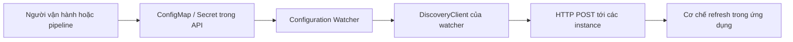
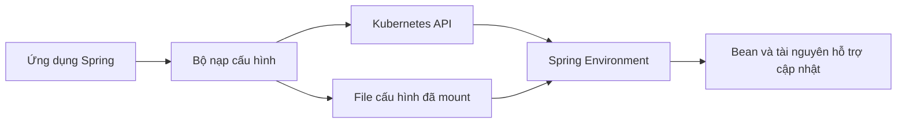
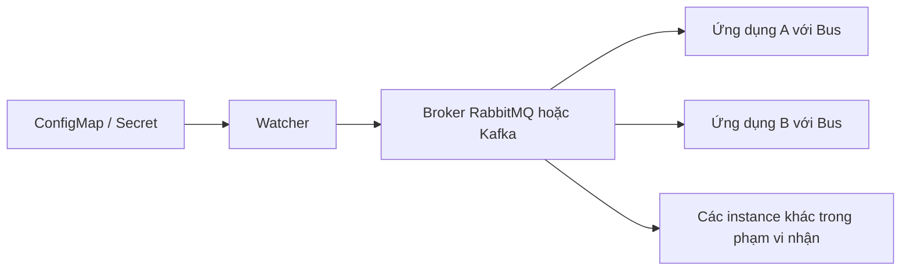

# Kiến trúc Spring Cloud Kubernetes Configuration Watcher

## Mục tiêu bài học

Trong module **SPRING_CLOUD_KUBERNETES**, Kubernetes cung cấp ConfigMap và Secret để tách cấu hình khỏi image. Tuy nhiên, thay dữ liệu Kubernetes không có nghĩa mọi bean Spring đang chạy tự nhận giá trị mới.

**Spring Cloud Kubernetes Configuration Watcher** là một ứng dụng điều khiển triển khai riêng, theo dõi nguồn cấu hình và gửi tín hiệu để các ứng dụng đích thực hiện refresh. Muốn dùng đúng, cần hiểu rõ ai phát hiện thay đổi, ai tìm instance, ai gửi tín hiệu và ai đọc lại dữ liệu.

Sau bài học, bạn có thể:

- Vẽ được các thành phần của kiến trúc watcher và đường đi của một thay đổi.
- Phân biệt đường thông báo refresh với đường nạp cấu hình.
- So sánh cách truyền thông báo qua HTTP và Spring Cloud Bus.
- Ánh xạ đúng ConfigMap/Secret tới ứng dụng và các instance cần cập nhật.
- Xác định quyền truy cập, kết nối mạng và giới hạn của refresh.
- Chọn khi nào triển khai watcher và khi nào dùng rollout.

Các ví dụ dùng ứng dụng `orders` trong namespace `shop`. Chúng minh họa kiến trúc; phiên bản image, dependency và các thuộc tính phụ thuộc phiên bản phải được đối chiếu với Spring Cloud release train đang sử dụng.

## 1. Khoảng trống mà watcher giải quyết

Giả sử ứng dụng có timeout thanh toán `2s` trong ConfigMap. Người vận hành sửa thành `3s`, nhưng HTTP client trong JVM vẫn giữ timeout cũ.

Có ba lớp khác nhau:

| Lớp | Trách nhiệm |
|---|---|
| Kubernetes | Lưu dữ liệu ConfigMap/Secret, cung cấp API và chiếu dữ liệu vào volume khi được cấu hình |
| Bộ đọc cấu hình của ứng dụng | Nạp dữ liệu từ API hoặc file vào nguồn thuộc tính của Spring |
| Bean và tài nguyên sử dụng cấu hình | Bind giá trị, tạo client, quản lý kết nối và thực thi nghiệp vụ |

Watcher bổ sung đường phát hiện thay đổi và phát tín hiệu refresh. Nó không thay thế hai lớp đọc và sử dụng dữ liệu trong ứng dụng.

Ví dụ, file trong volume đã đổi nhưng một bean đã chụp giá trị lúc khởi tạo vẫn có thể giữ `2s`. Ngược lại, nhận một thông báo refresh cũng chưa đủ nếu ứng dụng không biết phải đọc ConfigMap nào.

Tài liệu chính thức mô tả watcher như một controller triển khai trong cụm để kích hoạt refresh của ứng dụng Spring Cloud: [Spring Cloud Kubernetes Configuration Watcher](https://docs.spring.io/spring-cloud-kubernetes/reference/spring-cloud-kubernetes-configuration-watcher.html).

## 2. Những thành phần trong kiến trúc

| Thành phần | Vai trò trong luồng cập nhật |
|---|---|
| ConfigMap/Secret | Chứa dữ liệu và metadata phục vụ lựa chọn nguồn, ánh xạ đích |
| Kubernetes API server | Điểm truy cập tài nguyên và các thay đổi được theo dõi |
| Watcher | Quan sát nguồn trong phạm vi được cấu hình, quyết định ứng dụng cần thông báo |
| DiscoveryClient phía watcher | Tìm các ServiceInstance cần gọi trong phương án HTTP |
| HTTP hoặc Spring Cloud Bus | Truyền tín hiệu refresh |
| Ứng dụng Spring đích | Nhận tín hiệu và thực hiện cơ chế refresh đã được hỗ trợ |
| PropertySource/Config Data hoặc file cấu hình | Đường ứng dụng đọc dữ liệu |
| Bean và client nghiệp vụ | Sử dụng cấu hình hiệu lực |
| ServiceAccount, RBAC và chính sách mạng | Cho phép và giới hạn từng đường truy cập |

Watcher thường chạy trong Deployment riêng. Nó không bắt buộc là sidecar trong mỗi Pod nghiệp vụ và cũng không phải một Deployment controller quản lý ReplicaSet của ứng dụng.

Vì có vòng đời riêng, có thể triển khai, quan sát và phân quyền watcher độc lập. Đổi lại, hệ thống có thêm một thành phần vận hành và một đường quản trị ứng dụng cần được bảo vệ.

## 3. Hai đường đi cần vẽ riêng

### 3.1. Đường truyền tín hiệu



Sơ đồ trên minh họa phương án HTTP. Watcher tìm đích rồi gửi yêu cầu quản trị. Không nên hình dung nó gửi toàn bộ nội dung ConfigMap/Secret trong body của một yêu cầu refresh để thay thế cơ chế nạp cấu hình.

### 3.2. Đường đọc dữ liệu



Hai nhánh API và file là các lựa chọn thiết kế. Không cần bật cả hai để đọc cùng một dữ liệu.

Điểm quan trọng là **tín hiệu và dữ liệu có thể đi theo hai đường khác nhau**. Vì vậy, có thể có tình trạng watcher gửi được thông báo nhưng ứng dụng đọc nguồn thất bại, hoặc ứng dụng đọc được dữ liệu lúc khởi động nhưng watcher không gửi được thông báo.

## 4. Một thay đổi đi qua những bước nào?

Xét ConfigMap `orders-runtime` được ánh xạ tới ứng dụng `orders`:

1. Pipeline cập nhật dữ liệu ConfigMap trong namespace `shop`.
2. Watcher quan sát thay đổi trong phạm vi namespace và loại nguồn đã được cấu hình.
3. Metadata của nguồn được dùng để xác định nguồn có thuộc diện cần thông báo hay không.
4. Watcher xác định ứng dụng đích theo quy tắc tên hoặc ánh xạ được hỗ trợ.
5. Với HTTP, DiscoveryClient phía watcher trả về các instance phù hợp.
6. Watcher gửi tín hiệu refresh theo đường quản trị của từng instance được chọn.
7. Ứng dụng nạp lại nguồn theo cơ chế tích hợp của Spring Cloud.
8. Các bean/tài nguyên có khả năng cập nhật sử dụng dữ liệu mới.
9. Hệ thống vận hành kiểm tra phiên bản cấu hình hiệu lực và hành vi ứng dụng.

Các bước cuối không phải một giao dịch nguyên tử trên tất cả Pod. Một instance có thể thành công trong khi instance khác chưa nhận được yêu cầu hoặc không đọc được nguồn.

Sự kiện nguồn, request HTTP và trạng thái bean là ba loại bằng chứng khác nhau. Không coi một dòng log “đã phát hiện thay đổi” là kết luận ứng dụng đã hoàn tất cập nhật.

## 5. HTTP: phát hiện instance và gọi endpoint quản trị

Phương án HTTP là cách truyền mặc định được mô tả trong tài liệu watcher. Watcher dùng Spring Cloud Kubernetes DiscoveryClient để tìm instance và gửi `POST` tới đường refresh, thường là `/actuator/refresh`. Xem [HTTP Implementation](https://docs.spring.io/spring-cloud-kubernetes/reference/spring-cloud-kubernetes-configuration-watcher.html#http-implementation).

Một minh họa:

```text
Service orders
  -> orders-a:8080
  -> orders-b:8080
  -> orders-c:8080

Watcher
  -> POST orders-a:8080/actuator/refresh
  -> POST orders-b:8080/actuator/refresh
  -> POST orders-c:8080/actuator/refresh
```

Danh sách thực tế phụ thuộc kết quả discovery, readiness, bộ lọc và trạng thái mạng. Sơ đồ không phải cam kết rằng mọi Pod đều được gọi thành công ở cùng thời điểm.

### 5.1. Vì sao không chỉ gửi một request qua Service?

Một request `POST http://orders/actuator/refresh` qua ClusterIP thường chỉ đến một backend. Nó không chứng minh các replica còn lại đã refresh.

Trong luồng nghiệp vụ, Spring Cloud LoadBalancer có thể chọn một instance để xử lý một lời gọi. Trong luồng cập nhật cấu hình, mục tiêu lại là thông báo tới tập instance cần cập nhật. Đây là hai nhu cầu khác nhau.

### 5.2. Cần thống nhất địa chỉ quản trị

Nếu ứng dụng đổi cổng management hoặc base path của Actuator, watcher cần được cấu hình để tạo đúng đích gọi. Tài liệu hỗ trợ metadata `boot.spring.io/actuator` trên Service và các thuộc tính cấu hình đường dẫn/cổng phía watcher.

Đừng giả định cổng nghiệp vụ luôn trùng cổng quản trị. Trước khi điều tra lỗi refresh, xác định rõ:

- Host hoặc IP instance mà discovery trả về.
- Cổng quản trị thực tế.
- Base path và endpoint refresh.
- Giao thức, yêu cầu xác thực và chính sách mạng.

Exposure endpoint chỉ làm endpoint có thể được ánh xạ qua HTTP theo cấu hình. Nó không đồng nghĩa watcher đã được xác thực hay được mạng cho phép kết nối.

## 6. Spring Cloud Bus: phân phối tín hiệu qua broker

Phương án messaging thay đường HTTP trực tiếp bằng sự kiện Spring Cloud Bus:



Watcher hỗ trợ các profile như `bus-amqp` và `bus-kafka` theo tài liệu triển khai tương ứng. Ứng dụng nhận phải có tích hợp Bus và cấu hình kết nối broker phù hợp.

Sự kiện Bus là tín hiệu để ứng dụng refresh nguồn của mình; broker không trở thành kho lưu dữ liệu ConfigMap/Secret trong kiến trúc này.

Tài liệu [Bus Refresh Endpoint](https://docs.spring.io/spring-cloud-bus/reference/spring-cloud-bus/bus-endpoints.html#bus-refresh-endpoint) mô tả tác động refresh scope và binding của Bus. Cơ chế địa chỉ instance được giải thích trong [Addressing Instances](https://docs.spring.io/spring-cloud-bus/reference/spring-cloud-bus/addressing.html).

| Khía cạnh | HTTP | Spring Cloud Bus |
|---|---|---|
| Đường tín hiệu | Watcher gọi endpoint của instance | Watcher phát sự kiện qua broker |
| Thành phần bổ sung | Kết nối HTTP quản trị tới ứng dụng | Broker và tích hợp Bus phía nhận |
| Phân phối | Theo các đích watcher tìm được | Theo routing/địa chỉ sự kiện và các thành viên Bus |
| Điểm cần chẩn đoán | Discovery, URL, mạng, HTTP security | Kết nối broker, destination, ID, xử lý sự kiện |
| Việc ứng dụng vẫn phải làm | Đọc lại nguồn, áp dụng và xác minh | Đọc lại nguồn, áp dụng và xác minh |

Không mặc định namespace Kubernetes là ranh giới cô lập của một broker dùng chung. Phạm vi gửi/nhận Bus cần được thiết kế theo tài liệu đúng phiên bản. Các instance Bus cũng cần định danh phù hợp, tránh cấu hình trùng ID làm sai cơ chế xử lý.

## 7. Bốn lớp lựa chọn thường bị nhầm

Một nguồn cấu hình có thể có nhiều loại tên và label:

| Lớp lựa chọn | Trả lời câu hỏi |
|---|---|
| Namespace/nguồn watcher quan sát | Watcher theo dõi tài nguyên ở đâu? |
| Label chọn nguồn | ConfigMap/Secret nào được xem xét gửi thông báo? |
| Ánh xạ ứng dụng đích | Thay đổi nguồn này cần thông báo cho ứng dụng nào? |
| Nguồn ứng dụng tự nạp | Ứng dụng sẽ đọc dữ liệu từ tài nguyên nào? |

Ví dụ:

```yaml
apiVersion: v1
kind: ConfigMap
metadata:
  name: orders-runtime
  namespace: shop
  labels:
    spring.cloud.kubernetes.config: "true"
  annotations:
    spring.cloud.kubernetes.configmap.apps: orders
data:
  app.release-id: "runtime-r1"
  app.checkout.timeout: "2s"
```

Ở đây:

- `orders-runtime` là tên ConfigMap.
- Label chọn nguồn cho watcher.
- Annotation ánh xạ thay đổi tới ứng dụng `orders`.
- Ứng dụng vẫn phải được cấu hình đọc `orders-runtime`.

Annotation gửi thông báo không tự thêm tài nguyên đó vào PropertySource của ứng dụng.

Nếu tên nguồn và tên ứng dụng trùng nhau, quy tắc mặc định có thể đủ. Với nguồn dùng chung, nguồn có hậu tố phiên bản hoặc nguồn theo profile, nên làm rõ ánh xạ thay vì dựa vào sự giống nhau tình cờ giữa các tên.

Tài liệu mô tả label và ánh xạ trong [Monitoring ConfigMaps and Secrets](https://docs.spring.io/spring-cloud-kubernetes/reference/spring-cloud-kubernetes-configuration-watcher.html#monitoring-configmaps-and-secrets).

## 8. Hai mô hình nạp dữ liệu phía ứng dụng

### 8.1. Đọc qua Kubernetes API

Trong mô hình này, ứng dụng có thư viện Config phù hợp, danh tính API và nguồn được cấu hình rõ ràng. Khi refresh, dữ liệu được nạp lại theo tích hợp của thư viện.

Ví dụ cấu hình khởi động của ứng dụng `orders`:

```yaml
spring:
  application:
    name: orders
  config:
    import: "kubernetes:"
  cloud:
    kubernetes:
      config:
        sources:
          - name: orders-runtime
            namespace: shop
        include-profile-specific-sources: false
      secrets:
        enabled: false
      discovery:
        enabled: false

management:
  endpoints:
    web:
      exposure:
        include: health,refresh
```

Các lựa chọn có chủ đích:

- `kubernetes:` bật đường Config Data được hỗ trợ khi có dependency tương ứng.
- Tên nguồn là `orders-runtime`, không suy từ tên ứng dụng.
- Tắt nguồn Secret vì ví dụ chưa dùng dữ liệu bí mật.
- Tắt discovery trong ứng dụng vì ví dụ không cần tìm dịch vụ từ chính ứng dụng; **watcher vẫn có DiscoveryClient riêng**.
- Endpoint refresh cần hỗ trợ từ Spring Cloud và Actuator; chỉ Spring Boot Actuator đơn lẻ không tự tạo toàn bộ cơ chế refresh của Spring Cloud.

Không đặt cấu hình chọn nguồn chỉ bên trong chính nguồn đang cần được tìm lần đầu. Cấu hình khởi động phải đủ để thư viện xác định nơi đọc.

Cơ chế import được mô tả trong [Kubernetes PropertySource implementations](https://docs.spring.io/spring-cloud-kubernetes/reference/property-source-config.html). Cách chọn nguồn và profile được mô tả trong [ConfigMap PropertySource](https://docs.spring.io/spring-cloud-kubernetes/reference/property-source-config/configmap-propertysource.html).

### 8.2. Đọc file mount

Trong mô hình file, kubelet đưa dữ liệu vào volume, Spring đọc file từ một vị trí như `/etc/orders-config/application.yaml`. Ứng dụng có thể không cần quyền Kubernetes API chỉ để đọc mount đó.

Đường đi lúc này:

```text
API thay đổi
  -> watcher nhận tín hiệu
  -> kubelet cập nhật volume sau một khoảng trễ
  -> ứng dụng nhận refresh và đọc lại file
```

Thứ tự trên không được bảo đảm luôn xảy ra đúng như mô tả. Refresh có thể tới trước khi file mới xuất hiện.

`spring.cloud.kubernetes.configuration.watcher.refreshDelay` cho phép trì hoãn gửi tín hiệu, nhưng thời gian chờ cố định không phải bằng chứng dữ liệu đã tới mọi Pod. Cần quan sát định danh cấu hình đã đọc và đã áp dụng.

Env của tiến trình đang chạy không đổi theo ConfigMap/Secret; mount `subPath` cũng không nhận cập nhật tự động của nguồn như mount thư mục. Watcher không loại bỏ các giới hạn đó. Xem [ConfigMaps](https://kubernetes.io/docs/concepts/configuration/configmap/).

## 9. Ví dụ bean để nhìn thấy tác động refresh

Ví dụ sau giả định ứng dụng đã có web starter, Actuator, Spring Cloud Context và starter Kubernetes Config tương thích. Nó chỉ công bố thuộc tính không nhạy cảm trong một endpoint nội bộ.

```java
import java.time.Duration;
import java.util.Map;

import org.springframework.cloud.context.config.annotation.RefreshScope;
import org.springframework.core.env.Environment;
import org.springframework.stereotype.Component;
import org.springframework.web.bind.annotation.GetMapping;
import org.springframework.web.bind.annotation.RestController;

@Component
@RefreshScope
class CheckoutPolicy {

    private final String releaseId;
    private final Duration timeout;

    CheckoutPolicy(Environment environment) {
        this.releaseId = environment.getRequiredProperty("app.release-id");
        this.timeout = environment.getRequiredProperty(
                "app.checkout.timeout", Duration.class);
    }

    public Map<String, String> view() {
        return Map.of(
                "releaseId", releaseId,
                "checkoutTimeout", timeout.toString());
    }
}

@RestController
class ConfigViewController {

    private final CheckoutPolicy policy;

    ConfigViewController(CheckoutPolicy policy) {
        this.policy = policy;
    }

    @GetMapping("/internal/config-view")
    public Map<String, String> configView() {
        return policy.view();
    }
}
```

Bean `CheckoutPolicy` lấy giá trị khi được khởi tạo. Refresh scope cho phép vô hiệu hóa instance đã lưu để instance mới được tạo khi được dùng tiếp theo.

Đoạn mã không chứng minh mọi đối tượng khác cũng đổi cấu hình. Nếu một HTTP client hoặc connection pool sao chép timeout lúc được tạo, phải xét riêng vòng đời của đối tượng đó.

Không đánh dấu mọi bean bằng `@RefreshScope` chỉ để thử làm mọi thứ cập nhật. Có loại bean hoặc tài nguyên không hỗ trợ refresh, và context refresh cũng có giới hạn với AOT/native image. Đối chiếu [Refresh Scope](https://docs.spring.io/spring-cloud-commons/reference/spring-cloud-commons/application-context-services.html#refresh-scope) cho stack đang sử dụng.

## 10. Service là cầu nối giữa tên ứng dụng và instance

Một Service đơn giản cho ví dụ:

```yaml
apiVersion: v1
kind: Service
metadata:
  name: orders
  namespace: shop
spec:
  selector:
    app.kubernetes.io/name: orders
  ports:
    - name: http
      port: 8080
      targetPort: http
```

Pod của ứng dụng cần có label khớp selector và container port mang tên `http`:

```yaml
# Trích đoạn trong Pod template của Deployment orders.
metadata:
  labels:
    app.kubernetes.io/name: orders
spec:
  serviceAccountName: orders-config-reader
  containers:
    - name: orders
      image: registry.example.com/shop/orders:REPLACE_WITH_APPROVED_VERSION
      ports:
        - name: http
          containerPort: 8080
```

Tên image là mẫu cần thay bằng image ứng dụng có thật. Đoạn trích trên không phải Deployment hoàn chỉnh; ServiceAccount và quyền API của ứng dụng cần được cấp riêng theo cách nạp nguồn đã chọn.

DiscoveryClient sử dụng thông tin Kubernetes Service và các địa chỉ endpoint theo cấu hình của nó. Nếu Service không có backend, selector sai hoặc bộ lọc discovery loại Service ra, watcher có thể thấy ConfigMap thay đổi nhưng không tìm được instance cần gọi. Xem [DiscoveryClient for Kubernetes](https://docs.spring.io/spring-cloud-kubernetes/reference/discovery-client.html).

## 11. Triển khai và phân quyền watcher riêng

### 11.1. Không dùng cùng danh tính cho mọi thành phần

Watcher cần đọc sự kiện cấu hình và tìm ứng dụng. Ứng dụng cần đọc nguồn của chính mình nếu chọn API. Pipeline lại cần ghi tài nguyên. Đây là ba trách nhiệm khác nhau.

| Danh tính | Quyền cần cân nhắc |
|---|---|
| Pipeline triển khai | Ghi đúng loại tài nguyên trong phạm vi đã được cấp |
| ServiceAccount watcher | Đọc/theo dõi nguồn, đọc dữ liệu discovery |
| ServiceAccount ứng dụng dùng API | Đọc nguồn cấu hình cần thiết theo chế độ truy vấn |
| Ứng dụng chỉ đọc volume | Không cần API get Secret chỉ để nhận mount |
| Watcher bật HA | Thêm quyền với tài nguyên leader election theo phiên bản |

Một Role minh họa cho watcher chỉ theo dõi ConfigMap trong `shop` và dùng discovery qua Endpoints:

```yaml
apiVersion: v1
kind: ServiceAccount
metadata:
  name: config-watcher
  namespace: shop
---
apiVersion: rbac.authorization.k8s.io/v1
kind: Role
metadata:
  name: config-watcher-reader
  namespace: shop
rules:
  - apiGroups: [""]
    resources: ["configmaps", "pods", "services", "endpoints"]
    verbs: ["get", "list", "watch"]
---
apiVersion: rbac.authorization.k8s.io/v1
kind: RoleBinding
metadata:
  name: config-watcher-reader
  namespace: shop
subjects:
  - kind: ServiceAccount
    name: config-watcher
    namespace: shop
roleRef:
  apiGroup: rbac.authorization.k8s.io
  kind: Role
  name: config-watcher-reader
```

Ví dụ không cấp quyền đọc Secret vì mô hình đang tắt theo dõi Secret. Nếu bật tính năng đó, phải xét và cấp quyền tương ứng.

Nếu discovery được cấu hình dùng EndpointSlices, cần quyền cho `endpointslices` trong API group `discovery.k8s.io` thay vì giả định Role trên đã đủ cho mọi backend discovery. Phạm vi namespace cấu hình cũng phải khớp RoleBinding thực tế.

Tài liệu [Security Configurations Inside Kubernetes](https://docs.spring.io/spring-cloud-kubernetes/reference/security-service-accounts.html) mô tả quan hệ giữa các chức năng và tài nguyên cần truy cập.

Label chọn nguồn không phải một chính sách RBAC. Một client dùng list/watch vẫn có thể cần quyền truy cập rộng hơn tập đối tượng có label được xử lý.

### 11.2. Cấu hình watcher phải đặt vào đúng Deployment

Trích đoạn ví dụ dưới đây dùng image `5.1.0` được minh họa trong tài liệu reference đã đối chiếu. Khi dùng stack khác, chọn image và tài liệu tương ứng, tránh sao chép thuộc tính mới vào phiên bản chưa hỗ trợ.

```yaml
apiVersion: apps/v1
kind: Deployment
metadata:
  name: config-watcher
  namespace: shop
spec:
  replicas: 1
  selector:
    matchLabels:
      app.kubernetes.io/name: config-watcher
  template:
    metadata:
      labels:
        app.kubernetes.io/name: config-watcher
    spec:
      serviceAccountName: config-watcher
      containers:
        - name: watcher
          image: springcloud/spring-cloud-kubernetes-configuration-watcher:5.1.0
          ports:
            - name: management
              containerPort: 8888
          env:
            - name: SPRING_CLOUD_KUBERNETES_RELOAD_NAMESPACES_0
              value: shop
            - name: SPRING_CLOUD_KUBERNETES_DISCOVERY_NAMESPACES_0
              value: shop
            - name: SPRING_CLOUD_KUBERNETES_SECRETS_ENABLED
              value: "false"
            - name: SPRING_CLOUD_KUBERNETES_CONFIGURATION_WATCHER_REFRESHDELAY
              value: "10000"
          readinessProbe:
            httpGet:
              path: /actuator/health/readiness
              port: management
          livenessProbe:
            httpGet:
              path: /actuator/health/liveness
              port: management
```

Đây là cấu trúc lab, chưa bao gồm chính sách tài nguyên, mạng và xác thực theo môi trường thực. Token ServiceAccount phải khả dụng cho watcher gọi API.

Cổng `8888` trong ví dụ là cổng của **watcher**, không phải cổng Actuator `8080` của ứng dụng `orders`.

Các biến chọn namespace theo dõi và namespace discovery là hai cấu hình cần kiểm tra riêng. Nếu chỉ mở rộng một phía, watcher có thể thấy nguồn nhưng không tìm được đích, hoặc thấy đích nhưng không được quan sát nguồn cần thiết.

### 11.3. Bí mật và HA là các quyết định bổ sung

Theo dõi Secret cần được bật rõ ràng theo phiên bản, chọn nguồn đúng label và cấp quyền phù hợp. Việc watcher gửi refresh cho một Secret không tự thay mật khẩu tại backend hay làm connection pool đang chạy nhận credential mới.

Tăng watcher lên hai replica cần đi cùng cơ chế phối hợp nếu muốn tránh hai bộ phát cùng hoạt động. Tài liệu reference `5.1.0` có cấu hình HA của watcher gắn với leader election; không giả định tính năng đó tồn tại hoặc mặc định bật ở mọi dòng phiên bản.

Leader election hỗ trợ chọn bộ phát đang hoạt động. Nó không biến đường phân phối refresh thành giao dịch exactly-once và không chứng minh tất cả instance đã áp dụng thành công.

## 12. RBAC, HTTP security và NetworkPolicy là ba lớp khác nhau

Một lỗi `403 Forbidden` từ Kubernetes API và một lỗi `403` từ endpoint ứng dụng có nguyên nhân và cách sửa khác nhau:

| Đường kết nối | Danh tính/chính sách liên quan |
|---|---|
| Watcher → Kubernetes API | ServiceAccount, token, Role/RoleBinding |
| Ứng dụng dùng API → Kubernetes API | Danh tính và quyền riêng của ứng dụng |
| Watcher → Actuator ứng dụng | HTTP security, xác thực, phân quyền endpoint |
| Watcher/ứng dụng → broker | Danh tính broker, ACL và cấu hình kết nối |
| Kết nối giữa các Pod | NetworkPolicy, routing, service mesh nếu có |

Kubernetes RBAC không tự xác thực một request HTTP tới Actuator. Mở NetworkPolicy cũng không tự cho phép Spring Security xử lý request quản trị.

Không đưa endpoint refresh ra Internet chỉ vì watcher cần gọi nó. Thiết kế đường quản trị nội bộ và danh tính gọi phù hợp với cơ chế được hỗ trợ. Nếu HTTP security dùng kiểm tra CSRF, request POST quản trị cũng phải được xử lý theo cấu hình bảo mật đã thiết kế.

Spring Boot mô tả exposure và bảo vệ endpoint trong [Actuator Endpoints](https://docs.spring.io/spring-boot/reference/actuator/endpoints.html).

## 13. Điều gì xảy ra khi một thành phần gặp lỗi?

| Điểm lỗi | Biểu hiện | Phân tích kiến trúc |
|---|---|---|
| Watcher không đọc được API | Không quan sát được nguồn, lỗi quyền/kết nối | Kiểm tra token, RBAC và namespace watcher |
| Nguồn không được chọn | Sửa ConfigMap nhưng không có tín hiệu phù hợp | Kiểm tra label và cấu hình chọn nguồn |
| Ánh xạ ứng dụng sai | Không tìm được ServiceInstance cần gọi | Kiểm tra tên ứng dụng, annotation và discovery |
| HTTP tới ứng dụng thất bại | Timeout, connection refused, 401/403/404 | Kiểm tra IP, cổng, path, mạng và HTTP security |
| Ứng dụng không đọc được nguồn | Refresh được nhận nhưng nạp cấu hình lỗi | Kiểm tra cấu hình nguồn và quyền của ứng dụng |
| File chưa cập nhật | Refresh vẫn đọc bản cũ | Đối chiếu đường mount, độ trễ và phiên bản đã đọc |
| Bean không cập nhật được | Environment mới nhưng hành vi cũ | Xét vòng đời bean/client và khả năng refresh |
| Chỉ một số Pod thay đổi | Hành vi không nhất quán giữa replica | Kiểm tra từng instance, không chỉ qua Service |
| Broker lỗi trong phương án Bus | Sự kiện không tới nơi nhận | Kiểm tra publisher, broker, routing và consumer |

Nếu watcher dừng, Pod mới vẫn có thể khởi động và nạp cấu hình hiện tại theo đường dữ liệu độc lập của nó. Các Pod đang chạy lại có thể không nhận được tín hiệu cập nhật trong thời gian đó.

Không dựa vào giả định mọi thay đổi bị lỡ sẽ được phát lại và áp dụng đúng một lần sau khi watcher phục hồi. Thiết kế vận hành cần kiểm tra lại cấu hình hiệu lực của các instance và có đường phục hồi được phép.

Watcher Ready chỉ chứng minh trạng thái sức khỏe mà probe của watcher kiểm tra. Nó không thay thế phép kiểm tra đầu cuối từ thay đổi nguồn tới hành vi ứng dụng.

## 14. Quan sát một luồng cập nhật hoàn chỉnh

Giả định ứng dụng, Service, quyền API, watcher và đường quản trị đã được cấu hình trong môi trường lab.

### 14.1. Thiết lập mốc

Đọc nguồn và danh sách Pod:

```bash
kubectl get configmap orders-runtime -n shop
kubectl get service orders -n shop
kubectl get pods -n shop -l app.kubernetes.io/name=orders
kubectl get pods -n shop -l app.kubernetes.io/name=config-watcher
```

Xác minh `/internal/config-view` trên từng Pod cần kiểm tra. Có thể dùng port-forward tới một Pod cụ thể:

```bash
kubectl port-forward -n shop pod/TEN_POD_ORDERS 18080:8080
```

Ở terminal khác, với đường nội bộ đã được cấp quyền:

```bash
curl http://localhost:18080/internal/config-view
```

Thay `TEN_POD_ORDERS` bằng tên thật; thêm cơ chế xác thực tương ứng nếu endpoint được bảo vệ. Kết thúc port-forward hiện tại trước khi chuyển sang Pod khác.

Kết quả minh họa trước cập nhật:

```json
{
  "releaseId": "runtime-r1",
  "checkoutTimeout": "PT2S"
}
```

### 14.2. Cập nhật dữ liệu và theo dõi từng chặng

Sửa ConfigMap để đổi `app.release-id` thành `runtime-r2` và timeout thành `3s`, giữ metadata chọn nguồn và ánh xạ đích:

```bash
kubectl edit configmap orders-runtime -n shop
kubectl logs deployment/config-watcher -n shop --tail=100
```

Sau khoảng chờ phù hợp, kiểm tra từng Pod đích. Kết quả mong muốn của ví dụ:

```json
{
  "releaseId": "runtime-r2",
  "checkoutTimeout": "PT3S"
}
```

`PT3S` là biểu diễn Duration của Java trong ví dụ, không phải bằng chứng một HTTP client chưa được gắn vào mã đã đổi timeout. Với dịch vụ thật, bổ sung phép thử nghiệp vụ sử dụng chính tài nguyên cần cập nhật.

Không nhất thiết Pod bị tạo lại trong luồng refresh. Ghi nhận Pod UID và số lần restart để phân biệt refresh trong tiến trình với một rollout hoặc crash đã xảy ra cùng lúc.

## 15. Giới hạn cần tính vào thiết kế

Watcher không tự bảo đảm:

- Toàn bộ replica đổi cấu hình đồng thời.
- Env của tiến trình đang chạy được cập nhật.
- Tham chiếu volume chuyển từ nguồn V1 sang nguồn V2.
- Mọi bean, pool kết nối hay TLS context đều refresh an toàn.
- ConfigMap, Secret và trạng thái backend được áp dụng nguyên tử.
- Một sự kiện luôn tương ứng chính xác một lần refresh.
- Cấu hình sai tự được rollback hoàn toàn.
- Trì hoãn gửi thông báo đồng nghĩa đã debounce hoặc giới hạn tần suất.

Một lượt refresh có thể chỉ vô hiệu hóa bean để lần sử dụng sau mới tạo lại. Vì vậy, HTTP thành công vẫn cần được đối chiếu với định danh cấu hình và hành vi hiệu lực.

Thay đổi liên tiếp còn có thể tạo nhiều lượt refresh gần nhau. Cách xử lý phụ thuộc yêu cầu: gom lần công bố, chọn ít nguồn hơn, giới hạn đường phát tín hiệu hoặc tích hợp bộ điều phối có chủ đích.

Nếu lựa chọn shutdown/restart thay vì refresh theo tính năng của một phiên bản, phải coi đó là một chiến lược vòng đời khác. Không mô tả nó như thể JVM luôn giữ nguyên và chỉ thay vài thuộc tính.

## 16. Khi nào nên đưa watcher vào hệ thống?

| Nhu cầu | Hướng thiết kế phù hợp để cân nhắc |
|---|---|
| Cấu hình chỉ đọc lúc khởi động, cần truy vết release | ConfigMap/Secret có phiên bản và rollout |
| Một số thuộc tính nghiệp vụ thực sự hỗ trợ đổi lúc chạy | Watcher và cơ chế refresh đã xác minh |
| Chỉ cần Service DNS và cân bằng tải Kubernetes | Chọn đúng chức năng; không cần watcher chỉ vì chạy trên Kubernetes |
| Có nhiều ứng dụng đã dùng Bus | Đánh giá phương án messaging và phạm vi nhận |
| Không muốn ứng dụng gọi Kubernetes API để đọc cấu hình | Mount file, xét độ trễ và khả năng đọc lại |
| Thay đổi kết nối, credential hoặc cấu trúc khởi tạo phức tạp | Kiểm tra khả năng cập nhật; rollout nếu không đủ điều kiện refresh |

Một mô tả kiến trúc đủ rõ phải trả lời được:

1. Nguồn nào được watcher theo dõi, trong namespace nào?
2. Metadata nào ánh xạ nguồn tới ứng dụng?
3. Ai tìm instance và tín hiệu đi qua HTTP hay broker?
4. Ứng dụng đọc dữ liệu qua API hay file?
5. Đối tượng nào có thể cập nhật và đối tượng nào cần tạo tiến trình mới?
6. Danh tính và chính sách nào cho phép từng đường kết nối?
7. Bằng chứng nào cho biết từng instance đã dùng đúng bản cấu hình?

Khi trả lời được các câu hỏi này, Configuration Watcher trở thành một thành phần có vai trò cụ thể trong hệ thống, với đường dữ liệu, đường quản trị và giới hạn vận hành được xác định rõ.
