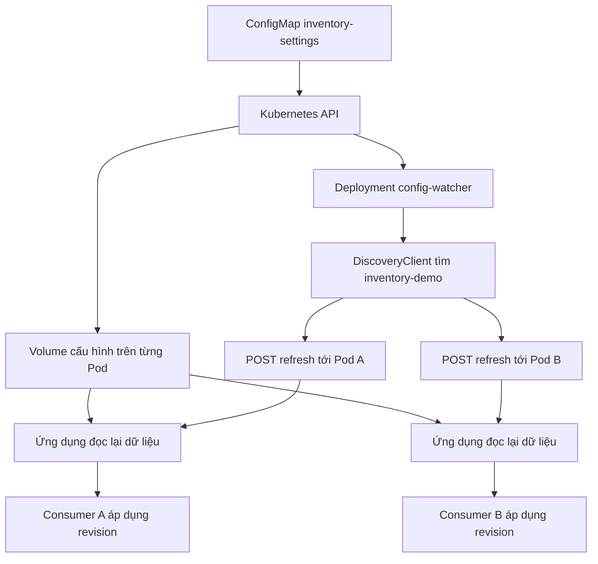

# Triển khai watcher tách khỏi ứng dụng nghiệp vụ

Trong chương **Configuration Watcher** của module **SPRING_CLOUD_KUBERNETES**, watcher được triển khai như một thành phần vận hành riêng: có Deployment, ServiceAccount, quyền đọc Kubernetes API và vòng đời phát hành độc lập. Ứng dụng nghiệp vụ tiếp tục chịu trách nhiệm nạp cấu hình, kiểm tra dữ liệu và áp dụng thay đổi vào đúng consumer.

Tách watcher không có nghĩa ứng dụng tự động hiểu mọi cấu hình mới. Nó tạo một ranh giới rõ giữa **phát hiện thay đổi và gửi tín hiệu** với **đọc lại dữ liệu và cập nhật hành vi**.

Bài học xây dựng một lab dùng HTTP: watcher theo dõi ConfigMap trong một namespace, tìm các instance của ứng dụng và gọi Actuator refresh trên từng instance. Lab có hai replica nghiệp vụ để kiểm tra việc cập nhật trên từng Pod.

Sau bài học, bạn có thể:

- Phân chia trách nhiệm, danh tính và quyền của watcher với ứng dụng.
- Triển khai watcher bằng Deployment riêng và giới hạn namespace theo dõi.
- Ánh xạ đúng ConfigMap sang tên ứng dụng mà DiscoveryClient tìm kiếm.
- Cấu hình tuyến tới Actuator khi ứng dụng dùng management port riêng.
- Kiểm chứng cả thông báo refresh lẫn revision được từng replica chấp nhận.
- Nhận ra điều kiện cần bổ sung trước khi dùng mô hình này trong môi trường thật.

## 1. Ranh giới triển khai và luồng thay đổi

Trong bài, “tách khỏi ứng dụng nghiệp vụ” có nghĩa là watcher chạy trong Pod thuộc Deployment khác. Watcher không phải một sidecar đặt cạnh từng replica nghiệp vụ, cũng không phải vòng watch API được thêm vào mỗi instance của ứng dụng.



Các trách nhiệm được chia như sau:

| Thành phần | Trách nhiệm |
| --- | --- |
| Pipeline hoặc người thay cấu hình | Công bố ứng viên đã được kiểm tra |
| Kubernetes | Lưu tài nguyên và cấp dữ liệu theo cách tiêu thụ đã chọn |
| Configuration Watcher | Nhận sự kiện đủ điều kiện, xác định đích và gửi thông báo |
| Ứng dụng Spring | Đọc lại nguồn, validate và cập nhật bean/consumer hỗ trợ |
| Hệ thống quan sát | Xác nhận revision thực tế trên từng replica |

Configuration Watcher hỗ trợ đường HTTP và Spring Cloud Bus. Bài chọn HTTP để quan sát trực tiếp các bước mà không cần broker. [Spring Cloud Kubernetes: Configuration Watcher](https://docs.spring.io/spring-cloud-kubernetes/reference/3.3/spring-cloud-kubernetes-configuration-watcher.html).

Tách Deployment đem lại khả năng cấp quyền, nâng cấp và theo dõi watcher độc lập. Đổi lại, watcher trở thành một thành phần cần được vận hành: mất watcher có thể làm chậm cập nhật cấu hình dù ứng dụng vẫn đang phục vụ.

## 2. Phạm vi phiên bản và giả định của lab

Ví dụ watcher khóa image:

```text
springcloud/spring-cloud-kubernetes-configuration-watcher:3.3.3
```

Đây là phiên bản minh họa của dòng 3.3, không phải tuyên bố về phiên bản mới nhất. Khi đưa vào hệ thống thật, khóa image theo digest đã kiểm tra và dùng tài liệu khớp phiên bản.

Ứng dụng minh họa dùng Java 17 trở lên, Spring Boot 3.5.x và Spring Cloud BOM 2025.0.x tương thích. Các patch version được chọn và khóa trong dự án thực hành. Không lấy một image watcher mới bất kỳ rồi giả định mọi tên property và hành vi vẫn giống ví dụ.

Các giả định khác:

- Một namespace lab: `watcher-lab`.
- Ứng dụng có hai replica, watcher có một replica.
- Ứng dụng đọc ConfigMap qua volume, không gọi Kubernetes API.
- Watcher chỉ theo dõi ConfigMap; chức năng theo dõi Secret được tắt.
- Discovery của mẫu dùng tài nguyên Endpoints để khớp cấu hình dòng 3.3 đã chọn.
- Có kết nối từ watcher tới API server và management port của các Pod.
- Các endpoint quản trị không được công bố ra Internet.

Tệp, image ứng dụng và namespace trong các bước sau do người học chuẩn bị. Không có image nghiệp vụ dựng sẵn trong bài.

## 3. Hợp đồng tên: nguồn cấu hình khác với đích nhận thông báo

Lab dùng các định danh:

| Định danh | Giá trị |
| --- | --- |
| Tên ConfigMap | `inventory-settings` |
| Annotation chỉ ứng dụng nhận refresh | `inventory-demo` |
| `spring.application.name` của ứng dụng | `inventory-demo` |
| Tên Kubernetes Service | `inventory-demo` |
| Deployment nghiệp vụ | `inventory-demo` |
| Deployment watcher | `config-watcher` |
| ServiceAccount nghiệp vụ | `inventory-app` |
| ServiceAccount watcher | `config-watcher` |

ConfigMap mang nhãn `spring.cloud.kubernetes.config: "true"` để tham gia luồng thông báo. Annotation `spring.cloud.kubernetes.configmap.apps` chỉ định tên ứng dụng nhận thông báo.

Nếu không có annotation đích, watcher của phiên bản này dùng tên tài nguyên làm tên ứng dụng. Vì ConfigMap trong lab tên `inventory-settings` nhưng Service tên `inventory-demo`, annotation là phần cần thiết. [Mã nguồn ánh xạ nguồn sang ứng dụng, v3.3.3](https://github.com/spring-cloud/spring-cloud-kubernetes/blob/v3.3.3/spring-cloud-kubernetes-controllers/spring-cloud-kubernetes-configuration-watcher/src/main/java/org/springframework/cloud/kubernetes/configuration/watcher/WatcherUtil.java).

Trong discovery Kubernetes, tên Service là một định danh quan trọng để tìm instance. Chỉ đặt `spring.application.name` trong Java không tạo ra Service Kubernetes và không sửa một Service bị đặt sai tên. [Spring Cloud Kubernetes: DiscoveryClient](https://docs.spring.io/spring-cloud-kubernetes/reference/3.3/discovery-client.html).

Label dùng để quyết định xử lý sự kiện không phải ranh giới phân quyền. Watcher có quyền list/watch ConfigMap trong namespace vẫn có thể đọc những ConfigMap mà nó không phát refresh.

## 4. Chuẩn bị ứng dụng nghiệp vụ có thể nhận refresh

Ứng dụng cần thực hiện đủ hai việc:

1. Có endpoint refresh từ Spring Cloud Context/Actuator.
2. Có consumer thực sự nhận cấu hình mới sau refresh.

Ví dụ dưới dùng một policy đơn giản hiển thị banner. Nó không giữ pool, connection hay task nền, nên giúp tập trung vào đường triển khai watcher.

### 4.1. Dependency và cấu hình khởi động

Các dependency cần có, version do parent/BOM phù hợp quản lý:

```xml
<dependency>
    <groupId>org.springframework.boot</groupId>
    <artifactId>spring-boot-starter-web</artifactId>
</dependency>
<dependency>
    <groupId>org.springframework.boot</groupId>
    <artifactId>spring-boot-starter-actuator</artifactId>
</dependency>
<dependency>
    <groupId>org.springframework.cloud</groupId>
    <artifactId>spring-cloud-starter</artifactId>
</dependency>
```

Ứng dụng của lab chưa cần thêm starter Kubernetes: nguồn là file mount, còn việc theo dõi API thuộc watcher.

Tệp `src/main/resources/application.yaml`:

```yaml
spring:
  application:
    name: inventory-demo

server:
  port: 8080

management:
  server:
    port: 9090
  endpoints:
    web:
      exposure:
        include: health,refresh
  endpoint:
    health:
      probes:
        enabled: true
```

Cổng nghiệp vụ là 8080, cổng quản trị là 9090. Exposure chỉ làm endpoint có thể truy cập; nó không thay thế xác thực hoặc phân quyền HTTP.

### 4.2. Một consumer được tạo lại qua refresh scope

Tệp `InventoryApplication.java`:

```java
package com.example.inventory;

import java.util.Map;
import java.util.UUID;

import org.springframework.boot.SpringApplication;
import org.springframework.boot.autoconfigure.SpringBootApplication;
import org.springframework.cloud.context.config.annotation.RefreshScope;
import org.springframework.context.annotation.Bean;
import org.springframework.core.env.Environment;
import org.springframework.web.bind.annotation.GetMapping;
import org.springframework.web.bind.annotation.RestController;

@SpringBootApplication
public class InventoryApplication {

    public static void main(String[] args) {
        SpringApplication.run(InventoryApplication.class, args);
    }

    @Bean
    @RefreshScope
    DisplayPolicy displayPolicy(Environment environment) {
        return new DisplayPolicy(
                environment.getRequiredProperty("demo.revision"),
                environment.getRequiredProperty("demo.banner")
        );
    }

    public static class DisplayPolicy {

        private final String instanceId = UUID.randomUUID().toString();
        private final String revision;
        private final String banner;

        public DisplayPolicy(String revision, String banner) {
            if (!revision.matches("[A-Za-z0-9._-]{1,48}")) {
                throw new IllegalArgumentException("invalid demo revision");
            }
            if (banner.isBlank() || banner.length() > 120) {
                throw new IllegalArgumentException("invalid demo banner");
            }
            this.revision = revision;
            this.banner = banner;
        }

        public PolicyView snapshot() {
            return new PolicyView(instanceId, revision, banner);
        }
    }

    public record PolicyView(
            String instanceId,
            String revision,
            String banner
    ) {
    }

    @RestController
    public static class BannerController {

        private final DisplayPolicy policy;
        private final String podName;

        public BannerController(DisplayPolicy policy, Environment environment) {
            this.policy = policy;
            this.podName = environment.getProperty("POD_NAME", "local");
        }

        @GetMapping("/demo/banner")
        public Map<String, String> banner() {
            PolicyView current = policy.snapshot();
            return Map.of(
                    "pod", podName,
                    "targetId", current.instanceId(),
                    "revision", current.revision(),
                    "banner", current.banner()
            );
        }
    }
}
```

`DisplayPolicy` là target không final; controller gọi qua bean được Spring inject. Mỗi target giữ một bộ revision/banner bất biến, nên endpoint quan sát trả về dữ liệu được consumer chấp nhận.

Refresh scope cho phép tạo lại target sau refresh; nó không làm mọi singleton hoặc tài nguyên bên ngoài tự thay đổi. Cần đánh giá riêng client, pool và các bean chép dữ liệu từ cấu hình. [Spring Cloud Context: Refresh Scope](https://docs.spring.io/spring-cloud-commons/reference/4.3/spring-cloud-commons/application-context-services.html#refresh-scope).

Mẫu chưa có Spring Security để việc thử nghiệm ngắn gọn. Phần giới hạn mạng phía dưới là cấu hình lab; môi trường thật cần thiết kế đường quản trị có xác thực tương thích với watcher.

## 5. Triển khai nguồn và hai replica nghiệp vụ

Tạo namespace bằng tệp `namespace.yaml`:

```yaml
apiVersion: v1
kind: Namespace
metadata:
  name: watcher-lab
```

Tệp `inventory-config.yaml`:

```yaml
apiVersion: v1
kind: ConfigMap
metadata:
  name: inventory-settings
  namespace: watcher-lab
  labels:
    spring.cloud.kubernetes.config: "true"
  annotations:
    spring.cloud.kubernetes.configmap.apps: "inventory-demo"
data:
  application.yaml: |-
    demo:
      revision: inventory-r1
      banner: "Kho đang hoạt động bình thường"
```

Tệp `inventory-app.yaml`:

```yaml
apiVersion: v1
kind: ServiceAccount
metadata:
  name: inventory-app
  namespace: watcher-lab
---
apiVersion: apps/v1
kind: Deployment
metadata:
  name: inventory-demo
  namespace: watcher-lab
spec:
  replicas: 2
  selector:
    matchLabels:
      app: inventory-demo
  template:
    metadata:
      labels:
        app: inventory-demo
    spec:
      serviceAccountName: inventory-app
      automountServiceAccountToken: false
      containers:
        - name: app
          image: registry.example.test/training/inventory-demo:lab
          ports:
            - name: http
              containerPort: 8080
            - name: management
              containerPort: 9090
          env:
            - name: SPRING_CONFIG_ADDITIONAL_LOCATION
              value: file:/etc/inventory/application.yaml
            - name: POD_NAME
              valueFrom:
                fieldRef:
                  fieldPath: metadata.name
          volumeMounts:
            - name: app-config
              mountPath: /etc/inventory
              readOnly: true
          startupProbe:
            httpGet:
              path: /actuator/health/liveness
              port: management
            periodSeconds: 5
            failureThreshold: 24
          readinessProbe:
            httpGet:
              path: /actuator/health/readiness
              port: management
            periodSeconds: 5
          livenessProbe:
            httpGet:
              path: /actuator/health/liveness
              port: management
            periodSeconds: 10
      volumes:
        - name: app-config
          configMap:
            name: inventory-settings
---
apiVersion: v1
kind: Service
metadata:
  name: inventory-demo
  namespace: watcher-lab
  annotations:
    boot.spring.io/actuator: "http://:9090/actuator"
spec:
  selector:
    app: inventory-demo
  ports:
    - name: http
      port: 8080
      targetPort: http
```

Thay image nghiệp vụ bằng image thật chứa ứng dụng. Không thêm RoleBinding cho `inventory-app` chỉ để đọc file ConfigMap đã mount.

`SPRING_CONFIG_ADDITIONAL_LOCATION` làm Spring Boot đọc thêm file ngoài ứng dụng. Không có `optional:` nên đây là một nguồn bắt buộc trong lab; kiểm tra cả nguồn ghi đè nếu giá trị hiệu lực khác mong đợi. [Spring Boot: externalized configuration](https://docs.spring.io/spring-boot/3.5/reference/features/external-config.html).

Mount cả thư mục giúp nhận cập nhật volume; tránh `subPath` cho đường này. Dữ liệu volume cập nhật có độ trễ, còn biến môi trường từ ConfigMap không tự thay đổi trong container đang chạy. [Kubernetes ConfigMaps](https://kubernetes.io/docs/concepts/configuration/configmap/).

Annotation `boot.spring.io/actuator` cung cấp path/cổng quản trị. Watcher vẫn dùng host của instance tìm được, rồi thay đường dẫn và cổng theo metadata; annotation không cần trỏ tới một hostname Service chung. [Mã nguồn HttpRefreshTrigger, v3.3.3](https://github.com/spring-cloud/spring-cloud-kubernetes/blob/v3.3.3/spring-cloud-kubernetes-controllers/spring-cloud-kubernetes-configuration-watcher/src/main/java/org/springframework/cloud/kubernetes/configuration/watcher/HttpRefreshTrigger.java).

Không cần công bố cổng 9090 trong Service để watcher gọi trực tiếp Pod IP theo tuyến trên. Cần bảo đảm ứng dụng lắng nghe management port trên địa chỉ có thể truy cập từ watcher.

## 6. ServiceAccount và RBAC riêng cho watcher

Tệp `watcher-rbac.yaml`:

```yaml
apiVersion: v1
kind: ServiceAccount
metadata:
  name: config-watcher
  namespace: watcher-lab
---
apiVersion: rbac.authorization.k8s.io/v1
kind: Role
metadata:
  name: config-watcher-reader
  namespace: watcher-lab
rules:
  - apiGroups: [""]
    resources:
      - configmaps
      - services
      - endpoints
      - pods
    verbs:
      - get
      - list
      - watch
---
apiVersion: rbac.authorization.k8s.io/v1
kind: RoleBinding
metadata:
  name: config-watcher-reader
  namespace: watcher-lab
subjects:
  - kind: ServiceAccount
    name: config-watcher
    namespace: watcher-lab
roleRef:
  apiGroup: rbac.authorization.k8s.io
  kind: Role
  name: config-watcher-reader
```

Role nằm trong một namespace và chỉ cấp các thao tác đọc. Nó không cho watcher sửa Deployment, xóa Pod hoặc cập nhật ConfigMap.

`list/watch` có phạm vi rộng hơn một lệnh `get` theo tên. Label sự kiện không biến quyền đọc thành quyền chỉ đọc các object có label đó. Nếu cần hạn chế sâu hơn, phải thiết kế danh tính, namespace và cách API client truy cập cho phù hợp. [Kubernetes RBAC](https://kubernetes.io/docs/reference/access-authn-authz/rbac/).

Lab không cấp quyền đọc Secret. Điều này phải đi cùng việc tắt chức năng tương ứng trong watcher; thiếu quyền trong khi vẫn chạy informer Secret sẽ tạo lỗi chứ không phải một thiết kế hoàn chỉnh.

Nếu sử dụng EndpointSlice, thay cấu hình discovery và cấp quyền phù hợp cho `endpointslices` trong API group `discovery.k8s.io`. Mẫu giữ Endpoints để khớp nhánh minh họa; API Endpoints đã deprecated từ Kubernetes 1.33 nên kế hoạch nâng cấp cần kiểm tra lại lựa chọn này. [Kubernetes Service: Endpoints](https://kubernetes.io/docs/concepts/services-networking/service/#endpoints-deprecated).

## 7. Deployment watcher độc lập

Tệp `watcher-deployment.yaml`:

```yaml
apiVersion: apps/v1
kind: Deployment
metadata:
  name: config-watcher
  namespace: watcher-lab
spec:
  replicas: 1
  strategy:
    type: Recreate
  selector:
    matchLabels:
      app: config-watcher
  template:
    metadata:
      labels:
        app: config-watcher
    spec:
      serviceAccountName: config-watcher
      automountServiceAccountToken: true
      containers:
        - name: watcher
          image: springcloud/spring-cloud-kubernetes-configuration-watcher:3.3.3
          ports:
            - name: http
              containerPort: 8888
          env:
            - name: SPRING_CLOUD_KUBERNETES_RELOAD_NAMESPACES_0
              value: watcher-lab
            - name: SPRING_CLOUD_KUBERNETES_DISCOVERY_NAMESPACES_0
              value: watcher-lab
            - name: SPRING_CLOUD_KUBERNETES_RELOAD_MONITORINGSECRETS
              value: "false"
            - name: SPRING_CLOUD_KUBERNETES_SECRETS_ENABLED
              value: "false"
            - name: SPRING_CLOUD_KUBERNETES_DISCOVERY_USEENDPOINTSLICES
              value: "false"
            - name: SPRING_CLOUD_KUBERNETES_CONFIGURATION_WATCHER_REFRESHDELAY
              value: "15000"
            - name: SPRING_CLOUD_KUBERNETES_CONFIGURATION_WATCHER_REFRESHSTRATEGY
              value: REFRESH
            - name: LOGGING_LEVEL_ORG_SPRINGFRAMEWORK_CLOUD_KUBERNETES_CONFIGURATION_WATCHER
              value: DEBUG
          startupProbe:
            httpGet:
              path: /actuator/health/liveness
              port: http
            periodSeconds: 5
            failureThreshold: 24
          readinessProbe:
            httpGet:
              path: /actuator/health/readiness
              port: http
            periodSeconds: 5
          livenessProbe:
            httpGet:
              path: /actuator/health/liveness
              port: http
            periodSeconds: 10
          resources:
            requests:
              cpu: 100m
              memory: 256Mi
            limits:
              cpu: 500m
              memory: 512Mi
```

Giới hạn tài nguyên chỉ là điểm khởi đầu của lab, chưa phải kết quả đo tải. Số nguồn, số instance, tần suất thay đổi và phiên bản client đều ảnh hưởng nhu cầu tài nguyên.

Bảng giải thích các cấu hình quan trọng:

| Cấu hình | Mục đích |
| --- | --- |
| `reload.namespaces[0]` | Phạm vi sự kiện cấu hình |
| `discovery.namespaces[0]` | Phạm vi tìm instance nhận thông báo |
| `reload.monitoring-secrets=false` | Không khởi động theo dõi Secret cho lab |
| `secrets.enabled=false` | Tắt Secrets PropertySource tương ứng |
| `discovery.use-endpoint-slices=false` | Khóa lựa chọn discovery theo mẫu |
| `configuration.watcher.refresh-delay` | Đợi trước khi gửi thông báo |
| `configuration.watcher.refresh-strategy=REFRESH` | Chọn refresh, không yêu cầu shutdown |
| `automountServiceAccountToken=true` | Cấp danh tính cho client gọi Kubernetes API |

Trong tên biến môi trường, dấu gạch ngang của property bị bỏ; vì vậy `monitoring-secrets` được viết thành `MONITORINGSECRETS`, còn `refresh-delay` thành `REFRESHDELAY`.

Image v3.3.3 có cấu hình đóng gói bật theo dõi Secret; lab ghi đè rõ ràng thay vì chỉ bỏ quyền Secret trong Role. [Cấu hình mặc định của image v3.3.3](https://github.com/spring-cloud/spring-cloud-kubernetes/blob/v3.3.3/spring-cloud-kubernetes-controllers/spring-cloud-kubernetes-configuration-watcher/src/main/resources/application.yml). Cơ chế informer kiểm tra giá trị `monitoringSecrets` trước khi theo dõi. [Mã nguồn Secrets change detector](https://github.com/spring-cloud/spring-cloud-kubernetes/blob/v3.3.3/spring-cloud-kubernetes-client-config/src/main/java/org/springframework/cloud/kubernetes/client/config/reload/KubernetesClientEventBasedSecretsChangeDetector.java).

Hai phạm vi namespace được khai báo riêng vì “nhìn thấy nguồn thay đổi” và “tìm được instance” là hai bước khác nhau. Không mở `all-namespaces` để chữa một lỗi tên hoặc RoleBinding.

`15000` ở refresh delay là 15 giây trong kiểu bind của phiên bản này. Nó là tham số lab, không phải bảo đảm file volume đã mới ở mọi cluster. [Các thuộc tính watcher v3.3.3](https://github.com/spring-cloud/spring-cloud-kubernetes/blob/v3.3.3/spring-cloud-kubernetes-controllers/spring-cloud-kubernetes-configuration-watcher/src/main/java/org/springframework/cloud/kubernetes/configuration/watcher/ConfigurationWatcherConfigurationProperties.java).

`Recreate` tránh chủ động chạy chồng hai watcher trong quá trình cập nhật Deployment của lab, nhưng có khoảng gián đoạn theo dõi. Một replica vẫn có thể nhận lại sự kiện sau reconnect; lựa chọn này không tạo bảo đảm gửi đúng một lần.

Watcher chủ động gọi đi, nên luồng lab không cần Service riêng cho cổng 8888. Kubelet có thể probe Pod trực tiếp. Nếu hạ tầng giám sát cần Service để scrape hoặc khám phá, bổ sung tài nguyên đó theo nhu cầu thực tế.

## 8. Giới hạn đường mạng tới Actuator

Ví dụ `app-network-policy.yaml`:

```yaml
apiVersion: networking.k8s.io/v1
kind: NetworkPolicy
metadata:
  name: inventory-management
  namespace: watcher-lab
spec:
  podSelector:
    matchLabels:
      app: inventory-demo
  policyTypes:
    - Ingress
  ingress:
    - ports:
        - protocol: TCP
          port: 8080
    - from:
        - podSelector:
            matchLabels:
              app: config-watcher
      ports:
        - protocol: TCP
          port: 9090
```

Trong lab, cổng nghiệp vụ 8080 được phép nhận ingress, còn 9090 chỉ được rule này cho phép từ Pod có label watcher trong cùng namespace. Phải có CNI hỗ trợ NetworkPolicy và kiểm tra các policy khác đang áp dụng; các rule cho phép có tính cộng dồn. [Kubernetes Network Policies](https://kubernetes.io/docs/concepts/services-networking/network-policies/).

NetworkPolicy làm việc ở mức kết nối/port, không phân biệt `/actuator/refresh` với một path khác trên cùng cổng. Nó cũng không biến label Pod thành xác thực HTTP theo ServiceAccount.

Nếu môi trường có default-deny egress, cần cho phép watcher tới API server, DNS khi cần và management port các Pod đích. Quy tắc địa chỉ API server phụ thuộc topology/CNI; không sao chép một CIDR mẫu rồi coi là đã đúng.

Mẫu chưa cấu hình credential cho lời gọi Actuator. Token ServiceAccount dùng với API server không tự trở thành credential hợp lệ cho endpoint Spring. Nếu Actuator có xác thực, cần một cách gọi được hỗ trợ và đã kiểm chứng, chẳng hạn tích hợp proxy/service mesh hoặc image watcher được cấu hình mở rộng phù hợp. Không giả định có một biến môi trường tùy ý sẽ làm image gửi Authorization header.

## 9. Triển khai theo thứ tự và xác minh danh tính

Các lệnh dưới dùng context `lab`; thay bằng context thử nghiệm của bạn.

```bash
kubectl --context lab apply -f namespace.yaml
kubectl --context lab apply -f inventory-config.yaml
kubectl --context lab apply -f inventory-app.yaml
kubectl --context lab apply -f app-network-policy.yaml
kubectl --context lab apply -f watcher-rbac.yaml
kubectl --context lab apply -f watcher-deployment.yaml
kubectl --context lab -n watcher-lab rollout status deployment/inventory-demo --timeout=180s
kubectl --context lab -n watcher-lab rollout status deployment/config-watcher --timeout=180s
```

Xem Pod và log watcher:

```bash
kubectl --context lab -n watcher-lab get pods -o wide
kubectl --context lab -n watcher-lab logs deployment/config-watcher --tail=200
kubectl --context lab -n watcher-lab get service inventory-demo
kubectl --context lab -n watcher-lab get endpoints inventory-demo
```

Với người vận hành có quyền impersonation, kiểm tra danh tính watcher:

```bash
kubectl --context lab -n watcher-lab auth can-i list configmaps --as=system:serviceaccount:watcher-lab:config-watcher
kubectl --context lab -n watcher-lab auth can-i watch configmaps --as=system:serviceaccount:watcher-lab:config-watcher
kubectl --context lab -n watcher-lab auth can-i list services --as=system:serviceaccount:watcher-lab:config-watcher
kubectl --context lab -n watcher-lab auth can-i list endpoints --as=system:serviceaccount:watcher-lab:config-watcher
kubectl --context lab -n watcher-lab auth can-i get secrets --as=system:serviceaccount:watcher-lab:config-watcher
kubectl --context lab -n watcher-lab auth can-i list configmaps --as=system:serviceaccount:watcher-lab:inventory-app
```

Trong môi trường không có cấp quyền khác ngoài lab, bốn lệnh đầu dự kiến `yes`; hai lệnh cuối dự kiến `no`.

`auth can-i` kiểm tra authorization, không chứng minh token đang được cấp vào Pod, kết nối API hoạt động hoặc tuyến tới Actuator đúng. `--as` cần quyền impersonation; nếu quyền phụ thuộc group, cần mô phỏng đúng group hoặc kiểm tra bằng danh tính thực. [kubectl auth can-i](https://kubernetes.io/docs/reference/kubectl/generated/kubectl_auth/kubectl_auth_can-i/).

Kiểm tra thêm hai Deployment dùng đúng `serviceAccountName`. Đừng dựa vào việc chúng nằm cùng namespace để suy ra chúng đang dùng cùng hoặc khác danh tính.

## 10. Kiểm chứng từ thay đổi ConfigMap đến từng replica

### 10.1. Ghi nhận trạng thái ban đầu

Liệt kê hai Pod nghiệp vụ:

```bash
kubectl --context lab -n watcher-lab get pods -l app=inventory-demo -o wide
```

Chọn từng Pod và port-forward tới cổng nghiệp vụ, ví dụ:

```bash
kubectl --context lab -n watcher-lab port-forward pod/<pod-a> 18080:8080
```

Ở terminal khác:

```bash
curl http://localhost:18080/demo/banner
```

Lặp lại với Pod B, dùng một cổng local khác nếu cần. Kết quả ban đầu phải báo đúng tên Pod và `revision = inventory-r1`.

Ghi lại UID, restart count và `targetId` để phân biệt refresh target với thay Pod:

```bash
kubectl --context lab -n watcher-lab get pod <pod-a> -o jsonpath='{.metadata.uid}{" "}{.status.containerStatuses[0].restartCount}{"\n"}'
```

### 10.2. Công bố revision mới

Chỉ sửa phần dữ liệu trong ConfigMap:

```yaml
demo:
  revision: inventory-r2
  banner: "Kho đang áp dụng lịch xử lý mới"
```

Giữ nguyên label, annotation và tên nguồn, sau đó áp dụng:

```bash
kubectl --context lab apply -f inventory-config.yaml
kubectl --context lab -n watcher-lab logs deployment/config-watcher --tail=200
```

Không gọi refresh thủ công trong bước chứng minh watcher tự động, vì thao tác đó sẽ làm mất bằng chứng về cơ chế đã tạo ra thay đổi.

Theo dõi đến một deadline vận hành xác định, tính cả thời gian watch, refresh delay, lan truyền volume và xử lý trong ứng dụng. Lấy kết quả riêng trên hai Pod.

| Quan sát | Kết quả dự kiến |
| --- | --- |
| ConfigMap trên API server | `inventory-r2` |
| Watcher | Nhận sự kiện, lên lịch gửi tới `inventory-demo` |
| Tuyến HTTP | Gọi tới instance qua cổng quản trị 9090 |
| Pod A | Banner mới, `inventory-r2`, target mới |
| Pod B | Banner mới, `inventory-r2`, target mới |
| UID/restart count | Không đổi do thí nghiệm refresh |

Log watcher gửi HTTP thành công chỉ xác nhận một phần đường đi. Điều kiện hoàn tất là từng consumer thuộc phạm vi triển khai trả revision mong muốn và hành vi đúng.

HTTP implementation của watcher tìm danh sách instance và gửi POST theo từng instance; vì vậy không thay nó bằng một lời gọi qua ClusterIP rồi cho rằng mọi replica đã nhận. [Luồng gửi HTTP v3.3.3](https://github.com/spring-cloud/spring-cloud-kubernetes/blob/v3.3.3/spring-cloud-kubernetes-controllers/spring-cloud-kubernetes-configuration-watcher/src/main/java/org/springframework/cloud/kubernetes/configuration/watcher/HttpRefreshTrigger.java).

Nếu một Pod chưa đổi, kiểm tra file của chính Pod đó bằng phương thức chẩn đoán được phép. Image tối giản có thể không có shell hoặc `cat`; không coi thiếu công cụ là bằng chứng volume không cập nhật.

### 10.3. Các phép thử lỗi có chủ đích

Thực hiện từng biến thể riêng trong lab rồi khôi phục:

| Biến thể | Điều cần quan sát |
| --- | --- |
| Bỏ label `spring.cloud.kubernetes.config` | Nguồn có thể vẫn được watch nhưng không đi qua điều kiện phát refresh |
| Bỏ annotation đích trong lab này | Watcher dùng tên `inventory-settings`, không khớp Service nghiệp vụ |
| Gõ sai management port trong annotation | Có đích discovery nhưng lời gọi quản trị thất bại |
| Làm watcher mất quyền watch ConfigMap | Lỗi API/authorization, không chữa bằng quyền ghi rộng hơn |
| Chặn watcher tới 9090 | Lỗi tuyến HTTP dù RBAC đọc nguồn vẫn đúng |
| Đưa banner không hợp lệ | Refresh gửi được nhưng target nghiệp vụ có thể tạo lỗi |
| Dừng watcher trong lúc ứng dụng đang chạy | Ứng dụng có thể vẫn phục vụ bằng revision đã giữ |

Một lần refresh không thành công toàn bộ cần được phân loại đúng: không thấy sự kiện, không có đích, gọi HTTP lỗi hay consumer từ chối dữ liệu.

## 11. Độ trễ, lỗi lặp và tính sẵn sàng

Refresh delay cho phép chờ trước khi gửi thông báo; nó không đo trực tiếp việc mỗi volume đã cập nhật xong. Nếu delay quá ngắn, ứng dụng có thể refresh từ file cũ. Nếu quá dài, phản ứng với thay đổi sẽ chậm.

Nên đo thời gian từ revision được công bố tới revision được từng replica chấp nhận, rồi chọn ngân sách độ trễ phù hợp. Không tự động retry bằng vòng restart Pod khi dữ liệu mới không hợp lệ.

Các tình huống vận hành cần có câu trả lời:

- Watcher restart hoặc reconnect có tạo thông báo lặp không?
- Hai controller cùng theo dõi một phạm vi có thể cùng gửi refresh không?
- Một replica không được discovery trả về thì ai phát hiện nó đang dùng cấu hình cũ?
- Nếu nguồn được sửa nhanh nhiều lần, consumer cuối cùng chấp nhận revision nào?
- Khi watcher phục hồi, quy trình xác nhận và đối soát trạng thái mong muốn là gì?

Không mặc định có xử lý đúng một lần hoặc replay bền vững cho mọi thay đổi. Thông báo refresh nên chịu được việc lặp theo hợp đồng của ứng dụng; việc tạo target mới không được tạo side effect nghiệp vụ không kiểm soát.

Một watcher replica là lựa chọn lab. Để thiết kế HA, phải kiểm tra cơ chế phối hợp của đúng image và thử tình huống trùng controller; tăng `replicas` không tự chứng minh đã có leader election hoặc loại trừ thông báo trùng.

Readiness của watcher không thay thế kiểm tra đường refresh tới từng ứng dụng. Readiness của ứng dụng cũng không tự chứng minh consumer đã chấp nhận revision mới.

## 12. Mở rộng namespace, Secret và lựa chọn Bus

### Namespace riêng cho hạ tầng

Watcher có thể được đặt trong namespace hạ tầng, nhưng việc di chuyển không chỉ là đổi `metadata.namespace` của Deployment:

1. Tạo ServiceAccount tại namespace watcher thực sự chạy.
2. Tạo Role trong từng namespace dữ liệu cần đọc.
3. Tạo RoleBinding tại namespace dữ liệu, trỏ subject tới ServiceAccount ở namespace watcher.
4. Khai báo đồng bộ phạm vi reload và discovery.
5. Điều chỉnh chính sách mạng giữa các namespace.
6. Thử trường hợp các namespace có Service trùng tên để tránh mở rộng đích ngoài dự kiến.

Đặt watcher ở namespace khác không tự cấp quyền đọc chéo namespace. Với nhiều nhóm nghiệp vụ có mức tin cậy khác nhau, có thể chọn watcher riêng theo phạm vi thay vì một danh tính đọc toàn cluster.

### Theo dõi Secret

Khi thật sự cần Secret, bổ sung cả quyền, cấu hình theo dõi, label đích và hợp đồng rotation của consumer. Không chỉ bật cờ và thêm `secrets` vào một Role dùng chung mà chưa đánh giá phạm vi dữ liệu đọc được.

Watcher gửi thông báo không làm credential đã được chụp trong client hoặc connection pool tự xoay vòng. Không log nội dung Secret trong quá trình chẩn đoán.

### HTTP hay Spring Cloud Bus?

| Cơ chế | Cần chuẩn bị | Điều vẫn phải xác minh |
| --- | --- | --- |
| HTTP | Discovery, tuyến tới từng instance, endpoint quản trị và xác thực | Từng consumer đã nhận và áp dụng revision |
| Bus | Broker, binder/profile và kết nối Bus của ứng dụng | Phạm vi nhận sự kiện, dữ liệu mới và hành vi consumer |

Dòng 3.3 có các profile Bus như `bus-amqp` và `bus-kafka`. Chuyển profile không thay thế việc triển khai broker và cấu hình ứng dụng tham gia Bus. [Configuration Watcher: cơ chế messaging](https://docs.spring.io/spring-cloud-kubernetes/reference/3.3/spring-cloud-kubernetes-configuration-watcher.html#messaging-implementation).

Trong lab, DiscoveryClient nằm trong watcher để tìm các instance nhận thông báo. Ứng dụng nghiệp vụ không cần tự dùng DiscoveryClient hoặc Spring Cloud LoadBalancer cho luồng banner. Chỉ thêm các tính năng đó khi đường gọi nghiệp vụ thực sự cần chúng.

## 13. Điều kiện bàn giao một triển khai watcher

Một triển khai có thể được bàn giao khi có bằng chứng cho các điều kiện sau:

| Điều kiện | Bằng chứng |
| --- | --- |
| Watcher độc lập với nghiệp vụ | Deployment, image, ServiceAccount và rollout riêng |
| Phạm vi đọc rõ ràng | Namespace, Role/RoleBinding và kết quả kiểm tra quyền |
| Nguồn và đích khớp | Label, annotation, Service và instance discovery |
| Tuyến quản trị đúng | Host/port/path, kết nối mạng và xác thực phù hợp |
| Cấu hình đến ứng dụng | File/API source của đúng Pod có revision mong muốn |
| Consumer áp dụng được | Kết quả nghiệp vụ và revision trên từng replica |
| Thất bại được quan sát | Log/cảnh báo cho API, discovery, HTTP và validation |
| Có phương án phục hồi | Cấu hình hợp lệ trước đó, đối soát replica và cách triển khai lại |

Các artifact vận hành nên ghi image/digest watcher, revision cấu hình, namespace, tên ứng dụng và kết quả đã được làm sạch. Không dùng log chứa token hoặc Secret làm bằng chứng.

Điểm cốt lõi của việc tách watcher là tách đúng trách nhiệm: watcher điều phối thông báo, ứng dụng sở hữu cách áp dụng cấu hình, còn quy trình triển khai xác nhận hành vi cuối cùng trên từng replica.
