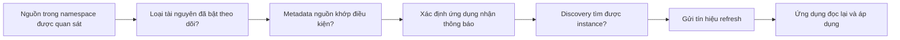

# Chọn ConfigMap và Secret cần theo dõi bằng metadata

Trong chương **Configuration Watcher** của module **SPRING_CLOUD_KUBERNETES**, metadata là hợp đồng giúp controller biết nguồn cấu hình nào cần xử lý và ứng dụng nào cần được thông báo. Nếu hợp đồng này thiếu hoặc bị đặt nhầm chỗ, ConfigMap có thể đã thay đổi nhưng ứng dụng vẫn giữ cấu hình cũ; ngược lại, một thay đổi nhỏ có thể gây refresh nhiều dịch vụ ngoài dự kiến.

Bài dùng ví dụ `order-service` trong namespace `commerce-staging`. ConfigMap `order-runtime` cung cấp cấu hình chạy; Secret `order-partner-credentials` cung cấp credential cho một kết nối đối tác. Watcher chỉ nên xử lý những nguồn được đưa vào phạm vi theo dõi có chủ đích.

Các ví dụ selector tùy chỉnh và annotation chọn đích nâng cao được giới hạn theo **Configuration Watcher 5.0.5**. Một phần riêng đối chiếu cách lọc trong tài liệu nhánh 3.3. Không trộn thuộc tính của hai nhánh chỉ vì chúng có tên gần giống nhau.

## 1. Tách việc chọn nguồn khỏi việc chọn ứng dụng nhận thông báo

Một lần cập nhật đi qua các câu hỏi khác nhau:



Ba lớp cần phân biệt ngay từ đầu:

| Lớp | Câu hỏi | Ví dụ |
| --- | --- | --- |
| Phạm vi quan sát | Watcher nhìn vào namespace và loại tài nguyên nào? | ConfigMap trong `commerce-staging`; có bật Secret hay không |
| Metadata nguồn | ConfigMap hoặc Secret này có được chọn để xử lý không? | Label `spring.cloud.kubernetes.config: "true"` |
| Metadata định tuyến | Ứng dụng nào cần nhận thông báo cho nguồn đã chọn? | Annotation `spring.cloud.kubernetes.configmap.apps: "order-service"` |

Label chọn nguồn không phải selector của Pod. Annotation chọn ứng dụng không phải lệnh để ứng dụng tự mount hay tự import nguồn đó.

Ví dụ, `order-runtime` có thể được chọn đúng và Watcher gửi refresh tới `order-service`, nhưng ứng dụng vẫn không đổi nếu nó chưa được cấu hình đọc ConfigMap `order-runtime`. Cần kiểm tra cả quan hệ nguồn–consumer, không chỉ metadata của nguồn.

## 2. Vai trò của name, namespace, label và annotation

| Metadata | Vai trò trong bài | Điều không tự xảy ra |
| --- | --- | --- |
| `metadata.namespace` | Xác định nơi nguồn tồn tại | Không tự mở rộng phạm vi quan sát hoặc quyền của Watcher |
| `metadata.name` | Định danh nguồn; có thể là tên đích mặc định khi không có annotation ứng dụng | Không tự đổi `spring.application.name` |
| `metadata.labels` | Chọn nhóm nguồn hoặc nhóm đối tượng bằng các điều kiện nhỏ, có cấu trúc | Không tự chuyển dữ liệu thành property của Spring |
| `metadata.annotations` | Chứa thông tin định tuyến hoặc mô tả mà một consumer cụ thể hiểu | Annotation tùy đặt không tự có tác dụng với Watcher |
| `data` hoặc `stringData` | Chứa nội dung cấu hình hoặc bí mật | Không thay thế cho label hay annotation trên metadata |

Kubernetes dùng labels và selectors để nhận diện tập đối tượng; nhiều điều kiện selector được kết hợp theo yêu cầu của selector. Annotation phù hợp với thông tin mô tả hoặc thông tin cho công cụ xử lý, không phải cơ chế label selection. [Labels and Selectors](https://kubernetes.io/docs/concepts/overview/working-with-objects/labels/), [Annotations](https://kubernetes.io/docs/concepts/overview/working-with-objects/annotations/)

Các giá trị trong labels và annotations phải được biểu diễn như chuỗi trong manifest:

```yaml
metadata:
  labels:
    spring.cloud.kubernetes.config: "true"
```

Dùng `"true"` giúp tránh YAML chuyển thành boolean ở vị trí API mong đợi chuỗi. Không coi `"True"`, `"TRUE"` và `"true"` là tương đương trong một selector so sánh chuỗi chính xác.

Các key chính xác cũng quan trọng. Label ConfigMap dùng phần `config`, còn annotation ứng dụng của ConfigMap dùng phần `configmap`. Viết gần đúng có thể tạo metadata hợp lệ về Kubernetes nhưng không được Watcher hiểu.

## 3. Các nhãn opt-in cơ bản

Theo tài liệu Watcher nhánh 5.0, ConfigMap được chọn bằng label `spring.cloud.kubernetes.config: "true"`; Secret không được theo dõi mặc định và cần bật riêng, sau đó dùng label `spring.cloud.kubernetes.secret: "true"`. [Configuration Watcher nhánh 5.0](https://docs.spring.io/spring-cloud-kubernetes/reference/5.0/spring-cloud-kubernetes-configuration-watcher.html)

Bộ key cần nhớ:

| Loại nguồn | Label opt-in | Annotation đích theo tên |
| --- | --- | --- |
| ConfigMap | `spring.cloud.kubernetes.config: "true"` | `spring.cloud.kubernetes.configmap.apps` |
| Secret | `spring.cloud.kubernetes.secret: "true"` | `spring.cloud.kubernetes.secret.apps` |

Ví dụ tối thiểu khi tên nguồn trùng tên dịch vụ đích:

```yaml
apiVersion: v1
kind: ConfigMap
metadata:
  name: order-service
  namespace: commerce-staging
  labels:
    spring.cloud.kubernetes.config: "true"
data:
  application.yaml: |
    order:
      config-revision: r1
      partner:
        connect-timeout: 2s
```

Metadata trên được đặt **trực tiếp trên ConfigMap**. Gắn cùng label vào Deployment, Service hoặc Pod không làm ConfigMap được chọn.

Khi không chỉ định ứng dụng đích theo tên và không chọn một cơ chế đích khác, tên nguồn là tên đích mặc định của Watcher. Vì vậy, mẫu tối thiểu có ý nghĩa khi discovery tìm được dịch vụ `order-service`. Nó không chứng minh ứng dụng đã import nội dung cấu hình. [Cách tạo đích mặc định trong KubernetesSourceProvider v5.0.5](https://github.com/spring-cloud/spring-cloud-kubernetes/blob/v5.0.5/spring-cloud-kubernetes-controllers/spring-cloud-kubernetes-configuration-watcher/src/main/java/org/springframework/cloud/kubernetes/configuration/watcher/KubernetesSourceProvider.java)

Với quy ước đặt tên có hậu tố mục đích như `order-runtime`, nên khai báo đích tường minh thay vì mong Watcher tự bỏ hậu tố.

## 4. ConfigMap có tên riêng và ứng dụng đích rõ ràng

Ví dụ xuyên suốt dùng một ConfigMap không trùng tên ứng dụng:

```yaml
apiVersion: v1
kind: ConfigMap
metadata:
  name: order-runtime
  namespace: commerce-staging
  labels:
    spring.cloud.kubernetes.config: "true"
    config.example.com/watch-scope: "orders"
    app.kubernetes.io/part-of: "commerce"
  annotations:
    spring.cloud.kubernetes.configmap.apps: "order-service"
    config.example.com/change-id: "cfg-2026-11-24-01"
data:
  application.yaml: |
    order:
      config-revision: r1
      partner:
        connect-timeout: 2s
```

Các thành phần có trách nhiệm riêng:

| Key hoặc giá trị | Ý nghĩa |
| --- | --- |
| `order-runtime` | Tên nguồn cấu hình |
| `spring.cloud.kubernetes.config` | Nhãn opt-in mà Watcher hiểu |
| `config.example.com/watch-scope` | Nhãn quy ước của dự án, chỉ có tác dụng lọc khi policy Watcher sử dụng nó |
| `spring.cloud.kubernetes.configmap.apps` | Đích thông báo theo tên dịch vụ |
| `config.example.com/change-id` | Thông tin truy vết của dự án; Watcher không tự dùng nó làm revision nghiệp vụ |
| `order.config-revision` | Property do ứng dụng tự định nghĩa để quan sát cấu hình đã áp dụng |

Annotation `*.apps` nhận một chuỗi các tên được phân tách bằng dấu phẩy, không phải một mảng YAML, URL hay danh sách tên Pod. Không dùng `order-service:8080` hoặc địa chỉ `https://...` làm tên ứng dụng đích ở đây.

Trong Kubernetes DiscoveryClient, tên dịch vụ được trả về theo `metadata.name` của Service. Khi thiết kế ví dụ, thống nhất Service và `spring.application.name` cùng là `order-service` để dễ vận hành, nhưng không coi hai giá trị tự đồng bộ. [Định danh dịch vụ trong DiscoveryClient nhánh 5.0](https://docs.spring.io/spring-cloud-kubernetes/reference/5.0/discovery-client.html)

### Consumer phải đọc đúng nguồn

Một đoạn cấu hình nạp ConfigMap qua API của ứng dụng đích có thể là:

```yaml
spring:
  application:
    name: order-service
  config:
    import: "kubernetes:"
  cloud:
    kubernetes:
      config:
        namespace: commerce-staging
        sources:
          - name: order-runtime
      secrets:
        enabled: false
```

Đây là phần cấu hình của **ứng dụng đích**, với dependency Config Data Kubernetes tương thích đã có. Nó khác policy chạy của **Watcher** ở phần sau.

Nếu ứng dụng dùng file mount, cần khai báo volume và import file tương ứng thay cho đường nạp qua API. Không thêm đồng thời nhiều đường nạp chỉ để che một tham chiếu sai.

Watcher gửi tín hiệu cập nhật, không gửi toàn bộ nội dung ConfigMap vào bean nghiệp vụ. Ứng dụng vẫn cần đường đọc lại nguồn và consumer có khả năng refresh.

## 5. Secret: opt-in nguồn, bật chức năng và cấp quyền là các bước riêng

Một Secret có metadata đúng chưa đủ nếu controller không tạo bộ theo dõi Secret hoặc không có quyền đọc loại tài nguyên này.

Mẫu dưới chỉ dùng credential giả cho môi trường thực hành:

```yaml
apiVersion: v1
kind: Secret
metadata:
  name: order-partner-credentials
  namespace: commerce-staging
  labels:
    spring.cloud.kubernetes.secret: "true"
    config.example.com/watch-scope: "orders"
  annotations:
    spring.cloud.kubernetes.secret.apps: "order-service"
    config.example.com/change-id: "credential-lab-01"
type: Opaque
stringData:
  order.partner.username: "lab-user"
  order.partner.password: "REPLACE_WITH_TEST_CREDENTIAL"
```

Key annotation của Secret là `spring.cloud.kubernetes.secret.apps`, không phải key dành cho ConfigMap. Mã nguồn dùng hai kiểu nguồn riêng với các key tương ứng. [ConfigMapKubernetesSource v5.0.5](https://github.com/spring-cloud/spring-cloud-kubernetes/blob/v5.0.5/spring-cloud-kubernetes-controllers/spring-cloud-kubernetes-configuration-watcher/src/main/java/org/springframework/cloud/kubernetes/configuration/watcher/ConfigMapKubernetesSource.java), [SecretKubernetesSource v5.0.5](https://github.com/spring-cloud/spring-cloud-kubernetes/blob/v5.0.5/spring-cloud-kubernetes-controllers/spring-cloud-kubernetes-configuration-watcher/src/main/java/org/springframework/cloud/kubernetes/configuration/watcher/SecretKubernetesSource.java)

Trong ví dụ này, consumer cần được cấu hình đọc Secret riêng, qua mount hoặc API theo thiết kế đã chọn. Đoạn consumer ở phần trước đang tắt Secrets PropertySource; thêm metadata vào Secret không tự bật lại loader đó.

Khi muốn theo dõi Secret trong policy minh họa phía dưới, bật rõ hai thuộc tính liên quan:

```properties
spring.cloud.kubernetes.secrets.enabled=true
spring.cloud.kubernetes.reload.monitoring-secrets=true
```

Tài liệu nhánh 5.0 hướng dẫn công tắc `SPRING_CLOUD_KUBERNETES_SECRETS_ENABLED=TRUE`; ví dụ dùng thêm cờ monitoring tường minh để thể hiện chủ đích theo dõi. Các giá trị này phải có hiệu lực trong **tiến trình Watcher**, không chỉ trong ứng dụng `order-service`.

Nếu thông tin được nạp thành biến môi trường lúc container khởi động, refresh không sửa biến môi trường của tiến trình đó. Nếu credential đã được dùng tạo connection pool hoặc HTTP client, cần thiết kế xoay vòng hoặc tái tạo tài nguyên phù hợp.

Không đặt credential, token hoặc URL chứa thông tin xác thực trong label, annotation hay tên tài nguyên. Metadata được dùng cho chọn lọc và truy vết, không phải vùng lưu bí mật.

## 6. Thu hẹp tập nguồn bằng selector của Watcher 5.0.5

Nhãn opt-in tiêu chuẩn có thể chưa đủ khi một namespace chứa nhiều nhóm cấu hình. Ví dụ, controller phụ trách nhóm đặt hàng chỉ nên xử lý nguồn có:

```text
spring.cloud.kubernetes.config=true
VÀ
config.example.com/watch-scope=orders
```

Với Secret, điều kiện loại nguồn tương ứng là `spring.cloud.kubernetes.secret=true`, ngoài điều kiện nhóm và công tắc theo dõi Secret.

Một policy minh họa cho tiến trình Watcher:

```yaml
spring:
  cloud:
    kubernetes:
      reload:
        namespaces:
          - commerce-staging
        monitoring-config-maps: true
        monitoring-secrets: false
        enable-reload-filtering: false
        config-maps-labels:
          "[spring.cloud.kubernetes.config]": "true"
          "[config.example.com/watch-scope]": "orders"
        secrets-labels:
          "[spring.cloud.kubernetes.secret]": "true"
          "[config.example.com/watch-scope]": "orders"
      secrets:
        enabled: false
      discovery:
        all-namespaces: false
        namespaces:
          - commerce-staging
```

Đây là **phần policy cần đưa vào cấu hình hiệu lực của controller**, không phải một Deployment hoàn chỉnh. Watcher vẫn cần image đúng phiên bản, service account, RBAC và các cấu hình thông báo tương ứng.

Map label được chuyển thành selector để informer quan sát nguồn. Trong tag 5.0.5, detector ConfigMap đưa selector đó vào request list/watch tới Kubernetes API. [KubernetesClientEventBasedConfigMapChangeDetector v5.0.5](https://github.com/spring-cloud/spring-cloud-kubernetes/blob/v5.0.5/spring-cloud-kubernetes-client-config/src/main/java/org/springframework/cloud/kubernetes/client/config/reload/KubernetesClientEventBasedConfigMapChangeDetector.java)

Dấu ngoặc vuông trong khóa YAML ở map cấu hình giúp giữ nguyên key label có dấu chấm hoặc dấu gạch chéo khi bind map. Nó không phải một phần tên label Kubernetes. Trên ConfigMap thật, key vẫn là `config.example.com/watch-scope`, không có ngoặc. [Quy tắc binding map của Spring Boot](https://docs.spring.io/spring-boot/reference/features/external-config.html)

Mẫu giữ cả nhãn tiêu chuẩn lẫn nhãn nhóm. Trong mã nguồn Watcher 5.0.5, sau bước informer, luồng phát tín hiệu còn kiểm tra nhãn tiêu chuẩn tương ứng loại nguồn. Vì vậy, không bỏ label opt-in tiêu chuẩn rồi giả định một label riêng của dự án sẽ thay thế mọi bước kiểm tra. [Kiểm tra nhãn trước khi phát tín hiệu trong WatcherUtil v5.0.5](https://github.com/spring-cloud/spring-cloud-kubernetes/blob/v5.0.5/spring-cloud-kubernetes-controllers/spring-cloud-kubernetes-configuration-watcher/src/main/java/org/springframework/cloud/kubernetes/configuration/watcher/WatcherUtil.java)

### Namespace nguồn và namespace discovery khác nhau

Trong policy trên:

- `reload.namespaces` thu hẹp nơi lấy sự kiện ConfigMap/Secret.
- `discovery.namespaces` thu hẹp nơi tìm dịch vụ đích.
- RBAC quyết định các thao tác controller thực sự được phép thực hiện.

Không suy từ việc nguồn nằm trong `commerce-staging` rằng mọi đích discovery cũng tự bị giới hạn ở đó. Khi mở rộng quan sát nhiều namespace, cần xem xét trường hợp dịch vụ trùng tên và phạm vi thông báo rộng hơn dự kiến.

### Không bật cùng lúc bộ lọc cũ để cộng thêm điều kiện

Ở tag 5.0.5, nếu `spring.cloud.kubernetes.reload.enable-reload-filtering` được bật, mã nguồn chọn bộ lọc cũ thay cho map label đã cấu hình, đồng thời ghi cảnh báo deprecation. Nó không kết hợp hai bộ lọc thành phép AND như người dùng có thể đoán. [Cách resolve selector trong v5.0.5](https://github.com/spring-cloud/spring-cloud-kubernetes/blob/v5.0.5/spring-cloud-kubernetes-client-config/src/main/java/org/springframework/cloud/kubernetes/client/config/reload/KubernetesClientEventBasedChangeDetector.java)

Vì vậy, policy map tùy chỉnh ở trên để cờ cũ là `false`. Khi cấu hình đến từ nhiều nguồn hoặc biến môi trường, cần kiểm tra giá trị hiệu lực và selector thực tế trong log controller.

## 7. Đối chiếu cách lọc ở nhánh 3.3

Tài liệu Watcher nhánh 3.3 mô tả việc bật lọc informer bằng biến môi trường:

```yaml
env:
  - name: SPRING_CLOUD_KUBERNETES_CONFIG_INFORMER_ENABLED
    value: "TRUE"
```

Khi dùng cách đó, nguồn cần label bổ sung:

```yaml
metadata:
  labels:
    spring.cloud.kubernetes.config: "true"
    spring.cloud.kubernetes.config.informer.enabled: "true"
```

Đối với Secret, label opt-in loại nguồn vẫn là `spring.cloud.kubernetes.secret: "true"`. Cách lọc informer không biến label ConfigMap thành label Secret. [Cách lọc trong tài liệu Watcher nhánh 3.3](https://docs.spring.io/spring-cloud-kubernetes/reference/3.3/spring-cloud-kubernetes-configuration-watcher.html)

Cần đọc hai label theo hai vai trò:

| Label trong cách dùng 3.3 | Vai trò |
| --- | --- |
| `spring.cloud.kubernetes.config.informer.enabled` | Đưa nguồn vào tập quan sát của informer khi bộ lọc này được bật |
| `spring.cloud.kubernetes.config` hoặc `spring.cloud.kubernetes.secret` | Đánh dấu nguồn tương ứng để phát tín hiệu cập nhật |

Không mang nguyên đoạn cấu hình này sang policy map tùy chỉnh 5.0.5 rồi kỳ vọng mọi điều kiện cùng được áp dụng. Trước khi nâng cấp, kiểm tra image controller, cấu hình hiệu lực và selector tạo ra; tên phiên bản của ứng dụng đích không xác định thay cho phiên bản controller.

Với nhánh 5.0.5 trong bài, dùng các map `config-maps-labels` và `secrets-labels` theo policy đã nêu. Bảng đối chiếu không có nghĩa một key từng có trong tài liệu lịch sử sẽ tiếp tục có cùng tác dụng ở mọi phiên bản tương lai.

## 8. Một nguồn dùng chung hoặc nguồn theo profile

### Nguồn dùng chung cho nhiều ứng dụng

Một ConfigMap dùng chung có thể khai báo nhiều đích:

```yaml
apiVersion: v1
kind: ConfigMap
metadata:
  name: commerce-shared-runtime
  namespace: commerce-staging
  labels:
    spring.cloud.kubernetes.config: "true"
    config.example.com/watch-scope: "orders"
  annotations:
    spring.cloud.kubernetes.configmap.apps: "order-service,invoice-service"
data:
  application.yaml: |
    commerce:
      config-revision: shared-r1
      partner-connect-timeout: 2s
```

Trước khi dùng cách này, cần xác nhận cả hai ứng dụng thật sự đọc nguồn chung. Annotation chỉ mở rộng tập nhận thông báo, không tự tạo quan hệ import.

Cũng cần hiểu phạm vi tác động: thay một khóa chỉ được `order-service` sử dụng vẫn có thể kích hoạt refresh ở cả hai đích được khai báo. Metadata này chọn tài nguyên và consumer, không phải danh sách key cần refresh riêng.

Nếu hai ứng dụng có lịch phát hành, quyền sở hữu hoặc khả năng áp dụng cấu hình khác nhau, cân nhắc tách nguồn. Tránh gom nhiều cấu hình chỉ để giảm số lượng ConfigMap nhưng làm mỗi thay đổi ảnh hưởng quá rộng.

### Tên nguồn có profile hoặc môi trường

Ví dụ `order-runtime-staging` vẫn có thể thông báo cho `order-service`:

```yaml
metadata:
  name: order-runtime-staging
  namespace: commerce-staging
  labels:
    spring.cloud.kubernetes.config: "true"
    config.example.com/watch-scope: "orders"
  annotations:
    spring.cloud.kubernetes.configmap.apps: "order-service"
```

Không dựa vào việc Watcher tự tách hậu tố `-staging` để tìm tên ứng dụng. Việc Spring chọn đúng profile và đọc nguồn profile là trách nhiệm của cấu hình loader phía ứng dụng.

Một annotation đích tường minh đặc biệt hữu ích khi công cụ triển khai sinh tên ConfigMap có hậu tố phiên bản hoặc hash. Tuy nhiên, tạo một ConfigMap mới không tự làm Pod hiện tại đổi tham chiếu volume hoặc biến môi trường sang nguồn mới. Khi đó có thể cần rollout, không chỉ refresh.

## 9. Chọn đích bằng metadata của instance là một khả năng khác

Ở nhánh 5.0, Watcher còn có annotation chọn đích bằng cặp label:

| Loại nguồn | Annotation đích theo label |
| --- | --- |
| ConfigMap | `spring.cloud.kubernetes.configmap.labels` |
| Secret | `spring.cloud.kubernetes.secret.labels` |

Ví dụ metadata nguồn khi **chọn cách đích theo label thay cho đích theo tên**:

```yaml
metadata:
  name: order-runtime
  namespace: commerce-staging
  labels:
    spring.cloud.kubernetes.config: "true"
    config.example.com/watch-scope: "orders"
  annotations:
    spring.cloud.kubernetes.configmap.labels: "app=order-service,tier=backend"
```

Đây không phải điều kiện lọc ConfigMap. Watcher dùng nó để đối chiếu metadata của `ServiceInstance` do DiscoveryClient trả về.

Với ví dụ này, cần xác nhận instance có các metadata `app=order-service` và `tier=backend`. Có thể bắt đầu từ label trên Service:

```yaml
apiVersion: v1
kind: Service
metadata:
  name: order-service
  namespace: commerce-staging
  labels:
    app: order-service
    tier: backend
spec:
  selector:
    app.kubernetes.io/name: order-service
  ports:
    - name: http
      port: 8080
      targetPort: 8080
```

Service selector ở đây chọn Pod có label tương ứng; các Pod đích phải thực sự có label đó. Label `app` trên Service lại phục vụ một quan hệ khác: nó có thể được DiscoveryClient đưa vào metadata instance khi cấu hình discovery cho phép.

Cần kiểm tra `spring.cloud.kubernetes.discovery.metadata.add-labels` và prefix label nếu có. Không giả định label nhìn thấy trên Pod sẽ tự xuất hiện đúng key ở `ServiceInstance.getMetadata()`. [Metadata trả về bởi DiscoveryClient nhánh 5.0](https://docs.spring.io/spring-cloud-kubernetes/reference/5.0/discovery-client.html)

Ở tag 5.0.5, việc khớp đích yêu cầu tất cả cặp key–value của annotation cùng khớp metadata instance. Chuỗi này là danh sách `key=value` đơn giản; không mặc định hỗ trợ mọi toán tử của Kubernetes label selector như `in` hoặc `notin`. [Hàm khớp metadata đích trong WatcherUtil v5.0.5](https://github.com/spring-cloud/spring-cloud-kubernetes/blob/v5.0.5/spring-cloud-kubernetes-controllers/spring-cloud-kubernetes-configuration-watcher/src/main/java/org/springframework/cloud/kubernetes/configuration/watcher/WatcherUtil.java)

Không đồng thời khai báo `*.apps` và `*.labels` với suy nghĩ rằng hai nhóm sẽ giao nhau. Trong HTTP trigger của tag 5.0.5, khi bộ label đích không rỗng, luồng chọn đích theo label được ưu tiên; nhánh chọn theo tên không được chạy như một bộ lọc bổ sung. Dùng một cách định tuyến rõ ràng cho mỗi nguồn. [HttpRefreshTrigger v5.0.5](https://github.com/spring-cloud/spring-cloud-kubernetes/blob/v5.0.5/spring-cloud-kubernetes-controllers/spring-cloud-kubernetes-configuration-watcher/src/main/java/org/springframework/cloud/kubernetes/configuration/watcher/HttpRefreshTrigger.java)

Với tập ứng dụng ít và ổn định, annotation `*.apps` thường dễ kiểm tra hơn. Chọn đích theo metadata phù hợp khi có một nhóm đích được quản trị bằng labels và đội vận hành quan sát được metadata discovery thực tế.

## 10. Selector không thay thế phân quyền RBAC

Label chọn nguồn là một chính sách xử lý của controller, không phải một ranh giới bảo mật tự hình thành.

Nếu service account có quyền list/watch Secret trong một namespace, việc controller thường dùng selector hẹp không đồng nghĩa danh tính đó chỉ được phép đọc Secret có label tương ứng. Đừng coi một label do người dùng có thể sửa là cơ chế cấp quyền đọc dữ liệu.

| Cơ chế | Điều nó kiểm soát |
| --- | --- |
| Namespace được cấu hình | Nơi controller dự kiến quan sát hoặc discovery |
| Label selector | Tập nguồn được request hoặc luồng xử lý lựa chọn |
| Role và RoleBinding | Những thao tác danh tính được phép thực hiện |
| Quyền sửa metadata nguồn | Ai có thể đưa nguồn vào hoặc đổi đích thông báo |
| Bảo vệ endpoint và mạng | Ai có thể gọi refresh và tuyến nào được phép kết nối |

Kubernetes RBAC hỗ trợ quy tắc theo tài nguyên, verb và trong một số trường hợp theo tên. Với list/watch bị hạn chế bằng `resourceNames`, client phải gửi field selector tên phù hợp; một label selector không tự thay thế điều kiện đó. [Tài liệu RBAC của Kubernetes](https://kubernetes.io/docs/reference/access-authn-authz/rbac/)

Vì vậy, cần xác định request thực tế của Watcher trước khi thêm `resourceNames` vào Role. Một policy nhìn có vẻ hẹp nhưng làm informer không list/watch được sẽ khiến theo dõi ngừng hoạt động.

Ứng dụng và controller có thể có quyền khác nhau:

- Watcher cần quan sát nguồn và có thể cần các tài nguyên discovery tùy cách triển khai.
- Ứng dụng đọc file mount có thể không cần quyền gọi API chỉ để đọc file.
- Ứng dụng đọc nguồn qua API cần quyền loader tương ứng.
- Không cấp quyền ghi Secret hoặc ConfigMap chỉ để nhận thay đổi.

Cũng nên quản trị quyền sửa label và annotation như một thay đổi hành vi vận hành. Người có thể đổi annotation từ một dịch vụ sang nhiều dịch vụ có thể mở rộng phạm vi refresh, dù không sửa nội dung cấu hình.

## 11. Kiểm tra metadata mà không in nội dung Secret

Các lệnh sau là minh họa cho môi trường đã triển khai, không phải kết quả chạy sẵn. Chúng tập trung vào tập nguồn và các key metadata cần thiết.

Liệt kê ConfigMap khớp policy:

```shell
kubectl -n commerce-staging get configmaps -l 'spring.cloud.kubernetes.config=true,config.example.com/watch-scope=orders' --show-labels
```

Liệt kê Secret có metadata khớp điều kiện nguồn:

```shell
kubectl -n commerce-staging get secrets -l 'spring.cloud.kubernetes.secret=true,config.example.com/watch-scope=orders' --show-labels
```

Lệnh liệt kê Secret không in giá trị credential. Kết quả có nguồn khớp label cũng chưa chứng minh controller đã bật theo dõi Secret.

Chỉ đọc annotation đích cần kiểm tra:

```shell
kubectl -n commerce-staging get configmap order-runtime -o 'jsonpath={.metadata.annotations.spring\.cloud\.kubernetes\.configmap\.apps}'
kubectl -n commerce-staging get secret order-partner-credentials -o 'jsonpath={.metadata.annotations.spring\.cloud\.kubernetes\.secret\.apps}'
```

Không dump toàn bộ Secret hoặc toàn bộ annotations để kiểm tra một annotation đích. Một annotation do công cụ khác lưu có thể chứa dữ liệu không cần công khai, chẳng hạn bản manifest đã được áp dụng trước đó.

Nếu Watcher chạy với service account `configuration-watcher` trong namespace `platform-system`, người có quyền impersonate có thể kiểm tra quyền của danh tính đó:

```shell
kubectl auth can-i list configmaps --as=system:serviceaccount:platform-system:configuration-watcher -n commerce-staging
kubectl auth can-i watch configmaps --as=system:serviceaccount:platform-system:configuration-watcher -n commerce-staging
kubectl auth can-i list secrets --as=system:serviceaccount:platform-system:configuration-watcher -n commerce-staging
kubectl auth can-i watch secrets --as=system:serviceaccount:platform-system:configuration-watcher -n commerce-staging
```

Các tên service account và namespace controller phải được thay theo môi trường thực. Quyền `get` cũng cần được đối chiếu nếu client có đường đọc sử dụng verb đó.

Đối chiếu tiếp với log:

```shell
kubectl -n platform-system logs deployment/configuration-watcher --since=10m
```

Cần tìm bằng chứng cho từng bước: informer được tạo ở namespace nào, selector nào có hiệu lực, nguồn nào bị bỏ qua, đích discovery nào được chọn và việc gửi thông báo thành công hay thất bại. Không bật log nội dung Secret để tìm những bằng chứng này.

Cuối cùng, kiểm tra revision mà từng Pod ứng dụng thực sự sử dụng. HTTP thành công chỉ xác nhận một phần luồng; consumer vẫn có thể giữ tài nguyên đã tạo với cấu hình cũ.

## 12. Ma trận hành vi để phát hiện chọn nhầm hoặc bỏ sót

Giả định policy Watcher là policy nhánh 5.0.5 trong bài: chỉ quan sát `commerce-staging`, dùng nhãn nhóm `orders`, bật ConfigMap và chưa bật Secret.

| Nguồn hoặc thay đổi | Kết quả cần đánh giá |
| --- | --- |
| `order-runtime` có label ConfigMap chuẩn và nhóm `orders` | Nguồn đủ điều kiện chọn; đích theo annotation là `order-service` |
| ConfigMap cùng namespace nhưng thiếu label chuẩn | Không đủ hợp đồng opt-in nguồn |
| ConfigMap có label chuẩn nhưng nhóm `billing` | Không khớp selector nhóm |
| ConfigMap có đủ label nhưng ở `commerce-prod` | Ngoài namespace nguồn được cấu hình |
| Secret có label Secret chuẩn và nhóm `orders` | Metadata khớp nhưng theo dõi Secret đang tắt |
| `order-runtime-staging` đủ label nhưng không có annotation đích | Tên đích mặc định có thể là `order-runtime-staging`; không tự chuyển thành `order-service` |
| Nguồn dùng chung ghi `order-service,invoice-service` | Phải xác nhận cả hai đích và cả hai quan hệ đọc nguồn |
| Nguồn được chọn nhưng Service đích không xuất hiện trong discovery | Chọn nguồn đúng nhưng chưa có tuyến đích hợp lệ |
| Tín hiệu đến đúng ứng dụng nhưng loader đọc ConfigMap khác | Chọn và định tuyến đúng, consumer vẫn đọc sai nguồn |

Bật Secret có chủ đích rồi kiểm tra lại dòng Secret sau khi cấp đúng quyền và chuẩn bị consumer. Không dùng credential thật để làm dữ liệu kiểm tra ban đầu.

Một trình tự thực hành có thể là:

1. Xác nhận revision ban đầu trên từng Pod đích.
2. Cập nhật một giá trị không nhạy cảm của nguồn được chọn, giữ nguyên metadata.
3. Quan sát sự kiện, đích thông báo và revision mới trên từng Pod.
4. Cập nhật một ConfigMap đối chứng không khớp nhóm, xác nhận không gây refresh ngoài ý muốn.
5. Kiểm tra trường hợp sai tên đích để phân biệt lỗi selection với lỗi discovery.
6. Nếu có Secret, thử riêng cơ chế xoay vòng đã được thiết kế, chỉ quan sát thông tin trạng thái cần thiết.

Không coi thao tác thêm hoặc xóa label là một lệnh refresh được bảo đảm. Nó có thể làm thay đổi membership trong informer và có sự kiện đang xử lý từ trước. Xóa label cũng không tự xóa property mà ứng dụng đã nạp hay thu hồi credential đang được client giữ.

## 13. Các lỗi thường gặp và thứ tự tìm nguyên nhân

| Hiện tượng | Điểm cần kiểm tra |
| --- | --- |
| Có label trên Deployment nhưng nguồn bị bỏ qua | Label phải ở metadata của ConfigMap hoặc Secret được theo dõi |
| ConfigMap được chọn nhưng Secret không có sự kiện | Công tắc Secret, cờ monitoring, quyền API và label loại nguồn |
| Label nhóm có vẻ đúng nhưng selector không khớp | Key bị biến đổi khi bind map, sai chữ hoa/thường hoặc policy hiệu lực khác bản đang xem |
| Annotation tồn tại nhưng không có đích | Sai key ConfigMap/Secret, giá trị không phải tên discovery hoặc scope discovery sai |
| Một nguồn làm nhiều ứng dụng refresh bất ngờ | Annotation nhiều đích, đích theo label quá rộng hoặc nhiều controller cùng quan sát |
| Tùy chỉnh map label không có tác dụng | Bộ lọc cũ đang bật, nguồn cấu hình khác ghi đè hoặc controller chưa nạp policy mới |
| Refresh gọi đúng đích nhưng dữ liệu vẫn cũ | Nguồn loader, độ trễ file mount, precedence và khả năng refresh của consumer |
| Một lần gọi qua Service cho kết quả mới nhưng đôi khi vẫn thấy cũ | Cần quan sát từng Pod; có thể còn instance ở revision cũ |

Kubernetes không tự đưa giá trị mới từ ConfigMap vào biến môi trường của tiến trình đang chạy. File volume có cơ chế cập nhật riêng và mount `subPath` có giới hạn; metadata chọn đúng không xóa những khác biệt này. [Cách cập nhật nguồn ConfigMap của Kubernetes](https://kubernetes.io/docs/concepts/configuration/configmap/)

Nếu ứng dụng nạp nguồn qua Config Data, một giá trị từ nguồn ưu tiên cao hơn vẫn có thể thắng giá trị vừa cập nhật. Vì vậy, thấy đúng tên ConfigMap chưa đủ để xác nhận giá trị hiệu lực. [Property source precedence của Spring Cloud Kubernetes 5.0](https://docs.spring.io/spring-cloud-kubernetes/reference/5.0/property-source-config.html)

Spring Cloud LoadBalancer có thể giúp chọn instance khi gọi dịch vụ, nhưng không phải bằng chứng rằng mọi instance đã được refresh. Để kiểm tra cập nhật, hãy giữ danh tính Pod hoặc instance trong quan sát và dùng một revision không nhạy cảm.

## 14. Duy trì hợp đồng metadata trong quy trình triển khai

Nên giữ một quy ước ngắn, có thể kiểm tra từ manifest sau render:

| Nội dung | Quy ước minh họa |
| --- | --- |
| Nguồn được phép theo dõi | Có label opt-in loại nguồn và đúng nhóm `orders` |
| Nguồn tên khác ứng dụng | Khai báo `*.apps` tường minh |
| Nguồn dùng chung | Ghi rõ consumer và lý do cần nhiều đích |
| Metadata đích nâng cao | Dùng một kiểu định tuyến và xác nhận metadata discovery |
| Secret | Chỉ bật theo dõi khi có nhu cầu, quyền và cơ chế áp dụng đã rõ |
| Thay đổi policy controller | Có quy trình nạp lại hoặc rollout controller phù hợp |
| Đổi tên hoặc sinh tên bằng hash | Cập nhật đồng thời consumer, annotation đích và kế hoạch rollout khi cần |

Khi xem một thay đổi cấu hình, cần đọc cả nội dung lẫn metadata. Việc vô tình xóa annotation ứng dụng đích hoặc đổi nhãn nhóm có thể làm ngừng cập nhật, dù property bên trong vẫn hợp lệ.

Hợp đồng đạt yêu cầu khi có thể chỉ ra bốn quan hệ: nguồn thuộc phạm vi quan sát nào, điều kiện metadata nào chọn nguồn, cơ chế nào xác định đích và consumer nào thực sự đọc rồi áp dụng nội dung. Duy trì rõ các quan hệ đó giúp Configuration Watcher cập nhật đúng phạm vi và giúp đội vận hành xác định lỗi ở đúng bước.
