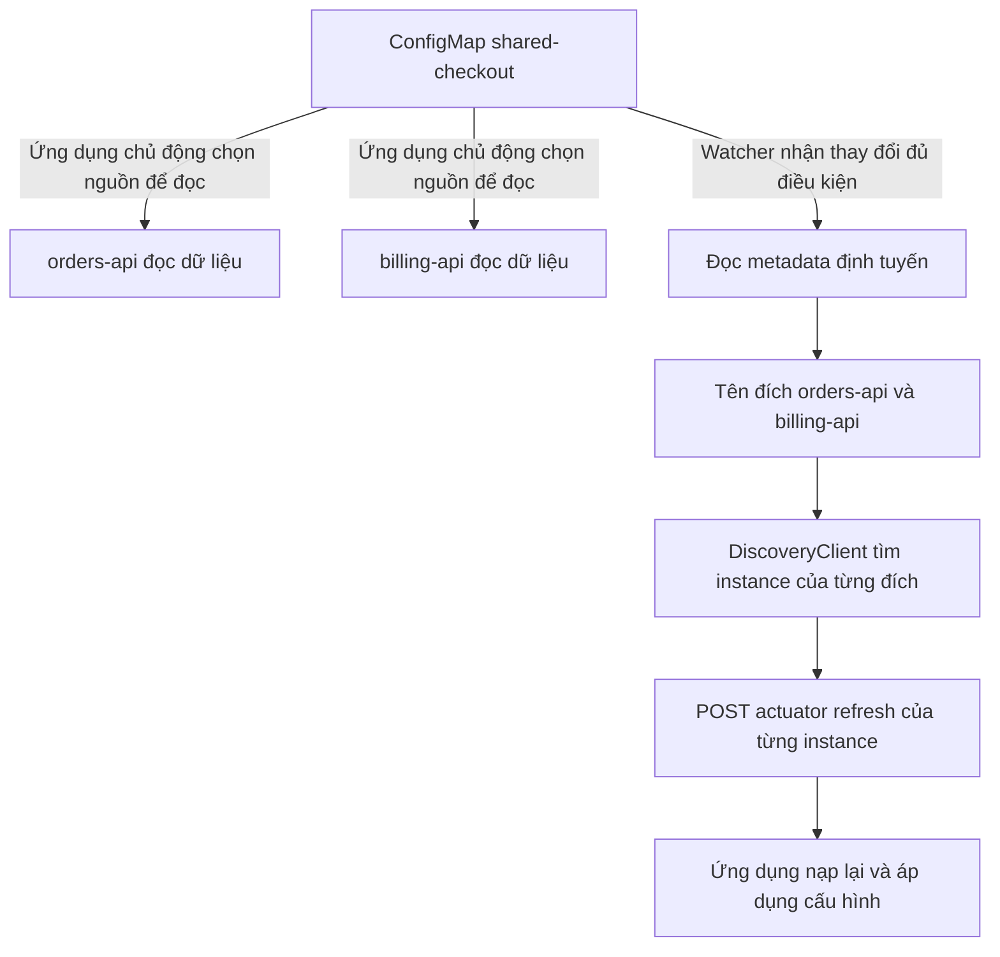

# Liên kết tài nguyên cấu hình với ứng dụng cần thông báo

## 1. Liên kết đúng là một phần của hợp đồng cấu hình

Giả sử ứng dụng chạy sau Kubernetes Service orders-api, nhưng ConfigMap của nó tên là orders-runtime. Bạn cập nhật ConfigMap, watcher thấy thay đổi, nhưng ứng dụng không nhận thông báo. Một nguyên nhân có thể là watcher đang tìm đích mang tên orders-runtime, trong khi Service mà DiscoveryClient tìm thấy lại là orders-api.

Đây là bài toán **liên kết tài nguyên nguồn với đích nhận thông báo**. Nó khác với việc ứng dụng biết đọc ConfigMap nào.

Trong module **SPRING_CLOUD_KUBERNETES**, bài thuộc chương **Configuration Watcher**. Mục tiêu là thiết kế, khai báo và kiểm chứng quan hệ giữa ConfigMap/Secret với các ứng dụng cần được thông báo, kể cả khi một nguồn được dùng chung.

Bài lấy Spring Cloud Kubernetes **3.3.x**, đặc biệt mã nguồn tag **3.3.3**, làm mốc cho các tên thuộc tính và hành vi cụ thể. Phần thực hành tập trung vào đường thông báo HTTP; khi dùng Spring Cloud Bus cần đối chiếu thêm định danh và cơ chế định tuyến của Bus.

Các manifest, lệnh và phản hồi trong bài là ví dụ cùng kết quả kỳ vọng. Chúng không phải bằng chứng đã được triển khai hoặc kiểm thử trên cluster.

## 2. Phân biệt ba quan hệ dễ bị gộp làm một

### 2.1. Quan hệ đọc dữ liệu

Ứng dụng đọc cấu hình từ đâu?

Ví dụ orders-api đọc orders-runtime và shared-checkout. Quan hệ này được tạo bởi cấu hình nguồn của ứng dụng, volume mount, Config Data import hoặc một cơ chế đọc được thiết kế rõ.

Nếu không có đường đọc đó, nhận thông báo refresh không tự làm ứng dụng biết một ConfigMap mới.

### 2.2. Quan hệ nguồn được watcher xử lý và đích cần thông báo

Watcher có quan sát nguồn không, nguồn có đủ điều kiện phát thông báo không, và danh sách ứng dụng nhận là gì?

Đây là trách nhiệm của namespace theo dõi, bộ lọc nếu được bật, label chọn nguồn và annotation định tuyến. Metadata này mô tả điều phối; nó không phải cấu hình đọc dữ liệu trong ứng dụng.

### 2.3. Quan hệ từ Service đến các instance

Ở đường HTTP, watcher phải tìm instance để gửi yêu cầu quản trị. Service, bộ chọn Pod, endpoint, cổng và đường dẫn actuator cùng tham gia bước này.



Các cạnh trên phải tương ứng với nhau theo thiết kế. Watcher không tự suy luận một đồ thị phụ thuộc hoàn chỉnh từ mọi volume mount hoặc từ toàn bộ PropertySource trong các ứng dụng.

Có thể dùng ba tập để rà soát thiết kế:

- **R(source):** những ứng dụng thực sự đọc nguồn.
- **D(source):** những ứng dụng cần thay đổi hành vi khi nguồn đổi.
- **N(source):** những đích watcher được cấu hình để thông báo.

Mục tiêu là N bao phủ đúng D. Thường D nằm trong R, nhưng một ứng dụng có đọc nguồn vẫn có thể không cần refresh động nếu chính sách của nó là triển khai lại. Đừng tạo fan-out chỉ vì “có thể sẽ cần”.

## 3. Hiểu đúng các tên xuất hiện trong một liên kết

| Tên hoặc trường | Trách nhiệm | Có tự thay thế đích HTTP không? |
| --- | --- | --- |
| ConfigMap/Secret metadata.name | Định danh tài nguyên nguồn | Được dùng làm đích mặc định khi không có danh sách đích hợp lệ |
| Tên khóa như application.yml trong data | Mô tả dữ liệu cấu hình được lưu | Không |
| spring.application.name | Định danh Spring, có thể tham gia chọn nguồn mặc định hoặc Bus | Không tự tạo Service cùng tên |
| Service metadata.name | Service ID mà Kubernetes DiscoveryClient sử dụng | Là tên cần đối chiếu ở đường HTTP |
| Deployment metadata.name | Định danh workload quản lý Pod | Không |
| Pod label như app: orders-api | Dữ liệu để selector chọn Pod | Không tự trở thành tên đích |
| Annotation apps trên tài nguyên nguồn | Danh sách tên đích watcher cần xử lý | Cần phù hợp với cơ chế phân giải đích |

DiscoveryClient của Spring Cloud Kubernetes truy vấn Service theo tên; tài liệu mô tả serviceId dựa trên Service metadata.name. Xem [DiscoveryClient for Kubernetes 3.3](https://docs.spring.io/spring-cloud-kubernetes/reference/3.3/discovery-client.html).

Ví dụ sau hoàn toàn có thể hợp lệ, nhưng cần cấu hình tường minh:

```text
Spring application name: orders-application
Deployment name:         orders-server
Service name:            orders-api
ConfigMap name:          orders-runtime
HTTP notification target: orders-api
```

Đặt các tên giống nhau giúp đơn giản hóa vận hành, nhưng không phải điều kiện bắt buộc của mọi kiến trúc. Khi khác nhau, tài liệu triển khai phải ghi rõ tên nào phục vụ bước nào.

Đặc biệt, một nhãn app: orders-api trong Pod không tạo ra Kubernetes Service orders-api. Service vẫn phải tồn tại và có selector phù hợp. Kubernetes dùng selector của Service để liên kết tới các Pod/endpoint liên quan. Xem [Kubernetes Service](https://kubernetes.io/docs/concepts/services-networking/service/).

## 4. Quy tắc định tuyến trong Configuration Watcher 3.3

### 4.1. Tách label chọn nguồn khỏi annotation chọn đích

Các tên metadata chính:

| Loại nguồn | Label cho phép phát thông báo | Annotation chỉ định ứng dụng đích |
| --- | --- | --- |
| ConfigMap | spring.cloud.kubernetes.config: "true" | spring.cloud.kubernetes.configmap.apps |
| Secret | spring.cloud.kubernetes.secret: "true" | spring.cloud.kubernetes.secret.apps |

Các hằng số tương ứng được khai báo trong [ConfigurationWatcherConfigurationProperties 3.3.3](https://github.com/spring-cloud/spring-cloud-kubernetes/blob/v3.3.3/spring-cloud-kubernetes-controllers/spring-cloud-kubernetes-configuration-watcher/src/main/java/org/springframework/cloud/kubernetes/configuration/watcher/ConfigurationWatcherConfigurationProperties.java).

Label trả lời “nguồn này có được xử lý để phát thông báo không?”. Annotation trả lời “cần thông báo cho các tên đích nào?”. Có annotation đúng nhưng nguồn không vượt qua điều kiện chọn vẫn chưa đủ.

Nếu bật bộ lọc informer của watcher theo tài liệu 3.3, nguồn còn cần label spring.cloud.kubernetes.config.informer.enabled: "true". Đây là một bước chọn nguồn khác; nó không thay cho label config/secret ở bảng trên. Xem [Configuration Watcher 3.3](https://docs.spring.io/spring-cloud-kubernetes/reference/3.3/spring-cloud-kubernetes-configuration-watcher.html).

### 4.2. Đích mặc định và danh sách tường minh

Trong WatcherUtil 3.3.3:

- Không có annotation tương ứng hoặc giá trị chỉ chứa khoảng trắng: danh sách đích không có phần tử, rồi watcher dùng metadata.name của nguồn.
- Có danh sách: tách bằng dấu phẩy, trim từng tên và dùng tập tên đó.
- Tên nguồn không tự được thêm vào danh sách tường minh.

Xem [WatcherUtil 3.3.3](https://github.com/spring-cloud/spring-cloud-kubernetes/blob/v3.3.3/spring-cloud-kubernetes-controllers/spring-cloud-kubernetes-configuration-watcher/src/main/java/org/springframework/cloud/kubernetes/configuration/watcher/WatcherUtil.java).

Ví dụ nguồn shared-checkout có annotation "orders-api,billing-api" thì các đích được khai báo là orders-api và billing-api; không phải ba đích gồm cả shared-checkout.

Để ngừng cho phép nguồn phát thông báo, quản lý label chọn nguồn theo chính sách triển khai. Không dùng annotation apps rỗng với ý nghĩa “không gửi cho ai”, vì nó có thể quay về quy tắc tên mặc định.

Liệt kê các tên rõ ràng; không coi annotation như một biểu thức label selector, wildcard, URL actuator hoặc một cú pháp namespace/name khi implementation không quy định như vậy. Tránh phần tử rỗng, dấu phẩy thừa và tên không tồn tại.

### 4.3. Metadata phải nằm đúng vị trí và đúng kiểu

```yaml
apiVersion: v1
kind: ConfigMap
metadata:
  name: orders-runtime
  namespace: watcher-link-lab
  labels:
    spring.cloud.kubernetes.config: "true"
  annotations:
    spring.cloud.kubernetes.configmap.apps: "orders-api"
data:
  orders-config.revision: "o1"
```

Trong ví dụ:

- Label và annotation nằm trên ConfigMap nguồn.
- Annotation không nằm trong data hoặc trong Pod template.
- Danh sách nhiều đích là một chuỗi phân tách bằng dấu phẩy, không phải YAML array.
- Giá trị label "true" được viết dưới dạng chuỗi.

Kubernetes annotation là metadata dạng cặp khóa/giá trị chuỗi. Việc đưa khóa apps vào data biến nó thành dữ liệu ứng dụng, không phải annotation mà watcher đang đọc. Xem [Kubernetes Annotations](https://kubernetes.io/docs/concepts/overview/working-with-objects/annotations/).

## 5. Ví dụ hoàn chỉnh về đồ thị phụ thuộc của hai ứng dụng

### 5.1. Đặt quan hệ đọc và quan hệ thông báo cạnh nhau

Trong namespace watcher-link-lab, giả định có hai ứng dụng Spring JVM:

| Nguồn | Ứng dụng thực sự đọc | Đích thông báo được thiết kế |
| --- | --- | --- |
| orders-runtime | orders-api | orders-api |
| billing-runtime | billing-api | billing-api |
| shared-checkout | orders-api, billing-api | orders-api, billing-api |

Mỗi ứng dụng có thể có nhiều replica. Tên đích biểu diễn nhóm ứng dụng qua Service ID, không phải tên một Pod cụ thể.

Đường đọc được minh họa bằng Kubernetes Config Data. Các ứng dụng cần starter Config tương thích với họ client đã chọn, Spring Boot Actuator và Spring Cloud Context phù hợp. Các phiên bản dependency phải do BOM tương thích của dự án quản lý.

Cấu hình của **orders-api**:

```yaml
spring:
  application:
    name: orders-api
  config:
    import: "kubernetes:"
  cloud:
    kubernetes:
      config:
        namespace: watcher-link-lab
        include-profile-specific-sources: false
        sources:
          - name: orders-runtime
          - name: shared-checkout
      secrets:
        enabled: false
      reload:
        enabled: false

management:
  endpoints:
    web:
      exposure:
        include: health,refresh
```

Cấu hình tương ứng của **billing-api**:

```yaml
spring:
  application:
    name: billing-api
  config:
    import: "kubernetes:"
  cloud:
    kubernetes:
      config:
        namespace: watcher-link-lab
        include-profile-specific-sources: false
        sources:
          - name: billing-runtime
          - name: shared-checkout
      secrets:
        enabled: false
      reload:
        enabled: false

management:
  endpoints:
    web:
      exposure:
        include: health,refresh
```

Hai block thuộc hai ứng dụng khác nhau. Ví dụ chỉ dùng ConfigMap nên tắt nguồn Secret; mỗi ứng dụng vẫn cần quyền API phù hợp cho đường đọc ConfigMap đã chọn. Cơ chế reload cũ trong ứng dụng được tắt để watcher là đường kích hoạt của baseline.

Danh sách config.sources là hợp đồng nạp nhiều ConfigMap; nó không tự tạo annotation thông báo trên các nguồn. Xem [Using a ConfigMap PropertySource 3.3](https://docs.spring.io/spring-cloud-kubernetes/reference/3.3/property-source-config/configmap-propertysource.html).

Import kubernetes: thuộc đường Config Data. Không bật thêm bootstrap như một đường nạp song song cho cùng ví dụ. Xem [Kubernetes PropertySource implementations 3.3](https://docs.spring.io/spring-cloud-kubernetes/reference/3.3/property-source-config.html).

Một phương án khác là mount file và import file. Khi đổi phương án, giữ nguyên nguyên tắc đối chiếu: mỗi đích nhận thông báo phải có đường đọc và áp dụng đúng nguồn mà nó phụ thuộc.

### 5.2. Manifest của các nguồn và Service đích

Manifest dưới đây mô tả **nguồn cùng Service**, không chứa Deployment của ứng dụng hoặc Deployment/RBAC của watcher. Điều kiện là các ứng dụng đã chạy HTTP trên cổng 8080 và các Pod có label app tương ứng.

Tạo namespace lab trước, rồi lưu manifest thực hành thành links.yaml:

```yaml
apiVersion: v1
kind: ConfigMap
metadata:
  name: orders-runtime
  namespace: watcher-link-lab
  labels:
    spring.cloud.kubernetes.config: "true"
    spring.cloud.kubernetes.config.informer.enabled: "true"
  annotations:
    spring.cloud.kubernetes.configmap.apps: "orders-api"
data:
  orders-config.revision: "o1"
---
apiVersion: v1
kind: ConfigMap
metadata:
  name: billing-runtime
  namespace: watcher-link-lab
  labels:
    spring.cloud.kubernetes.config: "true"
    spring.cloud.kubernetes.config.informer.enabled: "true"
  annotations:
    spring.cloud.kubernetes.configmap.apps: "billing-api"
data:
  billing-config.revision: "b1"
---
apiVersion: v1
kind: ConfigMap
metadata:
  name: shared-checkout
  namespace: watcher-link-lab
  labels:
    spring.cloud.kubernetes.config: "true"
    spring.cloud.kubernetes.config.informer.enabled: "true"
  annotations:
    spring.cloud.kubernetes.configmap.apps: "orders-api,billing-api"
data:
  checkout.policy-revision: "s1"
  checkout.max-items: "10"
---
apiVersion: v1
kind: Service
metadata:
  name: orders-api
  namespace: watcher-link-lab
spec:
  selector:
    app: orders-api
  ports:
    - name: http
      port: 8080
      targetPort: 8080
---
apiVersion: v1
kind: Service
metadata:
  name: billing-api
  namespace: watcher-link-lab
spec:
  selector:
    app: billing-api
  ports:
    - name: http
      port: 8080
      targetPort: 8080
```

Các khóa revision được chọn riêng để nhìn rõ nguồn nào đang tác động. Không dùng một khóa chung trùng tên giữa mọi nguồn rồi nhầm việc override với lỗi định tuyến.

Annotation một-nhiều trên shared-checkout không sao chép dữ liệu sang orders-runtime hoặc billing-runtime. Hai ứng dụng cùng chọn đọc shared-checkout; watcher chỉ dùng metadata để chọn đích thông báo.

### 5.3. Trường hợp tài nguyên theo profile hoặc tên phát hành

Một nguồn có tên orders-runtime-prod không tự có nghĩa phải tìm ứng dụng orders-runtime-prod. Nếu nguồn đó được orders-api thực sự sử dụng, có thể khai báo đích tường minh:

```yaml
apiVersion: v1
kind: ConfigMap
metadata:
  name: orders-runtime-prod
  namespace: watcher-link-lab
  labels:
    spring.cloud.kubernetes.config: "true"
    spring.cloud.kubernetes.config.informer.enabled: "true"
  annotations:
    spring.cloud.kubernetes.configmap.apps: "orders-api"
data:
  orders-config.revision: "prod-o1"
```

Đây là biến thể ngoài baseline: mục 5.1 đã tắt nguồn theo profile để giữ bài thực hành đơn giản. Trước khi dùng biến thể, phải xác nhận ứng dụng chọn nguồn này qua profile/source list thực tế; chỉ thêm annotation không khiến nó được nạp.

Cùng nguyên tắc đó áp dụng cho ConfigMap có hậu tố phiên bản hoặc hash. Đích thông báo thường là tên ứng dụng ổn định, còn nguồn ứng dụng thực sự tham chiếu có thể thay đổi theo phát hành.

### 5.4. Secret dùng cùng ý tưởng nhưng khác khóa metadata

Phần metadata minh họa của một Secret đã được quản lý bằng quy trình cấp bí mật riêng:

```yaml
metadata:
  name: checkout-client-token
  namespace: watcher-link-lab
  labels:
    spring.cloud.kubernetes.secret: "true"
    spring.cloud.kubernetes.config.informer.enabled: "true"
  annotations:
    spring.cloud.kubernetes.secret.apps: "orders-api,billing-api"
```

Đây chỉ là đoạn metadata, không phải manifest đầy đủ để cấp credential. Dùng khóa secret.apps cho Secret; không sao chép nhầm configmap.apps.

Danh sách hai đích chỉ đúng nếu cả hai ứng dụng cần áp dụng credential từ nguồn này. Nó không cấp quyền đọc Secret, không tạo mount và không bật API đọc Secret trong ứng dụng. Spring Cloud Kubernetes mặc định không bật tiêu thụ Secret qua API; đường tiêu thụ cần được cấu hình và phân quyền riêng. Xem [Secrets PropertySource 3.3](https://docs.spring.io/spring-cloud-kubernetes/reference/3.3/property-source-config/secrets-propertysource.html).

## 6. Đích HTTP phải phân giải thành đúng instance

### 6.1. Từ tên đích tới yêu cầu actuator

Trong HttpRefreshTrigger 3.3.3, appName được đưa vào getInstances(appName); watcher tạo URI actuator cho từng ServiceInstance rồi gửi POST. Đây là căn cứ để đối chiếu annotation với Service ID, thay vì tên Deployment. Xem [HttpRefreshTrigger 3.3.3](https://github.com/spring-cloud/spring-cloud-kubernetes/blob/v3.3.3/spring-cloud-kubernetes-controllers/spring-cloud-kubernetes-configuration-watcher/src/main/java/org/springframework/cloud/kubernetes/configuration/watcher/HttpRefreshTrigger.java).

Một Service tồn tại nhưng không có endpoint phù hợp vẫn có thể không cung cấp instance để thông báo. Một instance được tìm thấy nhưng sai cổng, sai path hoặc bị chặn truy cập cũng chưa nhận được yêu cầu thành công.

Đừng thay việc gửi đến từng instance bằng một lần POST tùy ý vào địa chỉ Service rồi coi mọi replica đều được refresh. Một lời gọi được cân bằng tải thường chỉ do một instance xử lý.

### 6.2. Namespace theo dõi nguồn và namespace discovery là hai phạm vi

Trong baseline, cấu hình watcher để cả hai phạm vi chỉ hướng tới watcher-link-lab. Các biến môi trường minh họa đặt trong Deployment **của watcher**, không phải của ứng dụng nhận:

```yaml
env:
  - name: SPRING_CLOUD_KUBERNETES_RELOAD_NAMESPACES_0
    value: "watcher-link-lab"
  - name: SPRING_CLOUD_KUBERNETES_DISCOVERY_NAMESPACES_0
    value: "watcher-link-lab"
  - name: SPRING_CLOUD_KUBERNETES_CONFIG_INFORMER_ENABLED
    value: "true"
```

Nguồn trong namespace A có thể được watcher quan sát trong khi discovery chỉ tìm Service trong namespace B. Điều đó phải là lựa chọn có chủ đích, được phân quyền và kiểm chứng, không phải hệ quả mong muốn chỉ vì annotation chứa đúng một tên.

DiscoveryClient hỗ trợ phạm vi namespace riêng và Service ID là tên Service. Khi nhiều namespace có Service trùng tên, phải kiểm tra các instance thật sự được trả về. Xem [DiscoveryClient: namespace và tên Service](https://docs.spring.io/spring-cloud-kubernetes/reference/3.3/discovery-client.html).

HttpRefreshTrigger 3.3.3 không truyền namespace của tài nguyên nguồn vào lời gọi getInstances(appName). Vì vậy, không xem tên đích đơn lẻ là một ranh giới cách ly theo namespace nguồn. Khi phục vụ nhiều môi trường, nên giới hạn phạm vi watcher/discovery theo thiết kế và kiểm tra va chạm tên.

Không sửa lỗi thiếu instance bằng cách mặc định bật all-namespaces. Trước hết xác định đúng namespace, Service, selector, quyền và các bộ lọc discovery đang dùng.

### 6.3. Cổng và đường dẫn actuator có metadata riêng

Nếu ứng dụng dùng cổng quản trị 9090 và base path /manage, phần metadata trên **Service** có thể là:

```yaml
metadata:
  name: orders-api
  namespace: watcher-link-lab
  annotations:
    boot.spring.io/actuator: "http://:9090/manage"
```

Đoạn trên chỉ trích metadata Service. Nó không cấu hình management.server.port hoặc base path trong Spring; ứng dụng phải thật sự phục vụ đường quản trị tương ứng, và watcher phải truy cập được.

Giá trị annotation là base path quản trị, không thêm sẵn /refresh. Watcher tạo endpoint theo strategy đang dùng. Mã HttpRefreshTrigger xử lý host của instance và metadata port/path, nên annotation này cũng không phải một URL tùy ý để chuyển thông báo đến hệ thống ngoài.

Với baseline cổng 8080 và /actuator, không cần tùy biến trên. Nếu dùng xác thực hoặc giới hạn mạng cho actuator, phải cấu hình đường truy cập được hỗ trợ cho watcher; việc expose endpoint không tự giải quyết quyền gọi nó.

### 6.4. Nếu dùng Spring Cloud Bus

Trong tag 3.3.3, BusRefreshTrigger dùng appName để tạo destination của remote application event. Do đó, khi đổi transport cần kiểm chứng định danh Bus và phạm vi consumer, không áp dụng máy móc kiểm tra Service HTTP. Xem [BusRefreshTrigger 3.3.3](https://github.com/spring-cloud/spring-cloud-kubernetes/blob/v3.3.3/spring-cloud-kubernetes-controllers/spring-cloud-kubernetes-configuration-watcher/src/main/java/org/springframework/cloud/kubernetes/configuration/watcher/BusRefreshTrigger.java).

Phần thực hành tiếp theo giữ đường HTTP để quan sát rõ nguồn, tên đích, instance và kết quả POST. Không bật đồng thời nhiều đường thông báo nếu chưa xác định cách tránh thao tác trùng.

## 7. Thực hành kiểm chứng liên kết trên từng instance

### 7.1. Chuẩn bị baseline có thể quan sát

Với namespace lab mới, tạo namespace và áp dụng nguồn cùng Service trước khi các ứng dụng cần đọc cấu hình khởi động:

```powershell
kubectl create namespace watcher-link-lab
kubectl apply -f ./links.yaml
```

Sau đó cần có:

- Hai ứng dụng orders-api và billing-api đã dùng cấu hình ở mục 5.1, mỗi ứng dụng có thể chạy hai replica để quan sát fan-out.
- Label của Pod khớp selector Service, cổng HTTP 8080 và actuator refresh hoạt động.
- Watcher 3.3.x chạy ở đường HTTP, có namespace theo dõi/discovery như mục 6.
- Quyền đọc nguồn của ứng dụng và quyền quan sát/discovery của watcher được cấp riêng theo nhu cầu.
- Một cách đọc trạng thái cấu hình không nhạy cảm trên từng Pod.

Manifest links.yaml không tự cung cấp các điều kiện còn lại. Nếu namespace đã tồn tại, chỉ dùng nó khi đã xác định đây là môi trường thực hành dành cho bài.

Endpoint refresh cần có chính sách truy cập phù hợp. Trong một lab cô lập, có thể dùng đường quản trị nội bộ được kiểm soát; khi áp dụng vào hệ thống thật, watcher phải có cách truy cập actuator tương thích với cơ chế xác thực và mạng của hệ thống.

### 7.2. Một endpoint quan sát giá trị sau refresh

Có thể thêm lớp sau vào package được component scan của cả hai ứng dụng:

```java
package example.checkout;

import java.util.Map;
import java.util.UUID;

import org.springframework.beans.factory.annotation.Value;
import org.springframework.cloud.context.config.annotation.RefreshScope;
import org.springframework.web.bind.annotation.GetMapping;
import org.springframework.web.bind.annotation.RestController;

@RestController
@RefreshScope
public class CheckoutConfigStateController {
    private final String application;
    private final String policyRevision;
    private final int maxItems;
    private final String targetId = UUID.randomUUID().toString();

    public CheckoutConfigStateController(
            @Value("${spring.application.name}") String application,
            @Value("${checkout.policy-revision}") String policyRevision,
            @Value("${checkout.max-items}") int maxItems) {
        this.application = application;
        this.policyRevision = policyRevision;
        this.maxItems = maxItems;
    }

    @GetMapping("/internal/config-state")
    public Map<String, Object> state() {
        return Map.of(
            "application", application,
            "policyRevision", policyRevision,
            "maxItems", maxItems,
            "targetId", targetId
        );
    }
}
```

Đây là endpoint do bài tự định nghĩa, không phải endpoint sẵn có của Spring Cloud Kubernetes. Nó cho thấy bộ giá trị nhận khi target controller được khởi tạo và giúp quan sát target sau refresh.

Bean refresh scope có thể được tạo lại khi được truy cập sau refresh. Consumer nghiệp vụ vẫn phải được kiểm chứng riêng; chỉ một controller trả giá trị mới chưa chứng minh mọi HTTP client hoặc connection pool đã đổi. Xem [Spring Cloud Context: Refresh Scope](https://docs.spring.io/spring-cloud-commons/reference/4.3/spring-cloud-commons/application-context-services.html#refresh-scope).

Endpoint không trả credential và không thay cho một chính sách validation đầy đủ của cấu hình nghiệp vụ.

### 7.3. Đối chiếu nguồn, đích và endpoint trước khi sửa data

```powershell
kubectl -n watcher-link-lab get configmap orders-runtime billing-runtime shared-checkout -o yaml
kubectl -n watcher-link-lab get service orders-api billing-api -o wide
kubectl -n watcher-link-lab get pods -l app=orders-api -o wide
kubectl -n watcher-link-lab get pods -l app=billing-api -o wide
kubectl -n watcher-link-lab get endpoints orders-api billing-api -o yaml
```

Với client dùng EndpointSlice, kiểm tra tài nguyên tương ứng của Service:

```powershell
kubectl -n watcher-link-lab get endpointslices -l kubernetes.io/service-name=orders-api -o yaml
kubectl -n watcher-link-lab get endpointslices -l kubernetes.io/service-name=billing-api -o yaml
```

Đối chiếu loại endpoint mà phiên bản discovery thực sự dùng. Chỉ nhìn thấy một EndpointSlice không tự chứng minh mọi implementation/client đang lấy instance từ đó.

Ghi baseline cho từng Pod. Trong một cửa sổ PowerShell riêng, chọn một tên Pod thực tế và chạy:

```powershell
$podName = 'THAY-BANG-TEN-POD-THUC'
kubectl -n watcher-link-lab port-forward pod/$podName 18080:8080
```

Giữ cửa sổ đó hoạt động. Từ cửa sổ khác:

```powershell
Invoke-RestMethod -Uri 'http://localhost:18080/internal/config-state'
```

Lặp lại với từng Pod, dùng cổng local khác nếu giữ nhiều phiên port-forward. Lưu tên Pod, policyRevision và targetId. Baseline của nguồn chung là s1 và maxItems là 10.

### 7.4. Cập nhật nguồn dùng chung, giữ nguyên liên kết

```powershell
kubectl -n watcher-link-lab edit configmap/shared-checkout
```

Chỉ thay phần data theo ví dụ:

```yaml
data:
  checkout.policy-revision: "s2"
  checkout.max-items: "12"
```

Giữ label và annotation như baseline. Sau đó quan sát log watcher bằng đúng tên Deployment của môi trường. Ví dụ nếu Deployment được đặt tên configuration-watcher:

```powershell
kubectl -n watcher-link-lab logs deployment/configuration-watcher --since=10m
```

Để thấy chi tiết lập lịch và gửi HTTP trong lab ConfigMap, có thể cấu hình mức log phù hợp cho package org.springframework.cloud.kubernetes.configuration.watcher. Các chuỗi log và mức log phải được đối chiếu với phiên bản đang chạy.

Cần phân biệt các bằng chứng:

| Bằng chứng | Điều xác nhận được |
| --- | --- |
| Tài nguyên có data s2 | API server đã lưu dữ liệu mới |
| Watcher xác định đích orders-api, billing-api | Liên kết nguồn → tên đích đã được đọc |
| Có các instance đích và yêu cầu POST | Discovery và bước gửi đã đi tiếp |
| Có kết quả HTTP cho từng instance | Endpoint quản trị có phản hồi tương ứng |
| Từng Pod trả s2 và 12 | Target quan sát đã nhận cấu hình mới |
| Consumer nghiệp vụ dùng giới hạn mới | Hành vi thực tế đã áp dụng theo yêu cầu |

Không coi log “đã lên lịch” là log “đã gửi thành công”. Nếu watcher có refresh delay, chờ theo cấu hình và quan sát kết quả thực tế; không chọn một lần sleep cố định làm bằng chứng mọi bước đã hoàn tất.

Với ứng dụng đọc file mount, còn phải xác nhận file của Pod đã cập nhật trước lần nạp lại. Kubernetes cập nhật volume ConfigMap theo cơ chế eventual consistency; env và mount subPath có các giới hạn cập nhật riêng. Xem [ConfigMaps: Mounted updates](https://kubernetes.io/docs/concepts/configuration/configmap/#mounted-configmaps-are-updated-automatically).

### 7.5. Thử các sai lệch có chủ đích trong lab

Thực hiện từng trường hợp riêng, ghi mốc thời gian và khôi phục baseline sau mỗi lần:

| Thay đổi | Kỳ vọng cần kiểm tra |
| --- | --- |
| orders-runtime thay o1 thành o2 | Tên đích thuộc nguồn này là orders-api |
| shared-checkout thay s1 thành s2 | Cả orders-api và billing-api thuộc danh sách đích |
| Bỏ annotation apps của shared-checkout rồi sửa data | Đích quay về tên shared-checkout; baseline không có Service đó |
| Chỉ đặt annotation thành orders-api rồi sửa nguồn chung | orders-api có trong danh sách; billing-api bị bỏ khỏi liên kết |
| Tắt label config rồi sửa data | Nguồn không đủ điều kiện phát thông báo theo label này |
| Giữ annotation đúng nhưng làm Service không có endpoint phù hợp | Cần phát hiện điểm đứt ở bước phân giải instance |
| Annotation đúng nhưng ứng dụng không đọc nguồn | Có thể nhận refresh mà không thay đổi giá trị nghiệp vụ mong muốn |

Ví dụ bỏ annotation:

```powershell
kubectl -n watcher-link-lab annotate configmap shared-checkout spring.cloud.kubernetes.configmap.apps-
```

Sau thao tác metadata, tạo một thay đổi data mới có revision riêng để kiểm chứng đường xử lý. Không dựa vào giả định mọi thay đổi annotation đều tự kích hoạt cùng một hành vi như thay đổi data.

Khôi phục danh sách đích trước khi phát hành một revision tiếp theo:

```powershell
kubectl -n watcher-link-lab annotate configmap shared-checkout 'spring.cloud.kubernetes.configmap.apps=orders-api,billing-api' --overwrite
kubectl -n watcher-link-lab label configmap shared-checkout spring.cloud.kubernetes.config=true --overwrite
kubectl -n watcher-link-lab label configmap shared-checkout spring.cloud.kubernetes.config.informer.enabled=true --overwrite
```

Việc sửa riêng một nguồn vẫn có thể làm refresh scope xử lý lại các target của instance được thông báo, dù bộ giá trị checkout không đổi. Vì vậy, dùng log nhận/gửi và đúng revision của nguồn đang thử để đánh giá liên kết; không chỉ đếm số targetId đổi.

Đừng suy rằng việc bỏ billing-api khỏi annotation là một cách kiểm soát quyền đọc nguồn. Nếu billing-api vẫn có đường đọc shared-checkout, nó có thể lấy dữ liệu mới khi khởi động lại hoặc khi một cơ chế khác kích hoạt refresh.

## 8. Quyền đọc dữ liệu, quyền quan sát và quyền thông báo khác nhau

Ba danh tính thường gặp:

| Danh tính | Nhiệm vụ |
| --- | --- |
| ServiceAccount của ứng dụng | Đọc nguồn qua API nếu dùng đường đó |
| ServiceAccount của watcher | Quan sát ConfigMap/Secret và tài nguyên discovery cần thiết |
| Danh tính truy cập actuator | Được phép thực hiện thao tác quản trị trên ứng dụng |

Với ứng dụng chỉ nhận file đã mount, không cần cấp quyền Kubernetes API cho container chỉ vì nó là đích HTTP. Với ứng dụng đọc ConfigMap qua API ở baseline, quyền đọc của nó phải phù hợp với danh sách sources.

RBAC quản lý quyền theo resource, verb và phạm vi; label chọn nguồn không tự tạo giới hạn quyền đọc ở API server. Xem [Kubernetes RBAC](https://kubernetes.io/docs/reference/access-authn-authz/rbac/).

Lệnh chẩn đoán mẫu nếu người vận hành có quyền impersonate và ServiceAccount watcher thực tế tên configuration-watcher:

```powershell
kubectl auth can-i watch configmaps -n watcher-link-lab --as=system:serviceaccount:watcher-link-lab:configuration-watcher
kubectl auth can-i list services -n watcher-link-lab --as=system:serviceaccount:watcher-link-lab:configuration-watcher
kubectl auth can-i list endpoints -n watcher-link-lab --as=system:serviceaccount:watcher-link-lab:configuration-watcher
```

Kết quả can-i chỉ trả lời thao tác cụ thể vừa hỏi, không xác nhận toàn bộ quyền cần cho mọi client hoặc mọi loại nguồn. Nếu theo dõi Secret, kiểm tra chính sách riêng; không cấp quyền rộng toàn cluster chỉ để vượt qua một lỗi thiếu quyền.

Annotation định tuyến cũng là một phần của cấu hình điều phối có tác động vận hành. Người có quyền sửa nó có thể thay đổi nhóm ứng dụng nhận thao tác refresh trong phạm vi watcher thực thi được. Đội sở hữu nguồn cần kiểm soát thay đổi danh sách này cùng với nội dung cấu hình.

## 9. Chẩn đoán liên kết sai theo từng bước

| Hiện tượng | Hướng kiểm tra ưu tiên |
| --- | --- |
| Watcher không xử lý nguồn | Namespace nguồn, label chọn nguồn và bộ lọc informer nếu bật |
| Có apps nhưng đích không đúng | Khóa annotation có đúng loại ConfigMap/Secret, đúng metadata và đúng chuỗi không? |
| Watcher dùng tên ConfigMap ngoài dự kiến | Annotation thiếu hoặc rỗng, hoặc cấu hình ở sai vị trí |
| Tên đích là tên Deployment | Đối chiếu lại Service ID ở đường HTTP |
| Không có instance đích | Phạm vi discovery, Service, selector, endpoint và RBAC |
| Instance đúng nhưng POST thất bại | Cổng/path actuator, endpoint exposure, xác thực và kết nối mạng |
| POST thành công nhưng giá trị cũ | Nguồn có được ứng dụng nạp, có override, có refresh đúng bean và client không? |
| Một app dùng chung không được cập nhật | Đồ thị phụ thuộc đã đổi nhưng annotation hoặc nguồn của app chưa đổi |
| Một phần replica còn cũ | Kết quả gửi theo từng instance, vòng đời Pod và trạng thái áp dụng thực tế |
| Có thông báo sang môi trường khác | Phạm vi discovery nhiều namespace và Service trùng tên |
| Quá nhiều lần refresh không cần thiết | Danh sách đích rộng, nhiều watcher hoặc nhiều đường kích hoạt chồng nhau |

Một nguồn chung có thể tác động nhiều replica. Khi thêm một ứng dụng vào danh sách, đánh giá cả số instance nhận thao tác, chi phí tái tạo tài nguyên và khả năng những app đó có hợp đồng cấu hình khác nhau.

Không mở rộng danh sách đích như một cách chữa chung cho việc “chưa thấy cập nhật”. Tìm điểm đứt bằng bằng chứng, rồi sửa quan hệ đọc, chọn nguồn, định tuyến hoặc áp dụng tương ứng.

## 10. Giữ liên kết nhất quán theo vòng đời phát hành

Bảng ánh xạ của một nguồn nên ghi rõ:

- Namespace, loại và tên tài nguyên.
- Các ứng dụng đang đọc nó cùng cách đọc.
- Những ứng dụng cần cập nhật động và tên đích theo transport.
- Label/annotation được quản lý trong manifest.
- Phạm vi discovery, đường quản trị và danh tính có quyền truy cập.
- Bằng chứng cần có để xác nhận từng replica áp dụng phiên bản mới.

Khi thêm hoặc bỏ một consumer, cập nhật cả source list/mount và danh sách thông báo theo hợp đồng mới. Khi đổi tên Service, rà lại annotation; khi đổi tên ConfigMap, rà lại đường đọc và hành vi fallback theo tên. Hai thay đổi đó không tự thay thế cho nhau.

Nếu nguồn cấu hình có phiên bản, chuyển tham chiếu của ứng dụng và metadata thông báo theo quy trình phát hành có kiểm soát. Thông báo tới một ứng dụng đang tham chiếu nguồn cũ không tự chuyển nó sang nguồn mới.

Liên kết đạt mục tiêu khi có thể lần theo một thay đổi từ **đúng tài nguyên**, qua **đúng tên đích**, tới **đúng tập instance**, rồi kiểm chứng **đúng hành vi cần thay đổi**. DiscoveryClient giúp tìm instance, Configuration Watcher giúp phát thông báo, còn ứng dụng chịu trách nhiệm đọc và áp dụng dữ liệu theo cơ chế được hỗ trợ. Chỉ bổ sung các tính năng Spring Cloud Kubernetes mà đường triển khai thực sự cần.
