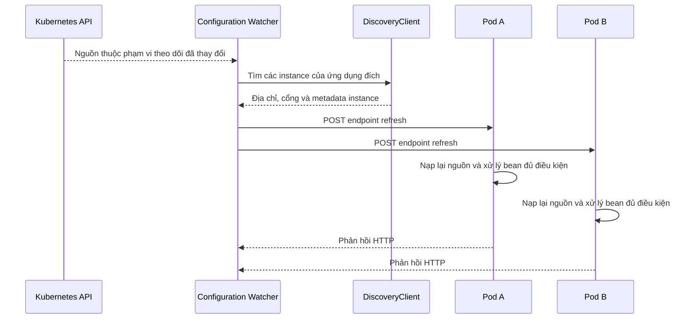

# Thông báo qua HTTP và điều kiện endpoint refresh

## Mục tiêu và bối cảnh

Trong chương **Configuration Watcher** của module **SPRING_CLOUD_KUBERNETES**, thông báo HTTP là một đường nối từ thay đổi ConfigMap hoặc Secret đến ứng dụng Spring đang chạy. Đường nối này chỉ hữu ích khi Watcher tìm đúng instance, gọi đúng endpoint và ứng dụng có khả năng áp dụng cấu hình mới.

Sau bài học, bạn có thể:

- Mô tả chuỗi phát hiện thay đổi, khám phá instance và gửi thông báo HTTP.
- Xác định các điều kiện để endpoint refresh tồn tại, được expose và nhận được `POST` từ Watcher.
- Ghép đúng địa chỉ, cổng và đường dẫn khi tách cổng nghiệp vụ với cổng quản trị.
- Phân biệt quyền Kubernetes API, quyền mạng và quyền HTTP của ứng dụng.
- Kiểm chứng thay đổi trên từng Pod thay vì chỉ dựa vào mã HTTP thành công.

Ví dụ xuyên suốt là `inventory-service`: cổng nghiệp vụ `8080`, cổng quản trị `8081`, Actuator base path `/manage`. ConfigMap `inventory-config` chứa một thông điệp không mật và mã phiên bản cấu hình. Mục tiêu là Watcher gửi thông báo đến từng instance để ứng dụng đọc lại nguồn này.

## 1. HTTP notification thực hiện công việc gì?

Trong chế độ HTTP, Configuration Watcher dùng thông tin khám phá dịch vụ để tìm các instance đích và gửi `POST` đến endpoint refresh. Mặc định, đường dẫn là `/actuator/refresh` và cổng được lấy theo thông tin discovery. Có thể cấu hình lại khi ứng dụng dùng management port hoặc base path khác. Xem [Spring Cloud Kubernetes Configuration Watcher](https://docs.spring.io/spring-cloud-kubernetes/reference/spring-cloud-kubernetes-configuration-watcher.html).

Luồng khái quát:



Sơ đồ biểu diễn trách nhiệm, không cam kết thứ tự gửi hoặc mức song song của mọi phiên bản triển khai.

Thông báo không nên được hiểu là Watcher gửi password mới hoặc toàn bộ nội dung ConfigMap trong request body. Ứng dụng phải có sẵn đường đọc cấu hình của nó, chẳng hạn Config Data đọc volume hoặc PropertySource đọc API. Notification là yêu cầu kiểm tra/nạp lại, còn dữ liệu đến từ nguồn được ứng dụng cấu hình.

Một lời gọi kiểm tra tương đương về ý nghĩa có thể có dạng:

```http
POST /manage/refresh HTTP/1.1
Host: <dia-chi-instance>:8081
Content-Type: application/json

{}
```

Body `{}` minh họa cho thao tác kiểm tra thủ công; không phải yêu cầu khai báo giá trị cấu hình mới. Header và body thực tế của HTTP client trong Watcher phải được đối chiếu với phiên bản sử dụng.

## 2. Có ba nhóm điều kiện cần kiểm tra riêng

### 2.1. Watcher có phát thông báo cho đúng đích không?

- Nguồn thuộc namespace và phạm vi theo dõi đã cấu hình.
- ConfigMap hoặc Secret đáp ứng điều kiện chọn nguồn của Watcher.
- Tên hoặc metadata dùng để xác định ứng dụng đích là chính xác.
- Discovery tìm được instance đang hoạt động trong phạm vi mong muốn.

Trong ví dụ, ConfigMap và ứng dụng có tên khác nhau. Vì vậy, phải khai báo ánh xạ đích phù hợp, thay vì mong Watcher tự suy ra từ tên volume hoặc tên Deployment.

### 2.2. Request có tới được endpoint không?

- Địa chỉ instance định tuyến được từ Pod của Watcher.
- Cổng callback là cổng tiến trình thực sự lắng nghe.
- Scheme HTTP/HTTPS và đường dẫn khớp với ứng dụng.
- Cấu hình mạng, proxy, service mesh, TLS và chính sách truy cập cho phép request.
- Xác thực, phân quyền và xử lý CSRF phù hợp với HTTP client gửi thông báo.

### 2.3. Endpoint có áp dụng được thay đổi không?

- Thành phần Spring Cloud cung cấp endpoint refresh đang có trong ứng dụng và tương thích phiên bản.
- Nguồn cấu hình mới có thể được đọc lại.
- Bean/client tiêu thụ được thiết kế để nhận thay đổi.
- Có bằng chứng từ đối tượng đang phục vụ rằng phiên bản mới đã được dùng.

Một lỗi ở nhóm thứ ba không được giải quyết bằng cách mở thêm cổng. Một lỗi ở nhóm thứ nhất không được giải quyết bằng cách tắt bảo vệ endpoint.

## 3. Điều kiện để endpoint refresh có mặt

### Có Actuator chưa đủ

Spring Boot Actuator cung cấp nền tảng quản trị; endpoint refresh trong ngữ cảnh bài học đến từ Spring Cloud Context. Nếu ứng dụng chỉ có Actuator, thêm `refresh` vào danh sách exposure không tự tạo ra endpoint đó.

Ứng dụng JVM thực hành cần Spring Web, Actuator và thành phần Spring Cloud Context. Có thể dùng các starter phù hợp như `spring-boot-starter-web`, `spring-boot-starter-actuator` và `spring-cloud-starter`, được quản lý bằng bộ phiên bản Spring Boot/Spring Cloud tương thích. Nếu đã dùng một starter Spring Cloud Kubernetes kéo theo những thành phần này, kiểm tra dependency thực tế thay vì thêm nhiều starter trùng vai trò.

Không cần cài DiscoveryClient vào chính ứng dụng chỉ để nó nhận một `POST` đến refresh. Watcher cần khả năng tìm instance; ứng dụng nhận cần endpoint và đường đọc cấu hình. Hai trách nhiệm có thể được triển khai độc lập.

### Bốn khái niệm khác nhau: tồn tại, cho phép thao tác, expose và authorize

| Khái niệm | Câu hỏi | Ví dụ lỗi |
| --- | --- | --- |
| Thành phần endpoint | Auto-configuration có tạo refresh endpoint không? | Thiếu Spring Cloud Context |
| Tình trạng cho phép endpoint | Cấu hình endpoint/access có cho thao tác ghi không? | Tính năng bị tắt hoặc mức access chỉ đọc |
| HTTP exposure | Endpoint có được ánh xạ ra HTTP không? | Chỉ expose `health` |
| Authorization | Caller này có được thực hiện thao tác không? | Watcher không có danh tính hoặc quyền phù hợp |

Tên thuộc tính điều khiển enabled/access có thể khác theo thế hệ Spring Boot. Với bản hỗ trợ giới hạn access toàn cục, một giới hạn chỉ đọc có thể chặn thao tác ghi dù endpoint nằm trong exposure. Cần đọc theo phiên bản đang chạy. Cơ chế endpoint và exposure được mô tả tại [Spring Boot Actuator Endpoints](https://docs.spring.io/spring-boot/reference/actuator/endpoints.html).

Không mở `env`, `configprops`, `restart`, `shutdown` hoặc `*` chỉ để làm cho refresh hoạt động. Bài này sử dụng chiến lược refresh, không chuyển sang gọi shutdown để xử lý một endpoint bị thiếu.

## 4. Cấu hình ứng dụng và nguồn trong ví dụ

### 4.1. Cấu hình khởi động của `inventory-service`

```yaml
spring:
  application:
    name: inventory-service
  config:
    import: "file:/etc/inventory/application.yaml"

server:
  port: 8080

management:
  server:
    port: 8081
  endpoints:
    web:
      base-path: /manage
      exposure:
        include: health,refresh
  endpoint:
    health:
      show-details: never
```

Giả định không có `management.server.base-path`, context path bổ sung hoặc path mapping riêng cho refresh. Khi đó, URL của refresh trên mỗi instance có dạng:

```text
http://<dia-chi-Pod>:8081/manage/refresh
```

Mẫu xác định đường dẫn và exposure, chưa khai báo đầy đủ chính sách xác thực. Trong lab, phải chọn một đường bảo vệ phù hợp ở phần sau và kiểm tra từ đúng nguồn gọi. Nếu Spring Security đã nằm trên classpath, không được giả định endpoint tự cho phép Watcher truy cập.

Không bind management server chỉ vào `127.0.0.1` nếu Watcher ở Pod khác cần gọi trực tiếp. Gọi từ trong container hoặc qua một công cụ chuyển tiếp có thể thành công trong khi kết nối từ Pod ngoài không tới được listener.

### 4.2. ConfigMap chứa dữ liệu không mật

```yaml
apiVersion: v1
kind: ConfigMap
metadata:
  name: inventory-config
  namespace: training-watcher
  labels:
    spring.cloud.kubernetes.config: "true"
  annotations:
    spring.cloud.kubernetes.configmap.apps: "inventory-service"
data:
  application.yaml: |
    inventory:
      config-version: inventory-v1
      message: "Kiểm tra tồn kho trước khi xác nhận"
```

Nhãn chọn nguồn và annotation chọn ứng dụng đích là hai mục đích khác nhau. Annotation `*.apps` chứa tên ứng dụng mà Watcher sẽ tìm qua discovery; nó không thay đổi giá trị `spring.application.name` trong ứng dụng.

Nếu hệ thống sử dụng cách chọn đích bằng metadata labels thay cho tên, cần kiểm tra hỗ trợ của phiên bản, nhãn được đưa vào `ServiceInstance` và tiền tố metadata nếu có. Đừng thêm đồng thời nhiều cơ chế chọn đích mà không biết cơ chế nào được ưu tiên.

Tệp được mount bằng volume thông thường, không dùng `subPath`. Phần sau là trích đoạn Pod template, không phải Deployment đầy đủ:

```yaml
spec:
  template:
    spec:
      containers:
        - name: inventory-service
          ports:
            - name: http
              containerPort: 8080
            - name: management
              containerPort: 8081
          volumeMounts:
            - name: inventory-config
              mountPath: /etc/inventory
              readOnly: true
      volumes:
        - name: inventory-config
          configMap:
            name: inventory-config
            items:
              - key: application.yaml
                path: application.yaml
```

`containerPort: 8081` chỉ khai báo thông tin cổng trong Pod specification, không tự tạo listener. Chính `management.server.port` và tiến trình ứng dụng tạo listener thực tế.

### 4.3. Chỉ đọc tệp không đòi hỏi ứng dụng đọc API

Kubelet cấp volume theo khai báo của Pod. Trong thiết kế chỉ đọc tệp, ứng dụng không cần quyền API ConfigMap/Secret chỉ cho thao tác đó. Nếu không có tính năng khác cần token Kubernetes, có thể cân nhắc tắt tự động mount token của ServiceAccount ứng dụng.

Watcher là thành phần khác: nó cần quyền phù hợp để theo dõi nguồn và khám phá instance. Không sao chép quyền của Watcher sang mọi ứng dụng chỉ vì cả hai cùng tham gia cập nhật cấu hình.

## 5. Ghép đúng địa chỉ, management port và base path

### 5.1. Mặc định chỉ đúng khi ứng dụng cũng dùng mặc định

Nếu discovery cung cấp cổng nghiệp vụ `8080` nhưng refresh nằm ở `8081`, lời gọi mặc định đến cổng discovery sẽ sai. Nếu base path là `/manage` nhưng Watcher gọi `/actuator/refresh`, sai đường dẫn vẫn xảy ra dù mạng và xác thực đều đúng.

Các thành phần của URL cần được ghi nhận rõ:

| Thành phần | Trong ví dụ | Nguồn quyết định |
| --- | --- | --- |
| Scheme | `http` | Cấu hình truyền và listener/proxy thực tế |
| Host | Địa chỉ của instance được khám phá | Discovery và đường định tuyến |
| Port | `8081` | Cổng management, được cung cấp cho Watcher |
| Actuator base path | `/manage` | Cấu hình ứng dụng và metadata/cấu hình Watcher |
| Endpoint | `refresh` | Endpoint được gọi trong chiến lược refresh |

Port được khai báo trên Service, `targetPort`, cổng listener và cổng trong `ServiceInstance` không nên bị coi là cùng một giá trị một cách mặc định. Đối chiếu địa chỉ callback cuối cùng trong quan sát của Watcher với socket thật ở Pod.

### 5.2. Cung cấp metadata cho Service

Tài liệu Watcher hỗ trợ annotation `boot.spring.io/actuator` trên Service cho management port hoặc Actuator path khác mặc định. Ví dụ phù hợp với ứng dụng ở trên:

```yaml
apiVersion: v1
kind: Service
metadata:
  name: inventory-service
  namespace: training-watcher
  labels:
    app: inventory-service
  annotations:
    boot.spring.io/actuator: "http://:8081/manage"
spec:
  selector:
    app: inventory-service
  ports:
    - name: http
      port: 8080
      targetPort: 8080
```

Cú pháp URI với phần host để trống là metadata theo cách Watcher mô tả, không phải URL để người dùng dán vào trình duyệt. Host của lời gọi phải đến từ instance. Giá trị biểu diễn base quản trị; không thêm `/refresh` vào base rồi vô tình tạo đường dẫn lặp endpoint.

Trong mẫu này, Service có cổng nghiệp vụ; callback được cấu hình tới cổng management của từng instance. Không bắt buộc biến management port thành cổng công khai của Service hoặc Ingress chỉ để Watcher gọi trực tiếp Pod. Cần xác minh đường discovery và callback của triển khai đang dùng. Tham khảo [Watcher: Non-Default Management Port and Actuator Path](https://docs.spring.io/spring-cloud-kubernetes/reference/spring-cloud-kubernetes-configuration-watcher.html#_non_default_management_port_and_actuator_path).

### 5.3. Cấu hình chung trên Watcher là một lựa chọn khác

Nếu nhiều ứng dụng có cùng quy ước cổng/path, có thể cấu hình thuộc tính tương ứng trên chính Watcher:

```yaml
spring:
  cloud:
    kubernetes:
      configuration:
        watcher:
          actuator-port: 8081
          actuator-path: /manage
```

Các tên YAML trên dùng kiểu kebab-case cho `actuatorPort` và `actuatorPath` được tài liệu mô tả. Đây là cấu hình của Watcher, không phải cấu hình tạo endpoint trong ứng dụng.

Nếu dùng đồng thời metadata và cấu hình chung, kiểm tra thứ tự ưu tiên trong phiên bản cụ thể và quan sát URL cuối cùng. Với nhóm ứng dụng có cổng/path khác nhau, metadata theo Service thường thể hiện khác biệt rõ hơn một giá trị chung áp cho tất cả.

### 5.4. Listener và đường dẫn phải khớp trong ứng dụng

Khi tách management port, cách ghép base path chịu ảnh hưởng của `management.server.base-path`; khi dùng chung cổng, servlet context path hoặc WebFlux base path có thể tham gia vào đường dẫn. Đừng chỉ sửa annotation của Watcher mà bỏ qua route thực tế của server. Xem [Spring Boot Monitoring and Management Over HTTP](https://docs.spring.io/spring-boot/reference/actuator/monitoring.html).

Nếu ánh xạ endpoint refresh sang tên khác, Watcher không mặc nhiên suy ra tên mới đó. Cần kiểm tra khả năng cấu hình URL/chiến lược hoặc khôi phục một hợp đồng endpoint thống nhất.

## 6. Discovery quyết định tập instance được thông báo

HTTP callback của Watcher cần danh sách các instance, không chỉ một địa chỉ cân bằng tải chung. Một request thủ công đến Service có thể chỉ đi tới một Pod; gọi lặp nhiều lần không chứng minh đã chạm đủ replica.

Tên `inventory-service` trong ví dụ được dùng nhất quán ở cấu hình ứng dụng, Service và annotation chọn đích. Đây là quy ước giúp tránh mơ hồ, không phải Kubernetes bắt buộc mọi tên tài nguyên phải giống nhau. Nếu thay một trong các tên, phải xem chính xác tên nào discovery đang dùng làm service id.

Kiểm tra Service selector, endpoint được công bố, namespace và trạng thái instance. Các cách triển khai DiscoveryClient có lựa chọn về metadata, cổng và phạm vi tìm kiếm; đối chiếu tài liệu đúng client thay vì suy đoán từ tên Deployment. Xem [DiscoveryClient for Kubernetes](https://docs.spring.io/spring-cloud-kubernetes/reference/discovery-client.html).

Spring Cloud LoadBalancer giải quyết việc chọn một instance cho lời gọi dịch vụ thông thường. Nó không biến một lần gọi refresh qua Service thành thao tác phát đến tất cả Pod. Khả năng phát thông báo theo từng instance phải được kiểm tra ở Watcher.

## 7. Bảo vệ HTTP: xác thực, phân quyền và CSRF

### 7.1. Quyền Kubernetes API không phải quyền của endpoint

Một ServiceAccount được phép `watch configmaps` chỉ có quyền tương ứng ở Kubernetes API. Quyền đó không tự được ứng dụng diễn giải thành quyền gọi `POST /manage/refresh`.

Tương tự, một token của Kubernetes không tự trở thành bearer token mà Spring Security chấp nhận. Nếu ứng dụng cần JWT, Basic authentication, mTLS hoặc danh tính qua proxy, đường gửi HTTP phải thực sự đáp ứng cơ chế đó.

Không giả định rằng tạo một Secret chứa username/password hoặc đặt một biến môi trường bất kỳ vào Watcher là client sẽ tự thêm `Authorization`. Cần kiểm tra HTTP client và tùy chọn tích hợp được hỗ trợ của đúng phiên bản. Nếu client chuẩn không đáp ứng yêu cầu, lựa chọn một tích hợp có kiểm chứng, chẳng hạn đường mTLS của nền tảng hoặc thành phần bổ sung được kiểm soát; không giữ cấu hình xác thực trên server mà bỏ trống phần caller.

### 7.2. Chọn rõ mô hình bảo vệ cho đường quản trị

| Mô hình | Điều phải cấu hình | Điều chưa được bảo đảm chỉ bởi mô hình đó |
| --- | --- | --- |
| Cô lập mạng quản trị | Chỉ nguồn được phép tới cổng management, không public qua Ingress | Danh tính ở mức ứng dụng nếu ai đó vào được vùng mạng |
| Xác thực/phân quyền tại ứng dụng | Caller có thông tin xác thực hợp lệ và quyền refresh | Đường mạng, TLS và khả năng client gửi đúng thông tin |
| mTLS hoặc chính sách service mesh | Danh tính workload, trust và authorization đúng đường gọi | Bean có refresh được hay cấu hình mới đã tới Pod |

Có thể kết hợp các lớp. Trong lab chỉ dùng mạng nội bộ, phải xác định rõ cổng management được bảo vệ bởi chính sách nào. Trong hệ thống yêu cầu xác thực danh tính, cần kiểm thử đúng danh tính của Watcher; lời gọi thành công bằng tài khoản quản trị cá nhân không chứng minh Watcher có quyền.

### 7.3. Vì sao POST có thể bị `403` dù đăng nhập được?

CSRF là một nguyên nhân thường gặp. Endpoint refresh thay đổi trạng thái ứng dụng nên dùng `POST`; cơ chế CSRF mặc định của Spring Security có thể từ chối request thiếu token phù hợp.

Nếu đường quản trị là lời gọi máy tới máy và đã có mô hình bảo vệ thích hợp, có thể cấu hình ngoại lệ CSRF hẹp cho endpoint đó theo thiết kế bảo mật. Không tắt CSRF toàn ứng dụng chỉ để một callback hoạt động, nhất là ứng dụng còn dùng cookie/session cho giao diện người dùng. Xem [Spring Security CSRF](https://docs.spring.io/spring-security/reference/servlet/exploits/csrf.html).

Một hợp đồng phân quyền có thể được mô tả như sau:

```text
POST endpoint refresh:
  - chỉ chấp nhận caller thuộc nhóm được cấp quyền làm mới cấu hình
  - áp dụng cơ chế xác thực mà HTTP client đã hỗ trợ thực tế
  - xử lý CSRF riêng theo mô hình máy tới máy đã chọn
Các endpoint và luồng trình duyệt khác:
  - giữ quy tắc bảo vệ phù hợp của chúng
```

Đây là hợp đồng thiết kế, không phải đoạn cấu hình Spring Security có thể dán để chạy cho mọi phiên bản. Khi bổ sung `SecurityFilterChain`, phải kiểm tra cả các route còn lại của ứng dụng, vì cơ chế auto-configuration có thể nhường quyền điều khiển cho cấu hình tùy biến.

CORS chủ yếu liên quan đến trình duyệt. Sửa CORS không thay thế xử lý authorization hoặc CSRF cho Watcher, vốn là một HTTP client máy tới máy.

## 8. Mạng và TLS phải phù hợp với callback thực tế

### 8.1. Mẫu NetworkPolicy cho lab cùng namespace

Giả định Pod ứng dụng có nhãn `app: inventory-service`, Pod Watcher có nhãn `app: configuration-watcher`, và các client nghiệp vụ trong lab có nhãn `role: inventory-client`. Mẫu sau cho Watcher tới cổng quản trị, đồng thời khai báo riêng đường client nghiệp vụ tới `8080`:

```yaml
apiVersion: networking.k8s.io/v1
kind: NetworkPolicy
metadata:
  name: inventory-ingress
  namespace: training-watcher
spec:
  podSelector:
    matchLabels:
      app: inventory-service
  policyTypes:
    - Ingress
  ingress:
    - from:
        - podSelector:
            matchLabels:
              app: configuration-watcher
      ports:
        - protocol: TCP
          port: 8081
    - from:
        - podSelector:
            matchLabels:
              role: inventory-client
      ports:
        - protocol: TCP
          port: 8080
```

Các nhãn là quy ước của lab và phải được gắn đúng vào workload thực tế. `podSelector` trong các nguồn trên chọn Pod cùng namespace. Nếu Watcher ở namespace khác, cần mô tả nguồn liên namespace đúng cách thay vì sao chép nguyên mẫu này.

Policy chọn Pod đích và giới hạn ingress; các caller nghiệp vụ khác không đáp ứng quy tắc sẽ cần được thiết kế thêm. Đây không phải policy đầy đủ của mọi hệ thống production. Nếu Watcher đang bị giới hạn egress, còn phải cho phép đường ra tương ứng, cùng DNS và đường Kubernetes API cần thiết.

NetworkPolicy cần plugin mạng hỗ trợ thực thi. Những policy cùng áp dụng có tính cộng gộp: một policy khác cho phép rộng hơn có thể khiến kết quả khác với mong đợi khi chỉ đọc mẫu này. NetworkPolicy kiểm soát mạng, không kiểm tra danh tính người dùng hay quyền của từng URL. Xem [Kubernetes Network Policies](https://kubernetes.io/docs/concepts/services-networking/network-policies/).

Người có quyền tạo hoặc sửa Pod để gắn nhãn nguồn cũng có thể ảnh hưởng tới ranh giới dựa trên nhãn. Vì thế quyền triển khai và mô hình danh tính workload phải được xét cùng chính sách mạng.

### 8.2. HTTPS và service mesh

Nếu management listener dùng HTTPS, scheme của callback phải tương ứng và HTTP client phải tin chuỗi chứng thư. Khi gọi thẳng địa chỉ Pod, một chứng thư chỉ cấp cho DNS của Service có thể không khớp tên đích mà client đang xác minh.

Cần thiết kế danh tính và đường gọi phù hợp: chứng thư đúng tên, proxy hoặc mesh có cơ chế định danh tương ứng. Không dùng việc tắt kiểm tra chứng thư như cách sửa mặc định. mTLS của mesh còn có thể chặn request dù cấu hình ứng dụng và NetworkPolicy đều đúng.

Quan sát địa chỉ đích ở đường gửi thực tế. Một URL công khai qua Ingress có thể đi qua rewrite, login hoặc cân bằng tải khác hoàn toàn callback trực tiếp đến instance.

## 9. Bean đủ điều kiện và bằng chứng áp dụng

### 9.1. Một bean minh họa cho cấu hình không mật

Mẫu sau dùng `@RefreshScope` để đối tượng đích có thể được tạo lại sau refresh:

```java
import org.springframework.beans.factory.annotation.Value;
import org.springframework.cloud.context.config.annotation.RefreshScope;
import org.springframework.stereotype.Component;

@Component
@RefreshScope
public class InventoryMessage {
    private final String version;
    private final String message;

    public InventoryMessage(
            @Value("${inventory.config-version}") String version,
            @Value("${inventory.message}") String message) {
        if (version.isBlank() || message.isBlank()) {
            throw new IllegalArgumentException("Thiếu cấu hình thông điệp tồn kho");
        }
        this.version = version;
        this.message = message;
    }

    public Snapshot snapshot() {
        return new Snapshot(version, message);
    }

    public record Snapshot(String appliedVersion, String message) {
    }
}
```

Đặt lớp trong package được Spring quét. Lớp và phương thức cần được proxy không để `final`. Record ở đây chỉ là giá trị trả về không mật, không phải một record cấu hình được giả định có thể rebind.

Một controller dành cho lab có thể lấy snapshot từ chính bean được chức năng sử dụng:

```java
import org.springframework.beans.factory.annotation.Value;
import org.springframework.web.bind.annotation.GetMapping;
import org.springframework.web.bind.annotation.RestController;

@RestController
public class InventoryConfigController {
    private final InventoryMessage inventoryMessage;
    private final String podName;

    public InventoryConfigController(
            InventoryMessage inventoryMessage,
            @Value("${HOSTNAME:local}") String podName) {
        this.inventoryMessage = inventoryMessage;
        this.podName = podName;
    }

    @GetMapping("/internal/inventory-config")
    public AppliedConfig current() {
        return new AppliedConfig(podName, inventoryMessage.snapshot());
    }

    public record AppliedConfig(String pod, InventoryMessage.Snapshot config) {
    }
}
```

Controller nằm trên cổng nghiệp vụ `8080` trong mẫu và cần được bảo vệ như đường chẩn đoán nội bộ. Đường dẫn `internal` không tự cung cấp cơ chế bảo mật. Trong hệ thống thật, nên đối chiếu thêm UID Pod để phân biệt instance bị thay thế.

Đừng đọc snapshot một lần trong constructor của controller rồi giữ mãi bản sao đó. Cũng không gắn `appliedVersion` từ một nguồn mới khác với đối tượng đã tạo ra hành vi; marker cần phản ánh đúng cấu hình đang được dùng.

### 9.2. HTTP thành công chưa phải toàn bộ công việc thành công

Endpoint refresh có thể trả danh sách khóa được phát hiện thay đổi. Ví dụ một phản hồi minh họa:

```json
["inventory.config-version", "inventory.message"]
```

Danh sách và thứ tự không phải hợp đồng nghiệp vụ mà ứng dụng nên phụ thuộc. Một phản hồi `[]` có thể xảy ra khi nguồn không đổi, đã có lần refresh trước đó, hoặc lần nạp chưa nhìn thấy dữ liệu mới. Nó cần được diễn giải cùng phiên bản đang phục vụ.

`@RefreshScope` có cơ chế tạo lại đối tượng đích khi sử dụng; lỗi khởi tạo có thể xuất hiện ở lần gọi tiếp theo. Một singleton thông thường giữ `@Value` lúc khởi tạo không tự có khả năng đổi chỉ vì endpoint đã được gọi. Các giới hạn của refresh scope được mô tả tại [Spring Cloud Context: Refresh Scope](https://docs.spring.io/spring-cloud-commons/reference/spring-cloud-commons/application-context-services.html#refresh-scope).

Không suy ra rằng datasource, HTTP client hoặc mọi bean của ứng dụng đều được thay an toàn. Với thành phần không hỗ trợ refresh hoặc ứng dụng đóng gói theo chế độ không hỗ trợ cơ chế này, lựa chọn rolling replacement phù hợp hơn việc chỉ làm cho HTTP trả `200`.

### 9.3. Dữ liệu mới phải tới trước hoặc được kiểm tra lại

Với volume, tín hiệu HTTP có thể đến trước khi tệp được cập nhật. Watcher có tùy chọn chờ trước thông báo, nhưng một khoảng chờ cố định không chứng minh mọi Pod đã có dữ liệu.

ConfigMap volume được cập nhật theo cơ chế lan truyền của Kubernetes; biến môi trường trong tiến trình không tự đổi, còn `subPath` không nhận cập nhật tự động như volume thông thường. Xem [Kubernetes ConfigMaps](https://kubernetes.io/docs/concepts/configuration/configmap/).

Cần theo dõi phiên bản đã áp dụng và có phương án xử lý khi chưa đạt mục tiêu: kiểm tra lại, gọi lại theo quy trình được kiểm soát hoặc thay Pod. Không giả định Watcher của mọi phiên bản có cùng retry, timeout hay khả năng đối soát bền vững.

## 10. Kiểm tra theo ba lớp trước khi thử tự động

### 10.1. Endpoint trên một Pod có hoạt động không?

Giả định ứng dụng đã có mã ví dụ, image phù hợp, volume, Service và chính sách truy cập đã chọn. Trước khi sửa cấu hình, lấy danh sách Pod:

```powershell
kubectl -n training-watcher get pods -l app=inventory-service
kubectl -n training-watcher get service inventory-service
kubectl -n training-watcher get endpointslices -l kubernetes.io/service-name=inventory-service
```

EndpointSlice hỗ trợ kiểm tra tập địa chỉ được công bố; implementation discovery thực tế có thể đọc tài nguyên hoặc dùng bộ lọc khác. Không coi quyền của tài khoản chạy `kubectl` là quyền của Watcher.

Trong terminal thứ nhất, chọn một Pod đã quan sát và giữ port-forward chạy:

```powershell
$selectedPod = 'TEN_POD_UNG_DUNG'
kubectl -n training-watcher port-forward pod/$selectedPod 18081:8081 18080:8080
```

Trong terminal thứ hai, theo mô hình lab cho phép caller này thực hiện thao tác:

```powershell
Invoke-RestMethod -Method Get -Uri 'http://127.0.0.1:18081/manage/health'
Invoke-RestMethod -Method Post -Uri 'http://127.0.0.1:18081/manage/refresh' -ContentType 'application/json' -Body '{}'
Invoke-RestMethod -Method Get -Uri 'http://127.0.0.1:18080/internal/inventory-config'
```

Nếu có xác thực, phải dùng cơ chế được cấp; mẫu không chứa thông tin xác thực và không hướng dẫn đưa chúng vào lịch sử shell. Thành công ở bước này xác nhận route và hành vi trên Pod được chọn, chưa kiểm tra đường mạng từ Watcher.

GET health thành công không chứng minh POST refresh được authorize hoặc vượt qua CSRF. Tương tự, thành công qua port-forward không chứng minh cổng management đang truy cập được từ Pod khác theo chính sách mạng.

### 10.2. Request từ nguồn mạng của Watcher có tới được không?

Lấy chính xác địa chỉ instance mà discovery cung cấp, rồi kiểm tra từ Pod Watcher hoặc môi trường chẩn đoán được phép có cùng điều kiện mạng và danh tính. Nếu container Watcher có `curl`, có thể dùng mẫu lab:

```powershell
$watcherPod = 'TEN_POD_WATCHER'
$targetPodIp = 'IP_POD_UNG_DUNG'
kubectl -n training-watcher exec $watcherPod -- curl --silent --show-error --connect-timeout 3 --max-time 10 -X POST -H 'Content-Type: application/json' -d '{}' "http://${targetPodIp}:8081/manage/refresh"
```

Các giá trị là chỗ điền từ quan sát thực tế. Timeout trong lệnh chỉ là lựa chọn chẩn đoán, không phải cấu hình timeout của Watcher. Nếu image không có tiện ích, dùng phương án chẩn đoán được môi trường cho phép; không cài tùy tiện công cụ vào container production.

Thử bằng công cụ khác vẫn chỉ xác minh lớp mạng và endpoint theo request của công cụ. Nếu công cụ dùng credential khác hoặc proxy khác HTTP client của Watcher, chưa thể kết luận đường tự động đã đúng.

### 10.3. Watcher có thực sự chọn và gọi instance đó không?

Đối chiếu nguồn được chọn, tên ứng dụng, danh sách instance, URL callback và kết quả gửi trong log/quan sát của Watcher. Khi gặp `Forbidden` ở Kubernetes API, kiểm tra quyền của đúng ServiceAccount; khi gặp `401/403` từ ứng dụng, kiểm tra bảo vệ HTTP.

Một lệnh kiểm tra quyền API minh họa, nếu người chạy được phép impersonate:

```powershell
kubectl auth can-i watch configmaps -n training-watcher --as=system:serviceaccount:training-watcher:configuration-watcher
```

Tên ServiceAccount phải khớp triển khai. Thiếu quyền impersonate của người chạy là lỗi khác với kết quả kiểm tra quyền Watcher. Các quyền discovery cần thiết còn phụ thuộc client và tài nguyên được dùng; không cấp `cluster-admin` để bỏ qua việc xác định đó.

## 11. Thử end-to-end mà không che mất lỗi callback

Sau khi các phép thử thủ công ban đầu đã qua, xác nhận mỗi Pod đang dùng `inventory-v1`. Tiếp theo:

1. Sửa `data.application.yaml` trong ConfigMap thành `inventory-v2` và thông điệp mới.
2. Áp dụng nguồn bằng quy trình lab đã chọn.
3. Quan sát Watcher phát hiện thay đổi, tìm instance và gửi thông báo.
4. Kiểm tra endpoint snapshot và chức năng trên từng Pod.
5. Ghi instance chưa chuyển, lỗi gửi hoặc lỗi áp dụng; kết thúc theo thời hạn bài đo đã chọn.

Ví dụ nội dung mới bên trong khóa `application.yaml`:

```yaml
inventory:
  config-version: inventory-v2
  message: "Dành hàng trước khi xác nhận thanh toán"
```

Trong pha kiểm tra tự động, không gửi thêm refresh thủ công trước khi kết luận. Một lần refresh thủ công có thể làm cấu hình đổi và che mất lỗi Watcher. Nếu cần can thiệp để chẩn đoán, ghi rõ đó là lần thử riêng, không dùng nó làm bằng chứng đường tự động thành công.

Bảng bằng chứng có thể gồm:

| Instance | Địa chỉ callback quan sát được | Kết quả gửi | Phiên bản từ bean đang dùng | Kết quả chức năng |
| --- | --- | --- | --- | --- |
| Pod A | Ghi URL thực tế | Mã HTTP hoặc lỗi kết nối | `inventory-v2` hoặc giá trị thực đo | Ghi kết quả |
| Pod B | Ghi URL thực tế | Mã HTTP hoặc lỗi kết nối | `inventory-v2` hoặc giá trị thực đo | Ghi kết quả |
| Pod C | Ghi URL thực tế | Mã HTTP hoặc lỗi kết nối | `inventory-v2` hoặc giá trị thực đo | Ghi kết quả |

Những dòng trên là mẫu ghi nhận, không phải báo cáo kiểm thử đã chạy. Nếu Pod thay đổi trong thời gian đo, cập nhật danh sách và đối chiếu UID. Một Pod biến mất không được âm thầm tính là đã refresh.

## 12. Đọc lỗi theo đúng lớp

| Dấu hiệu | Nguyên nhân cần kiểm tra | Hành động tiếp theo |
| --- | --- | --- |
| Không có thông báo | Sai namespace, điều kiện chọn nguồn hoặc ánh xạ ứng dụng | Kiểm tra nguồn và quyết định chọn đích của Watcher |
| Không tìm thấy instance | Sai service id, selector, metadata hoặc phạm vi discovery | Đối chiếu Service và địa chỉ discovery thực tế |
| Connection refused | Sai cổng, không có listener hoặc bind địa chỉ không phù hợp | Kiểm tra management listener và callback port |
| Timeout | NetworkPolicy, egress, mesh, định tuyến hoặc xử lý chậm | Xác định request có tới ứng dụng không trước khi retry |
| Lỗi TLS | Sai scheme, trust hoặc tên chứng thư | Sửa hợp đồng TLS và đường gọi, giữ kiểm tra chứng thư |
| `401` | Chưa xác thực được caller | Kiểm tra credential mà client thực sự gửi |
| `403` | Thiếu quyền, CSRF hoặc chính sách proxy/mesh | Xem nguyên nhân từ lớp từ chối, không tắt bảo vệ hàng loạt |
| `404` | Sai path/port, endpoint chưa có hoặc chưa expose | Kiểm tra endpoint, mapping và URL cuối cùng |
| `405` | Sai HTTP method hoặc route không nhận POST | Dùng đúng hợp đồng refresh |
| `3xx` hoặc trang login | Đi vào đường có redirect/xác thực trình duyệt | Kiểm tra URL cuối và mô hình machine-to-machine |
| `415` | Content type/body không được lớp nhận chấp nhận | Đối chiếu HTTP client, endpoint và proxy |
| `429` | Giới hạn tần suất hoặc nhiều đợt refresh gần nhau | Kiểm tra chính sách tải và retry có giới hạn |
| `5xx` | Lỗi đọc nguồn, bind hoặc xử lý trong ứng dụng | Kiểm tra lỗi ứng dụng và phiên bản còn phục vụ |
| `2xx` nhưng cấu hình cũ | Dữ liệu chưa tới, nguồn ghi đè, bean/client giữ giá trị cũ | Đối chiếu tệp/PropertySource và snapshot thực tế |

Các mã là dấu hiệu chẩn đoán, không phải ánh xạ duy nhất. Proxy hoặc cấu hình bảo mật có thể che route và biến lỗi thành mã khác. Đặc biệt, một client tự đi theo redirect có thể nhận `200` cùng trang HTML đăng nhập; phải xem đúng nội dung phản hồi thay vì chỉ mã cuối.

Timeout không chứng minh ứng dụng chưa thực hiện refresh. Request có thể đã tới và được xử lý trước khi phản hồi bị mất hoặc quá hạn. Cần đối soát phiên bản trước khi lặp lại vô hạn. Việc tạo lại bean có thể tốn tài nguyên; không giả định notification có bảo đảm exactly-once hoặc mọi thao tác khởi tạo đều không có tác dụng phụ.

## 13. Bài thực hành ngắn

Trên môi trường lab đã chuẩn bị, hoàn thành bốn tình huống độc lập:

1. **Cổng và path mặc định:** làm rõ URL mà Watcher dự định gọi khi chưa cấu hình management metadata; so sánh với listener thật.
2. **Tách management:** cấu hình `8081/manage`, cung cấp metadata phù hợp và chứng minh Watcher gửi đến từng instance.
3. **Bảo vệ endpoint:** kiểm tra một caller được phép và một caller không được phép theo mô hình đã chọn; phân biệt lỗi mạng, authorization và CSRF.
4. **Áp dụng cấu hình:** phát hành marker mới, quan sát callback tự động và xác minh marker lấy từ bean đang phục vụ trên từng Pod.

Bài nộp gồm sơ đồ URL, cấu hình không mật, bảng bằng chứng và giải thích một lỗi đã mô phỏng. Không nộp Secret, bearer token, password hoặc bản dump cấu hình. Nếu dùng port-forward hay credential quản trị để chẩn đoán, ghi rõ phạm vi kết luận của phép thử đó.

Một đường thông báo HTTP đạt yêu cầu khi nguồn được chọn đúng, instance được tìm đúng, callback tới đúng endpoint theo mô hình bảo vệ đã chọn và hành vi ứng dụng đã được xác minh sau cập nhật. Nếu không cần thay đổi lúc chạy, rolling deployment vẫn có thể là lựa chọn đơn giản hơn; chỉ bật Configuration Watcher khi chức năng phát thông báo này phục vụ một nhu cầu triển khai cụ thể.
