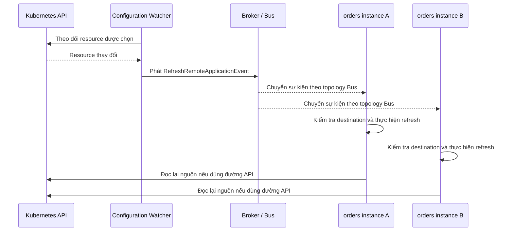

# Thông báo qua Spring Cloud Bus khi bản phát hành hỗ trợ

Trong chương **Configuration Watcher** của module **SPRING_CLOUD_KUBERNETES**, Spring Cloud Bus là một cách chuyển thông báo cập nhật cấu hình qua broker thay cho việc watcher gọi HTTP tới từng instance. Cách này hữu ích khi hệ thống đã có hạ tầng messaging và muốn dùng một kênh quản trị sự kiện cho nhiều instance.

Điều kiện “khi bản phát hành hỗ trợ” rất quan trọng. Một tên profile xuất hiện trong tài liệu của phiên bản này không chứng minh image watcher của phiên bản khác có cùng implementation, binder hoặc quy tắc chọn người nhận.

Bài học dùng watcher **Spring Cloud Kubernetes 5.1.0** làm mốc cụ thể và chọn RabbitMQ cho luồng minh họa chính. Phiên bản Spring Boot, Spring Cloud Bus và Spring Cloud Stream của ứng dụng phải được quản lý bằng BOM tương thích; số phiên bản của các dự án thành phần có thể khác nhau.

## 1. Kiểm tra khả năng của bản phát hành trước khi cấu hình

Cần xác định cả artifact triển khai lẫn thư viện của ứng dụng nhận:

| Hạng mục | Bằng chứng cần có |
| --- | --- |
| Watcher có messaging implementation | Tài liệu đúng phiên bản và implementation trong artifact |
| Profile được hỗ trợ | Tên profile, điều kiện tạo bean và cấu hình đi kèm |
| Binder được đóng gói | Dependency Rabbit hoặc Kafka thực sự có trong image/JAR |
| Ứng dụng nhận có Bus | Starter tương ứng trong dependency graph của ứng dụng |
| Tương thích phiên bản | Bộ dependency theo release train/BOM đã chọn |
| Cách định tuyến | Quy tắc tạo địa chỉ đích và cách recipient so khớp Bus ID |
| Chiến lược cập nhật | Refresh cấu hình hay shutdown ứng dụng |

Ở mốc 5.1.0, POM của watcher khai báo cả starter Bus AMQP và Bus Kafka. Đây là bằng chứng cho artifact nguồn của phiên bản đó, không phải cho mọi image tùy biến. Xem [POM watcher tại tag v5.1.0](https://github.com/spring-cloud/spring-cloud-kubernetes/blob/v5.1.0/spring-cloud-kubernetes-controllers/spring-cloud-kubernetes-configuration-watcher/pom.xml).

Hai profile đi kèm có nội dung đáng chú ý:

| Profile watcher | Cấu hình được kích hoạt trong bản tham chiếu |
| --- | --- |
| `bus-amqp` | Bật Bus và chọn default binder `rabbit` |
| `bus-kafka` | Bật Bus và chọn default binder `kafka` |

Có thể đối chiếu trực tiếp [application-bus-amqp.yaml](https://github.com/spring-cloud/spring-cloud-kubernetes/blob/v5.1.0/spring-cloud-kubernetes-controllers/spring-cloud-kubernetes-configuration-watcher/src/main/resources/application-bus-amqp.yaml) và [application-bus-kafka.yaml](https://github.com/spring-cloud/spring-cloud-kubernetes/blob/v5.1.0/spring-cloud-kubernetes-controllers/spring-cloud-kubernetes-configuration-watcher/src/main/resources/application-bus-kafka.yaml).

Việc đặt `SPRING_PROFILES_ACTIVE=bus-amqp` vào một ứng dụng không có profile hoặc dependency tương ứng không tự bổ sung messaging implementation. Đặc biệt, profile của watcher và dependency của ứng dụng nghiệp vụ là hai việc phải cấu hình riêng.

Nếu bản phát hành đang dùng không có đường Bus được hỗ trợ, chọn đường HTTP hoặc rollout theo nhu cầu. Không ghép property của bản mới vào image cũ rồi coi ứng dụng khởi động được là bằng chứng tính năng đã hoạt động.

## 2. Bus chuyển tín hiệu; ứng dụng vẫn phải đọc nguồn cấu hình

Luồng khái niệm:



Spring Cloud Bus dùng broker để nối các node và truyền những sự kiện quản trị như yêu cầu refresh. Dự án cung cấp các starter cho RabbitMQ và Kafka; xem [Spring Cloud Bus: Introduction](https://docs.spring.io/spring-cloud-bus/reference/index.html).

`RefreshRemoteApplicationEvent` không thay thế một ConfigMap PropertySource và không phải một kho cấu hình mới. Khi nhận yêu cầu, ứng dụng vẫn cần có nguồn nạp đúng, quyền đọc đúng và cơ chế cập nhật bean phù hợp.

Trong implementation Bus tham chiếu, `RefreshListener` kiểm tra sự kiện có dành cho instance hiện tại rồi gọi `ContextRefresher.refresh()`; nó không gọi HTTP vào chính ứng dụng. Xem [RefreshListener](https://github.com/spring-cloud/spring-cloud-bus/blob/v5.0.4/spring-cloud-bus/src/main/java/org/springframework/cloud/bus/event/RefreshListener.java).

Vì vậy cần giữ riêng ba kết luận:

1. Watcher đã phát được sự kiện.
2. Instance đã nhận và xử lý sự kiện phù hợp.
3. Bean/client nghiệp vụ đã dùng cấu hình mới.

Thành công ở bước trước không tự chứng minh bước sau. Broker hoạt động tốt vẫn không giúp ứng dụng đọc được một ConfigMap sai namespace hoặc bind một giá trị sai kiểu.

## 3. Ba loại “destination” và định danh dễ nhầm

| Giá trị | Vai trò | Ví dụ |
| --- | --- | --- |
| `spring.cloud.bus.destination` | Tên kênh bên middleware mà các node Bus dùng | `commerce-prod-config-bus` |
| Destination của một sự kiện | Mẫu địa chỉ người nhận sự kiện | `orders-service:**` |
| `spring.cloud.bus.id` | Định danh của một instance Bus | `orders-service:pod-uid-a` |
| Tên ConfigMap | Resource được ứng dụng đọc | `orders-service` |
| Namespace Kubernetes | Phạm vi resource/API Kubernetes | `commerce-prod` |

`spring.cloud.bus.destination` phải được cấu hình thống nhất giữa bên phát và bên nhận của cùng miền Bus. Nó là tên destination của middleware, không phải tên ứng dụng cần refresh. Cấu hình broker và property này được mô tả trong [Spring Cloud Bus: Configuration](https://docs.spring.io/spring-cloud-bus/reference/spring-cloud-bus/configuration.html).

Đặt watcher dùng `commerce-prod-config-bus` nhưng ứng dụng vẫn dùng destination mặc định có thể tạo hai hệ thống đều kết nối broker thành công mà không trao đổi đúng sự kiện.

### Bus ID phải phân biệt được từng instance

Địa chỉ Bus có thể dùng các phần phân tách bằng dấu hai chấm. Nếu tự đặt ID, giữ phần đầu trùng quy ước tên ứng dụng và phần sau phân biệt instance:

```text
orders-service:pod-uid-a
orders-service:pod-uid-b
inventory-service:pod-uid-c
```

Mẫu `orders-service:**` khớp hai instance orders trong ví dụ. Không gán cùng một ID cố định `orders-service` cho mọi replica.

Cơ chế Bus còn dùng ID để phân biệt nguồn gửi với chính instance nhận; trùng ID có thể khiến sự kiện không được xử lý như mong đợi. Xem [Addressing Instances](https://docs.spring.io/spring-cloud-bus/reference/spring-cloud-bus/addressing.html).

Không tự thêm namespace vào đầu ID, chẳng hạn `commerce-prod:orders-service:...`, mà vẫn kỳ vọng một sự kiện đích `orders-service:**` khớp nguyên như trước. Quy ước ID và cách watcher tạo địa chỉ phải được thiết kế cùng nhau.

## 4. Chọn ứng dụng nhận theo hành vi đúng phiên bản

Ở mã nguồn watcher 5.1.0, thông tin resource được chuyển thành tập tên ứng dụng hoặc bộ nhãn dùng để tìm ứng dụng. Nếu không có annotation tên ứng dụng, tên resource là đích mặc định. Xem [KubernetesSourceProvider 5.1.0](https://github.com/spring-cloud/spring-cloud-kubernetes/blob/v5.1.0/spring-cloud-kubernetes-controllers/spring-cloud-kubernetes-configuration-watcher/src/main/java/org/springframework/cloud/kubernetes/configuration/watcher/KubernetesSourceProvider.java).

Ví dụ chọn rõ `orders-service`:

```yaml
apiVersion: v1
kind: ConfigMap
metadata:
  name: orders-service
  namespace: commerce-prod
  labels:
    spring.cloud.kubernetes.config: "true"
  annotations:
    spring.cloud.kubernetes.configmap.apps: "orders-service"
data:
  app.config.revision: "cfg-21"
  app.banner: "Orders configuration revision 21"
```

Label cho biết resource thuộc tập watcher theo dõi theo quy ước mặc định. Annotation chọn ứng dụng nhận thông báo; nó không khiến ứng dụng tự đọc ConfigMap đó nếu ứng dụng chưa có nguồn nạp phù hợp.

### Phát theo tên ứng dụng và phát qua broker là hai tầng

`BusRefreshTrigger` của tag 5.1.0 phát sự kiện cho từng tên ứng dụng đã chọn. Với tên `orders-service`, cơ chế destination của Bus dùng dạng khớp các instance của ứng dụng. Xem [BusRefreshTrigger](https://github.com/spring-cloud/spring-cloud-kubernetes/blob/v5.1.0/spring-cloud-kubernetes-controllers/spring-cloud-kubernetes-configuration-watcher/src/main/java/org/springframework/cloud/kubernetes/configuration/watcher/BusRefreshTrigger.java) và [PathDestinationFactory](https://github.com/spring-cloud/spring-cloud-bus/blob/v5.0.4/spring-cloud-bus/src/main/java/org/springframework/cloud/bus/event/PathDestinationFactory.java).

Không suy rằng broker phân phối rộng thì mọi instance đều thực hiện refresh; recipient còn lọc địa chỉ sự kiện. Đồng thời, không coi cơ chế lọc đó là ranh giới quyền truy cập broker.

Tài liệu watcher có mô tả tổng quát về broadcast tới các instance Bus. Khi thiết kế phạm vi tác động, cần đối chiếu rule tạo destination của đúng tag/image và kiểm tra tập nhận thực tế. Bài này dùng hành vi theo tên ứng dụng của mã nguồn 5.1.0 làm căn cứ cho ví dụ.

### Nếu dùng annotation theo nhãn

Phiên bản tham chiếu còn có annotation `spring.cloud.kubernetes.configmap.labels`. Watcher dùng ReactiveDiscoveryClient để tìm `ServiceInstance`, so nhãn với metadata, rồi rút về những service ID riêng biệt.

Hệ quả là nhãn có thể giúp chọn **dịch vụ**, nhưng sự kiện tiếp theo gửi theo service ID. Nó không mặc nhiên bảo đảm chỉ một Pod canary trong dịch vụ đó được refresh. Khi cần giới hạn đến từng nhóm instance, phải kiểm tra cả bước khám phá lẫn mẫu Bus ID cuối cùng.

Ví dụ chính dùng tên ứng dụng tường minh để tránh cần thêm đường discovery theo nhãn. Điều đó không có nghĩa mọi cấu hình Bus đều có thể tắt discovery ở watcher: tính năng nhắm đích đang chọn mới quyết định nhu cầu này.

## 5. Cấu hình watcher dùng RabbitMQ

Giả sử môi trường minh họa đã có:

- Namespace `commerce-prod`.
- RabbitMQ tại `rabbitmq.messaging.svc.cluster.local`, có virtual host `commerce-prod`.
- ServiceAccount `configuration-watcher` cùng Role/RoleBinding cần thiết.
- Secret `config-bus-rabbit-watcher` trong namespace của watcher, có key `username` và `password`.
- Đường mạng cho watcher truy cập Kubernetes API và broker.

Deployment minh họa:

```yaml
apiVersion: apps/v1
kind: Deployment
metadata:
  name: configuration-watcher
  namespace: commerce-prod
spec:
  replicas: 1
  selector:
    matchLabels:
      app: configuration-watcher
  template:
    metadata:
      labels:
        app: configuration-watcher
    spec:
      serviceAccountName: configuration-watcher
      containers:
        - name: watcher
          image: springcloud/spring-cloud-kubernetes-configuration-watcher:5.1.0
          env:
            - name: POD_UID
              valueFrom:
                fieldRef:
                  fieldPath: metadata.uid
            - name: SPRING_PROFILES_ACTIVE
              value: bus-amqp
            - name: SPRING_CLOUD_BUS_ID
              value: "configuration-watcher:$(POD_UID)"
            - name: SPRING_CLOUD_BUS_DESTINATION
              value: commerce-prod-config-bus
            - name: SPRING_CLOUD_KUBERNETES_RELOAD_NAMESPACES_0
              value: commerce-prod
            - name: SPRING_CLOUD_KUBERNETES_SECRETS_ENABLED
              value: "false"
            - name: SPRING_CLOUD_KUBERNETES_CONFIGURATION_WATCHER_REFRESHSTRATEGY
              value: refresh
            - name: SPRING_CLOUD_KUBERNETES_CONFIGURATION_WATCHER_REFRESHDELAY
              value: "5000"
            - name: SPRING_RABBITMQ_HOST
              value: rabbitmq.messaging.svc.cluster.local
            - name: SPRING_RABBITMQ_PORT
              value: "5672"
            - name: SPRING_RABBITMQ_VIRTUAL_HOST
              value: commerce-prod
            - name: SPRING_RABBITMQ_USERNAME
              valueFrom:
                secretKeyRef:
                  name: config-bus-rabbit-watcher
                  key: username
            - name: SPRING_RABBITMQ_PASSWORD
              valueFrom:
                secretKeyRef:
                  name: config-bus-rabbit-watcher
                  key: password
```

Đây là manifest Deployment cho luồng minh họa, chưa bao gồm việc tạo broker, Secret, RBAC hoặc probe. Image thực tế nên được ghim bằng digest đã kiểm tra trong quy trình triển khai.

`POD_UID` được khai báo trước khi dùng trong `SPRING_CLOUD_BUS_ID`. Cú pháp `$(POD_UID)` ở đây do Kubernetes mở rộng giá trị biến môi trường trong Pod; nó khác placeholder `${...}` của Spring.

### Giải thích những lựa chọn quan trọng

| Lựa chọn | Mục đích |
| --- | --- |
| Profile `bus-amqp` | Chọn messaging bằng binder Rabbit trong watcher tham chiếu |
| Bus destination riêng | Tách miền thông báo của ví dụ |
| Bus ID có Pod UID | Phân biệt instance watcher |
| Watch namespace cụ thể | Giới hạn nguồn resource theo thiết kế |
| Tắt Secret | Bài chỉ cần theo dõi dữ liệu không nhạy cảm |
| `refresh-strategy=refresh` | Phát yêu cầu refresh cấu hình |
| Delay 5000 ms | Khoảng trì hoãn minh họa trước khi phát thông báo |
| Credential từ Secret | Không đặt giá trị xác thực trong ConfigMap bài học |

`refresh-strategy=shutdown` là một chiến lược khác: nó có thể phát sự kiện shutdown thay cho refresh. Bài này chủ động chọn `refresh`. Enum và property của bản tham chiếu có thể kiểm tra tại [ConfigurationWatcherConfigurationProperties](https://github.com/spring-cloud/spring-cloud-kubernetes/blob/v5.1.0/spring-cloud-kubernetes-controllers/spring-cloud-kubernetes-configuration-watcher/src/main/java/org/springframework/cloud/kubernetes/configuration/watcher/ConfigurationWatcherConfigurationProperties.java).

Không bật cả `bus-amqp` và `bus-kafka` trong ví dụ rồi để thứ tự profile quyết định binder. Chọn một transport đã được kiểm tra.

Delay 5 giây không phải SLA hoặc giá trị phù hợp sẵn cho mọi cluster. Với volume, nó cần được đối chiếu với thời gian dữ liệu thực sự tới filesystem của ứng dụng. Với API, vẫn phải kiểm tra độ trễ toàn luồng thay vì suy từ mỗi delay.

## 6. Cấu hình ứng dụng nhận: dependency và đường đọc nguồn

Một ứng dụng `orders-service` cần có Bus riêng. Thêm dependency phù hợp dưới dependency management của dự án, ví dụ Maven:

```xml
<dependency>
    <groupId>org.springframework.cloud</groupId>
    <artifactId>spring-cloud-starter-bus-amqp</artifactId>
</dependency>
<dependency>
    <groupId>org.springframework.cloud</groupId>
    <artifactId>spring-cloud-starter-kubernetes-fabric8-config</artifactId>
</dependency>
<dependency>
    <groupId>org.springframework.boot</groupId>
    <artifactId>spring-boot-starter-actuator</artifactId>
</dependency>
```

Dependency thứ nhất cho Bus/Rabbit, thứ hai cho đường đọc cấu hình Kubernetes của ví dụ, thứ ba cung cấp Actuator và hạ tầng quan sát liên quan. Không khai báo version rời rạc cho từng starter nếu BOM đã quản lý.

Cơ chế tự cấu hình Bus từ classpath và các starter được trình bày trong [Spring Cloud Bus: Quickstart](https://docs.spring.io/spring-cloud-bus/reference/quickstart.html).

Một cấu hình ứng dụng có thể là:

```yaml
spring:
  application:
    name: orders-service
  config:
    import: "kubernetes:"
  rabbitmq:
    host: rabbitmq.messaging.svc.cluster.local
    port: 5672
    virtual-host: commerce-prod
    username: "${BUS_RABBIT_USERNAME}"
    password: "${BUS_RABBIT_PASSWORD}"
  cloud:
    bus:
      enabled: true
      destination: commerce-prod-config-bus
      id: "${spring.application.name}:${POD_UID}"
    stream:
      default-binder: rabbit
    kubernetes:
      config:
        enabled: true
        name: orders-service
        namespace: commerce-prod
      secrets:
        enabled: false
      discovery:
        enabled: false
      reload:
        enabled: false

management:
  endpoints:
    web:
      exposure:
        include: health
```

Cấu hình đọc ConfigMap qua `spring.config.import: "kubernetes:"` được mô tả tại [Kubernetes PropertySource implementations](https://docs.spring.io/spring-cloud-kubernetes/reference/property-source-config.html). Không nạp đồng thời cùng dữ liệu bằng cả legacy bootstrap và Config Data.

Các property kết nối Rabbit dùng nhóm `spring.rabbitmq.*`; xem [Spring Boot: AMQP](https://docs.spring.io/spring-boot/reference/messaging/amqp.html). Địa chỉ, cổng và vhost trong bài là giả định của môi trường minh họa; bổ sung TLS/CA cùng chính sách xác thực theo broker thực tế.

Ứng dụng cần được cấp các biến sau trong Pod template:

```yaml
env:
  - name: POD_UID
    valueFrom:
      fieldRef:
        fieldPath: metadata.uid
  - name: BUS_RABBIT_USERNAME
    valueFrom:
      secretKeyRef:
        name: config-bus-rabbit-orders
        key: username
  - name: BUS_RABBIT_PASSWORD
    valueFrom:
      secretKeyRef:
        name: config-bus-rabbit-orders
        key: password
```

Secret của ứng dụng phải tồn tại trong namespace ứng dụng. Có thể dùng tài khoản broker khác với watcher và cấp quyền phù hợp topology Bus thực tế, gồm các thao tác publish, consume hoặc tạo binding mà triển khai yêu cầu.

Ứng dụng vẫn cần quyền Kubernetes để đọc ConfigMap qua API. Nhận được sự kiện từ broker không trao thêm quyền đọc cấu hình.

### Vì sao không bật mọi tính năng Kubernetes?

Ứng dụng trong ví dụ chỉ cần đọc cấu hình và nhận Bus event. Nó không cần bật DiscoveryClient hoặc Spring Cloud LoadBalancer chỉ để được Bus thông báo.

`reload.enabled=false` trong ứng dụng giữ ví dụ có một đường thông báo từ watcher qua Bus, thay vì đồng thời chạy thêm cơ chế theo dõi/reload bên trong từng ứng dụng. Đây là cấu hình của ứng dụng nhận; watcher có cấu hình riêng.

Việc tắt Secret PropertySource không cản Kubernetes cấp credential broker qua `secretKeyRef`. Cấp biến môi trường bằng Secret và ứng dụng tự đọc Secret qua API là hai đường khác nhau.

### Bean phải có khả năng áp dụng cấu hình

Khi Bus gọi refresh, ứng dụng vẫn chịu các giới hạn của Spring Cloud Context. JavaBean cấu hình có cơ chế rebind khác với target `@RefreshScope`; một client đã sao chép giá trị lúc khởi tạo không tự đổi chỉ vì bean thuộc tính đổi.

Constructor binding/record cấu hình, datasource không refresh được hoặc AOT/native image cần được đánh giá theo phiên bản. Xem [Spring Cloud Context: Refresh Scope](https://docs.spring.io/spring-cloud-commons/reference/spring-cloud-commons/application-context-services.html#refresh-scope).

Ví dụ chưa cung cấp bean đọc `app.banner` và `app.config.revision`. Ứng dụng thực hành cần một thành phần có khả năng cập nhật đã được kiểm tra và một cách quan sát hai trường không nhạy cảm này.

## 7. Khi chọn Kafka thay cho RabbitMQ

Nếu artifact watcher và release train hỗ trợ Kafka, thay profile watcher bằng `bus-kafka`. Ứng dụng nhận dùng `spring-cloud-starter-bus-kafka` thay starter AMQP và cùng kết nối tới miền Bus Kafka đã chọn.

Cấu hình binder minh họa cho hai phía:

```yaml
spring:
  cloud:
    bus:
      destination: commerce-prod-config-bus
    stream:
      default-binder: kafka
      kafka:
        binder:
          brokers:
            - kafka-0.messaging.svc.cluster.local:9092
            - kafka-1.messaging.svc.cluster.local:9092
```

Đây là fragment thay thế cho phần transport; vẫn cần giữ Bus ID, đường đọc nguồn và các cấu hình ứng dụng khác.

Property `spring.cloud.stream.kafka.binder.brokers` chỉ danh sách broker của Kafka binder. Không chỉ cấu hình riêng producer rồi mặc định consumer và các thành phần binder khác cũng trỏ đúng cluster. Các lựa chọn được mô tả trong [Kafka Binder Configuration Options](https://docs.spring.io/spring-cloud-stream/reference/kafka/kafka-binder/config-options.html).

Kafka còn cần chính sách topic, ACL, SASL/TLS và tài khoản theo môi trường. Ví dụ không quyết định thay người quản trị về số partition, replication hoặc quyền tự tạo topic.

### Giữ đúng mô hình phân phối tới nhiều instance

Không tùy tiện cấu hình mọi replica vào một consumer group chia việc cho binding nội bộ Bus. Trong mô hình consumer group của Spring Cloud Stream, mỗi group nhận dữ liệu, nhưng một message chỉ đến một thành viên trong cùng group. Xem [Consumer Groups](https://docs.spring.io/spring-cloud-stream/reference/spring-cloud-stream/consumer-groups.html).

Nếu đổi topology thành competing consumers như một hàng đợi tác vụ, có thể chỉ một Pod refresh trong khi các Pod còn lại giữ giá trị cũ. Giữ topology mặc định được Bus thiết lập, và chỉ tùy biến group/binding sau khi đã chứng minh mọi instance mục tiêu đều nhận được tín hiệu cần thiết.

Điều cần chứng minh là fan-out theo yêu cầu cập nhật của Bus, không chỉ là “topic có một consumer nhận message”.

## 8. Nhận Bus event không yêu cầu mở endpoint HTTP refresh

Đường watcher → broker → Bus listener không đi qua `POST /actuator/refresh` của từng ứng dụng. Vì vậy, không phải mở HTTP refresh trên mọi Pod chỉ để nhận sự kiện Bus.

`/actuator/busrefresh` là một đường **khởi phát** refresh qua HTTP rồi phát lên Bus. Nó khác với consumer đang nhận sự kiện từ broker. Tài liệu [Bus Endpoints](https://docs.spring.io/spring-cloud-bus/reference/spring-cloud-bus/bus-endpoints.html) mô tả endpoint này và tác động của nó.

Nếu cần kiểm tra thủ công bằng endpoint trong môi trường được phép, có thể bổ sung:

```yaml
management:
  endpoints:
    web:
      exposure:
        include: health,busrefresh
```

Sau khi endpoint tồn tại, được access policy cho phép và có đường truy cập quản trị hợp lệ, một ví dụ PowerShell là:

```powershell
Invoke-RestMethod -Method Post -Uri 'http://127.0.0.1:18080/actuator/busrefresh/orders-service:**'
```

Cổng local 18080 là giả định của ví dụ; cần bổ sung xác thực theo môi trường. Lệnh chưa được chạy trong bài.

Không gọi endpoint không chỉ định đích trên một miền Bus lớn nếu mục tiêu kiểm tra chỉ là `orders-service`. Đồng thời, một lần gọi busrefresh thủ công thành công chưa chứng minh watcher đang phát thông báo từ Kubernetes đúng cách.

Không cần dùng `busenv` để truyền lại nội dung ConfigMap trong luồng minh họa. Nguồn chuẩn vẫn là resource mà ứng dụng được cấu hình đọc; việc tự đẩy thêm giá trị Environment qua một đường khác có thể làm khó xác định nguồn hiệu lực.

## 9. Namespace, broker ACL và quyền Kubernetes là các ranh giới khác nhau

Giới hạn watcher theo namespace chỉ giới hạn **nguồn thay đổi mà watcher quan sát**. Nó không tạo namespace cho sự kiện trong broker.

Giả sử hai môi trường đều có Bus ID bắt đầu bằng `orders-service:`, cùng broker/vhost và cùng Bus destination. Một sự kiện đích `orders-service:**` có thể khớp instance của cả hai môi trường. Tên namespace của ConfigMap không tự được thêm vào mẫu địa chỉ đó.

Tài liệu watcher cũng lưu ý phạm vi kết nối broker có thể vượt namespace Kubernetes; xem [Messaging Implementation](https://docs.spring.io/spring-cloud-kubernetes/reference/spring-cloud-kubernetes-configuration-watcher.html#_messaging_implementation).

Có thể thiết kế miền thông báo theo các lớp:

| Lớp | Quyết định cần có |
| --- | --- |
| Kubernetes watch | Namespace và resource nào được quan sát |
| Quyền đọc API của watcher | Request nào được phép theo implementation đang bật |
| Quyền đọc API của ứng dụng | ConfigMap/Secret nào ứng dụng cần nạp lại |
| Broker | Tài khoản, TLS, vhost/topic và ACL |
| Bus destination | Những node nào tham gia cùng miền thông báo |
| Event destination | Những Bus ID nào được yêu cầu xử lý |
| Hợp đồng cấu hình | Những phiên bản ứng dụng nào có thể dùng dữ liệu mới |

Tên destination khác nhau giúp tách luồng, nhưng cần broker ACL để kiểm soát chủ thể nào có quyền publish/consume từng luồng. Kiểm tra đích ở phía ứng dụng không thay xác thực hoặc phân quyền broker.

### RBAC không biến mất khi chuyển sang Bus

Watcher vẫn cần quyền quan sát những resource được chọn. Ứng dụng dùng API để nạp lại ConfigMap vẫn cần quyền đọc của chính nó. Nếu dùng nhắm đích theo metadata discovery, watcher còn phát sinh nhu cầu đọc các resource phục vụ khám phá.

Không áp một Role get-only cho watcher dùng informer/list/watch chỉ vì ứng dụng đích chỉ đọc một ConfigMap theo tên.

Credential broker được cấp bằng Secret không đồng nghĩa ServiceAccount của ứng dụng cần quyền API để đọc tất cả Secret. Kubernetes có thể cấp giá trị qua `secretKeyRef`; yêu cầu quyền cho đường ứng dụng tự gọi API là một quyết định riêng.

Thông báo refresh có thể làm nhiều bean hoặc client thay đổi trạng thái. Bên được publish lên miền Bus vì vậy có quyền tác động vận hành đáng kể; tài khoản và mạng của kênh này cần nằm trong thiết kế quản trị cấu hình.

## 10. Độ trễ, sự kiện trùng và instance tạm thời vắng mặt

Một lần thay đổi có thể đi qua nhiều khoảng chờ:

```text
Thời gian áp dụng
  = phát hiện resource thay đổi
  + refreshDelay của watcher
  + publish và phân phối qua broker
  + nạp lại nguồn ở ứng dụng
  + bind/tạo lại bean
  + thời điểm thành phần nghiệp vụ dùng bộ mới
```

Nếu dùng volume, phải xét thêm lúc dữ liệu được projection tới Pod. ConfigMap mount có cơ chế cập nhật theo thời gian; biến môi trường từ ConfigMap không tự đổi trong tiến trình đã chạy. Xem [ConfigMaps](https://kubernetes.io/docs/concepts/configuration/configmap/).

Một delay cố định không chứng minh mọi Pod đã có file mới. Một event đến sớm có thể khiến ứng dụng đọc lại giá trị cũ từ file, rồi không có thêm event nào đúng lúc dữ liệu cuối cùng xuất hiện. Cần kiểm tra cơ chế đang dùng và có cách đối chiếu revision sau cập nhật.

### Không xem sự kiện refresh là một snapshot cấu hình

Giả sử resource lần lượt chuyển từ cfg-21 sang cfg-22 rồi cfg-23. Khi instance xử lý một thông báo còn nằm trong hàng đợi, nó có thể nạp trạng thái hiện tại cfg-23.

Đối với mô hình tín hiệu “hãy đọc lại nguồn”, điều này có thể hoàn toàn phù hợp. Nếu nghiệp vụ yêu cầu xử lý chính xác từng phiên bản cấu hình theo thứ tự, cần một giao thức phát hành phiên bản riêng; một refresh event chung không đủ mô tả yêu cầu đó.

Phát lại event cũ cũng không khôi phục nội dung cfg-21. Muốn rollback dữ liệu, phải phục hồi nguồn hoặc tham chiếu snapshot thích hợp rồi cho ứng dụng nạp lại.

### Sự kiện có thể đến lại hoặc bị bỏ lỡ

Không xây callback refresh có tác dụng nghiệp vụ chỉ được phép xảy ra đúng một lần. Reconnect, retry, nhiều watcher chưa phối hợp hoặc thay đổi liên tiếp có thể tạo nhiều lần yêu cầu cập nhật.

Ngược lại, không khẳng định một Pod offline sẽ luôn nhận lại mọi thông báo. Điều đó phụ thuộc binder, consumer group, queue/subscription, retention và cấu hình broker.

Một cơ chế vận hành cần có ít nhất một cách phát hiện instance bị lệch revision và đưa nó về trạng thái mong muốn, chẳng hạn kiểm tra sau phát hành hoặc rollout có kiểm soát. Startup của Pod mới cũng phải nạp được cấu hình đúng mà không phụ thuộc một event chỉ xuất hiện trước khi Pod ra đời.

### Tăng replica watcher cần cơ chế phối hợp đúng phiên bản

Deployment minh họa đặt một replica để giữ luồng quan sát đơn giản. Nếu tăng nhiều replica, kiểm tra khả năng HA/leader election của đúng image và quyền API mà cơ chế đó yêu cầu.

Tăng replica không tự bảo đảm mỗi thay đổi chỉ tạo một event. Dù có cơ chế phối hợp bên phát, bên nhận vẫn cần chịu được những lần refresh lặp lại.

## 11. Kiểm chứng từ broker tới cấu hình hiệu lực

Một phép kiểm tra nên có ít nhất hai instance orders và một ứng dụng không thuộc đích. Mục tiêu là chứng minh cả fan-out đúng lẫn không refresh sai phạm vi.

### Trình tự kiểm tra minh họa

1. Ghi nhận image watcher, profile, binder, broker/vhost/topic và Bus destination.
2. Xác nhận Bus ID của từng instance khác nhau và khớp quy ước tên ứng dụng.
3. Xác nhận orders A và B đang dùng cfg-21.
4. Thay ConfigMap minh họa sang cfg-22 và đổi `app.banner`.
5. Quan sát watcher phát sự kiện với origin/event destination phù hợp.
6. Quan sát consumer Bus ở từng instance mục tiêu.
7. Đọc revision và banner mà ứng dụng thực sự sử dụng.
8. Kiểm tra ứng dụng ngoài đích không thực hiện refresh chỉ vì chia sẻ transport.
9. Đối chiếu restart count để phân biệt refresh với việc container vô tình đã restart.

Kết quả mong đợi:

| Instance | Đích sự kiện khớp? | Cấu hình hiệu lực sau kiểm tra |
| --- | --- | --- |
| orders A | Có | cfg-22, banner mới |
| orders B | Có | cfg-22, banner mới |
| inventory C | Không | Giữ cấu hình của inventory; không thực hiện refresh vì sự kiện orders |

Đây là kết quả dự kiến, không phải kết quả đã chạy trên cluster. Ứng dụng cần chủ động cung cấp bằng chứng revision/banner; ConfigMap có cfg-22 chưa chứng minh client đã nhìn thấy cfg-22.

### Các loại xác nhận có ý nghĩa khác nhau

| Bằng chứng | Điều nó xác nhận |
| --- | --- |
| Broker chấp nhận publish | Bên phát đã đưa được thông điệp vào transport theo cơ chế đó |
| Consumer nhận message | Có đường phân phối tới consumer |
| Bus event/ack được ghi nhận | Một bước xử lý Bus đã xảy ra theo cơ chế quan sát đang dùng |
| Listener bắt đầu refresh | Đã đi tới đường refresh trong ứng dụng |
| Revision hiệu lực đổi | Thành phần được quan sát đã nhìn thấy dữ liệu mới |
| Phép thử nghiệp vụ đạt | Cấu hình đã tạo hành vi mong muốn ở phần được kiểm tra |

Ack của broker hoặc Bus không phải cam kết mọi bean/client đã áp dụng thành công. Không dùng số message publish làm mẫu số duy nhất để kết luận mọi Pod đã cập nhật.

Khi quan sát event, có thể ghi event ID, origin, event destination, Bus ID của recipient, Pod và revision đã áp dụng. Không log toàn bộ Environment, payload Secret hoặc credential broker.

Các lệnh quan sát Kubernetes minh họa:

```powershell
kubectl logs -n commerce-prod deployment/configuration-watcher --tail=100
kubectl get pods -n commerce-prod -l app=orders-service -o wide
```

Chưa thực thi các lệnh này. Log watcher cần được ghép với log/diagnostic của từng Pod đích; một lần gọi thông qua Service có thể gặp các Pod khác nhau.

## 12. Chẩn đoán theo từng chặng của luồng

| Hiện tượng | Điều cần kiểm tra |
| --- | --- |
| Watcher khởi động nhưng không có publisher Bus | Profile, artifact, dependency và conditional configuration của đúng phiên bản |
| Profile đúng nhưng binder không khởi tạo | Binder có trong image và default binder có được chọn đúng không |
| Hai bên đều kết nối broker nhưng không có event tới app | Broker/vhost/cluster và Bus destination có thống nhất không |
| Chỉ một replica đổi cấu hình | Topology consumer group, Bus ID trùng hoặc một Pod không kết nối |
| Event tới nhưng recipient bỏ qua | Event destination có khớp Bus ID, application name và prefix không |
| Resource có label nhưng không phát event | Namespace watch, RBAC, detector, điều kiện thay đổi và delay |
| Nhắm theo nhãn không tìm được đích | Discovery metadata, khả năng đọc resource và phạm vi service ID được chọn |
| Refresh nhầm môi trường/namespace | Miền Bus dùng chung, ID trùng prefix và thiếu phân tách broker/destination |
| Listener xử lý nhưng revision vẫn cũ | Nguồn nạp sai, override, file chưa cập nhật hoặc bean/client giữ bản sao |
| Message nhận được nhưng validation thất bại | Dữ liệu không hợp lệ; transport không sửa được lỗi hợp đồng |
| Một thay đổi tạo nhiều refresh | Nhiều watcher, retry, reconnect hoặc nhiều sự kiện resource |
| Đặt `shutdown` nhưng tưởng là refresh | Kiểm tra refresh strategy và loại remote event thực tế |

Nếu broker gián đoạn, không giả định watcher tự chuyển sang gọi HTTP. Cần một đường phục hồi được hỗ trợ và đã kiểm tra, thay vì vô tình để cả HTTP và Bus phát thông báo trùng nhau.

Không đưa broker liveness vào thiết kế khiến mọi ứng dụng đang phục vụ tốt bị restart đồng thời khi chỉ kênh cập nhật cấu hình mất kết nối. Readiness, liveness và cảnh báo kênh quản trị cần phản ánh chính sách vận hành thực tế của ứng dụng.

Khi nguồn mới không hợp lệ, dừng mở rộng thay đổi, khôi phục một bộ dữ liệu hợp lệ rồi xác minh lại revision và hành vi. Bus không tự giữ một bản cấu hình tốt cũ cho mọi bean và không tự rollback ConfigMap.

## 13. Những điều cần chứng minh trước khi chọn Bus

Một đợt thử nghiệm đầy đủ nên bao gồm:

- Sửa một ConfigMap và quan sát mọi replica mục tiêu.
- Kiểm tra ứng dụng ngoài đích, kể cả ứng dụng cùng tên ở môi trường khác nếu hạ tầng có chia sẻ.
- Mất kết nối broker rồi phục hồi một instance.
- Pod được tạo sau khi thay đổi đã xảy ra.
- Sự kiện trùng và nhiều thay đổi liên tiếp.
- Dữ liệu sai kiểu hoặc vi phạm validation.
- Consumer đã nhận nhưng client chưa áp dụng.
- Rollback nguồn cấu hình và xác nhận lại toàn bộ instance.

Đây là các kịch bản cần thực hiện theo môi trường, chưa phải các phép thử đã chạy trong bài.

Có thể dùng bảng quyết định sau:

| Điều kiện hệ thống | Hướng cần đánh giá |
| --- | --- |
| Đã có broker được vận hành tốt và cần tín hiệu refresh tới nhiều instance | Bus có thể phù hợp nếu đúng bản phát hành hỗ trợ |
| Chưa có broker và phạm vi nhận nhỏ | So sánh chi phí vận hành Bus với đường HTTP |
| Cần kiểm soát chặt cặp image–cấu hình và khả năng khôi phục | Snapshot cấu hình cùng rollout có thể phù hợp hơn |
| Bean/client không hỗ trợ refresh an toàn | Đổi transport không giải quyết được vòng đời; cần rollout hoặc thiết kế lại |
| Không chứng minh được phạm vi nhận theo namespace/ứng dụng | Chưa nên mở rộng miền Bus |

Một triển khai Bus có thể giải thích được phải chỉ ra **artifact nào hỗ trợ, transport nào được chọn, sự kiện nhắm đến Bus ID nào và từng instance đã áp dụng revision nào**. Từ đó mới quyết định thêm broker, discovery hoặc cơ chế refresh có thực sự cần cho cách triển khai Spring trên Kubernetes hay không.
