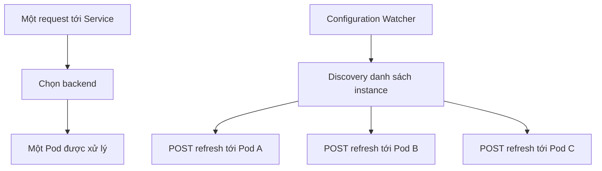

# Thông báo đến nhiều bản sao và kiểm chứng phạm vi cập nhật

Trong chương **Configuration Watcher** của module **SPRING_CLOUD_KUBERNETES**, một dòng log “đã gửi refresh” chưa đủ để kết luận cấu hình đã đến mọi bản sao. Cũng không đủ để kết luận các ứng dụng ngoài phạm vi không bị tác động.

Khi dịch vụ có nhiều replica, cần kiểm chứng hai điều riêng biệt:

- **Đủ phạm vi**: mọi instance thuộc phạm vi yêu cầu đã áp dụng đúng cấu hình trong thời hạn cho phép.
- **Đúng phạm vi**: thông báo và tác động không lan sang instance không được chọn.

Bài học giải thích đường thông báo HTTP và Bus, sau đó xây dựng một lab HTTP có ba replica đích và một replica đối chứng. Bằng chứng được gắn với Pod UID, revision được consumer chấp nhận và kết quả xử lý, thay vì chỉ đếm request thành công qua một Service.

Sau bài học, bạn có thể:

- Phân biệt cân bằng tải một request với gửi thông báo tới nhiều instance.
- Xác định tập đích mong muốn độc lập với kết quả discovery.
- Thu thập bằng chứng từ watcher, ứng dụng và hành vi nghiệp vụ.
- Phát hiện cả replica bị bỏ sót lẫn ứng dụng bị refresh ngoài dự kiến.
- Xử lý thay Pod, lỗi một phần, thông báo lặp và cấu hình đổi nhanh.

## 1. Một request qua Service không phải thông báo cho mọi replica

Giả sử `catalog-api` có ba Pod:

```text
catalog-a
catalog-b
catalog-c
```

Một lời gọi HTTP tới ClusterIP/Service thường được chuyển tới một backend phù hợp; nó không tự tạo ba lời gọi tới ba Pod. Một request qua Spring Cloud LoadBalancer cũng là một lần chọn instance theo thuật toán và trạng thái hiện hành, không phải phép phát thông báo cho toàn bộ danh sách.



Kubernetes Service cung cấp một điểm truy cập tới các backend; để chứng minh nhiều replica đã cập nhật, cần quan sát từng backend thuộc phạm vi. [Kubernetes Service](https://kubernetes.io/docs/concepts/services-networking/service/).

Gọi `/demo/check` qua Service 30 lần rồi thấy toàn kết quả mới vẫn chưa chứng minh Pod thứ ba đã đổi. Kết nối được tái sử dụng, session affinity hoặc điều kiện mạng có thể làm nhiều request đi tới cùng một tập con.

Tương tự, gọi một lần `POST /actuator/refresh` qua Service không phải phương án thay thế cho cơ chế gửi đến từng instance.

## 2. Watcher chọn nguồn, ứng dụng và instance qua các bước khác nhau

Đường HTTP của Spring Cloud Kubernetes Configuration Watcher có thể nhìn theo chuỗi:

```text
Sự kiện ConfigMap/Secret
  -> điều kiện label và namespace nguồn
  -> tên ứng dụng nhận thông báo
  -> DiscoveryClient tìm instance
  -> xác định host, port, path quản trị
  -> gửi POST
  -> ứng dụng refresh
  -> consumer áp dụng dữ liệu mới
```

Trong ví dụ của bài, nguồn là:

```yaml
metadata:
  name: catalog-runtime
  namespace: watch-scope-lab
  labels:
    spring.cloud.kubernetes.config: "true"
  annotations:
    spring.cloud.kubernetes.configmap.apps: "catalog-api"
```

Label cho phép nguồn tham gia luồng phát thông báo. Annotation chọn tên ứng dụng; khi không có danh sách đích, watcher v3.3.3 dùng tên tài nguyên. Một annotation có thể chứa nhiều tên ứng dụng cách nhau bằng dấu phẩy. [Mã nguồn WatcherUtil v3.3.3](https://github.com/spring-cloud/spring-cloud-kubernetes/blob/v3.3.3/spring-cloud-kubernetes-controllers/spring-cloud-kubernetes-configuration-watcher/src/main/java/org/springframework/cloud/kubernetes/configuration/watcher/WatcherUtil.java).

Tên ứng dụng trong luồng discovery cần khớp Service dự kiến. `spring.application.name` không tự tạo Service Kubernetes hoặc sửa selector của Service.

Các phạm vi cần kiểm tra độc lập:

| Phạm vi | Ví dụ cần xác nhận |
| --- | --- |
| Nguồn được theo dõi | ConfigMap nào, namespace nào, loại tài nguyên nào |
| Ứng dụng được ánh xạ | `catalog-api`, không phải `billing-api` |
| Instance được discovery tìm thấy | Host/cổng và namespace của từng instance |
| Endpoint nhận thông báo | Cổng Actuator, path, xác thực và tuyến mạng |
| Consumer được phép đổi | Chính sách runtime cụ thể, không phải mọi thuộc tính |

Discovery có lựa chọn namespace và việc bao gồm địa chỉ chưa ready. Mẫu lab yêu cầu các Pod đã ready trước khi bắt đầu; không mở phạm vi hoặc bật nhận địa chỉ chưa ready để che một lỗi thiếu instance. [Spring Cloud Kubernetes: DiscoveryClient](https://docs.spring.io/spring-cloud-kubernetes/reference/3.3/discovery-client.html).

Trong nhánh HTTP v3.3.3, watcher gọi `getInstances(appName)` rồi gửi POST cho các instance trả về. Đoạn gửi này không tự thêm điều kiện lọc theo namespace của nguồn. Vì vậy, nếu mở discovery nhiều namespace có Service trùng tên, phải kiểm tra khả năng chọn đích rộng hơn dự kiến. Đây là nhận xét từ mã nguồn của phiên bản đang minh họa. [Mã nguồn HttpRefreshTrigger v3.3.3](https://github.com/spring-cloud/spring-cloud-kubernetes/blob/v3.3.3/spring-cloud-kubernetes-controllers/spring-cloud-kubernetes-configuration-watcher/src/main/java/org/springframework/cloud/kubernetes/configuration/watcher/HttpRefreshTrigger.java).

## 3. Định nghĩa tập đích trước khi quan sát kết quả

Không lấy “những instance watcher tìm thấy” làm định nghĩa duy nhất của “những instance phải được cập nhật”. Nếu discovery bỏ sót một Pod, cách làm đó sẽ biến lỗi thành kết quả đạt.

Trong cửa sổ kiểm tra không scale và không rollout, đặt:

| Ký hiệu | Ý nghĩa |
| --- | --- |
| `E` | Tập Pod UID phải áp dụng thay đổi theo kế hoạch |
| `D` | Tập instance được discovery tìm thấy tại thời điểm gửi |
| `T` | Tập instance có bằng chứng được thử gửi thông báo |
| `H` | Tập instance trả HTTP thành công |
| `C` | Tập Pod UID đã chứng minh consumer dùng revision/hành vi mong muốn |
| `O` | Các instance ngoài `E` có bằng chứng bị thử gửi hoặc nhận refresh |

Với ba replica đích:

```text
E = {uid-a, uid-b, uid-c}
Revision mong muốn = catalog-r2
Deadline = thời điểm công bố + ngân sách cập nhật đã chọn
```

Điều kiện áp dụng hoàn tất trong thí nghiệm ổn định là `E` được bao phủ đầy đủ bởi `C`. Điều kiện đúng phạm vi cần thêm việc không quan sát thấy đích ngoài dự kiến trong các bằng chứng đã thu thập.

Các tỷ lệ hữu ích:

```text
Độ phủ áp dụng = số Pod UID trong E đã đạt / số Pod UID trong E
Số đích ngoài dự kiến = số instance ngoài E có bằng chứng bị tác động
```

Ba replica dự kiến nhưng chỉ hai replica đạt phải được báo là `2/3`, không phải “100% các replica trả lời”.

Không mặc định có quan hệ bao hàm tuyệt đối giữa mọi tập. Pod mới có thể khởi động trực tiếp với cấu hình mới mà chưa nhận một lần refresh nào; khi đó nó có thể thuộc tập đã áp dụng nhưng chưa có bằng chứng được thông báo.

## 4. Phân cấp bằng chứng: đã thử gửi, đã refresh, đã áp dụng

| Bằng chứng | Chứng minh được | Chưa chứng minh được |
| --- | --- | --- |
| Watcher nhận sự kiện | Đường watch hoạt động cho sự kiện đó | Đích đã được chọn đúng |
| Watcher log một URI gửi | Có lần thử tới URI đó | Request đã tới ứng dụng hoặc thành công |
| Access log phía ứng dụng | Request đã tới server theo log | Consumer đã dùng dữ liệu mới |
| HTTP 2xx của refresh | Endpoint hoàn thành theo hợp đồng của nó | Mọi target lazy đã tạo được |
| Sự kiện refresh trong tiến trình | Cơ chế scope đã được kích hoạt | Đúng revision đã được áp dụng |
| Revision từ consumer | Consumer đang giữ bộ dữ liệu được báo | Mọi đường nghiệp vụ khác cũng đã đổi |
| Kết quả nghiệp vụ phân biệt bản cũ/mới | Đường xử lý đã dùng hành vi cần kiểm chứng | Mọi replica khác cũng giống như vậy |

Refresh scope có thể tạo target mới ở lần gọi tiếp theo. Vì vậy một lần POST thành công chưa đủ để xác nhận factory của target mới không lỗi. [Mã nguồn RefreshScope](https://github.com/spring-cloud/spring-cloud-commons/blob/4.3.x/spring-cloud-context/src/main/java/org/springframework/cloud/context/scope/refresh/RefreshScope.java).

Một phép kiểm tra tốt kết hợp danh tính replica, revision được chấp nhận và hành vi có thể phân biệt cấu hình cũ/mới trong cùng kết quả.

## 5. Lab: ba replica đích và một ứng dụng đối chứng

Lab dùng HTTP với watcher image `3.3.3` và ứng dụng JVM Java 17 trở lên. Mã minh họa phù hợp Spring Boot 3.5.x cùng Spring Cloud BOM 2025.0.x; khóa patch version tương thích trong dự án.

Bố cục:

| Thành phần | Số replica | Nguồn | Vai trò |
| --- | --- | --- | --- |
| `catalog-api` | 3 | `catalog-runtime` | Nhóm phải nhận thay đổi |
| `billing-api` | 1 | `billing-runtime` | Nhóm không được chọn |
| `scope-watcher` | 1 | Watch API | Gửi thông báo |

Cả hai ứng dụng dùng cùng image lab nhưng có tên và ConfigMap khác nhau. Watcher chỉ được cấu hình theo dõi/discovery trong namespace `watch-scope-lab`.

Mẫu tập trung vào kiểm chứng phạm vi. Không triển khai broker, không dùng Secret và không cần DiscoveryClient hoặc Spring Cloud LoadBalancer bên trong ứng dụng nghiệp vụ.

### 5.1. Consumer và tín hiệu refresh trong ứng dụng

Các dependency, version do parent/BOM quản lý:

```xml
<dependency>
    <groupId>org.springframework.boot</groupId>
    <artifactId>spring-boot-starter-web</artifactId>
</dependency>
<dependency>
    <groupId>org.springframework.boot</groupId>
    <artifactId>spring-boot-starter-actuator</artifactId>
</dependency>
<dependency>
    <groupId>org.springframework.cloud</groupId>
    <artifactId>spring-cloud-starter</artifactId>
</dependency>
```

Tệp `ScopeDemoApplication.java`:

```java
package com.example.scope;

import java.util.UUID;
import java.util.concurrent.atomic.AtomicLong;

import org.springframework.boot.SpringApplication;
import org.springframework.boot.autoconfigure.SpringBootApplication;
import org.springframework.cloud.context.config.annotation.RefreshScope;
import org.springframework.cloud.context.scope.refresh.RefreshScopeRefreshedEvent;
import org.springframework.context.annotation.Bean;
import org.springframework.context.event.EventListener;
import org.springframework.core.env.Environment;
import org.springframework.stereotype.Component;
import org.springframework.web.bind.annotation.GetMapping;
import org.springframework.web.bind.annotation.RequestParam;
import org.springframework.web.bind.annotation.RestController;

@SpringBootApplication
public class ScopeDemoApplication {

    public static void main(String[] args) {
        SpringApplication.run(ScopeDemoApplication.class, args);
    }

    @Bean
    @RefreshScope
    BatchPolicy batchPolicy(Environment environment) {
        return new BatchPolicy(
                environment.getRequiredProperty("demo.revision"),
                environment.getRequiredProperty(
                        "demo.max-batch-size", Integer.class
                )
        );
    }

    public static class BatchPolicy {

        private final String targetId = UUID.randomUUID().toString();
        private final String revision;
        private final int maxBatchSize;

        public BatchPolicy(String revision, int maxBatchSize) {
            if (!revision.matches("[A-Za-z0-9._-]{1,48}")) {
                throw new IllegalArgumentException("invalid revision");
            }
            if (maxBatchSize < 1 || maxBatchSize > 500) {
                throw new IllegalArgumentException("invalid batch size limit");
            }
            this.revision = revision;
            this.maxBatchSize = maxBatchSize;
        }

        public PolicyView evaluate(int batchSize) {
            return new PolicyView(
                    targetId,
                    revision,
                    maxBatchSize,
                    batchSize >= 1 && batchSize <= maxBatchSize
            );
        }
    }

    public record PolicyView(
            String targetId,
            String revision,
            int maxBatchSize,
            boolean accepted
    ) {
    }

    @Component
    public static class RefreshObservations {

        private final String processId = UUID.randomUUID().toString();
        private final AtomicLong refreshEvents = new AtomicLong();

        @EventListener
        public void onRefresh(RefreshScopeRefreshedEvent event) {
            refreshEvents.incrementAndGet();
        }

        public String processId() {
            return processId;
        }

        public long refreshEvents() {
            return refreshEvents.get();
        }
    }

    @RestController
    public static class CheckController {

        private final BatchPolicy policy;
        private final RefreshObservations observations;
        private final String app;
        private final String namespace;
        private final String pod;
        private final String podUid;

        public CheckController(
                BatchPolicy policy,
                RefreshObservations observations,
                Environment environment
        ) {
            this.policy = policy;
            this.observations = observations;
            this.app = environment.getRequiredProperty(
                    "spring.application.name"
            );
            this.namespace = environment.getProperty("POD_NAMESPACE", "local");
            this.pod = environment.getProperty("POD_NAME", "local");
            this.podUid = environment.getProperty("POD_UID", "local");
        }

        @GetMapping("/demo/check")
        public CheckView check(
                @RequestParam(defaultValue = "10") int batchSize
        ) {
            PolicyView current = policy.evaluate(batchSize);
            return new CheckView(
                    app, namespace, pod, podUid,
                    observations.processId(),
                    observations.refreshEvents(),
                    current
            );
        }
    }

    public record CheckView(
            String application,
            String namespace,
            String pod,
            String podUid,
            String processId,
            long refreshEvents,
            PolicyView policy
    ) {
    }
}
```

`BatchPolicy` là target không final, giữ một snapshot nhất quán cho mỗi lần `evaluate`. Bộ đếm nằm ngoài refresh scope nên không bị đặt lại chỉ vì policy được refresh.

`refreshEvents` đếm sự kiện scope trong tiến trình, không phải bộ đếm mọi HTTP request đã tới server. Nó có thể tăng bởi một thao tác khác ngoài watcher; lab cần một cửa sổ thử nghiệm không có thay đổi cạnh tranh.

Không dùng bộ đếm này làm bằng chứng consumer đã chấp nhận revision. Trường `policy.revision` và `policy.accepted` mới được lấy từ consumer thực sự.

Cơ chế refresh không tự cập nhật mọi bean hoặc pool. Thí nghiệm chọn consumer thuần dữ liệu để kiểm chứng đường thông báo mà không trộn thêm bài toán thay tài nguyên. [Spring Cloud Context: Refresh Scope](https://docs.spring.io/spring-cloud-commons/reference/4.3/spring-cloud-commons/application-context-services.html#refresh-scope).

### 5.2. Cấu hình ứng dụng đóng gói

Tệp `src/main/resources/application.yaml`:

```yaml
spring:
  application:
    name: scope-demo

server:
  port: 8080

management:
  server:
    port: 9090
  endpoints:
    web:
      exposure:
        include: health,refresh
  endpoint:
    health:
      probes:
        enabled: true
```

Hai Deployment sẽ ghi đè tên ứng dụng bằng môi trường. Các giá trị `demo.*` bắt buộc được đọc từ file mount.

Endpoint lab trả dữ liệu công khai, không trả toàn bộ `Environment` hoặc Secret. Nếu môi trường có Spring Security, cấu hình quyền quản trị và cơ chế xác thực từ watcher tương ứng; image mẫu không tự biến token Kubernetes thành credential Actuator.

## 6. Manifest nguồn, workload và watcher

Các tệp sau do người học chuẩn bị trong dự án lab. Image nghiệp vụ là placeholder cần thay bằng image thật chứa ứng dụng ở phần 5.

### 6.1. Namespace và hai nguồn độc lập

Tệp `sources.yaml`:

```yaml
apiVersion: v1
kind: Namespace
metadata:
  name: watch-scope-lab
---
apiVersion: v1
kind: ConfigMap
metadata:
  name: catalog-runtime
  namespace: watch-scope-lab
  labels:
    spring.cloud.kubernetes.config: "true"
  annotations:
    spring.cloud.kubernetes.configmap.apps: "catalog-api"
data:
  application.yaml: |-
    demo:
      revision: catalog-r1
      max-batch-size: 25
---
apiVersion: v1
kind: ConfigMap
metadata:
  name: billing-runtime
  namespace: watch-scope-lab
data:
  application.yaml: |-
    demo:
      revision: billing-r1
      max-batch-size: 25
```

Nguồn billing không mang label phát thông báo trong lab. Điều quan trọng hơn là nguồn catalog chỉ ánh xạ tới `catalog-api`.

### 6.2. Ba replica catalog

Tệp `catalog-app.yaml`:

```yaml
apiVersion: v1
kind: ServiceAccount
metadata:
  name: scope-app
  namespace: watch-scope-lab
---
apiVersion: apps/v1
kind: Deployment
metadata:
  name: catalog-api
  namespace: watch-scope-lab
spec:
  replicas: 3
  selector:
    matchLabels:
      app: catalog-api
  template:
    metadata:
      labels:
        app: catalog-api
    spec:
      serviceAccountName: scope-app
      automountServiceAccountToken: false
      containers:
        - name: app
          image: registry.example.test/training/scope-demo:lab
          ports:
            - name: http
              containerPort: 8080
            - name: management
              containerPort: 9090
          env:
            - name: SPRING_APPLICATION_NAME
              value: catalog-api
            - name: SPRING_CONFIG_ADDITIONAL_LOCATION
              value: file:/etc/demo/application.yaml
            - name: POD_NAME
              valueFrom:
                fieldRef:
                  fieldPath: metadata.name
            - name: POD_NAMESPACE
              valueFrom:
                fieldRef:
                  fieldPath: metadata.namespace
            - name: POD_UID
              valueFrom:
                fieldRef:
                  fieldPath: metadata.uid
          volumeMounts:
            - name: runtime
              mountPath: /etc/demo
              readOnly: true
          readinessProbe:
            httpGet:
              path: /actuator/health/readiness
              port: management
            periodSeconds: 5
      volumes:
        - name: runtime
          configMap:
            name: catalog-runtime
---
apiVersion: v1
kind: Service
metadata:
  name: catalog-api
  namespace: watch-scope-lab
  annotations:
    boot.spring.io/actuator: "http://:9090/actuator"
spec:
  selector:
    app: catalog-api
  ports:
    - name: http
      port: 8080
      targetPort: http
```

Downward API đưa namespace, tên và UID Pod vào tiến trình, giúp đối chiếu kết quả với inventory Kubernetes. [Kubernetes: cấp thông tin Pod qua môi trường](https://kubernetes.io/docs/tasks/inject-data-application/environment-variable-expose-pod-information/).

`spring.config.additional-location` bổ sung file cấu hình ngoài ứng dụng; nguồn ưu tiên cao hơn vẫn có thể ghi đè giá trị. [Spring Boot: externalized configuration](https://docs.spring.io/spring-boot/3.5/reference/features/external-config.html).

Tạo `billing-app.yaml` từ hai object Deployment và Service của mẫu, không cần lặp lại ServiceAccount. Thay đầy đủ các vị trí sau:

| Vị trí | Catalog | Billing |
| --- | --- | --- |
| Tên Deployment và Service | `catalog-api` | `billing-api` |
| `replicas` | 3 | 1 |
| Selector Deployment, label Pod và selector Service | `app: catalog-api` | `app: billing-api` |
| `SPRING_APPLICATION_NAME` | `catalog-api` | `billing-api` |
| Tên ConfigMap trong volume | `catalog-runtime` | `billing-runtime` |

Giữ nguyên namespace, image, đường mount, cổng, Downward API, ServiceAccount và annotation quản trị. Đối chứng cần endpoint refresh hoạt động; không chọn một ứng dụng vốn không thể nhận refresh làm đối chứng cho việc định tuyến đúng.

### 6.3. Watcher chỉ đọc trong namespace lab

Tệp `watcher.yaml`:

```yaml
apiVersion: v1
kind: ServiceAccount
metadata:
  name: scope-watcher
  namespace: watch-scope-lab
---
apiVersion: rbac.authorization.k8s.io/v1
kind: Role
metadata:
  name: scope-watcher-reader
  namespace: watch-scope-lab
rules:
  - apiGroups: [""]
    resources: ["configmaps", "services", "endpoints", "pods"]
    verbs: ["get", "list", "watch"]
---
apiVersion: rbac.authorization.k8s.io/v1
kind: RoleBinding
metadata:
  name: scope-watcher-reader
  namespace: watch-scope-lab
subjects:
  - kind: ServiceAccount
    name: scope-watcher
    namespace: watch-scope-lab
roleRef:
  apiGroup: rbac.authorization.k8s.io
  kind: Role
  name: scope-watcher-reader
---
apiVersion: apps/v1
kind: Deployment
metadata:
  name: scope-watcher
  namespace: watch-scope-lab
spec:
  replicas: 1
  strategy:
    type: Recreate
  selector:
    matchLabels:
      app: scope-watcher
  template:
    metadata:
      labels:
        app: scope-watcher
    spec:
      serviceAccountName: scope-watcher
      automountServiceAccountToken: true
      containers:
        - name: watcher
          image: springcloud/spring-cloud-kubernetes-configuration-watcher:3.3.3
          ports:
            - name: http
              containerPort: 8888
          env:
            - name: SPRING_CLOUD_KUBERNETES_RELOAD_NAMESPACES_0
              value: watch-scope-lab
            - name: SPRING_CLOUD_KUBERNETES_DISCOVERY_NAMESPACES_0
              value: watch-scope-lab
            - name: SPRING_CLOUD_KUBERNETES_RELOAD_MONITORINGSECRETS
              value: "false"
            - name: SPRING_CLOUD_KUBERNETES_SECRETS_ENABLED
              value: "false"
            - name: SPRING_CLOUD_KUBERNETES_DISCOVERY_USEENDPOINTSLICES
              value: "false"
            - name: SPRING_CLOUD_KUBERNETES_CONFIGURATION_WATCHER_REFRESHDELAY
              value: "15000"
            - name: SPRING_CLOUD_KUBERNETES_CONFIGURATION_WATCHER_REFRESHSTRATEGY
              value: REFRESH
            - name: LOGGING_LEVEL_ORG_SPRINGFRAMEWORK_CLOUD_KUBERNETES_CONFIGURATION_WATCHER
              value: DEBUG
          readinessProbe:
            httpGet:
              path: /actuator/health/readiness
              port: http
            periodSeconds: 5
```

Image v3.3.3 có cấu hình đóng gói bật theo dõi Secret; lab ghi đè tắt rõ ràng và không cấp quyền Secret. [Cấu hình image v3.3.3](https://github.com/spring-cloud/spring-cloud-kubernetes/blob/v3.3.3/spring-cloud-kubernetes-controllers/spring-cloud-kubernetes-configuration-watcher/src/main/resources/application.yml).

Role theo namespace không thay thế kiểm soát HTTP. Label không hạn chế quyền list/watch theo nhãn; cần xem quyền hiệu lực của đúng ServiceAccount. [Kubernetes RBAC](https://kubernetes.io/docs/reference/access-authn-authz/rbac/).

Mẫu khóa discovery ở Endpoints của dòng minh họa. Nếu nền tảng dùng EndpointSlice, đổi property tương ứng và quyền `endpointslices` trong group `discovery.k8s.io`; kiểm tra đúng client/image, không chỉ đổi một Role. Các lựa chọn discovery được mô tả trong [danh sách property Spring Cloud Kubernetes 3.3](https://docs.spring.io/spring-cloud-kubernetes/reference/3.3/appendix.html).

Refresh delay 15 giây là tham số lab, không phải bảo đảm volume đã mới. Hai đường lan truyền dữ liệu và thông báo có thể hoàn thành khác thời điểm.

Môi trường lab phải cho watcher kết nối API server và cổng 9090 các Pod. Không public management port; khi có NetworkPolicy/default-deny, khai báo đúng các đường cần thiết và kiểm tra cả xác thực HTTP.

## 7. Lập inventory và baseline trước lần cập nhật

Các lệnh dưới dùng Bash và context `lab`; thay context bằng cluster thử nghiệm thực.

```bash
kubectl --context lab apply -f sources.yaml
kubectl --context lab apply -f catalog-app.yaml
kubectl --context lab apply -f billing-app.yaml
kubectl --context lab apply -f watcher.yaml
kubectl --context lab -n watch-scope-lab rollout status deployment/catalog-api --timeout=180s
kubectl --context lab -n watch-scope-lab rollout status deployment/billing-api --timeout=180s
kubectl --context lab -n watch-scope-lab rollout status deployment/scope-watcher --timeout=180s
```

Chờ hoạt động khởi tạo/informer ổn định rồi ghi baseline. Những thông báo lúc khởi động có thể làm bộ đếm khác 0; so sánh độ tăng trong cửa sổ thử, không yêu cầu bộ đếm ban đầu phải bằng 0.

Lấy inventory:

```bash
kubectl --context lab -n watch-scope-lab get pods -l app=catalog-api -o custom-columns='NAME:.metadata.name,UID:.metadata.uid,IP:.status.podIP,READY:.status.containerStatuses[0].ready,RESTARTS:.status.containerStatuses[0].restartCount'
kubectl --context lab -n watch-scope-lab get pods -l app=billing-api -o custom-columns='NAME:.metadata.name,UID:.metadata.uid,IP:.status.podIP,READY:.status.containerStatuses[0].ready,RESTARTS:.status.containerStatuses[0].restartCount'
kubectl --context lab -n watch-scope-lab get endpoints catalog-api -o yaml
```

Inventory Pod phải được đối chiếu với workload mong muốn và trạng thái rollout. Selector gõ sai có thể làm mất Pod khỏi chính bản kiểm tra; không dùng nó mà không kiểm tra số replica và owner tương ứng.

Trong lab ổn định, có đúng ba Pod catalog ready, không terminating. Gắn ba UID đó vào `E`. Ghi UID của Pod billing vào nhóm đối chứng.

Một Pod thay thế có UID mới, kể cả khi tên được tái sử dụng. [Kubernetes: vòng đời và danh tính Pod](https://kubernetes.io/docs/concepts/workloads/pods/pod-lifecycle/).

Đọc từng Pod bằng port-forward riêng. Ví dụ, chạy các lệnh sau ở các terminal riêng sau khi thay tên:

```bash
kubectl --context lab -n watch-scope-lab port-forward pod/<catalog-a> 18081:8080
kubectl --context lab -n watch-scope-lab port-forward pod/<catalog-b> 18082:8080
kubectl --context lab -n watch-scope-lab port-forward pod/<catalog-c> 18083:8080
kubectl --context lab -n watch-scope-lab port-forward pod/<billing-pod> 18084:8080
```

Lấy kết quả baseline:

```bash
curl --fail --silent --show-error "http://localhost:18081/demo/check?batchSize=10"
curl --fail --silent --show-error "http://localhost:18082/demo/check?batchSize=10"
curl --fail --silent --show-error "http://localhost:18083/demo/check?batchSize=10"
curl --fail --silent --show-error "http://localhost:18084/demo/check?batchSize=10"
```

Kỳ vọng catalog báo `catalog-r1`, limit 25 và `accepted=true`. Billing báo `billing-r1` với trạng thái riêng. Lưu `podUid`, `processId`, `targetId` và `refreshEvents` ban đầu cho từng Pod.

Port-forward kiểm tra consumer trên Pod cụ thể, không kiểm chứng tuyến watcher tới management port. Tuyến đó phải có bằng chứng gửi/nhận tương ứng.

## 8. Thử nghiệm cập nhật và tiêu chí hoàn tất

### 8.1. Công bố đúng một ứng viên

Chỉ đổi dữ liệu của `catalog-runtime` trong `sources.yaml`:

```yaml
demo:
  revision: catalog-r2
  max-batch-size: 5
```

Giữ `billing-runtime` nguyên vẹn. Trong cửa sổ thử không rollout, scale hoặc cập nhật nguồn lần nữa.

```bash
kubectl --context lab apply -f sources.yaml
kubectl --context lab -n watch-scope-lab get configmap catalog-runtime -o jsonpath='{.metadata.uid}{" "}{.metadata.resourceVersion}{"\n"}'
kubectl --context lab -n watch-scope-lab logs deployment/scope-watcher --since=5m
```

Ghi thời điểm công bố và deadline. `resourceVersion` là metadata để tương quan nguồn; không dùng nó thay revision nghiệp vụ hoặc suy thứ tự bằng phép tính số học.

Không gọi refresh thủ công trong phép chứng minh tự động. Nếu có thao tác sửa chữa thủ công sau đó, ghi riêng nguyên nhân và kết quả.

### 8.2. Thu bằng chứng trên từng replica

Trong deadline đã chọn, gọi lại từng cổng riêng. Với batch size 10, cấu hình mới phải cho `accepted=false`.

| Instance | Revision mục tiêu | Limit mục tiêu | Hành vi với size 10 |
| --- | --- | --- | --- |
| Catalog A | `catalog-r2` | 5 | Từ chối |
| Catalog B | `catalog-r2` | 5 | Từ chối |
| Catalog C | `catalog-r2` | 5 | Từ chối |
| Billing đối chứng | `billing-r1` | 25 | Giữ nguyên |

Đối chiếu UID/process ID để biết đây là cập nhật trên tiến trình cũ hay một Pod/container mới. Đối chiếu target ID để quan sát target được tạo lại.

Bảng bằng chứng sau là mẫu, không phải kết quả đã chạy:

| Pod UID | Process ID giữ nguyên | Có lần gửi/nhận | Refresh event tăng | Revision áp dụng | Hành vi đạt |
| --- | --- | --- | --- | --- | --- |
| uid-a | Có | Có | Có | catalog-r2 | Có |
| uid-b | Có | Có | Có | catalog-r2 | Có |
| uid-c | Có | Có | Có | catalog-r2 | Có |
| uid-billing | Có | Không quan sát trong cửa sổ | Không | billing-r1 | Giữ nguyên |

Các giá trị quan sát không được thu nguyên tử giữa nhiều Pod. Ghi thời điểm và lặp lại phép đọc cần thiết để xác nhận trạng thái cuối trong deadline; không yêu cầu tất cả chuyển cùng một millisecond.

### 8.3. Chứng minh đúng phạm vi cần hơn revision không đổi

Giả sử annotation bị sửa nhầm thành:

```yaml
spring.cloud.kubernetes.configmap.apps: "catalog-api,billing-api"
```

Billing có thể nhận refresh, tăng bộ đếm và thay target nhưng vẫn trả `billing-r1`, vì nó đọc file billing không thay đổi. Nếu chỉ nhìn revision, bạn sẽ bỏ sót việc thông báo đã lan ra ngoài dự kiến.

Vì vậy, với đối chứng cần kiểm tra:

- Watcher có thử gửi tới IP/cổng của nó không?
- Access log của ứng dụng có ghi request refresh không?
- Bộ đếm refresh trong cùng process có tăng không?
- Target ID có thay ngoài dự kiến không?

Không có event trong ứng dụng chưa đủ phủ nhận một lần gửi thất bại trước khi refresh chạy. Ngược lại, một revision không đổi chưa đủ phủ nhận việc refresh đã diễn ra.

Kết luận phải nêu phạm vi và cửa sổ bằng chứng, không tuyên bố “không thể gửi nhầm” chỉ từ một phép thử hữu hạn.

## 9. Lỗi một phần: không đếm danh sách discovery như danh sách đã thành công

Một instance có thể lỗi DNS/TLS, connection refused, authorization, timeout hoặc lỗi tạo target sau refresh. Các instance khác có thể đã đổi hoặc chưa hoàn thành.

Trong mã HTTP v3.3.3, các lời gọi được ghép trong một luồng reactive. Có thể suy từ cách ghép luồng và truyền lỗi rằng một lỗi không bảo đảm các lời gọi còn lại đều tiếp tục hoàn tất độc lập. Không mặc định có cơ chế retry bền vững cho từng replica chỉ vì đã có vòng gửi tới danh sách. [HttpRefreshTrigger v3.3.3](https://github.com/spring-cloud/spring-cloud-kubernetes/blob/v3.3.3/spring-cloud-kubernetes-controllers/spring-cloud-kubernetes-configuration-watcher/src/main/java/org/springframework/cloud/kubernetes/configuration/watcher/HttpRefreshTrigger.java).

Một bài thử lỗi trong cluster lab có CNI hỗ trợ NetworkPolicy:

1. Chọn Catalog C nhưng giữ Pod ready.
2. Gắn label `test.refresh-blocked=true` cho riêng Pod đó.
3. Tạo policy dưới đây.
4. Công bố một revision hợp lệ mới và đối soát cả ba replica.

Tệp `block-one-pod.yaml`:

```yaml
apiVersion: networking.k8s.io/v1
kind: NetworkPolicy
metadata:
  name: block-one-management-port
  namespace: watch-scope-lab
spec:
  podSelector:
    matchLabels:
      app: catalog-api
      test.refresh-blocked: "true"
  policyTypes:
    - Ingress
  ingress:
    - ports:
        - protocol: TCP
          port: 8080
```

Policy chỉ cho ingress 8080 theo rule này, không cho watcher vào 9090 của Pod được chọn. Kiểm tra policy khác không đang cho phép lại đường đó; NetworkPolicy có các rule cho phép cộng dồn và cần plugin mạng thực thi. [Kubernetes Network Policies](https://kubernetes.io/docs/concepts/services-networking/network-policies/).

Kết quả cần báo là lỗi gửi hoặc trạng thái không hội tụ, rồi chỉ rõ replica nào thực sự đạt. Không yêu cầu kết quả chính xác phải là “hai thành công, một thất bại”, vì thời điểm và cách lỗi của luồng gửi có thể ảnh hưởng các lần gọi khác.

Sau khi gỡ chặn, xác minh tuyến mạng đã hồi phục. Nếu phải refresh hoặc rollout để sửa trạng thái, ghi đó là thao tác đối soát/phục hồi, không coi là bằng chứng watcher tự retry thành công.

Một báo cáo lỗi nên có:

```text
expectedPods: 3
confirmedApplied: 2
desiredRevision: catalog-r3
pendingPodUids: [uid-c]
outOfScopeAttempts: 0 trong tập log đã thu
result: PARTIAL
nextAction: xác minh nguồn và tuyến management của uid-c
```

Không đổi số replica mong muốn xuống 2 chỉ để có độ phủ 100%.

## 10. Pod đổi trong lúc cập nhật: đối soát theo thế hệ

Trong môi trường thật, Pod có thể bị thay, restart hoặc scale trong khi thông báo đang gửi.

| Biến động | Cách diễn giải |
| --- | --- |
| Pod cũ biến mất | Ghi kết thúc vòng đời UID cũ, xác định Pod thay thế |
| Pod mới có revision mới từ startup | Đạt về cấu hình hiện tại, chưa chứng minh nhận thông báo của đợt cũ |
| Container restart trong cùng Pod UID | Process ID/bộ đếm có thể đổi hoặc reset |
| Pod chưa ready bị discovery bỏ qua | Cần chính sách để nó đạt cấu hình đúng khi trở lại phục vụ |
| Số replica tăng | Mở rộng tập cần đối soát theo thay đổi workload được ghi nhận |
| Rollout có Pod cũ và mới cùng tồn tại | Đánh giá tương thích giữa các revision trong khoảng giao nhau |

Đừng dùng một danh sách Pod tại thời điểm cuối để xóa mọi bằng chứng lỗi trước đó. Cần ghi rõ UID nào bị thay, vì sao và instance nào chịu trách nhiệm phục vụ tiếp.

Một cách đối soát vận hành:

```text
Inventory theo kế hoạch tại t0
  -> ghép kết quả theo Pod UID/process
  -> ghi nhận thay đổi workload có nguyên nhân
  -> bổ sung Pod mới cần kiểm tra
  -> xác nhận mọi replica đang phục vụ đạt điều kiện
  -> giữ lịch sử các lỗi và thao tác khắc phục
```

Watcher không phải giao dịch phân tán chuyển toàn bộ cluster sang revision mới đồng thời. Nếu nghiệp vụ không chấp nhận giai đoạn trộn revision, cần thiết kế phối hợp hoặc triển khai phù hợp hơn một lần refresh thông thường.

## 11. Thông báo lặp và nguồn đổi nhanh

Một thông báo refresh trong đường HTTP của mẫu không mang toàn bộ snapshot ứng dụng trong body. Nó khiến ứng dụng đọc lại nguồn mà ứng dụng đang sử dụng.

Vì vậy, nếu nguồn lần lượt thành `catalog-r2` rồi `catalog-r3` rất nhanh, lần xử lý thông báo liên quan thay đổi trước đó vẫn có thể đọc trạng thái mới nhất. Không yêu cầu mọi replica phải chứng minh đã lần lượt chạy đủ từng revision trung gian nếu cơ chế không cung cấp hợp đồng đó.

Cần xác định mục tiêu:

| Mục tiêu | Thiết kế cần có |
| --- | --- |
| Hội tụ về bộ cấu hình mới nhất | Revision, deadline và đối soát trạng thái hiện tại |
| Ghi nhận từng bước thay đổi | Nhật ký sự kiện/bản cấu hình và hợp đồng xử lý tương ứng |
| Chuyển tại một ranh giới phối hợp | Cơ chế điều phối hoặc rollout phù hợp |
| Giữ bản hợp lệ trước đó khi ứng viên lỗi | Validation và công bố trạng thái theo hợp đồng riêng |

Với volume, thông báo và dữ liệu là hai đường có độ trễ riêng. ConfigMap volume cập nhật theo cơ chế lan truyền; mount bằng `subPath` không nhận thay đổi tự động. [Kubernetes ConfigMaps](https://kubernetes.io/docs/concepts/configuration/configmap/).

Thông báo lặp có thể làm target được tạo lại dù giá trị nghiệp vụ không đổi. Consumer cần tránh side effect không kiểm soát trong constructor/hook khởi tạo. Số lần nhận event không cần bằng đúng 1 mới được coi là cập nhật cấu hình thành công.

Revision là định danh bản được chấp nhận, không nhất thiết là số có thể tăng để so sánh. Nếu hệ thống cần chống quay về bản cũ hoặc kiểm soát thứ tự, phải có quy tắc versioning riêng.

## 12. Khi dùng Spring Cloud Bus, thay đổi cơ chế gửi nhưng vẫn phải chứng minh từng instance

Trong cơ chế Bus, watcher phát `RefreshRemoteApplicationEvent` cho destination thay vì gọi HTTP trực tiếp tới từng Pod. Nhánh v3.3.3 tạo destination từ tên ứng dụng qua `PathDestinationFactory`. [Mã nguồn BusRefreshTrigger](https://github.com/spring-cloud/spring-cloud-kubernetes/blob/v3.3.3/spring-cloud-kubernetes-controllers/spring-cloud-kubernetes-configuration-watcher/src/main/java/org/springframework/cloud/kubernetes/configuration/watcher/BusRefreshTrigger.java).

Với Bus 4.3.x, destination kiểu `catalog-api:**` nhắm các service ID cùng prefix. Mỗi instance cần ID riêng; các replica trùng ID có thể làm xử lý sự kiện không đúng mong đợi. [Spring Cloud Bus: addressing instances](https://docs.spring.io/spring-cloud-bus/reference/4.3/spring-cloud-bus/addressing.html).

Factory destination trong dòng này có thể mở tên ứng dụng thành mẫu cho các instance. Đây là semantics của Bus, không phải phép lọc namespace Kubernetes. [Mã nguồn PathDestinationFactory](https://github.com/spring-cloud/spring-cloud-bus/blob/v4.3.2/spring-cloud-bus/src/main/java/org/springframework/cloud/bus/event/PathDestinationFactory.java).

Khi kiểm chứng Bus, bổ sung:

- Broker, binder/profile và kết nối của mọi instance.
- Destination thực tế và service ID của từng replica.
- Quy ước tách môi trường khi nhiều môi trường dùng chung hạ tầng messaging.
- Tín hiệu xử lý refresh trong ứng dụng, revision áp dụng và hành vi.

Không suy rằng một broker publish thành công hoặc một acknowledgment là bằng chứng consumer nghiệp vụ đã nhận cấu hình hợp lệ. Vẫn cần bảng kết quả theo instance tương tự lab HTTP.

Các profile watcher như `bus-amqp` hoặc `bus-kafka` cần hạ tầng và cấu hình Bus tương ứng. Chỉ đổi profile không tự tạo broker hoặc đưa ứng dụng vào Bus. [Configuration Watcher: HTTP và messaging](https://docs.spring.io/spring-cloud-kubernetes/reference/3.3/spring-cloud-kubernetes-configuration-watcher.html).

## 13. Báo cáo phạm vi cập nhật có thể kiểm chứng

Một báo cáo vận hành nên gắn với một cửa sổ thay đổi cụ thể:

```text
changeId: <mã thao tác của quy trình triển khai>
source:
  namespace: watch-scope-lab
  name: catalog-runtime
  uid: <uid của ConfigMap>
  resourceVersion: <giá trị đã quan sát>
desiredRevision: catalog-r2
targetApplications: [catalog-api]
expectedPodUids: [uid-a, uid-b, uid-c]
controlPodUids: [uid-billing]
windowStart: <thời điểm bắt đầu>
deadline: <hạn xác nhận>

confirmedAppliedPodUids: [uid-a, uid-b, uid-c]
observedOutOfScopeAttempts: []
workloadChanges: []
result: PASS
evidence: <log và kết quả consumer đã được làm sạch>
```

Đây là mẫu báo cáo, không phải kết quả thực thi. `changeId` là dữ liệu của quy trình bên ngoài; không giả định image watcher tự gửi nó hoặc revision nghiệp vụ trong một HTTP header.

Nên chặn kết luận thành công khi:

- Có Pod thuộc tập yêu cầu chưa được xác nhận.
- Có đích ngoài dự kiến trong bằng chứng gửi/nhận.
- Inventory, UID hoặc process đã đổi mà chưa được đối soát.
- Nguồn tiếp tục thay đổi khiến revision đang kiểm chứng không còn rõ.
- Chỉ có HTTP 2xx hoặc readiness mà chưa có bằng chứng consumer.
- Một thao tác thủ công đã tác động nhưng chưa được ghi riêng.

Ở quy mô lớn, có thể tự động thu inventory và truy vấn theo từng instance với thời hạn, số lần đồng thời và quyền truy cập phù hợp. Tránh dùng mỗi Pod UID/UUID làm nhãn metric không giới hạn; log hoặc báo cáo theo lần triển khai thường phù hợp hơn cho dữ liệu chi tiết đó.

Một lần cập nhật nhiều bản sao chỉ có thể được đánh giá rõ ràng khi biết ai phải thay đổi, ai thực sự thay đổi, ai không được tác động và bằng chứng của từng kết luận.
