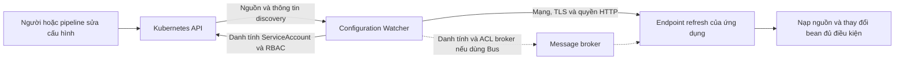

# Phân quyền watcher và bảo vệ kênh thông báo

## Mục tiêu và bối cảnh

Trong chương **Configuration Watcher** của module **SPRING_CLOUD_KUBERNETES**, Watcher là thành phần có khả năng đọc trạng thái cấu hình và yêu cầu ứng dụng làm mới trạng thái chạy. Phân quyền cho nó cần xét cả dữ liệu Kubernetes lẫn tác động của thông báo đến ứng dụng Spring.

Sau bài học, bạn có thể:

- Tách quyền đọc Kubernetes API khỏi quyền gọi HTTP hoặc gửi thông báo qua broker.
- Tạo ServiceAccount và RBAC có phạm vi namespace phù hợp với tính năng đã bật.
- Đánh giá rủi ro của quyền `list/watch` Secret, quyền sửa workload và metadata điều khiển thông báo.
- Bảo vệ đường callback bằng kiểm soát mạng, danh tính, TLS và phân quyền endpoint.
- Kiểm tra cả thao tác được phép và thao tác phải bị từ chối mà không in thông tin bí mật.

Ví dụ dùng một Watcher trong namespace `watcher-system` theo dõi ConfigMap của `pricing-service` trong namespace `shop-apps`. Ứng dụng đọc cấu hình qua volume; endpoint refresh ở `8081/manage/refresh`. Ban đầu không bật theo dõi Secret và không bật HA. Những lựa chọn này là phạm vi của ví dụ, không phải yêu cầu mọi hệ thống phải dùng cùng kiến trúc.

## 1. Có nhiều ranh giới quyền trong cùng một luồng cập nhật



Ba nhóm quyền chính cần được thiết kế riêng:

| Nhóm quyền | Nơi quyết định | Ví dụ |
| --- | --- | --- |
| Đọc hoặc ghi tài nguyên cụm | Kubernetes authorization, thường là RBAC | Watcher được `watch configmaps` trong `shop-apps` |
| Truy cập đường mạng | NetworkPolicy, firewall, proxy hoặc service mesh | Chỉ workload Watcher được tới cổng management |
| Thực hiện thao tác quản trị | Spring Security, proxy danh tính hoặc ACL broker | Chỉ danh tính được cấp quyền mới được yêu cầu refresh |

ServiceAccount đọc được ConfigMap không đồng nghĩa ứng dụng chấp nhận request HTTP của nó. NetworkPolicy cho đi qua không đồng nghĩa request đã được xác thực. Một chứng thư hợp lệ cũng chưa quyết định caller được gọi endpoint nào.

Watcher không cần quyền sửa ConfigMap chỉ để phát hiện thay đổi. Nó không cần quyền sửa Deployment chỉ để gửi HTTP refresh. Nếu lựa chọn kiến trúc khác có thao tác bổ sung, phải bổ sung quyền cho đúng thao tác, không cấp trước quyền quản trị rộng cho mọi tình huống có thể phát sinh.

## 2. Chốt tính năng trước khi viết Role

Configuration Watcher có thể dùng HTTP hoặc Spring Cloud Bus để phát tín hiệu. Phạm vi theo dõi, discovery, Secret và HA ảnh hưởng đến quyền cần dùng. Các thuộc tính phải được đối chiếu với phiên bản Spring Cloud Kubernetes và client được triển khai. Xem [Spring Cloud Kubernetes Configuration Watcher](https://docs.spring.io/spring-cloud-kubernetes/reference/spring-cloud-kubernetes-configuration-watcher.html).

Lập một bảng thiết kế trước khi chọn quyền:

| Câu hỏi | Lựa chọn của ví dụ | Hệ quả |
| --- | --- | --- |
| Watcher chạy ở đâu? | `watcher-system` | ServiceAccount có namespace này |
| Tài nguyên đích ở đâu? | Chỉ `shop-apps` | Role/RoleBinding nằm trong `shop-apps` |
| Theo dõi nguồn gì? | ConfigMap | Không cấp quyền Secret cho chức năng chưa dùng |
| Discovery dùng gì? | Client đọc trực tiếp API, cấu hình EndpointSlice | Cần đúng API group và resource của discovery |
| Client có đọc Pod không? | Có trong profile minh họa | Có quyền đọc Pod; bỏ nếu implementation thực tế không cần |
| Phát tín hiệu bằng gì? | HTTP tới management port | Cần đường mạng và quyền endpoint riêng |
| Có HA không? | Chưa bật | Không cấp quyền Lease cho profile ban đầu |
| Ứng dụng nhận có gọi API không? | Không, chỉ đọc volume | Không dùng chung quyền API của Watcher với ứng dụng |

Đây là profile minh họa để giải thích cách suy ra quyền. Không có một Role tối thiểu đúng cho tất cả image, tất cả client và mọi chế độ discovery. Khi triển khai, cần kiểm chứng những request mà phiên bản thực tế thực hiện.

### Hai phạm vi phải khớp nhau

Phạm vi đọc nguồn và phạm vi discovery là hai cấu hình khác nhau. Watcher có thể theo dõi ConfigMap trong `shop-apps` nhưng discovery vẫn tìm instance ở namespace mặc định của Pod Watcher nếu chưa cấu hình đúng.

Ngược lại, bật discovery toàn cụm có thể khiến client thực hiện request vượt quá Role theo namespace. Không sửa lỗi này bằng cách cấp ClusterRoleBinding ngay; trước hết đối chiếu nhu cầu và thu hẹp phạm vi client. Các lựa chọn namespace và EndpointSlice được mô tả tại [DiscoveryClient for Kubernetes](https://docs.spring.io/spring-cloud-kubernetes/reference/discovery-client.html).

## 3. ServiceAccount riêng và RoleBinding đúng namespace

### 3.1. Danh tính của Watcher

Giả định hai namespace đã tồn tại. ServiceAccount của Watcher:

```yaml
apiVersion: v1
kind: ServiceAccount
metadata:
  name: config-watcher
  namespace: watcher-system
automountServiceAccountToken: true
```

Danh tính Kubernetes tương ứng:

```text
system:serviceaccount:watcher-system:config-watcher
```

Ví dụ chọn tự động cấp token vì client trong Watcher cần gọi Kubernetes API. Điều này không có nghĩa mọi container và mọi ứng dụng phải nhận token. Khi dùng token projection tùy biến, cần kiểm tra vị trí tệp, CA, audience và khả năng client đọc lại token sau khi xoay vòng.

### 3.2. Role đọc tài nguyên trong namespace ứng dụng

Role cho profile ConfigMap, Pod và Service cùng EndpointSlice:

```yaml
apiVersion: rbac.authorization.k8s.io/v1
kind: Role
metadata:
  name: config-watcher-reader
  namespace: shop-apps
rules:
  - apiGroups: [""]
    resources: ["configmaps", "services", "pods"]
    verbs: ["get", "list", "watch"]
  - apiGroups: ["discovery.k8s.io"]
    resources: ["endpointslices"]
    verbs: ["get", "list", "watch"]
```

Điểm cần đọc đúng:

- `apiGroups: [""]` chỉ core API group, không phải mọi API group.
- `endpointslices` thuộc `discovery.k8s.io`, không thuộc core group.
- Không có quyền `create`, `update`, `patch` hoặc `delete` đối với nguồn và workload.
- Không có `secrets`, `roles`, `rolebindings`, `pods/exec` hoặc wildcard.
- Quyền Pod phản ánh profile được chọn; nếu client không sử dụng dữ liệu Pod, loại nó khỏi thiết kế quyền sau khi kiểm chứng.

Nếu client dùng `Endpoints`, phải thiết kế quyền cho core resource `endpoints` và cấu hình client tương ứng. Không cấp cả hai loại theo thói quen nếu chỉ dùng một loại. Nếu phiên bản/client vẫn thực hiện thêm request vì một tính năng khác, xác định tính năng đó trước khi thay Role.

### 3.3. Binding tài nguyên và danh tính ở hai namespace khác nhau

```yaml
apiVersion: rbac.authorization.k8s.io/v1
kind: RoleBinding
metadata:
  name: config-watcher-reader
  namespace: shop-apps
subjects:
  - kind: ServiceAccount
    name: config-watcher
    namespace: watcher-system
roleRef:
  apiGroup: rbac.authorization.k8s.io
  kind: Role
  name: config-watcher-reader
```

RoleBinding nằm ở `shop-apps`, nơi quyền được cấp. Subject chỉ rõ ServiceAccount ở `watcher-system`. Role được tham chiếu nằm cùng namespace với RoleBinding.

Đặt RoleBinding chỉ ở namespace Watcher không tự cấp quyền với tài nguyên `shop-apps`. Cũng không được bỏ namespace của subject rồi mặc định nó sẽ trỏ đến danh tính mong muốn.

Khi cần lặp cùng tập quyền ở vài namespace, có thể dùng ClusterRole tái sử dụng và RoleBinding tại từng namespace. ClusterRole không đồng nghĩa phải gắn ClusterRoleBinding. Chỉ dùng phạm vi toàn cụm khi yêu cầu thực tế cần đến nó. Cấu trúc Role và binding được mô tả tại [Using RBAC Authorization](https://kubernetes.io/docs/reference/access-authn-authz/rbac/).

## 4. Cấu hình Watcher phải phản ánh đúng profile quyền

Phần trích Pod template sau minh họa danh tính và phạm vi; không phải một Deployment hoàn chỉnh:

```yaml
spec:
  template:
    metadata:
      labels:
        app: config-watcher
    spec:
      serviceAccountName: config-watcher
      containers:
        - name: watcher
          env:
            - name: SPRING_CLOUD_KUBERNETES_RELOAD_NAMESPACES_0
              value: shop-apps
            - name: SPRING_CLOUD_KUBERNETES_DISCOVERY_ALL_NAMESPACES
              value: "false"
            - name: SPRING_CLOUD_KUBERNETES_DISCOVERY_NAMESPACES_0
              value: shop-apps
            - name: SPRING_CLOUD_KUBERNETES_DISCOVERY_USE_ENDPOINT_SLICES
              value: "true"
            - name: SPRING_CLOUD_KUBERNETES_SECRETS_ENABLED
              value: "false"
```

Deployment chứa phần này chạy trong `watcher-system`; `serviceAccountName` được tra trong namespace của Pod. Image phải được chọn theo phiên bản đã xác định, không dùng một tag thay đổi tùy ý làm cơ sở cho giả định về quyền.

Phạm vi `reload.namespaces` và `discovery.namespaces` được cấu hình riêng. Nếu dùng DiscoveryServer qua HTTP thay cho client đọc API trực tiếp, phạm vi và quyền cần được xem xét ở thành phần server tương ứng, không chỉ ở Watcher.

Không tắt token mount cho Watcher rồi cấp thêm RBAC để chữa lỗi thiếu credential. Ngược lại, token hợp lệ nhưng bị `Forbidden` là vấn đề authorization hoặc sai phạm vi, không phải lý do tạo một token có quyền quản trị rộng hơn.

### Ứng dụng nhận dùng danh tính khác

Ví dụ ServiceAccount của `pricing-service` chỉ đọc volume:

```yaml
apiVersion: v1
kind: ServiceAccount
metadata:
  name: pricing-runtime
  namespace: shop-apps
automountServiceAccountToken: false
```

Pod ứng dụng phải thực sự dùng `serviceAccountName: pricing-runtime`; một Pod specification có thể ghi đè thiết lập token mount nên cần đối chiếu cấu hình cuối cùng. Không gắn Role của Watcher cho ứng dụng chỉ vì ứng dụng nhận refresh.

Kubelet cấp ConfigMap/Secret volume theo Pod specification. Quyền của tiến trình đọc tệp được mount và quyền của ServiceAccount đọc API là hai đường khác nhau. Nếu sau này bật DiscoveryClient hoặc API PropertySource trong ứng dụng, đánh giá bổ sung quyền cho tính năng đó.

## 5. Giới hạn của label selector và `resourceNames`

### Nhãn chọn đối tượng không phải ranh giới authorization

Một nhãn như:

```yaml
metadata:
  labels:
    spring.cloud.kubernetes.config: "true"
```

có thể giúp Watcher quyết định xử lý nguồn nào. Nó không tự làm cho RBAC chỉ cho phép đọc đúng các đối tượng mang nhãn đó. Nếu Role cho `list/watch configmaps` trong namespace, quyền API không được thu hẹp chỉ bằng một label selector trong cấu hình ứng dụng.

Trong ví dụ, Role đọc được ConfigMap trong `shop-apps`, không chỉ một ConfigMap được gắn nhãn. Nếu namespace chứa dữ liệu mà Watcher không được phép đọc, cần thiết kế lại ranh giới hoặc một giải pháp hỗ trợ giới hạn phù hợp, thay vì coi nhãn là cơ chế bảo vệ dữ liệu.

### `resourceNames` cần tương thích với request của client

Có thể giới hạn tên cho một số thao tác bằng `resourceNames`. Tuy nhiên, với `list/watch` bị giới hạn theo tên, client cần gửi field selector `metadata.name` phù hợp để request được authorize. Informer chỉ gửi label selector hoặc list toàn namespace có thể không đáp ứng điều kiện đó.

Không viết Role có `resourceNames: ["pricing-policy"]` rồi kết luận Watcher chắc chắn chỉ đọc được nguồn này và vẫn hoạt động. Phải kiểm tra implementation và request thực tế. Một `kubectl get` thành công theo tên cũng không chứng minh đường `list/watch` của client sẽ thành công.

RBAC không cung cấp cách giới hạn top-level `create` theo `resourceNames` như thao tác đọc một đối tượng đã có tên. Những giới hạn này được giải thích tại [Using RBAC Authorization](https://kubernetes.io/docs/reference/access-authn-authz/rbac/).

## 6. Secret làm thay đổi đáng kể mức độ nhạy cảm của quyền

`get` Secret đọc được dữ liệu; `list` và `watch` cũng có thể cung cấp nội dung Secret, không chỉ tên hoặc sự kiện rỗng. Quyền theo dõi Secret phải được đánh giá như quyền đọc thông tin xác thực trong phạm vi được cấp. Xem [Good practices for Kubernetes Secrets](https://kubernetes.io/docs/concepts/security/secrets-good-practices/).

Nếu không cần cập nhật bí mật lúc chạy, giữ theo dõi Secret ở trạng thái tắt và không cấp quyền tương ứng. Một ứng dụng được mount Secret không khiến Watcher mặc nhiên phải có quyền đọc Secret đó.

Nếu thực sự cần theo dõi Secret:

1. Xác định chức năng cần thông báo khi Secret đổi và thành phần nào phải đọc nội dung.
2. Chọn phạm vi namespace và tập Secret được phép tiếp cận theo khả năng client.
3. Đánh giá token của Watcher sẽ cho phép lộ dữ liệu nào nếu bị mất.
4. Bổ sung quyền đúng loại, không cấp `edit` hoặc `cluster-admin` thay cho quyền đọc cần thiết.
5. Kiểm tra log, trace và response không in Secret hoặc header xác thực.
6. Kiểm tra client ứng dụng thực sự chuyển sang thông tin mới trước khi thu hồi giá trị cũ ở nơi cấp.

Mã hóa khi lưu, TLS và kiểm soát truy cập có vai trò khác nhau. Dữ liệu được mã hóa trong etcd vẫn có thể được trả ở dạng đọc được cho caller đã có quyền API. Không dùng trạng thái “đã mã hóa khi lưu” để biện minh cho quyền đọc Secret rộng.

## 7. Kiểm soát cả người sửa nguồn và metadata thông báo

Watcher có thể đọc nguồn và dùng thông tin định tuyến để yêu cầu một ứng dụng khác refresh. Vì thế, người sửa được nguồn hoặc metadata liên quan có thể gây tác động gián tiếp qua Watcher.

| Thành phần có thể bị sửa | Tác động cần xét |
| --- | --- |
| Dữ liệu ConfigMap | Đổi hành vi hoặc đưa cấu hình không hợp lệ vào ứng dụng |
| Nhãn theo dõi | Đưa nguồn mới vào hoặc loại nguồn khỏi phạm vi xử lý |
| Annotation chọn ứng dụng đích | Mở rộng hoặc chuyển tập ứng dụng bị yêu cầu refresh |
| Service selector và địa chỉ discovery | Thay đổi tập instance mà client tìm thấy |
| Metadata management port/path | Ảnh hưởng URL callback mà Watcher xây dựng |
| Deployment hoặc Pod Watcher | Chạy mã khác với token, volume và danh tính của Watcher |

Đây là lý do cần kiểm soát tính toàn vẹn của nguồn và quyền triển khai, không chỉ quyền đọc. Có thể dùng quy trình review, quyền pipeline riêng và cơ chế admission phù hợp để ràng buộc các trường được thay đổi. Nhãn hoặc annotation chưa được kiểm soát không nên trở thành đường mở rộng tùy ý phạm vi tác động của một controller có quyền cao hơn.

Người được tạo hoặc sửa workload có thể tạo đường truy cập Secret qua volume hoặc chạy workload dưới một ServiceAccount có quyền hơn trong cùng namespace, tùy các cơ chế kiểm soát khác của cụm. Vì vậy, quyền triển khai, exec và quyền thay danh tính workload cũng phải được xem xét. Xem [Kubernetes RBAC Good Practices](https://kubernetes.io/docs/concepts/security/rbac-good-practices/).
