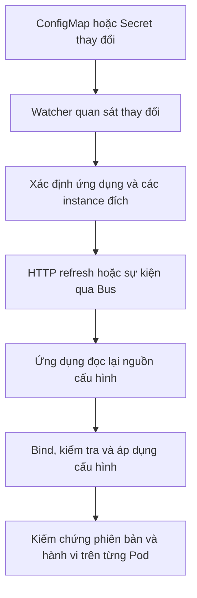

# Xử lý thông báo lỗi, trùng hoặc đến liên tiếp

## Mục tiêu bài học

Trong chương Configuration Watcher của module Spring Cloud Kubernetes, bài này giải quyết một tình huống vận hành cụ thể: ConfigMap hoặc Secret đã thay đổi nhưng quá trình thông báo và áp dụng cấu hình không diễn ra đồng đều trên các Pod.

Sau bài học, bạn có thể:

- Phân biệt lỗi theo dõi tài nguyên, lỗi chuyển thông báo và lỗi áp dụng cấu hình.
- Chọn retry có giới hạn, loại bỏ thông báo trùng và xử lý có tính lũy đẳng.
- Gộp các cập nhật dồn dập mà vẫn bảo đảm cấu hình mới nhất được áp dụng.
- Xác nhận kết quả trên từng Pod, xử lý trạng thái thành công một phần và phục hồi sau khi mất thông báo.

Các cấu hình Watcher minh họa dưới đây tham chiếu dòng Spring Cloud Kubernetes 3.3. Khi triển khai, đối chiếu tài liệu đúng phiên bản image, Spring Boot và Spring Cloud BOM của hệ thống. Những thuật toán điều phối được ghi rõ là thiết kế bổ sung; không mặc định Watcher có sẵn mọi cơ chế được đề xuất trong bài.

## 1. Bài toán là sự hội tụ của các Pod

Giả sử `pricing-service` có ba Pod. Cấu hình đang dùng là bản `cfg-a`; người vận hành cập nhật nguồn cấu hình thành `cfg-b`.

| Pod | Kết quả thông báo | Trạng thái ứng dụng sau đó |
| --- | --- | --- |
| `pricing-a` | HTTP thành công | Đã sử dụng `cfg-b` |
| `pricing-b` | Watcher hết thời gian chờ | Chưa biết: có thể đã áp dụng hoặc vẫn đang xử lý |
| `pricing-c` | Kết nối bị từ chối | Cần kiểm tra Pod và thử lại khi phù hợp |

Nếu chỉ ghi một dòng `refresh sent`, hệ thống chưa biết cả ba Pod đã hội tụ hay chưa. Nếu gửi lại cho tất cả Pod sau mỗi lỗi, hai Pod khỏe có thể liên tục bị refresh dù chỉ một đích gặp sự cố.

Trong bài này, mục tiêu vận hành là: sau khi các thay đổi tạm lắng và các thành phần cần thiết hoạt động trở lại, mọi Pod đang phục vụ phải áp dụng cùng cấu hình hợp lệ mong muốn, trong một khoảng thời gian đã quy định.

Đây là mục tiêu thiết kế của ứng dụng và quy trình vận hành. Không nên suy ra bảo đảm giao nhận chính xác một lần từ việc sử dụng Kubernetes watch, HTTP hay một broker.

## 2. Xác định thông báo đang thất bại ở đâu

### 2.1. Tách các chặng của quá trình

Watcher dùng HTTP hoặc Spring Cloud Bus. Với HTTP, nó tìm instance qua DiscoveryClient rồi gọi `/actuator/refresh` theo mặc định. Ví dụ chọn nguồn và ứng dụng đích nằm trong bài thực hành. [Tài liệu Configuration Watcher 3.3](https://docs.spring.io/spring-cloud-kubernetes/reference/3.3/spring-cloud-kubernetes-configuration-watcher.html)



Ở mỗi chặng, cần đặt một câu hỏi khác nhau:

1. **Quan sát:** Watcher có quyền và có nhận ra nguồn đã thay đổi không?
2. **Định tuyến:** Danh sách đích có đúng namespace, ứng dụng, cổng và đường dẫn không?
3. **Giao nhận:** Thông báo có đến đích, hoặc broker có chấp nhận bản tin không?
4. **Áp dụng:** Ứng dụng có đọc được dữ liệu mới và tạo được cấu hình hợp lệ không?
5. **Kiểm chứng:** Hành vi đang phục vụ có phản ánh cấu hình mong muốn không?

Không dùng kết quả ở chặng trước để thay cho bằng chứng của chặng sau. Đặc biệt, lỗi timeout là một kết quả chưa xác định, còn HTTP thành công cũng cần được đối chiếu với trạng thái thực tế của ứng dụng.

### 2.2. Bảng phân loại để chọn cách xử lý

Bảng sau là chính sách xử lý đề xuất cho một hệ thống có lớp điều phối hoặc công cụ vận hành bổ sung.

| Dấu hiệu | Cách hiểu ban đầu | Hành động hợp lý |
| --- | --- | --- |
| API Kubernetes trả `403` khi đọc ConfigMap | ServiceAccount thiếu quyền hoặc sai namespace | Kiểm tra RBAC; sửa nguyên nhân trước khi thử lại |
| Watch mất kết nối | Kênh quan sát bị gián đoạn | Theo dõi khả năng kết nối lại và đối soát nguồn hiện tại |
| Discovery không tìm được instance | Sai định tuyến, Service hoặc chưa có instance phù hợp | Kiểm tra selector, endpoints và readiness; không đánh dấu đã hội tụ |
| Gọi refresh trả `401` hoặc `403` | Thiếu xác thực, sai phân quyền, hoặc chính sách HTTP như CSRF chặn yêu cầu | Kiểm tra lớp bảo vệ endpoint; không mở công khai để chữa lỗi |
| Gọi refresh trả `404` | Sai path, base path hoặc endpoint chưa khả dụng | Kiểm tra Actuator, dependency và cổng quản trị |
| Gọi refresh trả `405` | Sai phương thức HTTP | Kiểm tra yêu cầu POST và proxy trung gian |
| Gọi refresh trả `429` | Đích hoặc proxy đang giới hạn tốc độ | Tôn trọng `Retry-After` hợp lệ và giới hạn ngân sách retry |
| Timeout, reset kết nối, một số `502/503/504` | Có thể là lỗi tạm thời, kết quả áp dụng có thể chưa rõ | Kiểm chứng trạng thái đích rồi retry có giới hạn |
| `500` lặp lại kèm lỗi bind hoặc validation | Cấu hình hoặc mã ứng dụng có vấn đề | Cô lập bản lỗi, sửa hoặc rollback nguồn; không retry vô hạn |
| HTTP thành công nhưng phiên bản vẫn cũ | Nguồn chưa cập nhật, sai thứ tự ưu tiên hoặc bean chưa dùng giá trị mới | Kiểm tra đường đọc cấu hình và hành vi thực tế |

Không coi mọi mã `5xx` là lỗi mạng có thể chữa bằng retry. Cùng một mã phản hồi có thể đến từ proxy hoặc từ lỗi tái tạo bean; log phía ứng dụng quyết định bước xử lý tiếp theo.

RBAC cho phép truy cập tài nguyên của Kubernetes; nó không tự cấp quyền gọi Actuator. Ví dụ, quyền `get/list/watch` ConfigMap của Watcher và quyền HTTP POST đến ứng dụng là hai lớp kiểm soát riêng. [Kubernetes RBAC](https://kubernetes.io/docs/reference/access-authn-authz/rbac/)

## 3. Retry thông báo thất bại mà không tạo thêm quá tải

### 3.1. Đặt timeout và ngân sách tổng

Một chính sách minh họa cho môi trường thử nghiệm:

- Timeout kết nối: 1 giây; timeout phản hồi: 4 giây.
- Tối đa 4 lần gọi, tính cả lần đầu.
- Backoff cơ sở 500 mili giây, trần 5 giây.
- Thời hạn cho một đợt xử lý trên một đích: 30 giây.
- Giới hạn đồng thời theo ứng dụng và toàn hệ thống.

Đây là tham số thiết kế, không phải giá trị mặc định hoặc tên property của Configuration Watcher. Thời gian thực tế phải dựa trên độ trễ quan sát được và khả năng chịu tải của ứng dụng.

Công thức full jitter có thể dùng cho lần chờ thứ `k`, bắt đầu từ `k = 0`:

```text
upperBound(k) = min(5 giây, 500 mili giây × 2^k)
wait(k)       = random trong khoảng [0, upperBound(k)]
```

Jitter phân tán thời điểm thử lại của nhiều đích. Nếu tất cả Pod retry đúng sau một giây, sự cố nhỏ dễ biến thành một đợt yêu cầu đồng loạt.

Trước mỗi lần gọi, kiểm tra thời hạn còn lại. Thời gian chờ và timeout của lần tiếp theo phải nằm trong ngân sách còn lại. Khi đã hết ngân sách, chuyển sang cảnh báo và đối soát sau; không tự bắt đầu ngay một vòng retry mới.

Nếu có nhiều tầng retry ở HTTP client, proxy và lớp điều phối, hãy tính số lần gọi tổng. Ba lần ở mỗi tầng của ba tầng có thể khuếch đại thành 27 lần gọi tới đích.

### 3.2. Theo dõi riêng từng instance

Nên lưu kết quả theo bộ khóa tương đương:

```text
application + targetPodUid + desiredConfigId
```

Ví dụ:

```text
pricing-service / pod-a-uid / cfg-b -> APPLIED
pricing-service / pod-b-uid / cfg-b -> VERIFY_PENDING
pricing-service / pod-c-uid / cfg-b -> RETRY_PENDING
```

Các trạng thái trên là mô hình đề xuất cho lớp giám sát hoặc điều phối của hệ thống, không phải status mà Watcher mặc định ghi vào Kubernetes.

Chỉ retry các đích còn thiếu bằng chứng thành công. Nếu dùng một địa chỉ Service được cân bằng tải cho các lần POST thủ công, nhiều lần gọi có thể đều vào cùng Pod; số lần gọi không chứng minh đã bao phủ mọi replica. Công cụ phục hồi cần biết chính xác instance nào đang được xử lý.

Pod bị thay thế cần được nhận diện lại qua discovery. Không tiếp tục gọi vô hạn vào địa chỉ cũ; cũng không chuyển bản ghi thành công của Pod cũ sang Pod mới chỉ vì tên ứng dụng giống nhau. Pod mới phải đọc cấu hình khi khởi động và được kiểm chứng trong tập đích hiện hành.

### 3.3. Timeout không chứng minh refresh chưa chạy

Giả sử ứng dụng hoàn thành refresh sau 3 giây nhưng phản hồi bị mất. Watcher thấy timeout; ứng dụng đã thay đổi trạng thái.

Vì vậy, khi kết quả chưa rõ:

1. Kiểm tra phiên bản thực tế hoặc hành vi đích nếu có kênh quan sát.
2. Nếu đã hội tụ, kết thúc công việc cho đích đó.
3. Nếu chưa hội tụ hoặc chưa có đủ bằng chứng, thử lại trong ngân sách.
4. Bảo đảm việc thực hiện lại không sinh thêm tác dụng phụ nghiệp vụ.

Retry giúp tăng khả năng hoàn tất. Tính lũy đẳng giúp retry trở nên an toàn. Hai cơ chế này cần đi cùng nhau.

## 4. Xử lý thông báo trùng bằng hai lớp bảo vệ

### 4.1. Phân biệt trùng tín hiệu và trùng hiệu ứng

Một đợt cập nhật có thể tạo nhiều lần kích hoạt do công cụ phục hồi gửi lại, nhiều Watcher cùng hoạt động, hoặc cơ chế giao nhận của hạ tầng. Thiết kế nên chịu được tình huống này mà không giả định mọi bản tin đều có định danh cấu hình toàn cục.

**Deduplication** nhận ra công việc đã được xếp hàng hoặc đã hoàn tất để giảm xử lý thừa. **Idempotency** bảo đảm thực hiện lại cùng trạng thái mong muốn vẫn cho kết quả an toàn.

Ví dụ hiệu ứng lũy đẳng:

```text
Đặt giới hạn retry nghiệp vụ thành 3.
Thực hiện lại vẫn giữ giới hạn là 3.
```

Ví dụ hiệu ứng không lũy đẳng:

```text
Mỗi lần nhận sự kiện refresh thì tăng giới hạn lên 1.
Mỗi lần refresh thì gửi email hoặc phát sinh giao dịch.
```

Không gắn tác dụng phụ nghiệp vụ trực tiếp với số lần nhận thông báo cấu hình. Nếu một thay đổi thật sự cần migration, dùng quy trình migration riêng với định danh và kiểm soát thực thi phù hợp.

### 4.2. Chọn khóa nhận diện đúng phạm vi

Với lớp nhận sự kiện tài nguyên do bạn tự xây dựng, một khóa nhận diện thay đổi có thể bao gồm:

```text
clusterId / namespace / kind / name / uid / resourceVersion
```

Trong đó, `uid` phân biệt đối tượng bị xóa rồi tạo lại cùng tên. Khi tạo công việc gửi tới ứng dụng, bổ sung danh tính instance đích; một Pod đã xử lý không có nghĩa các Pod còn lại đã xử lý.

`resourceVersion` cần được giữ như giá trị định danh phiên bản do API cung cấp. Không dùng phép cộng, so sánh số hoặc so sánh chuỗi tùy tiện để tạo thứ tự cập nhật nghiệp vụ giữa các nguồn. Kubernetes client cũng cần xử lý trường hợp watch lịch sử hết hiệu lực, chẳng hạn `410 Gone`, bằng cách lấy lại trạng thái và thiết lập watch phù hợp. [Kubernetes API Concepts](https://kubernetes.io/docs/reference/using-api/api-concepts/)

Nếu đích HTTP chỉ nhận yêu cầu refresh thông thường, đừng giả định nó có sẵn `uid/resourceVersion` của ConfigMap gây ra yêu cầu. Khóa trên thuộc lớp quan sát hoặc điều phối; ứng dụng có thể cần một `configId` không bí mật nằm trong dữ liệu cấu hình để báo cáo bản đã áp dụng.

Với nhiều ConfigMap và Secret cùng tạo nên cấu hình, một resourceVersion đơn lẻ không mô tả toàn bộ trạng thái hiệu lực. Có thể dùng một mã phát hành chung hoặc một tập định danh nguồn được kiểm tra tính tương thích trước khi công bố.

### 4.3. Phân biệt đã nhìn thấy, đang xử lý và đã áp dụng

Một lỗi phổ biến là ghi khóa vào bộ nhớ `seen` ngay khi nhận được thông báo, sau đó bỏ mọi lần gặp lại. Nếu lần đầu bị timeout hoặc tiến trình dừng trước khi áp dụng, hệ thống có thể tự loại bỏ cơ hội phục hồi.

Nên phân biệt:

| Trạng thái trong lớp bổ sung | Ý nghĩa | Cách xử lý thông báo trùng |
| --- | --- | --- |
| `PENDING` | Đã xếp công việc nhưng chưa hoàn tất | Gộp vào công việc còn chờ |
| `IN_FLIGHT` | Đang có một lần xử lý | Không mở thêm một lần song song cho cùng đích |
| `RETRY_PENDING` | Lần trước chưa thành công chắc chắn | Giữ cơ hội thử lại |
| `APPLIED` | Đích đã được kiểm chứng dùng cấu hình mong muốn | Bỏ công việc thừa trong thời gian lưu dấu |
| `REJECTED` | Bản cấu hình bị xác định không hợp lệ | Chờ bản sửa, rollback hoặc can thiệp có kiểm soát |

Bộ nhớ dedup cần có TTL và giới hạn kích thước. TTL nên bao phủ cửa sổ retry dự kiến. Khi tiến trình khởi động lại hoặc TTL hết, tính lũy đẳng ở ứng dụng vẫn phải bảo vệ hệ thống.

Nếu có nhiều tiến trình điều phối, khóa trong bộ nhớ của từng tiến trình không tạo ra đồng bộ toàn hệ thống. Cần phân vùng quyền xử lý hoặc cơ chế phối hợp có thời hạn và phục hồi khi chủ sở hữu mất kết nối. Chỉ tăng số replica Watcher không tự chứng minh đã giải quyết trùng thông báo.

## 5. Thông báo đến liên tiếp: gộp công việc và bảo vệ trạng thái mới

### 5.1. Debounce có giới hạn chờ tối đa

Giả sử công cụ triển khai ghi ba lần liên tiếp:

```text
t = 0 ms     cfg-a -> cfg-b
t = 120 ms   cfg-b -> cfg-c
t = 300 ms   cfg-c -> cfg-d
```

Với cấu hình mô tả trạng thái hiện tại, ứng dụng thường chỉ cần hội tụ về `cfg-d`. Không nhất thiết tái tạo bean cho mọi trạng thái trung gian.

Một lớp điều phối bổ sung có thể dùng debounce cuối đợt:

1. Nhận thay đổi thì đánh dấu ứng dụng cần đối soát.
2. Chờ một khoảng yên lặng, ví dụ 500 mili giây.
3. Nếu có thay đổi mới, dời lịch nhưng không quá giới hạn chờ tối đa, ví dụ 3 giây kể từ thay đổi đầu đợt.
4. Đến hạn thì đọc trạng thái nguồn hiện tại và xử lý đích.
5. Thay đổi xuất hiện trong lúc đang xử lý sẽ tạo lượt đối soát tiếp theo.

Trong ví dụ không có cập nhật nào nữa, một lượt xử lý có thể bắt đầu khoảng `t = 800 ms`. Nếu cập nhật kéo dài liên tục, giới hạn 3 giây ngăn việc chờ yên lặng mãi mãi.

Debounce chỉ phù hợp khi các bản trung gian được phép bỏ qua. Nếu nghiệp vụ yêu cầu thi hành từng thay đổi theo thứ tự, cần một luồng lệnh hoặc sự kiện nghiệp vụ có nhật ký và xác nhận riêng; ConfigMap không thay thế luồng đó.

### 5.2. `refreshDelay` có mục đích khác debounce

Với nguồn mount thành tệp, dòng 3.3 hỗ trợ trì hoãn thông báo:

```yaml
# Trích phần env của container Configuration Watcher.
env:
  - name: SPRING_CLOUD_KUBERNETES_CONFIGURATION_WATCHER_REFRESHDELAY
    value: "10000"
```

Đơn vị là mili giây. Delay phục vụ độ trễ cập nhật nguồn; không bảo đảm loại trùng, gộp sự kiện hoặc chờ đủ cho mọi cluster. [Watcher: refresh delay](https://docs.spring.io/spring-cloud-kubernetes/reference/3.3/spring-cloud-kubernetes-configuration-watcher.html)

Cần kiểm tra cách ứng dụng tiêu thụ cấu hình: dữ liệu từ ConfigMap mount theo volume được cập nhật với độ trễ; biến môi trường lấy từ ConfigMap không tự đổi trong container đang chạy; mount bằng `subPath` không nhận cập nhật ConfigMap. Chỉ tăng delay sẽ không sửa được hai trường hợp sau. [Kubernetes ConfigMaps](https://kubernetes.io/docs/concepts/configuration/configmap/)

Với Secret, cũng phải xác minh đường đọc đang dùng và tránh in giá trị ra log để đo độ trễ. Ưu tiên mã phát hành công khai riêng hoặc trạng thái kiểm tra kết nối thay cho nội dung bí mật.

### 5.3. Ngăn công việc cũ ghi đè kết quả mới

Xét hai công việc: một lượt retry xuất phát từ `cfg-b` đang chờ, trong khi `cfg-d` đã trở thành trạng thái mong muốn.

Đối với yêu cầu refresh thông thường, thông báo chủ yếu yêu cầu đọc lại nguồn; không nên coi mỗi yêu cầu là một gói dữ liệu cấu hình bất biến. Tuy nhiên, nếu bạn xây thêm lớp đọc, chuẩn bị và công bố cấu hình bất đồng bộ, một công việc cũ có thể hoàn thành muộn và ghi đè snapshot mới.

Chính sách đề xuất:

- Mỗi ứng dụng ở lớp điều phối có một bộ đếm thế hệ nội bộ, tăng khi cần đối soát lại.
- Bộ đếm này được tạo dưới quyền điều phối rõ ràng; nó không phải phép chuyển `resourceVersion` thành số.
- Trước khi bắt đầu retry, bỏ công việc đã bị thay thế hoặc chuyển nó sang đối soát trạng thái mới nhất.
- Tại một instance ứng dụng, chỉ có một chu trình đọc, kiểm tra và công bố snapshot tại một thời điểm.
- Nếu chuẩn bị cấu hình ngoài khóa, phải kiểm tra thế hệ ngay trước lúc công bố, dưới cùng khóa bảo vệ cập nhật.

Không chỉ kiểm tra thế hệ trước lúc gửi rồi bỏ kiểm tra ở lúc công bố; khoảng thời gian giữa hai bước vẫn có thể xuất hiện cập nhật mới.

## 6. Mô hình điều phối bổ sung để tránh mất cập nhật

Mã giả dưới đây mô tả một controller hoặc lớp mở rộng do đội phát triển sở hữu. Đây không phải API, class hay property có sẵn của Spring Cloud Kubernetes.

```text
State theo application:
  generation
  dirty
  running
  firstPendingAt
  dueAt

onRelevantChange(application):
  dưới khóa của application:
    generation = generation + 1
    dirty = true
    nếu firstPendingAt chưa có:
      firstPendingAt = now
    dueAt = min(now + quietWindow, firstPendingAt + maxWait)
    bảo đảm scheduler có lịch đánh thức

onDue(application):
  dưới cùng khóa:
    nếu running hoặc không dirty: return
    nếu now < dueAt: hẹn lại và return
    running = true
    dirty = false
    firstPendingAt = empty
    runGeneration = generation

  try:
    desired = readCurrentConfiguration(application)
    validateDesired(desired)
    targets = discoverCurrentInstances(application)

    với mỗi target, trong giới hạn đồng thời:
      nếu đã kiểm chứng target dùng desired: continue
      notifyAndVerifyWithBoundedRetry(target, desired, runGeneration)

    ghi nhận kết quả riêng từng target
  finally:
    dưới cùng khóa:
      running = false
      nếu generation khác runGeneration: dirty = true
      nếu dirty: bảo đảm scheduler có lịch xử lý tiếp
```

Những chi tiết cần hoàn thiện khi hiện thực:

- Lỗi đọc nguồn hoặc validation phải có trạng thái và hành động rõ ràng; không được nuốt ngoại lệ rồi coi như đã hoàn tất.
- Khi đã hết retry, lưu danh sách đích chưa hội tụ để công việc đối soát hoặc người vận hành xử lý tiếp.
- Scheduler phải đánh thức lại sau khi `running` kết thúc nếu còn `dirty`; cờ `dirty` riêng lẻ không tự tạo công việc.
- Danh sách instance có thể thay đổi trong lượt xử lý. Lượt đối soát tiếp theo cập nhật tập đích hiện hành.
- Nếu cần phục hồi công việc sau khi controller dừng, dùng lưu trữ bền hoặc tái dựng công việc từ nguồn hiện tại khi khởi động.

Đối soát định kỳ nên được xem là một lớp phục hồi độc lập: đọc trạng thái mong muốn, so với từng Pod rồi chỉ sửa phần còn lệch. Nó khắc phục trường hợp mất tín hiệu; bộ nhớ dedup đơn thuần không làm được việc đó.

## 7. Ứng dụng phải áp dụng lại cấu hình một cách an toàn

### 7.1. HTTP thành công chưa đủ để chứng minh hành vi đã đổi

`@RefreshScope` dùng proxy và tái tạo đối tượng khi được sử dụng sau khi làm mất hiệu lực cache. Vì vậy, kết quả endpoint refresh cần được kết hợp với một phép đọc hoặc kiểm tra hành vi thực sự của thành phần liên quan. Không giả định mọi singleton đều tự cập nhật hoặc việc xóa một property luôn khôi phục đúng giá trị cũ. [Spring Cloud Context: Refresh Scope](https://docs.spring.io/spring-cloud-commons/reference/spring-cloud-commons/application-context-services.html)

Để theo dõi, có thể xây một endpoint nội bộ do ứng dụng sở hữu, chẳng hạn `GET /internal/config-state`, trả thông tin đã được lọc:

```json
{
  "pod": "pricing-a",
  "appliedConfigId": "cfg-d",
  "lastApplyStatus": "SUCCESS",
  "lastAppliedAt": "2026-11-24T08:15:00Z"
}
```

Endpoint này là ví dụ thiết kế, không được Spring tự sinh. `appliedConfigId` phải lấy từ trạng thái ứng dụng đã công bố sau kiểm tra, không chỉ sao chép giá trị vừa đọc từ Environment.

Nếu dùng mã `cfg-d`, pipeline phát hành phải bảo đảm mã đó gắn với đúng tập dữ liệu. Nếu cần phát hiện thay đổi nội dung, tính fingerprint trên biểu diễn chuẩn hóa của dữ liệu thực sự có hiệu lực; không chỉ băm metadata của tài nguyên.

Không đưa Secret hoặc hash của Secret ít entropy vào API công khai, nhãn metric hay log. Hash không mặc nhiên biến dữ liệu bí mật thành dữ liệu an toàn để công bố.

### 7.2. Đọc, kiểm tra, rồi công bố một snapshot

Với cấu hình nghiệp vụ có yêu cầu nhất quán cao, nên thiết kế một cổng áp dụng riêng:

```text
candidate = đọc đủ các nguồn cấu hình hiện tại
validate(candidate)
prepare(candidate)                    # Không làm thay đổi trạng thái đang phục vụ

dưới khóa áp dụng của instance:
  kiểm tra candidate chưa bị thay thế
  nếu nội dung hiệu lực giống snapshot đang dùng:
    ghi nhận đã hội tụ; bỏ tác vụ tốn kém
  nếu khác:
    công bố snapshot bất biến bằng một thao tác nguyên tử
    cập nhật appliedConfigId và thời điểm thành công
```

Đoạn này mô tả thiết kế ứng dụng. Gọi `/actuator/refresh` mặc định không tự cung cấp một giao dịch rollback nguyên tử cho toàn bộ đồ thị bean.

Ví dụ hai thuộc tính `min-price` và `max-price` cần thỏa `0 <= min-price <= max-price`. Nếu cập nhật từng trường trực tiếp trên đối tượng đang phục vụ, một request có thể gặp tổ hợp cũ/mới không hợp lệ. Chuẩn bị một snapshot hoàn chỉnh rồi công bố giúp tránh trạng thái trung gian trong phạm vi đã thiết kế.

Khi candidate không hợp lệ, cổng áp dụng riêng có thể giữ snapshot hợp lệ trước đó và báo `REJECTED`. Nếu ứng dụng đang dùng refresh chuẩn, phải kiểm chứng riêng hành vi khi bind hoặc tạo bean thất bại; không mặc định snapshot cũ vẫn nguyên vẹn.

Với tài nguyên như pool kết nối, cần thêm vòng đời đóng/mở và xử lý request đang chạy. Không hủy tài nguyên cũ ngay khi còn request cần sử dụng nó.

### 7.3. Thay đổi nhiều nguồn không tạo giao dịch tự động

Một Secret và một ConfigMap được cập nhật bằng hai yêu cầu API có thể được quan sát ở hai thời điểm khác nhau. Gộp thông báo theo cửa sổ thời gian không tạo ra giao dịch xuyên hai tài nguyên.

Nếu hai nguồn phải tương thích:

1. Gắn một mã phát hành không bí mật cho bộ cấu hình.
2. Chỉ chấp nhận candidate khi các thành phần đạt điều kiện tương thích.
3. Khi chưa đầy đủ, chờ hoặc đối soát lại trong ngân sách.
4. Khi rollback, phát hành lại bộ dữ liệu tương thích bằng một thay đổi mới có thể truy vết.

Đặc biệt với xoay vòng thông tin xác thực, cần xem xét khoảng chuyển tiếp mà phía cung cấp dịch vụ chấp nhận cả thông tin cũ và mới. Retry thông báo không giải quyết được một quy trình xoay vòng làm mất khả năng kết nối ngay lập tức.

## 8. Nếu dùng Spring Cloud Bus

Spring Cloud Bus liên kết các instance thông qua broker để lan truyền thay đổi trạng thái hoặc lệnh quản trị. Nó bổ sung một đường vận chuyển; việc dùng broker vẫn cần được gắn với cách kiểm chứng áp dụng của ứng dụng. [Spring Cloud Bus](https://docs.spring.io/spring-cloud-bus/reference/4.3/)

Trong thiết kế vận hành, hãy tách ba bằng chứng:

| Bằng chứng | Kết luận có thể đưa ra | Điều chưa được chứng minh |
| --- | --- | --- |
| Producer gửi được bản tin | Chặng phát thông báo đã tiến triển | Mọi consumer đã xử lý |
| Consumer hoặc binder xác nhận nhận/xử lý theo cấu hình transport | Một chặng giao nhận đã hoàn thành | Hành vi nghiệp vụ đã dùng đúng cấu hình |
| Từng Pod báo trạng thái đã áp dụng và qua kiểm tra hành vi | Có bằng chứng hội tụ ở các Pod đã kiểm tra | Các Pod khác hoặc Pod mới cũng đã hội tụ |

Retry, redelivery, acknowledgment và dead-letter phụ thuộc binder, broker và cấu hình cụ thể. Nếu thêm hàng đợi lỗi, cần có quy trình xem nguyên nhân và phát lại có kiểm soát; không giả định dead-letter đã tồn tại chỉ vì bật profile Bus.

Không tạo một consumer group dùng chung theo kiểu chia việc nếu yêu cầu là mọi instance đều nhận tín hiệu. Hãy kiểm tra semantics fan-out của cấu hình Bus/binder đang dùng. Một bản tin được một consumer xử lý không đồng nghĩa cả ứng dụng đã được refresh.

Chỉ nên dùng Bus khi mô hình vận hành cần đường thông báo đó và đội ngũ có khả năng vận hành broker. Nếu bài toán chỉ là vài ứng dụng trong cluster, bổ sung broker riêng có thể tăng số điểm cần xử lý lỗi.

## 9. Bài thực hành: quan sát trùng, cập nhật dồn và lỗi một phần

### 9.1. Điều kiện và cấu hình minh họa

Thực hiện trong namespace thử nghiệm `config-lab`, không chạy các tình huống gây lỗi trên môi trường đang phục vụ người dùng.

Chuẩn bị:

- Ứng dụng `pricing-service` có ba replica, một Service được DiscoveryClient nhận diện và Actuator refresh được bảo vệ phù hợp.
- Ứng dụng có dependency Spring Cloud tương thích và đường đọc cấu hình đã được kiểm chứng có thể đọc lại khi refresh.
- Bean hoặc thành phần sử dụng cấu hình có cơ chế cập nhật tương ứng; API kiểm tra trả giá trị thực đang sử dụng.
- Watcher đã được triển khai, có quyền cần thiết trong namespace và tìm được các instance.
- Một kênh quản trị nội bộ được phép gọi refresh; không công khai endpoint ra Internet.

Các đoạn YAML sau là trích đoạn phục vụ bài thực hành, không phải bộ manifest triển khai hoàn chỉnh.

```yaml
apiVersion: v1
kind: ConfigMap
metadata:
  name: pricing-service
  namespace: config-lab
  labels:
    spring.cloud.kubernetes.config: "true"
  annotations:
    spring.cloud.kubernetes.configmap.apps: "pricing-service"
data:
  application.yaml: |
    pricing:
      config-id: cfg-a
      max-retries: 2
```

Trong ứng dụng, phần exposure tối thiểu để thực hành có thể là:

```yaml
management:
  endpoints:
    web:
      exposure:
        include: health,info,refresh
```

Exposure là một điều kiện truy cập endpoint; cấu hình bảo vệ và dependency vẫn phải phù hợp. Không cần mở toàn bộ `/env` hoặc `/configprops` để xử lý bài này. [Spring Boot Actuator endpoints](https://docs.spring.io/spring-boot/reference/actuator/endpoints.html)

### 9.2. Gửi lặp cùng một yêu cầu

Chọn một Pod cụ thể và dùng kênh quản trị để chuyển tiếp cổng. Giả sử ứng dụng dùng cổng 8080; nếu management port khác, thay cổng tương ứng.

```powershell
# Terminal 1: chọn Pod thực tế từ danh sách.
kubectl -n config-lab get pods -l app=pricing-service
$pricingPod = 'TEN_POD_CAN_KIEM_TRA'
kubectl -n config-lab port-forward "pod/$pricingPod" 18080:8080
```

Trong terminal khác:

```powershell
# Biến môi trường chứa token hợp lệ cho bài thực hành, không ghi token vào lịch sử.
$pricingHeaders = @{ Authorization = "Bearer $env:CONFIG_LAB_TOKEN" }
1..3 | ForEach-Object {
    Invoke-RestMethod -Method Post `
        -Uri 'http://127.0.0.1:18080/actuator/refresh' `
        -Headers $pricingHeaders
}
```

Ví dụ giả định ứng dụng đã cấu hình nhận Bearer token. Nếu dùng cơ chế khác, thay phần xác thực bằng cơ chế đã được cấp cho môi trường thử nghiệm.

Quan sát trạng thái cấu hình và API nghiệp vụ của đúng Pod. Nếu đã xây `/internal/config-state`, đọc endpoint đó bằng cùng kênh xác thực. Kỳ vọng giá trị đang dùng không bị tăng dần hoặc phát sinh tác dụng phụ chỉ vì có ba lần gọi.

Lặp lại việc kiểm chứng trên từng replica. Một Service trả dữ liệu đúng trong một lần gọi chưa chứng minh các Pod còn lại cũng đúng.

### 9.3. Tạo một đợt cập nhật liên tiếp

Đoạn sau dùng PowerShell 7.3 trở lên với cơ chế truyền đối số native mặc định, sửa cùng một key cấu hình bằng ba lần patch và không lưu tệp trung gian.

```powershell
$pricingChanges = @(
    @{ id = 'cfg-b'; retries = 3 },
    @{ id = 'cfg-c'; retries = 4 },
    @{ id = 'cfg-d'; retries = 5 }
)

foreach ($pricingChange in $pricingChanges) {
    $pricingYaml = "pricing:`n  config-id: $($pricingChange.id)`n  max-retries: $($pricingChange.retries)`n"
    $pricingPatch = @{ data = @{ 'application.yaml' = $pricingYaml } } |
        ConvertTo-Json -Depth 4 -Compress
    kubectl -n config-lab patch configmap pricing-service --type merge --patch $pricingPatch
    Start-Sleep -Milliseconds 150
}
```

Kỳ vọng cuối cùng trên cả ba Pod là `config-id=cfg-d` và `max-retries=5`. Không đặt tiêu chí đúng là phải có chính xác ba hoặc chính xác một lần refresh: số lần kích hoạt phụ thuộc đường thông báo và cơ chế gộp thực sự đã hiện thực.

Nếu dùng nguồn mount, ghi nhận thời điểm thay đổi API, thời điểm dữ liệu mount đổi và thời điểm ứng dụng áp dụng. Đây là ba mốc khác nhau.

### 9.4. Tạo lỗi một phần và phục hồi

Trong môi trường lab, dùng proxy thử nghiệm hoặc chính sách mạng đã chuẩn bị để tạm ngắt đường quản trị tới đúng một Pod, trong khi hai Pod còn lại vẫn có thể được refresh. Lưu cấu hình trước khi gây lỗi để khôi phục chính xác.

Sau đó cập nhật sang một mã mới, quan sát lỗi và khôi phục kết nối. Nếu bản Watcher đang dùng không cung cấp retry hoặc đối soát như mong muốn, chạy công cụ phục hồi có kiểm soát hoặc gửi refresh tới đích còn lệch rồi kiểm chứng lại.

Tiêu chí chấp nhận:

- Hai Pod khỏe không bị refresh dồn dập vô hạn.
- Pod bị lỗi được nhận diện riêng, có nguyên nhân và số lần thử rõ ràng.
- Sau khi phục hồi và chạy cơ chế đối soát đã chọn, cả ba Pod hội tụ trong ngân sách thời gian.
- Không đánh dấu thành công chỉ vì đã hết số lần retry.

### 9.5. Ma trận mở rộng

| Tình huống thử | Điều cần quan sát | Tiêu chí đạt |
| --- | --- | --- |
| Timeout sau khi ứng dụng đã áp dụng | Mã cấu hình thực tế và tác dụng phụ | Gửi lại an toàn, không làm thay đổi nghiệp vụ ngoài ý muốn |
| Cấu hình không hợp lệ, ví dụ retry âm | Lỗi validation và trạng thái đang phục vụ | Bản lỗi được báo rõ; hành vi giữ bản tốt chỉ được công nhận nếu cơ chế đó đã được hiện thực |
| Pod bị thay thế trong lúc retry | UID và danh sách đích mới | Không theo địa chỉ cũ mãi; Pod mới được kiểm chứng |
| Watcher dừng trong khi ConfigMap thay đổi | Cơ chế đối soát khi khởi động lại | Hội tụ từ nguồn hiện tại, không phụ thuộc duy nhất vào một tín hiệu quá khứ |
| Cập nhật liên tục vượt cửa sổ debounce | Độ trễ lớn nhất tới một lượt xử lý | Có lượt xử lý theo giới hạn chờ tối đa của cơ chế bổ sung |
| Retry cũ chạy khi đã có bản mới | Thế hệ công việc và snapshot công bố | Không công bố snapshot cũ đè trạng thái mới |

## 10. Quan sát, cảnh báo và quyết định phục hồi

Nên ghi log có cấu trúc tại nơi thực sự xử lý công việc:

```json
{
  "application": "pricing-service",
  "namespace": "config-lab",
  "sourceKind": "ConfigMap",
  "sourceName": "pricing-service",
  "targetPodUid": "example-pod-uid",
  "desiredConfigId": "cfg-d",
  "attempt": 2,
  "outcome": "VERIFY_PENDING",
  "errorCategory": "RESPONSE_TIMEOUT",
  "durationMs": 4000
}
```

Chỉ ghi trường mà thành phần đó thực sự biết. Một endpoint refresh thông thường không nhất thiết biết ConfigMap nào gây ra yêu cầu; nếu không có thông tin nguồn thì để trống hoặc bỏ trường.

Các metric sau là gợi ý tự xây dựng, không phải danh sách metric có sẵn của Watcher:

- Số lần thông báo theo kết quả và nhóm lỗi.
- Số lần retry, thời gian chờ và số đích chưa hội tụ.
- Số lần gộp công việc hoặc bỏ công việc đã bị thay thế.
- Độ trễ từ khi thay đổi được chấp nhận tới lúc tập Pod hiện hành hội tụ.
- Tuổi của công việc đang chờ và thời gian kể từ lần đối soát thành công gần nhất.

Giữ nhãn metric có số lượng giá trị hữu hạn. UID, resourceVersion, configId từng đợt và thông báo ngoại lệ đầy đủ phù hợp hơn với log có kiểm soát; không đưa toàn bộ chúng vào nhãn time series.

Ví dụ chính sách cảnh báo: phát hiện một ứng dụng còn Pod chưa hội tụ sau 60 giây, kèm số đích và nguyên nhân gần nhất. Đây là ngưỡng minh họa; ngân sách thực tế phải phù hợp đường truyền cấu hình và yêu cầu nghiệp vụ.

Khi cấu hình hợp lệ cũ vẫn phục vụ an toàn, có thể giữ khả năng phục vụ và báo trạng thái suy giảm. Với thay đổi bắt buộc vì an toàn hoặc tương thích, readiness có thể cần phản ánh việc chưa sẵn sàng theo chính sách riêng. Tránh biến một lần mất kết nối tạm thời tới Watcher thành nguyên nhân liveness thất bại trên mọi Pod: readiness ảnh hưởng khả năng nhận traffic, còn liveness thất bại có thể dẫn tới khởi động lại container. [Kubernetes probes](https://kubernetes.io/docs/concepts/workloads/pods/probes/)

Quy trình phục hồi nên bắt đầu từ nguyên nhân và tập đích còn lệch:

1. Xác định lỗi thuộc quan sát, định tuyến, giao nhận hay áp dụng.
2. Đối chiếu trạng thái nguồn mong muốn với trạng thái từng Pod.
3. Sửa quyền, endpoint, đường mạng hoặc dữ liệu cấu hình tương ứng.
4. Đối soát và chỉ kích hoạt lại các công việc cần thiết.
5. Nếu phải rollback, ghi một thay đổi nguồn có thể truy vết; nếu phải rolling restart, đánh giá readiness và khả năng cập nhật dần.
6. Kết thúc khi có bằng chứng các Pod đang phục vụ đã hội tụ.

Chọn mức cơ chế phù hợp: ít ứng dụng có thể bắt đầu bằng một Watcher, endpoint được bảo vệ và quy trình phục hồi rõ ràng. Khi yêu cầu cao hơn, bổ sung retry có giới hạn, đo trạng thái đã áp dụng và đối soát. Chỉ thêm điều phối phân tán, lưu trữ bền hoặc broker khi yêu cầu thực tế cần đến chúng.

## 11. Tự kiểm tra

1. **Một Pod trả timeout sau POST refresh. Có thể kết luận nó chưa cập nhật không?** Không. Cần kiểm chứng trạng thái; retry phải an toàn khi lần trước đã áp dụng.
2. **Pod A đã áp dụng `cfg-d`. Có được bỏ thông báo cho Pod B không?** Không. Kết quả phải gắn với instance đích.
3. **Tăng `refreshDelay` có loại bỏ mọi thông báo trùng không?** Không. Delay chờ nguồn và cơ chế dedup/debounce có mục đích khác nhau.
4. **Đã gửi sự kiện qua Bus thành công thì cả ba Pod đã hội tụ chưa?** Chưa có đủ bằng chứng. Cần quan sát việc áp dụng tại từng Pod.
5. **Đổi ConfigMap thành biến môi trường rồi gọi refresh có bảo đảm biến môi trường trong container đổi không?** Không. Cần chọn lại cách tiêu thụ hoặc thực hiện cập nhật Pod phù hợp.
6. **Vì sao phải đối soát lại sau khi mất watch?** Vì mục tiêu là trạng thái hiện tại đúng, kể cả khi không còn nhận được một thông báo lịch sử.
7. **Có được đánh dấu `APPLIED` ngay lúc nhận sự kiện không?** Không. Đó mới là lúc bắt đầu công việc; phải hoàn tất kiểm chứng trước khi ghi thành công.

Bài học cốt lõi: coi thông báo là tín hiệu cần kiểm tra lại trạng thái. Thiết kế để việc lặp lại an toàn, công việc cũ không ghi đè bản mới và từng Pod đều có bằng chứng đã áp dụng cấu hình mong muốn.
