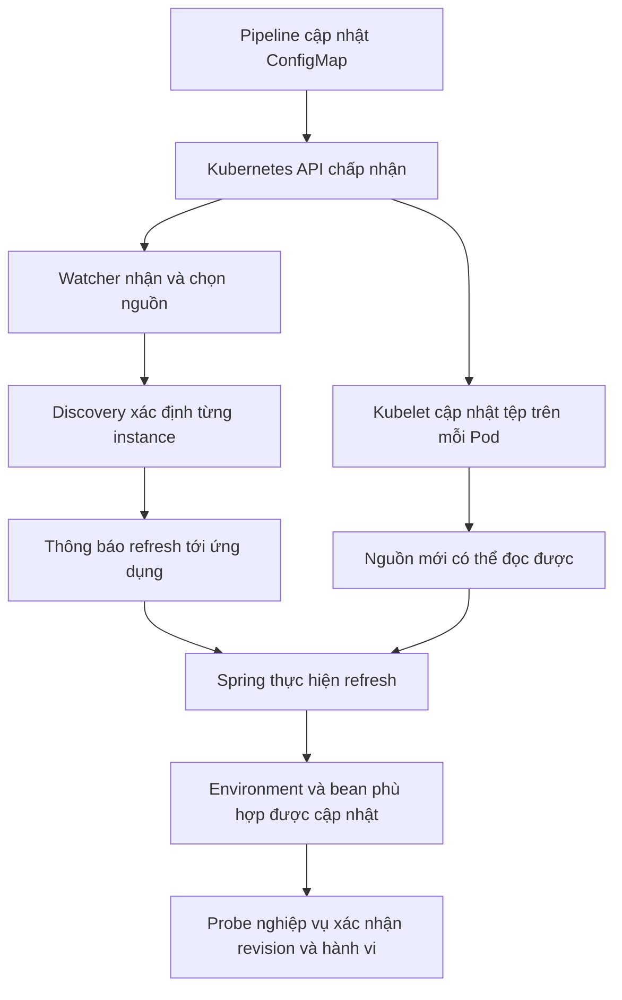

# Quan sát sự kiện từ thay đổi tài nguyên đến cấu hình có hiệu lực

## Mục tiêu và tình huống thực hành

Trong chương **Configuration Watcher** của module **SPRING_CLOUD_KUBERNETES**, quan sát một lần cập nhật cấu hình là nối được bằng chứng từ Kubernetes API đến hành vi của ứng dụng Spring trên từng Pod. Đây là bước cần thiết để vận hành tích hợp ConfigMap, Secret, DiscoveryClient và kênh thông báo mà không nhầm một thao tác trung gian thành kết quả cuối cùng.

Sau bài học, bạn có thể:

- Phân biệt tài nguyên đã đổi, Watcher đã nhận, thông báo đã tới và cấu hình đã được sử dụng.
- Gắn một lần phát hành cấu hình với danh tính tài nguyên, Pod và kết quả kiểm tra nghiệp vụ.
- Đo thời gian hội tụ, phát hiện một replica còn dùng cấu hình cũ và tìm chặng gây chậm.
- Thiết kế log, metric và cảnh báo có ích mà không ghi giá trị Secret.
- Kiểm chứng cập nhật cấu hình độc lập với restart và trạng thái sức khỏe Pod.

Ví dụ dùng `pricing-service` với ba Pod trong namespace `shop-apps`. Giới hạn giảm giá đổi từ `10` sang `15`; yêu cầu giảm `12%` phải chuyển từ bị từ chối sang được chấp nhận. Một Watcher trong `watcher-system` phát thông báo HTTP. Ứng dụng JVM đọc một tệp ConfigMap được mount; không bật theo dõi Secret hoặc Spring Cloud Bus trong luồng thực hành chính.

Đây là bài về thiết kế bằng chứng quan sát, không phải bộ manifest triển khai hoàn chỉnh. Cần có sẵn ứng dụng Spring MVC, Actuator, Spring Cloud Context cùng bộ phiên bản Spring Boot/Spring Cloud tương thích; Watcher đã được triển khai, phân quyền RBAC và discovery đúng namespace. Các lệnh terminal bên dưới dùng cú pháp Bash và chỉ dành cho môi trường thực hành được phép thao tác.

## 1. Xác định thế nào là cấu hình có hiệu lực

Một ConfigMap đã lưu thành công chỉ chứng minh Kubernetes chấp nhận dữ liệu mới. Với bài này, kết quả cuối cùng được định nghĩa cụ thể:

> Mỗi Pod đang phục vụ trả về revision mong đợi và thực hiện phép kiểm tra giảm giá bằng giới hạn mới, trong cùng một lần gọi vào bean nghiệp vụ.

Phân chia bằng chứng thành các mức giúp tránh kết luận quá sớm:

| Mức quan sát | Bằng chứng nên thu thập | Điều còn chưa chứng minh |
| --- | --- | --- |
| Tài nguyên được cập nhật | Kết quả ghi API, UID, `resourceVersion`, revision phát hành | Watcher đã nhận thay đổi |
| Watcher thấy nguồn | Log nhận tài nguyên, namespace, tên, phiên tài nguyên | Nguồn đã được chọn để thông báo |
| Đích được xác định | Danh sách instance và địa chỉ thực tế được chọn | Mọi instance cần thiết đều có trong danh sách |
| Thông báo được xử lý | Trạng thái HTTP hoặc bằng chứng nhận sự kiện ở ứng dụng | Bean nghiệp vụ đã sử dụng giá trị mới |
| Nguồn tại Pod sẵn sàng | Revision trong tệp được mount hoặc nguồn API tương ứng | Spring đã nạp lại nguồn ấy |
| Trạng thái ứng dụng đổi | Revision trong `Environment` và bean liên quan | Mọi hành vi phụ thuộc cấu hình đều đúng |
| Hành vi được xác nhận | Probe nghiệp vụ đúng revision, đúng kết quả, đúng Pod | Những luồng nghiệp vụ chưa được kiểm tra |

Không dùng số dòng log refresh thành công làm số Pod đã hội tụ. Một Pod có thể nhận nhiều thông báo, trong khi một Pod khác chưa nhận lần nào.

## 2. Vẽ đúng hai nhánh của quá trình cập nhật



Nhánh thông báo và nhánh cập nhật tệp không tạo thành một giao dịch chung. Có thể quan sát được thông báo trước khi tệp mới xuất hiện trên một Pod.

Tệp ConfigMap được mount cập nhật theo cơ chế eventual consistency; mount bằng `subPath` không nhận cập nhật. Dùng điều này để phân biệt lỗi đường nguồn với lỗi refresh. [Kubernetes: cập nhật ConfigMap volume](https://kubernetes.io/docs/tasks/configure-pod-container/configure-pod-configmap/#mounted-configmaps-are-updated-automatically).

Configuration Watcher hỗ trợ HTTP hoặc Spring Cloud Bus. Với HTTP, Watcher dùng discovery để gửi `POST` tới endpoint refresh của các instance; mặc định là `/actuator/refresh`. Nhãn chọn ConfigMap và tham số trì hoãn thông báo được mô tả trong [tài liệu Configuration Watcher](https://docs.spring.io/spring-cloud-kubernetes/reference/spring-cloud-kubernetes-configuration-watcher.html).

Với ứng dụng nạp trực tiếp qua Kubernetes API, thay cột bằng chứng tệp bằng bằng chứng nguồn API đã được đọc lại. Đừng tìm độ trễ volume cho một luồng không dùng volume. Nếu có nhiều PropertySource, cần ghi rõ nguồn nào được kỳ vọng thắng cho thuộc tính đang thử.

## 3. Dùng revision nghiệp vụ để nối các bằng chứng

Trong ví dụ, mỗi lần phát hành có một mã không nhạy cảm:

```text
cfg-001: max-discount-percent = 10
cfg-002: max-discount-percent = 15
```

`pricing.revision` là quy ước tự thiết kế của ứng dụng và pipeline. Spring Cloud Kubernetes không tự tạo mã này hoặc tự gắn nó vào mọi log và request.

Ba loại danh tính có mục đích khác nhau:

| Trường | Mục đích |
| --- | --- |
| Namespace + kind + name + UID | Xác định chính xác đối tượng nguồn; phân biệt trường hợp xóa rồi tạo lại |
| `metadata.resourceVersion` | Ghi lại phiên Kubernetes của tài nguyên đã quan sát |
| `pricing.revision` | Đối chiếu bản cấu hình mong đợi với bản mà nghiệp vụ đang dùng |
| Pod name + Pod UID | Phân biệt các replica và một Pod mới thay thế Pod cũ |
| Application version/image | Phân biệt cập nhật cấu hình với thay đổi mã ứng dụng |

Lưu `resourceVersion` nguyên dạng chuỗi. Bài này không dùng phép trừ hoặc sắp xếp nó để đo độ trễ; revision Kubernetes không phải thời gian hay revision nghiệp vụ. Quy tắc so sánh phiên phụ thuộc phạm vi tài nguyên và API được dùng. [Kubernetes API: resource versions](https://kubernetes.io/docs/reference/using-api/api-concepts/#resource-versions).

Quy ước phát hành cần bảo đảm revision và nội dung liên quan được cập nhật cùng nhau trong một lần ghi ConfigMap. Không tái sử dụng `cfg-002` cho hai nội dung khác nhau. Nếu cấu hình đến từ nhiều ConfigMap/Secret, một marker trong một nguồn không chứng minh các nguồn còn lại đã đồng bộ; khi đó cần tập revision của các nguồn hoặc một phiên cấu hình tổng hợp do ứng dụng xác nhận.

## 4. Chuẩn bị nguồn cấu hình và các điểm quan sát

### 4.1. ConfigMap có marker không nhạy cảm

Manifest ban đầu cho bài thực hành:

```yaml
apiVersion: v1
kind: ConfigMap
metadata:
  name: pricing-service
  namespace: shop-apps
  labels:
    spring.cloud.kubernetes.config: "true"
data:
  application.yaml: |
    pricing:
      revision: cfg-001
      max-discount-percent: 10
```

Đặt tên ConfigMap và Service cùng là `pricing-service` để luồng thực hành không cần ánh xạ tên bổ sung. Trước khi đo, phải kiểm tra discovery thực tế trả đủ ba instance mong đợi; cùng tên chưa đủ nếu client đang tìm ở sai namespace hoặc lọc mất một instance.

Phần trích Pod template cho ứng dụng:

```yaml
spec:
  template:
    metadata:
      labels:
        app: pricing-service
    spec:
      containers:
        - name: app
          env:
            - name: POD_NAME
              valueFrom:
                fieldRef:
                  fieldPath: metadata.name
            - name: POD_UID
              valueFrom:
                fieldRef:
                  fieldPath: metadata.uid
          volumeMounts:
            - name: pricing-config
              mountPath: /etc/pricing
              readOnly: true
      volumes:
        - name: pricing-config
          configMap:
            name: pricing-service
```

`POD_NAME` và `POD_UID` nhận diện replica; chúng không chứa nội dung cấu hình cần refresh. Không thêm `subPath` vào mount của bài này.

Ứng dụng dùng cấu hình đóng gói trong image:

```yaml
spring:
  application:
    name: pricing-service
  config:
    import: "file:/etc/pricing/application.yaml"

server:
  port: 8080

management:
  endpoints:
    web:
      exposure:
        include: health,refresh
```

Ví dụ giữ Actuator cùng cổng `8080` và dùng đường dẫn mặc định. Cấu hình này chỉ mô tả exposure; môi trường thực hành vẫn phải cấp quyền gọi refresh cho Watcher và bảo vệ đường chẩn đoán bằng cơ chế xác thực/phân quyền hiện có. Exposure, quyền truy cập endpoint và xác thực HTTP là các lớp cần kiểm tra riêng. [Spring Boot Actuator: endpoints](https://docs.spring.io/spring-boot/reference/actuator/endpoints.html).

Ứng dụng đọc tệp trong ví dụ không cần gọi Kubernetes API chỉ để cung cấp endpoint quan sát. Không cấp thêm quyền đọc toàn bộ Secret cho nó hoặc cho Watcher nhằm phục vụ bài đo ConfigMap.

### 4.2. Bật log có chọn lọc trên Watcher

Phần trích biến môi trường trong container Watcher:

```yaml
env:
  - name: LOGGING_LEVEL_ORG_SPRINGFRAMEWORK_CLOUD_KUBERNETES_CONFIGURATION_WATCHER
    value: DEBUG
  - name: LOGGING_LEVEL_ORG_SPRINGFRAMEWORK_CLOUD_KUBERNETES_CLIENT_CONFIG_RELOAD
    value: DEBUG
  - name: LOGGING_LEVEL_ORG_SPRINGFRAMEWORK_CLOUD_KUBERNETES_COMMONS_CONFIG_RELOAD
    value: DEBUG
  - name: SPRING_CLOUD_KUBERNETES_RELOAD_NAMESPACES_0
    value: shop-apps
  - name: SPRING_CLOUD_KUBERNETES_CONFIGURATION_WATCHER_REFRESHDELAY
    value: "10000"
```

`10000` là mức trì hoãn minh họa theo mili giây, không phải bảo đảm tệp sẽ cập nhật trong mười giây. Tên logger phụ thuộc implementation và phiên bản; dùng nhóm tương ứng với image thực tế. Các thiết lập này được nêu tại [Configuration Watcher: cấu hình và logging](https://docs.spring.io/spring-cloud-kubernetes/reference/spring-cloud-kubernetes-configuration-watcher.html).

Phạm vi discovery phải được cấu hình riêng cho `shop-apps`. Các biến trên không thay thế cấu hình discovery hoặc RBAC đã yêu cầu ở phần điều kiện thực hành. Sau khi thu bằng chứng, trả mức log về phù hợp để giảm chi phí và nguy cơ lộ dữ liệu.

## 5. Tạo bằng chứng từ chính bean nghiệp vụ

Chỉ trả revision đọc từ `Environment` có thể bỏ sót một bean vẫn giữ giá trị cũ. Ta tạo bean chính sách trả cả revision và quyết định từ cùng trạng thái nội bộ.

`@RefreshScope` sử dụng proxy; target được khởi tạo khi được gọi và bị loại khỏi cache khi refresh. Vì vậy, cần kiểm tra một lần sử dụng bean sau refresh, kể cả trường hợp target mới chưa được tạo lúc HTTP refresh kết thúc. [Spring Cloud Context: Refresh Scope](https://docs.spring.io/spring-cloud-commons/reference/spring-cloud-commons/application-context-services.html#refresh-scope).

### 5.1. Bean chính sách

Mã minh họa dùng Java có hỗ trợ `record`; đặt các lớp trong package được ứng dụng quét:

```java
package example.pricing;

import java.time.Instant;
import org.springframework.beans.factory.annotation.Value;
import org.springframework.cloud.context.config.annotation.RefreshScope;
import org.springframework.stereotype.Component;

@Component
@RefreshScope
public class PricingPolicy {
    private final String revision;
    private final int maxDiscountPercent;
    private final Instant snapshotCreatedAt;

    public PricingPolicy(
            @Value("${pricing.revision}") String revision,
            @Value("${pricing.max-discount-percent}") int maxDiscountPercent) {
        if (revision.isBlank()) {
            throw new IllegalArgumentException("pricing.revision is required");
        }
        if (maxDiscountPercent < 0 || maxDiscountPercent > 100) {
            throw new IllegalArgumentException("discount must be between 0 and 100");
        }
        this.revision = revision;
        this.maxDiscountPercent = maxDiscountPercent;
        this.snapshotCreatedAt = Instant.now();
    }

    public Decision evaluate(int requestedPercent) {
        boolean allowed = requestedPercent >= 0
                && requestedPercent <= maxDiscountPercent;
        return new Decision(revision, maxDiscountPercent, allowed,
                snapshotCreatedAt);
    }

    public record Decision(
            String revision,
            int maxDiscountPercent,
            boolean allowed,
            Instant snapshotCreatedAt) {
    }
}
```

Revision và giới hạn cùng thuộc một target của `PricingPolicy`. Kết quả của `evaluate` không ghép revision từ nguồn ngoài với giá trị nghiệp vụ lấy từ một bean khác.

Để probe phản ánh hệ thống thật, luồng tính giá cần gọi chính bean này hoặc cùng cơ chế chính sách. Nếu hệ thống giữ một bản sao riêng trong cache khác, endpoint minh họa chưa đủ chứng minh cache đó đã đổi.

### 5.2. Endpoint quan sát nội bộ

```java
package example.pricing;

import java.time.Instant;
import java.util.Map;
import org.springframework.beans.factory.annotation.Value;
import org.springframework.core.env.Environment;
import org.springframework.web.bind.annotation.GetMapping;
import org.springframework.web.bind.annotation.RequestParam;
import org.springframework.web.bind.annotation.RestController;

@RestController
public class ConfigObservationController {
    private final PricingPolicy policy;
    private final Environment environment;
    private final String podName;
    private final String podUid;

    public ConfigObservationController(
            PricingPolicy policy,
            Environment environment,
            @Value("${POD_NAME:local}") String podName,
            @Value("${POD_UID:local}") String podUid) {
        this.policy = policy;
        this.environment = environment;
        this.podName = podName;
        this.podUid = podUid;
    }

    @GetMapping("/internal/config-observation")
    public Map<String, Object> observe(
            @RequestParam(name = "requestedPercent", defaultValue = "12")
            int requestedPercent) {
        PricingPolicy.Decision decision = policy.evaluate(requestedPercent);
        return Map.of(
                "pod", podName,
                "podUid", podUid,
                "environmentRevision",
                    environment.getProperty("pricing.revision", "unknown"),
                "effectiveRevision", decision.revision(),
                "maxDiscountPercent", decision.maxDiscountPercent(),
                "probeRequestedPercent", requestedPercent,
                "probeAllowed", decision.allowed(),
                "snapshotCreatedAt", decision.snapshotCreatedAt(),
                "observedAt", Instant.now());
    }
}
```

Endpoint chỉ đọc các trường được chọn trong ví dụ không nhạy cảm; không trả toàn bộ `Environment`. Tên `environmentRevision`, `effectiveRevision` và đường dẫn này do bài học tự định nghĩa, không phải endpoint chuẩn của Spring Cloud Kubernetes.

Có hai giới hạn cần ghi trong tài liệu vận hành:

- Lần gọi quan sát cũng có thể khởi tạo target `@RefreshScope` mới. Nó xác nhận trạng thái sau khi có truy cập, không đo riêng thời điểm tất cả bean tự động được khởi tạo.
- `Environment` và bean được đọc ở các thời điểm gần nhau nhưng không phải một snapshot giao dịch chung. Khi refresh đang diễn ra, lấy thêm mẫu ổn định trước khi kết luận có lỗi. Revision và quyết định trong `Decision` mới là cặp bằng chứng của phép kiểm tra nghiệp vụ này.

`snapshotCreatedAt` là thời điểm tạo target; `observedAt` là thời điểm trả mẫu. Cả hai không tự cung cấp thời điểm Kubernetes nhận cập nhật.

## 6. Thực hành một lần thay đổi có kiểm soát

### Bước 1: Ghi baseline của từng Pod

Triển khai cấu hình `cfg-001` và chờ ứng dụng ổn định trước khi bắt đầu đo. Liệt kê Pod, UID và số lần restart:

```bash
kubectl -n shop-apps get pods -l app=pricing-service \
  -o custom-columns='NAME:.metadata.name,UID:.metadata.uid,READY:.status.containerStatuses[*].ready,RESTARTS:.status.containerStatuses[*].restartCount'
```

Ghi lại danh sách ba Pod đang phục vụ. Dùng tên thật từ kết quả, mở đường tới một Pod cụ thể:

```bash
kubectl -n shop-apps port-forward pod/<pod-name> 18080:8080
```

Ở terminal khác, với credential chẩn đoán đã được cấp vào biến môi trường:

```bash
curl --fail-with-body --silent --show-error \
  -H "Authorization: Bearer ${DIAGNOSTIC_TOKEN}" \
  'http://127.0.0.1:18080/internal/config-observation?requestedPercent=12'
```

Nếu môi trường dùng mTLS hoặc cơ chế xác thực khác, thay cách cấp credential tương ứng. Port-forward không tự cấp quyền ứng dụng.

Ghi baseline cho từng Pod: `effectiveRevision=cfg-001`, `maxDiscountPercent=10`, `probeAllowed=false`. Đóng port-forward bằng `Ctrl+C` trước khi mở lại cùng cổng cho Pod kế tiếp. Gọi qua `Service` nhiều lần có thể lặp lại cùng một Pod, nên không dùng cách đó để khẳng định đã kiểm tra đủ ba replica.

### Bước 2: Bắt đầu thu bằng chứng trước khi sửa

Theo dõi log Watcher; thay tên Deployment nếu môi trường dùng tên khác:

```bash
kubectl -n watcher-system logs deployment/config-watcher \
  --follow --timestamps=true --since=5m
```

Ghi giờ bắt đầu trên máy quan sát và metadata nguồn:

```bash
date -u +%Y-%m-%dT%H:%M:%SZ
kubectl -n shop-apps get configmap pricing-service \
  -o jsonpath='{.metadata.uid}{"\t"}{.metadata.resourceVersion}{"\n"}'
```

Trong hệ thống tập trung log, lọc theo namespace, tên nguồn, ứng dụng và khoảng thời gian. Đừng chỉ tìm từ khóa `refresh` mà bỏ mất các dòng chọn nguồn, lỗi discovery hoặc lỗi quyền truy cập API.

### Bước 3: Đổi revision và giới hạn trong cùng một lần ghi

Lệnh minh họa thay phần tệp cấu hình trong ConfigMap của môi trường thực hành:

```bash
kubectl -n shop-apps patch configmap pricing-service --type merge --patch '{
  "data": {
    "application.yaml": "pricing:\n  revision: cfg-002\n  max-discount-percent: 15\n"
  }
}'
date -u +%Y-%m-%dT%H:%M:%SZ
kubectl -n shop-apps get configmap pricing-service \
  -o jsonpath='{.metadata.uid}{"\t"}{.metadata.resourceVersion}{"\n"}'
```

Tệp mẫu chỉ có hai thuộc tính; lệnh trên thay toàn bộ giá trị `application.yaml`. Với cấu hình thật, phát hành từ nguồn cấu hình quản lý chính thức để giữ đủ các thuộc tính khác. Nếu có nhiều bên ghi đồng thời, cần cơ chế kiểm soát xung đột; một lần `get` sau ghi có thể đã thấy lần sửa tiếp theo của người khác.

Thời điểm sau lệnh `patch` là thời điểm phía client đã nhận kết quả, dùng làm mốc gần đúng có ghi rõ giới hạn. Muốn có mốc chính xác ở phía API server, cần nguồn audit đã được cấu hình phù hợp.

### Bước 4: Quan sát từng chặng và từng replica

Trong cùng cửa sổ thời gian, thu các bằng chứng:

1. Watcher nhận đúng ConfigMap và chọn nó để xử lý.
2. Discovery tìm được các instance đích; ghi lại Pod/địa chỉ nào bị bỏ qua.
3. Từng lần gửi HTTP có kết quả hoặc lỗi cụ thể.
4. Tệp nguồn mới xuất hiện ở từng Pod khi cần khoanh vùng đường volume.
5. Endpoint nội bộ của từng Pod trả revision và quyết định mới.

Để kiểm tra tệp trong bài thực hành không chứa bí mật, có thể dùng:

```bash
kubectl -n shop-apps exec <pod-name> -c app -- \
  cat /etc/pricing/application.yaml
```

Lệnh này cần quyền chẩn đoán `pods/exec` của người vận hành và công cụ `cat` trong image; đó không phải quyền cần cấp cho Watcher. Nếu image không có công cụ hoặc chính sách không cho exec, dùng cơ chế chẩn đoán được nền tảng hỗ trợ. Không áp dụng cách in nội dung này cho Secret.

Lặp phép gọi ở bước 1 cho từng Pod. Ví dụ một kết quả mong đợi:

```json
{
  "pod": "pricing-service-7c9d7f8d6b-a1b2c",
  "podUid": "demo-pod-uid-a",
  "environmentRevision": "cfg-002",
  "effectiveRevision": "cfg-002",
  "maxDiscountPercent": 15,
  "probeRequestedPercent": 12,
  "probeAllowed": true,
  "snapshotCreatedAt": "2026-11-24T03:00:13Z",
  "observedAt": "2026-11-24T03:00:14Z"
}
```

UID và giờ trong JSON chỉ minh họa. Không coi mẫu này là kết quả đã chạy sẵn của môi trường.

### Bước 5: Kết luận có điều kiện

Tạo bảng bằng chứng thay vì ghi một dòng thành công chung:

| Pod/UID | Revision trước | Revision sau | Kết quả yêu cầu 12% | Restart tăng? | Đã hội tụ? |
| --- | --- | --- | --- | --- | --- |
| Pod A / UID A | cfg-001 | cfg-002 | Cho phép | Không | Có |
| Pod B / UID B | cfg-001 | cfg-002 | Cho phép | Không | Có |
| Pod C / UID C | cfg-001 | cfg-001 | Từ chối | Không | Chưa |

Bảng minh họa trên phải được kết luận là **chưa hội tụ đủ**, dù Watcher có log gửi thành công tới hai Pod.

Nếu Pod bị thay thế hoặc container restart giữa phép đo, ghi lại sự kiện đó. Pod mới đọc `cfg-002` lúc khởi động không chứng minh Pod cũ đã refresh thành công. Không trộn kết quả hai luồng này vào cùng phép đo cập nhật không restart.

## 7. Đo thời gian và tỷ lệ hội tụ

Đặt tên cho các mốc để người vận hành cùng hiểu một phép đo:

| Mốc | Ý nghĩa |
| --- | --- |
| `t_api_ack` | Client nhận kết quả cập nhật nguồn thành công |
| `t_watcher_seen` | Watcher ghi nhận tài nguyên phù hợp |
| `t_notify_start(pod)` | Bắt đầu gửi thông báo tới một instance |
| `t_notify_end(pod)` | Nhận kết quả từ đường thông báo |
| `t_source_seen(pod)` | Lần đầu quan sát nguồn mới tại Pod |
| `t_effective_seen(pod)` | Lần đầu probe nghiệp vụ xác nhận cấu hình mới |

Không gán giá trị cho một mốc chưa thu được. Nếu log framework không có timestamp hay danh tính cần thiết, ghi `unknown` hoặc bổ sung instrumentation; không suy ra một thời điểm chính xác từ log ở chặng khác.

Các phép tính hữu ích:

```text
notification_duration(pod) = t_notify_end(pod) - t_notify_start(pod)
observed_convergence(pod) = t_effective_seen(pod) - t_api_ack
observed_convergence_all = max(observed_convergence(pod))
convergence_ratio = số Pod đang phục vụ được xác nhận đúng / số Pod đang phục vụ cần xác nhận
```

Chỉ tính `observed_convergence_all` cho một tập Pod đã hội tụ đủ. Nếu một Pod chưa có bằng chứng, kết quả là đang chờ hoặc quá hạn, không phải lấy giá trị lớn nhất của các Pod đã thành công rồi công bố toàn bộ thành công.

Nếu polling mỗi hai giây, thời điểm phát hiện là cận trên quan sát được của thời điểm trạng thái thực sự đổi, còn chịu độ trễ request. Với các timestamp từ nhiều máy, cần đồng bộ đồng hồ và ghi sai số; hoặc dùng một bộ quan sát lấy giờ bắt đầu và giờ nhận mẫu bằng đồng hồ đơn điệu của chính nó.

Hai ví dụ phân tích:

- Tệp ở Pod C chưa có revision mới khi thông báo đã đến: nghi ngờ khoảng trễ projection so với thời điểm refresh.
- Tệp đã mới từ lâu nhưng probe còn cũ: tập trung vào nạp lại PropertySource, nguồn có ưu tiên cao hơn, refresh scope và cache nghiệp vụ.

Để đo tỷ lệ, xác định rõ tập Pod đang phục vụ ở thời điểm đánh giá. Khi có scale hoặc rollout, theo dõi biến động thành viên bằng UID; Pod mới là một đối tượng cần xác nhận mới. Đồng thời giữ kết quả ban đầu để không làm biến mất bằng chứng một Pod cũ bị lỗi.

## 8. Thiết kế log, metric và liên kết dấu vết

### 8.1. Log theo trạng thái thực sự biết được

Một schema tự thiết kế có thể gồm:

```json
{
  "event": "config_effect_verified",
  "application": "pricing-service",
  "namespace": "shop-apps",
  "pod_uid": "demo-pod-uid-a",
  "desired_revision": "cfg-002",
  "effective_revision": "cfg-002",
  "result": "matched",
  "probe": "discount-policy"
}
```

Các tên sự kiện như `config_source_observed`, `config_notification_completed`, `config_effect_verified` là hợp đồng quan sát đề xuất, không phải định dạng log có sẵn của Watcher. Cần tự bổ sung instrumentation hoặc chuẩn hóa log từ từng thành phần; giữ lại log gốc khi ánh xạ để có thể kiểm tra lại.

Ghi trường ở nơi thật sự biết giá trị đó. Ứng dụng chỉ đọc volume có thể không biết UID hoặc `resourceVersion` của ConfigMap; pipeline/bộ quan sát lưu ánh xạ từ revision phát hành tới metadata nguồn. Không ghi một UID nguồn tự đoán vào log ứng dụng.

Tách `attempt_id` của một lần gửi khỏi revision phát hành: một revision có thể có nhiều lần gửi lại. Nếu dùng distributed tracing, cần chủ động truyền ngữ cảnh qua HTTP hoặc message. Thay đổi tài nguyên qua API và callback Watcher không tự nhiên thuộc cùng một trace chỉ vì xảy ra gần nhau.

### 8.2. Metric phục vụ câu hỏi vận hành

Các metric sau là **đề xuất tự triển khai**, không phải danh sách metric mặc định của Spring Cloud Kubernetes:

| Metric đề xuất | Loại | Câu hỏi được trả lời |
| --- | --- | --- |
| `app_config_notification_attempts_total` | Counter với kết quả hữu hạn | Có lỗi hoặc gửi lặp tăng bất thường không? |
| `app_config_notification_duration_seconds` | Histogram | Đường thông báo chậm ở mức nào? |
| `app_config_convergence_duration_seconds` | Histogram | Từ thay đổi nguồn tới bằng chứng nghiệp vụ mất bao lâu? |
| `app_config_converged` | Gauge 0/1 theo target | Pod có khớp cấu hình đang mong đợi không? |
| `app_config_observation_success` | Gauge 0/1 theo target | Bộ quan sát có lấy được mẫu hợp lệ không? |

`app_config_converged` đòi hỏi bên quan sát biết cả revision mong đợi lẫn kết quả thực tế; chỉ đo revision của Pod chưa đủ. Có thể để một synthetic monitor nội bộ quản lý việc so sánh này. Dùng nhãn hữu hạn như ứng dụng, namespace, kênh và nhóm kết quả; tận dụng danh tính target từ hệ thống scrape để phân biệt Pod.

Đưa revision, `resourceVersion`, attempt ID và thông báo lỗi chi tiết vào log/trace thay vì liên tục sinh nhãn metric mới. Không mã hóa toàn bộ URL hay giá trị cấu hình vào label.

Ví dụ logic cảnh báo cho metric tự triển khai:

```yaml
- alert: PricingConfigurationNotConverged
  expr: app_config_converged{application="pricing-service"} == 0
  for: 2m
  labels:
    severity: warning
  annotations:
    summary: "Pod pricing-service chưa khớp cấu hình mong đợi"
```

Hai phút là ngưỡng thực hành cần hiệu chỉnh theo đo đạc, không phải giới hạn được framework bảo đảm. Phải có kiểm tra riêng khi metric mất hoặc bộ quan sát không truy cập được Pod; target biến mất không đồng nghĩa `app_config_converged=1`.

### 8.3. Secret cần cách quan sát khác

Khi mở rộng sang Secret, giữ metadata và kết quả kiểm tra chức năng đã được duyệt, không ghi password, token, chuỗi kết nối hoặc nội dung tệp. Không dùng hash không có khóa của bí mật ít khả năng làm mã công khai, vì có thể bị dò đoán. Có thể dùng một mã phiên không nhạy cảm hoặc chứng minh kết nối được bằng credential mới, tùy chính sách của hệ thống.

## 9. Bảng khoanh vùng theo bằng chứng cuối cùng

| Bằng chứng cuối cùng hoặc triệu chứng | Hướng kiểm tra tiếp theo |
| --- | --- |
| Lệnh ghi tài nguyên thất bại | Quyền ghi, namespace, tên tài nguyên, validation, xung đột ghi |
| API có revision mới, Watcher không có dấu vết | Phạm vi watch, selector, RBAC, kết nối API, trạng thái tiến trình Watcher |
| Watcher thấy nguồn, không tìm ra instance | Tên ứng dụng/ánh xạ nguồn, namespace discovery, Service, danh sách endpoint, tiêu chí chọn instance |
| Có ba Pod cần phục vụ nhưng discovery chỉ có hai | Vì sao Pod còn lại bị bỏ qua; kiểm tra readiness, selector và trạng thái endpoint |
| Gửi HTTP bị 401/403 | Danh tính caller, quyền endpoint, proxy bảo mật và cấu hình HTTP security |
| Gửi HTTP bị 404 hoặc sai cổng | Exposure, base path Actuator, cổng và địa chỉ discovery thực tế |
| Gửi HTTP timeout | NetworkPolicy, DNS, route, kết nối TLS và khả năng xử lý request của đích |
| HTTP thành công, tệp tại một Pod vẫn cũ | Projection, mount đúng nguồn, `subPath`, thời điểm phát thông báo |
| Tệp mới, `Environment` vẫn cũ | Nguồn có được import/nạp lại không, profile và nguồn cấu hình khác đang thắng |
| `Environment` mới, chính sách nghiệp vụ cũ | Bean đủ điều kiện refresh chưa, dữ liệu đã bị sao chép sang cache khác chưa |
| Bean mới tạo bị lỗi | Validation, kiểu dữ liệu, tài nguyên phụ thuộc; xác minh lỗi ở lần sử dụng đầu tiên |
| Chỉ một số Pod dùng revision mới | Đối chiếu danh sách đích gửi với toàn bộ Pod cần kiểm tra; xem từng UID |
| Tất cả Pod Ready nhưng probe sai revision | Readiness hiện tại có kiểm tra điều kiện cấu hình này hay chỉ điều kiện sức khỏe khác? |

Một trạng thái sức khỏe `UP` hoặc Pod `Ready` chỉ hữu ích trong phạm vi điều kiện mà health check đã kiểm tra. Nếu revision là điều kiện bắt buộc để phục vụ, thiết kế kiểm tra riêng có timeout và hành vi khi nguồn quan sát gặp lỗi. Không biến mọi chậm trễ cấu hình thành lỗi liveness gây restart hàng loạt.

## 10. Phân biệt quan sát trạng thái với lịch sử sự kiện đầy đủ

Dòng watch của Kubernetes và đối tượng Kubernetes `Event` là hai thứ khác nhau. Không yêu cầu `kubectl get events` phải chứa một dòng cho mọi lần sửa ConfigMap; log ứng dụng, bằng chứng API và kết quả probe mới tạo thành hồ sơ cho bài này.

Watch có thể cần kết nối lại và list lại; khi lịch sử phiên không còn được giữ, client phải xử lý trường hợp `410 Gone`. Vì vậy, không dùng luồng watch như kho lưu lịch sử phát hành lâu dài. [Kubernetes API: efficient detection of changes](https://kubernetes.io/docs/reference/using-api/api-concepts/#efficient-detection-of-changes).

Một số tình huống cần thiết kế tiêu chí riêng:

- **Cập nhật nhanh nhiều lần:** `cfg-002` và `cfg-003` xuất hiện gần nhau. Đặt rõ yêu cầu là hội tụ tới bản hiện tại hay bắt buộc mỗi bản trung gian phải có bằng chứng thực thi. Luồng refresh theo trạng thái không tự đáp ứng yêu cầu audit từng bản.
- **Thông báo trùng:** đếm số lần gửi riêng với số Pod được xác nhận; giữ logic kiểm tra có thể gọi lặp mà không gây tác dụng phụ nghiệp vụ.
- **Watcher gián đoạn:** sau phục hồi, kiểm tra bản đang có hiệu lực bằng probe, thay vì suy ra mọi thay đổi trong thời gian gián đoạn đã được áp dụng.
- **Rollback:** phát một revision mới, chẳng hạn `cfg-004`, chứa lại giới hạn `10`; đo quy trình hội tụ như một lần thay đổi mới và kỳ vọng yêu cầu `12%` bị từ chối trở lại.
- **Xóa rồi tạo lại nguồn:** kiểm tra UID và đường đọc của ứng dụng; đừng ghép hai đối tượng chỉ vì có cùng tên.

Nếu sử dụng Spring Cloud Bus, thay các mốc gửi HTTP bằng mốc publish, broker nhận và consumer xử lý. Broker chấp nhận message chưa phải bằng chứng mọi Pod đã refresh; phép kiểm tra revision và hành vi trên từng Pod vẫn cần giữ.

## 11. Bài luyện tập và tiêu chí hoàn thành

Thực hiện từng tình huống trong môi trường thực hành, khôi phục cấu hình sau mỗi tình huống:

1. Cập nhật bình thường từ `cfg-001` sang `cfg-002`; ghi thời gian hội tụ của từng Pod và kết quả phép thử `12%`.
2. Tạo một lỗi xác thực ở kênh refresh của một đích được kiểm soát; dùng bằng chứng để phân biệt lỗi 401/403 với lỗi đọc ConfigMap.
3. Tạo điều kiện refresh đến sớm so với nguồn tệp; ghi thứ tự bằng chứng thay vì chỉ tăng delay rồi công bố thành công.
4. Phát hai revision gần nhau; kiểm tra bản cuối có hiệu lực và ghi rõ có quan sát được bản trung gian không.
5. Rollback bằng revision mới; xác nhận hành vi trở về giới hạn cũ và không nhầm với lỗi giữ cấu hình cũ.

Bài thực hành đạt khi có đủ:

- Metadata nguồn trước/sau và revision mong đợi không chứa bí mật.
- Danh sách Pod/UID cần kiểm tra, kèm giải thích mọi thay đổi thành viên hoặc restart.
- Bằng chứng Watcher nhận nguồn, xác định đích và kết quả thông báo trong phạm vi log thực sự có.
- Kết quả trên từng Pod chứng minh cùng revision và hành vi; không chỉ chụp một HTTP `200`.
- Độ trễ quan sát có nêu cách lấy thời gian, tần suất lấy mẫu và trường hợp chưa hội tụ.
- Một kết luận lỗi chỉ ra chặng chưa được chứng minh cùng bước chẩn đoán tiếp theo.

Giá trị của quan sát Configuration Watcher nằm ở việc trả lời được: bản cấu hình nào đã đến đâu, replica nào đang dùng nó và hành vi nào xác nhận điều đó. Bộ bằng chứng này cũng giúp quyết định có cần Watcher/refresh động cho một loại cấu hình, hay nên chọn quy trình rollout có kiểm soát cho thay đổi chỉ phù hợp lúc khởi động.
