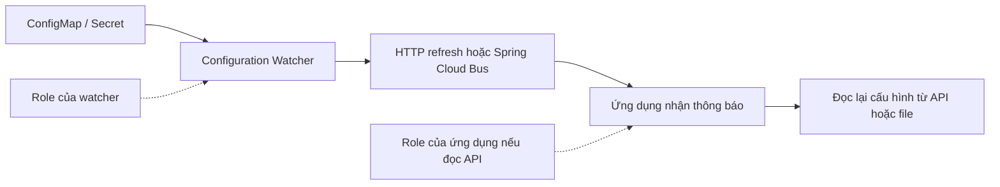

# Quyền tối thiểu theo từng tính năng Spring Cloud Kubernetes

Trong chương **Phân quyền RBAC** của module **SPRING_CLOUD_KUBERNETES**, bài học này hướng dẫn chuyển một nhu cầu tích hợp thành tập quyền Kubernetes cụ thể. Mục tiêu là triển khai DiscoveryClient, ConfigMap, Secret, Spring Cloud LoadBalancer và Configuration Watcher với quyền vừa đủ cho đường chạy đã chọn.

Một ứng dụng chỉ gọi dịch vụ bằng DNS và đọc cấu hình từ volume có nhu cầu khác hẳn một controller theo dõi thay đổi trong nhiều namespace. Vì vậy, không nên tạo một Role chung chứa mọi resource rồi gắn cho toàn bộ ứng dụng Spring.

Ví dụ về chế độ đọc cấu hình trong bài lấy **Spring Cloud Kubernetes 5.1.0, Kubernetes Java Client** làm mốc. BOM/release train của dự án phải quản lý bộ thư viện tương thích. Với phiên bản hoặc implementation khác, cần đối chiếu request thực tế trước khi giữ nguyên tập quyền.

## 1. Bắt đầu từ request cần thực hiện

Một yêu cầu phân quyền có thể mô tả bằng bộ thông tin:

| Thành phần | Câu hỏi cần trả lời | Ví dụ |
| --- | --- | --- |
| Chủ thể | Tiến trình dùng danh tính nào? | ServiceAccount `orders-runtime` |
| API group | Resource thuộc nhóm API nào? | Nhóm lõi `""` |
| Resource | Ứng dụng truy cập loại đối tượng nào? | `configmaps` |
| Verb | Ứng dụng làm thao tác gì? | `get` |
| Phạm vi | Trong namespace nào, tên nào? | `shop-prod/orders-service` |

Đường dẫn HTTP giúp phân biệt verb RBAC:

```text
GET /api/v1/namespaces/shop-prod/configmaps/orders-service
    -> get một ConfigMap

GET /api/v1/namespaces/shop-prod/configmaps
    -> list tập ConfigMap

GET /api/v1/namespaces/shop-prod/configmaps?watch=true
    -> watch thay đổi ConfigMap
```

Cả ba đều có thể dùng HTTP GET, nhưng Kubernetes kiểm tra ba verb khác nhau. Cho phép `get` không tự cho phép `list` hoặc `watch`. Xem cách Kubernetes xác định thuộc tính request trong [Authorization](https://kubernetes.io/docs/reference/access-authn-authz/authorization/).

Một informer thường cần lấy trạng thái ban đầu rồi mở luồng theo dõi. Vì vậy, “chỉ theo dõi thay đổi” chưa đủ cơ sở để bỏ `list`. Ngược lại, đọc một cấu hình lúc khởi động không tự tạo nhu cầu `watch`.

Có thể dùng mẫu ghi chép sau trước khi viết manifest:

```text
Tính năng: nạp cấu hình orders khi khởi động
Implementation: Kubernetes Java Client, Spring Cloud Kubernetes 5.1.0
Cách đọc: SINGLE, nguồn theo tên, không mở rộng theo profile
Danh tính: system:serviceaccount:shop-prod:orders-runtime
Request cần: get configmaps/orders-service trong shop-prod
Request không cần: list secrets, watch configmaps, sửa deployment
```

Ghi chép này làm rõ lý do tồn tại của từng rule. Nếu sau đó bật discovery hoặc reload trong cùng tiến trình, phải bổ sung nhu cầu tương ứng vào bản mô tả.

## 2. Ma trận tính năng và tài nguyên

Bảng sau là điểm xuất phát để thiết kế quyền. Các tổ hợp `get/list/watch` là nhóm thao tác đọc cần kiểm tra theo implementation; không phải yêu cầu cấp đồng loạt cho mọi ứng dụng.

| Tính năng thực sự bật | Resource/API liên quan | Cách thu hẹp |
| --- | --- | --- |
| Đọc ConfigMap theo tên bằng `SINGLE` | `configmaps`, nhóm lõi; đường đọc từng tên dùng `get` | Giới hạn namespace và `resourceNames` |
| Đọc cấu hình bằng `BATCH` hoặc tìm theo nhãn | `configmaps` hoặc `secrets`; có đường `list` | Tách namespace; cân nhắc nguồn theo tên |
| Theo dõi cấu hình bằng informer | Resource đang theo dõi; thường có `list/watch` | Chỉ bật nguồn cần theo dõi |
| DiscoveryClient gọi Kubernetes API | `services`, `endpoints`, có thể `pods`; kiểm tra `get/list/watch` | Chỉ chọn namespace cần khám phá |
| Discovery dùng EndpointSlice | `endpointslices` thuộc `discovery.k8s.io`, cùng các resource discovery còn dùng | Chọn đúng API; tránh cấp cả hai kiểu endpoint vô điều kiện |
| LoadBalancer chế độ `POD` | Kế thừa nhu cầu DiscoveryClient | Thu hẹp discovery |
| LoadBalancer chế độ `SERVICE` | Vẫn có bước tìm Kubernetes Service qua API | Không coi chế độ này là DNS thuần |
| Configuration Watcher | `configmaps`; thêm `secrets` khi bật, thêm discovery khi đường định tuyến cần | ServiceAccount riêng cho controller |
| Ứng dụng nhận thông báo Bus | Nhận sự kiện broker không tự đòi quyền Kubernetes | Quyền đọc lại cấu hình phụ thuộc nguồn nạp |
| DNS, volume/env, probe HTTP thông thường | Không cần quyền API của ứng dụng chỉ để dùng các cơ chế này | Có thể không mount token nếu tiến trình không gọi API |

Tài liệu [Security Configurations Inside Kubernetes](https://docs.spring.io/spring-cloud-kubernetes/reference/security-service-accounts.html) liệt kê các nhóm resource theo starter. Cần tiếp tục tách chúng theo tính năng đã bật thay vì sao chép Role ví dụ chứa cả cấu hình lẫn discovery.

**Quyền tối thiểu được quyết định bởi đường thực thi, không chỉ bởi tên dependency.** Một starter có mặt trên classpath chưa chứng minh rằng toàn bộ chức năng của nó đang cần thiết.

## 3. Gắn đúng danh tính cho từng tiến trình

ServiceAccount là danh tính của workload. Role chứa rule; RoleBinding gắn rule vào chủ thể. Nếu Pod không khai báo `serviceAccountName`, Kubernetes chọn ServiceAccount `default` trong namespace. Nên khai báo tài khoản riêng cho từng nhóm ứng dụng có cùng nhu cầu quyền. Xem [Configure Service Accounts for Pods](https://kubernetes.io/docs/tasks/configure-pod-container/configure-service-account/).

Ví dụ quy ước cho hệ thống bán hàng:

| Tiến trình | ServiceAccount | Nhu cầu dự kiến |
| --- | --- | --- |
| Ứng dụng orders | `orders-runtime` | Đọc ConfigMap của orders |
| Controller theo dõi cấu hình | `configuration-watcher` | Theo dõi ConfigMap và tìm ứng dụng nhận nếu cần |
| Pipeline triển khai | Danh tính CI/CD riêng | Tạo hoặc cập nhật workload theo quy trình triển khai |

Việc controller có quyền rộng hơn ứng dụng không phải lý do để dùng chung tài khoản. Khi cần thu hồi quyền theo dõi, tài khoản riêng cũng giúp tránh thay đổi quyền của toàn bộ dịch vụ.

Định danh đầy đủ của tài khoản trong ví dụ là:

```text
system:serviceaccount:shop-prod:orders-runtime
```

Namespace trong định danh là nơi **ServiceAccount tồn tại**. Namespace của resource được cấp quyền có thể khác; trường hợp này cần RoleBinding tại namespace đích.

Thông tin nhận diện không phải credential. Không ghi token ServiceAccount vào mã Java, ConfigMap hoặc log. Kubernetes hỗ trợ credential được mount cho Pod với cơ chế token có thời hạn; xem [Managing Service Accounts](https://kubernetes.io/docs/reference/access-authn-authz/service-accounts-admin/).

## 4. Ví dụ hoàn chỉnh: ứng dụng chỉ đọc một ConfigMap

### 4.1. Giả định của ví dụ

Ứng dụng `orders-service` chạy trong namespace đã tồn tại `shop-prod`. Nó dùng starter cấu hình của Kubernetes Java Client, không bật discovery, event reload, leader election hay tính năng khác gọi API. Ví dụ chỉ cần nạp một ConfigMap lúc khởi động.

Dependency được quản lý phiên bản bằng BOM của dự án:

```xml
<dependency>
    <groupId>org.springframework.cloud</groupId>
    <artifactId>spring-cloud-starter-kubernetes-client-config</artifactId>
</dependency>
```

Cấu hình đặt trong `application.yaml` được đóng gói cùng ứng dụng hoặc nguồn có sẵn trước khi import:

```yaml
spring:
  application:
    name: orders-service
  config:
    import: "kubernetes:"
  cloud:
    kubernetes:
      config:
        enabled: true
        namespace: shop-prod
        name: orders-service
        read-type: SINGLE
        include-profile-specific-sources: false
        fail-fast: true
      secrets:
        enabled: false
      discovery:
        enabled: false
      reload:
        enabled: false

management:
  health:
    kubernetes:
      enabled: false
  info:
    kubernetes:
      enabled: false
```

`spring.config.import: "kubernetes:"` kích hoạt đường Config Data của Spring Cloud Kubernetes. Không đồng thời ghép cơ chế legacy bootstrap vào ví dụ này. Xem [Kubernetes PropertySource implementations](https://docs.spring.io/spring-cloud-kubernetes/reference/property-source-config.html).

Hai contributor Kubernetes về health và info được tắt để ví dụ không phát sinh nhu cầu lấy metadata Pod qua các chức năng phụ. Các property tương ứng được mô tả tại [Pod Health Indicator](https://docs.spring.io/spring-cloud-kubernetes/reference/pod-health-indicator.html) và [Info Contributor](https://docs.spring.io/spring-cloud-kubernetes/reference/info-contributor.html). Việc tắt chúng không đồng nghĩa tắt mọi health endpoint của Spring Boot.

### 4.2. Manifest cấu hình và RBAC

```yaml
apiVersion: v1
kind: ServiceAccount
metadata:
  name: orders-runtime
  namespace: shop-prod
---
apiVersion: rbac.authorization.k8s.io/v1
kind: Role
metadata:
  name: orders-config-reader
  namespace: shop-prod
rules:
  - apiGroups: [""]
    resources: ["configmaps"]
    resourceNames: ["orders-service"]
    verbs: ["get"]
---
apiVersion: rbac.authorization.k8s.io/v1
kind: RoleBinding
metadata:
  name: orders-config-reader
  namespace: shop-prod
subjects:
  - kind: ServiceAccount
    name: orders-runtime
    namespace: shop-prod
roleRef:
  apiGroup: rbac.authorization.k8s.io
  kind: Role
  name: orders-config-reader
---
apiVersion: v1
kind: ConfigMap
metadata:
  name: orders-service
  namespace: shop-prod
data:
  app.config.revision: "cfg-1"
  app.banner: "Orders production"
```

Trong Pod template của Deployment hiện có, đặt:

```yaml
spec:
  template:
    spec:
      serviceAccountName: orders-runtime
      automountServiceAccountToken: true
```

Đây là đoạn bổ sung cho Deployment, không phải một Deployment đầy đủ. Bản triển khai còn cần image, container, port và các trường phù hợp với ứng dụng.

Tại sao Role chỉ có `get`? Với đường nguồn theo tên và `SINGLE` ở implementation tham chiếu, mã đọc gọi `readNamespacedConfigMap(name, namespace)`. Không cần thêm `watch` để chỉ nạp cấu hình khi khởi động. Căn cứ là [KubernetesClientSourcesSingleRead tại tag v5.1.0](https://github.com/spring-cloud/spring-cloud-kubernetes/blob/v5.1.0/spring-cloud-kubernetes-client-config/src/main/java/org/springframework/cloud/kubernetes/client/config/KubernetesClientSourcesSingleRead.java).

Tắt mở rộng nguồn theo profile giúp tập tên truy vấn khớp với một tên được cấp quyền. Nếu muốn đọc thêm `orders-service-prod` hoặc nguồn dùng chung, hãy khai báo chúng rõ ràng và cập nhật tập tên được phép. Không thêm quyền đọc toàn namespace chỉ để tránh xác định các tên này.

### 4.3. Vì sao đổi sang BATCH có thể làm ví dụ thất bại?

Ở mốc tham chiếu, cấu hình mặc định của `ConfigMapConfigProperties` chọn `BATCH`. Mã đọc batch gọi `listNamespacedConfigMap(namespace)`, rồi dữ liệu được xử lý để chọn nguồn cần dùng. Xem [ConfigMapConfigProperties](https://github.com/spring-cloud/spring-cloud-kubernetes/blob/v5.1.0/spring-cloud-kubernetes-commons/src/main/java/org/springframework/cloud/kubernetes/commons/config/ConfigMapConfigProperties.java) và [KubernetesClientSourcesBatchRead](https://github.com/spring-cloud/spring-cloud-kubernetes/blob/v5.1.0/spring-cloud-kubernetes-client-config/src/main/java/org/springframework/cloud/kubernetes/client/config/KubernetesClientSourcesBatchRead.java).

Vì vậy, cấu hình có `name: orders-service` nhưng vẫn dùng batch có thể cần `list`, trong khi Role trên chỉ cho `get` một tên. Đây là sự không khớp giữa cách truy vấn và quyền, không phải bằng chứng rằng mọi ứng dụng Spring đều cần namespace-reader.

Hai lựa chọn cần đánh giá là giữ đường đọc từng tên hoặc chấp nhận phạm vi đọc batch. Với ví dụ chỉ có một nguồn cố định, đường `SINGLE` diễn đạt đúng nhu cầu hơn.

## 5. resourceNames và label selector giải quyết hai việc khác nhau

`resourceNames` giới hạn theo tên đối tượng. Nếu dùng nó cùng `list/watch`, client phải gửi field selector `metadata.name` phù hợp để request được cấp quyền. Một informer theo dõi tập resource không tự tương thích chỉ vì ứng dụng cuối cùng chỉ quan tâm một tên.

Label selector dùng để chọn dữ liệu cần xử lý. Kubernetes RBAC chuẩn không có rule “chỉ cho đọc ConfigMap có label team=orders”. Một client đã được quyền list rộng vẫn có thể gửi request khác. Xem giới hạn của `resourceNames` trong [Using RBAC Authorization](https://kubernetes.io/docs/reference/access-authn-authz/rbac/).

Ví dụ so sánh:

| Thiết kế | Phạm vi mà danh tính có thể đọc |
| --- | --- |
| `get` + `resourceNames: ["orders-service"]` | ConfigMap tên đó trong phạm vi binding |
| `list configmaps` không giới hạn tên | Tập ConfigMap trong phạm vi binding |
| `list configmaps` và ứng dụng tự lọc label | Quyền vẫn là list; bộ lọc ứng dụng không thu hẹp rule |
| Role chỉ cho đọc trong `shop-prod` | Không tự cho đọc trong namespace khác |

Với Secret, đọc danh sách là quyền nhạy cảm vì response có thể chứa dữ liệu Secret. Không xem `list` là quyền “chỉ nhìn tên”. Hướng dẫn [Secrets PropertySource](https://docs.spring.io/spring-cloud-kubernetes/reference/property-source-config/secrets-propertysource.html) cũng nhấn mạnh rủi ro này.

Nếu phải dùng tập Secret được tìm theo label, hãy đánh giá phạm vi namespace và danh tính của bộ đọc trước. Không thể thay một ranh giới phân quyền bằng quy ước gắn nhãn.

## 6. DiscoveryClient và LoadBalancer

### 6.1. Discovery trực tiếp qua Kubernetes API

Khi ứng dụng tự khám phá instance qua API, hãy xác định nó dùng Endpoints hay EndpointSlice, có đọc metadata Pod không, và sử dụng cache/informer nào.

Một mẫu rule đọc cho đường discovery dùng Endpoints là:

```yaml
rules:
  - apiGroups: [""]
    resources: ["services", "endpoints", "pods"]
    verbs: ["get", "list", "watch"]
```

Đây là phạm vi resource thường gặp của discovery trực tiếp. Tập verb/resource có thể thu hẹp tiếp nếu implementation và chức năng bật không dùng chúng. Không gắn thêm `configmaps` hoặc `secrets` chỉ vì ứng dụng có DiscoveryClient.

Nếu chọn EndpointSlice ở phiên bản hỗ trợ, bổ sung đúng API group:

```yaml
rules:
  - apiGroups: ["discovery.k8s.io"]
    resources: ["endpointslices"]
    verbs: ["get", "list", "watch"]
```

Cấu hình lựa chọn trong bản tham chiếu là `spring.cloud.kubernetes.discovery.use-endpoint-slices=true`. Đối chiếu [DiscoveryClient for Kubernetes](https://docs.spring.io/spring-cloud-kubernetes/reference/discovery-client.html) trước khi bỏ rule Endpoints; các thành phần khác trong cùng tiến trình có thể vẫn truy cập nó.

### 6.2. Hai chế độ LoadBalancer

Trong chế độ `POD`, Spring Cloud Kubernetes LoadBalancer lấy instance từ DiscoveryClient; nhu cầu quyền đi theo đường discovery đó. Trong chế độ `SERVICE`, implementation vẫn tìm Service để xác định đích và port rồi tạo địa chỉ dịch vụ. Vì vậy, chỉ đổi `mode=SERVICE` chưa đủ để bỏ quyền API. Xem [LoadBalancer for Kubernetes](https://docs.spring.io/spring-cloud-kubernetes/reference/load-balancer.html).

Một quyết định khác là cấu hình HTTP client thông thường gọi thẳng:

```text
http://inventory-service.shop-prod.svc.cluster.local:8080
```

Khi client chỉ dùng địa chỉ DNS này, bước phân giải tên không phải request Kubernetes API dưới danh tính ứng dụng. Cơ chế DNS của cluster được mô tả tại [DNS for Services and Pods](https://kubernetes.io/docs/concepts/services-networking/dns-pod-service/).

Trong ví dụ orders, nếu chỉ cần gọi inventory theo một Service ổn định, cách dùng DNS có thể giúp giữ nguyên Role chỉ đọc ConfigMap. Nếu nghiệp vụ cần lựa chọn instance theo metadata, discovery có thể phù hợp hơn và phải được cấp quyền riêng cho nhu cầu đó.

### 6.3. Discovery qua một server trung gian

Nếu sử dụng HTTP DiscoveryClient cùng DiscoveryServer, cần phân biệt hai tiến trình. Bên thực sự gọi Kubernetes API mới cần quyền đọc các resource discovery. Ứng dụng gọi server qua HTTP không vì thế phải nhận cùng Role.

Thiết kế này chuyển điểm truy cập API sang server trung gian; cần kiểm soát dữ liệu mà server trả về cho từng nhóm ứng dụng. Đây là quyết định kiến trúc, không phải một cách tự động thu hẹp dữ liệu chỉ bằng cách xóa Role ở client.

## 7. Configuration Watcher có danh tính và tập quyền riêng

Watcher theo dõi cấu hình rồi phát tín hiệu cập nhật. Ứng dụng nhận tín hiệu thực hiện đọc lại nguồn cấu hình và cập nhật bean theo cơ chế đã triển khai.



Với watcher chỉ theo dõi ConfigMap, phần rule cấu hình có thể bắt đầu như sau:

```yaml
rules:
  - apiGroups: [""]
    resources: ["configmaps"]
    verbs: ["get", "list", "watch"]
```

Đây là **phần quyền cho nguồn cấu hình**. Nếu watcher dùng discovery để tìm Service/instance nhận HTTP refresh hoặc chọn ứng dụng theo metadata, cần ghép thêm phần quyền discovery phù hợp. Không coi đoạn trên là Role hoàn chỉnh cho mọi kiểu triển khai watcher.

Ở bản tham chiếu, Secret monitoring không bật mặc định. Khi chủ động bật bằng `spring.cloud.kubernetes.secrets.enabled=true`, mới đánh giá thêm rule Secret. Nhãn theo dõi giúp chọn resource phát thông báo; nhãn không giới hạn quyền của danh tính controller. Xem [Configuration Watcher](https://docs.spring.io/spring-cloud-kubernetes/reference/spring-cloud-kubernetes-configuration-watcher.html).

Phân biệt ba lớp quyền khi chẩn đoán:

| Lớp | Ví dụ điều kiện |
| --- | --- |
| Watcher đọc sự kiện | ServiceAccount có quyền watch resource trong namespace |
| Watcher chuyển thông báo | Mạng, xác thực Actuator hoặc credential broker phù hợp |
| Ứng dụng đọc lại cấu hình | Role của ứng dụng cho phép đọc nguồn API, hoặc file đã được mount |

Quyền Kubernetes của watcher không cấp quyền đọc API cho ứng dụng. Ngược lại, ứng dụng đọc được ConfigMap không chứng minh watcher được phép theo dõi ConfigMap đó.

Nếu bật tính năng HA/leader election, phải lập thêm mục quyền cho lock mà implementation sử dụng. Native leader election có thể dùng Lease hoặc ConfigMap; nó cần cập nhật trạng thái lock và không thể được đáp ứng chỉ bằng Role đọc cấu hình. Xem [Leader Election](https://docs.spring.io/spring-cloud-kubernetes/reference/leader-election.html). Chỉ cấp phần quyền này cho tiến trình thực sự tham gia bầu leader.

## 8. Khi ứng dụng không cần quyền đọc API

ConfigMap và Secret có thể được đưa vào container bằng volume hoặc biến môi trường. Việc kubelet cung cấp chúng cho Pod không đòi ứng dụng phải có `get/list/watch` các resource đó dưới ServiceAccount của mình. Tuy nhiên, tiến trình vẫn nhìn thấy dữ liệu đã được đưa vào container. Xem [ConfigMaps](https://kubernetes.io/docs/concepts/configuration/configmap/) và [Secrets](https://kubernetes.io/docs/concepts/configuration/secret/).

Ví dụ Pod template đọc file cấu hình:

```yaml
spec:
  template:
    spec:
      serviceAccountName: orders-runtime
      automountServiceAccountToken: false
      containers:
        - name: orders
          image: registry.example.com/orders-service:1.0.0
          env:
            - name: SPRING_CONFIG_IMPORT
              value: "file:/etc/orders/application.yaml"
          volumeMounts:
            - name: orders-config
              mountPath: /etc/orders
              readOnly: true
      volumes:
        - name: orders-config
          configMap:
            name: orders-service-files
```

Ví dụ này giả định ConfigMap `orders-service-files` đã có key `application.yaml`. Image là tên minh họa và cần thay bằng image thực tế. Phải tắt đường import `kubernetes:` cùng các chức năng gọi API trong cấu hình ứng dụng nếu chuyển sang phương án file.

Spring Boot hỗ trợ import cấu hình từ file; xem [Externalized Configuration](https://docs.spring.io/spring-boot/reference/features/external-config.html). Với Secret có mỗi key là một file riêng, `configtree:` có thể là lựa chọn phù hợp hơn một file YAML tổng hợp.

Cần quyết định cách áp dụng thay đổi: cập nhật volume không tự bảo đảm các bean đã dùng giá trị mới; biến môi trường của tiến trình đang chạy cũng không đổi theo resource. Có thể chọn rollout hoặc một cơ chế refresh đã được thiết kế cho nguồn nạp đó.

`automountServiceAccountToken: false` chỉ phù hợp khi toàn bộ tiến trình và container liên quan không cần token được mount tự động. Nó không thu hồi RoleBinding đang tồn tại và không chặn một credential được cấp bằng cách khác.

## 9. Giới hạn namespace trước khi mở rộng quyền

Ví dụ orders cần đọc thêm nguồn trong `shared-config`. Giữ ServiceAccount ở `shop-prod`, tạo Role và RoleBinding trong **namespace đích**:

```yaml
apiVersion: rbac.authorization.k8s.io/v1
kind: Role
metadata:
  name: orders-shared-config-reader
  namespace: shared-config
rules:
  - apiGroups: [""]
    resources: ["configmaps"]
    resourceNames: ["orders-shared"]
    verbs: ["get"]
---
apiVersion: rbac.authorization.k8s.io/v1
kind: RoleBinding
metadata:
  name: orders-shared-config-reader
  namespace: shared-config
subjects:
  - kind: ServiceAccount
    name: orders-runtime
    namespace: shop-prod
roleRef:
  apiGroup: rbac.authorization.k8s.io
  kind: Role
  name: orders-shared-config-reader
```

Cấu hình nguồn nạp cũng phải trỏ đúng `shared-config/orders-shared`. Thêm Role không khiến Spring tự tìm nguồn mới; thêm nguồn mới cũng không tự sinh quyền.

Có thể dùng ClusterRole để tái sử dụng tập rule rồi gắn bằng RoleBinding ở các namespace được chọn. ClusterRoleBinding sẽ mở phạm vi cấp quyền theo cluster đối với các resource tương ứng. Ưu tiên binding theo namespace nếu nhu cầu đã xác định được. Đây là cách áp dụng nguyên tắc giới hạn phạm vi trong [RBAC Good Practices](https://kubernetes.io/docs/concepts/security/rbac-good-practices/).

Không bật `all-namespaces` chỉ để chữa một lỗi namespace. Truy vấn danh sách ở cấp toàn cluster có phạm vi phân quyền khác với nhiều truy vấn namespaced; một tập RoleBinding cục bộ không bảo đảm mọi kiểu request toàn cluster được phép.

## 10. Kiểm chứng cả quyền được cấp và quyền phải thiếu

Các lệnh dưới đây chạy trong terminal của người vận hành, với context cluster thử nghiệm đã chọn. Người dùng `--as` phải có quyền impersonate danh tính tương ứng. Không đưa quyền impersonate vào Role của ứng dụng.

Với Role `orders-config-reader` ở mục 4, chạy lần lượt:

```powershell
$rbacIdentity = "system:serviceaccount:shop-prod:orders-runtime"

kubectl auth can-i get configmaps/orders-service --as=$rbacIdentity -n shop-prod
kubectl auth can-i get configmaps/unrelated-config --as=$rbacIdentity -n shop-prod
kubectl auth can-i list configmaps --as=$rbacIdentity -n shop-prod
kubectl auth can-i watch configmaps --as=$rbacIdentity -n shop-prod
kubectl auth can-i list secrets --as=$rbacIdentity -n shop-prod
kubectl auth can-i patch deployments.apps --as=$rbacIdentity -n shop-prod
kubectl auth can-i get configmaps/orders-service --as=$rbacIdentity -n another-team
```

Kỳ vọng trong môi trường chỉ có các quyền của ví dụ:

| Request | Kết quả |
| --- | --- |
| Get `shop-prod/orders-service` | `yes` |
| Get `shop-prod/unrelated-config` | `no` |
| List hoặc watch ConfigMap | `no` |
| List Secret | `no` |
| Patch Deployment | `no` |
| Get cùng tên tại namespace khác | `no` |

Cú pháp kiểm tra resource có tên và impersonation được mô tả trong [kubectl auth can-i](https://kubernetes.io/docs/reference/kubectl/generated/kubectl_auth/kubectl_auth_can-i/). Nếu cluster còn binding khác cấp quyền, kết quả thực tế có thể rộng hơn bảng kỳ vọng.

Tiếp theo cần chạy ứng dụng để xác nhận đường dùng thật: ứng dụng khởi động với cấu hình mong đợi, không có request bị từ chối ngoài dự kiến, và không vô tình dùng credential khác. `can-i=yes` chỉ xác nhận quyền cho request được hỏi; nó không chứng minh nguồn đã tồn tại, mạng thông suốt hay bean đã cập nhật.

Với watcher hoặc discovery, kiểm tra cả khởi động và hoạt động dài hạn. Cache có sẵn có thể khiến một đường chạy nhìn như thành công, trong khi việc mở lại watch hoặc đọc danh sách ban đầu vẫn thất bại.

## 11. Chẩn đoán lỗi bằng thông tin của request

Một lỗi minh họa:

```text
User "system:serviceaccount:shop-prod:orders-runtime"
cannot list resource "configmaps" in API group ""
in the namespace "shop-prod"
```

Lỗi nói rằng tiến trình đã thực hiện `list`. Nếu thiết kế chỉ cho đọc `SINGLE`, trước hết kiểm tra property có được nạp đúng thời điểm và implementation có đúng phiên bản dự kiến không.

| Biểu hiện | Điểm cần kiểm tra |
| --- | --- |
| `403 Forbidden` với đúng danh tính | Verb, resource, API group, namespace và binding |
| `401 Unauthorized` | Credential, token hết hạn, token được dùng hoặc cấu hình client |
| Log nhắc ServiceAccount `default` | Pod template có gắn đúng tài khoản không |
| Đọc được nhưng không theo dõi được | Request `watch`, request list ban đầu và cấu hình informer |
| Forbidden cho EndpointSlice | Rule dùng `discovery.k8s.io`, không phải nhóm lõi |
| Lỗi kết nối hoặc TLS | Địa chỉ API server, CA và kết nối mạng |
| Refresh trả `401/403` từ ứng dụng | Xác thực/ủy quyền HTTP của ứng dụng nhận |
| Chỉ lỗi ở namespace bổ sung | Binding và nguồn nạp tại namespace đích |

Không sửa mọi lỗi bằng cách thêm `*` hoặc gắn `cluster-admin`. Một thay đổi quyền có căn cứ phải chỉ ra được request nào đang cần và vì sao tính năng cần request đó.

Trong Kubernetes RBAC, quyền từ các binding được cộng dồn. Tạo thêm một Role hẹp không thu hồi quyền đã được cấp ở nơi khác. Khi kiểm tra quyền thực tế, cần xét toàn bộ binding liên quan; nguyên tắc cộng dồn được nêu trong [Using RBAC Authorization](https://kubernetes.io/docs/reference/access-authn-authz/rbac/).

## 12. Áp dụng vào một quyết định triển khai

Giả sử nhóm orders chọn cấu hình sau:

- Đọc `orders-service` bằng API theo tên lúc khởi động.
- Đọc mật khẩu cơ sở dữ liệu qua Secret được mount.
- Gọi inventory bằng DNS của Kubernetes Service.
- Dùng probe HTTP để kiểm tra khả năng phục vụ của ứng dụng.
- Chưa cần tự động refresh và chưa cần client chọn từng Pod.

Từ các lựa chọn đó, phần quyền API của ứng dụng có thể giữ ở `get` ConfigMap theo tên như mục 4. Không có nhu cầu cấp quyền discovery, theo dõi Secret hoặc sửa workload chỉ để thực hiện các chức năng đã liệt kê.

Nếu sau này bổ sung watcher, tạo danh tính riêng cho controller và thiết kế lại đường cập nhật cấu hình. Nếu bổ sung Pod Health Indicator có truy vấn API, ghi rõ phần quyền mới thay vì mặc định cho đọc mọi Pod. Probe HTTP của kubelet và việc ứng dụng tự hỏi Kubernetes API về Pod là hai luồng khác nhau; xem cơ chế probe trong [Pod Lifecycle](https://kubernetes.io/docs/concepts/workloads/pods/pod-lifecycle/).

Một bản mô tả quyền sẵn sàng cho triển khai nên trả lời được: tiến trình nào gọi API, gọi trong namespace nào, dùng verb gì, vì sao cần từng resource, và những request nào phải bị từ chối. Khi lựa chọn tính năng Spring Cloud Kubernetes thay đổi, cập nhật mô tả và kiểm chứng lại quyền tương ứng.
