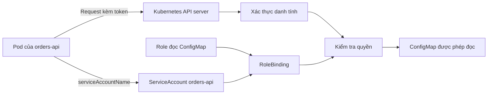

# ServiceAccount dành riêng cho ứng dụng

Trong chương **Phân quyền RBAC** của module **SPRING_CLOUD_KUBERNETES**, việc đầu tiên khi cho ứng dụng gọi Kubernetes API là xác định danh tính mà ứng dụng sẽ sử dụng. Nếu nhiều dịch vụ dùng chung ServiceAccount `default`, một thay đổi quyền để phục vụ dịch vụ này có thể đồng thời mở quyền cho các dịch vụ khác.

Bài học xây dựng một danh tính riêng cho `orders-api`, chỉ cấp quyền đọc ConfigMap trong namespace của ứng dụng, rồi kiểm chứng danh tính và quyền thực tế. Cách thiết kế này cũng giúp tách ứng dụng nghiệp vụ khỏi Configuration Watcher và chọn đúng phần tích hợp Spring Cloud Kubernetes cần triển khai.

Sau bài học, bạn có thể:

- Phân biệt ServiceAccount, token và quyền do RBAC cấp.
- Gắn ServiceAccount vào đúng Pod template của Deployment.
- Chọn việc mount token theo nhu cầu gọi API của ứng dụng.
- Tách quyền của ứng dụng, watcher và hệ thống triển khai.
- Kiểm chứng cả thao tác được phép lẫn thao tác phải bị từ chối.

## 1. ServiceAccount trả lời câu hỏi “ai đang gọi Kubernetes API?”

ServiceAccount là danh tính dành cho workload. Nó thuộc một namespace; hai ServiceAccount cùng tên ở hai namespace là hai danh tính khác nhau. Khi Pod không khai báo `serviceAccountName`, Kubernetes dùng ServiceAccount `default` của namespace đó. [Kubernetes: Service Accounts](https://kubernetes.io/docs/concepts/security/service-accounts/).

Ví dụ, danh tính của ứng dụng trong bài là:

```text
Namespace:       team-orders
ServiceAccount:  orders-api
Tên xác thực:    system:serviceaccount:team-orders:orders-api
```

Tên xác thực theo mẫu trên là tên Kubernetes sử dụng cho ServiceAccount. ServiceAccount còn thuộc các nhóm như `system:serviceaccounts` và `system:serviceaccounts:team-orders`; vì vậy cần tính cả quyền được cấp qua nhóm khi đánh giá quyền thực tế. [Kubernetes: Service account authentication](https://kubernetes.io/docs/reference/access-authn-authz/authentication/#service-account-tokens).

Ba thành phần có trách nhiệm khác nhau:

| Thành phần | Câu hỏi được giải quyết | Ví dụ |
| --- | --- | --- |
| ServiceAccount | Danh tính workload là gì? | `orders-api` trong `team-orders` |
| Token | Request đưa ra bằng chứng xác thực nào? | Bearer token được cấp cho Pod |
| Role và RoleBinding | Danh tính được thực hiện thao tác nào? | Đọc ConfigMap trong `team-orders` |

Tạo ServiceAccount chưa phải là cấp quyền đọc ConfigMap. Đặt tên ServiceAccount giống `spring.application.name` cũng không tự tạo liên kết giữa Spring và Kubernetes. Liên kết cần khai báo trong Pod và RBAC.



ServiceAccount không thay thế tài khoản đăng nhập của khách hàng trong Spring Security. Quyền gọi `GET /orders` của người dùng và quyền đọc Kubernetes ConfigMap của tiến trình là hai bài toán riêng.

## 2. “Dành riêng” được xác định theo trách nhiệm của workload

Trong một hệ thống có ứng dụng nghiệp vụ, watcher và pipeline triển khai, nên bắt đầu bằng ba danh tính:

| Workload | ServiceAccount gợi ý | Trách nhiệm dự kiến |
| --- | --- | --- |
| Ứng dụng nghiệp vụ | `orders-api` | Đọc cấu hình mà ứng dụng thực sự cần |
| Configuration Watcher | `orders-config-watcher` | Theo dõi nguồn cấu hình và tìm đích theo cơ chế thông báo đã chọn |
| Pipeline triển khai | Danh tính triển khai riêng | Tạo hoặc cập nhật tài nguyên theo quy trình phát hành |

Đây là đề xuất thiết kế của bài, không phải tên bắt buộc của Spring Cloud Kubernetes.

Một ứng dụng không cần quyền tạo Deployment chỉ vì nó chạy trong Deployment. Tương tự, watcher có quyền `watch` không có nghĩa mọi ứng dụng nhận thông báo refresh đều cần quyền đó.

Nếu ứng dụng dùng DiscoveryClient gọi trực tiếp API, cần đánh giá tài nguyên discovery. Nếu ứng dụng chỉ gọi tên DNS của một Kubernetes Service, không phát sinh nhu cầu đọc API discovery từ chính thao tác gọi HTTP đó. Spring Cloud LoadBalancer cũng cần được xét theo nguồn danh sách instance mà bạn thực sự chọn. [Spring Cloud Kubernetes: DiscoveryClient](https://docs.spring.io/spring-cloud-kubernetes/reference/discovery-client.html).

Các replica của cùng một Deployment thường dùng chung ServiceAccount vì có cùng trách nhiệm. Không cần tạo một ServiceAccount cho mỗi Pod. Khi hai workload có quyền khác nhau hoặc cần thu hồi quyền độc lập, việc dùng chung ServiceAccount cần được xem xét lại.

ServiceAccount riêng giúp thu hẹp phạm vi ảnh hưởng, nhưng không tự bảo đảm quyền tối thiểu. Nếu danh tính mới vẫn được gắn `cluster-admin`, việc đổi tên không giải quyết vấn đề quyền quá rộng. Kubernetes khuyến nghị giới hạn quyền theo nhu cầu và tránh cấp quyền rộng cho workload. [Kubernetes: RBAC good practices](https://kubernetes.io/docs/concepts/security/rbac-good-practices/).

## 3. Thiết kế hợp đồng quyền trước khi viết manifest

Lab chọn một nhu cầu cụ thể:

> `orders-api` đọc cấu hình từ Kubernetes API khi khởi động, trong namespace `team-orders`. Ứng dụng không đọc Secret, không discovery trực tiếp và không tự theo dõi thay đổi cấu hình.

Hợp đồng quyền của lab:

| Thao tác | Kết quả yêu cầu | Lý do |
| --- | --- | --- |
| `get` ConfigMap | Cho phép trong `team-orders` | Hỗ trợ đọc tài nguyên cụ thể |
| `list` ConfigMap | Cho phép trong `team-orders` | Hỗ trợ chế độ đọc theo lô của ví dụ |
| `watch` ConfigMap | Từ chối | Lab chưa chạy cơ chế theo dõi trong ứng dụng |
| Đọc Secret | Từ chối | Lab không lấy cấu hình bí mật qua API |
| Tạo hoặc sửa ConfigMap | Từ chối | Công bố cấu hình thuộc quy trình triển khai |
| Đọc ConfigMap ở namespace khác | Từ chối | Không thuộc phạm vi ứng dụng |
| Đọc danh sách Node | Từ chối | Không cần tài nguyên cấp cluster |

Ví dụ Spring bên dưới dùng chế độ `BATCH` của Spring Cloud Kubernetes 5.1.x. Tài liệu phân biệt `BATCH`, vốn cần quyền liệt kê theo namespace, với `SINGLE` để đọc theo tên. Không sao chép thuộc tính `read-type` sang phiên bản cũ mà chưa kiểm tra hỗ trợ. [Spring Cloud Kubernetes: ConfigMap PropertySource](https://docs.spring.io/spring-cloud-kubernetes/reference/property-source-config/configmap-propertysource.html).

Điểm đánh đổi cần chấp nhận rõ: Role trong lab cho phép liệt kê **mọi ConfigMap trong namespace `team-orders`**, không chỉ ConfigMap `orders-api`. Cấu hình Spring chọn nguồn nào để nạp không làm hẹp quyền RBAC của danh tính.

Nếu yêu cầu bảo mật chỉ cho đọc một ConfigMap, cần đồng thời chọn cơ chế truy cập phù hợp và viết Role theo tên. Mục 9 trình bày giới hạn của cách này.

## 4. Tạo ServiceAccount và gắn quyền trong một namespace

Các manifest trong bài là nội dung minh họa để người học áp dụng trên cluster lab. Cần có `kubectl`, context đúng và tài khoản triển khai đủ quyền tạo tài nguyên tương ứng. Không chạy bằng tài khoản runtime của `orders-api`.

Lưu nội dung sau thành một manifest lab, ví dụ `orders-identity.yaml`:

```yaml
apiVersion: v1
kind: Namespace
metadata:
  name: team-orders
---
apiVersion: v1
kind: ServiceAccount
metadata:
  name: orders-api
  namespace: team-orders
  labels:
    app.kubernetes.io/name: orders-api
automountServiceAccountToken: false
---
apiVersion: rbac.authorization.k8s.io/v1
kind: Role
metadata:
  name: orders-api-config-reader
  namespace: team-orders
rules:
  - apiGroups: [""]
    resources: ["configmaps"]
    verbs: ["get", "list"]
---
apiVersion: rbac.authorization.k8s.io/v1
kind: RoleBinding
metadata:
  name: orders-api-config-reader
  namespace: team-orders
subjects:
  - kind: ServiceAccount
    name: orders-api
    namespace: team-orders
roleRef:
  apiGroup: rbac.authorization.k8s.io
  kind: Role
  name: orders-api-config-reader
---
apiVersion: v1
kind: ConfigMap
metadata:
  name: orders-api
  namespace: team-orders
data:
  demo.banner: "orders-from-kubernetes-api"
```

Áp dụng bằng danh tính triển khai:

```powershell
kubectl apply -f orders-identity.yaml
kubectl get serviceaccount orders-api -n team-orders
kubectl describe role orders-api-config-reader -n team-orders
kubectl describe rolebinding orders-api-config-reader -n team-orders
```

Các trường quan trọng trong ví dụ:

- `subjects` xác định ServiceAccount nhận quyền.
- `roleRef` xác định tập quyền được gắn.
- Namespace của RoleBinding là phạm vi cấp quyền của binding.
- `apiGroups: [""]` chỉ core API group chứa ConfigMap.

RoleBinding có thể tham chiếu Role trong cùng namespace hoặc ClusterRole. Dùng ClusterRole qua RoleBinding vẫn giới hạn các quyền tài nguyên có namespace theo namespace của binding; chỉ vì có chữ “ClusterRole” không có nghĩa binding đó cấp quyền trên mọi namespace. [Kubernetes: RoleBinding and ClusterRoleBinding](https://kubernetes.io/docs/reference/access-authn-authz/rbac/#rolebinding-and-clusterrolebinding).

Lab dùng Role để thể hiện trực tiếp phạm vi một namespace, không cần ClusterRoleBinding.

## 5. Gắn ServiceAccount vào đúng Pod template

### 5.1. Chuẩn bị ứng dụng Spring

Ví dụ giả định dự án Spring Boot đã dùng BOM tương thích với Spring Cloud Kubernetes 5.1.x. Chọn một Kubernetes client, ở đây là Fabric8; các dependency liên quan gồm:

```xml
<dependency>
    <groupId>org.springframework.boot</groupId>
    <artifactId>spring-boot-starter-web</artifactId>
</dependency>
<dependency>
    <groupId>org.springframework.cloud</groupId>
    <artifactId>spring-cloud-starter-kubernetes-fabric8-config</artifactId>
</dependency>
```

Cấu hình đóng gói trong `application.yaml`:

```yaml
spring:
  application:
    name: orders-api
  config:
    import: "kubernetes:"
  cloud:
    discovery:
      enabled: false
    kubernetes:
      config:
        enabled: true
        name: orders-api
        read-type: BATCH
        fail-fast: true
      secrets:
        enabled: false
```

`spring.config.import: "kubernetes:"` kích hoạt việc nạp Kubernetes PropertySource theo Config Data. [Spring Cloud Kubernetes: PropertySource implementations](https://docs.spring.io/spring-cloud-kubernetes/reference/property-source-config.html).

Bài dùng `fail-fast` để lỗi truy cập cấu hình không bị che bởi một lần khởi động chỉ dùng giá trị cục bộ. Hãy giữ giá trị `orders-from-kubernetes-api` chỉ trong ConfigMap của lab, không đồng thời khai báo cùng giá trị qua biến môi trường hoặc file đóng gói.

Có thể thêm controller vào ứng dụng Spring Boot hiện có:

```java
package com.example.orders;

import java.util.Map;

import org.springframework.core.env.Environment;
import org.springframework.web.bind.annotation.GetMapping;
import org.springframework.web.bind.annotation.RestController;

@RestController
public class ConfigEvidenceController {

    private final Environment environment;

    public ConfigEvidenceController(Environment environment) {
        this.environment = environment;
    }

    @GetMapping("/demo/config")
    public Map<String, String> config() {
        return Map.of(
                "application", environment.getRequiredProperty(
                        "spring.application.name"),
                "banner", environment.getRequiredProperty("demo.banner")
        );
    }
}
```

Controller chỉ trả marker công khai của lab. Không dùng cách trả toàn bộ Environment để kiểm tra cấu hình khi ứng dụng có dữ liệu bí mật.

### 5.2. Deployment sử dụng danh tính đã tạo

Build image từ ứng dụng trên rồi thay `registry.example.com/learning/orders-api:sa-lab` bằng image thật mà cluster kéo được:

```yaml
apiVersion: apps/v1
kind: Deployment
metadata:
  name: orders-api
  namespace: team-orders
spec:
  replicas: 2
  selector:
    matchLabels:
      app: orders-api
  template:
    metadata:
      labels:
        app: orders-api
    spec:
      serviceAccountName: orders-api
      automountServiceAccountToken: true
      containers:
        - name: application
          image: registry.example.com/learning/orders-api:sa-lab
          ports:
            - name: http
              containerPort: 8080
          env:
            - name: SPRING_CLOUD_KUBERNETES_CONFIG_NAMESPACE
              valueFrom:
                fieldRef:
                  fieldPath: metadata.namespace
          readinessProbe:
            httpGet:
              path: /demo/config
              port: http
            initialDelaySeconds: 10
            periodSeconds: 5
```

Lưu manifest Deployment thành `orders-deployment.yaml` rồi áp dụng:

```powershell
kubectl apply -f orders-deployment.yaml
kubectl rollout status deployment/orders-api -n team-orders --timeout=120s
```

Vị trí đúng là `spec.template.spec.serviceAccountName`. Nếu chỉ tạo ServiceAccount và RoleBinding nhưng bỏ trường này, Pod vẫn có thể chạy bằng `default`.

Trong ví dụ, ServiceAccount đặt `automountServiceAccountToken: false` làm mặc định; Pod cần API chủ động đặt `true`. Khi hai nơi cùng khai báo, giá trị trong Pod được ưu tiên. Thay đổi ServiceAccount của một Pod đang tồn tại cần tạo Pod mới; với Deployment, sửa Pod template để rollout. [Kubernetes: Configure Service Accounts for Pods](https://kubernetes.io/docs/tasks/configure-pod-container/configure-service-account/).

Việc cập nhật Role hoặc RoleBinding thì không yêu cầu đổi tên ServiceAccount hay chép một token mới vào image. Đây là thay đổi chính sách áp dụng cho những lần kiểm tra quyền tiếp theo.

## 6. Token được cấp cho Pod và cách sử dụng

Trên các cụm Kubernetes hiện đại, token tự cấp cho Pod dùng cơ chế TokenRequest và projected volume, có thời hạn và được kubelet xoay vòng. Không cần tạo Secret token tĩnh để bắt đầu lab; cột `SECRETS` bằng `0` trên ServiceAccount không chứng minh Pod thiếu credentials. [Kubernetes: ServiceAccount token volume projection](https://kubernetes.io/docs/tasks/configure-pod-container/configure-service-account/#serviceaccount-token-volume-projection).

Đường dẫn in-cluster quen thuộc:

```text
/var/run/secrets/kubernetes.io/serviceaccount/token
/var/run/secrets/kubernetes.io/serviceaccount/ca.crt
/var/run/secrets/kubernetes.io/serviceaccount/namespace
```

Kubernetes client có thể dùng token để xác thực, CA để kiểm tra chứng chỉ API server và thông tin namespace để chọn phạm vi. Hãy để client sử dụng cấu hình in-cluster thay vì đóng gói kubeconfig quản trị vào container. [Kubernetes: Accessing the API from a Pod](https://kubernetes.io/docs/tasks/run-application/access-api-from-pod/).

Token có audience và thời hạn; nếu tự cấu hình projected token cho dịch vụ ngoài cluster, audience phải phù hợp với bên xác thực. Không mặc định token cho một dịch vụ ngoài cũng dùng được với Kubernetes API. [Kubernetes: Projected Volumes](https://kubernetes.io/docs/concepts/storage/projected-volumes/#serviceaccounttoken-projected-volumes).

Trong vận hành, cần tránh:

- Ghi token vào log, phản hồi HTTP hoặc kho mã nguồn.
- Đọc token một lần rồi giữ nguyên trong biến tĩnh vô thời hạn khi tự viết HTTP client.
- Tạo token sống lâu để chữa lỗi client không xử lý xoay vòng.
- Mount credentials quản trị của người triển khai vào ứng dụng.

Đặt `automountServiceAccountToken: false` chỉ điều khiển việc tự mount credentials. Nó không xóa RoleBinding, không thu hồi quyền và không bảo đảm Pod không thể nhận credentials qua một cơ chế khác.

## 7. Kiểm chứng danh tính và quyền thực tế

Cần hai lớp bằng chứng: tài nguyên đang chạy mang đúng danh tính, và danh tính đó có đúng quyền. Một dòng `yes` từ `can-i` chưa chứng minh ứng dụng đã nạp được ConfigMap.

### 7.1. Kiểm tra mọi replica

```powershell
kubectl get deployment orders-api -n team-orders -o 'jsonpath={.spec.template.spec.serviceAccountName}'
kubectl get pods -n team-orders -l app=orders-api -o 'custom-columns=NAME:.metadata.name,SA:.spec.serviceAccountName,PHASE:.status.phase'
```

Yêu cầu cả hai Pod hiện tại đều có `SA=orders-api`. Kiểm tra danh sách Pod giúp phát hiện rollout chưa xong hoặc một workload khác trùng label.

Kiểm tra cấu hình readiness và trạng thái bằng:

```powershell
kubectl get pods -n team-orders -l app=orders-api
kubectl logs deployment/orders-api -n team-orders --all-pods=true --tail=100
```

Nếu phiên bản `kubectl` không hỗ trợ `--all-pods` cho lệnh log, lấy tên từng Pod từ lệnh trước rồi đọc log từng Pod.

### 7.2. Kiểm tra quyền bằng impersonation

Các lệnh sau chạy trên máy người vận hành bằng tài khoản được phép impersonate danh tính và nhóm tương ứng. Nếu nhận lỗi cấm impersonation, đó là giới hạn của tài khoản đang kiểm tra, chưa phải kết quả quyền của ứng dụng.

Đặt biến PowerShell:

```powershell
$appIdentity = 'system:serviceaccount:team-orders:orders-api'
$identityGroups = @(
    '--as-group=system:authenticated'
    '--as-group=system:serviceaccounts'
    '--as-group=system:serviceaccounts:team-orders'
)
```

Kiểm tra các quyền đã thiết kế:

```powershell
kubectl auth can-i get configmaps/orders-api -n team-orders --as=$appIdentity @identityGroups
kubectl auth can-i list configmaps -n team-orders --as=$appIdentity @identityGroups
kubectl auth can-i watch configmaps -n team-orders --as=$appIdentity @identityGroups
kubectl auth can-i get secrets -n team-orders --as=$appIdentity @identityGroups
kubectl auth can-i create configmaps -n team-orders --as=$appIdentity @identityGroups
kubectl auth can-i list configmaps -n kube-system --as=$appIdentity @identityGroups
kubectl auth can-i list nodes --as=$appIdentity @identityGroups
kubectl auth can-i list configmaps -n team-orders --as=system:serviceaccount:team-orders:default @identityGroups
```

Kết quả mong muốn, theo đúng thứ tự:

```text
yes
yes
no
no
no
no
no
no
```

`kubectl auth can-i` hỏi hệ thống phân quyền về một thao tác cụ thể; `--as` và `--as-group` phục vụ kiểm tra bằng impersonation. Các lệnh trên không đọc token từ Pod. [Kubernetes: kubectl auth can-i](https://kubernetes.io/docs/reference/kubectl/generated/kubectl_auth/kubectl_auth_can-i/).

Nếu kết quả `no` mong muốn lại thành `yes`, cần tìm binding khác đang cấp quyền, kể cả binding vào nhóm. RBAC cộng gộp quyền và không có luật `deny`; thêm một Role hẹp không hủy quyền rộng từ binding khác. [Kubernetes: RBAC API objects](https://kubernetes.io/docs/reference/access-authn-authz/rbac/#api-objects).

### 7.3. Xác nhận ứng dụng đọc được cấu hình

Trong một cửa sổ terminal:

```powershell
kubectl port-forward deployment/orders-api -n team-orders 18080:8080
```

Trong cửa sổ khác:

```powershell
Invoke-RestMethod -Uri 'http://127.0.0.1:18080/demo/config'
```

Kết quả cần chứa:

```json
{
  "application": "orders-api",
  "banner": "orders-from-kubernetes-api"
}
```

Port-forward tới Deployment chọn một Pod. Để xác nhận cả hai replica, lấy từng tên Pod ở mục 7.1 rồi port-forward `pod/<ten-pod>` lần lượt và lặp lại request.

Bằng chứng này có ý nghĩa khi marker không tồn tại ở nguồn cấu hình khác và ứng dụng sử dụng image vừa build. Nó xác nhận đường đọc cấu hình của lab; không chứng minh rằng cập nhật ConfigMap sẽ tự refresh bean hoặc cập nhật đồng thời mọi replica.

Mẫu không triển khai watcher. Muốn kiểm tra cập nhật runtime, cần thêm cơ chế đó cùng danh tính riêng và tiêu chí xác nhận từng consumer đã áp dụng cấu hình.

## 8. Trường hợp ứng dụng không cần gọi Kubernetes API

Một lựa chọn khác cho `orders-api` là nhận cấu hình qua ConfigMap volume và gọi các dịch vụ khác bằng DNS. Khi đã loại bỏ các thành phần cần API khỏi ứng dụng, có thể giữ ServiceAccount riêng nhưng không tạo RoleBinding đọc ConfigMap và không tự mount token.

Pod template có thể chứa:

```yaml
spec:
  serviceAccountName: orders-api
  automountServiceAccountToken: false
  containers:
    - name: application
      image: registry.example.com/learning/orders-api:file-config
      env:
        - name: SPRING_CONFIG_IMPORT
          value: "file:/etc/orders/application.yaml"
      volumeMounts:
        - name: application-config
          mountPath: /etc/orders
          readOnly: true
  volumes:
    - name: application-config
      configMap:
        name: orders-file-config
```

Đây là phương án thay thế, không phải phần cần áp dụng thêm vào Deployment dùng API ở mục 5. Image của phương án này cần bỏ import `kubernetes:` và các tính năng khác yêu cầu Kubernetes API.

ConfigMap tương ứng có key `application.yaml`, chẳng hạn:

```yaml
apiVersion: v1
kind: ConfigMap
metadata:
  name: orders-file-config
  namespace: team-orders
data:
  application.yaml: |
    demo:
      banner: orders-from-mounted-file
```

Với volume, kubelet chuẩn bị dữ liệu cho Pod; tiến trình ứng dụng đọc file. Việc đọc file đó không đòi cấp quyền `get configmaps` cho ServiceAccount của ứng dụng. Cập nhật file được mount cũng không đồng nghĩa Spring tự nạp lại Environment hoặc tạo lại bean. [Kubernetes: ConfigMaps](https://kubernetes.io/docs/concepts/configuration/configmap/).

Chọn phương án này khi cơ chế file và quy trình rollout đã đáp ứng nhu cầu. Không cần thêm một client gọi Kubernetes API chỉ để ứng dụng biết nó đang chạy trong cluster.

## 9. Giới hạn theo tên và những thay đổi phạm vi thường gặp

### 9.1. Chỉ đọc một ConfigMap bằng API

Nếu client thực sự chỉ gửi request đọc theo tên, có thể thiết kế Role thay thế:

```yaml
apiVersion: rbac.authorization.k8s.io/v1
kind: Role
metadata:
  name: orders-api-config-reader
  namespace: team-orders
rules:
  - apiGroups: [""]
    resources: ["configmaps"]
    resourceNames: ["orders-api"]
    verbs: ["get"]
```

Role này phù hợp với hợp đồng chỉ `GET` ConfigMap `orders-api`. Không áp dụng nguyên trạng cho chế độ `BATCH` của lab. Cần chuyển cơ chế đọc tương thích và tính cả tên nguồn theo profile nếu ứng dụng sử dụng chúng.

`resourceNames` không biến một request liệt kê toàn namespace thành request đọc một tài nguyên. Với `list` hoặc `watch` bị giới hạn theo tên, client phải gửi field selector `metadata.name` phù hợp; label selector chọn nhãn ứng dụng không thay thế điều kiện này. [Kubernetes: Referring to resources](https://kubernetes.io/docs/reference/access-authn-authz/rbac/#referring-to-resources).

### 9.2. Đọc cấu hình ở namespace khác

Giả sử ứng dụng vẫn ở `team-orders` nhưng cấu hình chuyển sang `shared-config`. Thiết kế phạm vi cần trở thành:

```text
ServiceAccount: team-orders/orders-api

Role:           shared-config/orders-api-config-reader
RoleBinding:    shared-config/orders-api-config-reader

Subject của RoleBinding:
  kind: ServiceAccount
  name: orders-api
  namespace: team-orders
```

Đồng thời phải sửa namespace nguồn của client. Chỉ đổi RoleBinding mà client vẫn đọc `team-orders` sẽ không làm request tự chuyển sang namespace mới.

Không chuyển sang ClusterRoleBinding chỉ để giải quyết một trường hợp đọc ở namespace thứ hai. Hãy giữ quyền đúng nơi chứa nguồn dữ liệu cần đọc.

### 9.3. Bật thêm chức năng Spring Cloud Kubernetes

Trước mỗi thay đổi chức năng, bổ sung vào bảng nhu cầu quyền:

| Thay đổi | Điều cần xác định |
| --- | --- |
| Đọc Secret qua API | Secret nào, namespace nào và thao tác API nào |
| DiscoveryClient gọi API | Client nào, tài nguyên endpoint nào, phạm vi namespace |
| Dùng EndpointSlice | API group `discovery.k8s.io` và resource `endpointslices` khi cơ chế đã chọn sử dụng chúng |
| Thêm Configuration Watcher | ServiceAccount của watcher và quyền riêng theo kiểu thông báo |
| Chỉ thêm health probe HTTP | Probe thực tế có gọi Kubernetes API từ ứng dụng hay không |

Tài liệu Spring Cloud Kubernetes liệt kê tài nguyên cần quyền theo nhóm dependency; quyền cụ thể vẫn phải phù hợp tính năng đang bật. Không cấp cả quyền Secret và discovery chỉ vì dự án có một starter cấu hình. [Spring Cloud Kubernetes: Security Configurations Inside Kubernetes](https://docs.spring.io/spring-cloud-kubernetes/reference/security-service-accounts.html).

## 10. Chẩn đoán lỗi theo lớp

| Hiện tượng | Cần kiểm tra trước | Hướng xử lý |
| --- | --- | --- |
| Pod không tạo được do thiếu ServiceAccount | Tên và namespace, sự kiện ReplicaSet | Tạo đúng ServiceAccount trước Pod |
| Thông báo lỗi nhắc tới `...:default` | `serviceAccountName` trên từng Pod | Sửa Pod template và chờ rollout |
| API trả `401` | Credentials, token, thời hạn, audience | Sửa xác thực trước khi mở quyền |
| API trả `403` | Danh tính, verb, resource, namespace trong lỗi | So khớp request với Role và binding |
| Timeout hoặc lỗi TLS | Đường mạng, DNS, CA, endpoint API | Sửa kết nối hoặc trust phù hợp |
| Đọc ConfigMap được nhưng startup vẫn lỗi | Import, tên nguồn, profile, key cần dùng | Kiểm tra cấu hình Spring và dữ liệu nguồn |
| Default ServiceAccount cũng đọc được | Binding vào `default` hoặc các nhóm | Loại bỏ cấp quyền dùng chung ngoài yêu cầu |
| Pod cũ đúng, Pod mới lỗi | Credentials và thiết lập khi tạo Pod mới | So sánh template, mount và client |

Kubernetes thực hiện xác thực và kiểm tra quyền ở những bước khác nhau; kết quả từ chối quyền cần được phân biệt với lỗi kết nối tới API server. [Kubernetes: Authorization](https://kubernetes.io/docs/reference/access-authn-authz/authorization/).

Một lỗi điển hình:

```text
User "system:serviceaccount:team-orders:orders-api"
cannot list resource "configmaps"
in API group ""
in the namespace "team-orders"
```

Thông báo này cho biết request đang bị từ chối là `list configmaps` của danh tính mong muốn. Việc thêm duy nhất `get` hoặc đổi tên ConfigMap sẽ không cấp quyền cho request `list` đó. Hãy đối chiếu với chế độ đọc mà client thực sự chạy.

Không dùng `cluster-admin` làm bước sửa lỗi tạm thời cho ứng dụng. Lỗi cần quyền nào thì làm rõ nhu cầu của quyền đó; nếu không thuộc hợp đồng, xem xét tắt chức năng đã gây request.

## 11. Bài thực hành và tiêu chí hoàn thành

Thực hiện trên namespace lab độc lập:

1. Tạo ServiceAccount, Role, RoleBinding và ConfigMap như mục 4.
2. Build image Spring, khai báo Deployment và chờ hai replica ready.
3. Ghi nhận tên từng Pod và ServiceAccount đang sử dụng.
4. Chạy tám phép kiểm tra quyền; giải thích từng kết quả khác kỳ vọng.
5. Xác nhận từng replica trả marker của ConfigMap.
6. Mô tả cách chuyển sang cấu hình qua file khi ứng dụng không còn cần API.
7. Ghi rõ danh tính nào sẽ được dùng nếu sau này thêm Configuration Watcher.

Bảng nghiệm thu:

| Tiêu chí | Bằng chứng cần có |
| --- | --- |
| Danh tính tường minh | Mọi Pod mục tiêu dùng `orders-api` |
| Quyền đọc đủ cho lab | `get` và `list configmaps` được phép trong `team-orders` |
| Không có quyền ngoài hợp đồng | Các phép thử `watch`, Secret, ghi cấu hình và ngoài namespace bị từ chối |
| Không phụ thuộc `default` | `default` không có quyền đọc ConfigMap của lab |
| Đường ứng dụng hoạt động | Từng replica trả `orders-from-kubernetes-api` |
| Credentials phù hợp | Pod cần API được cấp token; không có token quản trị đóng gói trong image |
| Trách nhiệm được tách | Ứng dụng, watcher và pipeline có kế hoạch danh tính riêng |

Thiết kế đạt yêu cầu khi tên ServiceAccount trong manifest, quyền RBAC và các request thực tế của ứng dụng cùng tuân theo một hợp đồng rõ ràng. ServiceAccount riêng là điểm xuất phát để giới hạn quyền; việc chọn ít tính năng API hơn và kiểm chứng quyền bị từ chối mới giúp duy trì giới hạn đó khi hệ thống phát triển.
