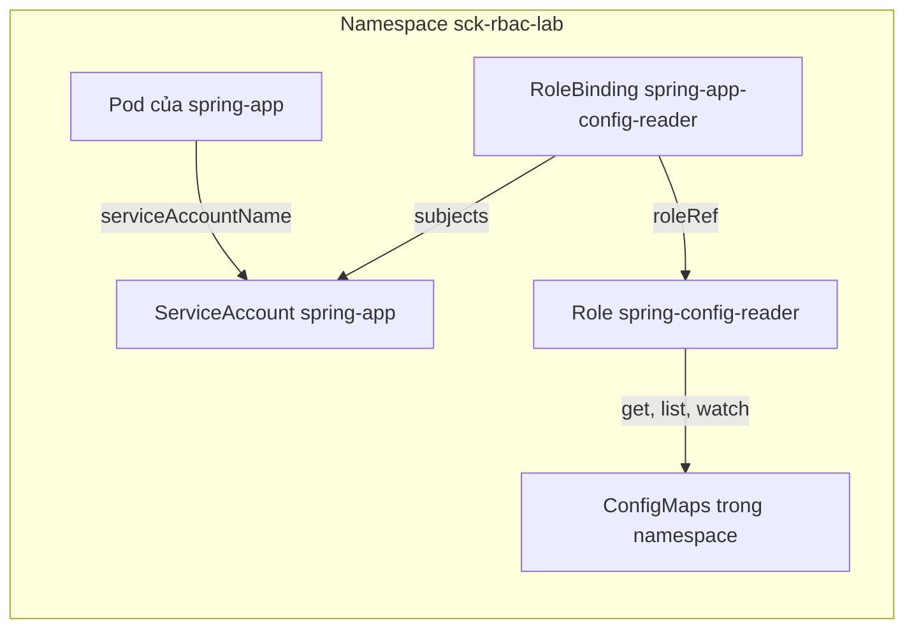

# Role và RoleBinding trong một namespace

## Mục tiêu bài học

Trong chương Phân quyền RBAC của module Spring Cloud Kubernetes, bài này hướng dẫn cấp quyền cho ứng dụng Spring đọc tài nguyên Kubernetes trong đúng một namespace.

Sau bài học, bạn có thể:

- Phân biệt danh tính ServiceAccount, tập quyền Role và liên kết RoleBinding.
- Viết manifest cấp quyền đọc ConfigMap cho một ứng dụng.
- Gắn đúng ServiceAccount vào Pod của Deployment.
- Kiểm chứng quyền được phép và quyền phải bị từ chối bằng `kubectl auth can-i`.
- Điều chỉnh quyền theo tính năng Spring Cloud Kubernetes đang sử dụng, thay vì cấp một bộ quyền rộng cho mọi ứng dụng.

Ví dụ dùng API RBAC ổn định `rbac.authorization.k8s.io/v1`. Bài thực hành tập trung vào phân quyền; nó không thay thế việc cấu hình nguồn dữ liệu Spring, discovery hoặc Configuration Watcher đúng với phiên bản triển khai.

## 1. Bắt đầu từ yêu cầu cụ thể

Giả sử ứng dụng `spring-app` chạy trong namespace `sck-rbac-lab`. Ứng dụng cần đọc ConfigMap để lấy cấu hình qua Kubernetes API.

Yêu cầu ban đầu:

| Nhu cầu | Quyết định trong ví dụ |
| --- | --- |
| Danh tính của ứng dụng | ServiceAccount riêng tên `spring-app` |
| Phạm vi dữ liệu | Namespace `sck-rbac-lab` |
| Tài nguyên được đọc | `configmaps` |
| Thao tác cần cho cách đọc minh họa | `get`, `list`, `watch` |
| Thao tác ghi ConfigMap | Không cấp |
| Đọc Secret, quản trị Deployment, đọc log hoặc exec vào Pod | Không cấp |
| Đọc ConfigMap ở namespace khác | Không được cấp bởi bộ manifest này |

Ở đây chọn cả ba quyền đọc để minh họa một client có thao tác lấy danh sách và theo dõi thay đổi. Nếu client thực tế chỉ đọc trực tiếp một đối tượng bằng tên, cần đánh giá lại để thu hẹp quyền.

Trước khi viết YAML, hãy xác định thành phần nào thật sự gọi Kubernetes API. Chỉ việc chạy ứng dụng trên Kubernetes không phải lý do để cấp cho nó quyền đọc toàn bộ namespace.

## 2. Ba đối tượng có ba vai trò khác nhau

### 2.1. ServiceAccount xác định danh tính

ServiceAccount là danh tính dành cho tiến trình chạy trong cluster. Trong ví dụ, danh tính đầy đủ của ứng dụng khi xác thực bằng ServiceAccount là:

```text
system:serviceaccount:sck-rbac-lab:spring-app
```

Tên `spring-app` ở namespace khác tạo thành danh tính khác. Tên Deployment hoặc label `app=spring-app` không tự thay thế ServiceAccount. [Kubernetes Service Accounts](https://kubernetes.io/docs/concepts/security/service-accounts/)

### 2.2. Role mô tả tập quyền

Role là một đối tượng thuộc namespace, chứa các quy tắc trong `rules`. Một Role có thể mô tả quyền trên loại tài nguyên, nhóm API và thao tác cụ thể. [Role API](https://kubernetes.io/docs/reference/kubernetes-api/rbac/role-v1/)

Ví dụ:

```yaml
apiVersion: rbac.authorization.k8s.io/v1
kind: Role
metadata:
  name: spring-config-reader
  namespace: sck-rbac-lab
rules:
  - apiGroups: [""]
    resources: ["configmaps"]
    verbs: ["get", "list", "watch"]
```

Đọc quy tắc này theo thứ tự:

```text
Trong namespace sck-rbac-lab,
cho phép get/list/watch tài nguyên configmaps thuộc core API group.
```

Tạo Role mới chỉ định nghĩa một tập quyền. Cần một binding để gán tập quyền đó cho danh tính.

### 2.3. RoleBinding gắn quyền với người nhận

RoleBinding dùng `subjects` để chỉ người nhận và `roleRef` để tham chiếu Role. Với `roleRef.kind: Role`, Role được tìm trong cùng namespace với RoleBinding. Namespace của RoleBinding xác định phạm vi cấp quyền của liên kết. [RoleBinding API](https://kubernetes.io/docs/reference/kubernetes-api/rbac/role-binding-v1/)

```yaml
apiVersion: rbac.authorization.k8s.io/v1
kind: RoleBinding
metadata:
  name: spring-app-config-reader
  namespace: sck-rbac-lab
subjects:
  - kind: ServiceAccount
    name: spring-app
    namespace: sck-rbac-lab
roleRef:
  apiGroup: rbac.authorization.k8s.io
  kind: Role
  name: spring-config-reader
```

Trong ví dụ này:

- `subjects[0].name` là tên ServiceAccount, không phải tên Pod.
- `subjects[0].namespace` xác định nơi ServiceAccount tồn tại.
- `roleRef.name` phải khớp tên Role.
- `metadata.name` của RoleBinding là tên riêng của liên kết; nó không bắt buộc trùng tên Role hoặc ServiceAccount.



Sơ đồ biểu diễn liên hệ phân quyền. Khi có yêu cầu thực tế, API server đánh giá danh tính và các quyền liên quan; ứng dụng không cần đọc RoleBinding trước mỗi lần đọc ConfigMap.

## 3. Hiểu đúng các trường dễ nhầm

### 3.1. Ba vị trí API group

| Vị trí | Giá trị trong ví dụ | Ý nghĩa |
| --- | --- | --- |
| `apiVersion` của Role hoặc RoleBinding | `rbac.authorization.k8s.io/v1` | Phiên bản API của đối tượng phân quyền |
| `rules[].apiGroups` | `[""]` | Nhóm API của tài nguyên được cho phép; ConfigMap thuộc core group |
| `roleRef.apiGroup` | `rbac.authorization.k8s.io` | Nhóm API chứa Role được tham chiếu |

Không đặt `v1` vào `rules[].apiGroups`. Phiên bản API và nhóm API là hai phần khác nhau. Không đặt chuỗi rỗng vào `roleRef.apiGroup` của RoleBinding tham chiếu Role RBAC.

Trong `subjects`, ServiceAccount thuộc core group; trường `apiGroup` có thể được bỏ như ví dụ, hoặc để chuỗi rỗng. Không sao chép `apiGroup` của `roleRef` sang subject ServiceAccount.

### 3.2. Tên tài nguyên và thao tác

Trong `resources`, dùng tên API dạng số nhiều như `configmaps`, `pods`, `services`; không dùng `ConfigMap` hoặc tên của một đối tượng cụ thể.

| Verb | Cách hiểu qua một yêu cầu ConfigMap |
| --- | --- |
| `get` | Đọc một ConfigMap bằng tên |
| `list` | Đọc danh sách ConfigMap |
| `watch` | Theo dõi luồng thay đổi ConfigMap |
| `create` | Tạo ConfigMap mới |
| `update` | Thay thế/cập nhật đối tượng |
| `patch` | Cập nhật một phần đối tượng |
| `delete` | Xóa đối tượng |

Được `get` không tự suy ra được `list` hoặc `watch`. Vì vậy, một ứng dụng đọc cấu hình khi khởi động thành công nhưng thất bại lúc mở informer vẫn có thể đang thiếu quyền.

Phân quyền không sửa được sai cách gọi API: yêu cầu `list` cần được đánh giá theo quyền `list`, dù người phát triển chỉ muốn lấy một ConfigMap từ kết quả.

## 4. Bộ manifest hoàn chỉnh cho bài thực hành

### 4.1. Chuẩn bị môi trường

Dùng một cluster thử nghiệm. Người thao tác cần được phép tạo namespace và các đối tượng trong bài, đồng thời được phép gán tập quyền tương ứng. Tài khoản chỉ có quyền tạo ứng dụng chưa chắc được phép cấp quyền RBAC.

Ví dụ sau dùng PowerShell và một namespace mới, chưa tồn tại:

```powershell
kubectl config current-context
kubectl create namespace sck-rbac-lab
```

Nếu namespace đã tồn tại, xác minh đó đúng là môi trường lab được phép sử dụng và kiểm tra các binding có sẵn trước khi tiếp tục.

### 4.2. Tạo ServiceAccount, dữ liệu mẫu, Role và RoleBinding

Khối dưới truyền manifest trực tiếp cho `kubectl`, không cần tạo tệp YAML trung gian:

```powershell
$rbacManifest = @'
apiVersion: v1
kind: ServiceAccount
metadata:
  name: spring-app
  namespace: sck-rbac-lab
---
apiVersion: v1
kind: ConfigMap
metadata:
  name: spring-app
  namespace: sck-rbac-lab
data:
  application.yaml: |
    demo:
      message: Xin chao tu ConfigMap
---
apiVersion: rbac.authorization.k8s.io/v1
kind: Role
metadata:
  name: spring-config-reader
  namespace: sck-rbac-lab
rules:
  - apiGroups: [""]
    resources: ["configmaps"]
    verbs: ["get", "list", "watch"]
---
apiVersion: rbac.authorization.k8s.io/v1
kind: RoleBinding
metadata:
  name: spring-app-config-reader
  namespace: sck-rbac-lab
subjects:
  - kind: ServiceAccount
    name: spring-app
    namespace: sck-rbac-lab
roleRef:
  apiGroup: rbac.authorization.k8s.io
  kind: Role
  name: spring-config-reader
'@

$rbacManifest | kubectl apply --dry-run=server -f -
# Chỉ áp dụng sau khi lệnh dry-run thành công.
$rbacManifest | kubectl apply -f -
```

Ở ví dụ này, tài khoản vận hành tạo ConfigMap mẫu. ServiceAccount `spring-app` chỉ được đọc; ứng dụng không được cấp quyền tạo dữ liệu chỉ để bộ manifest triển khai được.

Dry-run hỗ trợ kiểm tra yêu cầu với API server. Nó không chứng minh ứng dụng Spring đã nạp được cấu hình hoặc mọi kiểm tra quyền đã đạt.

Đọc lại những đối tượng phân quyền đã tạo:

```powershell
kubectl -n sck-rbac-lab get serviceaccount spring-app
kubectl -n sck-rbac-lab get role spring-config-reader -o yaml
kubectl -n sck-rbac-lab get rolebinding spring-app-config-reader -o yaml
```

Kiểm tra tên, namespace, rule, subject và roleRef. Không cần in token ServiceAccount để xác nhận liên kết.

## 5. Gắn danh tính đó vào ứng dụng Spring

Deployment phải đặt `serviceAccountName` trong Pod template:

```yaml
apiVersion: apps/v1
kind: Deployment
metadata:
  name: spring-app
  namespace: sck-rbac-lab
spec:
  replicas: 2
  selector:
    matchLabels:
      app: spring-app
  template:
    metadata:
      labels:
        app: spring-app
    spec:
      serviceAccountName: spring-app
      containers:
        - name: application
          image: registry.example.com/training/spring-app:1.0.0
          ports:
            - name: http
              containerPort: 8080
```

Image trên là chỗ giữ chỗ. Thay bằng image ứng dụng Spring đã được cấu hình đọc ConfigMap qua API, có dependency và cấu hình tương thích với bản Spring Cloud Kubernetes đang dùng.

Nếu không chỉ định ServiceAccount, Pod thường dùng ServiceAccount `default` của namespace. Tạo một ServiceAccount riêng rồi quên gắn vào Pod là nguyên nhân phổ biến khiến RoleBinding đúng nhưng ứng dụng vẫn bị từ chối. Việc đổi `serviceAccountName` phải thực hiện ở template để tạo Pod mới; không đổi trực tiếp danh tính của Pod đang tồn tại. [Cấu hình ServiceAccount cho Pod](https://kubernetes.io/docs/tasks/configure-pod-container/configure-service-account/)

Xác minh trên các Pod thực tế:

```powershell
kubectl -n sck-rbac-lab get pods -l app=spring-app `
    -o 'custom-columns=NAME:.metadata.name,SERVICEACCOUNT:.spec.serviceAccountName'
```

Kỳ vọng mọi Pod thuộc Deployment này dùng `spring-app`. Nếu mới cập nhật template, đợi rollout hoàn tất và kiểm tra lại những Pod đang phục vụ.

RoleBinding thay đổi không đòi hỏi đổi tên ServiceAccount hoặc tạo token thủ công. Tuy nhiên, RBAC đúng vẫn chưa đủ nếu client thiếu credential, dùng kubeconfig khác, sai namespace hoặc không kết nối được API server.

Khi ứng dụng cần gọi API bằng credential tự mount, hãy kiểm tra cả cấu hình `automountServiceAccountToken` ở Pod và ServiceAccount. Với ứng dụng không cần gọi API, có thể tắt automount sau khi xác nhận các thành phần trong Pod cũng không cần nó.

## 6. Kiểm chứng cả quyền được cấp và quyền bị từ chối

### 6.1. Kiểm tra bằng đúng danh tính

`kubectl auth can-i` kiểm tra một hành động có được phép hay không. Dùng `--as` cần quyền impersonation; lỗi bị cấm impersonate là lỗi của tài khoản đang chạy kiểm tra, chưa phải kết luận về quyền ứng dụng. [kubectl auth can-i](https://kubernetes.io/docs/reference/kubectl/generated/kubectl_auth/kubectl_auth_can-i/)

Ví dụ sau dành cho người vận hành được phép impersonate cả ServiceAccount và các group tương ứng:

```powershell
$rbacIdentity = @(
    '--as=system:serviceaccount:sck-rbac-lab:spring-app',
    '--as-group=system:serviceaccounts',
    '--as-group=system:serviceaccounts:sck-rbac-lab',
    '--as-group=system:authenticated'
)

kubectl auth can-i get configmaps -n sck-rbac-lab @rbacIdentity
kubectl auth can-i list configmaps -n sck-rbac-lab @rbacIdentity
kubectl auth can-i watch configmaps -n sck-rbac-lab @rbacIdentity
```

Ba kết quả mong đợi là `yes`.

Các group được đưa vào để phản ánh đầy đủ hơn danh tính ServiceAccount khi có binding theo nhóm. Không cấp quyền impersonation cho chính ứng dụng chỉ để chạy các lệnh kiểm tra này. [Kubernetes authentication và impersonation](https://kubernetes.io/docs/reference/access-authn-authz/authentication/)

### 6.2. Kiểm tra các giới hạn

```powershell
kubectl auth can-i patch configmaps -n sck-rbac-lab @rbacIdentity
kubectl auth can-i delete configmaps -n sck-rbac-lab @rbacIdentity
kubectl auth can-i get secrets -n sck-rbac-lab @rbacIdentity
kubectl auth can-i create deployments.apps -n sck-rbac-lab @rbacIdentity
kubectl auth can-i list configmaps -n default @rbacIdentity
kubectl auth can-i list nodes @rbacIdentity
```

Trong một lab không có quyền bổ sung cho danh tính hoặc các group này, các kết quả phải là `no`.

| Kiểm tra | Kỳ vọng với bộ manifest mẫu |
| --- | --- |
| Đọc một ConfigMap trong `sck-rbac-lab` | `yes` |
| Liệt kê/theo dõi ConfigMap trong `sck-rbac-lab` | `yes` |
| Ghi hoặc xóa ConfigMap | `no` |
| Đọc Secret | `no` |
| Tạo Deployment | `no` |
| Đọc ConfigMap trong `default` | `no` |
| Liệt kê Node của cluster | `no` |

RBAC cộng các quyền từ những binding có hiệu lực, không có một rule `deny` để Role hẹp triệt tiêu Role rộng. Nếu kiểm tra âm trả `yes`, cần tìm quyền được cấp từ liên kết khác. [Kubernetes RBAC](https://kubernetes.io/docs/reference/access-authn-authz/rbac/)

Đặc biệt, không kiểm tra bằng tài khoản quản trị của người phát triển rồi kết luận ứng dụng có quyền. Cùng một lệnh `kubectl get configmaps` nhưng khác danh tính có thể cho kết quả hoàn toàn khác.

### 6.3. Thử một yêu cầu đọc thực tế

```powershell
kubectl -n sck-rbac-lab get configmap spring-app @rbacIdentity
```

Lệnh này phải đọc được ConfigMap mẫu. Để kiểm tra `watch` thực tế, mở terminal:

```powershell
kubectl -n sck-rbac-lab get configmaps --watch @rbacIdentity
```

Dùng `Ctrl+C` để kết thúc theo dõi. Nếu cần tạo thay đổi để quan sát, thực hiện bằng tài khoản vận hành đã được cấp quyền ghi, không bằng danh tính ứng dụng.

`can-i` cho biết quyết định phân quyền; yêu cầu đọc thực tế còn giúp phát hiện sai tên hoặc tài nguyên không tồn tại. Hai kiểm tra này vẫn không thay thế kiểm tra client đang chạy bên trong Pod.

## 7. Đặt ranh giới namespace cho đúng

Trong bộ manifest mẫu, các namespace đều là `sck-rbac-lab`, nhưng mỗi vị trí có ý nghĩa riêng:

| Vị trí namespace | Vai trò |
| --- | --- |
| `metadata.namespace` của ServiceAccount | Nơi danh tính `spring-app` tồn tại |
| `metadata.namespace` của Role | Nơi tập quyền namespaced được định nghĩa |
| `metadata.namespace` của RoleBinding | Nơi liên kết cấp quyền có hiệu lực |
| `subjects[].namespace` | Namespace của ServiceAccount được nhận quyền |
| Namespace trong yêu cầu API | Nơi client đang yêu cầu đọc tài nguyên |

Nếu ứng dụng gửi yêu cầu tới `default`, RoleBinding trong `sck-rbac-lab` không làm yêu cầu đó hợp lệ.

RoleBinding có thể chỉ tới ServiceAccount ở namespace khác, nhưng phạm vi tài nguyên vẫn do namespace của RoleBinding quyết định. Ví dụ một liên kết ở namespace dữ liệu có thể cấp quyền cho một controller ở namespace công cụ. Đây là một thiết kế khác; bài thực hành giữ cả danh tính và tài nguyên trong cùng namespace để dễ kiểm chứng.

Với `roleRef.kind: Role`, không thể thêm `roleRef.namespace` để tham chiếu Role ở nơi khác. Nếu sau này cần tái sử dụng tập quyền, có thể xem xét ClusterRole được gắn bằng RoleBinding tại từng namespace; việc đó không tự biến RoleBinding thành quyền toàn cluster.

Không dùng yêu cầu liệt kê toàn cluster chỉ vì ứng dụng có quyền liệt kê trong một namespace. Thiết lập discovery hoặc watcher theo nhiều namespace phải đi kèm mô hình quyền tương ứng.

## 8. Chọn quyền theo tính năng Spring Cloud Kubernetes

Tài liệu Spring Cloud Kubernetes mô tả các quyền đọc thường gặp cho discovery và cấu hình; bộ quyền thực tế phụ thuộc tính năng, client và phiên bản. [Security configurations của Spring Cloud Kubernetes](https://docs.spring.io/spring-cloud-kubernetes/reference/security-service-accounts.html)

Dùng bảng sau làm điểm bắt đầu cho việc thiết kế, sau đó đối chiếu yêu cầu API thực tế:

| Cách ứng dụng hoạt động | Hướng thiết kế quyền |
| --- | --- |
| Đọc ConfigMap trực tiếp qua Kubernetes API | Cấp quyền ConfigMap phù hợp cách đọc |
| Đọc Secret qua Kubernetes API | Chỉ thêm quyền Secret khi thật sự cần |
| DiscoveryClient truy vấn tài nguyên Kubernetes | Xác định các quyền đọc Service, Endpoints, Pod hoặc EndpointSlice mà implementation sử dụng |
| Chỉ gọi dịch vụ qua DNS Kubernetes | Không mặc định cần quyền đọc Service qua API |
| Chỉ nhận cấu hình qua volume hoặc biến môi trường | Không mặc định cần quyền đọc API cho tiến trình ứng dụng |
| Nhận HTTP refresh từ Configuration Watcher | Quyền gọi HTTP và quyền đọc nguồn cấu hình cần được xét riêng |

Nếu cần discovery dùng các tài nguyên core tương ứng, có thể bổ sung rule sau vào Role sau khi xác nhận nhu cầu:

```yaml
# Trích rules; không phải một manifest độc lập.
- apiGroups: [""]
  resources: ["services", "endpoints", "pods"]
  verbs: ["get", "list", "watch"]
```

Nếu implementation đang dùng EndpointSlice, nhóm API cần được xác định riêng:

```yaml
# Chỉ thêm khi client thực tế cần đọc EndpointSlice.
- apiGroups: ["discovery.k8s.io"]
  resources: ["endpointslices"]
  verbs: ["get", "list", "watch"]
```

Không thêm cả hai đoạn chỉ để dập mọi thông báo `Forbidden`. Đầu tiên đọc log để biết client đang gọi tài nguyên nào và tính năng đó có được chủ động sử dụng hay không.

Configuration Watcher là một tiến trình riêng, nên cần xét ServiceAccount và quyền của chính Watcher. Nếu Watcher theo dõi ConfigMap thay cho ứng dụng, không suy ra rằng mọi ứng dụng đích cũng cần `watch` ConfigMap. Ngược lại, ứng dụng vẫn cần quyền đọc nếu đường nạp cấu hình của nó gọi API khi refresh.

RBAC Kubernetes không cấp quyền gọi `/actuator/refresh`, không cấu hình NetworkPolicy và không bảo vệ API nghiệp vụ. Những lớp này cần được thiết kế theo đường truy cập thực tế.

## 9. Thu hẹp hơn khi chỉ cần một ConfigMap

Nếu ứng dụng chỉ thực hiện `get` trực tiếp ConfigMap `spring-app`, có thể cân nhắc thay toàn bộ `rules` của Role bằng:

```yaml
rules:
  - apiGroups: [""]
    resources: ["configmaps"]
    resourceNames: ["spring-app"]
    verbs: ["get"]
```

Đây là phương án thay thế cho ví dụ ban đầu, không phải một rule hạn chế để thêm cạnh rule đọc rộng. Nếu rule cũ vẫn tồn tại, quyền cũ vẫn được cấp.

Không áp dụng cách thu hẹp này khi chưa biết client có `list/watch` hay không. Với `resourceNames`, yêu cầu `list/watch` cần selector `metadata.name` phù hợp để được cấp quyền; một informer liệt kê không kèm điều kiện đó có thể thất bại. Label selector cũng không tự tạo ranh giới RBAC. [RBAC: giới hạn theo tên tài nguyên](https://kubernetes.io/docs/reference/access-authn-authz/rbac/#referring-to-resources)

Cấp quyền đọc một ConfigMap là cấp quyền đọc đối tượng đó; không phải chỉ một key trong `data`. Nếu các phần dữ liệu có yêu cầu truy cập khác nhau, hãy thiết kế lại cách phân tách dữ liệu thay vì trông chờ Role lọc từng key.

Với Secret, việc thu hẹp cần được xem xét kỹ hơn: `list/watch` cũng có thể làm lộ nội dung Secret. Không coi quyền đọc Secret là quyền chỉ đọc tên hoặc metadata. [RBAC good practices](https://kubernetes.io/docs/concepts/security/rbac-good-practices/)

## 10. Chẩn đoán lỗi theo danh tính, tài nguyên và thao tác

Ví dụ thông báo:

```text
configmaps is forbidden:
User "system:serviceaccount:sck-rbac-lab:spring-app"
cannot list resource "configmaps" in API group ""
in the namespace "sck-rbac-lab"
```

Tách thông báo thành các dữ kiện:

```text
Danh tính:   system:serviceaccount:sck-rbac-lab:spring-app
Thao tác:    list
Tài nguyên:  configmaps
API group:   core group, biểu diễn bằng chuỗi rỗng
Namespace:   sck-rbac-lab
```

Sau đó đối chiếu từng phần với manifest và lệnh `can-i` tương ứng. Không chữa lỗi `cannot list configmaps` bằng cách cấp `cluster-admin` cho ứng dụng.

| Hiện tượng | Điểm cần kiểm tra trước |
| --- | --- |
| Role đã có nhưng vẫn bị `Forbidden` | RoleBinding có tồn tại và trỏ đúng Role không? |
| Binding đúng nhưng danh tính trong log kết thúc bằng `:default` | Pod có dùng đúng `serviceAccountName` không? |
| Đọc một ConfigMap được nhưng informer thất bại | Client có cần thêm `list/watch` không? |
| Bị từ chối trong namespace `default` | Client đang chọn namespace nào? |
| Lỗi tham chiếu Role hoặc không tìm ra quyền | Role có cùng namespace với RoleBinding và đúng tên không? |
| `can-i` báo cấm impersonate | Tài khoản kiểm tra có quyền kiểm tra danh tính đó không? |
| Kết quả âm lại là `yes` | Có binding khác hoặc quyền theo group không? |
| Phản hồi `Unauthorized` | Kiểm tra credential, token và danh tính trước khi sửa rule |
| Timeout, lỗi DNS hoặc TLS | Kiểm tra kết nối và cấu hình client; thêm Role không sửa đường mạng |
| API Kubernetes cho phép nhưng HTTP Actuator bị `403` | Kiểm tra lớp bảo vệ endpoint ứng dụng |

Quy trình điều tra đề xuất:

1. Xác nhận cluster context và namespace đang kiểm tra.
2. Đọc danh tính từ log hoặc xem ServiceAccount trên Pod thực tế.
3. Ghi lại chính xác verb, resource, API group và namespace của yêu cầu.
4. Đọc RoleBinding, rồi Role được tham chiếu.
5. Kiểm tra các binding khác nếu quyền hiệu lực không như dự kiến.
6. Dùng `can-i` cho đúng danh tính, sau đó thử yêu cầu đọc thực tế.
7. Kiểm tra lại ứng dụng trong Pod để xác nhận client dùng cùng danh tính và namespace.

## 11. Thay đổi và thu hồi quyền có kiểm soát

### 11.1. Sửa Role ảnh hưởng các subject đang được gán

Nếu nhiều RoleBinding cùng tham chiếu `spring-config-reader`, thay đổi `rules` của Role có thể ảnh hưởng tất cả người nhận liên quan. Do đó, một thay đổi để phục vụ riêng ứng dụng A cần được đánh giá xem có vô tình mở quyền cho ứng dụng B hay không.

Đặt tên Role theo khả năng như `spring-config-reader` giúp người đọc hiểu mục đích. Khi các ứng dụng có nhu cầu khác nhau, cân nhắc tách Role hoặc ServiceAccount thay vì tiếp tục mở rộng Role dùng chung.

### 11.2. `roleRef` không đổi trực tiếp sau khi tạo

`roleRef` của RoleBinding là bất biến. Nếu muốn gán Role khác, cần thay thế binding bằng quy trình phù hợp; sửa trực tiếp `roleRef.name` rồi apply sẽ không được chấp nhận. [RoleBinding: roleRef](https://kubernetes.io/docs/reference/kubernetes-api/rbac/role-binding-v1/)

Trong vận hành, có thể tạo binding mới để chuyển đổi rồi xóa binding cũ. Phải tính khoảng thời gian hai tập quyền cùng có hiệu lực và kiểm tra lại quyền sau chuyển đổi.

Xóa một RoleBinding không bảo đảm mọi quyền của danh tính đã biến mất nếu còn binding khác. Hãy lặp lại cả kiểm tra dương và âm sau khi thu hồi.

### 11.3. Tách danh tính triển khai và danh tính runtime

Tài khoản CI/CD có thể cần tạo hoặc cập nhật Deployment, ConfigMap và đối tượng phân quyền theo chính sách của tổ chức. Ứng dụng đang chạy thường chỉ cần đọc phần tài nguyên phục vụ chức năng của nó.

Không gán quyền quản lý Role, RoleBinding hoặc workload cho runtime chỉ vì pipeline dùng những tài nguyên đó. Tránh wildcard khi đã biết rõ tài nguyên và thao tác cần thiết; quyền tạo workload trong một namespace còn có thể kéo theo khả năng tiếp cận những tài nguyên khác qua Pod được tạo. [Khuyến nghị RBAC](https://kubernetes.io/docs/concepts/security/rbac-good-practices/)

## 12. Bài tập tự thực hành và tiêu chí hoàn thành

Thực hiện theo thứ tự trên namespace lab:

1. Áp dụng bộ manifest và đọc lại cả Role lẫn RoleBinding.
2. Xác nhận ba quyền đọc ConfigMap trả `yes`.
3. Xác nhận các kiểm tra ghi ConfigMap, đọc Secret và đọc namespace khác trả `no`, với giả định không có cấp quyền bổ sung.
4. Gắn ServiceAccount vào ứng dụng Spring và kiểm tra danh tính trên từng Pod.
5. Nếu thử phương án `resourceNames`, thay rule rộng, kiểm tra lại rằng chỉ thao tác đã thiết kế còn được phép.
6. Trong lab, tạm xóa đúng RoleBinding mẫu, kiểm tra lại quyền ConfigMap rồi khôi phục bằng manifest ban đầu.

Lệnh thu hồi để thử nghiệm:

```powershell
kubectl -n sck-rbac-lab delete rolebinding spring-app-config-reader
kubectl auth can-i get configmaps -n sck-rbac-lab @rbacIdentity

# Khôi phục đúng bộ manifest đã tạo ở phần trước.
$rbacManifest | kubectl apply -f -
```

Không áp dụng bước gây lỗi này trên ứng dụng đang phục vụ người dùng. Nếu sau khi xóa binding kết quả vẫn là `yes`, đó là dấu hiệu cần tìm thêm nguồn cấp quyền chứ không phải kết luận việc xóa đã thất bại.

Hoàn thành bài thực hành khi giải thích được từng kết quả theo đúng danh tính, tập quyền và namespace; ứng dụng đọc được dữ liệu cần thiết trong khi các thao tác ngoài yêu cầu vẫn bị từ chối.

## 13. Tự kiểm tra kiến thức

1. **Tạo Role xong đã cấp quyền cho ứng dụng chưa?** Chưa. Cần RoleBinding gắn Role với đúng subject.
2. **Vì sao `rules[].apiGroups` là chuỗi rỗng nhưng `roleRef.apiGroup` lại khác?** Rule trỏ tới tài nguyên core; roleRef trỏ tới đối tượng RBAC.
3. **RoleBinding có tên giống Deployment thì Pod tự nhận quyền không?** Không. Phải gắn đúng ServiceAccount trong Pod template và trong subject.
4. **Có quyền `get` thì tự có `watch` không?** Không. Đó là các thao tác riêng.
5. **Role hẹp có phủ định quyền từ binding rộng khác không?** Không. Cần xem toàn bộ nguồn cấp quyền.
6. **Cùng tên ServiceAccount ở hai namespace có phải cùng danh tính không?** Không. Namespace là một phần của danh tính ServiceAccount.
7. **Cấp quyền đọc ConfigMap có tự sửa lỗi Actuator bị cấm không?** Không. Đó là hai lớp phân quyền khác nhau.

Một bộ RBAC phù hợp nối được bốn yếu tố: đúng danh tính, đúng thao tác, đúng tài nguyên và đúng namespace. Với Spring Cloud Kubernetes, hãy xác định tính năng thật sự cần dùng trước, rồi cấp và kiểm chứng quyền tương ứng.
