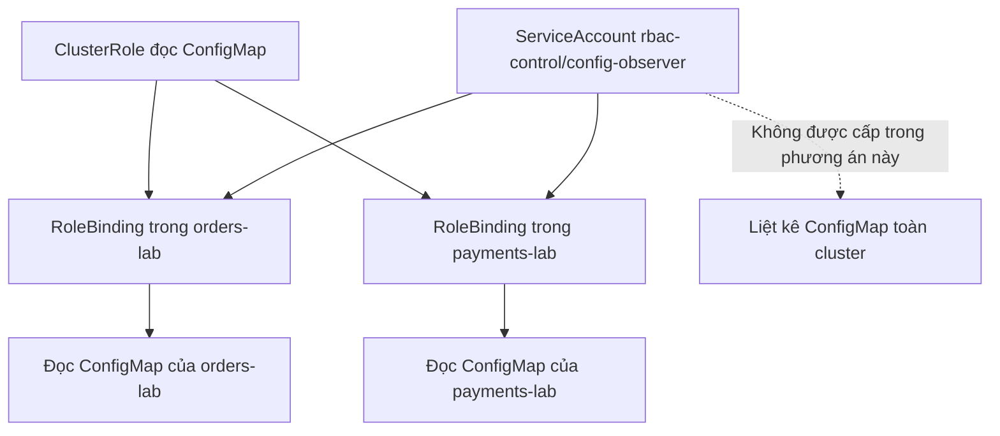

# Khi nào cần ClusterRole và ClusterRoleBinding

Trong chương **Phân quyền RBAC** của module **SPRING_CLOUD_KUBERNETES**, việc bật discovery hoặc Configuration Watcher thường dẫn đến câu hỏi: ứng dụng có cần quyền trên toàn cluster không? Câu trả lời phụ thuộc vào tài nguyên và phạm vi request mà client thực sự gửi, không phụ thuộc vào việc ứng dụng có chạy trong Kubernetes hay không.

Điểm cần phân biệt ngay từ đầu: **cần ClusterRole không đồng nghĩa cần ClusterRoleBinding**. Bạn có thể định nghĩa một ClusterRole dùng chung rồi cấp quyền riêng trong từng namespace bằng RoleBinding.

Bài học xây dựng hai phương án cho một tiến trình quan sát ConfigMap: chỉ đọc hai namespace được chọn, hoặc đọc trên toàn cluster. Qua đó, bạn sẽ biết khi nào cần mở rộng phạm vi và cách chứng minh các quyền ngoài yêu cầu vẫn bị từ chối.

Sau bài học, bạn có thể:

- Phân biệt phạm vi của Role, ClusterRole, RoleBinding và ClusterRoleBinding.
- Chọn binding theo loại request và phạm vi tài nguyên.
- Tái sử dụng ClusterRole mà vẫn giữ giới hạn theo namespace.
- Nhận biết nhu cầu quyền phát sinh khi bật discovery nhiều namespace hoặc theo dõi cấu hình.
- Kiểm chứng quyền bằng cả phép thử được phép và bị từ chối.

## 1. Tách bộ quy tắc khỏi nơi cấp quyền

Role và ClusterRole mô tả **được làm gì**. RoleBinding và ClusterRoleBinding gắn bộ quy tắc đó cho **ai**, trong phạm vi tương ứng.

| Tài nguyên RBAC | Có namespace? | Vai trò |
| --- | --- | --- |
| `Role` | Có | Định nghĩa quyền trong một namespace |
| `ClusterRole` | Không | Định nghĩa bộ quyền dùng chung hoặc quyền cần phạm vi cluster |
| `RoleBinding` | Có | Cấp quyền trong namespace chứa binding |
| `ClusterRoleBinding` | Không | Cấp các quyền của ClusterRole ở phạm vi cluster |

Role là tài nguyên có namespace, còn ClusterRole được quản lý ở phạm vi cluster. Bản thân việc tạo một trong hai đối tượng chưa cấp quyền cho workload; cần binding phù hợp. [Kubernetes: Role](https://kubernetes.io/docs/reference/kubernetes-api/rbac/role-v1/), [Kubernetes: ClusterRole](https://kubernetes.io/docs/reference/kubernetes-api/rbac/cluster-role-v1/).

Các tổ hợp quan trọng:

| Bộ quy tắc | Binding | Kết quả |
| --- | --- | --- |
| Role | RoleBinding cùng namespace | Quyền trong namespace đó |
| ClusterRole | RoleBinding | Quyền tài nguyên có namespace, trong namespace của binding |
| ClusterRole | ClusterRoleBinding | Quyền theo quy tắc ở phạm vi cluster |
| Role | ClusterRoleBinding | Không hợp lệ |

Một RoleBinding chỉ có hiệu lực trong namespace của chính nó, kể cả khi tham chiếu ClusterRole. Nó không thể tham chiếu Role ở namespace khác. [Kubernetes: RoleBinding](https://kubernetes.io/docs/reference/kubernetes-api/rbac/role-binding-v1/).

ClusterRoleBinding chỉ tham chiếu ClusterRole. Nó không có namespace để dùng làm giới hạn cấp quyền. Namespace trong subject ServiceAccount xác định danh tính nhận quyền, không biến binding thành quyền riêng trong namespace ấy. [Kubernetes: ClusterRoleBinding](https://kubernetes.io/docs/reference/kubernetes-api/rbac/cluster-role-binding-v1/).

Ví dụ, subject sau luôn là cùng một danh tính:

```yaml
subjects:
  - kind: ServiceAccount
    name: config-observer
    namespace: rbac-control
```

Danh tính đó có thể được cấp quyền tại `orders-lab`, `payments-lab` hoặc toàn cluster tùy binding. Nơi ServiceAccount tồn tại không quyết định nơi nó được phép đọc dữ liệu.

## 2. Khi nào cần từng phương án?

Bắt đầu bằng một yêu cầu cụ thể rồi đối chiếu:

| Nhu cầu | Phương án nên xem xét |
| --- | --- |
| Ứng dụng chỉ đọc cấu hình trong namespace riêng | Role và RoleBinding |
| Nhiều namespace cần cùng một bộ quyền | ClusterRole dùng chung, RoleBinding ở từng namespace |
| Một tiến trình cần đọc hai namespace cố định | ClusterRole và hai RoleBinding, nếu client gửi request theo từng namespace |
| Controller có trách nhiệm đọc mọi namespace, kể cả namespace tạo sau này | ClusterRole và ClusterRoleBinding |
| Tiến trình cần đọc tài nguyên không có namespace như Node | ClusterRole và ClusterRoleBinding với quy tắc cụ thể |
| Client cần truy cập non-resource URL của API server | ClusterRole và ClusterRoleBinding cho URL cần thiết |
| Ứng dụng chỉ gọi Service bằng DNS và đọc file cấu hình được mount | Đánh giá khả năng không cần quyền đọc Kubernetes API |

Các trường hợp đọc tài nguyên cấp cluster hoặc non-resource URL không thể được giải quyết bằng một RoleBinding trong namespace. ClusterRole hỗ trợ những nhóm quy tắc này. [Kubernetes: Role and ClusterRole](https://kubernetes.io/docs/reference/access-authn-authz/rbac/#role-and-clusterrole).

“Cần thiết” ở đây là yêu cầu nghiệp vụ và kỹ thuật đã được xác định. Một lỗi `403` khi bật nhầm `all-namespaces` chưa phải bằng chứng rằng ứng dụng nên có quyền toàn cluster. Có thể lựa chọn đúng là thu hẹp cấu hình client.

## 3. Nhiều namespace khác với một request trên mọi namespace

Giả sử `config-observer` chỉ được đọc `orders-lab` và `payments-lab`.

Hai request riêng có dạng:

```http
GET /api/v1/namespaces/orders-lab/configmaps
GET /api/v1/namespaces/payments-lab/configmaps
```

Một request liệt kê ConfigMap trên tất cả namespace có dạng:

```http
GET /api/v1/configmaps
```

Namespace là một thuộc tính của request được hệ thống phân quyền xem xét. Request toàn cluster không mang namespace để RoleBinding của một namespace áp dụng. [Kubernetes: Request attributes used in authorization](https://kubernetes.io/docs/reference/access-authn-authz/authorization/#request-attributes-used-in-authorization).

Vì vậy, hai RoleBinding cho hai namespace không làm request thứ ba trở thành “trả về phần được phép”. Kubernetes RBAC không tự lọc một danh sách toàn cluster thành tập kết quả theo các RoleBinding của người gọi.



Để tìm loại tài nguyên có namespace, có thể dùng:

```powershell
kubectl api-resources --namespaced=true
kubectl api-resources --namespaced=false
```

ConfigMap, Secret, Pod và Service là những ví dụ có namespace; Node và Namespace là những ví dụ không có namespace. Cần phân biệt đối tượng `Namespace` với tài nguyên được chứa bên trong namespace. [Kubernetes: Namespaces](https://kubernetes.io/docs/concepts/overview/working-with-objects/namespaces/).

Nếu client được cấu hình sẵn danh sách hai namespace, nó thường không cần quyền `list namespaces` chỉ để sử dụng các tên đó. Nhưng nếu client thực sự gọi API liệt kê Namespace để tự tìm phạm vi, request ấy cần được đánh giá riêng.

## 4. Liên hệ với Spring Cloud Kubernetes

### 4.1. DiscoveryClient và Spring Cloud LoadBalancer

DiscoveryClient có lựa chọn namespace hiện tại, danh sách namespace hoặc tất cả namespace. Với client Kubernetes trực tiếp, việc bật `spring.cloud.kubernetes.discovery.all-namespaces=true` có thể dẫn đến nhu cầu quyền đọc ở phạm vi cluster. Nếu dùng HTTP DiscoveryClient, cần xem quyền của DiscoveryServer nơi thực sự gọi Kubernetes API. [Spring Cloud Kubernetes: DiscoveryClient](https://docs.spring.io/spring-cloud-kubernetes/reference/discovery-client.html).

Ví dụ cấu hình giới hạn:

```yaml
spring:
  cloud:
    kubernetes:
      discovery:
        all-namespaces: false
        namespaces:
          - orders-lab
          - payments-lab
```

Cần xác định đúng client và tài nguyên nó sử dụng: Service, Endpoints, Pod hoặc EndpointSlice theo tính năng và phiên bản. Không cấp tất cả chỉ vì một mẫu triển khai có sẵn chúng.

Spring Cloud LoadBalancer chọn instance từ nguồn danh sách đã cấu hình. Việc dùng LoadBalancer không tự tạo ra yêu cầu đọc Node hay quản trị tài nguyên cấp cluster. Nếu nguồn instance đi qua một thành phần discovery khác, đánh giá quyền tại thành phần thực hiện request Kubernetes.

### 4.2. Configuration Watcher

Phạm vi nguồn cấu hình được watcher theo dõi và phạm vi instance nhận thông báo là hai lựa chọn cần kiểm tra riêng. Trong tài liệu Configuration Watcher hiện hành, danh sách namespace của nguồn được cấu hình qua `spring.cloud.kubernetes.reload.namespaces`. [Spring Cloud Kubernetes: Configuration Watcher](https://docs.spring.io/spring-cloud-kubernetes/reference/spring-cloud-kubernetes-configuration-watcher.html).

Ví dụ phần cấu hình nguồn:

```yaml
spring:
  cloud:
    kubernetes:
      reload:
        namespaces:
          - orders-lab
          - payments-lab
      secrets:
        enabled: false
```

Đây là phần cấu hình liên quan đến phạm vi, không phải toàn bộ Deployment watcher. Cần đối chiếu với phiên bản image, cơ chế thông báo và các chức năng đang bật trước khi ghép vào triển khai.

Một watcher cần đọc ConfigMap ở hai namespace không mặc nhiên cần quyền đọc Secret toàn cluster. Nếu watcher tìm instance qua discovery, bổ sung đúng quyền discovery và namespace tương ứng. Nếu dùng thêm leader election, quyền của đối tượng khóa cũng cần được xác định riêng.

Cấp quyền Kubernetes API cũng không tự cho phép gọi `/actuator/refresh` của ứng dụng. Endpoint đó thuộc server ứng dụng, chịu cấu hình xác thực HTTP và đường mạng riêng.

## 5. Lab A: dùng ClusterRole nhưng giới hạn ở hai namespace

### 5.1. Mục tiêu và điều kiện

Lab tập trung kiểm chứng phạm vi RBAC, chưa triển khai một watcher hoàn chỉnh.

Thiết kế:

| Thành phần | Giá trị |
| --- | --- |
| Namespace chứa danh tính | `rbac-control` |
| ServiceAccount | `config-observer` |
| Namespace được đọc | `orders-lab`, `payments-lab` |
| Namespace đối chứng | `outsider-lab` |
| Tài nguyên được phép | `configmaps` |
| Thao tác được phép | `get`, `list`, `watch` |
| Phạm vi không được phép | Ngoài hai namespace, Secret, Node và ghi cấu hình |

Cần một cluster lab có RBAC và `kubectl` trỏ đúng context. Người áp dụng manifest phải được phép tạo các tài nguyên RBAC tương ứng; người chạy phép thử impersonation cần được phép mô phỏng danh tính và nhóm.

### 5.2. Manifest

Lưu nội dung minh họa sau thành `observer-scope-lab.yaml`:

```yaml
apiVersion: v1
kind: Namespace
metadata:
  name: rbac-control
---
apiVersion: v1
kind: Namespace
metadata:
  name: orders-lab
---
apiVersion: v1
kind: Namespace
metadata:
  name: payments-lab
---
apiVersion: v1
kind: Namespace
metadata:
  name: outsider-lab
---
apiVersion: v1
kind: ServiceAccount
metadata:
  name: config-observer
  namespace: rbac-control
automountServiceAccountToken: false
---
apiVersion: rbac.authorization.k8s.io/v1
kind: ClusterRole
metadata:
  name: sck-configmap-observer
rules:
  - apiGroups: [""]
    resources: ["configmaps"]
    verbs: ["get", "list", "watch"]
---
apiVersion: rbac.authorization.k8s.io/v1
kind: RoleBinding
metadata:
  name: sck-configmap-observer
  namespace: orders-lab
subjects:
  - kind: ServiceAccount
    name: config-observer
    namespace: rbac-control
roleRef:
  apiGroup: rbac.authorization.k8s.io
  kind: ClusterRole
  name: sck-configmap-observer
---
apiVersion: rbac.authorization.k8s.io/v1
kind: RoleBinding
metadata:
  name: sck-configmap-observer
  namespace: payments-lab
subjects:
  - kind: ServiceAccount
    name: config-observer
    namespace: rbac-control
roleRef:
  apiGroup: rbac.authorization.k8s.io
  kind: ClusterRole
  name: sck-configmap-observer
---
apiVersion: v1
kind: ConfigMap
metadata:
  name: orders-runtime
  namespace: orders-lab
  labels:
    spring.cloud.kubernetes.config: "true"
data:
  demo.message: "orders-r1"
---
apiVersion: v1
kind: ConfigMap
metadata:
  name: payments-runtime
  namespace: payments-lab
  labels:
    spring.cloud.kubernetes.config: "true"
data:
  demo.message: "payments-r1"
---
apiVersion: v1
kind: ConfigMap
metadata:
  name: outsider-runtime
  namespace: outsider-lab
  labels:
    spring.cloud.kubernetes.config: "true"
data:
  demo.message: "outsider-r1"
```

Áp dụng bằng danh tính triển khai:

```powershell
kubectl apply -f observer-scope-lab.yaml
kubectl get clusterrole sck-configmap-observer
kubectl describe rolebinding sck-configmap-observer -n orders-lab
kubectl describe rolebinding sck-configmap-observer -n payments-lab
```

ClusterRole không có `metadata.namespace`. Hai RoleBinding có namespace khác nhau nhưng tham chiếu cùng ClusterRole và cùng ServiceAccount.

Lab không tạo Pod nên không cần mount token. Khi dùng ServiceAccount này cho watcher thật, phải gắn `serviceAccountName: config-observer` trên Pod template và cung cấp credentials in-cluster phù hợp. Tắt automount không làm mất quyền RBAC của danh tính; các phép thử dưới đây dùng impersonation.

## 6. Kiểm chứng phương án giới hạn bằng danh tính mô phỏng

### 6.1. Chuẩn bị impersonation

Trong PowerShell:

```powershell
$observerIdentity = 'system:serviceaccount:rbac-control:config-observer'
$observerGroups = @(
    '--as-group=system:authenticated'
    '--as-group=system:serviceaccounts'
    '--as-group=system:serviceaccounts:rbac-control'
)
```

Các nhóm được đưa vào phép thử để tính cả binding cấp quyền qua nhóm. Tài khoản người kiểm tra phải có quyền impersonate các giá trị tương ứng. Lỗi không được impersonate là lỗi của bước chuẩn bị kiểm tra, không phải kết quả quyền của `config-observer`. [Kubernetes: User impersonation](https://kubernetes.io/docs/reference/access-authn-authz/authentication/#user-impersonation).

### 6.2. Kiểm tra cả quyền được phép và bị từ chối

```powershell
kubectl auth can-i get configmaps/orders-runtime -n orders-lab --as=$observerIdentity @observerGroups
kubectl auth can-i list configmaps -n orders-lab --as=$observerIdentity @observerGroups
kubectl auth can-i watch configmaps -n payments-lab --as=$observerIdentity @observerGroups
kubectl auth can-i list configmaps -n outsider-lab --as=$observerIdentity @observerGroups
kubectl auth can-i list configmaps -n rbac-control --as=$observerIdentity @observerGroups
kubectl auth can-i list configmaps --all-namespaces --as=$observerIdentity @observerGroups
kubectl auth can-i list secrets -n orders-lab --as=$observerIdentity @observerGroups
kubectl auth can-i patch configmaps/orders-runtime -n orders-lab --as=$observerIdentity @observerGroups
kubectl auth can-i list nodes --as=$observerIdentity @observerGroups
kubectl auth can-i list namespaces --as=$observerIdentity @observerGroups
```

Kết quả mong muốn theo thứ tự:

```text
yes
yes
yes
no
no
no
no
no
no
no
```

`kubectl auth can-i` kiểm tra một hành động tại lớp phân quyền. Để hỏi về request trên mọi namespace, dùng `--all-namespaces` thay vì kiểm tra từng namespace rồi suy ra quyền toàn cluster. [Kubernetes: kubectl auth can-i](https://kubernetes.io/docs/reference/kubectl/generated/kubectl_auth/kubectl_auth_can-i/).

Hai kết quả đáng chú ý trong lab:

- ServiceAccount nằm ở `rbac-control` nhưng không được đọc ConfigMap tại đó vì chưa được cấp quyền tương ứng.
- Có quyền trong hai namespace vẫn không cho phép `list configmaps --all-namespaces`.

### 6.3. Gửi request đọc thật

```powershell
kubectl get configmaps -n orders-lab -o name --as=$observerIdentity @observerGroups
kubectl get configmaps -n payments-lab -o name --as=$observerIdentity @observerGroups
kubectl get configmaps -n outsider-lab -o name --as=$observerIdentity @observerGroups
kubectl get configmaps --all-namespaces -o name --as=$observerIdentity @observerGroups
```

Hai lệnh đầu thành công; hai lệnh sau phải bị từ chối nếu không có cấp quyền ngoài manifest.

Cách kiểm tra này xác nhận phân quyền cho danh tính được mô phỏng và request được gửi. Nó chưa kiểm tra token của Pod, kết nối mạng từ watcher, thông báo HTTP/Bus hay việc ứng dụng đã áp dụng cấu hình mới.

Nếu dùng `--watch` để kiểm tra một phiên theo dõi thật, nên kiểm tra cả lần thiết lập kết nối mới sau thay đổi quyền. Dữ liệu đã đọc vào cache không bị xóa chỉ vì binding bị thu hồi.

## 7. Lab B: khi thật sự cần ClusterRoleBinding

Giả sử đội nền tảng có một controller trung tâm, được giao trách nhiệm quan sát ConfigMap trên toàn cluster, bao gồm namespace xuất hiện sau khi controller triển khai. Đây là hợp đồng khác với Lab A.

Để so sánh rõ, dùng ServiceAccount thứ hai `global-config-observer`. Không mở rộng quyền của danh tính giới hạn hai namespace.

Lưu phần minh họa sau thành `observer-global-lab.yaml`:

```yaml
apiVersion: v1
kind: ServiceAccount
metadata:
  name: global-config-observer
  namespace: rbac-control
automountServiceAccountToken: false
---
apiVersion: rbac.authorization.k8s.io/v1
kind: ClusterRoleBinding
metadata:
  name: sck-configmap-observer-global
subjects:
  - kind: ServiceAccount
    name: global-config-observer
    namespace: rbac-control
roleRef:
  apiGroup: rbac.authorization.k8s.io
  kind: ClusterRole
  name: sck-configmap-observer
```

Manifest này tái sử dụng ClusterRole đã tạo ở Lab A:

```powershell
kubectl apply -f observer-global-lab.yaml
$globalObserverIdentity = 'system:serviceaccount:rbac-control:global-config-observer'

kubectl auth can-i list configmaps --all-namespaces --as=$globalObserverIdentity @observerGroups
kubectl auth can-i list configmaps -n outsider-lab --as=$globalObserverIdentity @observerGroups
kubectl auth can-i list configmaps -n kube-system --as=$globalObserverIdentity @observerGroups
kubectl auth can-i list secrets --all-namespaces --as=$globalObserverIdentity @observerGroups
kubectl auth can-i list nodes --as=$globalObserverIdentity @observerGroups
kubectl auth can-i create configmaps -n orders-lab --as=$globalObserverIdentity @observerGroups
```

Kết quả mong muốn:

```text
yes
yes
yes
no
no
no
```

Bộ quy tắc chỉ cho đọc ConfigMap nên ClusterRoleBinding này không cấp quyền đọc Secret, đọc Node hoặc tạo ConfigMap. Nó mở rộng **phạm vi áp dụng** của bộ quy tắc, không biến mọi quyền thành quản trị.

Bảng so sánh:

| Phép thử | `config-observer` | `global-config-observer` |
| --- | --- | --- |
| Đọc ConfigMap trong `orders-lab` | Cho phép | Cho phép |
| Đọc ConfigMap trong `payments-lab` | Cho phép | Cho phép |
| Đọc ConfigMap trong `outsider-lab` | Từ chối | Cho phép |
| Liệt kê ConfigMap mọi namespace | Từ chối | Cho phép |
| Đọc Secret | Từ chối | Từ chối |
| Sửa ConfigMap | Từ chối | Từ chối |

Phạm vi của danh tính thứ hai còn bao gồm ConfigMap trong namespace tạo về sau. Nếu yêu cầu chỉ là thêm một namespace thứ ba vào danh sách hữu hạn, hãy xem xét thêm RoleBinding tại đó thay vì chuyển sang quyền toàn cluster.

Muốn thử lại việc thu hồi cấp quyền toàn cluster trong lab, xóa đúng binding đã tạo:

```powershell
kubectl delete clusterrolebinding sck-configmap-observer-global
kubectl auth can-i list configmaps --all-namespaces --as=$globalObserverIdentity @observerGroups
```

Kết quả sau thu hồi cần là `no` nếu không có binding khác cấp quyền. Giữ ClusterRole vì hai RoleBinding của Lab A vẫn sử dụng nó.

## 8. Các trường hợp ClusterRoleBinding phục vụ tài nguyên cấp cluster

### 8.1. Đọc Node hoặc Namespace

Một tiến trình kiểm kê hạ tầng có thể cần đọc Node. Quy tắc của ClusterRole dành riêng cho trách nhiệm đó có thể là:

```yaml
apiVersion: rbac.authorization.k8s.io/v1
kind: ClusterRole
metadata:
  name: sck-node-inventory-reader
rules:
  - apiGroups: [""]
    resources: ["nodes"]
    verbs: ["get", "list"]
```

Để cấp quyền này cho danh tính kiểm kê, dùng ClusterRoleBinding tham chiếu `sck-node-inventory-reader`. Một RoleBinding trong `orders-lab` không thể biến Node thành tài nguyên thuộc namespace đó.

Đừng dùng ví dụ này để mở quyền cho ứng dụng nghiệp vụ. Ứng dụng muốn biết mình đã ready thường không cần quyền đọc toàn bộ Node; hãy xác định dữ liệu sức khỏe nào thật sự cần và nguồn cung cấp dữ liệu đó.

Tương tự, nếu controller cần liệt kê các đối tượng Namespace, quy tắc cần nêu `resources: ["namespaces"]`. Quyền đọc ConfigMap toàn cluster không tự bao gồm quyền liệt kê Namespace.

### 8.2. Custom resource

Đối với custom resource, xem scope được khai báo trong CRD:

| Scope của custom resource | Cách suy xét |
| --- | --- |
| `Namespaced` | Có thể giới hạn bằng RoleBinding theo từng namespace |
| `Cluster` | Cần cấp quyền phù hợp qua ClusterRoleBinding |

Không suy ra scope chỉ từ tên tài nguyên hoặc từ việc operator được cài trong một namespace.

Ví dụ, một operator đặt Pod tại `operators` có thể quản lý custom resource cấp cluster; ngược lại, một operator tập trung vẫn có thể chỉ được cấp quyền trên tài nguyên có namespace ở hai namespace được chọn.

### 8.3. Non-resource URL của API server

ClusterRole có thể định nghĩa quy tắc cho đường dẫn không phải resource. Ví dụ minh họa một bộ quyền dành cho thành phần cần đọc metrics từ chính API server:

```yaml
apiVersion: rbac.authorization.k8s.io/v1
kind: ClusterRole
metadata:
  name: sck-apiserver-metrics-reader
rules:
  - nonResourceURLs: ["/metrics"]
    verbs: ["get"]
```

Quyền non-resource URL cần binding ở phạm vi cluster. Nó áp dụng cho URL trên Kubernetes API server, không phải đường dẫn giống tên trên một Service ứng dụng.

Do đó, thêm `nonResourceURLs: ["/actuator/refresh"]` vào ClusterRole không cấu hình xác thực cho Spring Boot Actuator. Khi watcher gọi endpoint quản trị của ứng dụng, cần xử lý quyền HTTP ở ứng dụng và đường mạng liên quan.

## 9. Những cách mở quyền ngoài dự kiến

### 9.1. Lấy label selector làm ranh giới bảo mật

Watcher có thể chỉ quan tâm ConfigMap mang nhãn `spring.cloud.kubernetes.config: "true"`. Điều đó không có nghĩa RBAC đã cấm danh tính đọc các ConfigMap không có nhãn.

Trong Lab A, Role cho phép đọc mọi ConfigMap trong hai namespace. Trong Lab B, quyền đọc áp dụng cho mọi namespace. Nếu dùng credentials trực tiếp để gửi request khác, danh tính vẫn có phạm vi RBAC đã được cấp.

Selector giúp chọn dữ liệu cho một chức năng; nó không tự trở thành luật giới hạn quyền theo nhãn. Nếu cần ranh giới chặt hơn, xem xét phân chia namespace hoặc cơ chế đọc theo tên và quyền tương ứng.

### 9.2. Cho rằng quyền chỉ đọc Secret là ít tác động

Quyền `list` và `watch` Secret có thể làm lộ nội dung Secret, không chỉ tên tài nguyên. Tránh thêm `secrets` vào ClusterRole chung nếu yêu cầu chỉ là quan sát ConfigMap. [Kubernetes: Listing secrets](https://kubernetes.io/docs/concepts/security/rbac-good-practices/#listing-secrets).

Những quy tắc sau không phù hợp với hợp đồng của hai lab:

```yaml
# Không dùng cho các lab chỉ đọc ConfigMap trong bài.
rules:
  - apiGroups: ["*"]
    resources: ["*"]
    verbs: ["*"]
```

Wildcard còn có thể cấp quyền lên tài nguyên hoặc thao tác xuất hiện sau này. Chọn rõ API group, resource và verb giúp việc mở rộng tính năng có điểm kiểm soát.

### 9.3. Tạo RoleBinding hẹp nhưng vẫn giữ binding rộng

RBAC cộng gộp quyền. Một RoleBinding mới chỉ cho đọc `orders-lab` không phủ định ClusterRoleBinding đã cho phép đọc mọi namespace. [Kubernetes: RBAC API objects](https://kubernetes.io/docs/reference/access-authn-authz/rbac/#api-objects).

Khi kết quả vượt kỳ vọng, kiểm tra cả:

- Binding gắn trực tiếp với ServiceAccount.
- Binding gắn với nhóm ServiceAccount trong namespace.
- Binding gắn với nhóm rộng hơn mà danh tính thuộc về.
- Các cơ chế phân quyền khác nếu cluster không chỉ dùng RBAC.

Phải kiểm tra lại phép thử âm sau thay đổi. Nhìn thấy RoleBinding hẹp trong manifest chưa đủ để kết luận quyền hiệu lực đã hẹp.

### 9.4. Sửa ClusterRole dùng chung mà không xét mọi binding

Trong Lab A và Lab B, nhiều binding cùng tham chiếu `sck-configmap-observer`. Nếu thêm quyền ghi vào ClusterRole ấy, các subject đang được gắn role sẽ nhận thêm quyền trong phạm vi binding tương ứng.

Nếu chỉ controller toàn cluster cần chức năng mới, cân nhắc một ClusterRole riêng thay vì thay đổi bộ quyền chung cho mọi người đọc ConfigMap.

`roleRef` của binding là bất biến. Khi đổi binding sang bộ quy tắc khác, cần kế hoạch thay thế binding; không mặc định có thể patch `roleRef` tại chỗ. [Kubernetes: ClusterRoleBinding API](https://kubernetes.io/docs/reference/kubernetes-api/rbac/cluster-role-binding-v1/).

Quyền chạy nghiệp vụ cũng cần tách khỏi quyền tạo hoặc gắn tài nguyên RBAC. Một workload đọc ConfigMap không cần quyền tự tạo ClusterRoleBinding để tự giải quyết lỗi truy cập.

## 10. Từ lỗi truy cập tới quyết định đúng

Một quy trình chẩn đoán có thể đi theo năm bước:

1. Ghi nhận danh tính thật của Pod hoặc tiến trình đang gọi.
2. Đọc verb, API group, resource và namespace trong request bị từ chối.
3. So sánh request đó với nhu cầu nghiệp vụ đã thống nhất.
4. Chọn thu hẹp client hoặc bổ sung đúng quy tắc và binding.
5. Chạy lại cả phép thử dương và âm.

Ví dụ lỗi:

```text
User "system:serviceaccount:rbac-control:config-observer"
cannot list resource "configmaps"
in API group ""
at the cluster scope
```

Nếu yêu cầu vẫn chỉ là hai namespace, cần kiểm tra client có đang dùng đường gọi toàn cluster không. Thêm một RoleBinding thứ ba không sửa được loại request này.

Nếu yêu cầu đã được mở thành quan sát toàn cluster, cần chọn danh tính và ClusterRoleBinding phù hợp, đồng thời chấp nhận phạm vi dữ liệu rộng hơn. Không dùng `cluster-admin` để bỏ qua bước xác định bộ quyền.

Các tình huống thường gặp:

| Hiện tượng | Cách giải thích cần kiểm tra |
| --- | --- |
| Đọc được trong một namespace, lỗi ở namespace thứ hai | Thiếu RoleBinding hoặc client chọn nhầm namespace |
| Mọi phép thử từng namespace đạt nhưng `-A` thất bại | Request toàn cluster chưa được cấp quyền |
| ClusterRoleBinding tồn tại nhưng vẫn bị từ chối | Sai subject, sai roleRef hoặc thiếu resource/verb |
| Có quyền ConfigMap nhưng discovery lỗi | Chưa có đúng quyền tài nguyên discovery |
| Cấp quyền EndpointSlice nhưng vẫn lỗi | Kiểm tra API group `discovery.k8s.io` và cơ chế client đang dùng |
| API đọc được nhưng refresh HTTP lỗi | Xác thực, endpoint hoặc mạng của ứng dụng cần kiểm tra riêng |
| Kết quả `can-i` tốt nhưng watcher vẫn lỗi | Kiểm tra Pod có dùng đúng ServiceAccount và credentials không |

Đặc biệt, namespace xuất hiện trong subject và namespace xuất hiện trên RoleBinding trả lời hai câu hỏi khác nhau: **ai nhận quyền** và **quyền có hiệu lực ở đâu**.

## 11. Thu hẹp từ quyền toàn cluster về danh sách hữu hạn

Khi phát hiện một watcher chỉ phục vụ hai namespace nhưng đang có ClusterRoleBinding, có thể thiết kế chuyển đổi theo thứ tự:

1. Chốt danh sách namespace nguồn và namespace discovery thực sự cần.
2. Chuẩn bị RoleBinding ở các namespace đích với bộ quyền phù hợp.
3. Cấu hình client gửi request theo từng namespace; triển khai cấu hình đó.
4. Xác nhận quá trình khởi động, liệt kê và thiết lập watch đều hoạt động.
5. Gỡ binding rộng đúng đối tượng sau khi đã có đường truy cập thay thế.
6. Kiểm tra request toàn cluster và namespace ngoài danh sách bị từ chối.

Cần kiểm tra lại những lần kết nối mới và quá trình khởi động mới. Một tiến trình còn cache dữ liệu cũ không chứng minh quyền sau chuyển đổi đã đủ.

Nếu danh tính còn được cấp quyền rộng qua binding khác hoặc nhóm, gỡ một ClusterRoleBinding chưa chắc đã hoàn tất thu hẹp. Đừng xóa ClusterRole dùng chung để thu hồi quyền cho riêng một subject; các workload khác có thể đang phụ thuộc vào nó.

## 12. Bài thực hành và tiêu chí hoàn thành

Thực hiện trên cluster lab:

1. Áp dụng Lab A rồi lưu kết quả của mười phép kiểm tra quyền.
2. Giải thích vì sao `config-observer` không đọc được ConfigMap trong chính namespace chứa ServiceAccount.
3. So sánh hai request theo namespace với request `--all-namespaces`.
4. Áp dụng Lab B và đối chiếu hai danh tính bằng cùng một tập phép thử.
5. Thu hồi binding toàn cluster của Lab B rồi xác nhận phép thử toàn cluster bị từ chối.
6. Với một ứng dụng Spring cụ thể, xác định chức năng nào thật sự gọi Kubernetes API và thành phần nào chịu trách nhiệm gọi.

Bảng nghiệm thu:

| Tiêu chí | Bằng chứng |
| --- | --- |
| Chọn đúng loại binding | Giải thích được vì sao dùng RoleBinding hoặc ClusterRoleBinding |
| Phạm vi hữu hạn hoạt động | Đọc được hai namespace đích, không đọc được namespace đối chứng |
| Phân biệt request toàn cluster | `can-i` và request đọc thật cho kết quả phù hợp |
| Quy tắc không bị mở rộng vô cớ | Secret, ghi cấu hình và Node vẫn bị từ chối trong hai lab |
| Danh tính rõ ràng | ServiceAccount và namespace subject được ghi chính xác |
| Thu hồi có kiểm chứng | Phép thử sau khi gỡ binding cho thấy quyền hiệu lực đã thay đổi |
| Tích hợp Spring có căn cứ | Cấu hình namespace, kiểu client và tài nguyên cần quyền được đối chiếu |

Dùng ClusterRole để mô tả một bộ quyền có thể tái sử dụng hoặc có phạm vi cluster. Chỉ dùng ClusterRoleBinding khi phạm vi cấp quyền thực sự cần đến nó; với danh sách namespace hữu hạn, ClusterRole kết hợp RoleBinding thường thể hiện giới hạn rõ ràng hơn.
