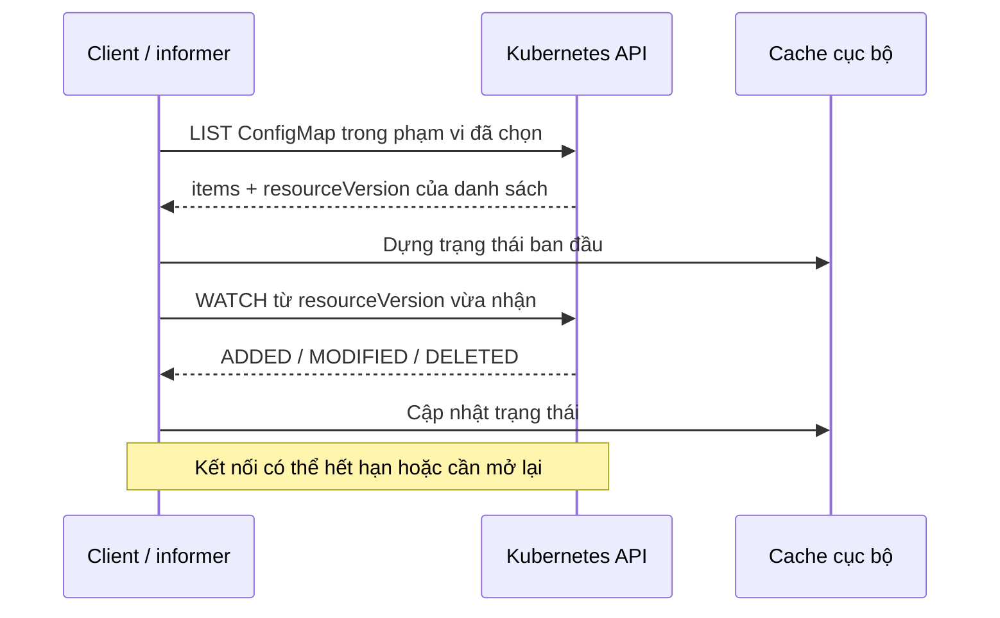

# Phân biệt các quyền get, list và watch

Trong chương **Phân quyền RBAC** của module **SPRING_CLOUD_KUBERNETES**, ba verb `get`, `list` và `watch` quyết định cách ứng dụng hoặc controller đọc Kubernetes API. Hiểu chúng giúp cấp đúng quyền cho DiscoveryClient, nguồn cấu hình ConfigMap/Secret và Configuration Watcher, đồng thời giải thích được các lỗi “khởi động được nhưng không nhận thay đổi”.

Bài học dùng ConfigMap làm đối tượng minh họa. Các khái niệm phân quyền áp dụng tương tự cho những resource khác, nhưng API group, phạm vi namespace, subresource và request thực tế vẫn phải được xác định riêng.

## 1. Ba verb RBAC khác nhau dù cùng dùng HTTP GET

| Verb RBAC | Ý định của request | Kết quả điển hình |
| --- | --- | --- |
| `get` | Đọc một đối tượng theo tên | Một ConfigMap |
| `list` | Đọc một tập đối tượng | ConfigMapList với mảng `items` |
| `watch` | Theo dõi đối tượng hoặc tập đối tượng theo thời gian | Luồng thông báo thay đổi |

Ví dụ đường dẫn:

```http
GET /api/v1/namespaces/rbac-lab/configmaps/orders-service

GET /api/v1/namespaces/rbac-lab/configmaps

GET /api/v1/namespaces/rbac-lab/configmaps?watch=true
```

Request thứ nhất cần `get`, request thứ hai cần `list`, request thứ ba cần `watch`. Không thể nhìn riêng phương thức HTTP GET rồi kết luận Role phải có verb `get`. Kubernetes ánh xạ request resource theo cả đường dẫn và kiểu thao tác; xem [Authorization](https://kubernetes.io/docs/reference/access-authn-authz/authorization/).

Các verb được cấp độc lập. Role có `get` không tự có `list/watch`; Role có `list/watch` cũng không tự được phép gọi request `get` một tên.

Tên lệnh CLI dễ gây nhầm:

```powershell
kubectl -n rbac-lab get configmap orders-service
kubectl -n rbac-lab get configmaps
kubectl -n rbac-lab get configmaps --watch
```

Dù đều có chữ `get`, các lệnh trên thực hiện các kiểu đọc khác nhau. `--watch` còn có bước đọc ban đầu rồi theo dõi. Xem mô tả `--watch`, `--watch-only` và `--raw` tại [kubectl get](https://kubernetes.io/docs/reference/kubectl/generated/kubectl_get/).

## 2. get: đọc một đối tượng đã biết tên

Giả sử ứng dụng orders biết chính xác nguồn cấu hình là `rbac-lab/orders-service`:

```http
GET /api/v1/namespaces/rbac-lab/configmaps/orders-service
```

Response rút gọn có dạng:

```json
{
  "apiVersion": "v1",
  "kind": "ConfigMap",
  "metadata": {
    "name": "orders-service",
    "namespace": "rbac-lab",
    "resourceVersion": "42010"
  },
  "data": {
    "app.config.revision": "cfg-1"
  }
}
```

Đây là một đối tượng, không có mảng `items`. Đường API đọc theo tên và đường đọc tập ConfigMap được mô tả trong [ConfigMap API](https://kubernetes.io/docs/reference/kubernetes-api/core/config-map-v1/).

Một phần rule cho phép đọc đúng tên này là:

```yaml
- apiGroups: [""]
  resources: ["configmaps"]
  resourceNames: ["orders-service"]
  verbs: ["get"]
```

Quyền `get` phù hợp khi ứng dụng đã biết tên và client thực sự gọi đường đọc từng tên. Nó không tự:

- Liệt kê các ConfigMap khác.
- Mở luồng nhận thay đổi.
- Cập nhật ConfigMap vừa đọc.
- Đọc cùng tên tại namespace khác.

Không nên đồng nhất “đã biết tên trong cấu hình Spring” với “thư viện chắc chắn gọi get”. Một implementation có thể đọc cả tập rồi chọn đối tượng trong bộ nhớ. Phần liên hệ Spring Cloud Kubernetes bên dưới sẽ làm rõ khác biệt này.

## 3. list: đọc tập đối tượng, không chỉ đọc tên

Request list không chứa tên đối tượng ở cuối đường dẫn:

```http
GET /api/v1/namespaces/rbac-lab/configmaps
```

Ví dụ response rút gọn:

```json
{
  "apiVersion": "v1",
  "kind": "ConfigMapList",
  "metadata": {
    "resourceVersion": "42020"
  },
  "items": [
    {
      "metadata": {
        "name": "orders-service",
        "namespace": "rbac-lab",
        "resourceVersion": "42010"
      },
      "data": {
        "app.config.revision": "cfg-1"
      }
    },
    {
      "metadata": {
        "name": "inventory-service",
        "namespace": "rbac-lab",
        "resourceVersion": "42012"
      },
      "data": {
        "app.config.revision": "inv-1"
      }
    }
  ]
}
```

Điểm cần quan sát là response chứa cả dữ liệu từng ConfigMap. Việc `kubectl` mặc định in một bảng ít cột là lựa chọn trình bày, không phải giới hạn dữ liệu của quyền list.

### Snapshot, phân trang và resourceVersion

Kết quả list biểu diễn một ảnh chụp của tập resource được truy vấn. Khi phân trang, client cần xử lý `metadata.continue` để lấy các phần tiếp theo; lấy trang đầu chưa chứng minh đã có toàn bộ tập.

`metadata.resourceVersion` của danh sách là mốc của tập được trả về. Khi xây dựng cache cho cả tập, cần dùng mốc danh sách để nối sang watch, thay vì tự chọn resourceVersion của một phần tử. Cấu trúc metadata và token tiếp tục được mô tả tại [ListMeta](https://kubernetes.io/docs/reference/kubernetes-api/definitions/list-meta-v1-meta/).

Các số resourceVersion trong bài chỉ là giá trị minh họa. Client phải coi chúng là chuỗi opaque và gửi lại theo giao thức, không tự cộng một, chuyển thành timestamp hay dùng làm số phiên bản nghiệp vụ. Xem [ObjectMeta](https://kubernetes.io/docs/reference/kubernetes-api/definitions/object-meta-v1-meta/).

### List một phần tử vẫn là list

Request sau có thể trả về một phần tử hoặc không có phần tử nào:

```http
GET /api/v1/namespaces/rbac-lab/configmaps?fieldSelector=metadata.name%3Dorders-service
```

Nó vẫn là request `list`, vì đang truy vấn một collection bằng bộ lọc. Số phần tử trong response không biến verb thành `get`.

Field selector `metadata.name` được Kubernetes hỗ trợ để chọn đối tượng theo tên; xem [Field Selectors](https://kubernetes.io/docs/concepts/overview/working-with-objects/field-selectors/).

## 4. watch: theo dõi một luồng thay đổi

Request watch có thể nối từ một mốc đã đọc:

```http
GET /api/v1/namespaces/rbac-lab/configmaps?watch=true&resourceVersion=42020&timeoutSeconds=45
```

Thay vì một ConfigMapList cố định, client đọc một chuỗi sự kiện. Ví dụ rút gọn:

```json
{
  "type": "MODIFIED",
  "object": {
    "apiVersion": "v1",
    "kind": "ConfigMap",
    "metadata": {
      "name": "orders-service",
      "namespace": "rbac-lab",
      "resourceVersion": "42031"
    },
    "data": {
      "app.config.revision": "cfg-2"
    }
  }
}
```

Các loại thông báo thường gặp:

| Loại | Cách hiểu khi xử lý |
| --- | --- |
| `ADDED` | Đối tượng xuất hiện trong tập được theo dõi; cũng có thể là sự kiện khởi tạo tùy chế độ |
| `MODIFIED` | Nhận trạng thái mới của đối tượng đã thay đổi |
| `DELETED` | Nhận thông tin đối tượng bị loại khỏi tập được theo dõi |
| `ERROR` | Luồng báo lỗi cần được client xử lý |
| `BOOKMARK` | Mốc tiến độ resourceVersion, không phải cấu hình nghiệp vụ mới |

Payload của `ADDED/MODIFIED` chứa trạng thái đối tượng, không chỉ một cặp “tên đối tượng + tên trường đã sửa”. Cấu trúc `type/object` được mô tả tại [WatchEvent](https://kubernetes.io/docs/reference/kubernetes-api/definitions/watch-event-v1-meta/).

Bookmark là khả năng của giao thức watch; client không nên giả định server gửi nó theo chu kỳ cố định. Các tham số `allowWatchBookmarks` và `timeoutSeconds` được mô tả trong [ConfigMap API](https://kubernetes.io/docs/reference/kubernetes-api/core/config-map-v1/).

Một luồng đang im lặng chưa có nghĩa bị lỗi: có thể chưa có thay đổi phù hợp. Ngược lại, việc mở được kết nối chưa chứng minh ứng dụng đã xử lý payload hoặc cập nhật bean.

## 5. Vì sao informer thường cần cả list và watch?

Một cache cần biết trạng thái hiện tại trước khi cập nhật theo những thay đổi tiếp theo. Luồng truyền thống là:



Mô hình này thể hiện rõ trong [Reflector của client-go](https://github.com/kubernetes/client-go/blob/v0.34.0/tools/cache/reflector.go). Đây là ví dụ về giao thức cache/informer, không phải khẳng định ứng dụng Spring dùng client Go.

Nếu chỉ cấp watch cho client vẫn thực hiện list ban đầu, client có thể thất bại trước khi mở được luồng. Nếu chỉ cấp list, cache có thể khởi tạo nhưng không cập nhật liên tục qua watch.

### Khôi phục sau khi mất kết nối

Watch không phải một kết nối tồn tại vô hạn. Khi mở lại, client cần giữ hoặc thiết lập lại mốc phù hợp. Nếu server không còn lịch sử mà client yêu cầu, có thể nhận `410 Gone`; client phải đồng bộ lại trạng thái trước khi tiếp tục.

Tài liệu [Kubernetes API Concepts](https://kubernetes.io/docs/reference/using-api/api-concepts/) mô tả cách xử lý lịch sử watch hết hạn bằng việc làm mới cache, đọc lại trạng thái và bắt đầu watch từ resourceVersion mới.

Trong thiết kế nghiệp vụ, nên coi sự kiện là tín hiệu để đối chiếu trạng thái mong muốn. Không dùng một lần nhận watch làm bảo đảm rằng một tác vụ có tác dụng phụ sẽ xảy ra đúng một lần.

### Có phải mọi watch đều luôn cần list?

Không. `watch` là một verb riêng; `list` cần khi đường client thực sự thực hiện list. Các phiên bản Kubernetes/client hỗ trợ streaming initial state có thể dùng watch với `sendInitialEvents` để khởi tạo trạng thái qua các sự kiện tổng hợp.

Cơ chế này được giới thiệu trong [Enhancing Kubernetes API Server Efficiency with API Streaming](https://kubernetes.io/blog/2024/12/17/kube-apiserver-api-streaming/). Khả năng sử dụng và fallback phụ thuộc phiên bản client/server. Không bỏ quyền list khỏi manifest của một thư viện chỉ vì cluster có tính năng streaming: cần xác nhận chính thư viện đang dùng đường nào.

## 6. Liên hệ trực tiếp với Spring Cloud Kubernetes

### 6.1. Nạp ConfigMap: tên nguồn chưa quyết định verb

Lấy **Spring Cloud Kubernetes 5.1.0, Kubernetes Java Client** làm mốc cho ví dụ cấu hình. Dependency của ứng dụng cần được quản lý bằng BOM/release train tương thích.

Trong đường đọc nguồn theo tên:

| Chế độ | Cách truy vấn ở implementation tham chiếu | Nhu cầu cần xét |
| --- | --- | --- |
| `SINGLE` | Đọc lần lượt từng tên | `get` những tên được đọc |
| `BATCH` | Đọc tập ConfigMap trong namespace rồi xử lý chọn nguồn | `list` trong phạm vi truy vấn |

Có thể đối chiếu lời gọi đọc theo tên ở [KubernetesClientSourcesSingleRead](https://github.com/spring-cloud/spring-cloud-kubernetes/blob/v5.1.0/spring-cloud-kubernetes-client-config/src/main/java/org/springframework/cloud/kubernetes/client/config/KubernetesClientSourcesSingleRead.java) và lời gọi đọc collection ở [KubernetesClientSourcesBatchRead](https://github.com/spring-cloud/spring-cloud-kubernetes/blob/v5.1.0/spring-cloud-kubernetes-client-config/src/main/java/org/springframework/cloud/kubernetes/client/config/KubernetesClientSourcesBatchRead.java).

Đoạn cấu hình minh họa lựa chọn nguồn:

```yaml
spring:
  application:
    name: orders-service
  config:
    import: "kubernetes:"
  cloud:
    kubernetes:
      config:
        namespace: rbac-lab
        name: orders-service
        read-type: SINGLE
        include-profile-specific-sources: false
      secrets:
        enabled: false
```

Đoạn này minh họa đường nạp cấu hình, không mô tả mọi chức năng khác của một ứng dụng hoàn chỉnh. Nếu discovery, health contributor hoặc logic tự viết cũng gọi API, phải tính thêm các request của chúng.

Lựa chọn `SINGLE/BATCH` và việc nạp nguồn theo profile được mô tả trong [Using a ConfigMap PropertySource](https://docs.spring.io/spring-cloud-kubernetes/reference/property-source-config/configmap-propertysource.html). Không áp một property mới vào image cũ mà chưa xác nhận phiên bản hỗ trợ.

### 6.2. Configuration Watcher và ứng dụng nhận thông báo

Watcher cần duy trì khả năng quan sát nguồn cấu hình; ứng dụng nhận thông báo cần khả năng đọc lại nguồn đã chọn. Hai tiến trình có thể dùng hai ServiceAccount và hai tập verb khác nhau:

```text
Configuration Watcher
    -> list/watch ConfigMap theo đường informer
    -> phát thông báo HTTP hoặc Bus

Ứng dụng orders
    -> nhận thông báo
    -> đọc lại ConfigMap bằng get nếu dùng nguồn SINGLE theo tên
       hoặc đọc lại file nếu cấu hình được mount
    -> áp dụng cơ chế refresh phù hợp
```

Đọc được ConfigMap trong ứng dụng không chứng minh watcher có quyền watch. Watcher nhận được thay đổi cũng không chứng minh ứng dụng có quyền đọc lại nguồn API. Xem vai trò controller trong [Configuration Watcher](https://docs.spring.io/spring-cloud-kubernetes/reference/spring-cloud-kubernetes-configuration-watcher.html).

Quyền theo dõi Kubernetes không tự bảo đảm refresh thành công. Cần xét tiếp việc chuyển thông báo, nguồn dữ liệu và cơ chế cập nhật trạng thái trong Spring.

### 6.3. DiscoveryClient và LoadBalancer

Lời gọi Java `DiscoveryClient.getInstances("inventory-service")` không có nghĩa request Kubernetes luôn mang verb `get`. Kết quả có thể đến từ cache được duy trì bằng list/watch hoặc từ đường truy vấn khác theo implementation.

Phạm vi namespace và kiểu DiscoveryClient được mô tả trong [DiscoveryClient for Kubernetes](https://docs.spring.io/spring-cloud-kubernetes/reference/discovery-client.html). Khi bật EndpointSlice, resource cần quan sát còn thuộc API group `discovery.k8s.io`; thay API group không làm ba verb trở thành một quyền chung.

LoadBalancer chế độ `POD` dựa vào DiscoveryClient; chế độ `SERVICE` vẫn có bước tìm Service. Vì vậy, cần xét request của đường triển khai thay vì suy ra quyền từ tên phương thức Java hoặc chế độ cân bằng tải. Xem [LoadBalancer for Kubernetes](https://docs.spring.io/spring-cloud-kubernetes/reference/load-balancer.html).

## 7. Quyền đọc độc lập không đồng nghĩa dữ liệu được che giấu

Xét một ServiceAccount chỉ có:

```yaml
- apiGroups: [""]
  resources: ["configmaps"]
  verbs: ["list", "watch"]
```

Danh tính này có thể bị từ chối khi gọi get trực tiếp một ConfigMap, nhưng vẫn đọc được ConfigMap ấy qua response list hoặc watch nằm trong phạm vi được cấp. Việc thiếu verb get không ngăn hai đường đọc còn lại.

Kubernetes lưu ý cả get, list và watch đều có thể trả về chi tiết đầy đủ của resource. Với Secret, list có thể làm lộ phần dữ liệu của các Secret được trả về; xem [Authorization](https://kubernetes.io/docs/reference/access-authn-authz/authorization/).

Base64 trong trường dữ liệu Secret không tạo thành ranh giới bảo mật cho một chủ thể đã đọc được response. Không cấp list/watch Secret chỉ để “xem tên” hoặc “biết rằng có thay đổi”; tham khảo [Secrets](https://kubernetes.io/docs/concepts/configuration/secret/).

Có hai câu hỏi cần kiểm tra riêng:

1. Request cụ thể có được cấp quyền không?
2. Danh tính còn đường đọc nào khác để lấy cùng dữ liệu?

Câu trả lời `no` cho một request chưa đủ để kết luận về toàn bộ dữ liệu mà danh tính có thể nhìn thấy.

## 8. Lab: hai danh tính với hai tập quyền đọc

Lab dưới đây chỉ dùng ConfigMap chứa dữ liệu minh họa. Giả định namespace `rbac-lab` đã tồn tại và người triển khai lab có quyền tạo các đối tượng được mô tả.

Tạo hai danh tính:

- `config-reader`: chỉ get ConfigMap `orders-service`.
- `config-observer`: list/watch ConfigMap trong namespace, không được cấp get trực tiếp.

### 8.1. Manifest

```yaml
apiVersion: v1
kind: ConfigMap
metadata:
  name: orders-service
  namespace: rbac-lab
data:
  app.config.revision: "cfg-1"
---
apiVersion: v1
kind: ConfigMap
metadata:
  name: inventory-service
  namespace: rbac-lab
data:
  app.config.revision: "inv-1"
---
apiVersion: v1
kind: ServiceAccount
metadata:
  name: config-reader
  namespace: rbac-lab
---
apiVersion: v1
kind: ServiceAccount
metadata:
  name: config-observer
  namespace: rbac-lab
---
apiVersion: rbac.authorization.k8s.io/v1
kind: Role
metadata:
  name: config-get-one
  namespace: rbac-lab
rules:
  - apiGroups: [""]
    resources: ["configmaps"]
    resourceNames: ["orders-service"]
    verbs: ["get"]
---
apiVersion: rbac.authorization.k8s.io/v1
kind: RoleBinding
metadata:
  name: config-get-one
  namespace: rbac-lab
subjects:
  - kind: ServiceAccount
    name: config-reader
    namespace: rbac-lab
roleRef:
  apiGroup: rbac.authorization.k8s.io
  kind: Role
  name: config-get-one
---
apiVersion: rbac.authorization.k8s.io/v1
kind: Role
metadata:
  name: config-list-watch
  namespace: rbac-lab
rules:
  - apiGroups: [""]
    resources: ["configmaps"]
    verbs: ["list", "watch"]
---
apiVersion: rbac.authorization.k8s.io/v1
kind: RoleBinding
metadata:
  name: config-list-watch
  namespace: rbac-lab
subjects:
  - kind: ServiceAccount
    name: config-observer
    namespace: rbac-lab
roleRef:
  apiGroup: rbac.authorization.k8s.io
  kind: Role
  name: config-list-watch
```

Role mô tả rule cho resource trong namespace; RoleBinding gắn tập rule vào ServiceAccount. Cấu trúc hai loại đối tượng được mô tả trong [Role API](https://kubernetes.io/docs/reference/kubernetes-api/rbac/role-v1/) và [RoleBinding API](https://kubernetes.io/docs/reference/kubernetes-api/rbac/role-binding-v1/).

Nếu lưu manifest thành `rbac-verbs-lab.yaml` trong môi trường lab, người triển khai có thể áp dụng bằng:

```powershell
kubectl apply -f .\rbac-verbs-lab.yaml
```

Các ServiceAccount đọc không cần được cấp quyền tạo Role hay RoleBinding để thực hiện chức năng của mình.

### 8.2. Kiểm tra quyền độc lập

Các lệnh dùng impersonation; người chạy phải có quyền dùng `--as` với danh tính tương ứng. Đây là quyền của người kiểm thử, không phải quyền cần thêm cho ứng dụng.

```powershell
$readerIdentity = "system:serviceaccount:rbac-lab:config-reader"
$observerIdentity = "system:serviceaccount:rbac-lab:config-observer"

kubectl auth can-i get configmaps/orders-service --as=$readerIdentity -n rbac-lab
kubectl auth can-i get configmaps/inventory-service --as=$readerIdentity -n rbac-lab
kubectl auth can-i list configmaps --as=$readerIdentity -n rbac-lab
kubectl auth can-i watch configmaps --as=$readerIdentity -n rbac-lab

kubectl auth can-i get configmaps/orders-service --as=$observerIdentity -n rbac-lab
kubectl auth can-i list configmaps --as=$observerIdentity -n rbac-lab
kubectl auth can-i watch configmaps --as=$observerIdentity -n rbac-lab

kubectl auth can-i list secrets --as=$observerIdentity -n rbac-lab
kubectl auth can-i patch configmaps/orders-service --as=$observerIdentity -n rbac-lab
```

Kỳ vọng nếu không có binding bổ sung cấp quyền:

| Request | config-reader | config-observer |
| --- | --- | --- |
| Get ConfigMap `orders-service` | yes | no |
| Get ConfigMap `inventory-service` | no | no |
| List ConfigMap trong `rbac-lab` | no | yes |
| Watch ConfigMap trong `rbac-lab` | no | yes |
| List Secret | no | no |
| Patch ConfigMap | no | no |

Cú pháp kiểm tra resource theo tên và impersonation được mô tả tại [kubectl auth can-i](https://kubernetes.io/docs/reference/kubectl/generated/kubectl_auth/kubectl_auth_can-i/).

Bảng này thể hiện tính độc lập của các verb. Nó không nói rằng observer không nhìn thấy dữ liệu orders: observer được cấp list và có thể nhận dữ liệu đó.

## 9. Quan sát request thật và luồng watch

### 9.1. Đọc một tên và đọc collection

Giữ các biến danh tính từ lab. Dùng `--raw` để yêu cầu đúng URI:

```powershell
kubectl --as=$readerIdentity get --raw "/api/v1/namespaces/rbac-lab/configmaps/orders-service"

kubectl --as=$readerIdentity get --raw "/api/v1/namespaces/rbac-lab/configmaps"

kubectl --as=$observerIdentity get --raw "/api/v1/namespaces/rbac-lab/configmaps/orders-service"

kubectl --as=$observerIdentity get --raw "/api/v1/namespaces/rbac-lab/configmaps"
```

Kỳ vọng lần lượt là: nhận ConfigMap orders, bị từ chối list, bị từ chối get trực tiếp, nhận danh sách chứa cả hai ConfigMap.

Không dùng credential quản trị viên mặc định rồi kết luận ứng dụng sẽ được phép. Danh tính mà API server kiểm tra phải đúng với danh tính của workload; cách Kubernetes quản lý danh tính ServiceAccount được mô tả trong [Managing Service Accounts](https://kubernetes.io/docs/reference/access-authn-authz/service-accounts-admin/).

### 9.2. List rồi watch từ mốc của danh sách

Trong terminal thứ nhất:

```powershell
$snapshot = kubectl --as=$observerIdentity get --raw "/api/v1/namespaces/rbac-lab/configmaps" | ConvertFrom-Json

$snapshot.items | Select-Object -ExpandProperty metadata | Select-Object name, resourceVersion

$watchResourceVersion = [uri]::EscapeDataString([string]$snapshot.metadata.resourceVersion)
$watchUri = "/api/v1/namespaces/rbac-lab/configmaps?watch=true&resourceVersion=$watchResourceVersion&timeoutSeconds=45"

kubectl --as=$observerIdentity get --raw $watchUri
```

Đợi luồng mở, rồi dùng terminal thứ hai với danh tính quản lý lab để sửa `app.config.revision` từ `cfg-1` thành `cfg-2`:

```powershell
kubectl -n rbac-lab edit configmap orders-service
```

Lưu thay đổi trong editor. Terminal watch dự kiến nhận thông báo `MODIFIED` với dữ liệu mới. Nếu 45 giây đã hết, mở lại luồng từ một snapshot mới để tiếp tục quan sát.

Lệnh sửa được thực hiện bằng danh tính quản lý lab vì reader và observer đều không có quyền ghi. Không cần cấp patch/update cho hai danh tính đọc chỉ để tạo dữ liệu thử nghiệm.

### 9.3. Đọc kết quả đúng phạm vi

Thông báo MODIFIED chứng minh client đã quan sát một thay đổi Kubernetes phù hợp. Lab này chưa chứng minh Spring Environment đã nạp lại nguồn hay bean nghiệp vụ đã dùng giá trị mới.

Nếu cần thử chuỗi refresh trong Spring, phải có ứng dụng nhận, cấu hình nguồn, đường thông báo và cơ chế cập nhật bean. Không suy diễn kết quả ở tầng API thành kết quả ở tầng nghiệp vụ.

## 10. Giới hạn list/watch bằng resourceNames

Nếu chỉ muốn observer theo dõi ConfigMap `orders-service`, có thể xem xét thay phần rule của Role `config-list-watch` bằng:

```yaml
rules:
  - apiGroups: [""]
    resources: ["configmaps"]
    resourceNames: ["orders-service"]
    verbs: ["list", "watch"]
```

Rule này không có nghĩa API server tự động cho phép list rộng rồi lặng lẽ lọc response. Khi dùng resourceNames cho list/watch, client phải gửi field selector `metadata.name` phù hợp. Điều kiện này được nêu trong [Using RBAC Authorization](https://kubernetes.io/docs/reference/access-authn-authz/rbac/).

Sau khi người quản lý lab áp dụng thay đổi rule, đối chiếu hai request:

```powershell
kubectl --as=$observerIdentity get --raw "/api/v1/namespaces/rbac-lab/configmaps"

kubectl --as=$observerIdentity get --raw "/api/v1/namespaces/rbac-lab/configmaps?fieldSelector=metadata.name%3Dorders-service"
```

Request đầu dự kiến bị từ chối. Request thứ hai có field selector phù hợp và có thể được cấp quyền list theo tên đã giới hạn.

Để tiếp tục watch, giữ cùng bộ lọc:

```powershell
$scopedSnapshot = kubectl --as=$observerIdentity get --raw "/api/v1/namespaces/rbac-lab/configmaps?fieldSelector=metadata.name%3Dorders-service" | ConvertFrom-Json

$scopedResourceVersion = [uri]::EscapeDataString([string]$scopedSnapshot.metadata.resourceVersion)
$scopedWatchUri = "/api/v1/namespaces/rbac-lab/configmaps?watch=true&fieldSelector=metadata.name%3Dorders-service&resourceVersion=$scopedResourceVersion&timeoutSeconds=45"

kubectl --as=$observerIdentity get --raw $scopedWatchUri
```

Không giả định một informer của Spring hoặc thư viện khác gửi được field selector theo cách này. Nếu thư viện khởi tạo informer để quan sát collection theo nhãn, rule giới hạn tên có thể không đáp ứng request ban đầu.

Label selector chọn resource để xử lý; nó không thay thế ranh giới quyền của RBAC. Muốn giới hạn dữ liệu theo nhóm vận hành, cần đánh giá cả namespace, danh tính và kiểu request mà implementation hỗ trợ.

## 11. Chẩn đoán theo verb bị từ chối

Hai thông báo sau dẫn đến hai hướng kiểm tra khác nhau:

```text
cannot list resource "configmaps" in API group ""
in the namespace "rbac-lab"
```

```text
cannot watch resource "configmaps" in API group ""
in the namespace "rbac-lab"
```

Thông báo đầu thường cần đối chiếu bước đọc collection: chế độ batch, đọc theo selector, khởi tạo informer hoặc đồng bộ lại. Thông báo sau cần đối chiếu bước mở luồng theo dõi.

| Biểu hiện | Kiểm tra có ích |
| --- | --- |
| Get một tên thành công nhưng startup vẫn lỗi list | Có đường batch hoặc bước list nào khác không? |
| Cache khởi tạo được rồi không đổi | Watch có được mở và xử lý không? |
| Watch hoạt động trước đó, sau restart lại lỗi | Bước đọc trạng thái ban đầu dùng verb gì? |
| Rule đã có list nhưng request vẫn Forbidden | Đúng danh tính, group API, resource, namespace và điều kiện tên chưa? |
| Get bị từ chối nhưng list trả về dữ liệu | Hai verb độc lập; list vẫn là đường đọc nội dung |
| Nhận `410 Gone` | Kiểm tra mốc watch và quá trình đồng bộ lại, không chữa bằng quyền ghi |
| Watch không có thông báo | Có thay đổi phù hợp sau mốc theo dõi, selector đúng và luồng còn mở không? |
| Watch có dữ liệu nhưng ứng dụng dùng cấu hình cũ | Kiểm tra bước refresh và cập nhật trạng thái Spring |

Với cache đang chạy lâu, một lời gọi Java thành công có thể chỉ đọc bộ nhớ. Khi thử phân quyền, cần quan sát cả giai đoạn khởi động, mở lại watch và đồng bộ lại sau gián đoạn.

Không thêm cả ba verb một cách máy móc sau mọi lỗi. Xác định request cần thiết trước, sau đó quyết định giữ chức năng, đổi cách truy vấn hoặc cấp thêm đúng quyền.

## 12. Chọn tập quyền từ hành vi cần có

Với ứng dụng đọc một ConfigMap theo tên lúc khởi động, đường `SINGLE` có thể chỉ cần get tên đó. Nếu chuyển sang đọc theo tập hoặc batch, phải xét list. Nếu thêm quan sát bằng informer truyền thống, phải xét cả list và watch; thêm get khi đường thực thi cũng đọc trực tiếp từng tên.

Các verb này phải đi cùng đúng resource, API group, namespace và danh tính. Chúng cũng không bao gồm quyền sửa Deployment, cập nhật ConfigMap hoặc quản lý RBAC.

Khi workload không cần tự gọi API, chẳng hạn chỉ đọc cấu hình được mount và gọi dịch vụ bằng DNS, không cần cấp quyền API chỉ để “đủ bộ get/list/watch”. Việc thu hẹp quyền và tránh wildcard là định hướng của [RBAC Good Practices](https://kubernetes.io/docs/concepts/security/rbac-good-practices/).

Một mô tả quyền rõ ràng cần nêu được: request nào dùng get, request nào dùng list, tiến trình nào giữ watch, cùng phạm vi dữ liệu mà mỗi đường đọc có thể trả về. Đây là căn cứ để chọn tính năng Spring Cloud Kubernetes thực sự cần cho triển khai.
