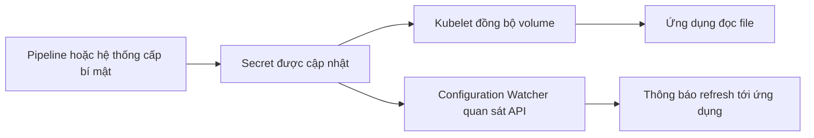

# Cấp quyền đọc Secret theo phạm vi cần thiết

Trong chương **Phân quyền RBAC** của module **SPRING_CLOUD_KUBERNETES**, quyền đọc Secret cần được thiết kế từ nhu cầu thực tế của ứng dụng. Một ứng dụng Spring cần mật khẩu cơ sở dữ liệu không đồng nghĩa với việc ServiceAccount của nó phải được đọc mọi Secret trong namespace.

Mục tiêu của bài học là xác định đúng danh tính, đường nhận dữ liệu, thao tác API và phạm vi tài nguyên; sau đó kiểm tra cả trường hợp được phép lẫn trường hợp phải bị từ chối. Cấu hình Spring chọn một nguồn Secret và chính sách Kubernetes cho phép đọc Secret là hai lớp riêng biệt.

## 1. Tình huống và kết quả cần đạt

Giả sử namespace `payments` có các Secret:

| Secret | Mục đích | Ứng dụng `orders-service` có cần không? |
| --- | --- | --- |
| `orders-db-auth` | Tài khoản cơ sở dữ liệu của ứng dụng đặt hàng | Có |
| `orders-migration-auth` | Tài khoản chạy migration với quyền cao hơn | Không |
| `payroll-db-auth` | Tài khoản của dịch vụ khác | Không |

Các Secret đã được cấp qua quy trình quản lý bí mật của môi trường thực hành. Không cần hiển thị hoặc sao chép giá trị của chúng để học RBAC.

Có hai kết quả triển khai hợp lý:

- **Dùng file được mount:** container nhận đúng các khóa cần thiết; ServiceAccount của ứng dụng không có quyền đọc Secret qua Kubernetes API.
- **Ứng dụng gọi API:** danh tính của ứng dụng chỉ được thực hiện thao tác cần thiết trong phạm vi đã chọn. Nếu client thực hiện GET theo tên, có thể giới hạn bằng `get` và `resourceNames`.

Không coi “ứng dụng khởi động được” là tiêu chí duy nhất. Bài thực hành còn phải chứng minh ứng dụng không thể đọc Secret của migration, Secret của dịch vụ khác hoặc Secret cùng tên trong namespace khác.

## 2. Viết nhu cầu thành một hợp đồng truy cập

Trước khi tạo Role, điền bảng sau cho từng thành phần:

| Câu hỏi | Ví dụ câu trả lời |
| --- | --- |
| Ai đọc? | ServiceAccount `orders-api` trong namespace `payments` |
| Đọc bằng cách nào? | Client gọi GET trực tiếp một đối tượng Secret |
| Đọc tài nguyên nào? | `secrets` thuộc core API group |
| Ở đâu? | Namespace `payments` |
| Tên nào? | `orders-db-auth` |
| Cần những thao tác gì? | Chỉ `get` ở thời điểm nạp cấu hình |
| Có cần theo dõi thay đổi không? | Chưa cần `list` hoặc `watch` |
| Bằng chứng nào xác nhận? | Kiểm tra quyền và request API thực tế của client |

Bảng này cũng giúp phân biệt ứng dụng nghiệp vụ, Configuration Watcher và pipeline triển khai. Chúng không nhất thiết cần cùng quyền, dù đều tham gia vào một luồng cập nhật cấu hình.

ServiceAccount được xác định bởi cả namespace lẫn tên. Danh tính của ví dụ API là:

```text
system:serviceaccount:payments:orders-api
```

`orders-api` trong namespace khác là một danh tính khác. Cấu hình `spring.application.name=orders-service` cũng không tự chọn ServiceAccount cho Pod. Xem [Service Accounts](https://kubernetes.io/docs/concepts/security/service-accounts/).

## 3. Hiểu đúng các quyền đọc Secret

| Verb | Loại yêu cầu điển hình | Phạm vi dữ liệu cần cân nhắc |
| --- | --- | --- |
| `get` | Đọc một Secret theo tên | Có thể nhận toàn bộ nội dung đối tượng đó |
| `list` | Liệt kê tập Secret | Phản hồi có thể chứa dữ liệu của các Secret, không chỉ tên |
| `watch` | Theo dõi các sự kiện của tập Secret | Sự kiện có thể mang nội dung đối tượng thay đổi |

`list` không phải một quyền nhẹ chỉ để biết Secret nào tồn tại. Kubernetes khuyến nghị hạn chế mạnh quyền đọc Secret, đặc biệt `list` và `watch`; xem [Good practices for Kubernetes Secrets](https://kubernetes.io/docs/concepts/security/secrets-good-practices/).

Ở mức HTTP, hai yêu cầu sau đều dùng phương thức GET nhưng có verb phân quyền khác nhau:

```text
GET /api/v1/namespaces/payments/secrets/orders-db-auth
    -> verb RBAC: get

GET /api/v1/namespaces/payments/secrets
    -> verb RBAC: list
```

Đừng suy quyền RBAC chỉ từ HTTP method. Một thư viện có thể dùng GET của collection để tìm Secret theo tên ở phía client; khi đó quyền `get` trên đối tượng riêng lẻ không đủ.

### Phạm vi đối tượng không phải phạm vi từng khóa

Một rule cho phép đọc `orders-db-auth` không chỉ cho phép `data.password`. RBAC tiêu chuẩn không cung cấp cơ chế đọc một khóa của Secret và che các khóa còn lại trong cùng đối tượng.

Nếu cùng một Secret chứa cả tài khoản ứng dụng và tài khoản quản trị cơ sở dữ liệu, việc thêm `resourceNames` vẫn để ứng dụng đọc cả hai. Thiết kế dữ liệu cần tách các nhóm bí mật theo chủ thể tiêu thụ và quyền của chúng.

Việc chỉ hiển thị `metadata.name` ở CLI cũng không tạo phân quyền theo trường. `kubectl get secret ... -o name` chỉ giảm dữ liệu in ra terminal; không thay đổi ý nghĩa của quyền API đã cấp.

## 4. Role tối thiểu cho client thực sự GET theo tên

Ví dụ dưới đây dành cho client đã được xác nhận gọi GET trực tiếp `orders-db-auth`. Đây là chính sách RBAC có phạm vi hẹp; nó không cam kết mọi phiên bản Secrets PropertySource của Spring Cloud Kubernetes đều dùng được với cùng tập verb.

Điều kiện thực hành: namespace `payments` đã tồn tại, người triển khai được phép quản lý ServiceAccount, Role và RoleBinding tương ứng. Secret được cấp riêng, không xuất hiện giá trị trong manifest RBAC.

```yaml
apiVersion: v1
kind: ServiceAccount
metadata:
  name: orders-api
  namespace: payments
---
apiVersion: rbac.authorization.k8s.io/v1
kind: Role
metadata:
  name: orders-db-secret-get
  namespace: payments
rules:
  - apiGroups: [""]
    resources: ["secrets"]
    resourceNames: ["orders-db-auth"]
    verbs: ["get"]
---
apiVersion: rbac.authorization.k8s.io/v1
kind: RoleBinding
metadata:
  name: orders-api-db-secret-get
  namespace: payments
subjects:
  - kind: ServiceAccount
    name: orders-api
    namespace: payments
roleRef:
  apiGroup: rbac.authorization.k8s.io
  kind: Role
  name: orders-db-secret-get
```

Trong Pod template của Deployment, chọn đúng danh tính:

```yaml
spec:
  template:
    spec:
      serviceAccountName: orders-api
```

Client dùng API cần cơ chế xác thực in-cluster phù hợp, thường là token được cấp cho ServiceAccount cùng CA của cluster. Không đưa token của người quản trị hoặc kubeconfig cá nhân vào image để làm ứng dụng vượt qua lỗi quyền.

Ý nghĩa các phần chính:

| Thành phần | Vai trò trong ví dụ |
| --- | --- |
| `apiGroups: [""]` | Secret thuộc core API group |
| `resources: ["secrets"]` | Tên tài nguyên dạng số nhiều mà API sử dụng |
| `resourceNames` | Danh sách tên đối tượng được phép đọc |
| `verbs: ["get"]` | Không tự thêm quyền liệt kê, theo dõi hoặc sửa |
| `Role.metadata.namespace` | Nơi chứa tài nguyên mà rule có hiệu lực |
| `RoleBinding.subjects` | Danh tính nhận quyền |
| `Pod.spec.serviceAccountName` | Danh tính mà workload thực sự sử dụng |

`resourceNames` là danh sách tên cụ thể, không phải biểu thức tiền tố. Không dùng `orders-*` để kỳ vọng khớp các Secret bắt đầu bằng `orders-`. Bỏ `resourceNames` hoặc dùng danh sách rỗng sẽ không còn giới hạn theo tên. Cơ chế Role, binding và giới hạn tên được mô tả trong [Using RBAC Authorization](https://kubernetes.io/docs/reference/access-authn-authz/rbac/).

### Một Role hẹp không thu hồi được quyền rộng đã có

Quyền RBAC được cộng từ các binding có hiệu lực; không có rule `deny` để ghi đè một rule `allow` khác. Nếu `orders-api` đã được cấp quyền đọc mọi Secret từ trước, thêm Role trên không thu hẹp quyền tổng hợp.

Vì vậy, một kết quả ngoài dự kiến trong bài kiểm tra từ chối cần dẫn tới việc tìm binding cũ, binding cho nhóm ServiceAccount hoặc ClusterRoleBinding liên quan. Chỉ nhìn manifest Role mới nhất không đủ để kết luận phạm vi hiệu lực.

## 5. Đối chiếu với cách Spring Cloud Kubernetes thực sự đọc Secret

Spring Cloud Kubernetes có thể đưa Secret vào Spring Environment qua Secrets PropertySource. Việc đọc Secret qua API mặc định không được bật; khi cần bật, vẫn phải giới hạn quyền ở Kubernetes. Tài liệu cũng trình bày lựa chọn chia sẻ bí mật qua volume mount. Xem [Secrets PropertySource](https://docs.spring.io/spring-cloud-kubernetes/reference/property-source-config/secrets-propertysource.html).

### 5.1. Chọn tên nguồn không đồng nghĩa với GET một đối tượng

Một cấu hình chọn nguồn API có thể có dạng sau, minh họa theo các thuộc tính của nhánh 3.3:

```yaml
spring:
  application:
    name: orders-service
  config:
    import: "kubernetes:"
  cloud:
    kubernetes:
      config:
        enabled: false
      discovery:
        enabled: false
      secrets:
        enabled: true
        enable-api: true
        namespace: payments
        name: orders-db-auth
        include-profile-specific-sources: false
        fail-fast: true
```

Đây là **cấu hình chọn dữ liệu**, không phải bằng chứng rằng ứng dụng chỉ có khả năng đọc đúng một Secret. Nó cũng không phải cấu hình hoàn chỉnh để ghép ngay với Role `get` ở phần 4.

Ở tag **Spring Cloud Kubernetes 3.3.3**, `KubernetesClientConfigUtils.secretsDataByName` lấy dữ liệu qua cache theo namespace rồi mới xử lý danh sách tên. Cache gọi `listNamespacedSecret` không có bộ lọc tên trong lời gọi đó. Vì vậy, với đường thực thi này, quyền GET theo tên không đáp ứng yêu cầu LIST. Có thể kiểm tra trực tiếp [KubernetesClientConfigUtils](https://raw.githubusercontent.com/spring-cloud/spring-cloud-kubernetes/v3.3.3/spring-cloud-kubernetes-client-config/src/main/java/org/springframework/cloud/kubernetes/client/config/KubernetesClientConfigUtils.java) và [KubernetesClientSecretsCache](https://raw.githubusercontent.com/spring-cloud/spring-cloud-kubernetes/v3.3.3/spring-cloud-kubernetes-client-config/src/main/java/org/springframework/cloud/kubernetes/client/config/KubernetesClientSecretsCache.java).

Biến thể Fabric8 tại cùng tag cũng có cache gọi `client.secrets().inNamespace(namespace).list()`. Đổi starter từ client này sang client khác không tự chứng minh phạm vi quyền đã hẹp hơn; xem [Fabric8SecretsCache 3.3.3](https://raw.githubusercontent.com/spring-cloud/spring-cloud-kubernetes/v3.3.3/spring-cloud-kubernetes-fabric8-config/src/main/java/org/springframework/cloud/kubernetes/fabric8/config/Fabric8SecretsCache.java).

Đây là nhận xét có phạm vi phiên bản cụ thể. Với release khác, cần đối chiếu đúng phiên bản thư viện, đường khởi tạo, cơ chế cache và request thực tế; không suy rằng mọi release đều có cùng cách đọc.

### 5.2. Không mở rộng quyền chỉ để hết lỗi khởi động

Nếu yêu cầu bảo mật là “ứng dụng chỉ được đọc một Secret”, nhưng implementation yêu cầu liệt kê toàn namespace, có các lựa chọn thiết kế:

| Lựa chọn | Điều cần chứng minh |
| --- | --- |
| Chuyển sang volume mount và `configtree:` | Ứng dụng đọc đúng file, không cần Secret API |
| Dùng client/adapter thực hiện GET theo tên | Không có LIST nền, kể cả lúc refresh và khởi động lại |
| Chọn cơ chế LIST/WATCH có field selector tương thích | Mọi request liên quan đều giữ giới hạn tên |
| Chấp nhận quyền đọc phạm vi namespace riêng cho ứng dụng | Namespace chỉ chứa nhóm bí mật được chấp thuận; Secret tạo mới trong đó cũng thuộc phạm vi cấp quyền |

Lựa chọn cuối là thay đổi mô hình phạm vi, cần được ghi rõ. Không mô tả nó thành “chỉ đọc một Secret” nếu tài khoản vẫn có khả năng liệt kê các Secret khác trong namespace.

`include-profile-specific-sources: false` giúp tránh lựa chọn thêm nguồn theo profile trong ví dụ; nó không chuyển một implementation LIST thành GET. `fail-fast: true` cũng không cấp quyền, mà yêu cầu xử lý nghiêm lỗi nạp nguồn theo cơ chế của release. Các thuộc tính được liệt kê trong [Common application properties 3.3](https://docs.spring.io/spring-cloud-kubernetes/reference/3.3/appendix.html).

Nếu credential bắt buộc không được nạp, ứng dụng không nên tiếp tục phục vụ bằng giá trị mặc định tùy tiện. Kết hợp kiểm tra cấu hình và readiness phù hợp với ứng dụng; đừng biến việc thiếu bí mật thành một lỗi âm thầm chỉ xuất hiện ở giao dịch đầu tiên.

## 6. Khi cần LIST hoặc WATCH có giới hạn tên

Chỉ thêm các verb này khi nhu cầu đã được xác định. Trong RBAC tiêu chuẩn, `resourceNames` có thể giới hạn LIST/WATCH nếu request gửi field selector `metadata.name` tương ứng. RBAC không tự lấy toàn bộ collection rồi lọc kết quả theo danh sách tên cho client.

Ví dụ rule thay thế để một client tương thích quan sát đúng một Secret:

```yaml
rules:
  - apiGroups: [""]
    resources: ["secrets"]
    resourceNames: ["orders-db-auth"]
    verbs: ["get", "list", "watch"]
```

Với rule này, request cần có dạng phù hợp, ví dụ:

```text
GET /api/v1/namespaces/payments/secrets?fieldSelector=metadata.name%3Dorders-db-auth

GET /api/v1/namespaces/payments/secrets?watch=true&fieldSelector=metadata.name%3Dorders-db-auth
```

Đây là điều kiện của request, không chỉ là cấu hình tên bên trong ứng dụng. Nếu thư viện tạo informer bằng LIST toàn namespace, sau đó mới lọc theo tên hoặc label trong bộ nhớ, nó vẫn không tương thích với rule trên.

Khi thử với CLI, sau khi có chính sách tương ứng và quyền kiểm tra danh tính, có thể quan sát bằng:

```powershell
kubectl -n payments get secrets --field-selector=metadata.name=orders-db-auth --watch -o name @identityArgs
```

Biến `identityArgs` được định nghĩa trong phần kiểm tra bên dưới. Dừng watch bằng Ctrl+C sau khi xác nhận. Lệnh này là minh họa một client có gửi selector, không chứng minh rằng client Spring của bạn gửi cùng request.

Nếu chỉ cần GET một lần khi startup, giữ rule `get` đơn giản thay vì thêm WATCH để dự phòng. Nếu có nhiều tên được phép, client có thể cần nhiều request theo tên; một LIST không giới hạn không tự được cho phép chỉ vì tất cả tên mong muốn đã xuất hiện trong `resourceNames`.

### Label và annotation không phải biên giới phân quyền Secret

Ví dụ `labels: {app: orders-service}` có thể giúp thư viện hoặc watcher tìm đúng nguồn. Tuy nhiên, RBAC thông thường không cho phép viết rule “chỉ đọc Secret mang label này”. Một tài khoản có LIST không giới hạn vẫn có thể chủ động gửi request không kèm label selector.

Không nhầm label selector dùng cho xử lý dữ liệu với ràng buộc tên được API server kiểm tra khi cấp quyền. Bộ lọc mà client tự chọn bỏ được không phải cam kết rằng client không có khả năng đọc dữ liệu khác.

## 7. Phương án không cấp Secret API cho ứng dụng: mount đúng dữ liệu

Khi ứng dụng chỉ cần credential ở thời điểm khởi động, dùng volume có thể đáp ứng yêu cầu mà không cấp `get`, `list`, `watch` Secret cho ServiceAccount của nó.

Ví dụ này là **phương án riêng** với ServiceAccount `orders-mounted`; không bind Role đọc Secret cho tài khoản này. Secret `orders-db-auth` trong namespace `payments` có các khóa `username` và `password` đã được cấp qua kênh quản lý bí mật.

```yaml
apiVersion: v1
kind: ServiceAccount
metadata:
  name: orders-mounted
  namespace: payments
automountServiceAccountToken: false
---
apiVersion: apps/v1
kind: Deployment
metadata:
  name: orders-mounted
  namespace: payments
spec:
  replicas: 1
  selector:
    matchLabels:
      app: orders-mounted
  template:
    metadata:
      labels:
        app: orders-mounted
    spec:
      serviceAccountName: orders-mounted
      automountServiceAccountToken: false
      containers:
        - name: app
          image: registry.example.com/training/orders-service:1.0.0
          volumeMounts:
            - name: db-auth
              mountPath: /run/secrets/orders
              readOnly: true
      volumes:
        - name: db-auth
          secret:
            secretName: orders-db-auth
            items:
              - key: username
                path: spring.datasource.username
              - key: password
                path: spring.datasource.password
```

Thay image minh họa bằng image ứng dụng của môi trường thực hành. Cấu hình đóng gói trong biến thể này:

```yaml
spring:
  application:
    name: orders-service
  config:
    import: "configtree:/run/secrets/orders/"
  cloud:
    kubernetes:
      config:
        enabled: false
      discovery:
        enabled: false
      secrets:
        enabled: false
        enable-api: false
```

Ở đây Spring Boot nạp configuration tree trực tiếp. Hai tên file trở thành thuộc tính `spring.datasource.username` và `spring.datasource.password`; không cần bật Secrets PropertySource để đọc cùng dữ liệu lần thứ hai. Cấu hình kết nối cơ sở dữ liệu còn lại và driver thuộc cấu hình riêng của ứng dụng. Xem [Externalized Configuration — configuration trees](https://docs.spring.io/spring-boot/reference/features/external-config.html).

Kubelet cấp volume Secret cho Pod theo cơ chế của nền tảng; ServiceAccount của tiến trình ứng dụng không cần quyền GET Secret chỉ để đọc file đã mount. Ngược lại, `automountServiceAccountToken: false` chỉ tắt tự động mount credential API của ServiceAccount, không thu hồi các RoleBinding đã cấp và không ngăn mount volume Secret được khai báo. Xem [Configure Service Accounts for Pods](https://kubernetes.io/docs/tasks/configure-pod-container/configure-service-account/).

Trong Pod có nhiều container, chỉ mount volume ở container cần dùng. `items` hạn chế khóa xuất hiện ở volume này; nó không phải phân quyền API theo khóa. Bảo vệ thêm quyền filesystem theo UID/GID của image, quyền sửa workload và quyền truy cập container.

Biến thể trên tắt discovery vì không dùng Kubernetes API trong ứng dụng. Nếu thực tế vẫn cần DiscoveryClient qua API, hãy cấu hình danh tính và quyền discovery phù hợp; việc đó vẫn không bắt buộc phải cấp quyền đọc Secret. Spring Cloud LoadBalancer cũng không tự tạo nhu cầu đọc credential của dịch vụ khác.

File Secret được đồng bộ không đồng nghĩa với việc connection pool hoặc bean Spring đã áp dụng credential mới. Trong ví dụ đọc lúc startup, chọn quy trình rollout khi rotation nếu chưa thiết kế cơ chế nạp lại an toàn.

## 8. Giới hạn namespace và truy cập chéo namespace

RoleBinding cấp quyền đối với tài nguyên namespaced tại namespace chứa binding. Nếu cần đọc một Secret ở namespace khác, đặt Role và RoleBinding tại **namespace chứa Secret**, rồi tham chiếu đúng ServiceAccount ở namespace nguồn.

Ví dụ tùy chọn: `orders-api` ở `payments` cần GET `partner-api-auth` ở `shared-config`. Hai namespace đã tồn tại và quyền này đã được xác định là cần thiết:

```yaml
apiVersion: rbac.authorization.k8s.io/v1
kind: Role
metadata:
  name: partner-secret-get
  namespace: shared-config
rules:
  - apiGroups: [""]
    resources: ["secrets"]
    resourceNames: ["partner-api-auth"]
    verbs: ["get"]
---
apiVersion: rbac.authorization.k8s.io/v1
kind: RoleBinding
metadata:
  name: orders-api-partner-secret-get
  namespace: shared-config
subjects:
  - kind: ServiceAccount
    name: orders-api
    namespace: payments
roleRef:
  apiGroup: rbac.authorization.k8s.io
  kind: Role
  name: partner-secret-get
```

Hai namespace trong ví dụ có ý nghĩa khác nhau: `metadata.namespace: shared-config` xác định nơi cấp quyền lên tài nguyên; `subjects[].namespace: payments` xác định danh tính nhận quyền. Client cũng phải chủ động gửi request đến namespace `shared-config`.

Một RoleBinding ở `payments` không khiến Role cùng tên tại `shared-config` tự được tham chiếu. Với `roleRef.kind: Role`, role được tham chiếu nằm cùng namespace với RoleBinding.

Có thể định nghĩa một ClusterRole để tái sử dụng rule rồi bind bằng RoleBinding ở từng namespace được chọn. Ngược lại, ClusterRoleBinding có thể mở rộng quyền namespaced ra toàn cluster. Ngay cả khi có `resourceNames`, tên Secret giống nhau trong nhiều namespace vẫn là nhiều đối tượng khác nhau; đừng dùng ClusterRoleBinding để tiết kiệm vài manifest mà vô tình cấp quyền mọi nơi.

Quyền API chéo namespace không làm cho `volumes[].secret.secretName` mount trực tiếp Secret ở namespace khác. Với cách mount, Secret được tham chiếu phải nằm cùng namespace với Pod. Nếu nền tảng đồng bộ bí mật sang namespace ứng dụng, controller đồng bộ phải có danh tính và phạm vi quyền riêng.

## 9. Kiểm tra cả quyền được cấp và quyền phải bị từ chối

Các lệnh dưới đây là hướng dẫn chạy trong cluster thực hành, không phải bằng chứng rằng một cluster cụ thể đã được kiểm tra. Người thực hiện cần được phép impersonate danh tính và nhóm được dùng. Nếu cluster hạn chế việc này, nhờ người vận hành kiểm tra bằng danh tính workload qua cơ chế được chấp thuận; không chuyển token quản trị cho ứng dụng.

### 9.1. Tạo tham số kiểm tra danh tính bằng PowerShell

Ví dụ cho tài khoản API của phần 4:

```powershell
$principal = 'system:serviceaccount:payments:orders-api'
$identityArgs = @(
    "--as=$principal"
    '--as-group=system:authenticated'
    '--as-group=system:serviceaccounts'
    '--as-group=system:serviceaccounts:payments'
)
```

Các nhóm được đưa vào để phát hiện cả quyền được cấp qua binding cho nhóm ServiceAccount. Việc impersonate nhóm cũng cần được cấp phép. Nếu bước impersonation hoặc truy vấn kiểm tra quyền bị từ chối, đó chưa phải kết luận về quyền đọc Secret của ứng dụng.

### 9.2. Kiểm tra ma trận của phương án GET theo tên

Với chỉ chính sách ở phần 4 và không có binding mở rộng, kết quả mong đợi là:

| Yêu cầu | Kết quả mong đợi |
| --- | --- |
| GET `payments/orders-db-auth` | `yes` |
| GET `payments/orders-migration-auth` | `no` |
| GET `payments/payroll-db-auth` | `no` |
| LIST Secret trong `payments` | `no` |
| WATCH Secret trong `payments` | `no` |
| PATCH `payments/orders-db-auth` | `no` |
| GET `analytics/orders-db-auth` | `no` |
| CREATE Pod trong `payments` | `no` với tài khoản chỉ cần đọc nguồn này |

Lệnh tương ứng:

```powershell
kubectl auth can-i get secrets/orders-db-auth -n payments @identityArgs
kubectl auth can-i get secrets/orders-migration-auth -n payments @identityArgs
kubectl auth can-i get secrets/payroll-db-auth -n payments @identityArgs
kubectl auth can-i list secrets -n payments @identityArgs
kubectl auth can-i watch secrets -n payments @identityArgs
kubectl auth can-i patch secrets/orders-db-auth -n payments @identityArgs
kubectl auth can-i get secrets/orders-db-auth -n analytics @identityArgs
kubectl auth can-i create pods -n payments @identityArgs
```

Nếu bạn đã chủ động thêm quyền LIST/WATCH giới hạn tên ở phần 6 hoặc quyền chéo namespace ở phần 8, lập ma trận riêng cho các thay đổi đó. LIST không kèm tên/selector vẫn không nên được cho phép chỉ vì có LIST có điều kiện theo tên.

`kubectl auth can-i` đánh giá khả năng được cấp quyền cho yêu cầu mô tả; không xác nhận Secret đã tồn tại, dữ liệu đúng hay đường mạng từ Pod hoạt động. Xem [kubectl auth can-i](https://kubernetes.io/docs/reference/kubectl/generated/kubectl_auth/kubectl_auth_can-i/).

### 9.3. Xác nhận request thực tế mà không in giá trị Secret

Sau kiểm tra quyền, thử GET đối tượng được phép, chỉ in tên:

```powershell
kubectl -n payments get secret orders-db-auth -o name @identityArgs
```

Kết quả mong đợi khi đối tượng tồn tại:

```text
secret/orders-db-auth
```

Thử đối tượng không được phép:

```powershell
kubectl -n payments get secret orders-migration-auth -o name @identityArgs
```

Kết quả mong đợi là `Forbidden`. Không cần dùng `-o yaml`, `-o json` hoặc decode `data` để xác minh RBAC. Nếu GET được cấp quyền nhưng nhận `NotFound`, cần kiểm tra tên/namespace và quy trình cấp Secret, thay vì mở rộng Role.

Sau đó chạy chính ứng dụng dưới danh tính của Pod và kiểm tra log lỗi đã loại bỏ dữ liệu nhạy cảm hoặc audit metadata. CLI có thể GET được trong khi Spring thất bại ở LIST; chính sự khác biệt đó cho thấy cần kiểm tra đường gọi API của thư viện.

Kiểm tra ServiceAccount của template và của Pod thực tế, thay `TEN_POD` bằng tên phù hợp:

```powershell
kubectl -n payments get deployment orders-service -o jsonpath='{.spec.template.spec.serviceAccountName}'
kubectl -n payments get pod TEN_POD -o jsonpath='{.spec.serviceAccountName}'
```

Sửa template không làm Pod cũ đổi ServiceAccount tại chỗ; cần Pod mới từ lần triển khai tương ứng. Đừng chỉ kiểm tra tên tài khoản trong manifest dự định áp dụng rồi bỏ qua workload đang chạy.

### 9.4. Điều tra quyền rộng ngoài dự kiến

Nếu kiểm tra âm tính trả `yes`, người có quyền quản trị phạm vi liên quan cần xem:

- RoleBinding cấp trực tiếp cho ServiceAccount.
- Binding cho nhóm `system:serviceaccounts:payments`, nhóm mọi ServiceAccount hoặc nhóm rộng khác.
- ClusterRoleBinding và các ClusterRole liên quan.
- Quyền gián tiếp qua khả năng tạo/sửa workload hoặc truy cập container.

Không cấp `edit`, `admin` hoặc `cluster-admin` chỉ để sửa một lỗi đọc Secret. Một Role “read-only” tự đặt tên vẫn có thể đọc toàn bộ bí mật nếu rule cho phép LIST Secret không giới hạn.

## 10. Tách quyền của ứng dụng và Configuration Watcher

Cập nhật cấu hình có thể có nhiều chủ thể khác nhau:



Trong kiến trúc này, ứng dụng đọc file có thể không cần Secret API, còn Watcher lại cần quyền quan sát nguồn. Chúng phải có ServiceAccount riêng và đánh giá quyền riêng.

| Thành phần | Phạm vi cần xem xét |
| --- | --- |
| Ứng dụng đọc volume | File/khóa được mount, container nhận volume, quyền filesystem |
| Ứng dụng chủ động GET Secret | Tên Secret, namespace, khả năng đọc lại khi cần |
| Configuration Watcher | Namespace quan sát, LIST/WATCH thực tế, discovery tài nguyên đích |
| Hệ thống cấp hoặc rotate Secret | Quyền ghi nguồn bí mật và quy trình bàn giao credential |
| Pipeline triển khai | Quyền sửa workload; không mặc nhiên chia sẻ cho ứng dụng |

Configuration Watcher có thể thông báo qua HTTP hoặc Spring Cloud Bus; cấu hình label và nguồn quan sát phụ thuộc release. Không suy rằng chỉ Secret được gắn label mới nằm trong khả năng đọc của tài khoản Watcher. Cần đối chiếu request của watcher và RBAC hiệu lực. Xem [Configuration Watcher](https://docs.spring.io/spring-cloud-kubernetes/reference/spring-cloud-kubernetes-configuration-watcher.html).

Với informer, xem cả request nạp danh sách ban đầu lẫn quá trình watch, reconnect và resync. Một phép thử GET thủ công thành công không xác nhận toàn bộ vòng đời watcher sẽ chạy.

Quyền HTTP gọi `/actuator/refresh` còn phụ thuộc cơ chế bảo vệ endpoint và kết nối mạng. RoleBinding cho Secret không cấp quyền HTTP đó. Tương tự, DiscoveryClient cần quyền đọc tài nguyên discovery tương ứng, không mặc nhiên cần quyền đọc Secret; Spring Cloud LoadBalancer không phải lý do để gộp Secret vào một Role đọc chung.

## 11. Giới hạn các đường truy cập gián tiếp và bảo vệ dữ liệu sau khi đọc

### 11.1. Quyền sửa workload có thể vượt qua kiểm tra GET trực tiếp

Một danh tính không được GET Secret nhưng được tạo Pod dùng Secret có thể tiếp cận dữ liệu qua workload đó. Quyền sửa Deployment để thêm volume, thay image, chạy container phụ hoặc chọn ServiceAccount mạnh hơn cũng cần được kiểm soát theo chính sách nền tảng.

Vì vậy, ma trận Secret là cần thiết nhưng không đại diện cho toàn bộ biên giới bảo mật. Đánh giá thêm quyền tạo/sửa workload, `pods/exec`, container debug và quyền của tài khoản pipeline. Kubernetes trình bày các nguy cơ này trong [RBAC good practices](https://kubernetes.io/docs/concepts/security/rbac-good-practices/).

Không gộp tài khoản migration, tài khoản ứng dụng và tài khoản watcher chỉ để giảm số ServiceAccount. Chúng có nhu cầu dữ liệu và vòng đời khác nhau; tách danh tính làm cho phạm vi cấp quyền và việc thu hồi rõ hơn.

### 11.2. Thu hồi quyền không xóa dữ liệu đã được đọc

Bỏ RoleBinding có thể chặn các yêu cầu API tiếp theo theo chính sách còn hiệu lực, nhưng không xóa mật khẩu khỏi bộ nhớ ứng dụng, không tự unmount volume và không tự đóng kết nối cơ sở dữ liệu đã được xác thực.

Khi cần thu hồi khả năng sử dụng credential, phải phối hợp với hệ thống đích để rotate hoặc vô hiệu credential, xử lý các Pod/client còn giữ dữ liệu cũ và kiểm tra mọi binding liên quan. Không dùng kết quả `can-i no` như bằng chứng rằng credential đã hết hiệu lực ở cơ sở dữ liệu.

Nếu Secret có tên theo phiên bản, chẳng hạn `orders-db-auth-r2`, cập nhật cả tham chiếu dữ liệu và allowlist tên theo quy trình triển khai. Trong cửa sổ chuyển tiếp có thể cần cho phép cả tên cũ/mới; sau khi hội tụ thì gỡ tên cũ. Đừng bỏ hẳn `resourceNames` chỉ để tránh phải quản lý rotation.

### 11.3. Audit bằng metadata, không sao chép payload bí mật

Để kiểm tra phạm vi, thông tin thường cần là danh tính gọi, verb, namespace, tên tài nguyên, URI/selector và mã phản hồi. Chính sách audit cần tránh ghi request/response body chứa Secret.

Ví dụ rule để người quản trị tích hợp vào audit policy hiện có, đặt trước các rule rộng có thể khớp cùng request:

```yaml
rules:
  - level: Metadata
    resources:
      - group: ""
        resources: ["secrets"]
```

Đây là một rule minh họa, không phải toàn bộ audit policy cho cluster. Thứ tự và mức audit cần được xem trong chính sách tổng thể; xem [Kubernetes Auditing](https://kubernetes.io/docs/tasks/debug/debug-cluster/audit/).

Ở phía ứng dụng, không log token ServiceAccount, dữ liệu Secret đã decode hoặc giá trị credential khi bind thuộc tính. Việc sanitize endpoint Spring và hạn chế exposure vẫn cần được cấu hình; base64 trong trường `data` không phải mã hóa bảo mật. Quyền đọc có phạm vi hẹp không ngăn được ứng dụng tự làm lộ bí mật mà nó đã nhận.

## 12. Chẩn đoán theo loại lỗi

| Hiện tượng | Nguyên nhân cần xác minh | Hướng xử lý |
| --- | --- | --- |
| `Unauthorized` khi gọi API | Token, audience, thời hạn hoặc cơ chế xác thực | Sửa xác thực; không thêm verb để chữa lỗi token |
| `Forbidden` với verb `get` | Sai danh tính, namespace, tên Secret hoặc thiếu binding | Đối chiếu hợp đồng truy cập và Pod thực tế |
| GET CLI được nhưng Spring báo `cannot list secrets` | Client dùng đường LIST | Kiểm tra release/implementation, chọn cơ chế cấp dữ liệu phù hợp |
| LIST/WATCH có tên vẫn bị từ chối | Request không mang field selector đúng hoặc còn LIST nền không giới hạn | Kiểm tra request thực tế, không bỏ allowlist theo phản xạ |
| `can-i yes` nhưng GET `NotFound` | Tên/namespace sai hoặc Secret chưa được cấp | Sửa nguồn cấp và tham chiếu |
| Pod mount thất bại nhưng API Role đúng | Secret/khóa được mount không tồn tại, sai namespace hoặc lỗi nền tảng | Xem event mount; quyền API của app không giải quyết mọi lỗi volume |
| Ứng dụng đọc được Secret ngoài danh sách | Binding khác đang cấp thêm quyền | Điều tra quyền tổng hợp rồi thu hẹp đúng binding |
| Volume đổi nhưng kết nối vẫn dùng credential cũ | Client/pool giữ giá trị lúc khởi tạo | Thực hiện cơ chế cập nhật hoặc rollout đã được thiết kế |

## 13. Bằng chứng hoàn thành của một chính sách đọc Secret

Một cấu hình có thể bàn giao khi có đủ các bằng chứng sau:

1. Xác định ServiceAccount trên Pod đang chạy, không chỉ trên template dự kiến.
2. Ghi rõ đường cấp dữ liệu: API theo tên, LIST/WATCH có điều kiện hoặc volume/configtree.
3. Có kiểm tra dương tính cho đúng nguồn cần dùng và kiểm tra âm tính với tên, namespace, verb ngoài phạm vi.
4. Đối chiếu hành vi client ở đúng release, bao gồm startup và các lần nạp lại nếu sử dụng.
5. Kiểm soát quyền workload và các binding khác có thể mở rộng khả năng truy cập.
6. Có quy trình rotation/thu hồi và quan sát lỗi mà không xuất nội dung bí mật.

Với tình huống trong bài, nếu `orders-service` chỉ cần credential khi startup thì mount đúng khóa vào đúng container là một lựa chọn trực tiếp để tránh Secret API cho ứng dụng. Khi có nhu cầu API thực sự, quyền phải khớp request mà client gửi; mục tiêu là khả năng truy cập thực tế có phạm vi rõ ràng, được kiểm chứng bằng cả kết quả cho phép và từ chối.
