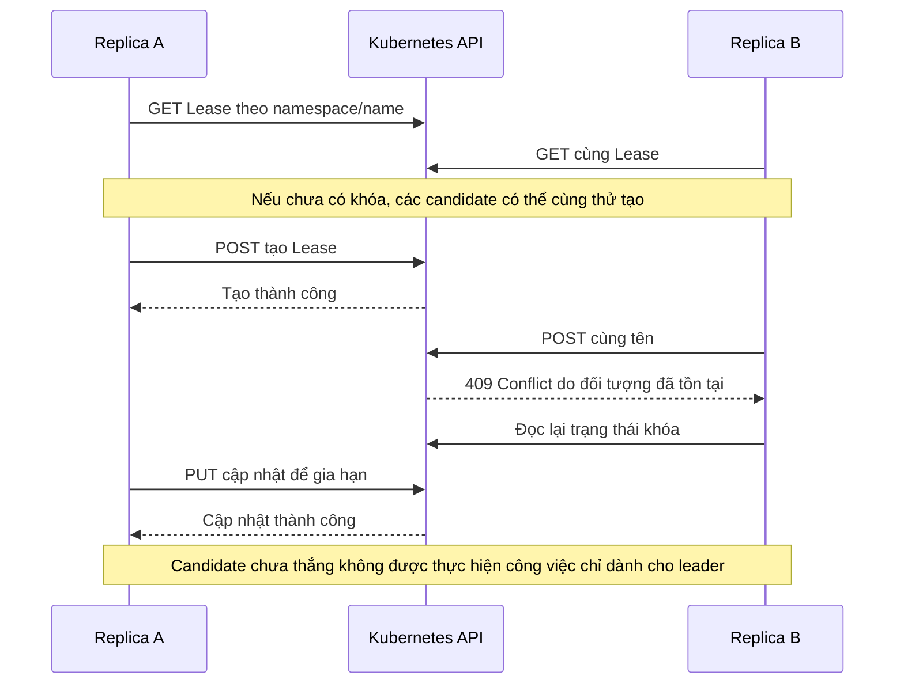

# Quyền ghi cần thiết cho cơ chế leader election

## Mục tiêu và phạm vi

Trong chương **Phân quyền RBAC** của module **SPRING_CLOUD_KUBERNETES**, leader election là một trường hợp cần quyền ghi Kubernetes API dù chức năng chính của ứng dụng có thể chỉ là đọc cấu hình hoặc phát thông báo refresh. Các replica cần một nơi lưu trạng thái phối hợp để quyết định replica nào được thực hiện công việc dành cho leader.

Sau bài học, bạn có thể:

- Xác định implementation đang dùng khóa `Lease` hay `ConfigMap` trước khi cấp quyền.
- Phân biệt quyền đọc khóa, tạo khóa lần đầu, chiếm khóa và gia hạn quyền lãnh đạo.
- Viết Role/RoleBinding theo namespace và giới hạn tên đối tượng cho các thao tác phù hợp.
- Chọn giữa ứng dụng tự tạo khóa và pipeline tạo sẵn khóa.
- Kiểm tra cả quyền được cấp lẫn quyền phải bị từ chối, đồng thời kiểm chứng failover thực tế.

Ví dụ chính có hai replica Configuration Watcher dùng ServiceAccount `config-watcher` trong namespace `watcher-system`. Hai replica dùng chung một `Lease` tên `config-watcher-lock` tại namespace riêng `watcher-locks`. Các ConfigMap nghiệp vụ nằm ở `shop-apps`.

Bài chỉ thiết kế phần quyền phục vụ leader election. Quyền đọc nguồn cấu hình, discovery, theo dõi trạng thái Pod, gọi HTTP refresh và truy cập broker được đánh giá riêng theo các tính năng đã bật. Việc dùng DiscoveryClient, Spring Cloud LoadBalancer hoặc đọc ConfigMap không tự động có nghĩa mọi ứng dụng đều cần bật leader election.

## 1. Vì sao quyền chỉ đọc chưa đủ?

Giả sử hai replica A và B cùng đọc một bản ghi cho biết chưa có leader. Nếu chúng chỉ đọc mà không có bước ghi có kiểm soát cạnh tranh, cả hai đều có thể tự cho rằng mình được chạy công việc.

Một luồng khóa dựa trên Lease thường gồm:

1. Đọc bản ghi hiện tại.
2. Nếu chưa có đối tượng khóa, thử tạo đối tượng.
3. Nếu có thể chiếm khóa, ghi danh tính holder và trạng thái liên quan bằng cơ chế kiểm soát phiên của API.
4. Khi đang làm leader, tiếp tục ghi để gia hạn.
5. Khi không gia hạn được theo điều kiện của client, dừng công việc leader và để một candidate khác tham gia tranh quyền.



Sơ đồ minh họa một tình huống khởi động; client có thể tổ chức retry và bước đọc khác nhau. Điều cần rút ra về RBAC là quyền ghi phục vụ **trạng thái phối hợp**, không phải quyền sửa cấu hình nghiệp vụ hoặc thay đổi Deployment.

Kubernetes biểu diễn Lease bằng tài nguyên thuộc API group `coordination.k8s.io`. Lease được dùng cho các nhu cầu phối hợp, bao gồm leader election. [Kubernetes: Leases](https://kubernetes.io/docs/concepts/architecture/leases/).

## 2. Chốt implementation và loại khóa trước

Không lấy một Role từ bài hướng dẫn của một phiên bản khác rồi giả định mọi cơ chế Spring Cloud Kubernetes leader election dùng cùng API.

| Trường hợp | Đối tượng khóa cần xác định | Hệ quả về quyền ghi |
| --- | --- | --- |
| Implementation Fabric8 kiểu cũ qua `spring-cloud-kubernetes-fabric8-leader` | ConfigMap | Quyền ghi áp dụng cho core resource `configmaps` |
| Native leader election được bật trong phiên bản có hỗ trợ | Lease hoặc ConfigMap theo client/cấu hình/khả năng cụm | Cấp quyền đúng loại khóa thực sự được sử dụng |
| Configuration Watcher HA trong phiên bản có tính năng này | Kiểm tra native election và loại khóa của image | Quyền khóa bổ sung cho quyền đọc nguồn và discovery |
| Tính năng không sử dụng leader election | Không có khóa cho tính năng đó | Không cấp thêm quyền ghi vì một khả năng chưa dùng |

Tài liệu Spring phân biệt implementation ConfigMap cũ với native leader election, cùng các thuộc tính chọn khóa và namespace. Kiểm tra tài liệu tương ứng với release train/image đang triển khai. [Spring Cloud Kubernetes: Leader Election](https://docs.spring.io/spring-cloud-kubernetes/reference/leader-election.html).

Trước khi viết Role, ghi lại một hợp đồng triển khai:

```text
implementation: native election, dùng Lease
lock API: coordination.k8s.io/v1
lock namespace: watcher-locks
lock name: config-watcher-lock
runtime identity: system:serviceaccount:watcher-system:config-watcher
bootstrap policy: runtime tự tạo nếu khóa chưa tồn tại
write operation: create khi thiếu; update khi chiếm/gia hạn
```

Đây là profile của ví dụ, không phải metadata mặc định do framework sinh ra. Đối chiếu nó với dependency, cấu hình hiệu lực và request API của phiên bản thực tế. Đặc biệt, không cấp cả quyền ghi ConfigMap lẫn Lease chỉ để tránh tìm hiểu implementation.

## 3. Ánh xạ thao tác API sang verb RBAC

Bảng dưới mô tả profile Lease đọc theo tên và cập nhật bằng PUT:

| Hành động | Request API điển hình | Verb RBAC | Vai trò trong vòng đời |
| --- | --- | --- | --- |
| Đọc khóa hiện có | GET đối tượng Lease theo tên | `get` | Nhận diện holder và trạng thái hiện tại |
| Tạo khóa khi chưa có | POST tới collection Lease của namespace | `create` | Khởi tạo khóa lúc bootstrap hoặc phục hồi khi khóa bị mất |
| Chiếm/gia hạn khóa đã có | PUT đối tượng Lease theo tên | `update` | Ghi trạng thái cạnh tranh và gia hạn |
| Sửa một phần bằng PATCH | PATCH đối tượng Lease | `patch` | Chỉ cần nếu client thực sự dùng đường PATCH |
| Liệt kê hoặc theo dõi collection | GET collection hoặc watch | `list`, `watch` | Chỉ cần nếu implementation thực hiện các request này |
| Xóa khóa | DELETE đối tượng Lease | `delete` | Không thuộc profile đọc/tạo/cập nhật đang xét |

Một ví dụ cụ thể là `LeaseLock` của Kubernetes Java client: đọc qua `readNamespacedLease`, tạo qua `createNamespacedLease`, cập nhật qua `replaceNamespacedLease`. Đây là căn cứ cho ba verb `get`, `create`, `update` của profile, không phải lý do cấp `patch` theo thói quen. [Mã nguồn Kubernetes Java client: LeaseLock](https://github.com/kubernetes-client/java/blob/master/extended/src/main/java/io/kubernetes/client/extended/leaderelection/resourcelock/LeaseLock.java).

Cần đọc đúng ba chi tiết:

- `update` và `patch` là hai quyền độc lập. Cấp một quyền không tự cấp quyền còn lại.
- `watch` không phải thao tác gia hạn khóa. Gia hạn có ghi thay đổi, nên chỉ `get/list/watch` không đủ.
- Dữ liệu Lease thông thường nằm trong `spec`; không suy ra cần quyền trên `leases/status` chỉ vì đang cập nhật trạng thái lãnh đạo theo nghĩa nghiệp vụ.

Đối tượng Lease còn tồn tại không có nghĩa holder vẫn giữ quyền hợp lệ. Hết thời hạn của một lượt giữ khóa không có nghĩa Kubernetes tự xóa đối tượng Lease. Vì vậy, không thêm `delete` chỉ để candidate khác có thể tranh quyền sau khi leader ngừng gia hạn.

## 4. Tách quyền đọc nghiệp vụ khỏi quyền ghi khóa

Trong ví dụ có ba phạm vi:

```text
watcher-system
  ServiceAccount và các Pod Configuration Watcher

watcher-locks
  Lease config-watcher-lock
  Role/RoleBinding phục vụ leader election

shop-apps
  ConfigMap/Secret và tài nguyên discovery của ứng dụng
  Các Role/RoleBinding đọc tương ứng với tính năng được bật
```

Danh tính của một Pod không thay đổi chỉ vì nó đọc hoặc ghi sang namespace khác. RoleBinding phải nằm tại nơi cấp quyền đối với tài nguyên đích; subject vẫn trỏ tới ServiceAccount thật của Pod.

Thiết kế mong đợi:

| Nhóm tài nguyên | Quyền liên quan đến bài này |
| --- | --- |
| Lease khóa trong `watcher-locks` | Được đọc/tạo/cập nhật theo phương án đã chọn |
| Lease khác đã tồn tại trong `watcher-locks` | Không được cập nhật bằng rule giới hạn tên |
| ConfigMap nghiệp vụ trong `shop-apps` | Có thể cần đọc theo chức năng Watcher; không được ghi vì leader election |
| Secret nghiệp vụ | Không cấp quyền ghi; quyền đọc chỉ khi tính năng thực sự cần |
| Deployment, Pod và RBAC object | Không cấp quyền ghi vì leader election |
| Khóa của controller hệ thống ở namespace khác | Không được tác động |

Quyền tối thiểu nên được giới hạn theo tài nguyên, namespace và danh tính; tránh wildcard và các binding quản trị rộng. [Kubernetes: RBAC good practices](https://kubernetes.io/docs/concepts/security/rbac-good-practices/).

Nếu không cần namespace khóa riêng, có thể đặt Lease trong `watcher-system`. Khi đó phải đổi đồng bộ namespace trong cấu hình khóa, Role, RoleBinding và các phép kiểm tra; không để chúng lệch nhau.

## 5. Phương án A: runtime tự tạo Lease

Giả định `watcher-system` và `watcher-locks` đã được bộ phận nền tảng tạo sẵn. Runtime không cần quyền tạo Namespace.

### 5.1. ServiceAccount riêng

```yaml
apiVersion: v1
kind: ServiceAccount
metadata:
  name: config-watcher
  namespace: watcher-system
```

Pod phải thực sự dùng:

```yaml
spec:
  serviceAccountName: config-watcher
```

Đoạn trên là phần trích Pod specification, không phải manifest hoàn chỉnh. Client cần credential hợp lệ để gọi API; Role không thay thế token, CA hoặc cấu hình kết nối.

### 5.2. Role giới hạn các lần đọc/cập nhật theo tên

```yaml
apiVersion: rbac.authorization.k8s.io/v1
kind: Role
metadata:
  name: config-watcher-lock-writer
  namespace: watcher-locks
rules:
  - apiGroups: ["coordination.k8s.io"]
    resources: ["leases"]
    resourceNames: ["config-watcher-lock"]
    verbs: ["get", "update"]
  - apiGroups: ["coordination.k8s.io"]
    resources: ["leases"]
    verbs: ["create"]
```

Tại sao tách hai rule? Đường đọc/cập nhật có tên đối tượng nên có thể giới hạn bằng `resourceNames`; top-level `create` không thể được giới hạn theo tên bằng cơ chế này. Không gắn `resourceNames` vào rule `create` rồi coi đó là giới hạn tên có hiệu lực. [Kubernetes RBAC: giới hạn theo tên tài nguyên](https://kubernetes.io/docs/reference/access-authn-authz/rbac/#referring-to-resources).

Hệ quả phải được chấp nhận rõ: ServiceAccount có thể tạo Lease với tên khác trong `watcher-locks`, dù không được rule này cấp quyền đọc/cập nhật những Lease khác đó. Namespace riêng giúp thu hẹp ảnh hưởng của quyền tạo; nó không biến `create` thành quyền chỉ tạo một tên.

Nếu yêu cầu bảo mật bắt buộc chỉ được tạo đúng một tên, cần phương án tạo sẵn hoặc chính sách admission phù hợp do nền tảng quản lý. Không mô tả một Role RBAC thuần túy như thể nó có điều kiện lọc `metadata.name` của request tạo.

### 5.3. RoleBinding đúng nơi đặt khóa

```yaml
apiVersion: rbac.authorization.k8s.io/v1
kind: RoleBinding
metadata:
  name: config-watcher-lock-writer
  namespace: watcher-locks
subjects:
  - kind: ServiceAccount
    name: config-watcher
    namespace: watcher-system
roleRef:
  apiGroup: rbac.authorization.k8s.io
  kind: Role
  name: config-watcher-lock-writer
```

Role và RoleBinding cùng nằm trong `watcher-locks`; ServiceAccount nằm trong `watcher-system`. Nếu bỏ sai namespace của subject hoặc chỉ tạo binding ở namespace Pod, quyền với Lease đích có thể không được cấp như mong đợi.

### 5.4. Cấu hình native election khớp quyền

Ở phiên bản có hỗ trợ các thuộc tính này, cấu hình phần leader election của profile:

```properties
spring.cloud.kubernetes.leader.election.enabled=true
spring.cloud.kubernetes.leader.election.lock-name=config-watcher-lock
spring.cloud.kubernetes.leader.election.lock-namespace=watcher-locks
spring.cloud.kubernetes.leader.election.use-config-map-as-lock=false
```

Ví dụ giả định cụm và client hỗ trợ Lease và đường khóa thực tế được xác nhận là Lease. Đối chiếu tên thuộc tính với phiên bản đang dùng, không trộn `leader.config-map-name` của implementation cũ với `leader.election.lock-name` của native implementation.

Đối với Configuration Watcher, bật riêng chế độ HA trong phiên bản có hỗ trợ:

```properties
spring.cloud.kubernetes.configuration.watcher.ha.enabled=true
```

Tài liệu Watcher nêu rằng HA bật native leader election; chỉ bật native election mà chưa bật Watcher HA không tự chuyển Watcher sang chế độ HA. Quyền Lease được hướng dẫn cho HA gồm `get`, `create`, `update`. [Configuration Watcher: High Availability](https://docs.spring.io/spring-cloud-kubernetes/reference/spring-cloud-kubernetes-configuration-watcher.html#high-availability).

Hai replica phải dùng cùng namespace, cùng loại và cùng tên khóa để thuộc một nhóm bầu chọn. Các nhóm công việc độc lập cần tên khóa riêng; không tái dùng tên khóa giữa các môi trường chỉ vì cùng ServiceAccount.

## 6. Phương án B: pipeline tạo sẵn khóa, runtime không được tạo

Khi cần bỏ quyền tạo Lease khỏi runtime, pipeline hoặc quản trị viên tạo khóa trước khi chạy các candidate. Role runtime chỉ cho đọc/cập nhật đúng đối tượng.

### 6.1. Khởi tạo đối tượng bằng danh tính triển khai

Ví dụ một Lease chưa có bản ghi leader:

```yaml
apiVersion: coordination.k8s.io/v1
kind: Lease
metadata:
  name: config-watcher-lock
  namespace: watcher-locks
spec: {}
```

Manifest rỗng phần `spec` là đối tượng ban đầu cho client hỗ trợ chiếm khóa bằng cập nhật. `LeaderElector` của Kubernetes Java client có đường xử lý bản ghi khóa rỗng bằng thao tác update. Phải kiểm chứng hành vi tương ứng ở client/version triển khai. [Mã nguồn Kubernetes Java client: LeaderElector](https://github.com/kubernetes-client/java/blob/master/extended/src/main/java/io/kubernetes/client/extended/leaderelection/LeaderElector.java).

Chỉ khởi tạo khi chưa có đối tượng. Pipeline không liên tục áp lại `spec: {}` lên khóa đang hoạt động; trạng thái holder và gia hạn phải do client election quản lý. Cũng cần kiểm tra cơ chế dọn dẹp/owner reference để khóa không vô tình biến mất khi một Pod hoặc một release bị xóa.

### 6.2. Role runtime thay thế phương án A

```yaml
apiVersion: rbac.authorization.k8s.io/v1
kind: Role
metadata:
  name: config-watcher-lock-writer
  namespace: watcher-locks
rules:
  - apiGroups: ["coordination.k8s.io"]
    resources: ["leases"]
    resourceNames: ["config-watcher-lock"]
    verbs: ["get", "update"]
```

Giữ RoleBinding như phương án A. Đây là **Role thay thế**; không giữ một binding khác vẫn cấp `create` rồi cho rằng runtime đã mất quyền tạo.

Phân chia trách nhiệm:

| Danh tính | Trách nhiệm |
| --- | --- |
| Pipeline/nền tảng | Bảo đảm namespace, khóa ban đầu và RBAC có trước khi ứng dụng tham gia election |
| Runtime candidate | Đọc khóa và ghi cập nhật cạnh tranh/gia hạn vào đúng tên |
| Quy trình phục hồi | Tạo lại khóa nếu mất, hoặc phục hồi theo thiết kế đã được duyệt |

Phương án B đánh đổi khả năng tự phục hồi khi khóa bị xóa. Nếu khóa không tồn tại, client có thể nhận `404` khi đọc rồi `403` khi thử tạo. Đó là hệ quả dự kiến của chính sách, không phải lý do âm thầm thêm quyền quản trị cho runtime.

## 7. Nếu implementation dùng ConfigMap

Core ConfigMap dùng API group rỗng `""`, không phải `coordination.k8s.io`. Một rule cho profile ConfigMap đã tạo sẵn và client cập nhật bằng PUT có thể là:

```yaml
rules:
  - apiGroups: [""]
    resources: ["configmaps"]
    resourceNames: ["pricing-leader-lock"]
    verbs: ["get", "update"]
```

Đây chỉ là phần `rules` minh họa cho Role ở namespace khóa tương ứng, không thay thế Role Lease của luồng chính. Nếu client phải tự tạo ConfigMap, đánh giá riêng quyền `create` và giới hạn của nó. Nếu client dùng PATCH, xác minh và cấp `patch` đúng đối tượng.

Trong implementation Fabric8 kiểu cũ được tham chiếu, controller đọc ConfigMap theo tên, tạo khi cần, cập nhật với `resourceVersion`, đồng thời kiểm tra trạng thái Pod. Vì vậy, phần quyền khóa không nhất thiết là toàn bộ quyền để implementation hoạt động. [Mã nguồn Spring Cloud Kubernetes: Fabric8LeadershipController](https://github.com/spring-cloud/spring-cloud-kubernetes/blob/main/spring-cloud-kubernetes-fabric8-leader/src/main/java/org/springframework/cloud/kubernetes/fabric8/leader/Fabric8LeadershipController.java).

Các điều cần giữ:

- Dùng ConfigMap dành riêng cho khóa; không dùng ConfigMap chứa `application.yaml` hoặc thông số nghiệp vụ làm nơi ghi trạng thái election.
- Nếu nhiều vai trò cùng lưu dưới các key trong một ConfigMap, `resourceNames` chỉ giới hạn đối tượng, không giới hạn từng key `data`. Những vai trò đó vẫn chung một phạm vi quyền ghi.
- Phân biệt namespace của khóa với nơi client tra Pod readiness. Không suy ra chỉ cần quyền đọc Pod trong namespace khóa nếu Pod thực sự chạy ở namespace khác.
- Quyền `list/watch` bổ sung phải xuất phát từ request của client/informer, không phải từ tên chức năng leader election. Khi giới hạn `list/watch` theo `resourceNames`, request cần field selector tương thích; label selector không thay thế điều kiện này.

Như vậy, lựa chọn Lease hay ConfigMap không chỉ là đổi một tên resource trong YAML; nó có thể đi cùng implementation, thuộc tính cấu hình và các thao tác hỗ trợ khác nhau.

## 8. Kiểm tra authorization cho đúng danh tính

Các lệnh bên dưới dùng cú pháp Bash, dành cho người vận hành được phép kiểm tra trong môi trường thực hành. Chúng kiểm tra quyết định authorization, không sửa dữ liệu khóa.

### 8.1. Kiểm tra ServiceAccount gắn vào Pod

```bash
kubectl -n watcher-system get pod <watcher-pod-name> \
  -o jsonpath='{.spec.serviceAccountName}{"\n"}'
```

Kết quả mong đợi là `config-watcher`. Kiểm tra cấu hình hiệu lực và log để xác nhận khóa thật sự nằm tại `watcher-locks/config-watcher-lock` và dùng Lease.

### 8.2. Mô phỏng danh tính cùng các nhóm ServiceAccount thông thường

```bash
leader_identity=(
  --as=system:serviceaccount:watcher-system:config-watcher
  --as-group=system:serviceaccounts
  --as-group=system:serviceaccounts:watcher-system
  --as-group=system:authenticated
)
```

Người chạy cần quyền impersonate danh tính và các nhóm này. Nếu chính lệnh impersonation bị từ chối, chưa thể kết luận ServiceAccount thiếu quyền Lease. Với hệ thống có nhóm/danh tính bổ sung, đối chiếu credential runtime thật để có kết quả đầy đủ.

Các phép kiểm tra dương tính cho cả hai phương án:

```bash
kubectl auth can-i get leases.coordination.k8s.io/config-watcher-lock \
  -n watcher-locks "${leader_identity[@]}"

kubectl auth can-i update leases.coordination.k8s.io/config-watcher-lock \
  -n watcher-locks "${leader_identity[@]}"
```

Mong đợi `yes`. Kiểm tra riêng quyền tạo collection:

```bash
kubectl auth can-i create leases.coordination.k8s.io \
  -n watcher-locks "${leader_identity[@]}"
```

Phương án A mong đợi `yes`, phương án B mong đợi `no`. Không dùng phép kiểm tra tạo theo tên để chứng minh một giới hạn top-level `create` mà RBAC không hỗ trợ.

`kubectl auth can-i` hỗ trợ kiểm tra verb/resource và impersonation; nó không thực hiện toàn bộ đường xử lý admission hoặc thử thuật toán election. [Tài liệu kubectl auth can-i](https://kubernetes.io/docs/reference/kubectl/generated/kubectl_auth/kubectl_auth_can-i/).

### 8.3. Kiểm tra quyền không nên có

```bash
kubectl auth can-i update leases.coordination.k8s.io/another-lock \
  -n watcher-locks "${leader_identity[@]}"

kubectl auth can-i delete leases.coordination.k8s.io/config-watcher-lock \
  -n watcher-locks "${leader_identity[@]}"

kubectl auth can-i update configmaps/pricing-service \
  -n shop-apps "${leader_identity[@]}"

kubectl auth can-i update secrets/example-credential \
  -n shop-apps "${leader_identity[@]}"

kubectl auth can-i patch deployments.apps/pricing-service \
  -n shop-apps "${leader_identity[@]}"
```

Trong profile chỉ có các quyền đã thiết kế, tất cả mong đợi `no`. Nếu kiểm tra ra `yes`, tìm các quyền hiệu lực khác đang được cấp; một Role hẹp không thu hồi quyền đến từ binding rộng hơn. RBAC cộng dồn các quyền được cho phép, không có rule deny để Role này phủ định Role khác. [Kubernetes RBAC: Role và ClusterRole](https://kubernetes.io/docs/reference/access-authn-authz/rbac/#role-and-clusterrole).

Không dùng tài khoản quản trị của người vận hành gọi `kubectl get lease` rồi kết luận ứng dụng đọc được Lease. Đó là hai danh tính khác nhau.

## 9. Kiểm chứng vòng đời, không chỉ kiểm tra can-i

`yes` với authorization là điều kiện cần, nhưng chưa chứng minh credential đúng, admission chấp nhận request, kết nối API ổn định hoặc callback leader điều khiển công việc đúng.

### 9.1. Quan sát khóa bằng danh tính vận hành

```bash
kubectl -n watcher-locks get lease config-watcher-lock \
  -o jsonpath='{.spec.holderIdentity}{"\t"}{.spec.renewTime}{"\t"}{.spec.leaseTransitions}{"\n"}'
```

Lấy nhiều mẫu hoặc dùng công cụ theo dõi được cấp quyền. Danh tính dùng để quan sát có thể cần thêm `watch`; điều đó không chứng minh runtime phải có `watch` nếu runtime chỉ đọc theo tên.

Đối chiếu holder với log và danh tính candidate của đúng client; không giả định mọi implementation luôn dùng nguyên tên Pod làm `holderIdentity`. Xác nhận gia hạn tiến triển trong nhiều chu kỳ, không chỉ chụp một đối tượng vừa được tạo.

### 9.2. Ma trận thực hành

| Tình huống trong môi trường cô lập | Bằng chứng mong đợi |
| --- | --- |
| Hai candidate, chưa có Lease, phương án A | Một candidate tạo/chiếm được khóa; candidate còn lại theo dõi/tranh quyền đúng thuật toán |
| Hai candidate, Lease đã được tạo sẵn, phương án B | Chiếm và gia hạn qua update; runtime không cần create để chạy đường này |
| Chỉ có `get`, thiếu quyền ghi | Không hoàn thành chiếm/gia hạn; log chỉ rõ thao tác bị từ chối |
| Có `create` nhưng thiếu `update` | Có thể vượt qua tạo khóa ban đầu nhưng không duy trì được vòng cập nhật |
| Khóa vắng mặt, phương án B | Không tự tạo; quy trình phục hồi chịu trách nhiệm bổ sung khóa |
| Leader ngừng hoạt động có kiểm soát | Candidate còn lại có cơ hội tiếp quản theo điều kiện thời gian và thuật toán |
| API có độ trễ hoặc bị gián đoạn | Theo dõi mất/gia hạn leadership và việc dừng công việc, không chỉ Pod còn chạy |
| Hai replica cấu hình khác tên/namespace khóa | Có thể thành hai nhóm bầu chọn riêng; sửa cấu hình, không mở rộng quyền |

Để thử failover, chỉ tác động lên leader của môi trường thực hành đã được phép và ghi lại Pod/UID, thời điểm ngừng gia hạn, thời điểm candidate khác bắt đầu công việc. Không thử bằng cách xóa Lease đang hoạt động trên hệ thống dùng chung: xóa khóa thay đổi điều kiện phối hợp và không tương đương với việc leader chết.

Nếu muốn chứng minh phương án B xử lý mất khóa thế nào, làm phép thử riêng trong môi trường cô lập và có sẵn quy trình khôi phục. Không trộn việc vận hành bình thường với thử nghiệm phá trạng thái khóa.

## 10. Chẩn đoán lỗi mà không cấp quyền dư

Một thông báo cần được đọc theo đủ thành phần:

```text
user: system:serviceaccount:watcher-system:config-watcher
verb: update
apiGroup: coordination.k8s.io
resource: leases
namespace: watcher-locks
name: config-watcher-lock
```

Đây là bản ghi minh họa các trường cần thu thập, không phải định dạng log mặc định. Khi có audit log, dùng nó để kiểm tra request thực tế; không ghi token ServiceAccount vào log chẩn đoán.

| Triệu chứng | Khả năng cần phân biệt | Bước xử lý |
| --- | --- | --- |
| 401 Unauthorized | Credential không được xác thực | Kiểm tra token, audience, CA và cách client nạp credential |
| 403 khi `get leases` | Sai subject, namespace, loại khóa hoặc thiếu quyền đọc | So request thực với Role/RoleBinding |
| 404 khi đọc rồi 403 khi tạo | Khóa chưa có, runtime không được create | Đối chiếu phương án bootstrap đã chọn |
| Tạo khóa được nhưng renew bị 403 | Thiếu `update` hoặc client dùng `patch` | Xác nhận HTTP method/verb thật trước khi sửa Role |
| 403 khi đọc Pod | Quyền hỗ trợ readiness hoặc implementation khác với giả định | Đánh giá quyền Pod riêng, không thêm quyền ghi Pod |
| 409 Conflict khi tạo | Candidate khác đã tạo cùng tên | Client đọc lại/retry theo thuật toán; không chữa bằng quyền rộng hơn |
| 409 Conflict khi cập nhật | Phiên đối tượng đã thay đổi do cạnh tranh | Kiểm tra logic retry và kiểm soát phiên; không tắt kiểm soát cạnh tranh |
| `can-i` cho phép nhưng request vẫn bị từ chối | Credential khác, admission, chính sách bổ sung | Đối chiếu người gọi, lý do từ chối và request thật |
| Timeout hoặc lỗi TLS | Kết nối hoặc xác thực kênh API | Kiểm tra mạng, chứng thư và độ trễ; RBAC không sửa lỗi đường truyền |
| Không thấy request election | Tính năng chưa bật hoặc sai implementation | Kiểm tra cấu hình hiệu lực và lifecycle của thành phần |
| Hai luồng công việc cùng chạy | Sai nhóm khóa, công việc chưa gắn leadership hoặc mất quyền chưa dừng tác vụ | Kiểm tra khóa và hành vi ứng dụng; không mặc định do thiếu RBAC |

Không cấp wildcard `verbs: ["*"]`, `resources: ["*"]` để bỏ qua chẩn đoán. Cũng không dùng ClusterRoleBinding toàn cụm chỉ vì ServiceAccount và Lease nằm ở hai namespace khác nhau.

Một lưu ý với việc thử thu hồi quyền: nếu mọi candidate dùng chung ServiceAccount, đổi Role hoặc binding sẽ ảnh hưởng tất cả chúng. Đừng kỳ vọng replica còn lại vẫn có thể failover nếu chính nó cũng vừa mất quyền ghi khóa.

## 11. Quyền khóa không bảo đảm mọi tác vụ chỉ chạy một lần

RBAC trả lời ai được gọi API để đọc/ghi khóa; thuật toán election trả lời candidate nào đang được xem là leader. Cả hai không tự bảo đảm một request nghiệp vụ đã chạy sẽ được hủy ngay khi leader mất kết nối hoặc dừng gia hạn.

Ví dụ: A đã gửi một tác vụ ra dịch vụ ngoài rồi bị treo; B được bầu và gửi lại cùng tác vụ. Cần cơ chế ứng dụng như idempotency key, kiểm soát cạnh tranh ở nơi lưu dữ liệu hoặc fencing phù hợp để bảo vệ tác dụng phụ. Tài liệu client-go cũng phân biệt leader election với bảo đảm fencing; đây là nguyên tắc thiết kế phân tán, không phải chỉ thị thay Java client bằng Go. [Kubernetes client-go: leader election và fencing](https://pkg.go.dev/k8s.io/client-go/tools/leaderelection).

Từ đó có ba yêu cầu triển khai:

- Chỉ khởi động công việc dành riêng cho leader khi thực sự nhận quyền lãnh đạo theo API của implementation đang dùng.
- Khi mất quyền, dừng nhận công việc mới và xử lý tác vụ đang chạy theo chính sách đã thiết kế.
- Xem các candidate được cấp quyền ghi cùng khóa là cùng một miền tin cậy. Quyền `update` cho phép sửa đối tượng khóa, không phải chỉ sửa duy nhất `renewTime` bằng một quy tắc tự hiểu trong RBAC.

Với Configuration Watcher, ngoài chuyện replica nào đang chủ động theo dõi, vẫn phải kiểm chứng thông báo tới đúng ứng dụng và cấu hình thực sự có hiệu lực. Một Lease được gia hạn đều không chứng minh refresh của ứng dụng đích thành công.

## 12. Bài luyện tập và tiêu chí hoàn thành

Trong môi trường thực hành, thiết kế hai bộ quyền ứng với phương án A và B. Với mỗi bộ:

1. Ghi rõ implementation, phiên bản, loại khóa, namespace, tên khóa và danh tính runtime.
2. Giải thích từng verb được cấp bằng request API cụ thể.
3. Chạy các phép kiểm tra dương tính và âm tính bằng danh tính phù hợp.
4. Quan sát nhiều vòng gia hạn và một lần chuyển leader có kiểm soát.
5. Giải thích hệ thống làm gì khi khóa không tồn tại.
6. Chứng minh runtime không được ghi ConfigMap/Secret nghiệp vụ hoặc sửa Deployment chỉ nhờ quyền leader election.

Một bản thiết kế đạt yêu cầu phải trả lời được:

| Câu hỏi | Điều cần có trong câu trả lời |
| --- | --- |
| Ai tạo khóa lần đầu? | Runtime hoặc pipeline, được chọn rõ |
| Ai khôi phục khi khóa mất? | Quy trình có người chịu trách nhiệm và quyền tương ứng |
| Vì sao có `update`? | Chiếm/gia hạn hoặc giải phóng theo đúng client |
| Có cần `patch`, `list`, `watch`, `delete` không? | Bằng chứng request của phiên bản đang chạy, không suy từ tên tính năng |
| `resourceNames` bảo vệ được gì? | Giới hạn các thao tác theo tên phù hợp; không hạn chế top-level create |
| Quyền ghi áp dụng tới đâu? | Đúng namespace và đối tượng khóa; không kéo sang cấu hình nghiệp vụ |
| Thế nào là failover thành công? | Leader mới bắt đầu đúng công việc, leader cũ dừng theo chính sách, có bằng chứng thời gian và danh tính |

Điểm cốt lõi là cấp quyền ghi cho đúng trạng thái phối hợp mà client thực sự sử dụng, đồng thời giữ quyền ghi cấu hình và workload ở ngoài phạm vi runtime. Từ hợp đồng đó mới quyết định cần `create`, chỉ `get/update`, hay thêm một verb cụ thể đã được chứng minh bởi implementation.
