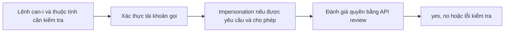

# Kiểm tra quyền bằng kubectl auth can-i

## Mục tiêu bài học

Trong chương Phân quyền RBAC của module Spring Cloud Kubernetes, bài này hướng dẫn biến một lỗi truy cập Kubernetes API thành các phép kiểm tra quyền cụ thể, có thể lặp lại.

Sau bài học, bạn có thể:

- Kiểm tra đúng danh tính của ứng dụng hoặc Configuration Watcher.
- Chọn đúng verb, loại tài nguyên, API group, namespace và subresource.
- Phân biệt quyền được phép, quyền bị từ chối và phép kiểm tra gặp lỗi.
- Xây dựng ma trận quyền cần có và quyền cần bị từ chối cho từng tính năng.
- Dùng kết quả kiểm tra để sửa quyền tối thiểu, rồi xác nhận bằng yêu cầu thực tế.

Các lệnh minh họa dùng PowerShell. Các thao tác tạo hoặc sửa RBAC chỉ phục vụ môi trường lab; những lệnh `can-i` tự chúng không thực hiện hành động nghiệp vụ đang được hỏi.

## 1. Lệnh này trả lời câu hỏi nào?

Cú pháp cơ bản:

```text
kubectl auth can-i VERB TYPE [-n NAMESPACE]
kubectl auth can-i VERB TYPE/NAME [-n NAMESPACE]
```

Ví dụ:

```powershell
kubectl auth can-i list configmaps -n sck-auth-lab
kubectl auth can-i get configmaps/orders-api -n sck-auth-lab
```

Lệnh hỏi API server liệu danh tính của yêu cầu có được thực hiện thao tác đã mô tả hay không. Kết quả thường là `yes` hoặc `no`. Có thể thêm `--as` để kiểm tra dưới danh tính được phép impersonate. [Tài liệu kubectl auth can-i](https://kubernetes.io/docs/reference/kubectl/generated/kubectl_auth/kubectl_auth_can-i/)

Ví dụ câu hỏi đầy đủ:

```text
ServiceAccount orders-api ở namespace sck-auth-lab
có được list configmaps thuộc core API group
trong namespace sck-auth-lab hay không?
```

Một câu hỏi chỉ có giá trị khi các thành phần đều đúng:

| Thành phần | Giá trị ví dụ | Sai sót thường gặp |
| --- | --- | --- |
| Cluster/context | Cluster lab đã chọn | Kiểm tra nhầm môi trường |
| Danh tính | `system:serviceaccount:sck-auth-lab:orders-api` | Dùng tài khoản quản trị hiện tại |
| Verb | `list` | Kiểm tra `get` trong khi client đang `watch` |
| Tài nguyên và group | `configmaps`, core group | Nhầm loại tài nguyên hoặc API group |
| Namespace | `sck-auth-lab` | Dùng namespace mặc định từ kubeconfig |
| Tên/subresource nếu có | `orders-api`, hoặc `log` | Bỏ tên khi Role giới hạn theo tên |

Không nên kết luận “ứng dụng có quyền” từ một phép kiểm tra khác với yêu cầu ứng dụng thực sự gửi.

### Cơ chế phía API server

Ở chế độ kiểm tra một hành động, `kubectl` sử dụng `SelfSubjectAccessReview`. Đây là yêu cầu đánh giá quyền của danh tính hiện hành, với các thuộc tính tài nguyên hoặc đường dẫn phi tài nguyên. [SelfSubjectAccessReview API](https://kubernetes.io/docs/reference/kubernetes-api/definitions/self-subject-access-review-v1-authorization/)



Review không đọc ConfigMap đích, không mở luồng watch và không thử chạy toàn bộ ứng dụng Spring. `can-i delete configmaps` cũng không xóa ConfigMap.

## 2. Chọn đúng cluster và danh tính

### 2.1. Xác nhận context trước

```powershell
kubectl config current-context
kubectl config view --minify
```

Khi làm việc với nhiều cluster, có thể chỉ định context trực tiếp:

```powershell
kubectl --context=TEN_CONTEXT_LAB auth can-i list configmaps -n sck-auth-lab
```

Thay `TEN_CONTEXT_LAB` bằng context thực tế. Giữ cùng context trong toàn bộ lượt kiểm tra và lúc đọc lại đối tượng RBAC.

Không cần dùng `kubectl config view --raw` hoặc in token để kiểm tra tên context. Báo cáo kết quả nên ghi rõ context và thời điểm vì quyền có thể thay đổi sau đó.

### 2.2. Kiểm tra tài khoản hiện tại và ServiceAccount là hai việc khác nhau

```powershell
# Hỏi quyền của tài khoản trong kubeconfig hiện tại.
kubectl auth can-i list configmaps -n sck-auth-lab

# Hỏi dưới danh tính ServiceAccount, khi người thao tác được phép impersonate.
kubectl auth can-i list configmaps -n sck-auth-lab `
    --as=system:serviceaccount:sck-auth-lab:orders-api
```

Nếu tài khoản hiện tại là quản trị viên, dòng đầu trả `yes` không chứng minh ứng dụng được phép làm việc đó.

Với workload đang chạy, xem danh tính từ Pod:

```powershell
kubectl -n sck-auth-lab get pods -l app=orders-api `
    -o 'custom-columns=NAME:.metadata.name,SERVICEACCOUNT:.spec.serviceAccountName'
```

Không lấy tên Deployment làm ServiceAccount theo suy đoán. Nếu Pod dùng `default`, cần kiểm tra đúng danh tính đó hoặc sửa Pod template theo thiết kế. `serviceAccountName` thuộc cấu hình Pod; RoleBinding chỉ có tác dụng cho subject đã được chỉ định. [Cấu hình ServiceAccount cho Pod](https://kubernetes.io/docs/tasks/configure-pod-container/configure-service-account/)

### 2.3. Impersonation có điều kiện riêng

`--as` không phải cách bỏ qua bảo mật. API server trước hết phải cho phép người thao tác impersonate danh tính yêu cầu.

Ví dụ lỗi:

```text
Error from server (Forbidden): ... cannot impersonate resource "serviceaccounts" ...
```

Đây là lỗi không thực hiện được phép kiểm tra dưới danh tính đó. Không ghi kết quả này thành “orders-api không có quyền đọc ConfigMap”.

Khi binding theo group có liên quan, cần phản ánh đúng group của ServiceAccount. Ví dụ dành cho người vận hành được phép impersonate cả danh tính và các group tương ứng:

```powershell
$ordersIdentity = @(
    '--as=system:serviceaccount:sck-auth-lab:orders-api',
    '--as-group=system:serviceaccounts',
    '--as-group=system:serviceaccounts:sck-auth-lab',
    '--as-group=system:authenticated'
)

kubectl auth can-i list configmaps -n sck-auth-lab @ordersIdentity
```

ServiceAccount xác thực theo tên `system:serviceaccount:<namespace>:<name>` và các group liên quan. Impersonation cần được cấp riêng; không cấp quyền này cho ứng dụng chỉ để thực hiện bài kiểm tra. [Kubernetes authentication](https://kubernetes.io/docs/reference/access-authn-authz/authentication/)

Impersonation theo username/group giúp kiểm tra chính sách tương ứng, nhưng không kiểm chứng token đang mount trong Pod. Với chính sách còn phụ thuộc UID hoặc thông tin bổ sung của danh tính, phải tính cả những thuộc tính đó hoặc kiểm tra qua credential thực trong môi trường được phép.

## 3. Chọn đúng verb, group và namespace

### 3.1. Một lệnh kubectl có thể cần nhiều verb

| Hoạt động cần kiểm tra | Các phép hỏi điển hình |
| --- | --- |
| Đọc một ConfigMap bằng tên | `get configmaps/orders-api` |
| Liệt kê ConfigMap | `list configmaps` |
| Client lấy danh sách rồi theo dõi | Kiểm tra riêng `list configmaps` và `watch configmaps` |
| Cập nhật một phần ConfigMap | `patch configmaps/orders-api` |
| Tạo ConfigMap | `create configmaps` |

Ví dụ:

```powershell
kubectl auth can-i get configmaps/orders-api -n sck-auth-lab @ordersIdentity
kubectl auth can-i list configmaps -n sck-auth-lab @ordersIdentity
kubectl auth can-i watch configmaps -n sck-auth-lab @ordersIdentity
```

Cả ba không thay thế nhau. Một client dùng informer có thể khởi tạo thất bại nếu chỉ được `get`, dù phép đọc trực tiếp một tài nguyên hoạt động.

Verb là thao tác logic của Kubernetes API. Không đồng nhất mọi HTTP GET với verb `get`: lấy danh sách và theo dõi là những trường hợp khác nhau.

### 3.2. Dùng tên group rõ ràng khi cần

```powershell
kubectl auth can-i list services -n sck-auth-lab @ordersIdentity
kubectl auth can-i list endpoints -n sck-auth-lab @ordersIdentity
kubectl auth can-i list endpointslices.discovery.k8s.io -n sck-auth-lab @ordersIdentity
kubectl auth can-i get deployments.apps/orders-api -n sck-auth-lab @ordersIdentity
```

`configmaps`, `services` và `endpoints` thuộc core API group. `endpointslices.discovery.k8s.io` chỉ rõ group `discovery.k8s.io`; `deployments.apps` chỉ rõ group `apps`.

Có thể đối chiếu tên API và phạm vi bằng:

```powershell
kubectl api-resources --namespaced=true
```

Nếu xuất hiện cảnh báo tài nguyên không tồn tại hoặc không phân giải được, hãy sửa câu hỏi trước khi dựa vào kết quả. Một tên viết sai không phải bằng chứng về quyền trên tài nguyên đúng.

### 3.3. Phân biệt một namespace và toàn cluster

```powershell
kubectl auth can-i list configmaps -n sck-auth-lab @ordersIdentity
kubectl auth can-i list configmaps -n default @ordersIdentity
kubectl auth can-i list configmaps --all-namespaces @ordersIdentity
```

Ba dòng là ba câu hỏi khác nhau. `--all-namespaces` hỏi về phạm vi toàn namespace, không trả danh sách các namespace mà danh tính có quyền. `no` ở dòng cuối không phủ định `yes` tại một namespace cụ thể.

Với tài nguyên phạm vi cluster như Node, không đặt kỳ vọng rằng `-n` sẽ thu hẹp tài nguyên vào namespace. Chỉ kiểm tra tài nguyên đó khi có nhu cầu; ứng dụng đọc cấu hình thông thường không mặc định cần quyền Node.

## 4. Tên tài nguyên, subresource và các phép hỏi đặc biệt

### 4.1. Role giới hạn theo tên

```powershell
kubectl auth can-i get configmaps/orders-api -n sck-auth-lab @ordersIdentity
kubectl auth can-i get configmaps/another-app -n sck-auth-lab @ordersIdentity
```

Nếu Role dùng `resourceNames`, hai kết quả có thể khác nhau. Kiểm tra `get configmaps` không có tên sẽ không thay thế kiểm tra đọc một ConfigMap được chỉ định.

`can-i get configmaps/orders-api` vẫn có thể trả `yes` khi đối tượng chưa tồn tại: câu hỏi là quyền đọc tên đó, không phải sự tồn tại của dữ liệu.

Với giới hạn tên áp dụng cho `list/watch`, phải xem cả selector mà yêu cầu thực tế sử dụng. Không suy ra một informer có thể liệt kê rộng chỉ từ quyền đọc theo tên. [RBAC: referring to resources](https://kubernetes.io/docs/reference/access-authn-authz/rbac/#referring-to-resources)

### 4.2. Subresource không phải tên Pod

Để hỏi quyền đọc log:

```powershell
kubectl auth can-i get pods --subresource=log -n sck-auth-lab @ordersIdentity
```

Nếu cần kiểm tra cho một Pod cụ thể:

```powershell
kubectl auth can-i get pods/TEN_POD --subresource=log -n sck-auth-lab @ordersIdentity
```

Không dùng `can-i get pods/log` để thay thế. Với cú pháp `TYPE/NAME`, phần `log` bị hiểu là tên Pod; subresource được truyền bằng `--subresource`. Đây là một khác biệt dễ tạo kết luận sai khi chẩn đoán quyền. [Cách kubectl phân tích yêu cầu can-i](https://github.com/kubernetes/kubectl/blob/master/pkg/cmd/auth/cani.go)

Được đọc Pod không tự có nghĩa được đọc log hoặc exec vào Pod. Với ứng dụng Spring, những quyền quản trị này cần được xét riêng, không thêm chỉ vì client cần discovery.

### 4.3. Đường dẫn phi tài nguyên và wildcard

Ví dụ hỏi một đường dẫn trên Kubernetes API server:

```powershell
kubectl auth can-i get /healthz @ordersIdentity
```

Đây không phải kiểm tra HTTP `/actuator/health` hoặc `/actuator/refresh` của ứng dụng Spring. RBAC Kubernetes và lớp bảo vệ endpoint ứng dụng có đối tượng kiểm soát khác nhau.

Một câu hỏi wildcard như `kubectl auth can-i '*' '*' -n sck-auth-lab` rộng hơn nhu cầu cụ thể. Kết quả `no` không nói rằng mọi thao tác đều bị cấm; hãy dùng ma trận quyền cụ thể cho công việc đang chẩn đoán.


## 5. Đọc kết quả: ALLOW, DENY và ERROR

### 5.1. Không gộp mọi lần thất bại thành thiếu quyền

| Kết quả quan sát | Cách ghi nhận | Hành động tiếp theo |
| --- | --- | --- |
| `yes` | `ALLOW` cho câu hỏi cụ thể tại thời điểm kiểm tra | Đối chiếu yêu cầu thật và xác nhận ứng dụng |
| `no` | `DENY` cho câu hỏi cụ thể | Đọc Role, binding và chính sách liên quan |
| `no` kèm lý do hoặc lỗi đánh giá | Không được phép; cần xem đầy đủ chẩn đoán | Không bỏ qua phần giải thích, nhất là lỗi authorizer |
| Cấm impersonate | `ERROR`: chưa kiểm tra được dưới danh tính mong muốn | Dùng người thao tác được cấp quyền kiểm tra |
| `Unauthorized` hoặc credential không hợp lệ | `ERROR` ở lớp xác thực | Sửa credential/context |
| Không gọi được review API, timeout, DNS hoặc TLS | `ERROR` của phép kiểm tra | Kiểm tra kết nối và quyền truy cập API review |
| Tài nguyên không phân giải được hoặc câu lệnh sai | `ERROR`/cần xem lại câu hỏi | Sửa cú pháp hoặc API group |

Chế độ `--quiet` chỉ giữ lại mã thoát thay cho kết quả thông thường:

```powershell
kubectl auth can-i list configmaps -n sck-auth-lab @ordersIdentity --quiet
$canIExitCode = $LASTEXITCODE
```

Kết quả được cho phép thông thường có mã `0`; bị từ chối có mã khác `0`. Nhưng lỗi thực thi cũng có thể có mã khác `0`, nên không dùng duy nhất mã thoát để kết luận đó là một lần từ chối quyền hợp lệ. [Mã xử lý kết quả của kubectl](https://github.com/kubernetes/kubectl/blob/master/pkg/cmd/auth/cani.go)

Trong kiểm tra thủ công, nên giữ thông báo lỗi và cảnh báo. Trong tự động hóa, lỗi không xác định phải làm lượt kiểm tra cần được xem lại, không trở thành một kiểm tra âm đã đạt.

### 5.2. `yes` có giới hạn rõ ràng

`yes` không chứng minh:

- Đối tượng được hỏi đã tồn tại.
- Pod đang dùng cùng credential và namespace với phép kiểm tra.
- Client có kết nối mạng từ Pod tới API server.
- Được `create` đồng nghĩa manifest bất kỳ sẽ qua admission hoặc validation.
- Ứng dụng đã bind hoặc áp dụng cấu hình mới.
- Có quyền gọi endpoint HTTP riêng của một ứng dụng khác.

Authorization là một bước trong xử lý yêu cầu Kubernetes. Những kiểm soát dựa vào nội dung đối tượng có thể nằm ở admission sau đó. [Kubernetes authorization](https://kubernetes.io/docs/reference/access-authn-authz/authorization/)

Ví dụ `can-i create deployments.apps` không gửi một Deployment cụ thể để kiểm tra chính sách image, security context hay quota. Tương tự, quyền đọc Secret không chứng minh ứng dụng đã dùng Secret đúng cách.

## 6. `--list` để khám phá, câu hỏi cụ thể để xác nhận

```powershell
kubectl auth can-i --list -n sck-auth-lab @ordersIdentity
```

Danh sách có thể hiển thị các cột tài nguyên, đường dẫn phi tài nguyên, tên tài nguyên và verb. Dùng nó để định hướng khi chưa rõ danh tính đang được cấp những nhóm quyền nào.

Chế độ này dùng `SelfSubjectRulesReview`. Danh sách có thể không đầy đủ tùy authorizer và lỗi đánh giá; không dùng nó như một bản sao hoàn chỉnh để thay API server quyết định quyền. [SelfSubjectRulesReview API](https://kubernetes.io/docs/reference/kubernetes-api/definitions/self-subject-rules-review-v1-authorization/)

Quy trình hợp lý:

1. Xem `--list` để tìm hướng điều tra.
2. Đặt câu hỏi theo đúng thao tác đang thất bại.
3. Đối chiếu binding nếu kết quả không như thiết kế.
4. Thử yêu cầu thật hoặc kiểm tra hành vi ứng dụng.

Không đọc mã thoát thành công của `--list` thành “mọi quyền mong muốn đều đạt”. Chế độ này có thể chỉ thành công trong việc lấy danh sách và vẫn cần xem cảnh báo.

Không ghép `--list` với `--all-namespaces` để tìm mọi quyền toàn cluster. Hãy thực hiện kiểm tra theo từng namespace cần dùng và từng yêu cầu toàn cluster nếu tính năng thực sự cần.

## 7. Lập ma trận quyền theo tính năng Spring Cloud Kubernetes

Thay vì một câu hỏi “ServiceAccount này dùng được Spring Cloud Kubernetes chưa?”, hãy lập bảng theo đường truy cập thực tế.

| Thành phần hoặc tính năng | Nhóm quyền cần kiểm tra khi có truy cập API | Điểm cần xác minh |
| --- | --- | --- |
| Ứng dụng đọc ConfigMap | `get`, có thể thêm `list/watch` trên `configmaps` | Client đọc trực tiếp, dùng danh sách hay informer? |
| Ứng dụng đọc Secret | Quyền tương ứng trên `secrets` | Có chủ động bật đọc qua API hay không? |
| DiscoveryClient | Các quyền đọc `services`, `endpoints`, `pods` hoặc EndpointSlice theo implementation | Dùng client và chế độ nào? |
| Spring Cloud LoadBalancer | Quyền của cơ chế discovery mà nó thực sự dùng | Có gọi API từ chính ứng dụng không? |
| Configuration Watcher | Quyền đọc/theo dõi nguồn và tài nguyên tìm đích cần thiết | Phải kiểm tra ServiceAccount của Watcher |

Tài liệu Spring Cloud Kubernetes liệt kê các tài nguyên thường gặp cho discovery và cấu hình. Đối chiếu phiên bản và tính năng đang bật trước khi chốt ma trận. [Spring Cloud Kubernetes security](https://docs.spring.io/spring-cloud-kubernetes/reference/security-service-accounts.html)

Ví dụ ứng dụng chỉ đọc ConfigMap, còn một Watcher riêng theo dõi nguồn:

```text
orders-api:   kiểm tra quyền của ServiceAccount ứng dụng.
config-watcher: kiểm tra riêng quyền của ServiceAccount Watcher.
```

Kết quả `yes` của ứng dụng không chứng minh Watcher có quyền theo dõi. Kết quả `yes` của Watcher cũng không cấp credential đọc nguồn cho ứng dụng.

Không thêm quyền Secret, Pod log hoặc quản trị Deployment vào ma trận dương khi ứng dụng không cần chúng. Những thao tác ngoài nhu cầu nên xuất hiện trong ma trận âm để phát hiện cấp quyền quá rộng.

Nếu ứng dụng chỉ dùng DNS để gọi Service hoặc nhận cấu hình qua volume, cần xác định xem nó có gọi API hay không trước khi đặt yêu cầu quyền. Tính năng không dùng thường không cần được chữa bằng cách bổ sung RBAC.

## 8. Bài thực hành: phát hiện đúng quyền `watch` đang thiếu

### 8.1. Điều kiện

Thực hiện trên cluster lab với tài khoản được phép:

- Tạo namespace và các đối tượng trong manifest.
- Cấp các quyền RBAC được mô tả.
- Impersonate ServiceAccount và các group dùng trong `$ordersIdentity`.

Bài thực hành không yêu cầu chạy một image Spring để kiểm tra chính sách. Khi áp dụng cho ứng dụng thật, bổ sung bước kiểm chứng từ Pod ở phần sau.

Giả định thiết kế lab cần `get/list/watch` ConfigMap, không cần đọc Secret hoặc ghi ConfigMap. Không có binding khác cấp các quyền bổ sung cho danh tính và group thử nghiệm.

### 8.2. Tạo một cấu hình cố ý thiếu `watch`

Manifest dưới tạo namespace, ServiceAccount, ConfigMap mẫu và bộ quyền ban đầu. Dùng tên namespace riêng này để tránh thay đổi workload khác.

```powershell
$authLabManifest = @'
apiVersion: v1
kind: Namespace
metadata:
  name: sck-auth-lab
---
apiVersion: v1
kind: ServiceAccount
metadata:
  name: orders-api
  namespace: sck-auth-lab
---
apiVersion: v1
kind: ConfigMap
metadata:
  name: orders-api
  namespace: sck-auth-lab
data:
  feature-mode: standard
---
apiVersion: rbac.authorization.k8s.io/v1
kind: Role
metadata:
  name: orders-config-reader
  namespace: sck-auth-lab
rules:
  - apiGroups: [""]
    resources: ["configmaps"]
    verbs: ["get", "list"]
---
apiVersion: rbac.authorization.k8s.io/v1
kind: RoleBinding
metadata:
  name: orders-config-reader-binding
  namespace: sck-auth-lab
subjects:
  - kind: ServiceAccount
    name: orders-api
    namespace: sck-auth-lab
roleRef:
  apiGroup: rbac.authorization.k8s.io
  kind: Role
  name: orders-config-reader
'@

$authLabManifest | kubectl apply -f -
```

Nếu namespace đã tồn tại, kiểm tra đó đúng là lab của bạn và xem quyền có sẵn trước khi áp dụng.

### 8.3. Ghi nhận trạng thái trước sửa

Dùng `$ordersIdentity` đã định nghĩa ở phần 2:

```powershell
kubectl auth can-i get configmaps/orders-api -n sck-auth-lab @ordersIdentity
kubectl auth can-i list configmaps -n sck-auth-lab @ordersIdentity
kubectl auth can-i watch configmaps -n sck-auth-lab @ordersIdentity
kubectl auth can-i patch configmaps/orders-api -n sck-auth-lab @ordersIdentity
kubectl auth can-i get secrets -n sck-auth-lab @ordersIdentity
kubectl auth can-i list configmaps -n default @ordersIdentity
```

Kỳ vọng lần lượt:

```text
yes
yes
no
no
no
no
```

Quyền `watch` đang thiếu là một lỗi được cố ý tạo. Các kết quả `no` còn lại phản ánh giới hạn mong muốn.

Nếu `watch` đã trả `yes` trước khi sửa, đừng bỏ qua: có thể lab có một binding khác đang cấp quyền. Cần điều tra nguồn cấp quyền trước khi dùng thí nghiệm này để đánh giá thay đổi.

### 8.4. Chỉ bổ sung quyền mà tính năng cần

```powershell
$ordersWatchRole = @'
apiVersion: rbac.authorization.k8s.io/v1
kind: Role
metadata:
  name: orders-config-reader
  namespace: sck-auth-lab
rules:
  - apiGroups: [""]
    resources: ["configmaps"]
    verbs: ["get", "list", "watch"]
'@

$ordersWatchRole | kubectl apply -f -
kubectl auth can-i watch configmaps -n sck-auth-lab @ordersIdentity
```

Kỳ vọng mới là `yes`. Chạy lại ba kiểm tra âm ở cuối phần trước; chúng vẫn phải là `no` theo thiết kế lab.

Không cần thêm wildcard, quyền Secret hoặc ClusterRoleBinding để sửa đúng lỗi này.

### 8.5. Xác nhận bằng yêu cầu thật

```powershell
# Đọc đúng ConfigMap mẫu.
kubectl -n sck-auth-lab get configmap orders-api @ordersIdentity

# Thực hiện đường đọc danh sách và theo dõi.
kubectl -n sck-auth-lab get configmaps --watch @ordersIdentity
```

Giữ terminal theo dõi và mở một terminal khác, dùng tài khoản vận hành có quyền ghi:

```powershell
kubectl -n sck-auth-lab annotate configmap orders-api lab-revision=2 --overwrite
```

Terminal watch phải quan sát được cập nhật. Dùng `Ctrl+C` để kết thúc. Thay đổi annotation chỉ phục vụ kiểm tra luồng watch; không dùng nó làm bằng chứng rằng cấu hình nghiệp vụ đã được refresh.

Thao tác ghi được thực hiện bằng người vận hành, không phải ServiceAccount ứng dụng. Đó là một phần của thiết kế quyền tối thiểu.


## 9. Tự động hóa một ma trận nhỏ bằng PowerShell

Sau khi đã bổ sung `watch` trong lab, có thể chạy ma trận dưới đây. Đây là ví dụ kiểm tra do bạn sở hữu, không phải một tính năng tự động của Spring Cloud Kubernetes.

```powershell
$ordersChecks = @(
    @{ Name = 'config-get';   Verb = 'get';   Target = 'configmaps/orders-api'; Namespace = 'sck-auth-lab'; Expected = 'ALLOW' },
    @{ Name = 'config-list';  Verb = 'list';  Target = 'configmaps';            Namespace = 'sck-auth-lab'; Expected = 'ALLOW' },
    @{ Name = 'config-watch'; Verb = 'watch'; Target = 'configmaps';            Namespace = 'sck-auth-lab'; Expected = 'ALLOW' },
    @{ Name = 'config-patch'; Verb = 'patch'; Target = 'configmaps/orders-api'; Namespace = 'sck-auth-lab'; Expected = 'DENY' },
    @{ Name = 'secret-get';   Verb = 'get';   Target = 'secrets';               Namespace = 'sck-auth-lab'; Expected = 'DENY' },
    @{ Name = 'other-ns';     Verb = 'list';  Target = 'configmaps';            Namespace = 'default';      Expected = 'DENY' }
)

$ordersResults = foreach ($ordersCheck in $ordersChecks) {
    $canIArgs = @(
        'auth', 'can-i', $ordersCheck.Verb, $ordersCheck.Target,
        '--namespace', $ordersCheck.Namespace
    ) + $ordersIdentity

    $canIRaw = @(& kubectl @canIArgs 2>&1)
    $canICode = $LASTEXITCODE
    $canIText = (($canIRaw | ForEach-Object { $_.ToString() }) -join "`n").Trim()

    $canIDecision = 'REVIEW'
    if ($canICode -eq 0 -and $canIText -eq 'yes') {
        $canIDecision = 'ALLOW'
    } elseif ($canICode -eq 1 -and $canIText -eq 'no') {
        $canIDecision = 'DENY'
    }

    $canITestStatus = 'FAIL'
    if ($canIDecision -eq $ordersCheck.Expected) {
        $canITestStatus = 'PASS'
    }

    [pscustomobject]@{
        Check    = $ordersCheck.Name
        Expected = $ordersCheck.Expected
        Actual   = $canIDecision
        ExitCode = $canICode
        Status   = $canITestStatus
        Detail   = $canIText
    }
}

$ordersResults | Format-Table Check, Expected, Actual, ExitCode, Status

$ordersFailures = @($ordersResults | Where-Object { $_.Status -ne 'PASS' })
if ($ordersFailures.Count -gt 0) {
    $ordersFailures | Format-List *
    throw 'Ma tran quyen chua dat; xem tung ket qua va Detail.'
}
```

Mẫu này chỉ tự nhận `ALLOW/DENY` khi kết quả có dạng đơn giản đã dự kiến. Nếu có cảnh báo, `no` kèm chẩn đoán hoặc lỗi kết nối, nó giữ `REVIEW` và làm lượt kiểm tra thất bại để người vận hành xem lại.

Chính sách phân loại này cố ý thận trọng. Với hệ thống tự động hóa lớn hơn, có thể dùng API review có cấu trúc để xem `allowed`, `reason`, `evaluationError`, đồng thời xử lý riêng lỗi gọi API. Không bỏ mất thông tin chẩn đoán chỉ để làm ma trận xanh.

Không đặt câu hỏi `DENY` cho một quyền mà ứng dụng thật sự cần. Kỳ vọng phải được viết từ thiết kế tính năng, không được sửa theo kết quả hiện tại để làm kiểm tra đạt.

Ma trận chỉ có giá trị trong context, danh tính và thời điểm đã chạy. Sau thay đổi Role, RoleBinding, ClusterRoleBinding hoặc cấu hình tính năng, cần chạy lại các hàng có liên quan.

## 10. Từ lỗi Spring tới một câu hỏi can-i đúng

Ví dụ log:

```text
User "system:serviceaccount:sck-auth-lab:orders-api"
cannot watch resource "configmaps" in API group ""
in the namespace "sck-auth-lab"
```

Chuyển thành:

```powershell
kubectl auth can-i watch configmaps -n sck-auth-lab @ordersIdentity
```

Nếu kiểm tra trả `no`, đọc Role và binding liên quan bằng tài khoản vận hành:

```powershell
kubectl -n sck-auth-lab get role orders-config-reader -o yaml
kubectl -n sck-auth-lab get rolebinding orders-config-reader-binding -o yaml
```

Đối chiếu lần lượt:

1. `subjects` có đúng ServiceAccount và namespace không?
2. `roleRef` có đúng tên và loại Role không?
3. `rules` có đúng API group, tài nguyên và verb `watch` không?
4. Client có đang chọn đúng namespace không?

Nếu kiểm tra trả `yes` nhưng ứng dụng vẫn bị từ chối, không lập tức mở thêm quyền. Trước hết xác nhận log mới, Pod hiện tại, namespace yêu cầu và credential thực tế. Ứng dụng có thể đang chạy bằng ServiceAccount khác hoặc dùng kubeconfig được gắn riêng.

Với yêu cầu thất bại ở tài nguyên khác, đổi câu hỏi theo log thay vì tái sử dụng máy móc lệnh ConfigMap. Chẳng hạn lỗi EndpointSlice cần kiểm tra `endpointslices.discovery.k8s.io`, không phải chỉ `endpoints`.

Nếu một kiểm tra âm bất ngờ trả `yes`, hãy xem cả RoleBinding, ClusterRoleBinding và binding theo group. Quyền RBAC được cộng từ các liên kết có hiệu lực; Role hẹp không tự triệt tiêu quyền rộng khác. [Kubernetes RBAC](https://kubernetes.io/docs/reference/access-authn-authz/rbac/)

## 11. Đối chiếu từ môi trường Pod và hành vi ứng dụng

Lệnh impersonation chạy từ máy vận hành kiểm tra chính sách, không đi qua mạng của Pod. Vì vậy, sau khi quyền phù hợp, cần kiểm chứng đường sử dụng thật:

- Pod thực tế dùng ServiceAccount nào?
- Client có dùng credential in-cluster hay một cấu hình ngoài?
- Credential có được cấp/mount theo thiết kế không?
- Từ Pod có kết nối được API server và xác minh TLS không?
- Client có đọc đúng namespace và nguồn cấu hình không?
- Spring đã thực sự đọc và sử dụng giá trị mong muốn chưa?

Nếu container ứng dụng có sẵn `kubectl`, có thể kiểm tra bằng credential hiện hành trong container qua kênh vận hành được phép. Không giả định image Spring có `kubectl`, shell hoặc công cụ chẩn đoán; cũng không cần cài thêm chỉ để bài kiểm tra hoàn thành.

Nếu dùng Pod chẩn đoán với cùng ServiceAccount, kết quả giúp xác minh chính sách của danh tính đó nhưng chưa chắc tái hiện chính xác NetworkPolicy, label, credential hoặc môi trường của Pod ứng dụng.

Không sao chép token lên hội thoại hoặc log. Những khác biệt về credential phải được điều tra qua công cụ vận hành phù hợp.

Đối với Configuration Watcher, cần kiểm chứng thêm việc tìm thấy đích và gửi refresh. Đối với ứng dụng đích, cần kiểm chứng việc đọc lại và áp dụng cấu hình. Một kết quả `can-i watch configmaps=yes` chỉ giải quyết đúng phần quyền theo dõi nguồn.

## 12. Bảng chẩn đoán nhanh

| Hiện tượng | Khả năng cần kiểm tra | Bước tiếp theo |
| --- | --- | --- |
| Người phát triển được đọc, ứng dụng không được | Hai danh tính khác nhau | Đọc ServiceAccount của Pod, kiểm tra bằng danh tính đó |
| `get=yes`, `watch=no` | Chỉ cấp quyền đọc trực tiếp | Xác định client có cần theo dõi; thêm đúng verb nếu cần |
| `yes` ở một namespace, `no` với `-A` | Quyền chỉ thuộc namespace | Kiểm tra từng namespace cần dùng, tránh mở rộng vô cớ |
| `get pods=yes`, đọc log thất bại | Thiếu quyền subresource hoặc thiếu tên phù hợp | Kiểm tra `--subresource=log` |
| `--list` có cảnh báo hoặc thiếu mục | Rules review không đầy đủ | Đặt câu hỏi cụ thể bằng access review |
| Cấm impersonate | Người thao tác không có quyền mô phỏng danh tính | Nhờ tài khoản vận hành được cấp quyền kiểm tra |
| `no` kèm lỗi authorizer | Quyết định không cho phép có lỗi đánh giá | Giữ nguyên chẩn đoán, điều tra authorizer trước khi sửa Role |
| Lỗi TLS/timeout | Không hoàn tất được phép kiểm tra | Kiểm tra context, endpoint, CA và kết nối |
| `yes` nhưng đọc thực tế báo `NotFound` | Có quyền nhưng dữ liệu không có ở tên/namespace đó | Kiểm tra sự tồn tại bằng người được phép |
| Mọi kiểm tra dương và âm đều `yes` | Có thể đang dùng quyền quá rộng | Xác nhận danh tính rồi tìm nguồn cấp quyền ngoài thiết kế |
| Quyền API đã đúng, refresh vẫn `403` | Endpoint ứng dụng có lớp bảo vệ riêng | Kiểm tra xác thực/phân quyền HTTP của endpoint |

## 13. Tiêu chí hoàn thành và tự kiểm tra

Bài thực hành hoàn thành khi:

- Đã ghi rõ cluster/context, danh tính và namespace được kiểm tra.
- Mỗi quyền cần thiết có câu hỏi riêng và kết quả được phép.
- Các thao tác ngoài nhu cầu vẫn bị từ chối theo thiết kế.
- Lỗi impersonation, mạng hoặc review API không bị ghi thành một lần kiểm tra âm đã đạt.
- Có ít nhất một yêu cầu đọc/theo dõi thực tế để đối chiếu chính sách.
- Khi áp dụng cho Spring, đã xác nhận từ Pod và hành vi ứng dụng tương ứng.

Trả lời các câu hỏi sau:

1. **`kubectl auth can-i get configmaps` chạy bằng quản trị viên trả `yes` có chứng minh ứng dụng đọc được cấu hình không?** Không. Cần đúng danh tính và yêu cầu thực tế.
2. **`can-i watch configmaps` trả `yes` có chứng minh informer khởi động được không?** Chưa. Có thể còn cần `list`, credential, mạng và cấu hình namespace phù hợp.
3. **Vì sao không dùng `can-i get pods/log` để kiểm tra đọc log?** Vì cú pháp đó biểu diễn tên tài nguyên; dùng `--subresource=log` cho subresource.
4. **Mã thoát khác `0` có luôn nghĩa là quyền bị từ chối không?** Không. Phải phân biệt lỗi thực thi với kết quả đánh giá quyền.
5. **`no` ở phạm vi toàn namespace có phủ định quyền tại một namespace cụ thể không?** Không. Đó là hai phạm vi câu hỏi khác nhau.
6. **`yes` cho một ConfigMap có chứng minh đối tượng đó tồn tại không?** Không. Cần đọc thực tế để kiểm tra sự tồn tại.
7. **Nếu kiểm tra âm trả `yes`, có thể thêm một Role hẹp để chặn quyền rộng không?** Không. Cần xử lý nguồn cấp quyền rộng đang có hiệu lực.

Giá trị của `kubectl auth can-i` nằm ở việc đặt đúng câu hỏi và giữ đúng giới hạn của kết quả. Với Spring Cloud Kubernetes, hãy dùng nó để kiểm chứng từng quyền phục vụ tính năng đã chọn, rồi nối kết quả với đường truy cập và hành vi thực tế của ứng dụng.
