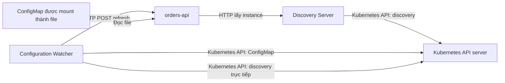

# Tách quyền ứng dụng, Discovery Server và Configuration Watcher

Trong chương **Phân quyền RBAC** của module **SPRING_CLOUD_KUBERNETES**, một hệ thống có thể có ba tiến trình cùng liên quan đến discovery và cấu hình nhưng cần những quyền rất khác nhau:

- Ứng dụng nghiệp vụ tiêu thụ cấu hình và gọi dịch vụ.
- Discovery Server đọc thông tin dịch vụ từ Kubernetes rồi cung cấp qua HTTP.
- Configuration Watcher theo dõi nguồn cấu hình và gửi thông báo refresh.

Nếu cả ba dùng chung ServiceAccount và một Role đọc mọi tài nguyên, việc mở quyền cho watcher cũng mở quyền cho ứng dụng. Khi cần thu hồi một chức năng hoặc điều tra lỗi, ranh giới trách nhiệm trở nên khó xác định.

Bài học thiết kế ba danh tính riêng, xây dựng ma trận quyền và minh họa một lab RBAC trong một namespace. Mục tiêu là cấp quyền đúng cho **tiến trình thực hiện request**, đồng thời kiểm chứng những quyền mà mỗi tiến trình không được có.

Sau bài học, bạn có thể:

- Vẽ đường gọi Kubernetes API và đường gọi HTTP giữa các thành phần.
- Chọn ServiceAccount, Role và RoleBinding riêng theo trách nhiệm.
- Giữ ứng dụng không cần credentials Kubernetes khi dùng HTTP discovery và cấu hình qua file.
- Tách quyền theo dõi cấu hình khỏi quyền công bố cấu hình.
- Kiểm tra độc lập quyền của ứng dụng, Discovery Server và watcher.

## 1. Xác định ai thực sự gọi Kubernetes API

### 1.1. Kiến trúc được chọn trong bài

Bài chọn một kiến trúc cụ thể để tránh cấp quyền theo giả định:

1. `orders-api` đọc cấu hình từ ConfigMap được mount thành file.
2. Ứng dụng dùng HTTP DiscoveryClient để hỏi `orders-discovery-server`.
3. Discovery Server gọi Kubernetes API để xây dựng dữ liệu discovery.
4. `orders-config-watcher` dùng discovery trực tiếp của nó để tìm instance và gửi HTTP refresh.
5. Watcher chỉ theo dõi ConfigMap; chưa bật Secret, HA hay leader election.

HTTP DiscoveryClient là lựa chọn dành cho Discovery Server. Khi dùng cách này, ứng dụng không tự đọc Kubernetes API chỉ để lấy danh sách instance. Discovery Server là bên cần quyền đọc Pod, Service và Endpoints cho cơ chế discovery đang minh họa. [Spring Cloud Kubernetes: Discovery Server](https://docs.spring.io/spring-cloud-kubernetes/reference/spring-cloud-kubernetes-discoveryserver.html).

Đường gọi:



Mũi tên đọc file thể hiện dữ liệu tới ứng dụng; không phải tiến trình ứng dụng dùng token của nó để lấy ConfigMap. Kubelet chuẩn bị volume cho Pod. Cơ chế này khác với việc dùng Kubernetes ConfigMap PropertySource qua API. [Kubernetes: ConfigMaps](https://kubernetes.io/docs/concepts/configuration/configmap/).

### 1.2. Không suy ra quyền từ tên thư viện

Hai ứng dụng đều có `DiscoveryClient` nhưng có thể dùng nguồn dữ liệu khác nhau. Client trực tiếp Kubernetes và HTTP client tới Discovery Server có vị trí cần quyền khác nhau.

Tương tự, thêm Spring Cloud LoadBalancer không tự có nghĩa ứng dụng cần quyền đọc Kubernetes API. Phải xem nguồn danh sách instance mà LoadBalancer đang sử dụng.

Nếu ứng dụng còn dùng một thành phần khác gọi API, chẳng hạn đọc Secret hoặc thông tin Pod, không thể kết luận “không cần API” chỉ vì discovery đã chuyển qua HTTP. Cần rà soát toàn bộ đường gọi thực tế.

Trong luồng HTTP của Configuration Watcher, watcher tìm các instance qua discovery rồi gửi POST tới endpoint refresh. Vì vậy, không tự xóa quyền discovery của watcher chỉ vì ứng dụng nghiệp vụ đang dùng Discovery Server. [Spring Cloud Kubernetes: HTTP implementation](https://docs.spring.io/spring-cloud-kubernetes/reference/spring-cloud-kubernetes-configuration-watcher.html#_http_implementation).

## 2. Ba danh tính, ba hợp đồng quyền

Lab dùng namespace `orders-rbac-lab`:

| Thành phần | ServiceAccount | Kubernetes API theo hợp đồng |
| --- | --- | --- |
| Ứng dụng `orders-api` | `orders-app` | Không đọc các tài nguyên nghiệp vụ của Kubernetes |
| Discovery Server | `orders-discovery-server` | Đọc Pod, Service, Endpoints trong namespace lab |
| Configuration Watcher | `orders-config-watcher` | Đọc ConfigMap và tài nguyên discovery trong namespace lab |

Các thao tác đọc của server và watcher trong ví dụ là `get`, `list`, `watch`. Bộ tài nguyên discovery theo mô hình Endpoints được tài liệu Spring Cloud Kubernetes mô tả; khi đổi client hoặc tính năng cần kiểm tra lại nhu cầu cụ thể. [Spring Cloud Kubernetes: Security Configurations Inside Kubernetes](https://docs.spring.io/spring-cloud-kubernetes/reference/security-service-accounts.html).

Ma trận quyền mong muốn:

| Thao tác trong namespace lab | Ứng dụng | Discovery Server | Watcher |
| --- | --- | --- | --- |
| Đọc Pod, Service, Endpoints qua API | Không | Có | Có |
| Đọc hoặc theo dõi ConfigMap qua API | Không | Không | Có |
| Đọc Secret qua API | Không | Không | Không |
| Tạo, sửa hoặc xóa ConfigMap | Không | Không | Không |
| Tạo hoặc sửa Deployment | Không | Không | Không |
| Sửa tài nguyên RBAC | Không | Không | Không |
| Đọc tài nguyên namespace khác | Không | Không | Không |
| Đọc Node | Không | Không | Không |
| Thao tác Lease | Không | Không | Không |

Danh tính triển khai chịu trách nhiệm tạo Deployment và công bố cấu hình. Danh tính runtime không cần quyền sửa ConfigMap chỉ vì nó cần nhận cấu hình mới.

Tài nguyên được liệt kê trong Role là giới hạn thực tế của lab. Ví dụ, quyền `list configmaps` cho watcher cho phép đọc các ConfigMap trong namespace, không chỉ một nguồn mà watcher đang chọn theo nhãn.

## 3. Ba lớp kiểm soát không thay thế cho nhau

| Đường truy cập | Thành phần kiểm soát chính | Ví dụ |
| --- | --- | --- |
| Từ Pod tới Kubernetes API | Xác thực Kubernetes và RBAC | Watcher được `watch configmaps` |
| Từ ứng dụng tới Discovery Server | Chính sách HTTP của Discovery Server và đường mạng | Ai được đọc catalog dịch vụ |
| Từ watcher tới Actuator | Cấu hình endpoint, xác thực HTTP và đường mạng | Ai được POST refresh |
| Từ tiến trình tới broker nếu dùng Bus | Xác thực và ACL của broker | Quyền publish hoặc consume |

Một RoleBinding không cấu hình quyền gọi HTTP của ứng dụng. Cũng không có cơ chế mặc định khiến Discovery Server dùng ServiceAccount của từng HTTP caller để gọi Kubernetes thay cho caller đó.

Hệ quả quan trọng: Discovery Server có thể đọc phạm vi rộng hơn ứng dụng. Nếu endpoint HTTP trả dữ liệu đó cho mọi caller, ứng dụng vẫn có thể biết thông tin qua server, dù ServiceAccount ứng dụng không có quyền đọc trực tiếp API.

Tách ServiceAccount giảm việc phân phối credentials Kubernetes; cần đồng thời chọn phạm vi dữ liệu mà server được phép trả cho các caller.

Với Actuator, việc expose endpoint và việc bảo vệ truy cập cần được cấu hình tại ứng dụng. Không coi `management.endpoints.web.exposure.include` là một luật xác thực. [Spring Boot: Actuator endpoints](https://docs.spring.io/spring-boot/reference/actuator/endpoints.html).

NetworkPolicy kiểm soát kết nối theo những khả năng mà plugin mạng hỗ trợ. Chính sách chuẩn dùng các selector như Pod và namespace; không mặc định nhận biết ServiceAccount để xác thực POST refresh. [Kubernetes: Network Policies](https://kubernetes.io/docs/concepts/services-networking/network-policies/).

## 4. Lab RBAC: ba ServiceAccount và các quyền độc lập

### 4.1. Điều kiện và phạm vi

Phần lab RBAC có thể kiểm chứng trước khi triển khai ứng dụng. Cần `kubectl` trỏ đúng cluster lab, một danh tính được phép tạo tài nguyên tương ứng và quyền impersonation để chạy các phép kiểm tra ở mục 7.

Phần cấu hình workload phía sau dùng các đoạn Pod template để ghép vào Deployment đã có image phù hợp. Ví dụ tập trung vào ranh giới quyền, không thay thế việc chuẩn bị image và cấu hình bảo vệ HTTP của dự án.

Lab dùng Endpoints để khớp bộ quyền dưới đây. Nếu chọn EndpointSlice, thay đổi client và API group tương ứng như mục 9.

### 4.2. Tạo danh tính

Lưu nội dung ví dụ sau thành `separate-identities.yaml`:

```yaml
apiVersion: v1
kind: Namespace
metadata:
  name: orders-rbac-lab
---
apiVersion: v1
kind: Namespace
metadata:
  name: orders-rbac-outside
---
apiVersion: v1
kind: ServiceAccount
metadata:
  name: orders-app
  namespace: orders-rbac-lab
automountServiceAccountToken: false
---
apiVersion: v1
kind: ServiceAccount
metadata:
  name: orders-discovery-server
  namespace: orders-rbac-lab
automountServiceAccountToken: false
---
apiVersion: v1
kind: ServiceAccount
metadata:
  name: orders-config-watcher
  namespace: orders-rbac-lab
automountServiceAccountToken: false
```

Cả ba ServiceAccount đều không tự mount credentials theo mặc định. Pod nào thật sự cần Kubernetes API sẽ chủ động bật lại ở Pod template.

### 4.3. Role dành riêng cho Discovery Server

Lưu thành `discovery-permissions.yaml`:

```yaml
apiVersion: rbac.authorization.k8s.io/v1
kind: Role
metadata:
  name: orders-discovery-read
  namespace: orders-rbac-lab
rules:
  - apiGroups: [""]
    resources: ["pods", "services", "endpoints"]
    verbs: ["get", "list", "watch"]
---
apiVersion: rbac.authorization.k8s.io/v1
kind: RoleBinding
metadata:
  name: orders-discovery-read
  namespace: orders-rbac-lab
subjects:
  - kind: ServiceAccount
    name: orders-discovery-server
    namespace: orders-rbac-lab
roleRef:
  apiGroup: rbac.authorization.k8s.io
  kind: Role
  name: orders-discovery-read
```

Không thêm `configmaps` hoặc `secrets` vào role này chỉ để sửa lỗi phát sinh từ một thành phần khác.

### 4.4. Tách quyền theo dõi nguồn và quyền tìm đích của watcher

Lưu thành `watcher-permissions.yaml`:

```yaml
apiVersion: rbac.authorization.k8s.io/v1
kind: Role
metadata:
  name: orders-watch-config
  namespace: orders-rbac-lab
rules:
  - apiGroups: [""]
    resources: ["configmaps"]
    verbs: ["get", "list", "watch"]
---
apiVersion: rbac.authorization.k8s.io/v1
kind: RoleBinding
metadata:
  name: orders-watch-config
  namespace: orders-rbac-lab
subjects:
  - kind: ServiceAccount
    name: orders-config-watcher
    namespace: orders-rbac-lab
roleRef:
  apiGroup: rbac.authorization.k8s.io
  kind: Role
  name: orders-watch-config
---
apiVersion: rbac.authorization.k8s.io/v1
kind: Role
metadata:
  name: orders-watcher-discovery-read
  namespace: orders-rbac-lab
rules:
  - apiGroups: [""]
    resources: ["pods", "services", "endpoints"]
    verbs: ["get", "list", "watch"]
---
apiVersion: rbac.authorization.k8s.io/v1
kind: RoleBinding
metadata:
  name: orders-watcher-discovery-read
  namespace: orders-rbac-lab
subjects:
  - kind: ServiceAccount
    name: orders-config-watcher
    namespace: orders-rbac-lab
roleRef:
  apiGroup: rbac.authorization.k8s.io
  kind: Role
  name: orders-watcher-discovery-read
```

Watcher nhận hợp của hai bộ quyền. Hai Role discovery có cùng quy tắc ở lab nhưng tách tên để thay đổi của watcher không tự sửa hợp đồng Discovery Server.

Có thể dùng chung một Role cho các bộ quyền cố ý giống nhau, nhưng khi đó cần quản lý mọi binding chịu ảnh hưởng nếu Role được chỉnh sửa.

Ứng dụng `orders-app` không có RoleBinding đọc Kubernetes API trong thiết kế này.

Áp dụng:

```powershell
kubectl apply -f separate-identities.yaml
kubectl apply -f discovery-permissions.yaml
kubectl apply -f watcher-permissions.yaml
kubectl get serviceaccounts -n orders-rbac-lab
kubectl get roles,rolebindings -n orders-rbac-lab
```

## 5. Gắn danh tính vào đúng workload

### 5.1. Ứng dụng nghiệp vụ

Phần Pod template của `orders-api`:

```yaml
spec:
  template:
    spec:
      serviceAccountName: orders-app
      automountServiceAccountToken: false
      containers:
        - name: application
          # Giữ image và các trường còn lại của Deployment ứng dụng.
          env:
            - name: SPRING_CONFIG_IMPORT
              value: "file:/etc/orders/application.yaml"
          volumeMounts:
            - name: runtime-config
              mountPath: /etc/orders
              readOnly: true
      volumes:
        - name: runtime-config
          configMap:
            name: orders-api
```

Đây là đoạn ghép vào Deployment, không phải manifest Deployment hoàn chỉnh. Không mount bằng `subPath` nếu cần nhận cập nhật file từ ConfigMap volume.

Một ConfigMap minh họa:

```yaml
apiVersion: v1
kind: ConfigMap
metadata:
  name: orders-api
  namespace: orders-rbac-lab
  labels:
    spring.cloud.kubernetes.config: "true"
  annotations:
    spring.cloud.kubernetes.configmap.apps: "orders-api"
data:
  application.yaml: |
    demo:
      revision: orders-r1
      max-batch-size: 20
```

Image ứng dụng chọn HTTP discovery starter:

```xml
<dependency>
    <groupId>org.springframework.cloud</groupId>
    <artifactId>spring-cloud-starter-kubernetes-discoveryclient</artifactId>
</dependency>
```

Phiên bản do BOM tương thích của dự án quản lý. Không đồng thời đưa client Kubernetes trực tiếp vào chỉ để dùng cùng chức năng discovery.

Cấu hình đóng gói của ứng dụng có thể chứa:

```yaml
spring:
  application:
    name: orders-api
  cloud:
    kubernetes:
      discovery:
        enabled: true
        discovery-server-url: http://orders-discovery-server
      config:
        enabled: false
      secrets:
        enabled: false
```

URL giả định Service `orders-discovery-server` cung cấp HTTP ở cổng 80 trong cùng namespace. Thuộc tính `discovery-server-url` xác định nơi HTTP client lấy dữ liệu. [Spring Cloud Kubernetes: Common application properties](https://docs.spring.io/spring-cloud-kubernetes/reference/appendix.html).

Phương án này không dùng import `kubernetes:` trong ứng dụng. Nếu còn import ấy, hoặc còn một thành phần cần API, việc tắt token có thể làm ứng dụng lỗi; cần loại bỏ đúng đường gọi không còn sử dụng.

### 5.2. Discovery Server

Phần Pod template:

```yaml
spec:
  template:
    spec:
      serviceAccountName: orders-discovery-server
      automountServiceAccountToken: true
```

Cấu hình server giới hạn namespace:

```yaml
spring:
  cloud:
    kubernetes:
      discovery:
        all-namespaces: false
        namespaces:
          - orders-rbac-lab
        use-endpoint-slices: false
      config:
        enabled: false
      secrets:
        enabled: false
```

Với HTTP DiscoveryClient, phạm vi đọc tài nguyên cần được cấu hình ở server. Đặt namespace ở ứng dụng HTTP client không tự làm hẹp Kubernetes API request của Discovery Server. [Spring Cloud Kubernetes: DiscoveryClient namespace selection](https://docs.spring.io/spring-cloud-kubernetes/reference/discovery-client.html).

### 5.3. Configuration Watcher

Phần Pod template:

```yaml
spec:
  template:
    spec:
      serviceAccountName: orders-config-watcher
      automountServiceAccountToken: true
```

Phần cấu hình phạm vi cho watcher:

```yaml
spring:
  cloud:
    kubernetes:
      reload:
        namespaces:
          - orders-rbac-lab
      discovery:
        all-namespaces: false
        namespaces:
          - orders-rbac-lab
        use-endpoint-slices: false
      secrets:
        enabled: false
      configuration:
        watcher:
          ha:
            enabled: false
```

Cần giữ image và thư viện theo bộ phiên bản đã chọn, đồng thời đối chiếu thuộc tính cấu hình với phiên bản đó.

Giá trị `automountServiceAccountToken` trên Pod ưu tiên hơn giá trị trên ServiceAccount. `serviceAccountName` cần đặt trong Pod template; thay đổi danh tính của Pod đang tồn tại cần tạo Pod mới, thường thông qua rollout Deployment. [Kubernetes: Configure Service Accounts for Pods](https://kubernetes.io/docs/tasks/configure-pod-container/configure-service-account/).

## 6. Quyền refresh không phải quyền công bố cấu hình

Trong mô hình của bài:

```text
Danh tính triển khai:
  tạo hoặc cập nhật ConfigMap

Configuration Watcher:
  đọc sự kiện và nguồn cấu hình
  tìm instance nhận thông báo
  yêu cầu ứng dụng refresh

Ứng dụng:
  đọc file cấu hình được mount
  cập nhật consumer theo cơ chế refresh đã thiết kế
```

Watcher không cần quyền `patch configmaps` chỉ để gửi thông báo. Discovery Server không cần quyền sửa Deployment để quan sát instance mới. Ứng dụng không cần quyền đọc Pod để kubelet có thể thực hiện HTTP readiness probe tới nó.

Đối với HTTP refresh, cần xác định riêng:

- Endpoint nào được expose và ở cổng nào.
- Cách watcher được xác thực khi gọi endpoint.
- Các caller khác có bị từ chối hay không.
- Watcher có thể tới từng địa chỉ instance mà discovery trả về hay không.
- Cơ chế tạo lại bean hoặc áp dụng cấu hình trong ứng dụng.

Không gửi token Kubernetes tới endpoint ứng dụng rồi mặc định endpoint sẽ hiểu danh tính ServiceAccount. Nếu có thiết kế dùng token workload để xác thực HTTP, cần hợp đồng xác thực, audience và phân quyền tương ứng; đó là một tích hợp riêng.

Cấu hình mới có thể xuất hiện trong volume sau một độ trễ, rồi mới được consumer áp dụng. POST refresh thành công và cấu hình đã được áp dụng là hai bằng chứng khác nhau.

Khi chọn thông báo qua Bus, thay đường gọi HTTP bằng luồng sự kiện và quyền broker thích hợp. Không mặc định có thể bỏ mọi quyền discovery của watcher: việc có tìm đích qua discovery hay không còn phụ thuộc cơ chế chọn đích và triển khai của phiên bản đã dùng.

## 7. Kiểm chứng độc lập từng ServiceAccount

### 7.1. Kiểm tra danh tính trên Pod

Sau khi ghép cấu hình và triển khai ba workload:

```powershell
kubectl get pods -n orders-rbac-lab -o 'custom-columns=NAME:.metadata.name,SA:.spec.serviceAccountName,PHASE:.status.phase'
```

Kết quả cần phân biệt rõ:

| Workload | ServiceAccount trên Pod |
| --- | --- |
| `orders-api` | `orders-app` |
| `orders-discovery-server` | `orders-discovery-server` |
| `orders-config-watcher` | `orders-config-watcher` |

Kiểm tra tất cả replica, kể cả trong thời gian rollout. Sửa manifest nhưng vẫn quan sát Pod cũ có thể dẫn đến kết luận sai về danh tính đang được sử dụng.

Không cần in token để thực hiện bước này. Với Pod cần API, kiểm tra thêm cấu hình mount và việc client sử dụng credentials in-cluster phù hợp.

### 7.2. Tạo bảng phép thử bằng impersonation

Người chạy cần được phép impersonate các danh tính và nhóm sử dụng trong phép thử. Nếu có lỗi impersonation, xử lý lỗi đó trước; không ghi nhận nó thành kết quả `no` của danh tính ứng dụng.

Ví dụ PowerShell:

```powershell
$labNamespace = 'orders-rbac-lab'

$subjects = [ordered]@{
    application = 'orders-app'
    discovery = 'orders-discovery-server'
    watcher = 'orders-config-watcher'
}

$identityGroups = @(
    '--as-group=system:authenticated'
    '--as-group=system:serviceaccounts'
    '--as-group=system:serviceaccounts:orders-rbac-lab'
)

$checks = @(
    @{ Name = 'list services'; Verb = 'list'; Resource = 'services'; Namespace = $labNamespace }
    @{ Name = 'watch endpoints'; Verb = 'watch'; Resource = 'endpoints'; Namespace = $labNamespace }
    @{ Name = 'list pods'; Verb = 'list'; Resource = 'pods'; Namespace = $labNamespace }
    @{ Name = 'watch configmaps'; Verb = 'watch'; Resource = 'configmaps'; Namespace = $labNamespace }
    @{ Name = 'list secrets'; Verb = 'list'; Resource = 'secrets'; Namespace = $labNamespace }
    @{ Name = 'patch configmaps'; Verb = 'patch'; Resource = 'configmaps'; Namespace = $labNamespace }
    @{ Name = 'create deployments'; Verb = 'create'; Resource = 'deployments.apps'; Namespace = $labNamespace }
    @{ Name = 'create rolebindings'; Verb = 'create'; Resource = 'rolebindings.rbac.authorization.k8s.io'; Namespace = $labNamespace }
    @{ Name = 'list services outside'; Verb = 'list'; Resource = 'services'; Namespace = 'orders-rbac-outside' }
)

$results = foreach ($subjectEntry in $subjects.GetEnumerator()) {
    $subjectIdentity = "system:serviceaccount:$($labNamespace):$($subjectEntry.Value)"

    foreach ($check in $checks) {
        $verb = $check.Verb
        $resource = $check.Resource
        $targetNamespace = $check.Namespace

        $decision = kubectl auth can-i $verb $resource --namespace=$targetNamespace --as=$subjectIdentity @identityGroups

        [pscustomobject]@{
            Component = $subjectEntry.Key
            Check = $check.Name
            Allowed = $decision
        }
    }
}

$results | Format-Table -AutoSize
```

Kết quả mong muốn:

| Phép thử | application | discovery | watcher |
| --- | --- | --- | --- |
| `list services` | no | yes | yes |
| `watch endpoints` | no | yes | yes |
| `list pods` | no | yes | yes |
| `watch configmaps` | no | no | yes |
| `list secrets` | no | no | no |
| `patch configmaps` | no | no | no |
| `create deployments` | no | no | no |
| `create rolebindings` | no | no | no |
| `list services outside` | no | no | no |

`kubectl auth can-i` kiểm tra quyền cho hành động được chỉ định. Khi dùng `--as` và nhóm tương ứng, phép thử giúp xác nhận quyền hiệu lực của từng danh tính mà không lấy token từ Pod. [Kubernetes: kubectl auth can-i](https://kubernetes.io/docs/reference/kubectl/generated/kubectl_auth/kubectl_auth_can-i/).

Kiểm tra thêm quyền cấp cluster và danh tính mặc định:

```powershell
$watcherIdentity = 'system:serviceaccount:orders-rbac-lab:orders-config-watcher'
$discoveryIdentity = 'system:serviceaccount:orders-rbac-lab:orders-discovery-server'

kubectl auth can-i list services --all-namespaces --as=$watcherIdentity @identityGroups
kubectl auth can-i list nodes --as=$discoveryIdentity @identityGroups
kubectl auth can-i get leases.coordination.k8s.io -n orders-rbac-lab --as=$watcherIdentity @identityGroups
kubectl auth can-i list services -n orders-rbac-lab --as=system:serviceaccount:orders-rbac-lab:default @identityGroups
```

Cả bốn kết quả cần là `no` theo hợp đồng của lab.

Nếu xuất hiện `yes` ngoài dự kiến, tìm binding khác cấp quyền trực tiếp hoặc qua nhóm. RBAC cộng gộp quyền; một Role hẹp không phủ định quyền rộng được cấp từ nơi khác. [Kubernetes: Using RBAC Authorization](https://kubernetes.io/docs/reference/access-authn-authz/rbac/#api-objects).

## 8. Kiểm chứng hành vi bên cạnh kiểm chứng RBAC

Quyền đúng là điều kiện cần để các đường gọi hoạt động. Cần thêm bằng chứng từ tiến trình thật.

### 8.1. Discovery Server hoạt động bằng danh tính của nó

Trong một terminal:

```powershell
kubectl port-forward service/orders-discovery-server -n orders-rbac-lab 18761:80
```

Trong terminal khác, dùng phương thức xác thực mà Discovery Server của lab đã được cấu hình để gọi:

```http
GET http://127.0.0.1:18761/apps/orders-api
```

Đường dẫn này trả thông tin instance của tên dịch vụ tương ứng. Cần đối chiếu với Pod ready và Service selector mong muốn, không chỉ kiểm tra HTTP `200`.

Tiếp theo, gọi một đường nghiệp vụ hoặc điểm kiểm tra của ứng dụng sử dụng HTTP DiscoveryClient. Việc ứng dụng vẫn discovery được trong khi ServiceAccount của nó bị từ chối `list services` là bằng chứng phù hợp với kiến trúc trung gian.

Một GET tới Discovery Server từ máy người vận hành chưa chứng minh ứng dụng trong Pod có kết nối và credentials HTTP phù hợp; phải kiểm tra đường gọi từ ứng dụng.

### 8.2. Watcher nhận thay đổi và chọn đúng đích

Dùng danh tính triển khai cập nhật revision của ConfigMap `orders-api`, sau đó thu thập:

| Bằng chứng | Điều được kiểm tra |
| --- | --- |
| Sự kiện hoặc log watch của watcher | Watcher quan sát được thay đổi |
| Log chọn instance | Discovery phía watcher tìm đúng đích |
| Kết quả POST refresh | Endpoint ứng dụng chấp nhận thông báo |
| Revision từ consumer trong ứng dụng | Consumer đã áp dụng cấu hình mới |
| Danh tính từng Pod | Không bỏ sót replica hoặc nhầm workload |

Điểm quan sát ở ứng dụng chỉ nên trả dữ liệu công khai của lab, ví dụ:

```json
{
  "pod": "orders-api-example",
  "revision": "orders-r2",
  "maxBatchSize": 30
}
```

Revision cần được lấy từ consumer thực sự dùng cấu hình, chẳng hạn một policy trong refresh scope, thay vì trả lại revision mới nhất từ API rồi coi đó là trạng thái ứng dụng.

Nếu ứng dụng có nhiều replica, kiểm tra từng Pod. Nhiều request qua một Service có thể lặp lại cùng backend; không đủ để kết luận mọi replica đã áp dụng.

### 8.3. Cố ý thu hồi một nhóm quyền trong lab

Thử tách ảnh hưởng bằng cách gỡ **binding theo dõi ConfigMap của watcher**:

```powershell
kubectl delete rolebinding orders-watch-config -n orders-rbac-lab
kubectl auth can-i watch configmaps -n orders-rbac-lab --as=$watcherIdentity @identityGroups
kubectl auth can-i list services -n orders-rbac-lab --as=$discoveryIdentity @identityGroups
```

Kỳ vọng:

```text
no
yes
```

Một phiên watch cũ có thể còn tồn tại; việc thu hồi quyền không tự xóa dữ liệu cache. Khi cần thử quá trình thiết lập watch mới trên lab, chỉ khởi động lại Deployment watcher để quan sát lỗi mới.

Trong thời gian đó, Discovery Server vẫn có bộ quyền riêng. Ứng dụng có thể tiếp tục phục vụ bằng cấu hình đang giữ, nhưng điều này không chứng minh nó sẽ nhận cấu hình mới.

Khôi phục đúng binding:

```powershell
kubectl apply -f watcher-permissions.yaml
kubectl auth can-i watch configmaps -n orders-rbac-lab --as=$watcherIdentity @identityGroups
```

Chờ watcher thiết lập lại việc quan sát rồi tạo một thay đổi cấu hình mới để kiểm tra tiếp. Không mặc định watcher sẽ phát lại mọi thông báo đã bỏ lỡ.

Có thể làm phép thử đối xứng với binding của Discovery Server. Khi kiểm tra, cần tính đến cache và kết nối cũ: lỗi discovery có thể chưa biểu hiện ngay ở mọi request ứng dụng.

## 9. Điều chỉnh quyền khi thay đổi kiến trúc

### 9.1. Ứng dụng chuyển sang đọc ConfigMap qua API

Nếu `orders-api` bỏ file mount và dùng PropertySource gọi Kubernetes API, danh tính `orders-app` cần thêm bộ quyền đọc cấu hình phù hợp.

Cách thay đổi:

1. Xác định tên nguồn, namespace và chế độ đọc của client.
2. Tạo Role và RoleBinding riêng cho `orders-app`.
3. Cấp credentials in-cluster cho Pod cần API.
4. Kiểm tra startup, refresh và các phép thử âm.
5. Giữ nguyên việc ứng dụng không có quyền sửa cấu hình hoặc discovery nếu vẫn dùng HTTP discovery.

Không gắn ứng dụng vào ServiceAccount của watcher chỉ vì cả hai đều đọc ConfigMap.

### 9.2. Chuyển từ Endpoints sang EndpointSlice

Nếu client được cấu hình dùng EndpointSlice, quyền tương ứng thuộc API group khác:

```yaml
rules:
  - apiGroups: ["discovery.k8s.io"]
    resources: ["endpointslices"]
    verbs: ["get", "list", "watch"]
```

Chỉ bổ sung vào những thành phần thực sự dùng client đó. Quyền `endpoints` trong core API group không tự bao gồm `endpointslices`. [Spring Cloud Kubernetes: EndpointSlice support](https://docs.spring.io/spring-cloud-kubernetes/reference/discovery-client.html).

Sau chuyển đổi, kiểm tra khả năng bỏ quyền cũ nếu client không còn sử dụng nó.

### 9.3. Theo dõi Secret

Nếu cần theo dõi Secret, trước hết xác định watcher nào được quyền nhìn thấy dữ liệu và phạm vi nào cần cho nó. Quyền `list` hoặc `watch` Secret có thể làm lộ nội dung, không chỉ metadata. [Kubernetes: RBAC good practices](https://kubernetes.io/docs/concepts/security/rbac-good-practices/#listing-secrets).

Có thể cần tách watcher theo nhóm ứng dụng hoặc mức độ tin cậy thay vì mở quyền đọc Secret rộng cho một watcher dùng chung.

Ứng dụng nhận Secret qua volume không nhất thiết cần quyền đọc Secret qua API. Tuy nhiên, tiến trình được mount volume vẫn đọc được dữ liệu trong file: không có quyền API không có nghĩa không thể tiếp cận dữ liệu được cấp theo đường khác.

### 9.4. Bật HA hoặc leader election

Khi bật HA, kiểm tra phiên bản watcher sử dụng loại khóa nào và các thao tác cần thiết. Nếu dùng Lease, quyền thuộc `coordination.k8s.io`.

Cấp quyền này cho watcher trong phạm vi khóa cần dùng, không cấp theo sang ứng dụng và Discovery Server. Role chỉ đọc cấu hình không phải bộ quyền đầy đủ cho mọi chế độ hoạt động.

### 9.5. Mở sang nhiều namespace

Nếu chỉ cần một danh sách namespace hữu hạn, xem xét Role hoặc ClusterRole tái sử dụng qua RoleBinding ở từng namespace. Không tự chọn ClusterRoleBinding để sửa một lỗi ở namespace thứ hai.

Cấu hình nguồn watcher và cấu hình discovery cần cùng khớp với phạm vi đã cấp. Nếu controller gửi request toàn cluster, các RoleBinding riêng lẻ không tự biến request ấy thành danh sách được lọc theo quyền.

## 10. Những thiết kế làm mất sự phân tách

### Dùng ba tên Role nhưng chỉ một ServiceAccount

Nếu cùng một ServiceAccount được gắn cả ba Role rồi dùng cho mọi Pod, tất cả tiến trình dùng danh tính ấy đều nhận hợp các quyền. Ba tên Role không tạo ra ba ranh giới runtime.

### Tách ServiceAccount nhưng gắn quyền vào nhóm chung

Một binding cho nhóm `system:serviceaccounts:orders-rbac-lab` có thể cấp quyền cho cả ba danh tính. Cần kiểm tra cấp quyền qua nhóm khi đánh giá hiệu lực của việc tách.

### Tắt mount token rồi coi quyền đã bị thu hồi

`automountServiceAccountToken: false` điều khiển việc tự mount credentials, không xóa RoleBinding. Phải quản lý cả việc cấp credentials và chính sách quyền.

### Cho ứng dụng quyền tạo workload hoặc dùng credentials triển khai

Quyền tạo Pod có thể cho phép dùng ServiceAccount khác hoặc mount dữ liệu trong namespace. Vì vậy, không đưa quyền tạo workload vào hợp đồng runtime chỉ để tiện xử lý lỗi.

Khi các workload có mức độ tin cậy khác nhau, tách namespace và kiểm soát việc triển khai Pod cũng cần được xem xét. Tách ServiceAccount trong cùng namespace không thay thế những ranh giới đó. [Kubernetes: Workload creation risks](https://kubernetes.io/docs/concepts/security/rbac-good-practices/#workload-creation).

### Gom mọi lỗi vào RBAC

| Hiện tượng | Lớp cần kiểm tra |
| --- | --- |
| Kubernetes API trả Forbidden | Danh tính, verb, resource, namespace và binding |
| Kubernetes API trả Unauthorized | Credentials và xác thực Kubernetes |
| Discovery Server trả HTTP `401/403` | Chính sách HTTP của Discovery Server |
| Refresh trả HTTP `401/403` | Chính sách bảo vệ endpoint ứng dụng |
| Không kết nối được tới instance | Host, port, Service, mạng và readiness |
| Refresh thành công nhưng hành vi chưa đổi | Nguồn file, thời điểm cập nhật và consumer |
| Pod đang dùng `default` | Pod template, rollout và danh tính thực tế |

Cần xác định server nào trả lỗi trước khi bổ sung quyền. HTTP `403` từ Actuator không được sửa bằng quyền `watch configmaps`.

## 11. Quy trình chuyển từ quyền chung sang quyền riêng

Có thể tổ chức thay đổi theo từng workload:

1. Lập bảng request Kubernetes thực tế và dữ liệu cần dùng cho từng tiến trình.
2. Tạo ba ServiceAccount, các Role và RoleBinding tương ứng.
3. Cập nhật Pod template của một workload rồi kiểm chứng cả khởi động mới và hoạt động sau đó.
4. Lặp lại cho những workload còn lại, kiểm tra từng replica đã dùng danh tính mới.
5. Thu hồi binding cũ dùng chung khi không còn workload hợp lệ phụ thuộc.
6. Kiểm tra lại quyền hiệu lực, đường discovery và luồng cập nhật cấu hình.

Trong thời gian còn binding rộng, ứng dụng có thể hoạt động nhờ quyền cũ. Vì vậy phải kiểm chứng lại sau khi gỡ quyền cũ; kết quả trước đó chưa chứng minh bộ quyền mới đã đủ.

Các quyền mới nên đi cùng chức năng cần đến chúng. Nếu tắt Secret, đổi nguồn cấu hình hoặc chuyển discovery sang HTTP, xem lại quyền có thể thu hồi thay vì chỉ tích lũy thêm.

## 12. Bài thực hành và tiêu chí hoàn thành

Thực hiện trên môi trường lab:

1. Áp dụng các manifest danh tính và RBAC.
2. Chạy bảng phép thử cho ba ServiceAccount.
3. Ghép danh tính đúng vào ba Deployment và xác nhận từng Pod.
4. Xác nhận ứng dụng dùng HTTP discovery mà không có quyền `list services` trực tiếp.
5. Cập nhật ConfigMap bằng danh tính triển khai và theo dõi đến revision từ consumer.
6. Thu hồi rồi khôi phục binding theo dõi ConfigMap của watcher.
7. Giải thích quyền nào cần thay đổi nếu bật Secret hoặc HA.

Bảng nghiệm thu:

| Tiêu chí | Bằng chứng |
| --- | --- |
| Danh tính độc lập | Ba workload dùng đúng ba ServiceAccount |
| Ứng dụng có phạm vi phù hợp | Không đọc API theo hợp đồng nhưng vẫn sử dụng file cấu hình và HTTP discovery |
| Discovery Server chỉ làm discovery | Đọc tài nguyên discovery, không đọc ConfigMap hoặc Secret |
| Watcher quan sát đúng nguồn | Có quyền ConfigMap và discovery cần cho kiểu thông báo đã chọn |
| Không có quyền công bố cấu hình | Ba danh tính runtime bị từ chối sửa ConfigMap |
| Không tự mở rộng quyền | Không tạo được workload hoặc binding RBAC |
| Phạm vi namespace đúng | Namespace đối chứng và request ngoài phạm vi bị từ chối |
| HTTP được kiểm tra riêng | Caller hợp lệ gọi được; caller ngoài hợp đồng bị từ chối |
| Cập nhật có bằng chứng cuối | Từng consumer mục tiêu báo revision và hành vi mong muốn |
| Thu hồi được kiểm chứng | Phép thử mới phản ánh đúng quyền sau thay đổi |

Ranh giới quyền được xác định bởi danh tính thực hiện request, bộ quyền hiệu lực và dữ liệu mà các thành phần trung gian cung cấp. Giữ ba yếu tố ấy rõ ràng giúp ứng dụng chỉ nhận những quyền cần thiết, trong khi Discovery Server và Configuration Watcher có thể được vận hành, thay đổi và thu hồi quyền độc lập.
