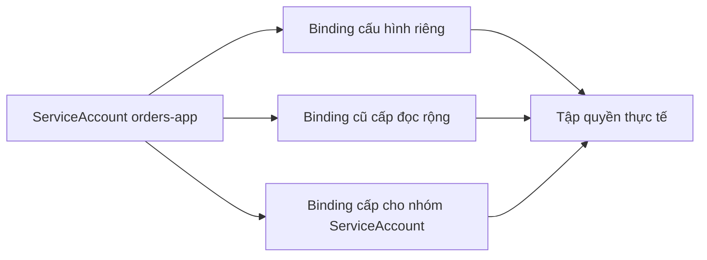

# Thu hồi quyền, rà soát quyền rộng và kiểm thử lỗi 403

Trong chương **Phân quyền RBAC** của module **SPRING_CLOUD_KUBERNETES**, việc cấp quyền chỉ là một nửa công việc. Khi ứng dụng bỏ một tính năng, thay cách nạp cấu hình hoặc kết thúc giai đoạn thử nghiệm, cần thu hồi quyền không còn dùng và chứng minh rằng quyền đó đã bị từ chối.

Bài học xây dựng một quy trình gồm ba phần: xác định mọi đường cấp quyền liên quan, thu hẹp chúng theo nhu cầu thực tế, rồi kiểm tra cả chức năng được giữ lại và request phải nhận lỗi `403 Forbidden`. Ví dụ xuyên suốt là ứng dụng orders chỉ cần đọc một ConfigMap theo tên; quyền đọc rộng ConfigMap và Secret trước đây phải được gỡ bỏ.

Các lệnh thay đổi RBAC trong bài dành cho môi trường lab và danh tính quản lý lab. Chúng không phải các lệnh ứng dụng nghiệp vụ cần được phép thực hiện.

## 1. Xác định kết quả cần đạt trước khi thu hồi

Một yêu cầu như “bỏ quyền rộng của orders” chưa đủ cụ thể để kiểm chứng. Hãy chuyển nó thành ma trận hành vi:

| Request của ứng dụng orders | Trạng thái cuối mong muốn |
| --- | --- |
| Get ConfigMap `orders-service` trong namespace ứng dụng | Được phép |
| Get ConfigMap không thuộc orders | Bị từ chối |
| List hoặc watch toàn bộ ConfigMap trong namespace | Bị từ chối nếu ứng dụng không cần quan sát |
| Get, list, watch Secret bằng Kubernetes API | Bị từ chối nếu ứng dụng không dùng đường này |
| Ghi ConfigMap, sửa Deployment, quản lý RBAC | Bị từ chối |
| Đọc cùng loại resource trong namespace khác | Bị từ chối nếu không có nhu cầu rõ ràng |

Đối với một Configuration Watcher, ma trận sẽ khác: quyền list/watch nguồn theo dõi có thể vẫn cần giữ. Thu hồi quyền phải đi cùng lựa chọn tính năng đang triển khai, thay vì áp cùng một tập rule cho mọi tiến trình Spring.

### Role hẹp không phủ định Role rộng

Kubernetes RBAC cộng quyền từ các rule áp dụng cho danh tính; không có rule deny để một Role hẹp phủ định quyền được cấp ở nơi khác. Vì vậy, tạo thêm Role chỉ cho get một ConfigMap không làm mất quyền đọc Secret từ binding cũ. Xem [Using RBAC Authorization](https://kubernetes.io/docs/reference/access-authn-authz/rbac/).

Có thể hình dung:



Thu hồi một đường cấp quyền chỉ đạt mục tiêu nếu không còn đường khác cấp cùng quyền đó.

## 2. Xác định danh tính thật và các binding liên quan

### 2.1. Bắt đầu từ Pod đang chạy

Kiểm tra cả template của Deployment và Pod hiện tại:

```powershell
kubectl -n shop-prod get deployment orders-service -o jsonpath="{.spec.template.spec.serviceAccountName}"

kubectl -n shop-prod get pods -l app=orders-service -o custom-columns=NAME:.metadata.name,SERVICEACCOUNT:.spec.serviceAccountName
```

Deployment đã đổi tài khoản chưa có nghĩa mọi Pod cũ đã được thay thế. Nếu không khai báo tài khoản riêng, Pod được gán ServiceAccount `default` của namespace. Cách gắn tài khoản được mô tả trong [Configure Service Accounts for Pods](https://kubernetes.io/docs/tasks/configure-pod-container/configure-service-account/).

Ví dụ danh tính cần rà soát:

```text
ServiceAccount: shop-prod/orders-app
Username: system:serviceaccount:shop-prod:orders-app
```

Cũng cần kiểm tra client có dùng credential bên ngoài thay cho token trong Pod không. Một thử nghiệm với ServiceAccount đúng không đại diện cho tiến trình thực tế đang dùng kubeconfig của người vận hành.

### 2.2. Đừng bỏ sót quyền cấp qua nhóm

ServiceAccount được nhận diện bằng username và các nhóm tương ứng. Những chủ thể cần xem xét gồm:

```text
ServiceAccount shop-prod/orders-app
User system:serviceaccount:shop-prod:orders-app
Group system:serviceaccounts
Group system:serviceaccounts:shop-prod
Group system:authenticated
```

Hai nhóm ServiceAccount và quy tắc username được mô tả tại [Authenticating](https://kubernetes.io/docs/reference/access-authn-authz/authentication/). Một binding cấp cho nhóm có thể tiếp tục cấp quyền dù binding trực tiếp đến ServiceAccount đã bị xóa.

### 2.3. Liệt kê binding ở phạm vi đủ rộng

Người rà soát có quyền đọc RBAC có thể bắt đầu bằng:

```powershell
kubectl get rolebindings -A -o wide
kubectl get clusterrolebindings -o wide
```

RoleBinding nằm ở namespace đích được cấp quyền, không nhất thiết cùng namespace với ServiceAccount. ClusterRoleBinding áp dụng ở phạm vi cluster theo ClusterRole được tham chiếu. Xem cấu trúc [RoleBinding](https://kubernetes.io/docs/reference/kubernetes-api/rbac/role-binding-v1/) và [ClusterRoleBinding](https://kubernetes.io/docs/reference/kubernetes-api/rbac/cluster-role-binding-v1/).

Đoạn PowerShell sau lọc các binding liên quan đến một ServiceAccount cùng các nhóm thông thường của nó:

```powershell
$saNamespace = "shop-prod"
$saName = "orders-app"
$saIdentity = "system:serviceaccount:" + $saNamespace + ":" + $saName
$saGroups = @(
    "system:serviceaccounts",
    "system:serviceaccounts:$saNamespace",
    "system:authenticated"
)

$roleBindingsJson = kubectl get rolebindings -A -o json
if ($LASTEXITCODE -ne 0) { throw "Không đọc đủ RoleBinding." }
$roleBindings = ($roleBindingsJson | ConvertFrom-Json).items

$clusterBindingsJson = kubectl get clusterrolebindings -o json
if ($LASTEXITCODE -ne 0) { throw "Không đọc đủ ClusterRoleBinding." }
$clusterBindings = ($clusterBindingsJson | ConvertFrom-Json).items

$matchedBindings = foreach ($binding in @($roleBindings) + @($clusterBindings)) {
    foreach ($subject in @($binding.subjects)) {
        $subjectNamespace = $subject.namespace
        if (-not $subjectNamespace) {
            $subjectNamespace = $binding.metadata.namespace
        }

        $matchesServiceAccount = (
            $subject.kind -eq "ServiceAccount" -and
            $subject.name -eq $saName -and
            $subjectNamespace -eq $saNamespace
        )
        $matchesUser = (
            $subject.kind -eq "User" -and
            $subject.name -eq $saIdentity
        )
        $matchesGroup = (
            $subject.kind -eq "Group" -and
            $saGroups -contains $subject.name
        )

        if ($matchesServiceAccount -or $matchesUser -or $matchesGroup) {
            [pscustomobject]@{
                BindingKind = $binding.kind
                Namespace = $binding.metadata.namespace
                Binding = $binding.metadata.name
                RoleKind = $binding.roleRef.kind
                Role = $binding.roleRef.name
                SubjectKind = $subject.kind
                Subject = $subject.name
            }
        }
    }
}

$matchedBindings | Format-Table -AutoSize
```

Đây là công cụ tìm đường tham chiếu, chưa phải bộ máy tính toàn bộ quyền hiệu lực. Cần đọc các Role/ClusterRole được tìm thấy và kiểm tra quyền thực tế. Nếu lệnh inventory bị Forbidden, phải ghi nhận phạm vi chưa kiểm tra được; không xem danh sách thiếu là bằng chứng “không còn binding”.

Với từng kết quả, đọc đối tượng được tham chiếu:

```powershell
kubectl -n shop-prod get role orders-config-reader -o yaml
kubectl get clusterrole shared-application-reader -o yaml
```

Thay tên và namespace theo kết quả thật; không suy quyền chỉ từ tên như `reader`, `view` hay `application`.

## 3. Nhận diện quyền rộng và nguồn tạo ra chúng

Rà soát theo nhu cầu nghiệp vụ, đồng thời chú ý các dấu hiệu sau:

| Dấu hiệu | Điều cần xác minh |
| --- | --- |
| `verbs: ["*"]` hoặc `resources: ["*"]` | Có đang cấp cả thao tác/resource không được ứng dụng sử dụng? |
| ClusterRoleBinding cho ứng dụng một namespace | Có thật sự cần phạm vi cluster? |
| Get/list/watch Secret không có nhu cầu rõ | Dữ liệu Secret có đang được mở rộng ngoài ý định? |
| Quyền tạo Pod hoặc workload | Có khả năng chạy tiến trình với dữ liệu hay danh tính mạnh hơn? |
| `pods/exec`, cấp token, `impersonate`, `bind`, `escalate` | Vì sao ứng dụng runtime cần những khả năng này? |
| Binding đến `default` hoặc nhóm ServiceAccount rộng | Có bao nhiêu workload đang hưởng cùng quyền? |
| Rule ghi cấu hình của ứng dụng chỉ cần đọc | Có thể loại bỏ create/update/patch/delete không? |

Quyền list/watch Secret cũng có thể trả về nội dung. Quyền tạo workload còn có tác động gián tiếp qua resource được mount hoặc ServiceAccount được sử dụng. Các rủi ro này được giải thích trong [RBAC Good Practices](https://kubernetes.io/docs/concepts/security/rbac-good-practices/).

### Kiểm tra ClusterRole tổng hợp

Nếu ClusterRole có `aggregationRule`, các rule hiệu lực được tổng hợp từ những ClusterRole phù hợp selector. Khi rà soát, phải xem cả nguồn tổng hợp; sửa trực tiếp phần rule được controller quản lý có thể không tạo kết quả bền vững.

Cấu trúc `aggregationRule` được mô tả tại [ClusterRole API](https://kubernetes.io/docs/reference/kubernetes-api/rbac/cluster-role-v1/). Đây là lý do cần đọc đối tượng đang chạy thay vì chỉ xem một đoạn YAML được truyền trong tài liệu triển khai.

### Tìm bên quản lý desired state

Trước khi chỉnh quyền, xác định manifest, Helm release, operator hoặc quy trình GitOps nào tạo binding. Nếu controller vẫn khai báo binding rộng là trạng thái mong muốn, thao tác xóa trực tiếp có thể bị hoàn tác.

Các role mặc định của Kubernetes còn có cơ chế tự đối soát riêng. Không sửa hàng loạt đối tượng `system:` để thu hẹp quyền ứng dụng; xem phần default roles và auto-reconciliation trong [Using RBAC Authorization](https://kubernetes.io/docs/reference/access-authn-authz/rbac/).

Với workload nghiệp vụ, thường nên thay binding do nhóm ứng dụng sở hữu và cập nhật nguồn triển khai tương ứng.

## 4. Lập kế hoạch thu hồi có thể kiểm chứng

Một kế hoạch thông thường có thể theo thứ tự:

1. Ghi nhận danh tính, tính năng đang bật và các request cần giữ.
2. Chụp kết quả quyền hiện tại và các binding cấp quyền.
3. Tạo hoặc xác nhận Role/RoleBinding hẹp đáp ứng chức năng cần giữ.
4. Gỡ đúng binding rộng hoặc đúng subject không còn được hưởng quyền.
5. Kiểm tra lại cả request được phép lẫn request bị từ chối.
6. Kiểm tra workload khi khởi động mới, refresh hoặc mở lại watch.
7. Cập nhật desired state và lưu bằng chứng sau thay đổi.

Ví dụ thông tin thay đổi:

```text
Workload: orders-service
Danh tính: shop-prod/orders-app
Giữ: get ConfigMap orders-service trong shop-prod
Bỏ: đọc ConfigMap khác, đọc Secret qua API, watch cấu hình
Nguồn quyền cần gỡ: RoleBinding orders-legacy-read
Ảnh hưởng dự kiến: không có discovery hoặc watcher trong tiến trình này
Kiểm chứng: request cấu hình chính thành công; request bị thu hồi nhận Forbidden
```

Nếu Role rộng đang được dùng chung, sửa Role đó sẽ tác động mọi chủ thể đang được bind. Với một workload cụ thể, có thể cần tách danh tính hoặc tách binding trước.

`roleRef` của một RoleBinding là trường bất biến. Thay vì cố patch nó sang Role khác, có thể tạo binding mới trỏ đến Role hẹp rồi xóa binding cũ sau khi kiểm chứng. Giới hạn trường này được mô tả trong [RoleBinding API](https://kubernetes.io/docs/reference/kubernetes-api/rbac/role-binding-v1/).

Thứ tự “cấp hẹp trước, bỏ rộng sau” phù hợp với việc thu hẹp quyền thông thường. Khi xử lý một danh tính đang bị lạm dụng, ưu tiên ngăn truy cập theo quy trình sự cố; không mặc định giữ quyền rộng chỉ để tránh gián đoạn.

## 5. Lab: giữ quyền cấu hình riêng và thu hồi quyền đọc rộng

### 5.1. Mô hình và điều kiện

Lab dùng namespace `rbac-revoke-lab` đã tồn tại, ServiceAccount `orders-app`, hai ConfigMap và một Secret giả. Không dùng dữ liệu sản xuất cho Secret của lab.

Một binding hẹp giữ quyền get `orders-service`. Binding `orders-legacy-read` mô phỏng quyền cũ cho đọc rộng ConfigMap và Secret. Mục tiêu là xóa binding cũ mà vẫn giữ được đường đọc cấu hình chính.

### 5.2. Manifest trạng thái ban đầu

```yaml
apiVersion: v1
kind: ServiceAccount
metadata:
  name: orders-app
  namespace: rbac-revoke-lab
---
apiVersion: v1
kind: ConfigMap
metadata:
  name: orders-service
  namespace: rbac-revoke-lab
data:
  app.config.revision: "cfg-1"
---
apiVersion: v1
kind: ConfigMap
metadata:
  name: unrelated-config
  namespace: rbac-revoke-lab
data:
  app.owner: "another-application"
---
apiVersion: v1
kind: Secret
metadata:
  name: lab-only-secret
  namespace: rbac-revoke-lab
type: Opaque
stringData:
  demo-value: "lab-only-no-real-credential"
---
apiVersion: rbac.authorization.k8s.io/v1
kind: Role
metadata:
  name: orders-config-reader
  namespace: rbac-revoke-lab
rules:
  - apiGroups: [""]
    resources: ["configmaps"]
    resourceNames: ["orders-service"]
    verbs: ["get"]
---
apiVersion: rbac.authorization.k8s.io/v1
kind: RoleBinding
metadata:
  name: orders-config-reader
  namespace: rbac-revoke-lab
subjects:
  - kind: ServiceAccount
    name: orders-app
    namespace: rbac-revoke-lab
roleRef:
  apiGroup: rbac.authorization.k8s.io
  kind: Role
  name: orders-config-reader
---
apiVersion: rbac.authorization.k8s.io/v1
kind: Role
metadata:
  name: legacy-config-reader
  namespace: rbac-revoke-lab
rules:
  - apiGroups: [""]
    resources: ["configmaps", "secrets"]
    verbs: ["get", "list", "watch"]
---
apiVersion: rbac.authorization.k8s.io/v1
kind: RoleBinding
metadata:
  name: orders-legacy-read
  namespace: rbac-revoke-lab
subjects:
  - kind: ServiceAccount
    name: orders-app
    namespace: rbac-revoke-lab
roleRef:
  apiGroup: rbac.authorization.k8s.io
  kind: Role
  name: legacy-config-reader
```

Nếu lưu khối trên thành `rbac-revoke-lab-initial.yaml` tại môi trường học, người quản lý lab áp dụng:

```powershell
kubectl apply -f .\rbac-revoke-lab-initial.yaml
```

Secret chỉ chứa giá trị giả để có đối tượng tồn tại khi thử request. Việc dùng `stringData` trong manifest giúp nhập dữ liệu lab; không biến manifest thành nơi lưu credential thật. Xem đặc điểm resource tại [Secrets](https://kubernetes.io/docs/concepts/configuration/secret/).

## 6. Ghi nhận quyền trước khi thay đổi

Các lệnh dưới đây dùng impersonation. Người kiểm thử phải được phép impersonate danh tính tương ứng. Không cấp quyền impersonate cho ứng dụng chỉ để phục vụ các kiểm tra này.

```powershell
$labNamespace = "rbac-revoke-lab"
$workloadIdentity = "system:serviceaccount:" + $labNamespace + ":orders-app"

kubectl auth can-i get configmaps/orders-service --as=$workloadIdentity -n $labNamespace
kubectl auth can-i get configmaps/unrelated-config --as=$workloadIdentity -n $labNamespace
kubectl auth can-i list configmaps --as=$workloadIdentity -n $labNamespace
kubectl auth can-i watch configmaps --as=$workloadIdentity -n $labNamespace
kubectl auth can-i get secrets/lab-only-secret --as=$workloadIdentity -n $labNamespace
kubectl auth can-i list secrets --as=$workloadIdentity -n $labNamespace
kubectl auth can-i watch secrets --as=$workloadIdentity -n $labNamespace
kubectl auth can-i patch configmaps/orders-service --as=$workloadIdentity -n $labNamespace
```

Cú pháp kiểm tra một request theo verb/resource/name được mô tả trong [kubectl auth can-i](https://kubernetes.io/docs/reference/kubectl/generated/kubectl_auth/kubectl_auth_can-i/).

Kết quả dự kiến nếu không có cấp quyền bổ sung:

| Request | Trước thu hồi | Sau thu hồi |
| --- | --- | --- |
| Get `configmaps/orders-service` | yes | yes |
| Get `configmaps/unrelated-config` | yes | no |
| List ConfigMap | yes | no |
| Watch ConfigMap | yes | no |
| Get `secrets/lab-only-secret` | yes | no |
| List Secret | yes | no |
| Watch Secret | yes | no |
| Patch `configmaps/orders-service` | no | no |

Có thể dùng `can-i --list` như thông tin hỗ trợ, nhưng vẫn cần kiểm tra từng request quan trọng theo đúng tên, namespace và verb.

Khi tự thêm `--as-group`, phải mô phỏng đủ nhóm cần thiết. Không truyền một nhóm tùy ý rồi cho rằng đã tái hiện danh tính workload. Implementation impersonation phân biệt trường hợp nhóm được chỉ định và nhóm ServiceAccount được suy ra; xem [impersonation filter của Kubernetes](https://github.com/kubernetes/apiserver/blob/v0.34.0/pkg/endpoints/filters/impersonation.go).

## 7. Thu hồi đúng đường cấp quyền

Trong lab, dùng danh tính quản lý để xóa đúng binding cũ:

```powershell
kubectl -n rbac-revoke-lab delete rolebinding orders-legacy-read
```

Không dùng `--as=$workloadIdentity` cho thao tác quản lý này: ứng dụng không cần được cấp quyền tự sửa RBAC.

Lệnh nhắm đến một đối tượng cụ thể, không xóa cả namespace, ServiceAccount hoặc Role dùng chung. Cú pháp xóa theo loại và tên được mô tả tại [kubectl delete](https://kubernetes.io/docs/reference/kubectl/generated/kubectl_delete/).

Kiểm tra binding hẹp vẫn tồn tại:

```powershell
kubectl -n rbac-revoke-lab get rolebinding orders-config-reader -o yaml
kubectl -n rbac-revoke-lab get rolebinding orders-legacy-read
```

Lệnh thứ hai dự kiến trả NotFound vì **đối tượng binding đã bị xóa**. Đây chưa phải bằng chứng request đọc Secret của workload đã bị từ chối; bước kiểm tra quyền cần thực hiện riêng.

Role `legacy-config-reader` có thể vẫn tồn tại sau khi xóa binding. Một Role không tự cấp quyền cho ServiceAccount; cần có binding áp dụng. Không cần xóa Role dùng chung chỉ để gỡ quyền cho một workload.

### Giữ thay đổi trong desired state

Manifest trạng thái cuối phải bỏ binding `orders-legacy-read`. Không áp lại nguyên manifest trạng thái ban đầu sau lab, vì nó sẽ tạo lại binding rộng.

Việc chạy `kubectl apply` một tệp mới chỉ chứa binding hẹp không tự xóa mọi binding cũ không được nhắc đến. Cơ chế prune là một lựa chọn riêng cần quản lý phạm vi rõ ràng; xem [kubectl apply](https://kubernetes.io/docs/reference/kubectl/generated/kubectl_apply/). Với GitOps, dùng cơ chế quản lý và xóa đối tượng của quy trình đang triển khai.

## 8. Kiểm thử lỗi 403 bằng request thực tế

### 8.1. Trước hết giữ một phép kiểm tra dương

Dùng cùng danh tính workload để đọc nguồn vẫn được phép:

```powershell
kubectl --as=$workloadIdentity get --raw "/api/v1/namespaces/rbac-revoke-lab/configmaps/orders-service"
```

Kết quả phải chứa ConfigMap orders. Phép kiểm tra này giúp chứng minh request đã đến được API server và danh tính thử nghiệm có thể đi qua đường xác thực/impersonation dự kiến.

### 8.2. Gửi request đã bị thu hồi

```powershell
kubectl --as=$workloadIdentity get --raw "/api/v1/namespaces/rbac-revoke-lab/secrets/lab-only-secret"

kubectl --as=$workloadIdentity get --raw "/api/v1/namespaces/rbac-revoke-lab/configmaps"

kubectl --as=$workloadIdentity get --raw "/api/v1/namespaces/rbac-revoke-lab/configmaps?watch=true&timeoutSeconds=5"
```

Các request này lần lượt kiểm tra get Secret, list ConfigMap và mở **watch mới**. Kỳ vọng là Forbidden cho đúng resource và danh tính, không phải chỉ một exit code khác không.

Một response Status minh họa:

```json
{
  "apiVersion": "v1",
  "kind": "Status",
  "status": "Failure",
  "message": "secrets \"lab-only-secret\" is forbidden: User \"system:serviceaccount:rbac-revoke-lab:orders-app\" cannot get resource \"secrets\" in API group \"\" in the namespace \"rbac-revoke-lab\"",
  "reason": "Forbidden",
  "details": {
    "name": "lab-only-secret",
    "kind": "secrets"
  },
  "code": 403
}
```

`kubectl` có thể trình bày lỗi bằng dòng `Error from server (Forbidden)` thay vì in toàn bộ JSON. Nội dung quan trọng là danh tính, verb, resource, namespace và nguồn phản hồi.

### 8.3. can-i=no chưa phải request tài nguyên nhận 403

`kubectl auth can-i` hỏi về quyết định cho một hành động. Kết quả `no` hữu ích nhưng chưa chứng minh ứng dụng đã gửi request đúng và xử lý response bị từ chối.

Cần giữ hai bằng chứng: kết quả kiểm tra quyền và kết quả request tài nguyên thật. Trình tự xác thực/ủy quyền và các thuộc tính request được mô tả trong [Authorization](https://kubernetes.io/docs/reference/access-authn-authz/authorization/).

Đặc biệt, nếu người kiểm thử không được impersonate, cũng có thể nhận Forbidden nhưng lỗi nói về `impersonate`, không phải get/list/watch resource đích. Trường hợp đó là lỗi của phép thử, chưa phải kết quả thu hồi quyền workload.

## 9. Thu hồi quyền có hiệu lực đến đâu?

### 9.1. Request mới và luồng đang mở cần kiểm tra riêng

Với request mới, cần kiểm tra lại sau khi thay đổi policy được các thành phần liên quan quan sát. Không dùng một thời gian cố định như “đợi đúng một giây là xong” cho mọi cluster.

Không nên giả định xóa RoleBinding sẽ lập tức đóng mọi watch đã mở. Bộ lọc authorization kiểm tra request trước khi chuyển cho handler; từ cơ chế đó, cần kiểm chứng riêng vòng đời một luồng dài đã được chấp nhận. Căn cứ implementation tham chiếu là [authorization filter của Kubernetes](https://github.com/kubernetes/apiserver/blob/v0.34.0/pkg/endpoints/filters/authorization.go).

Trong kế hoạch thu hồi, chủ động làm cho client đóng/mở lại luồng theo cách vận hành phù hợp, rồi xác minh watch mới bị từ chối. Không lấy việc một luồng cũ tiếp tục nhận dữ liệu làm bằng chứng rằng đã xác định đúng mọi nguyên nhân.

### 9.2. Token và quyền là hai lớp khác nhau

Xóa RoleBinding thay đổi đường cấp quyền; thao tác đó không tự xóa ServiceAccount hoặc làm token của nó mất hiệu lực xác thực.

Nếu credential bị lộ, phải xử lý vòng đời credential và các dữ liệu đã truy cập theo quy trình sự cố. Kubernetes có cơ chế token gắn với đối tượng và thời hạn; xem [Managing Service Accounts](https://kubernetes.io/docs/reference/access-authn-authz/service-accounts-admin/). Không coi việc tạo thêm một Role hẹp là biện pháp xử lý token bị lộ.

### 9.3. Dữ liệu đã đọc không tự biến mất

Sau thu hồi, ứng dụng có thể vẫn giữ cấu hình trong Environment, bean, cache discovery hoặc bộ nhớ khác. Quyền mới không thu hồi ngược những byte đã được đọc.

Nếu Secret đã được đưa vào container bằng volume/env, đường cung cấp đó cũng phải được đánh giá riêng. Thu hồi quyền API của ứng dụng không tự xóa dữ liệu đã mount. Vì vậy, kết quả “ứng dụng vẫn chạy” chưa chứng minh quyền cũ còn tồn tại; cần gửi request mới dưới đúng danh tính.

Ngược lại, ứng dụng đang chạy tốt từ cache cũng chưa chứng minh khởi động lại sẽ thành công sau thu hồi.

## 10. Kiểm tra hành vi của ứng dụng Spring sau khi thu hẹp

### 10.1. Chỉ giữ get ConfigMap khi đường đọc thực sự dùng get

Nếu áp Role hẹp của lab cho ứng dụng Spring, cần bảo đảm implementation và chức năng bật khớp nhu cầu. Lấy **Spring Cloud Kubernetes 5.1.0, Kubernetes Java Client** làm mốc, đường đọc nguồn theo tên có thể chọn `SINGLE`; chế độ batch có nhu cầu list rộng hơn.

Ví dụ phần lựa chọn nguồn:

```yaml
spring:
  config:
    import: "kubernetes:"
  cloud:
    kubernetes:
      config:
        name: orders-service
        namespace: rbac-revoke-lab
        read-type: SINGLE
        include-profile-specific-sources: false
        fail-fast: true
      secrets:
        enabled: false
```

Đây chỉ là cấu hình liên quan đến nguồn nạp. Cần loại hoặc cấu hình riêng các chức năng khác đang gọi API trong cùng tiến trình. Không dùng Role chỉ get ConfigMap cho một ứng dụng vẫn cần discovery, informer hoặc metadata Pod qua API.

Cơ chế đọc, nguồn theo profile và fail-fast được mô tả trong [Using a ConfigMap PropertySource](https://docs.spring.io/spring-cloud-kubernetes/reference/property-source-config/configmap-propertysource.html).

### 10.2. Phân biệt quyền của ứng dụng và controller

Nếu orders nhận thông báo từ Configuration Watcher, quyền của watcher vẫn thuộc ServiceAccount riêng. Khi ứng dụng không cần watch trực tiếp, có thể thu hồi watch ở ứng dụng mà giữ quyền cần thiết cho controller.

Ngược lại, thu hồi quyền quan sát ở watcher có thể làm mất cập nhật cấu hình dù ứng dụng vẫn đọc được giá trị lúc khởi động. Vai trò thông báo của controller được mô tả trong [Configuration Watcher](https://docs.spring.io/spring-cloud-kubernetes/reference/spring-cloud-kubernetes-configuration-watcher.html).

Nếu bỏ client-side discovery để gọi qua DNS, cần xác nhận ứng dụng thực sự không còn dùng đường khám phá API. Phạm vi namespace và các implementation DiscoveryClient được mô tả tại [DiscoveryClient for Kubernetes](https://docs.spring.io/spring-cloud-kubernetes/reference/discovery-client.html).

### 10.3. Định nghĩa cách xử lý Forbidden

| Tình huống | Hành vi cần thiết kế và quan sát |
| --- | --- |
| Cấu hình bắt buộc bị từ chối lúc startup | Lỗi rõ ràng; không đưa instance vào phục vụ với cấu hình chưa được xác định |
| Nguồn cấu hình tùy chọn bị từ chối | Chính sách fallback có chủ đích và có tín hiệu quan sát |
| Refresh không đọc được cấu hình mới | Biết đang giữ phiên bản cấu hình nào; không báo cập nhật thành công |
| Discovery không đồng bộ lại được | Nhận diện dữ liệu có thể cũ và áp dụng chính sách vận hành của ứng dụng |
| Watcher bị từ chối list/watch | Phát hiện chức năng cập nhật không hoạt động dù container còn chạy |

Không retry 403 liên tục mà không có giới hạn hay tín hiệu cảnh báo. Nếu đây là quyền cố ý bị thu hồi, retry dày không sửa được thiết kế; nếu đây là quyền cần giữ, phải truy ra request thiếu trước khi thay đổi rule.

Khi kiểm thử, quan sát cả startup mới, thao tác refresh và mở lại watch. Một kiểm tra HTTP nghiệp vụ đơn lẻ chưa bao phủ được các đường này.

## 11. Phân biệt 403 với các lỗi khác

| Kết quả | Ý nghĩa cần kiểm tra |
| --- | --- |
| `403` cho đúng username và resource API | Request đã bị từ chối ở đường ủy quyền tương ứng |
| `403` nói không được impersonate | Người kiểm thử chưa mô phỏng được workload |
| `401` | Kiểm tra credential, token và đường xác thực |
| `404` của RoleBinding đã xóa | Xác nhận đối tượng RBAC không còn, chưa xác nhận quyền hiệu lực |
| `404` của resource cấu hình | Kiểm tra tên/namespace và việc resource tồn tại |
| Timeout, lỗi DNS hoặc TLS | Kiểm tra kết nối trước khi kết luận về RBAC |
| `403` từ HTTP Actuator | Kiểm tra xác thực/ủy quyền của ứng dụng nhận thông báo |
| Request vẫn được phép | Tìm binding khác, nhóm khác, credential khác hoặc nguồn desired state khôi phục quyền |

Một hệ thống có thể có proxy hoặc authorizer bổ sung; không phải mọi Forbidden đều do một RoleBinding duy nhất. Luôn xác định dịch vụ phát response và nội dung của lỗi.

Nếu sau thu hồi request vẫn thành công, lần lượt kiểm tra:

1. Request có dùng đúng danh tính workload không?
2. Binding đã bị xóa có đúng namespace và tên không?
3. Có RoleBinding khác hoặc ClusterRoleBinding cấp cùng quyền không?
4. Quyền có đến từ một nhóm mà ServiceAccount thuộc về không?
5. Controller/GitOps có tạo lại binding không?
6. Client có đang dùng dữ liệu cũ thay vì gửi request mới không?
7. Chính sách ủy quyền ngoài RBAC có ảnh hưởng quyết định không?

Danh sách này giúp tránh tăng quyền trong lúc đang cần thu hồi quyền.

## 12. Lưu bằng chứng và tiêu chí hoàn tất

Khi cluster đã cấu hình audit, đối chiếu metadata của request: user, nhóm, verb, request URI, objectRef, namespace và response status. Với phép thử impersonation, phân biệt người gọi ban đầu với danh tính được impersonate.

Mức audit `Metadata` giúp ghi lại thông tin request mà không ghi request/response body. Không cần bật log toàn bộ payload Secret chỉ để chứng minh Forbidden; xem [Auditing](https://kubernetes.io/docs/tasks/debug/debug-cluster/audit/).

Một bản ghi kết quả có thể dùng cấu trúc:

```text
Workload: orders-service
Danh tính thử: system:serviceaccount:rbac-revoke-lab:orders-app
Thay đổi: xóa RoleBinding orders-legacy-read
Giữ lại: orders-config-reader
Get ConfigMap orders-service: PASS, được phép
Get Secret lab-only-secret: PASS, Forbidden cho get secrets
List ConfigMap: PASS, Forbidden cho list configmaps
Watch mới ConfigMap: PASS, Forbidden cho watch configmaps
Desired state: không còn khai báo binding cũ
Hành vi ứng dụng: đã kiểm tra các đường chạy phù hợp
Giới hạn: dữ liệu đã đọc và luồng cũ được đánh giá riêng
```

Các dòng PASS trên là **mẫu báo cáo cần điền sau khi thực hiện**, không phải kết quả chạy sẵn của bài học.

Hoàn tất thu hồi khi quyền cần thiết còn hoạt động, quyền dư bị từ chối bằng request mới, nguồn triển khai không khôi phục binding cũ, và hành vi ứng dụng sau thay đổi đã được kiểm tra đúng phạm vi. Không kết luận hoàn tất chỉ dựa vào một lệnh xóa thành công hoặc một kết quả `can-i=no`.
