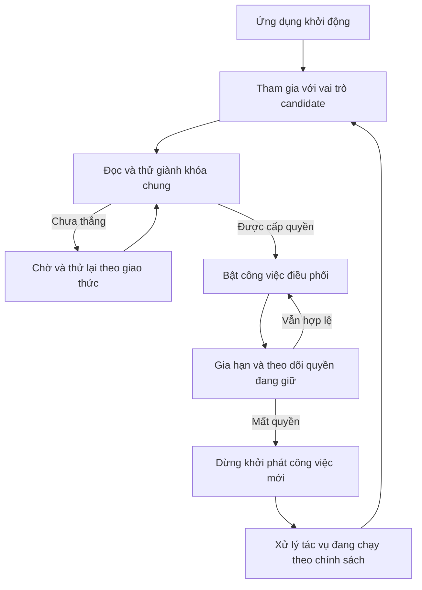
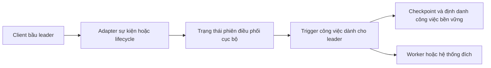

# Leader election là gì và những tác vụ cần một bên điều phối

## Mục tiêu và bối cảnh

Trong chương **Bầu leader** của module **SPRING_CLOUD_KUBERNETES**, leader election giúp các replica phối hợp để một replica nắm vai trò điều phối một nhóm công việc tại một thời điểm theo giao thức đã chọn. Các replica còn lại có thể tiếp tục phục vụ chức năng khác và sẵn sàng tranh quyền khi cần thay thế leader.

Sau bài học, bạn có thể:

- Nhận diện tác vụ cần một bên điều phối trong một ứng dụng Spring chạy nhiều Pod.
- Giải thích vai trò candidate, leader, khóa phối hợp, gia hạn và chuyển quyền.
- Phân biệt bầu leader với phân tải HTTP, chia việc cho worker và bảo đảm xử lý đúng một lần.
- Chọn giữa leader election, CronJob, cơ chế claim theo công việc và việc để mọi replica tự làm.
- Xác định bằng chứng cần có để đánh giá một lần failover thực sự thành công.

Tình huống xuyên suốt là `catalog-service` có ba Pod. Mỗi Pod phục vụ API tra cứu danh mục. Ứng dụng còn cần đồng bộ danh mục từ một nguồn ngoài theo chu kỳ. Đội phát triển muốn có nhiều replica để tăng khả năng sẵn sàng của API, nhưng chỉ một bên khởi phát vòng đồng bộ chung.

Các ví dụ là mô hình học tập. Phần mã chạy thử chỉ ghi log; phần điều phối có mã giả được đánh dấu rõ, không được coi là tích hợp leader election hoàn chỉnh.

## 1. Vấn đề xuất hiện khi từ một tiến trình chuyển sang nhiều replica

Với một Pod, một phương thức `@Scheduled` gọi đồng bộ theo chu kỳ có vẻ đáp ứng yêu cầu. Khi tăng lên ba Pod, mỗi tiến trình có ApplicationContext và scheduler của riêng nó. Nếu cùng chứa bean được lập lịch, cả ba có thể khởi phát cùng loại công việc.

Spring lập lịch callback trên các instance bean tương ứng; tài liệu cũng lưu ý việc tạo nhiều instance của lớp chứa `@Scheduled` dẫn tới nhiều callback được lập lịch. Từ đó, trong mô hình mỗi Pod có một ứng dụng riêng, không thể coi annotation này là lịch duy nhất của toàn cụm. [Spring Framework: Task Execution and Scheduling](https://docs.spring.io/spring-framework/reference/integration/scheduling.html#scheduling-annotation-support-scheduled).

Một timeline minh họa:

```text
10:00:00  Pod A: bắt đầu đồng bộ danh mục
10:00:00  Pod B: bắt đầu đồng bộ danh mục
10:00:01  Pod C: bắt đầu đồng bộ danh mục
```

Hậu quả tùy nghiệp vụ:

- Nguồn ngoài nhận ba lần gọi cho cùng một đợt dữ liệu.
- Nhiều tiến trình ghi đè checkpoint hoặc tạo công việc trùng nhau.
- Giới hạn tần suất của hệ thống ngoài bị tiêu thụ nhanh hơn dự kiến.
- Log và báo cáo khiến người vận hành khó phân biệt một đợt xử lý với ba lần xử lý.

Không phải mọi lần chạy song song đều sai. Nếu công việc được thiết kế phân vùng và mỗi Pod xử lý một tập khóa riêng, chạy song song có thể là yêu cầu đúng. Trước khi thêm leader election, cần viết rõ điều gì phải duy nhất và trong phạm vi nào.

### Những cách xử lý dễ gây hiểu nhầm

| Cách làm | Phạm vi thực tế | Điều cần lưu ý |
| --- | --- | --- |
| Dùng `synchronized` hoặc khóa Java | Một JVM | Không phối hợp các JVM ở các Pod khác nhau |
| Đặt pool scheduler có một thread | Một scheduler trong tiến trình | Vẫn có thể có một scheduler ở mỗi Pod |
| Đặt `replicas: 1` | Số replica được mong muốn cho workload | Giảm phương án dự phòng; thay thế/rollout vẫn cần xét tác vụ đang chạy |
| Chọn Pod có tên nhỏ nhất | Quy ước của ứng dụng | Cần xử lý thay đổi thành viên và lỗi; bản thân phép so tên chưa là giao thức phối hợp an toàn |
| Đặt Service phía trước các Pod | Đường request qua Service | Không quyết định scheduler nội bộ Pod nào được chạy |

Leader election phù hợp khi cần nhiều candidate dự phòng nhưng muốn một vai trò điều phối chung được cấp quyền rõ ràng.

## 2. Leader election là một vai trò có phạm vi

Các thuật ngữ cần phân biệt:

| Thuật ngữ | Ý nghĩa trong bài |
| --- | --- |
| Candidate | Replica đủ điều kiện tham gia bầu chọn |
| Leader | Candidate hiện được giao vai trò điều phối trong một nhóm |
| Follower/standby | Candidate chưa giữ vai trò leader; có thể tiếp quản khi điều kiện cho phép |
| Lock/coordination record | Bản ghi dùng để các candidate phối hợp trạng thái lãnh đạo |
| Renewal | Hành động duy trì quyền đang giữ theo giao thức |
| Leadership loss | Candidate không còn được tiếp tục hành xử với vai trò leader |
| Failover | Quá trình chuyển công việc điều phối sang candidate khác khi cần |

Leader không nhất thiết là Pod lâu đời nhất, mạnh nhất hoặc có tên đầu tiên. Tiêu chí thắng phụ thuộc implementation; không dựa vào những thuộc tính đó nếu giao thức không quy định.

Trong ví dụ:

```text
Phạm vi vai trò: điều phối đồng bộ danh mục
Nhóm candidate: ba replica catalog-service của môi trường thử nghiệm
Tài nguyên phối hợp: một khóa chung của nhóm
Tác vụ dành cho leader: khởi phát đợt đồng bộ và quản lý checkpoint chung
Tác vụ của mọi Pod: phục vụ API tra cứu, health check, cache cục bộ nếu cần
```

Một Pod có thể là leader cho vai trò đồng bộ danh mục nhưng không có vai trò gì trong một nhóm bầu chọn khác. Không tồn tại khái niệm tự động rằng một Pod trở thành leader cho mọi chức năng trong namespace hoặc mọi ứng dụng Spring trong cụm.

### Xác định đúng nhóm bầu chọn

Với thiết kế dùng đối tượng Kubernetes làm khóa, hợp đồng nhóm cần nêu ít nhất:

```text
cluster/API đích
loại tài nguyên khóa
namespace của khóa
tên khóa
vai trò logic nếu implementation phân biệt nhiều vai trò
implementation và định dạng bản ghi tương thích
```

Cùng `spring.application.name` không tự chứng minh các replica đang dùng cùng khóa. Hai candidate cấu hình khác tên khóa có thể trở thành hai leader của hai nhóm riêng mà không hề cạnh tranh với nhau.

Ngược lại, hai tác vụ độc lập dùng nhầm cùng một khóa có thể ngăn nhau hoạt động. Khi triển khai nhiều môi trường, tách khóa và quyền theo ranh giới môi trường; đừng để staging cạnh tranh với production.

## 3. Hình dung cơ chế phối hợp qua Lease

Kubernetes cung cấp đối tượng `Lease` trong API group `coordination.k8s.io` cho các nhu cầu phối hợp, bao gồm leader election. Các trường như danh tính holder và thời điểm gia hạn là dữ liệu có thể quan sát trên bản ghi. [Kubernetes: Leases](https://kubernetes.io/docs/concepts/architecture/leases/).

Luồng khái niệm của một cơ chế dựa trên Lease:



Đường quay lại candidate phụ thuộc lifecycle của client và thành phần tích hợp; không giả định mọi thư viện tự lặp lại vô hạn giống sơ đồ. Sơ đồ diễn đạt trách nhiệm cần thiết của hệ thống, không thay thế API của implementation.

Những bước quan trọng là:

1. Các candidate đọc trạng thái phối hợp.
2. Candidate thử ghi để giành quyền; cơ chế kiểm soát cạnh tranh của API giúp phân xử các lần ghi đồng thời.
3. Candidate thắng được phép khởi phát phần công việc được gắn với vai trò leader.
4. Leader duy trì quyền bằng gia hạn theo quy tắc của client.
5. Khi không còn giữ quyền, nó phải dừng hành vi dành riêng cho leader; candidate khác chỉ tiếp quản theo điều kiện của giao thức.

Với Lease, thời hạn của lượt giữ khóa không đồng nghĩa đối tượng Lease sẽ bị xóa khi hết hạn. Không nên tự thêm một quy trình xóa khóa liên tục để làm cho election hoạt động.

Đừng áp mô hình gia hạn theo Lease một cách máy móc cho mọi implementation cũ dùng ConfigMap. Cần xem cách client thật sự phát hiện leader không còn hợp lệ và cách nó thu hồi quyền.

### Có thể có một khoảng không có leader hữu ích

Sau khi A ngừng gia hạn, B có thể phải chờ điều kiện tiếp quản, thực hiện request API, nhận quyền và khởi tạo công việc. Trong khoảng đó, chưa có replica nào làm được việc điều phối hữu ích.

```text
A ngừng gia hạn
  -> candidate khác xác định có thể tiếp quản
  -> ghi giành quyền thành công
  -> khởi tạo vòng làm việc
  -> xử lý được công việc đầu tiên
```

Khả năng bầu leader không loại bỏ khoảng gián đoạn này. Thiết kế cần chấp nhận độ trễ chuyển quyền và cách xử lý các công việc đã đến hạn trong khoảng trống.

## 4. Những tác vụ thường cần một bên điều phối

### 4.1. Khởi phát một đợt đồng bộ dùng chung

`catalog-service` cần lấy phiên dữ liệu mới từ nguồn ngoài và tạo một đợt cập nhật chung. Nếu cả ba Pod làm cùng lúc, chi phí gọi ngoài và số công việc tạo ra có thể tăng ba lần.

Một coordinator có thể:

- Xác định phiên nguồn nào cần đồng bộ.
- Tạo danh tính công việc ổn định cho phiên đó.
- Chia công việc cho các worker nếu dữ liệu lớn.
- Ghi checkpoint dùng chung sau khi tiến độ thực sự được lưu.

Bầu một coordinator không có nghĩa bắt một Pod tự xử lý toàn bộ bản ghi danh mục. Phần điều phối có thể đơn nhất, còn phần xử lý dữ liệu được chia song song.

### 4.2. Duy trì một phiên kết nối hoặc một vòng polling dùng chung

Một nguồn ngoài có thể chỉ cho phép một phiên subscription của cùng tài khoản, hoặc đội vận hành muốn tránh nhiều vòng polling cùng lấy một luồng thay đổi. Leader có thể quản lý phiên đó, còn candidate khác chờ tiếp quản.

Cần kiểm tra yêu cầu của nguồn: nếu nguồn hỗ trợ nhiều consumer và tự phân vùng an toàn, dùng cơ chế đó có thể phù hợp hơn việc giới hạn toàn hệ thống vào một consumer.

### 4.3. Điều phối trạng thái dùng chung

Một vòng reconcile có thể cần quyết định việc nào sẽ được tạo tiếp theo từ trạng thái chung. Chọn một bên điều phối giúp đơn giản hóa việc tránh nhiều tiến trình cùng ra quyết định giống nhau.

Tuy nhiên, nếu các quyết định độc lập theo tenant hoặc theo partition, có thể dùng coordinator theo từng nhóm hoặc cơ chế claim theo khóa. Không ép mọi tenant vào một leader toàn cục khi không cần thiết.

### 4.4. Một thành phần hạ tầng đã có HA theo leader

Configuration Watcher có chế độ HA ở các phiên bản hỗ trợ: một replica chủ động theo dõi nguồn, các replica khác phục vụ vai trò dự phòng. Đây là ví dụ gần với phạm vi module về một tính năng thực sự có nhu cầu điều phối. Bật đúng chế độ HA của Watcher; không chỉ tăng số replica rồi giả định chúng sẽ tự phân công. [Spring Cloud Kubernetes: Configuration Watcher HA](https://docs.spring.io/spring-cloud-kubernetes/reference/spring-cloud-kubernetes-configuration-watcher.html#high-availability).

### Bảng đánh giá nhanh

| Tác vụ | Có nên cân nhắc leader election? | Điều cần xác nhận |
| --- | --- | --- |
| Khởi phát một đợt đồng bộ chung trong ứng dụng chạy liên tục | Có | Tính duy nhất của đợt, checkpoint và cách tiếp quản |
| Duy trì một phiên kết nối chung bắt buộc | Có | Cách đóng/mở phiên và xử lý leader cũ còn hoạt động |
| Điều phối tạo công việc từ trạng thái dùng chung | Có thể | Có cần một coordinator hay chỉ cần claim theo từng công việc? |
| Phục vụ HTTP API trên nhiều Pod | Thường không | Phân tải request và tính sẵn sàng của API |
| Nạp cache trong bộ nhớ của từng Pod | Thường không | Mỗi tiến trình có cần cache riêng không? |
| Đọc cấu hình riêng của mỗi ứng dụng | Thường không | Mỗi replica vẫn cần nhận cấu hình của nó |
| Xử lý nhiều message độc lập từ hàng đợi | Thường ưu tiên cơ chế phân chia của hệ thống hàng đợi | Ack, retry, claim và khả năng xử lý lặp |
| Chạy một batch độc lập theo lịch | Có phương án khác | CronJob hoặc scheduler chuyên dụng có đáp ứng tốt hơn không? |

## 5. Phân biệt với discovery, phân tải và sức khỏe Pod

Ba khái niệm dễ bị trộn lẫn khi cùng nằm trong một ứng dụng Spring Cloud Kubernetes:

| Khả năng | Câu hỏi nó trả lời | Không tự trả lời |
| --- | --- | --- |
| DiscoveryClient | Các instance đích ở đâu và có thông tin gì? | Instance nào đang giữ vai trò điều phối? |
| Service hoặc Spring Cloud LoadBalancer | Request này được gửi tới instance nào theo cách cấu hình? | Scheduler nội bộ của Pod nào được phép chạy? |
| Leader election | Candidate nào được cấp vai trò điều phối của nhóm? | Mọi request HTTP phải đi qua Pod đó hay không? |
| Readiness/liveness | Pod có đáp ứng điều kiện sức khỏe đã thiết kế? | Công việc nghiệp vụ chung có tiến triển đúng hay không? |

Trong ví dụ, cả A, B và C có thể là instance tốt để phục vụ API tra cứu. Chỉ A giữ quyền khởi phát đồng bộ. Nếu cấu hình readiness của B và C thành thất bại chỉ vì chúng không phải leader, ứng dụng sẽ mất phần lớn khả năng phục vụ API một cách không cần thiết.

Có một vòng phụ thuộc cần tránh: client chờ Pod Ready rồi mới tham gia bầu, trong khi readiness lại chờ Pod trở thành leader. Hai điều kiện như vậy có thể ngăn hệ thống khởi động công việc điều phối. Chọn điều kiện sẵn sàng theo chức năng thực tế và cách client election hoạt động.

Một Service cũng không tự biết leader election record để chuyển toàn bộ request tới leader. Nếu một API bắt buộc xử lý tại leader, cần thiết kế đường định tuyến và hành vi khi đổi leader riêng; không suy ra nó từ nhãn chung của Service.

## 6. Bầu leader không đồng nghĩa mỗi công việc chỉ chạy một lần

Cần phân biệt ba yêu cầu:

| Yêu cầu | Ví dụ | Cơ chế cần quan tâm |
| --- | --- | --- |
| Một bên khởi phát trong trạng thái ổn định | Một coordinator quét phiên nguồn mới | Leader election và gắn đúng công việc với leadership |
| Không lặp tác dụng phụ cho cùng công việc | Không tạo hai bản ghi cho cùng phiên nguồn | Idempotency, ràng buộc duy nhất hoặc giao thức ở nơi xử lý |
| Không mất công việc khi đổi leader | Phiên nguồn chưa xong được xử lý tiếp | Trạng thái bền vững, checkpoint, retry và recovery |

Một tình huống lỗi điển hình:

```text
1. A đang làm leader và gửi công việc W tới hệ thống đích.
2. Hệ thống đích đã nhận W, nhưng A chưa ghi checkpoint hoàn thành.
3. A bị treo hoặc mất kết nối tới Kubernetes API.
4. B được cấp quyền lãnh đạo và đọc checkpoint cũ.
5. B gửi lại W.
```

Cả A và B đều có thể đã hành động hợp lý theo thông tin tại thời điểm của chúng. Election không tự tạo một giao dịch chung giữa Kubernetes Lease, nguồn dữ liệu, nơi lưu checkpoint và hệ thống đích.

Tài liệu client-go cũng nêu rõ leader election không tự cung cấp bảo đảm fencing. Đây là giới hạn cần hiểu khi thiết kế, không phải lý do thay thư viện Java bằng Go. [Kubernetes client-go: leader election](https://pkg.go.dev/k8s.io/client-go/tools/leaderelection).

### Ba công cụ bổ sung có mục đích khác nhau

**Idempotency:** lần xử lý lặp của cùng một công việc không tạo tác dụng phụ lặp ngoài ý muốn. Trong ví dụ, có thể dùng `catalog:source-version-42` làm mã công việc ổn định, nếu phiên nguồn đủ để nhận diện công việc.

**Checkpoint bền vững:** leader mới có thể biết phần nào đã được xử lý. Lưu tiến độ chỉ trong biến Java của leader cũ không giúp candidate khác tiếp tục sau khi tiến trình chết.

**Fencing:** nơi nhận thao tác có cơ chế nhận diện và từ chối quyền ghi đã lỗi thời. Một số tăng dần tùy ý trong bộ nhớ của mỗi Pod chưa phải fencing token dùng chung; token chỉ có ý nghĩa khi được cấp và được kiểm tra theo một giao thức phù hợp.

Không dùng Pod name hoặc mã phiên leadership làm idempotency key cho công việc W, vì khi đổi leader những giá trị đó thay đổi và W có thể bị coi là công việc mới. Cũng không mặc định `resourceVersion` hoặc `leaseTransitions` của Lease là fencing token sẵn dùng cho mọi hệ thống ngoài.

## 7. Đặt trách nhiệm điều phối vào ứng dụng Spring

Spring Cloud Kubernetes có implementation leader election tích hợp với ứng dụng Spring. Tài liệu phân biệt implementation ConfigMap kiểu cũ và native election; API sự kiện cũng khác: nhóm cũ có `OnGrantedEvent`/`OnRevokedEvent`, nhóm native có `StartLeadingEvent`/`StopLeadingEvent` cùng sự kiện nhận biết leader. Chọn tài liệu khớp dependency/release đang triển khai. [Spring Cloud Kubernetes: Leader Election](https://docs.spring.io/spring-cloud-kubernetes/reference/leader-election.html).

Cài dependency hoặc bật một thuộc tính chưa tự chứng minh mọi `@Scheduled` của ứng dụng đã được bảo vệ. Phải có phần tích hợp điều khiển đúng tác vụ:



Mã giả dưới đây mô tả trách nhiệm, không phải API Java có sẵn:

```text
khi nhận quyền leader của vai trò catalog-sync:
    tạo phiên điều phối cục bộ mới
    cho phép trigger của vai trò này hoạt động

khi tới lịch:
    lấy phiên điều phối hiện tại
    nếu phiên không còn hoạt động: bỏ qua lần trigger
    xác định công việc từ phiên nguồn/checkpoint bền vững
    trước khi khởi phát, kiểm tra lại phiên có còn hợp lệ
    xử lý bằng định danh công việc ổn định và cơ chế chống lặp đã chọn

khi mất quyền:
    vô hiệu hóa phiên hiện tại
    dừng khởi phát công việc mới
    xử lý tác vụ đang chạy theo chính sách dừng/hoàn tất có kiểm soát
```

Kiểm tra cờ cục bộ ngay trước khi chạy chỉ thu hẹp cửa sổ lỗi; quyền vẫn có thể mất ngay sau phép kiểm tra. Nó không thay thế fencing hoặc ràng buộc bảo vệ dữ liệu ở nơi nhận tác dụng phụ.

Nếu có nhiều tác vụ trong một ứng dụng, adapter phải chọn đúng vai trò/nhóm. Không để một sự kiện của nhóm A vô tình bật hoặc tắt công việc của nhóm B.

### Hai trách nhiệm cần được kiểm tra riêng

| Trách nhiệm | Ví dụ bằng chứng |
| --- | --- |
| Client election chọn và duy trì quyền | Bản ghi khóa, log được/mất quyền, request gia hạn |
| Ứng dụng tuân thủ quyền | Chỉ phiên điều phối hợp lệ khởi phát công việc; mất quyền thì ngừng nhận việc mới |

Một Lease được gia hạn đều không chứng minh scheduler đã gắn đúng leadership. Ngược lại, log ứng dụng tự nhận mình là leader cũng chưa chứng minh nó đang dùng đúng bản ghi phối hợp.

## 8. Bài thử nhỏ: thấy lịch chạy trên nhiều Pod

Mục đích của bài thử đầu tiên là quan sát vấn đề trước khi tích hợp election. Cần một ứng dụng Spring Boot hiện có và môi trường thử nghiệm có thể chạy nhiều replica. Không gọi nguồn thật hoặc tạo tác dụng phụ nghiệp vụ trong bài thử này.

Bật scheduling trong package được ứng dụng quét:

```java
package example.catalog;

import org.springframework.context.annotation.Configuration;
import org.springframework.scheduling.annotation.EnableScheduling;

@Configuration
@EnableScheduling
public class SchedulingDemoConfig {
}
```

Tạo một trigger chỉ ghi log:

```java
package example.catalog;

import java.time.Instant;
import org.slf4j.Logger;
import org.slf4j.LoggerFactory;
import org.springframework.beans.factory.annotation.Value;
import org.springframework.scheduling.annotation.Scheduled;
import org.springframework.stereotype.Component;

@Component
public class CatalogTickDemo {
    private static final Logger log =
            LoggerFactory.getLogger(CatalogTickDemo.class);

    private final String podName;

    public CatalogTickDemo(@Value("${POD_NAME:local}") String podName) {
        this.podName = podName;
    }

    @Scheduled(fixedDelay = 5000)
    public void tick() {
        log.info("event=catalog_sync_tick pod={} observedAt={}",
                podName, Instant.now());
    }
}
```

Cấp tên Pod qua phần trích container specification:

```yaml
env:
  - name: POD_NAME
    valueFrom:
      fieldRef:
        fieldPath: metadata.name
```

Chạy image chứa mã này với ba replica trong namespace thử nghiệm. Dùng công cụ thu log của môi trường hoặc, nếu workload dùng nhãn dưới đây, lệnh Bash:

```bash
kubectl -n shop-apps logs -l app=catalog-service \
  --all-containers=true --prefix=true --since=2m
```

Kết quả cần tìm là cùng loại `catalog_sync_tick` xuất hiện từ ba Pod qua nhiều chu kỳ. Chúng không nhất thiết phát đúng cùng một mili giây vì thời điểm khởi động mỗi scheduler khác nhau.

Bài thử **chưa có leader election**. Không dùng nó làm mã điều phối production. Sau khi có tích hợp election phù hợp, giữ một log riêng cho scheduler tick và một log riêng cho công việc thực sự được khởi phát; nhiều scheduler tick có thể vẫn xuất hiện nếu ứng dụng dùng cách gate ở bên trong callback.

Ví dụ mong đợi sau tích hợp:

```text
Pod A: scheduler_tick -> leader_work_started work=catalog:source-version-42
Pod B: scheduler_tick -> skipped_not_leader
Pod C: scheduler_tick -> skipped_not_leader
```

Đây là định dạng log minh họa do ứng dụng tự thiết kế. Framework không tự cung cấp các tên sự kiện này. Phần tích hợp còn phải xử lý mất quyền và trạng thái công việc như các mục trước.

## 9. Chọn cơ chế đúng với loại công việc

Leader election thêm một vòng đời cần vận hành: credential Kubernetes, quyền đọc/ghi khóa, request gia hạn, ứng phó mất quyền và chuyển leader. Chỉ chọn nó khi vai trò điều phối liên tục mang lại lợi ích rõ ràng.

| Nhu cầu | Lựa chọn nên đánh giá trước | Lý do |
| --- | --- | --- |
| Batch độc lập mỗi đêm, chạy xong rồi thoát | Kubernetes CronJob hoặc scheduler batch | Vòng đời công việc độc lập với API service |
| Một coordinator liên tục, có nhiều candidate dự phòng | Leader election | Phù hợp vai trò điều phối dài hạn có chuyển quyền |
| Nhiều công việc độc lập, cần tăng số worker | Hàng đợi và cơ chế claim/phân chia công việc | Bảo vệ ở cấp công việc, không gom toàn bộ xử lý vào một leader |
| Một thao tác cập nhật trên một khóa dữ liệu | Transaction hoặc kiểm soát cạnh tranh tại kho dữ liệu | Đặt bảo vệ gần nơi lưu trạng thái cần bảo vệ |
| Cache cục bộ hoặc tài nguyên riêng từng Pod | Mỗi Pod tự quản lý | Một leader không tự cập nhật trạng thái trong bộ nhớ của mọi tiến trình |
| Tác vụ đã có hệ thống điều phối bên ngoài | Tận dụng hệ thống đó sau khi đánh giá | Tránh hai cơ chế phối hợp chồng lên nhau mà không rõ trách nhiệm |

Với CronJob, `concurrencyPolicy: Forbid` giới hạn các lần chạy đồng thời của Jobs do **cùng một CronJob** tạo ra; không phải khóa chung giữa các CronJob độc lập hoặc mọi scheduler Spring. Tài liệu Kubernetes cũng yêu cầu thiết kế Job có tính idempotent vì có tình huống tạo trùng hoặc bỏ lỡ lần chạy. [Kubernetes: CronJob concurrency policy và giới hạn](https://kubernetes.io/docs/concepts/workloads/controllers/cron-jobs/#concurrency-policy).

Với hàng đợi, cần hiểu riêng ack, retry, phân vùng và xử lý lặp. Việc broker phân việc không tự chứng minh mỗi tác dụng phụ xảy ra đúng một lần. Tuy nhiên, khi nhu cầu chính là phân chia hàng nghìn công việc độc lập, bầu một worker duy nhất thường làm giảm khả năng mở rộng không cần thiết.

### Bốn câu hỏi trước khi quyết định

1. Điều gì cần duy nhất: người tạo lịch, một phiên kết nối, một job hay quyền ghi một bản ghi?
2. Phạm vi duy nhất là toàn hệ thống, một tenant, một partition hay một nhóm ứng dụng?
3. Khi bên đang làm chết, bên khác cần biết trạng thái nào để tiếp tục?
4. Nếu có hai lần thực thi hoặc một lần bị bỏ lỡ, hệ thống sẽ phát hiện và phục hồi thế nào?

Nếu câu trả lời cuối cùng chỉ là “chắc sẽ không xảy ra vì đã có leader”, thiết kế chưa đủ.

## 10. Quan sát failover qua công việc hữu ích

Để đánh giá leader election, theo dõi cả quyền lãnh đạo và tiến độ công việc:

| Nhóm bằng chứng | Ví dụ |
| --- | --- |
| Phạm vi nhóm | Vai trò, cluster, loại khóa, namespace, tên khóa |
| Danh tính | Pod/UID, candidate ID, phiên điều phối |
| Quyền | Được cấp quyền, gia hạn, mất quyền, candidate mới tiếp quản |
| Công việc | Work ID, checkpoint trước/sau, bắt đầu, hoàn thành, retry |
| Tác dụng phụ | Kết quả ở hệ thống đích và dấu vết chống lặp |

Với profile dùng Lease, có thể quan sát bằng lệnh chỉ đọc trong môi trường được phép:

```bash
kubectl -n shop-jobs get lease catalog-sync-coordinator \
  -o jsonpath='{.spec.holderIdentity}{"\t"}{.spec.renewTime}{"\t"}{.spec.leaseTransitions}{"\n"}'
```

Tên khóa và namespace trong lệnh là ví dụ; phải thay bằng cấu hình thật. Nếu implementation dùng ConfigMap, tìm đúng nguồn thay vì kết luận không có leader chỉ vì không thấy Lease này.

Một lần chuyển quyền có thể có các mốc:

```text
t0: lần cuối quan sát leader A hoàn thành công việc hữu ích
t1: A ngừng gia hạn hoặc mất quyền
t2: B được cấp quyền lãnh đạo
t3: B đọc được checkpoint và khởi phát công việc
t4: công việc đầu tiên của B hoàn thành ở hệ thống đích
```

Độ trễ từ `t1` đến `t2` mô tả một phần chuyển quyền. Độ trễ tới `t4` mới phản ánh lúc chức năng nghiệp vụ hoạt động hữu ích trở lại. Nếu B được bầu nhưng không đọc được checkpoint hoặc không truy cập được nguồn ngoài, công việc vẫn gián đoạn.

Không lấy số Pod `Ready` làm số leader. Cũng không chỉ tìm một dòng log “became leader” rồi kết luận failover xong. Khi đo bằng log từ nhiều máy, cần xét đồng bộ đồng hồ và khoảng thời gian quan sát.

Quyền API cũng là một phụ thuộc vận hành: khả năng đọc ConfigMap không tự cho phép tạo/gia hạn Lease. Khi gặp lỗi, phân biệt thiếu quyền, credential, mạng và admission trước khi tăng phạm vi Role. Bài khái niệm này không yêu cầu cấp quyền ghi lên Secret hay workload.

## 11. Các hiểu nhầm cần loại bỏ

| Hiểu nhầm | Cách hiểu phù hợp |
| --- | --- |
| Có ba Pod thì Kubernetes tự chọn một Pod để chạy `@Scheduled` | Scheduler trong từng tiến trình hoạt động theo cấu hình của ứng dụng; cần phối hợp nếu muốn giới hạn vai trò chung |
| Leader của một tác vụ phải nhận mọi HTTP request | Vai trò điều phối và đường phục vụ request có thể độc lập |
| Follower là Pod hỏng hoặc vô ích | Nó có thể phục vụ API, làm worker hoặc chờ tiếp quản |
| Bật election tự bảo vệ mọi phương thức có annotation | Ứng dụng phải gắn đúng tác vụ với lifecycle của leadership |
| Khóa có một holder thì chỉ có một tác vụ thực tế đang chạy ở mọi tình huống | Tác vụ cũ có thể còn tồn tại; cần xử lý mất quyền và bảo vệ tác dụng phụ |
| Leader mới tự nhận được toàn bộ bộ nhớ của leader cũ | Trạng thái cần tiếp tục phải được lưu/chuyển bằng cơ chế riêng |
| Đổi leader làm `@Scheduled` tự chạy bù mọi lần bị bỏ lỡ | Chính sách công việc đến hạn và recovery phải được thiết kế rõ |
| Mọi tác vụ chạy theo lịch đều cần leader election | CronJob, scheduler chuyên dụng hoặc bảo vệ theo từng job có thể phù hợp hơn |
| Giảm thời gian chờ luôn làm hệ thống tốt hơn | Cần cân bằng thời gian phục hồi với độ trễ API và độ ổn định chuyển quyền |

Một trường hợp đặc biệt đáng kiểm tra là rollout. Candidate mới có thể lên trước khi candidate cũ dừng hẳn. Hợp đồng nhóm, quyền khóa và cách dừng công việc phải đúng cả khi thay image, không chỉ lúc một Pod bị chết đột ngột.

## 12. Bài luyện tập và tiêu chí hoàn thành

### Bài 1: Phân loại tác vụ

Với mỗi tác vụ sau, chọn “mọi replica”, “một coordinator”, hoặc “claim/phân vùng theo công việc”, rồi giải thích phạm vi trạng thái:

1. Nạp cache trong bộ nhớ của từng Pod sau khởi động.
2. Mỗi phút phát hiện một phiên danh mục mới và tạo đợt đồng bộ chung.
3. Xử lý 100.000 bản ghi độc lập đã được đưa vào hàng đợi.
4. Duy trì một phiên subscription mà nguồn ngoài chỉ cho một kết nối dùng chung.
5. Phục vụ API đọc danh mục trên ba Pod.

Hướng phân tích: cache cục bộ và API thường cần mọi replica phù hợp cùng tham gia; phát hiện phiên nguồn chung và phiên subscription hạn chế có thể cần một coordinator; hàng đợi cần xem cơ chế phân chia ở cấp công việc.

### Bài 2: Mô tả lần chuyển leader

Giả định A đã gửi công việc `catalog:source-version-42`, hệ thống đích đã nhận nhưng checkpoint chưa được ghi. A ngừng hoạt động; B được bầu.

Hãy nêu:

- B đọc được thông tin nào để quyết định tiếp tục?
- Vì sao công việc có thể bị gửi lại?
- Idempotency key phải giữ ổn định qua lần chuyển leader như thế nào?
- Bằng chứng nào xác nhận nguồn dữ liệu và hệ thống đích đã nhất quán trở lại?

### Bài 3: Viết hợp đồng điều phối

Hoàn thiện một bản thiết kế ngắn cho ví dụ `catalog-service`:

```text
Vai trò cần bầu:
Nhóm candidate:
Phạm vi/định danh khóa:
Công việc chỉ dành cho leader:
Công việc vẫn chạy ở mọi replica:
Nguồn checkpoint bền vững:
Định danh công việc và cách chống lặp:
Hành vi khi mất quyền:
Cách xử lý công việc đã đến hạn trong lúc chuyển quyền:
Bằng chứng failover thành công:
```

Bài học đạt mục tiêu khi bạn giải thích được vì sao một tác vụ cần một bên điều phối, giới hạn chính xác phần việc đó và mô tả được cách hệ thống phục hồi sau khi bên đang điều phối mất quyền. Từ hợp đồng này mới lựa chọn implementation Spring Cloud Kubernetes, loại khóa, quyền RBAC và tham số vận hành tương ứng.
