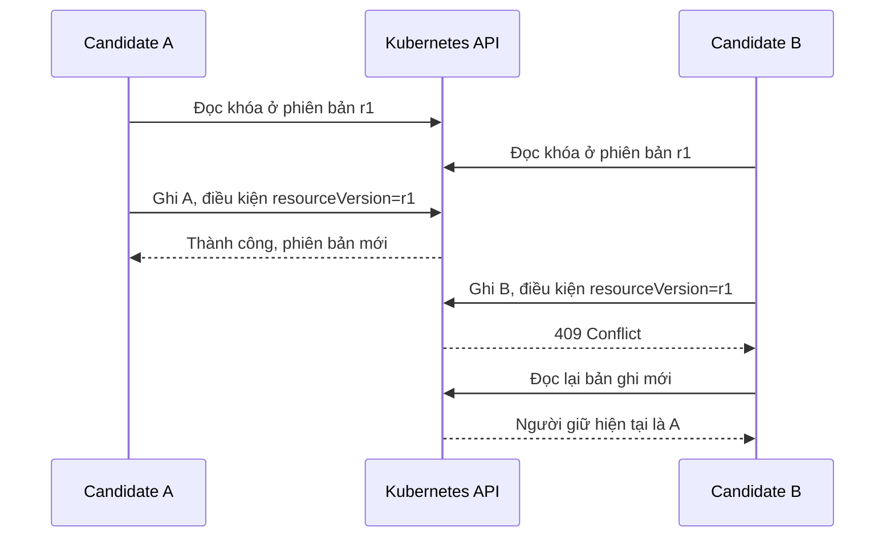

# Tài nguyên khóa và cơ chế cạnh tranh vai trò

## Mục tiêu bài học

Trong chương Bầu leader của module Spring Cloud Kubernetes, bài này giải thích cách nhiều replica phối hợp qua một tài nguyên khóa để chọn instance thực hiện một vai trò.

Sau bài học, bạn có thể:

- Xác định các replica có thật sự cạnh tranh trên cùng một khóa hay không.
- Giải thích vai trò của ConfigMap, Lease và `resourceVersion`.
- Phân biệt cơ chế ConfigMap của Spring Cloud Kubernetes 3.3 với cơ chế native có gia hạn Lease.
- Đọc kết quả cạnh tranh, cấp quyền phù hợp và quan sát chuyển giao leader.
- Nhận ra giới hạn của leader election đối với tác vụ đang chạy và tác dụng phụ bên ngoài.

Ví dụ cấu hình Spring dùng **Fabric8 leader theo cơ chế ConfigMap của dòng 3.3**. Phần Lease mô tả riêng cơ chế có thời hạn; không áp dụng các thuộc tính native cho một phiên bản chưa hỗ trợ chúng.

## 1. Khóa giải quyết điều gì khi có nhiều replica?

Giả sử `report-worker` chạy ba Pod. Mỗi Pod đều có thể phục vụ HTTP, nhưng chỉ một Pod được chủ động quét danh sách báo cáo cần tổng hợp.

Nếu cả ba cùng chạy lịch quét, một báo cáo có thể bị xử lý nhiều lần. Nếu chỉ cấu hình `replicas: 1`, khi Pod lỗi sẽ không có một tiến trình dự phòng đang sẵn sàng tiếp quản.

Leader election cho phép ba instance cùng tồn tại và cạnh tranh cho vai trò `report-runner`. Những instance không giữ vai trò vẫn có thể thực hiện chức năng khác hoặc chờ tiếp quản.

| Khái niệm | Ý nghĩa trong ví dụ |
| --- | --- |
| Candidate | Một instance đang tham gia cạnh tranh |
| Leader | Instance được cơ chế bầu chọn công nhận cho vai trò |
| Follower | Instance chưa được cấp vai trò đó |
| Lock resource | Đối tượng Kubernetes chứa thông tin điều phối |
| Leadership role | Tên công việc logic, ở đây là `report-runner` |
| Candidate identity | Danh tính riêng của từng instance tham gia |

Vai trò leader trong bài là vai trò điều phối nghiệp vụ. Nó khác đối tượng `Role` của RBAC, vốn quy định quyền truy cập Kubernetes API.

Kubernetes không tự biết công việc tổng hợp báo cáo của bạn. Thư viện điều phối khóa và phát tín hiệu; ứng dụng cần quyết định khi nào bắt đầu, ngừng nhận công việc và xử lý tác vụ đang chạy.

## 2. Những gì tạo nên một miền cạnh tranh

### 2.1. Không chỉ có tên ứng dụng

Để cạnh tranh với nhau, các candidate phải dùng cùng phạm vi điều phối. Có thể mô tả phạm vi này bằng:

```text
cluster + loại tài nguyên khóa + namespace + tên tài nguyên + khóa logic của vai trò
```

Với cơ chế ConfigMap 3.3 trong bài:

```text
cluster:       cluster-lab
kind:          ConfigMap
namespace:     sck-leader-lab
resource name: report-leaders
logical role:  report-runner
```

Nếu Pod A ghi `report-leaders` ở namespace X, còn Pod B ghi cùng tên ở namespace Y, chúng đang dùng hai tài nguyên khác nhau. Mỗi nhóm có thể tự bầu leader riêng.

Tương tự, cùng namespace nhưng một nhóm dùng ConfigMap và một nhóm dùng Lease sẽ không tự phối hợp chỉ vì tên đối tượng giống nhau.

### 2.2. Vai trò giống nhau, danh tính candidate phải phân biệt được

Trong cơ chế 3.3, mỗi vai trò được lưu thành một key trong `data` của ConfigMap, ghép từ tiền tố cấu hình và tên role. Với tiền tố mặc định, hình dung bản ghi đang quan sát như sau:

```yaml
# Minh họa trạng thái đã được thư viện ghi, không dùng để gán leader thủ công.
apiVersion: v1
kind: ConfigMap
metadata:
  name: report-leaders
  namespace: sck-leader-lab
data:
  leader.id.report-runner: report-worker-abc
```

`report-runner` là vai trò dùng chung; `report-worker-abc` là ID candidate đang giữ vai trò. Cách tạo key này nằm trong `LeadershipController` của dòng 3.3. [Mã nguồn LeadershipController 3.3.3](https://github.com/spring-cloud/spring-cloud-kubernetes/blob/v3.3.3/spring-cloud-kubernetes-commons/src/main/java/org/springframework/cloud/kubernetes/commons/leader/LeadershipController.java)

Auto-configuration Fabric8 3.3 tạo candidate dựa trên hostname. Trong triển khai Pod thông thường, cần giữ việc nhận diện này phù hợp tên Pod mà thư viện dùng để kiểm tra readiness; không cấu hình mọi replica cùng một danh tính cố định. [Fabric8LeaderAutoConfiguration 3.3.3](https://github.com/spring-cloud/spring-cloud-kubernetes/blob/v3.3.3/spring-cloud-kubernetes-fabric8-leader/src/main/java/org/springframework/cloud/kubernetes/fabric8/leader/Fabric8LeaderAutoConfiguration.java)

Hai vai trò khác nhau có thể được lưu trong cùng ConfigMap. Đây là hai cuộc cạnh tranh logic khác nhau; chúng không tạo ra một leader duy nhất cho mọi công việc. Tuy nhiên, các cập nhật vẫn có thể va chạm ở mức cùng đối tượng Kubernetes.

## 3. ConfigMap và Lease không có cùng giao thức

### 3.1. ConfigMap trong cơ chế Spring Cloud Kubernetes 3.3

Tài liệu dòng 3.3 mô tả cơ chế Fabric8 dùng ConfigMap và các sự kiện Spring Integration `OnGrantedEvent`, `OnRevokedEvent`. [Leader election 3.3](https://docs.spring.io/spring-cloud-kubernetes/reference/3.3/leader-election.html)

Ở implementation này, thư viện đọc bản ghi leader, kiểm tra readiness của Pod liên quan và cập nhật ConfigMap khi cần thay đổi người giữ vai trò. Nó không biến `update-period` thành thời hạn thuê khóa.

Một ConfigMap chứa ID leader không tự có `leaseDurationSeconds` hoặc cơ chế hết hạn do API server thực thi.

### 3.2. Lease và cơ chế native ở phiên bản hỗ trợ

Lease là tài nguyên thuộc nhóm `coordination.k8s.io`, dùng để điều phối giữa các thành phần. Các trường thường quan sát gồm: [Kubernetes Lease API](https://kubernetes.io/docs/reference/kubernetes-api/coordination/lease-v1/)

| Trường Lease | Ý nghĩa quan sát |
| --- | --- |
| `spec.holderIdentity` | Danh tính người giữ bản ghi |
| `spec.acquireTime` | Thời điểm nhận lượt giữ khóa |
| `spec.renewTime` | Thời điểm gia hạn được ghi nhận |
| `spec.leaseDurationSeconds` | Khoảng thời gian liên quan đến quyết định tiếp quản |
| `spec.leaseTransitions` | Số lần chuyển người giữ được ghi trong bản ghi |

Tài liệu Spring Cloud Kubernetes 5.1 mô tả thêm đường native hỗ trợ Lease hoặc ConfigMap, với nhóm thuộc tính `spring.cloud.kubernetes.leader.election.*` và các sự kiện `NewLeaderEvent`, `StartLeadingEvent`, `StopLeadingEvent`. Phải kiểm tra đúng phiên bản trước khi sử dụng. [Leader election native](https://docs.spring.io/spring-cloud-kubernetes/reference/5.1/leader-election.html)

| Điểm phân biệt | Ví dụ ConfigMap 3.3 trong bài | Cơ chế native có thời hạn |
| --- | --- | --- |
| Nơi chứa trạng thái | ConfigMap, `data` theo role | Bản ghi Lease hoặc ConfigMap theo implementation |
| Điều kiện chuyển giao cần xem | Bản ghi và trạng thái Pod/readiness | Gia hạn, thời hạn và điều kiện của client |
| Cấu hình khóa | `leader.config-map-name`, `leader.namespace` | `leader.election.lock-name`, `lock-namespace` ở phiên bản hỗ trợ |
| Tín hiệu ứng dụng | `OnGrantedEvent`, `OnRevokedEvent` | Các event native tương ứng |

Không chỉ thay ConfigMap bằng Lease trong YAML rồi cho rằng ứng dụng cũ sẽ tự đổi giao thức. Dependency, auto-configuration, schema bản ghi, event và RBAC phải tương thích.

## 4. Vì sao đọc cùng một trạng thái không làm cả hai cùng thắng?

### 4.1. Đọc rồi ghi vô điều kiện là chưa đủ

Xét hai candidate A và B cùng thấy vai trò chưa có người giữ:

```text
A đọc: chưa có leader.
B đọc: chưa có leader.
A ghi: leader = A.
B ghi: leader = B.
```

Nếu cả hai tự công nhận mình chỉ từ kết quả đọc, công việc có thể chạy song song. Cần một cách ghi có điều kiện để phát hiện trạng thái đã thay đổi giữa lúc đọc và ghi.

Kubernetes cung cấp `metadata.resourceVersion`. Khi cập nhật theo phiên bản cũ, API server có thể từ chối bằng `409 Conflict`; client phải đọc lại và đánh giá lại thay vì ghi đè mù. [Kubernetes API: cập nhật đối tượng](https://kubernetes.io/docs/reference/using-api/api-concepts/#updates-to-existing-resources)

### 4.2. Một cuộc cạnh tranh minh họa



`r1` chỉ là ký hiệu minh họa. Không tự tăng, sắp xếp hoặc dùng resourceVersion làm số thứ tự nghiệp vụ.

Nếu tài nguyên khóa chưa tồn tại, nhiều candidate có thể cùng thử tạo một đối tượng cùng tên. Một lần tạo thành công không làm các lần tạo cùng tên tiếp theo hợp lệ; bên thua cần đọc lại trạng thái đã có.

Không phải mọi PATCH đều tự tạo cạnh tranh an toàn. Cách cập nhật phải có điều kiện phù hợp với trạng thái đã đọc.

### 4.3. Khóa trong JVM và khóa giữa các Pod

`ReentrantLock` hoặc `synchronized` chỉ phối hợp các luồng trong cùng tiến trình. Chúng không ngăn JVM ở Pod khác cùng gửi yêu cầu.

Trong controller Fabric8 3.3, việc cập nhật ConfigMap dùng phiên bản đã đọc qua `lockResourceVersion(...).update()`. Đây là bước phối hợp với tài nguyên chung; khóa cục bộ và điều kiện cập nhật phân tán có trách nhiệm khác nhau. [Fabric8LeadershipController 3.3.3](https://github.com/spring-cloud/spring-cloud-kubernetes/blob/v3.3.3/spring-cloud-kubernetes-fabric8-leader/src/main/java/org/springframework/cloud/kubernetes/fabric8/leader/Fabric8LeadershipController.java)


## 5. Vòng cạnh tranh của cơ chế ConfigMap 3.3

Có thể tóm tắt đường xử lý ở mức khái niệm:

```text
Đọc ConfigMap và bản ghi của role.

Nếu đã có leader và Pod đó còn Ready:
    Ghi nhận trạng thái leader đang quan sát; chưa chiếm vai trò.
Nếu không còn leader hợp lệ:
    Kiểm tra candidate hiện tại có Ready hay không.
    Thử cập nhật trạng thái bằng cơ chế có điều kiện.
    Chỉ công bố được cấp vai trò sau khi thao tác nhận vai trò thành công.

Nếu có xung đột hoặc lỗi API:
    Không tự nhận đã thắng.
    Phân loại lỗi, quan sát lại và tham gia lượt kiểm tra tiếp theo.
```

Đây là diễn giải để học cơ chế, không phải mã thay thế controller. Implementation còn xử lý thu hồi bản ghi của chính candidate, watcher và sự kiện cục bộ.

### 5.1. Readiness tham gia vào quyết định

Dòng 3.3 có watcher theo dõi readiness của Pod liên quan và kích hoạt kiểm tra lại khi trạng thái thay đổi. Vì vậy, cần kiểm tra cả quyền đọc/theo dõi Pod bên cạnh quyền thao tác ConfigMap. [Fabric8PodReadinessWatcher 3.3.3](https://github.com/spring-cloud/spring-cloud-kubernetes/blob/v3.3.3/spring-cloud-kubernetes-fabric8-leader/src/main/java/org/springframework/cloud/kubernetes/fabric8/leader/Fabric8PodReadinessWatcher.java)

Thiết kế readiness cần tránh vòng lặp:

```text
Pod chỉ Ready khi đã là leader.
Nhưng candidate chỉ được xem xét nhận vai trò khi Ready.
```

Trong trường hợp đó, tất cả candidate có thể đứng chờ. Follower khỏe có thể vẫn cần Ready để phục vụ HTTP hoặc đủ điều kiện tiếp quản, tùy thiết kế ứng dụng.

Readiness không tự dừng mọi luồng nền. Một Pod không nhận traffic từ Service vẫn có thể có tác vụ đang chạy. [Kubernetes probes](https://kubernetes.io/docs/concepts/workloads/pods/probes/)

### 5.2. Chu kỳ kiểm tra khác chu kỳ gia hạn Lease

`spring.cloud.kubernetes.leader.update-period` trong ví dụ ConfigMap điều khiển lượt kiểm tra định kỳ của leader initiator. Ngoài lịch đó còn có các kích hoạt từ watcher; không coi giá trị này là thời gian failover cố định. [LeaderInitiator 3.3.3](https://github.com/spring-cloud/spring-cloud-kubernetes/blob/v3.3.3/spring-cloud-kubernetes-commons/src/main/java/org/springframework/cloud/kubernetes/commons/leader/LeaderInitiator.java)

Khi bản ghi vẫn hợp lệ và leader còn Ready, không nên kỳ vọng resourceVersion của ConfigMap phải tăng sau mỗi chu kỳ. Kiểm tra trạng thái không nhất thiết đồng nghĩa ghi lại đối tượng.

Một xung đột cập nhật riêng lẻ là kết quả cạnh tranh có thể dự kiến. `403 Forbidden`, lỗi TLS hoặc không truy cập được API server lại cần được điều tra như lỗi vận hành.

### 5.3. Không có lời hứa luân phiên công bằng

Candidate đang khỏe không phải nhường vai trò sau một số chu kỳ để mỗi Pod đều có lượt. Không dùng kết quả bầu leader làm bộ lập lịch round-robin.

Nếu một candidate vừa mất vai trò rồi tham gia lại, nó vẫn có thể thắng ở lần cạnh tranh sau. Nhu cầu ưu tiên, luân phiên hoặc phân chia tải cần được thiết kế riêng.

## 6. Với cơ chế Lease: nhận khóa, gia hạn và tiếp quản

Phần này mô tả các client bầu leader có bản ghi thuê thời hạn, độc lập với ví dụ ConfigMap 3.3.

### 6.1. Ba khoảng thời gian có trách nhiệm khác nhau

| Tham số khái niệm | Vai trò |
| --- | --- |
| Lease duration | Khoảng chờ để một candidate khác có thể xem xét tiếp quản theo giao thức |
| Renew deadline | Giới hạn mà leader cố gia hạn trước khi tự dừng vai trò theo client |
| Retry period | Khoảng giữa các lượt thử nhận/gia hạn |

Một cấu hình minh họa có thể là:

```text
leaseDuration = 15 giây
renewDeadline = 10 giây
retryPeriod   = 2 giây
```

Đây là bộ số phục vụ diễn giải. Cần thỏa điều kiện validation của client, đồng thời đủ dư địa cho độ trễ API, lịch chạy luồng và thời gian tạm dừng JVM. Ví dụ Kubernetes Java Client yêu cầu `leaseDuration > renewDeadline > retryPeriod`. [LeaderElector của Kubernetes Java Client](https://github.com/kubernetes-client/java/blob/master/extended/src/main/java/io/kubernetes/client/extended/leaderelection/LeaderElector.java)

Giảm mạnh lease duration có thể làm tiếp quản nhanh hơn trong một số lỗi nhưng cũng tăng nguy cơ đổi leader do gián đoạn tạm thời. Không chỉnh chỉ dựa trên kỳ vọng thời gian phản hồi lý tưởng.

### 6.2. Lease còn tồn tại không có nghĩa quyền giữ còn hiệu lực

Tài nguyên Lease là nơi lưu bản ghi. Hết thời hạn không đồng nghĩa API server tự xóa đối tượng, tự khởi chạy công việc ở follower hoặc tự giết leader cũ.

Client đọc bản ghi, quan sát gia hạn, xác định điều kiện tiếp quản và cạnh tranh cập nhật. Các chi tiết về đồng hồ và thời điểm quan sát phụ thuộc implementation; phép tính `renewTime + duration` chỉ nên dùng để diễn giải hoặc chẩn đoán có giới hạn, không để tự thay thuật toán của thư viện.

Ví dụ thứ tự sự kiện mong đợi trong một tình huống gia hạn thất bại:

```text
A đang giữ Lease.
A không gia hạn được trong khoảng client cho phép và ngừng công việc leader.
B tiếp tục quan sát; khi đủ điều kiện tiếp quản, B thử cập nhật Lease.
B chỉ bắt đầu phần việc leader sau khi nhận vai trò thành công.
```

Có thể có khoảng không có leader. Cũng cần phòng trường hợp tiến trình cũ chưa thực sự dừng công việc khi hệ thống đã tiếp quản; đó là lý do phải xét thêm cơ chế bảo vệ tác dụng phụ.

Không cam kết failover luôn đúng bằng lease duration hoặc renew deadline. Thời gian phát hiện, quan sát cục bộ, thử lại, độ trễ API và khởi động công việc đều ảnh hưởng.

## 7. Cấu hình Spring minh họa cho ConfigMap 3.3

### 7.1. Dependency và cấu hình ứng dụng

Dependency leader tương ứng:

```xml
<dependency>
    <groupId>org.springframework.cloud</groupId>
    <artifactId>spring-cloud-kubernetes-fabric8-leader</artifactId>
</dependency>
```

Quản lý phiên bản bằng Spring Cloud BOM tương thích với Spring Boot của dự án; ứng dụng cần được tạo KubernetesClient phù hợp. Không trộn tùy ý dependency leader và client từ các dòng phát hành khác nhau.

Ví dụ `application.yaml`:

```yaml
spring:
  application:
    name: report-worker
  cloud:
    kubernetes:
      leader:
        enabled: true
        namespace: ${POD_NAMESPACE}
        config-map-name: report-leaders
        role: report-runner
        create-config-map: false
        update-period: 5s
```

Chọn `create-config-map: false` vì bài thực hành để người vận hành tạo khóa trước. `update-period: 5s` là lựa chọn cho lab, không phải giá trị mặc định. Các thuộc tính thuộc nhóm leader ConfigMap 3.3. [Bảng thuộc tính Spring Cloud Kubernetes 3.3](https://docs.spring.io/spring-cloud-kubernetes/reference/3.3/appendix.html)

Tất cả replica tham gia vai trò này phải nhận cùng namespace, tên ConfigMap và tên role. Những ứng dụng không liên quan nên có phạm vi khóa riêng theo thiết kế.

### 7.2. Cấp quyền và tạo tài nguyên khóa trước

Khối PowerShell sau dành cho namespace lab được phép sử dụng. Nó tạo ServiceAccount, ConfigMap rỗng và bộ quyền phục vụ ví dụ:

```powershell
$leaderLabManifest = @'
apiVersion: v1
kind: Namespace
metadata:
  name: sck-leader-lab
---
apiVersion: v1
kind: ServiceAccount
metadata:
  name: report-worker
  namespace: sck-leader-lab
---
apiVersion: v1
kind: ConfigMap
metadata:
  name: report-leaders
  namespace: sck-leader-lab
data: {}
---
apiVersion: rbac.authorization.k8s.io/v1
kind: Role
metadata:
  name: report-leader-participant
  namespace: sck-leader-lab
rules:
  - apiGroups: [""]
    resources: ["configmaps"]
    resourceNames: ["report-leaders"]
    verbs: ["get", "watch", "update"]
  - apiGroups: [""]
    resources: ["pods"]
    verbs: ["get", "list", "watch"]
---
apiVersion: rbac.authorization.k8s.io/v1
kind: RoleBinding
metadata:
  name: report-leader-participant-binding
  namespace: sck-leader-lab
subjects:
  - kind: ServiceAccount
    name: report-worker
    namespace: sck-leader-lab
roleRef:
  apiGroup: rbac.authorization.k8s.io
  kind: Role
  name: report-leader-participant
'@

$leaderLabManifest | kubectl apply -f -
```

Quyền ConfigMap trong ví dụ không cấp `create` vì đối tượng đã được tạo trước. Nếu bật cơ chế tự tạo khóa, phải thiết kế quyền `create` riêng; RBAC không giới hạn thao tác tạo tài nguyên cấp cao bằng `resourceNames` theo cách giới hạn đọc/cập nhật. [Kubernetes RBAC](https://kubernetes.io/docs/reference/access-authn-authz/rbac/#referring-to-resources)

Quyền Pod dùng để phục vụ quan sát trạng thái candidate/leader trong namespace lab. Với phiên bản hoặc client khác, xác minh những verb thực sự sử dụng trước khi thu hẹp hay bổ sung.

Không cấp wildcard hoặc quyền Secret chỉ để bầu leader. Nếu chuyển sang Lease, cần quyền thích hợp trên `leases` của `coordination.k8s.io`; quyền ConfigMap không tự áp dụng cho tài nguyên đó.

### 7.3. Gắn danh tính và namespace cho Pod

Trích phần Pod template của Deployment:

```yaml
spec:
  replicas: 3
  template:
    spec:
      serviceAccountName: report-worker
      containers:
        - name: application
          image: registry.example.com/training/report-worker:1.0.0
          env:
            - name: POD_NAMESPACE
              valueFrom:
                fieldRef:
                  fieldPath: metadata.namespace
```

Đây là đoạn ghép vào Deployment đã có selector, label, probe và image thật, không phải manifest triển khai độc lập. Giữ namespace của KubernetesClient phù hợp namespace Pod trong ví dụ; việc đọc readiness của Pod cũng phải đi đúng phạm vi.

Image cần chứa mã ứng dụng phản ứng với sự kiện leader. Chỉ thêm dependency và tăng replica không tự biến mọi `@Scheduled` thành tác vụ chỉ chạy ở leader.

### 7.4. Cổng thực thi trong ứng dụng

Mã giả cho phần ứng dụng:

```text
Khi được cấp vai trò report-runner:
    Cho phép nhận công việc mới của vai trò đó.

Khi bị thu hồi vai trò report-runner:
    Đóng cổng nhận công việc mới ngay.
    Yêu cầu hủy hoặc dừng an toàn các công việc đang chạy.

Trước mỗi đợt xử lý:
    Nếu chưa có quyền thực thi cục bộ: bỏ qua.
    Thực hiện tác vụ với khóa nghiệp vụ/idempotency phù hợp.
```

Cờ cục bộ phải có cơ chế đồng bộ giữa các luồng. Nó vẫn có thể trở nên cũ khi tiến trình tạm dừng hoặc mất kết nối, nên không thay thế cơ chế bảo vệ dữ liệu đích.


## 8. Thí nghiệm nhỏ: hai bản đọc, một cập nhật bị xung đột

Thí nghiệm này chỉ minh họa cập nhật có điều kiện. Nó không chạy thuật toán bầu leader hoàn chỉnh và không sử dụng ConfigMap `report-leaders` của ứng dụng.

### 8.1. Tạo một ConfigMap riêng cho thí nghiệm

Chạy sau khi namespace `sck-leader-lab` đã tồn tại. Dùng tài khoản vận hành có quyền tạo, đọc và cập nhật ConfigMap:

```powershell
$raceManifest = @'
apiVersion: v1
kind: ConfigMap
metadata:
  name: lock-race-demo
  namespace: sck-leader-lab
data:
  holder: ""
'@

$raceManifest | kubectl apply -f -
```

Đảm bảo không có tiến trình nào khác chỉnh đối tượng thử nghiệm này.

### 8.2. Giữ hai bản đọc cùng phiên bản

```powershell
$raceA = kubectl -n sck-leader-lab get configmap lock-race-demo -o json |
    ConvertFrom-Json
$raceB = kubectl -n sck-leader-lab get configmap lock-race-demo -o json |
    ConvertFrom-Json

$raceA.metadata.resourceVersion
$raceB.metadata.resourceVersion
```

Kỳ vọng hai phiên bản giống nhau vì chưa có cập nhật xen giữa. Giữ nguyên `metadata.resourceVersion` của mỗi bản.

### 8.3. Cập nhật từ bản A rồi từ bản B đã cũ

```powershell
$raceA.data.holder = 'candidate-a'
$raceA | ConvertTo-Json -Depth 20 | kubectl replace -f -

$raceB.data.holder = 'candidate-b'
$raceB | ConvertTo-Json -Depth 20 | kubectl replace -f -
```

Lần đầu phải thành công. Lần thứ hai dùng phiên bản cũ nên phải bị từ chối với lỗi conflict trong điều kiện thí nghiệm này.

Đọc lại:

```powershell
kubectl -n sck-leader-lab get configmap lock-race-demo -o yaml
```

Kỳ vọng `holder` vẫn là `candidate-a`. Không xóa resourceVersion, không dùng `--force` và không đổi lệnh thành ghi đè vô điều kiện để làm lần thứ hai thành công.

Trong leader election thật, sau xung đột, B phải đọc lại và kiểm tra A có còn giữ vai trò hợp lệ hay không. Việc có thể đọc lại rồi ghi thành công chỉ chứng minh quyền cập nhật đối tượng, không tự chứng minh B được phép chiếm vai trò.

Thí nghiệm cho thấy điểm phân xử nằm ở cập nhật có điều kiện trên trạng thái chung. Nó không biến trường `holder` tự đặt thành một khóa có thời hạn hoặc có fencing.

## 9. Quan sát cuộc bầu chọn của ứng dụng

### 9.1. Quan sát bản ghi và tín hiệu cục bộ

Khi ba replica của ứng dụng minh họa đã được triển khai:

```powershell
kubectl -n sck-leader-lab get pods -l app=report-worker -o wide
kubectl -n sck-leader-lab get configmap report-leaders -o yaml
```

Lấy người giữ vai trò từ bản ghi:

```powershell
$reportLeaderState = kubectl -n sck-leader-lab get configmap report-leaders -o json |
    ConvertFrom-Json
$reportLeaderState.data.'leader.id.report-runner'
```

Đối chiếu ID với Pod và log cấp/thu hồi vai trò của ứng dụng. Nếu có Actuator và info contributor tương ứng, có thể đọc thông tin leader qua endpoint nội bộ được bảo vệ; không suy ra công việc đang chạy đúng chỉ từ một bản ghi.

Cần tách ba quan sát:

| Quan sát | Chứng minh điều gì? |
| --- | --- |
| ConfigMap/Lease đang ghi một holder | Trạng thái điều phối đang được lưu |
| Pod nhận sự kiện cấp vai trò | Tiến trình đã nhận tín hiệu cục bộ |
| Công việc thực tế được xử lý đúng | Cổng thực thi và cơ chế bảo vệ nghiệp vụ hoạt động theo thiết kế |

Không yêu cầu mỗi follower đều có log cấp vai trò. Chúng có thể hoạt động đúng bằng cách tiếp tục chờ và quan sát.

### 9.2. Kiểm tra chuyển giao trong lab

Với tác vụ thử nghiệm không tạo tác dụng phụ thật:

1. Ghi nhận holder hiện tại, các Pod Ready và thời điểm quan sát.
2. Xóa đúng Pod leader bằng thao tác thông thường trong namespace lab.
3. Theo dõi thay đổi bản ghi và sự kiện từ các candidate còn lại.
4. Xác nhận instance nhận vai trò mới bắt đầu công việc.
5. Xác nhận Pod thay thế tham gia lại mà không tự chạy phần việc leader trước khi được cấp.

Lệnh minh họa sau khi đã xác định tên Pod leader thực tế:

```powershell
kubectl -n sck-leader-lab delete pod TEN_POD_LEADER
```

Không dùng tùy chọn ép xóa để mô phỏng một lần dừng bình thường. Nếu cần khảo sát mất kết nối, JVM pause hoặc lỗi không thể cleanup, hãy xây tình huống thử riêng và giữ công việc ở mức an toàn để lặp lại.

Không đặt tiêu chí failover đúng bằng `5s` trong ví dụ ConfigMap. Đo thời gian từ lúc lỗi tới khi công việc được tiếp tục, đồng thời ghi nhận readiness, watcher và lỗi API.

### 9.3. Kiểm tra quyền khóa

Với tài khoản vận hành được phép impersonate danh tính tương ứng:

```powershell
$reportIdentity = '--as=system:serviceaccount:sck-leader-lab:report-worker'

kubectl auth can-i get configmaps/report-leaders -n sck-leader-lab $reportIdentity
kubectl auth can-i update configmaps/report-leaders -n sck-leader-lab $reportIdentity
kubectl auth can-i watch configmaps/report-leaders -n sck-leader-lab $reportIdentity
kubectl auth can-i get pods -n sck-leader-lab $reportIdentity
kubectl auth can-i watch pods -n sck-leader-lab $reportIdentity
kubectl auth can-i get secrets -n sck-leader-lab $reportIdentity
```

Với bộ quyền mẫu và không có cấp quyền bổ sung, các phép đọc/cập nhật/theo dõi cần thiết phải được phép, còn đọc Secret phải bị từ chối.

Trong môi trường có binding theo group, cần xét thêm các group của danh tính khi kiểm tra. Kết quả review vẫn cần được đối chiếu với log yêu cầu API thực tế, đặc biệt khi dùng giới hạn tên tài nguyên.

Với cơ chế native dùng Lease, quan sát tài nguyên `lease` theo đúng namespace/tên khóa đã cấu hình và kiểm tra quyền ở nhóm `coordination.k8s.io`. Không chẩn đoán một khóa Lease bằng cách chỉ nhìn ConfigMap cùng tên.

## 10. Khóa điều phối chưa bảo vệ mọi tác dụng phụ

### 10.1. Cập nhật bản ghi an toàn và dừng công việc là hai việc khác nhau

Giả sử A đang thực hiện một đợt ghi dữ liệu. A bị tạm dừng lâu; B sau đó được công nhận làm leader. Khi A hoạt động lại, một tác vụ cũ của A vẫn có thể tiếp tục chạy nếu ứng dụng không chặn nó.

Có một holder trong tài nguyên khóa không có nghĩa mọi tiến trình cũ đã mất khả năng ghi vào hệ thống bên ngoài. Tài liệu client-go cũng nêu rõ leader election không tự cung cấp bảo đảm fencing. [Giới hạn leader election của client-go](https://github.com/kubernetes/client-go/blob/master/tools/leaderelection/leaderelection.go)

Đối với ứng dụng, cần xử lý:

- Đóng cổng nhận việc khi thu hồi vai trò hoặc khi không còn đủ bằng chứng để tiếp tục.
- Hủy có hợp tác hoặc chia công việc thành các đoạn có điểm kiểm tra.
- Đặt timeout và giới hạn vòng đời công việc.
- Kiểm tra quyền ghi ở dữ liệu đích khi tác vụ yêu cầu bảo đảm chặt chẽ.

Chỉ đọc một cờ `isLeader` ở đầu một tác vụ kéo dài nhiều phút không đủ để chứng minh nó vẫn được phép ghi ở phút cuối.

### 10.2. Idempotency và fencing giải quyết hai vấn đề khác nhau

Với báo cáo theo ngày, một khóa nghiệp vụ như `(reportType, businessDate)` và ràng buộc duy nhất trong cơ sở dữ liệu có thể giúp các lần thử lại không tạo báo cáo trùng. Đây là tính lũy đẳng theo công việc.

Fencing dùng một thế hệ quyền thực thi được hệ thống đích kiểm tra. Ví dụ thiết kế:

```text
A từng có epoch 41.
B nhận epoch 42 từ cơ chế cấp epoch có tính nhất quán.
Hệ thống đích đã chấp nhận epoch 42 sẽ từ chối ghi với epoch 41.
```

Đây là cơ chế bổ sung phải được hiện thực tới nơi lưu dữ liệu. Không mặc định Spring tự cấp fencing token trong sự kiện leader.

Không tự dùng `resourceVersion` làm fencing token số học. Cũng không mặc định `leaseTransitions` đáp ứng một token tăng đơn điệu xuyên mọi lần xóa/tạo khóa. Muốn có fencing cần thiết kế và kiểm chứng đặc tính cấp thế hệ, độ bền và điều kiện chấp nhận ghi.

Leader election cũng không tự tạo bảo đảm xử lý đúng một lần. Chuyển giao có thể xảy ra sau khi một phần tác vụ đã hoàn thành nhưng trước khi ứng dụng ghi nhận hoàn tất.

## 11. Sai cấu hình và dấu hiệu vận hành

| Dấu hiệu | Điều cần kiểm tra |
| --- | --- |
| Mỗi Pod đều tự nhận là leader | Có dùng cùng cluster, kind, namespace, tên khóa và role không? |
| Không Pod nào nhận vai trò | RBAC, kết nối API, readiness và sự tồn tại của khóa |
| Khóa không tồn tại, `create-config-map=false` | Người vận hành đã tạo đúng ConfigMap chưa? |
| Bản ghi có ID nhưng không tìm thấy Pod tương ứng | Danh tính candidate, namespace client và trạng thái Pod cũ |
| Có `409 Conflict` lúc nhiều Pod khởi động | Phân biệt tranh chấp dự kiến với lỗi lặp lại không tiến triển |
| Liên tục `403 Forbidden` | Verb, API group, tài nguyên khóa và quyền đọc Pod theo implementation |
| Người giữ vai trò đổi liên tục | Readiness chập chờn, lỗi API, cấu hình thời gian của đúng giao thức |
| Bản ghi chỉ có một holder nhưng công việc bị trùng | Cổng thực thi, tác vụ cũ, retry và idempotency tại dữ liệu đích |
| Đã nâng cấp nhưng các Pod không cạnh tranh với nhau | Có đổi schema, loại khóa, tên khóa hoặc cơ chế bầu chọn không? |

Không để hệ thống GitOps hoặc một job cấu hình liên tục ghi lại `data` rỗng lên khóa mà thư viện đang quản lý. Tách tài nguyên trạng thái điều phối khỏi ConfigMap cấu hình nghiệp vụ để tránh ghi đè và phát tín hiệu cấu hình ngoài ý muốn.

Không gắn nhãn khiến Configuration Watcher theo dõi khóa bầu leader như nguồn cấu hình ứng dụng, trừ khi có thiết kế cụ thể cần điều đó. Đặc biệt với khóa được gia hạn thường xuyên, việc theo dõi nhầm có thể tạo refresh thừa.

Xóa hoặc sửa holder bằng tay không phải cách chuyển giao an toàn mặc định. Thao tác đó thay đổi bản ghi nhưng không chứng minh công việc ở leader cũ đã dừng.

Khi đổi từ ConfigMap sang Lease hoặc đổi tên khóa, coi đó là thay đổi giao thức điều phối. Nếu replica cũ và mới cùng hoạt động trên hai khóa độc lập, mỗi bên có thể bầu leader riêng. Cần quy trình chuyển đổi có kiểm soát phần việc nghiệp vụ.

## 12. Tự kiểm tra

1. **Hai Pod dùng cùng tên khóa ở hai namespace có cạnh tranh với nhau không?** Không. Đó là hai tài nguyên khác nhau.
2. **`role` trong leader election có phải RBAC Role không?** Không. Một bên là vai trò công việc, một bên là tập quyền API.
3. **Vì sao cần resourceVersion khi cập nhật khóa?** Để phát hiện trạng thái đã thay đổi giữa lúc đọc và ghi, tránh ghi đè từ bản cũ.
4. **Cứ PATCH holder là tạo được khóa phân tán an toàn không?** Không. Cần điều kiện cập nhật và giao thức kiểm tra trạng thái phù hợp.
5. **`update-period: 5s` có nghĩa ConfigMap 3.3 hết hạn sau 5 giây không?** Không. Đó là chu kỳ kiểm tra định kỳ.
6. **Một Lease hết thời hạn có tự biến mất hoặc tự dừng JVM cũ không?** Không. Client và ứng dụng phải thực hiện giao thức và xử lý công việc.
7. **Có leader mới thì mọi tác dụng phụ từ leader cũ đã bị ngăn chưa?** Chưa. Cần xử lý hủy công việc, idempotency và fencing khi phù hợp.
8. **Có thể trộn cấu hình/event ConfigMap 3.3 với native ở phiên bản khác không?** Không mặc định; phải kiểm tra dependency và giao thức được hỗ trợ.

Tài nguyên khóa là điểm phối hợp chung, còn cơ chế cạnh tranh là giao thức mà các candidate cùng tuân thủ. Để ứng dụng Spring vận hành đúng, cần nối giao thức đó với đúng phạm vi khóa, quyền API, trạng thái Pod và cách bảo vệ tác vụ thực tế.
