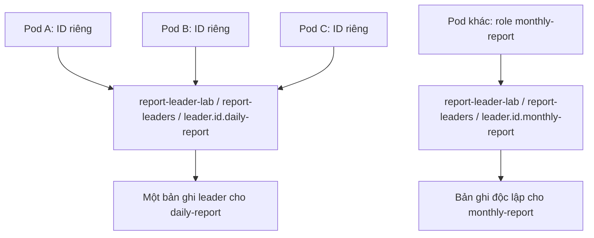

# Cấu hình danh tính, namespace và phạm vi nhóm bầu chọn

Trong chương **Bầu leader** của module **SPRING_CLOUD_KUBERNETES**, câu hỏi “đang có một leader hay hai leader?” chỉ có ý nghĩa khi đã xác định **nhóm bầu chọn nào**. Hai Pod thuộc hai nhóm khác nhau đều có thể là leader mà cơ chế bầu chọn vẫn hoạt động đúng.

Bài học tập trung vào ba lựa chọn quyết định phạm vi đó:

- Danh tính nào đại diện cho từng ứng viên?
- Namespace nào chứa Pod và bản ghi bầu chọn?
- Những instance nào cùng tranh một vị trí leader?

Lab sử dụng **Spring Cloud Kubernetes Fabric8 leader 3.3.3, lưu bản ghi trong ConfigMap**. Đây là phạm vi phiên bản cụ thể của ví dụ, giúp kiểm chứng chính xác cách tạo ID và khóa nhóm. Phần cuối đối chiếu với cơ chế native dùng Lease; không trộn hai bộ thuộc tính.

Sau bài học, bạn có thể cấu hình một nhóm ba replica, quan sát leader theo đúng danh tính Pod và thiết kế các nhóm độc lập mà không vô tình chạy trùng một công việc.

## 1. Ba loại danh tính cần phân biệt

Giả sử ứng dụng `report-worker` chạy ba Pod để dự phòng cho công việc lập báo cáo ngày:

```text
report-worker-7b8c-a1
report-worker-7b8c-b2
report-worker-7b8c-c3
```

Các Pod có thể cùng dùng ServiceAccount nhưng vẫn phải có ID ứng viên phân biệt.

| Giá trị | Đại diện cho | Có cần giống nhau giữa các replica cùng nhóm? |
| --- | --- | --- |
| `spring.application.name` | Tên ứng dụng Spring | Thường giống |
| ServiceAccount | Danh tính xác thực khi gọi Kubernetes API | Có thể giống |
| Candidate ID | Instance đang tham gia bầu chọn | Phải phân biệt các ứng viên đồng thời |
| Leader role | Vai trò công việc cần một leader | Phải giống nếu cùng tranh một vị trí |
| Pod UID | Vòng đời cụ thể của đối tượng Pod | Khác nhau giữa các Pod |
| Tên ConfigMap và namespace | Nơi lưu bản ghi bầu chọn | Phải giống trong cùng nhóm |

ServiceAccount giải quyết quyền gọi API; nó không phải ID của từng ứng viên. Tương tự, đổi tên ứng dụng Spring không tự bảo đảm hai nhóm bầu chọn được tách.

Pod UID hữu ích để phân biệt các vòng đời Pod, nhất là khi tên Pod được tái sử dụng. Tuy nhiên, không được tùy ý thay ID ứng viên bằng UID nếu triển khai leader còn dùng ID đó để tra Pod theo tên.

## 2. ID ứng viên của triển khai Fabric8 trong lab

Ở phiên bản `3.3.3`, auto-configuration tạo `DefaultCandidate` từ:

```text
Candidate ID = LeaderUtils.hostName()
Candidate role = spring.cloud.kubernetes.leader.role
```

Đây là hành vi của triển khai đang chọn, không phải một thuộc tính chung cho mọi thư viện bầu leader. [Fabric8LeaderAutoConfiguration 3.3.3](https://raw.githubusercontent.com/spring-cloud/spring-cloud-kubernetes/v3.3.3/spring-cloud-kubernetes-fabric8-leader/src/main/java/org/springframework/cloud/kubernetes/fabric8/leader/Fabric8LeaderAutoConfiguration.java).

`LeaderUtils.hostName()` ưu tiên biến môi trường `HOSTNAME`; nếu giá trị này rỗng thì lấy hostname từ môi trường Java. [LeaderUtils 3.3.3](https://raw.githubusercontent.com/spring-cloud/spring-cloud-kubernetes/v3.3.3/spring-cloud-kubernetes-commons/src/main/java/org/springframework/cloud/kubernetes/commons/leader/LeaderUtils.java).

Trong lab, gắn rõ `HOSTNAME` với tên Pod bằng Downward API:

```yaml
env:
  - name: HOSTNAME
    valueFrom:
      fieldRef:
        fieldPath: metadata.name
  - name: POD_NAME
    valueFrom:
      fieldRef:
        fieldPath: metadata.name
  - name: POD_NAMESPACE
    valueFrom:
      fieldRef:
        fieldPath: metadata.namespace
  - name: POD_UID
    valueFrom:
      fieldRef:
        fieldPath: metadata.uid
```

`HOSTNAME` phục vụ cách tạo candidate của triển khai này. Các biến `POD_NAME`, `POD_NAMESPACE` và `POD_UID` còn giúp ghi log, đối chiếu danh tính và truy vết Pod. Downward API cung cấp các trường metadata này mà tiến trình không cần gọi API để tự đọc chúng. [Kubernetes: Downward API](https://kubernetes.io/docs/concepts/workloads/pods/downward-api/).

Không cấu hình cùng một giá trị như `report-worker` cho `HOSTNAME` của mọi replica. Những tiến trình có cùng ID có thể bị nhận diện như cùng một ứng viên thay vì ba ứng viên độc lập.

Với triển khai này, ID còn được dùng làm tên Pod để kiểm tra readiness. Vì vậy, đặt `HOSTNAME` thành IP, UUID tùy ý hoặc tên logic khác tên Pod có thể làm bước kiểm tra readiness không tìm đúng đối tượng. [Fabric8PodReadinessWatcher 3.3.3](https://raw.githubusercontent.com/spring-cloud/spring-cloud-kubernetes/v3.3.3/spring-cloud-kubernetes-fabric8-leader/src/main/java/org/springframework/cloud/kubernetes/fabric8/leader/Fabric8PodReadinessWatcher.java).

Không tự thêm một thuộc tính như `spring.cloud.kubernetes.leader.identity` rồi mặc định thư viện sẽ dùng nó. Trước khi tùy biến candidate, phải kiểm tra điểm mở rộng và cách tra Pod của đúng phiên bản.

## 3. Nhóm bầu chọn được xác định bởi nơi lưu và khóa bản ghi

Đối với lab ConfigMap, có thể mô tả ranh giới nhóm như sau:

```text
Nhóm bầu chọn =
    cluster Kubernetes
  + namespace của ConfigMap
  + tên ConfigMap
  + khóa leader trong data
```

Khóa leader của triển khai `3.3.3` được tạo từ:

```text
leaderKey = leader-id-prefix + candidate role
```

Với cấu hình:

```yaml
spring:
  cloud:
    kubernetes:
      leader:
        config-map-name: report-leaders
        leader-id-prefix: "leader.id."
        role: daily-report
```

khóa tương ứng là:

```text
leader.id.daily-report
```

Khi một Pod giữ vị trí leader, ConfigMap có thể chứa dữ liệu như:

```yaml
data:
  leader.id.daily-report: report-worker-7b8c-b2
```

Cách tạo và đọc khóa này được xác định trong `LeadershipController`. [LeadershipController 3.3.3](https://raw.githubusercontent.com/spring-cloud/spring-cloud-kubernetes/v3.3.3/spring-cloud-kubernetes-commons/src/main/java/org/springframework/cloud/kubernetes/commons/leader/LeadershipController.java).

Hai replica muốn cùng tranh vị trí phải thống nhất namespace, tên ConfigMap và khóa. Chúng chỉ khác nhau ở ID ứng viên.



Trong ví dụ trên có thể có một leader cho `daily-report` và một leader cho `monthly-report`. Điều đó đúng nếu hai role đại diện hai công việc độc lập.

Cần chọn role và prefix tạo thành khóa hợp lệ trong ConfigMap. Không tạo tên nhóm tùy ý chứa ký tự không được phép trong key của `data`.

## 4. Namespace của Pod, client và bản ghi

Có ba giá trị dễ bị nhầm:

| Namespace | Ý nghĩa trong lab |
| --- | --- |
| Namespace của Pod | Nơi ứng viên thực sự chạy |
| Namespace mặc định của Kubernetes client | Nơi các request không chỉ rõ namespace được thực hiện |
| `spring.cloud.kubernetes.leader.namespace` | Nơi tìm ConfigMap leader của triển khai Fabric8 đã chọn |

Lab chủ động giữ cả ba bằng `report-leader-lab`.

Một chi tiết cần chú ý ở `3.3.3`: controller truy cập ConfigMap theo namespace leader đã cấu hình, nhưng kiểm tra readiness của Pod sử dụng namespace của Kubernetes client. Chỉ chuyển ConfigMap sang namespace dùng chung không tự tạo được mô hình bầu chọn liên namespace đúng. [Fabric8LeadershipController 3.3.3](https://raw.githubusercontent.com/spring-cloud/spring-cloud-kubernetes/v3.3.3/spring-cloud-kubernetes-fabric8-leader/src/main/java/org/springframework/cloud/kubernetes/fabric8/leader/Fabric8LeadershipController.java).

Ví dụ không nên suy diễn:

```text
Pod chạy ở team-a
client mặc định ở team-a
leader.namespace đặt thành shared-locks

=> Không đủ để kết luận ứng viên ở team-a và team-b
   đã cùng tra đúng mọi Pod và cùng bầu chọn an toàn.
```

Nếu thật sự cần nhóm trải qua nhiều namespace, phải xác minh triển khai hỗ trợ cách định vị từng ứng viên, chọn namespace cho từng request và cấp RBAC tương ứng. Không chỉ mở quyền toàn cluster để che lỗi định vị.

Một tên ConfigMap giống nhau trong hai namespace là hai đối tượng độc lập. Một tên giống nhau ở hai cluster cũng không phải một khóa chung.

## 5. Cấu hình Spring cho nhóm báo cáo ngày

### 5.1. Dependency và cấu hình

Dự án Spring Boot cần bộ phiên bản tương thích được quản lý bằng BOM. Mẫu được đối chiếu theo Spring Cloud Kubernetes `3.3.3`; dependency leader là:

```xml
<dependency>
    <groupId>org.springframework.cloud</groupId>
    <artifactId>spring-cloud-kubernetes-fabric8-leader</artifactId>
</dependency>
<dependency>
    <groupId>org.springframework.boot</groupId>
    <artifactId>spring-boot-starter-web</artifactId>
</dependency>
<dependency>
    <groupId>org.springframework.boot</groupId>
    <artifactId>spring-boot-starter-actuator</artifactId>
</dependency>
```

Triển khai Fabric8 dùng ConfigMap và phát các sự kiện `OnGrantedEvent`, `OnRevokedEvent` theo API leader của Spring Integration. [Spring Cloud Kubernetes 3.3: Leader Election](https://docs.spring.io/spring-cloud-kubernetes/reference/3.3/leader-election.html).

Cấu hình đóng gói `application.yaml`:

```yaml
spring:
  application:
    name: report-worker
  cloud:
    discovery:
      enabled: false
    kubernetes:
      config:
        enabled: false
      secrets:
        enabled: false
      leader:
        enabled: true
        auto-startup: true
        namespace: report-leader-lab
        config-map-name: report-leaders
        role: daily-report
        leader-id-prefix: "leader.id."
        create-config-map: false
        update-period: 5s

management:
  endpoints:
    web:
      exposure:
        include: health,info
  endpoint:
    health:
      probes:
        enabled: true
  info:
    leader:
      enabled: true
```

Các giá trị namespace, ConfigMap và role là cấu hình triển khai của lab. `create-config-map: false` nghĩa là tiến trình không tự tạo ConfigMap bị thiếu; phần hạ tầng phải tạo trước.

`update-period` điều khiển chu kỳ kiểm tra của triển khai này, không phải thời hạn Lease. Các thuộc tính như `role`, `namespace`, `leader-id-prefix` và `create-config-map` thuộc bộ `LeaderProperties` của phiên bản đang dùng. [LeaderProperties 3.3.3](https://raw.githubusercontent.com/spring-cloud/spring-cloud-kubernetes/v3.3.3/spring-cloud-kubernetes-commons/src/main/java/org/springframework/cloud/kubernetes/commons/leader/LeaderProperties.java).

Lab không cần DiscoveryClient, LoadBalancer hoặc ConfigMap PropertySource qua API để xác định nhóm bầu chọn. Nếu ứng dụng có thêm những tính năng đó, quyền của chúng được đánh giá riêng.

### 5.2. Ghi nhận sự kiện và danh tính

Trong ứng dụng Spring Boot có component scan cho package bên dưới, có thể thêm:

```java
package com.example.report;

import org.slf4j.Logger;
import org.slf4j.LoggerFactory;
import org.springframework.context.event.EventListener;
import org.springframework.core.env.Environment;
import org.springframework.integration.leader.Candidate;
import org.springframework.integration.leader.event.OnGrantedEvent;
import org.springframework.integration.leader.event.OnRevokedEvent;
import org.springframework.stereotype.Component;

@Component
public class LeadershipAudit {

    private static final Logger log =
            LoggerFactory.getLogger(LeadershipAudit.class);

    private final Candidate candidate;
    private final String podUid;

    public LeadershipAudit(Candidate candidate, Environment environment) {
        this.candidate = candidate;
        this.podUid = environment.getProperty("POD_UID", "unknown");
    }

    @EventListener
    public void granted(OnGrantedEvent event) {
        log.info("leadership_granted candidate={} role={} podUid={}",
                candidate.getId(), candidate.getRole(), podUid);
    }

    @EventListener
    public void revoked(OnRevokedEvent event) {
        log.info("leadership_revoked candidate={} role={} podUid={}",
                candidate.getId(), candidate.getRole(), podUid);
    }
}
```

Component này chỉ ghi bằng chứng bầu chọn. Nó không tự giới hạn một `@Scheduled` hoặc tự hủy công việc đã chạy; ứng dụng cần nối trạng thái leadership với vòng đời tác vụ thực tế.

## 6. Tạo hạ tầng và Deployment ba replica

### 6.1. Namespace, ServiceAccount, ConfigMap và RBAC

Dùng cluster lab cùng tài khoản được phép tạo các tài nguyên tương ứng. Lưu nội dung sau thành `report-leader-infra.yaml`:

```yaml
apiVersion: v1
kind: Namespace
metadata:
  name: report-leader-lab
---
apiVersion: v1
kind: ServiceAccount
metadata:
  name: report-worker
  namespace: report-leader-lab
automountServiceAccountToken: true
---
apiVersion: v1
kind: ConfigMap
metadata:
  name: report-leaders
  namespace: report-leader-lab
data: {}
---
apiVersion: rbac.authorization.k8s.io/v1
kind: Role
metadata:
  name: report-leader-access
  namespace: report-leader-lab
rules:
  - apiGroups: [""]
    resources: ["configmaps"]
    resourceNames: ["report-leaders"]
    verbs: ["get", "list", "watch", "update"]
  - apiGroups: [""]
    resources: ["pods"]
    verbs: ["get", "list", "watch"]
---
apiVersion: rbac.authorization.k8s.io/v1
kind: RoleBinding
metadata:
  name: report-leader-access
  namespace: report-leader-lab
subjects:
  - kind: ServiceAccount
    name: report-worker
    namespace: report-leader-lab
roleRef:
  apiGroup: rbac.authorization.k8s.io
  kind: Role
  name: report-leader-access
```

Role cho phép truy cập ConfigMap đã chọn và đọc trạng thái Pod trong namespace. Nó không cho tạo ConfigMap, sửa Pod, đọc Secret hoặc thao tác Lease.

Với `resourceNames`, request `list` hoặc `watch` phải kèm field selector tên phù hợp. Mẫu dựa trên đường gọi ConfigMap theo tên của Fabric8; nếu đổi SDK hoặc cơ chế watch, kiểm tra request thực tế trước khi giữ nguyên giới hạn này. [Kubernetes: Referring to resources](https://kubernetes.io/docs/reference/access-authn-authz/rbac/#referring-to-resources).

Danh tính triển khai tạo ConfigMap ban đầu; runtime chỉ cập nhật đối tượng đó. Không dùng ConfigMap leader làm nơi chứa cấu hình nghiệp vụ hay gắn nhãn kích hoạt Configuration Watcher, vì các lần thay đổi bản ghi bầu chọn không phải thay đổi chính sách nghiệp vụ.

### 6.2. Deployment

Build image từ ứng dụng Spring Boot có cấu hình và component ở mục 5. Thay image ví dụ bằng image thật mà cluster kéo được, rồi lưu thành `report-worker.yaml`:

```yaml
apiVersion: apps/v1
kind: Deployment
metadata:
  name: report-worker
  namespace: report-leader-lab
spec:
  replicas: 3
  selector:
    matchLabels:
      app: report-worker
  template:
    metadata:
      labels:
        app: report-worker
    spec:
      serviceAccountName: report-worker
      automountServiceAccountToken: true
      containers:
        - name: application
          image: registry.example.com/learning/report-worker:leader-lab
          ports:
            - name: http
              containerPort: 8080
          env:
            - name: HOSTNAME
              valueFrom:
                fieldRef:
                  fieldPath: metadata.name
            - name: POD_NAME
              valueFrom:
                fieldRef:
                  fieldPath: metadata.name
            - name: POD_UID
              valueFrom:
                fieldRef:
                  fieldPath: metadata.uid
            - name: POD_NAMESPACE
              valueFrom:
                fieldRef:
                  fieldPath: metadata.namespace
            - name: KUBERNETES_NAMESPACE
              valueFrom:
                fieldRef:
                  fieldPath: metadata.namespace
            - name: SPRING_CLOUD_KUBERNETES_CLIENT_NAMESPACE
              valueFrom:
                fieldRef:
                  fieldPath: metadata.namespace
            - name: SPRING_CLOUD_KUBERNETES_LEADER_NAMESPACE
              valueFrom:
                fieldRef:
                  fieldPath: metadata.namespace
          readinessProbe:
            httpGet:
              path: /actuator/health/readiness
              port: http
            initialDelaySeconds: 5
            periodSeconds: 3
          livenessProbe:
            httpGet:
              path: /actuator/health/liveness
              port: http
            initialDelaySeconds: 15
            periodSeconds: 10
```

Không đặt readiness phụ thuộc vào `isLeader` trong lab này. Ứng viên cần ready để có thể giành leadership; nếu mọi follower đều không ready chỉ vì chưa là leader, có thể hình thành vòng phụ thuộc không ai tiến lên được.

Áp dụng và chờ Pod:

```powershell
kubectl apply -f report-leader-infra.yaml
kubectl apply -f report-worker.yaml
kubectl rollout status deployment/report-worker -n report-leader-lab --timeout=180s
kubectl get pods -n report-leader-lab -l app=report-worker
```

## 7. Đọc lại cấu hình và bằng chứng của từng replica

### 7.1. Đối chiếu Pod và ứng viên

```powershell
kubectl get pods -n report-leader-lab -l app=report-worker -o 'custom-columns=NAME:.metadata.name,UID:.metadata.uid,SA:.spec.serviceAccountName,PHASE:.status.phase'
kubectl get configmap report-leaders -n report-leader-lab -o yaml
```

Kiểm tra:

- Có ba Pod với tên và UID riêng.
- Cả ba dùng ServiceAccount `report-worker`.
- Bản ghi `leader.id.daily-report` trỏ tới tên một Pod hợp lệ.
- Pod được ghi là leader đã ready và thuộc tập ứng viên mong muốn.

ConfigMap không chứa danh sách đầy đủ mọi ứng viên. Một khóa có một giá trị chỉ cho thấy bản ghi leader hiện tại của khóa đó; không đủ để kết luận chỉ có một tiến trình đang thực hiện tác vụ.

Đọc log từng Pod:

```powershell
kubectl logs deployment/report-worker -n report-leader-lab --all-pods=true --prefix=true --tail=100
```

Nếu `kubectl` chưa hỗ trợ `--all-pods` cho log Deployment, lấy từng tên Pod rồi chạy `kubectl logs pod/<ten-pod>`.

Khi đối chiếu log, ghi nhận candidate ID, role, Pod UID và thời điểm. Dùng cả UID để tránh ghép nhầm sự kiện của một Pod cũ với Pod mới có tên giống.

### 7.2. Kiểm tra thông tin leader trực tiếp trên từng Pod

Chọn một Pod từ danh sách rồi mở port-forward:

```powershell
kubectl port-forward pod/<ten-pod> -n report-leader-lab 18080:8080
```

Thay `<ten-pod>` bằng tên thật. Trong terminal khác:

```powershell
Invoke-RestMethod -Uri 'http://127.0.0.1:18080/actuator/info' | ConvertTo-Json -Depth 5
```

Thông tin minh họa trên Pod giữ leadership:

```json
{
  "leaderElection": {
    "leaderId": "report-worker-7b8c-b2",
    "role": "daily-report",
    "isLeader": true
  }
}
```

Lặp lại cho ba Pod. Trong trạng thái ổn định, mỗi Pod cần quan sát cùng leader của role và chỉ Pod giữ leadership báo `isLeader: true`.

Không suy ra kết quả cho ba Pod từ ba request qua một Kubernetes Service. Cân bằng tải không bảo đảm các request lần lượt tới ba instance khác nhau.

### 7.3. Kiểm tra quyền theo đúng namespace

Bằng tài khoản được phép impersonate danh tính và nhóm tương ứng:

```powershell
$workerIdentity = 'system:serviceaccount:report-leader-lab:report-worker'
$workerGroups = @(
    '--as-group=system:authenticated'
    '--as-group=system:serviceaccounts'
    '--as-group=system:serviceaccounts:report-leader-lab'
)

kubectl auth can-i get configmaps/report-leaders -n report-leader-lab --as=$workerIdentity @workerGroups
kubectl auth can-i update configmaps/report-leaders -n report-leader-lab --as=$workerIdentity @workerGroups
kubectl auth can-i watch configmaps/report-leaders -n report-leader-lab --as=$workerIdentity @workerGroups
kubectl auth can-i get pods -n report-leader-lab --as=$workerIdentity @workerGroups
kubectl auth can-i create configmaps -n report-leader-lab --as=$workerIdentity @workerGroups
kubectl auth can-i update configmaps/another-lock -n report-leader-lab --as=$workerIdentity @workerGroups
kubectl auth can-i get configmaps/report-leaders -n default --as=$workerIdentity @workerGroups
kubectl auth can-i list secrets -n report-leader-lab --as=$workerIdentity @workerGroups
```

Kết quả mong muốn:

```text
yes
yes
yes
yes
no
no
no
no
```

Lỗi không được phép impersonate cần xử lý ở tài khoản kiểm tra, không được ghi nhận thành quyền của ứng viên. `can-i` xác nhận chính sách của request; vẫn cần quan sát tiến trình thật sử dụng đúng credentials và namespace. [Kubernetes: kubectl auth can-i](https://kubernetes.io/docs/reference/kubectl/generated/kubectl_auth/kubectl_auth_can-i/).

Một lệnh liệt kê ConfigMap không kèm giới hạn tên có thể bị từ chối trong lab này, vì Role dùng `resourceNames`. Không mở quyền đọc toàn namespace chỉ để một lệnh kiểm tra chung trở nên thành công.

## 8. Thử nghiệm phạm vi nhóm bầu chọn

### 8.1. Cùng nhóm, thêm một replica

Scale Deployment trong lab:

```powershell
kubectl scale deployment/report-worker -n report-leader-lab --replicas=4
kubectl rollout status deployment/report-worker -n report-leader-lab --timeout=180s
```

Pod mới có ID riêng nhưng giữ cùng namespace, ConfigMap và role. Nó tham gia nhóm hiện có; thêm replica không có nghĩa thêm một vị trí leader.

Đối chiếu lại ConfigMap, thông tin từng Pod và log sự kiện. Cần kiểm tra tập ứng viên mới thay vì chỉ đọc bản ghi trước khi scale.

### 8.2. Hai role độc lập trong cùng ConfigMap

Giả sử cần thêm công việc báo cáo tháng. Tạo một Deployment lab khác dùng cùng image và các thiết lập namespace/identity, nhưng có:

```yaml
spring:
  cloud:
    kubernetes:
      leader:
        namespace: report-leader-lab
        config-map-name: report-leaders
        leader-id-prefix: "leader.id."
        role: monthly-report
```

Khi tạo Deployment mới, phải đổi tên, selector và Pod labels cho nhất quán để không lẫn với Deployment cũ. Giữ ID lấy từ tên Pod; không dùng một hostname cố định cho nhóm mới.

ConfigMap sau đó có thể chứa:

```yaml
data:
  leader.id.daily-report: report-worker-7b8c-b2
  leader.id.monthly-report: monthly-worker-6d9f-d4
```

Có hai leader cho hai vị trí khác nhau là kết quả mong muốn.

Nếu hai role vẫn chạy cùng một tác vụ “báo cáo ngày”, hệ thống đã được cấu hình thành hai nhóm cùng làm một việc. Đây là lỗi thiết kế phạm vi; không phải bằng chứng rằng một nhóm đã bầu hai leader.

Mẫu auto-configuration trong lab tạo một candidate cho một role của context. Không khai báo một danh sách role hoặc thêm nhiều Candidate bean rồi mặc định mọi thành phần leader sẽ tự tách tương ứng; cần thiết kế và hỗ trợ rõ ràng nếu một tiến trình tham gia nhiều nhóm.

### 8.3. Ma trận các thay đổi

| Thay đổi giữa hai tập replica | Còn chung nhóm trong mô hình ConfigMap của lab? |
| --- | --- |
| Chỉ khác candidate ID | Có |
| Chỉ khác tên Deployment | Có, nếu nơi lưu và khóa vẫn giống |
| Chỉ khác `spring.application.name` | Có, nếu không đổi các thuộc tính nhóm |
| Chỉ khác ServiceAccount | Có thể có, nếu cả hai được cấp quyền và các giá trị nhóm giống |
| Khác role tạo thành khóa khác | Không |
| Khác `leader-id-prefix` tạo thành khóa khác | Không |
| Khác tên ConfigMap | Không |
| Khác namespace chứa ConfigMap | Không |
| Khác cluster | Không |

Phạm vi thực tế dựa vào **khóa cuối cùng được lưu**, không chỉ việc chuỗi role hay prefix có khác nhau. Hãy chọn quy ước prefix cố định và role rõ ràng để tránh cách ghép chuỗi vô tình tạo cùng khóa.

Một quy ước hợp lý:

```text
Namespace:  môi trường hoặc miền vận hành
ConfigMap:  một nhóm công việc có cùng trách nhiệm quản trị
Role:       một công việc cần chọn leader
Candidate:  một Pod cụ thể
```

Ví dụ role `daily-report-tenant-a` có thể hợp lý nếu tenant A cần một leader độc lập. Thêm `v2` vào role chỉ vì phát hành phiên bản mới có thể vô tình tạo thêm nhóm cho cùng tenant.

## 9. Nhóm logic không phải ranh giới bảo mật

Hai role khác nhau trong cùng ConfigMap giúp tách vị trí leader ở mức logic. Tuy nhiên, RBAC cấp quyền cập nhật cả đối tượng ConfigMap, không giới hạn được chỉ một key trong `data`.

Vì vậy, ứng viên được quyền cập nhật `report-leaders` có khả năng tác động tới dữ liệu của các role cùng nằm trong đối tượng đó.

Nếu hai công việc có chủ sở hữu hoặc mức độ tin cậy khác nhau, xem xét:

- ConfigMap riêng cho từng miền quyền.
- ServiceAccount và RoleBinding riêng.
- Namespace riêng khi cần ranh giới vận hành và dữ liệu rõ hơn.

Đổi sang ConfigMap khác trong lab còn cần tạo đối tượng mới và cập nhật `resourceNames` tương ứng. Nếu không, lỗi Forbidden chỉ cho thấy quyền chưa khớp; nó chưa kiểm chứng được nhóm mới có hoạt động.

Tương tự, ServiceAccount riêng không tự tạo nhóm logic riêng. Hai danh tính có quyền trên cùng bản ghi và cùng khóa vẫn có thể cạnh tranh một vị trí leader.

## 10. Đổi nhóm trong rollout là thay đổi cơ chế phối hợp

Khi rollout phiên bản mới mà vẫn muốn một leader cho cùng công việc, cần giữ ổn định:

```text
cluster
namespace
ConfigMap
khóa leader
```

Candidate ID có thể thay đổi theo Pod mới. Hai phiên bản ứng dụng phải tương thích với cùng hợp đồng công việc và cách dừng tác vụ khi mất leadership.

Nếu đổi `role`, namespace hoặc tên ConfigMap trong một rolling update, có thể xảy ra:

```text
Pod phiên bản cũ -> nhóm cũ -> leader cũ
Pod phiên bản mới -> nhóm mới -> leader mới

Cả hai leader đều hợp lệ đối với nhóm của mình.
```

Đổi tên khóa không phải thao tác “chuyển quyền” giữa hai nhóm. Cần kế hoạch chuyển đổi để tác vụ cũ ngừng hoặc được chặn trước khi nhóm mới tạo tác động.

Các lựa chọn tùy hệ thống:

| Mục tiêu chuyển đổi | Điều cần thiết kế |
| --- | --- |
| Giữ một nhóm qua hai phiên bản | Giữ cùng nơi lưu, khóa và giao thức tương thích |
| Tách thành hai công việc thật sự độc lập | Định nghĩa tác động nghiệp vụ riêng cho mỗi role |
| Chuyển nơi lưu khóa | Điều phối dừng/khởi động hoặc cơ chế chặn tác động ngoài ý muốn |
| Chạy cùng công việc trên nhiều cluster | Cơ chế phối hợp vượt ra ngoài khóa riêng của từng cluster |

Không xóa bản ghi leader đang dùng để “ép bầu lại” rồi coi rằng tác vụ cũ đã dừng. Bản ghi thay đổi không tự kết thúc một thread hoặc một request nghiệp vụ đang thực thi.

## 11. Đối chiếu với cơ chế native dùng Lease

Tài liệu Spring Cloud Kubernetes hiện hành còn mô tả cơ chế native, bật qua `spring.cloud.kubernetes.leader.election.enabled`. Cơ chế đó có các thuộc tính như `lock-name`, `lock-namespace` và các sự kiện `StartLeadingEvent`, `StopLeadingEvent`; không phải bộ sự kiện và cấu hình của lab Fabric8 `3.3.3`. [Spring Cloud Kubernetes: Leader Election](https://docs.spring.io/spring-cloud-kubernetes/reference/leader-election.html).

Ví dụ phần cấu hình native để đối chiếu, chỉ dùng trên bộ dependency hỗ trợ nó:

```yaml
spring:
  cloud:
    kubernetes:
      leader:
        election:
          enabled: true
          lock-name: daily-report-lock
          lock-namespace: report-leader-lab
          use-config-map-as-lock: false
```

Ở cơ chế native, xác định nhóm theo loại tài nguyên khóa được chọn, namespace và tên khóa, trong cùng cluster. Không giả định `spring.cloud.kubernetes.leader.role` của triển khai ConfigMap cũ sẽ tự phân chia một Lease thành nhiều role.

Khi cơ chế chọn Lease:

```text
Nhóm = cluster + Lease + namespace + tên Lease
Ứng viên giữ quyền = holderIdentity trong bản ghi
```

Lease có các trường như `holderIdentity`, `renewTime` và `leaseDurationSeconds`. Chúng không có cùng cấu trúc với key `leader.id.daily-report` của ConfigMap trong lab. [Kubernetes: Lease API](https://kubernetes.io/docs/reference/kubernetes-api/coordination/lease-v1/).

Kubernetes dùng Lease cho phối hợp và bầu leader, nhưng sự tồn tại của tài nguyên này không tự kết nối lịch chạy công việc Java với leadership. Ứng dụng vẫn phải điều khiển tác vụ theo sự kiện và hợp đồng của thư viện. [Kubernetes: Leases](https://kubernetes.io/docs/concepts/architecture/leases/).

Trước khi chuyển implementation, đối chiếu:

| Thành phần | Cần xác nhận |
| --- | --- |
| Dependency | Client và implementation leader nào đang được nạp |
| ID ứng viên | Được tạo từ đâu, có khớp cách tra Pod hay không |
| Khóa nhóm | ConfigMap/key hay Lease/name |
| Namespace | Namespace Pod, client và khóa |
| Sự kiện | Listener hiện có có nhận đúng loại sự kiện mới không |
| RBAC | Core API group cho ConfigMap hay `coordination.k8s.io` cho Lease |
| Chuyển đổi | Nhóm cũ và mới có thể cùng hoạt động trong bao lâu |

Không chỉ đổi tên thuộc tính rồi giữ nguyên listener và quyền của cơ chế cũ.

## 12. Chẩn đoán lỗi theo cấu hình nhóm

| Hiện tượng | Cần kiểm tra |
| --- | --- |
| Không ứng viên nào được chọn | Pod readiness, ID có khớp tên Pod, quyền và ConfigMap có tồn tại |
| Log nhận diện cùng candidate trên nhiều Pod | `HOSTNAME` bị đặt tĩnh hoặc bị ghi đè ngoài dự kiến |
| Có hai leader báo cùng tác vụ | Hai bên có thực sự cùng cluster, namespace, ConfigMap và khóa không |
| Cùng role nhưng vẫn có hai leader | ConfigMap, namespace hoặc prefix có khác nhau không |
| Hai ứng dụng không liên quan tranh nhau | Vô tình dùng chung nhóm do copy cấu hình |
| Chỉ lỗi sau chuyển namespace | Namespace client, Pod và bản ghi không còn khớp |
| Forbidden khi cập nhật bản ghi | Subject, namespace, tên tài nguyên và verb chưa khớp Role |
| Không có ConfigMap và không tạo được | `create-config-map: false` nhưng hạ tầng chưa tạo |
| Ready của mọi Pod đều false | Readiness có phụ thuộc vào việc trở thành leader hay không |
| Có sự kiện granted nhưng tác vụ vẫn chạy ở follower | Vòng đời tác vụ chưa gắn với leadership |

Một lỗi dễ nhầm là role của leader và Kubernetes Role. `daily-report` là vai trò bầu chọn; `report-leader-access` là tên đối tượng RBAC. Đổi tên đối tượng RBAC không tự đổi nhóm bầu chọn.

Khi cần điều tra, ghi nhận một bộ thông tin hoàn chỉnh:

```text
cluster/context
podNamespace, podName, podUid
candidateId
implementationVersion
lockKind, lockNamespace, lockName
leaderKey hoặc role theo implementation
ServiceAccount
leadership event và thời điểm
```

Chỉ có dòng “isLeader=true” mà thiếu những giá trị trên rất dễ làm hai nhóm độc lập trông giống một nhóm bị lỗi.

## 13. Bài thực hành và tiêu chí hoàn thành

Thực hiện trên cluster lab:

1. Triển khai ba replica cùng role `daily-report` và kiểm tra từng candidate ID.
2. Đối chiếu thông tin từng Pod với bản ghi `leader.id.daily-report`.
3. Scale thêm một replica và xác nhận nó vẫn tham gia cùng nhóm.
4. Tạo một Deployment có role `monthly-report` và giải thích vì sao có thể có hai leader.
5. Thiết kế lại trường hợp hai nhóm thực ra đang chạy cùng một công việc.
6. Lập kế hoạch rollout giữ nguyên nhóm, rồi kế hoạch chuyển sang khóa mới.
7. Giải thích các thay đổi cần làm nếu chuyển sang implementation native dùng Lease.

Bảng nghiệm thu:

| Tiêu chí | Bằng chứng |
| --- | --- |
| ID phân biệt ứng viên | Mỗi Pod có candidate ID đúng tên của nó |
| Namespace nhất quán | Pod, client và ConfigMap khớp thiết kế của lab |
| Nhóm được mô tả đầy đủ | Có cluster, namespace, ConfigMap và khóa leader |
| Bằng chứng trên từng replica | Quan sát được trạng thái và sự kiện theo Pod UID |
| Scale giữ đúng nhóm | Pod mới không tạo một khóa bầu chọn riêng |
| Các role được hiểu đúng | Hai role độc lập được gắn với hai công việc độc lập |
| Quyền đúng phạm vi | Truy cập bản ghi cần thiết đạt, tài nguyên ngoài hợp đồng bị từ chối |
| Chuyển đổi có kế hoạch | Không mặc định khóa mới thu hồi quyền của nhóm cũ |
| Implementation rõ ràng | Không trộn thuộc tính và sự kiện ConfigMap/Lease |

Danh tính trả lời “ứng viên nào”, namespace và khóa trả lời “cùng bầu cho vị trí nào”. Khi ba phần này được cấu hình và kiểm chứng rõ ràng, việc quan sát leader, tách công việc và triển khai phiên bản mới sẽ có cơ sở để đánh giá chính xác.
