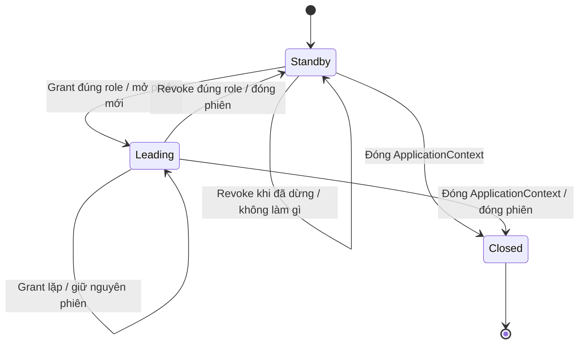

# Sự kiện được cấp và bị thu hồi vai trò leader

Trong chương **Bầu leader** của module Spring Cloud Kubernetes, việc chọn được một Pod giữ quyền mới chỉ giải quyết phần điều phối. Ứng dụng còn phải quyết định khi nào bắt đầu công việc, khi nào ngừng nhận việc và làm gì với tác vụ đang chạy khi mất quyền.

Ví dụ xuyên suốt bài là một ứng dụng đối soát có ba replica: cả ba phục vụ HTTP, nhưng chỉ replica giữ vai trò `billing-reconciler` được kích hoạt vòng đối soát nền. Hai sự kiện được cấp và bị thu hồi quyền là đầu vào cho vòng đời công việc đó.

Sau bài này, bạn có thể:

- Phân biệt `OnGrantedEvent`, `OnRevokedEvent` và trạng thái không giành được quyền.
- Viết listener ngắn, lọc đúng vai trò và điều khiển một tác vụ nền.
- Ngăn tác vụ của lần giữ quyền cũ tiếp tục chỉ vì Pod được bầu lại.
- Thiết kế đường dừng, quan sát chuyển quyền và nhận diện giới hạn về xử lý trùng.

## 1. Chốt cơ chế trước khi chọn lớp sự kiện

Ví dụ Java và cấu hình trong bài sử dụng **cơ chế Fabric8 dựa trên ConfigMap với API leader của Spring Integration**, được mô tả trong tài liệu Spring Cloud Kubernetes 3.3. Với cơ chế này, hai lớp cần quan tâm nằm trong package `org.springframework.integration.leader.event`. Hãy dùng bộ phiên bản Spring Boot, Spring Cloud và Spring Cloud Kubernetes tương thích qua BOM của dự án. [Tài liệu cơ chế ConfigMap](https://docs.spring.io/spring-cloud-kubernetes/reference/3.3/leader-election.html).

Tài liệu Spring Cloud Kubernetes hiện hành còn mô tả cơ chế native được bật bằng `spring.cloud.kubernetes.leader.election.enabled=true`, với các sự kiện `StartLeadingEvent`, `StopLeadingEvent` và `NewLeaderEvent`. Vì vậy, không giả định listener cho `OnGrantedEvent` sẽ xử lý cơ chế đó. Khi đổi cơ chế, phải đối chiếu lại dependency, cấu hình, loại khóa và sự kiện; `NewLeaderEvent` cũng không đồng nghĩa Pod hiện tại vừa được cấp quyền. [Tài liệu các cơ chế leader election](https://docs.spring.io/spring-cloud-kubernetes/reference/leader-election.html).

Bài này giữ một cơ chế thống nhất cho phần thực hành, không trộn thuộc tính của hai cơ chế.

## 2. Hai sự kiện mang ý nghĩa gì?

| Tình huống tại một instance | Sự kiện cần xử lý | Hành động của ứng dụng |
| --- | --- | --- |
| Instance vừa được cấp vai trò đang theo dõi | `OnGrantedEvent` | Mở một phiên xử lý cục bộ mới |
| Instance đang giữ vai trò bị thu hồi quyền | `OnRevokedEvent` | Đóng phiên, ngừng lấy việc mới |
| Instance chưa bao giờ giành được quyền | Không suy ra có revoke | Tiếp tục ở trạng thái chờ |
| Instance được bầu lại sau khi đã mất quyền | Một grant mới | Tạo phiên mới, không phục hồi tác vụ cũ |
| JVM chết đột ngột | Có thể không chạy listener nào nữa | Replica khác tiếp quản theo cơ chế bầu leader |

`OnGrantedEvent` biểu thị việc cấp quyền; `OnRevokedEvent` biểu thị việc thu hồi quyền. Chúng kế thừa `AbstractLeaderEvent`, cung cấp `getRole()` và `getContext()`. Vai trò ở đây là nhóm công việc do ứng dụng đặt tên, không phải Kubernetes RBAC `Role`. [API sự kiện cấp quyền](https://docs.spring.io/spring-integration/api/org/springframework/integration/leader/event/OnGrantedEvent.html), [API sự kiện thu hồi](https://docs.spring.io/spring-integration/api/org/springframework/integration/leader/event/OnRevokedEvent.html), [API sự kiện nền](https://docs.spring.io/spring-integration/api/org/springframework/integration/leader/event/AbstractLeaderEvent.html).

`Context` cho phép hỏi `isLeader()`, lấy vai trò và yêu cầu nhường quyền bằng `yield()`. Đây là giao diện điều khiển trạng thái leader, không phải transaction bao quanh một lần ghi cơ sở dữ liệu. [API Context](https://docs.spring.io/spring-integration/api/org/springframework/integration/leader/Context.html).

Hai chi tiết có ảnh hưởng trực tiếp đến thiết kế:

1. **Sự kiện được xử lý trong Spring ApplicationContext cục bộ.** Không coi chúng là thông điệp bền vững mà mọi Pod đều nhận được, có replay hoặc xác nhận giao nhận.
2. **Không giành được quyền khác với vừa mất quyền.** Một follower khởi động và tiếp tục chờ không cần đi qua đường thu hồi của ứng dụng.

Với cơ chế ConfigMap được chọn, controller chỉ phát grant/revoke khi quyền của candidate cục bộ thay đổi. Một follower quan sát thấy leader khác không nhận grant cho chính mình. [Mã nguồn chuyển trạng thái của controller](https://raw.githubusercontent.com/spring-cloud/spring-cloud-kubernetes/v3.3.0/spring-cloud-kubernetes-commons/src/main/java/org/springframework/cloud/kubernetes/commons/leader/LeadershipController.java).

## 3. Biểu diễn vòng đời công việc bằng trạng thái cục bộ

Ứng dụng có thể dùng ba trạng thái sau:



`Standby` nghĩa là không được lấy việc chỉ dành cho leader. Nó không có nghĩa HTTP server bị lỗi. `Closed` nghĩa component đang kết thúc và không nhận grant mới nữa.

Một lần giữ quyền cần có danh tính riêng trong bộ nhớ:

```text
Pod A: grant → phiên A1 → revoke → grant → phiên A2
Tác vụ đã chụp phiên A1 phải dừng dù Pod A đang giữ quyền với phiên A2.
```

Nếu chỉ dùng một biến `boolean leader`, tác vụ cũ có thể thấy giá trị chuyển từ `false` trở lại `true` rồi tiếp tục. So sánh danh tính phiên giúp phân biệt hai lần giữ quyền ngay trong một JVM. Danh tính này sẽ được minh họa trong mã bên dưới; nó chưa phải fencing token dùng giữa các Pod.

## 4. Chuẩn bị cấu hình cho ví dụ

Thêm dependency sau vào dự án đã quản lý phiên bản bằng BOM tương thích:

```xml
<dependency>
    <groupId>org.springframework.cloud</groupId>
    <artifactId>spring-cloud-kubernetes-fabric8-leader</artifactId>
</dependency>
```

Cấu hình minh họa:

```yaml
spring:
  application:
    name: billing-service
  cloud:
    kubernetes:
      leader:
        enabled: true
        role: billing-reconciler
        namespace: ${POD_NAMESPACE:demo}
        config-map-name: billing-leader
        create-config-map: false
        update-period: 5s

demo:
  leader:
    delay-ms: 2000
```

Ở đây, nền tảng tạo sẵn ConfigMap `billing-leader`; ứng dụng không tự tạo tài nguyên khi khởi động. `update-period` thuộc phần kiểm tra leader; `demo.leader.delay-ms` là nhịp chạy demo do ứng dụng tự định nghĩa. Hai giá trị không phải cam kết thời gian chuyển quyền. [Các thuộc tính của cơ chế ConfigMap](https://raw.githubusercontent.com/spring-cloud/spring-cloud-kubernetes/v3.3.0/spring-cloud-kubernetes-commons/src/main/java/org/springframework/cloud/kubernetes/commons/leader/LeaderProperties.java).

Trong namespace `demo`, chuẩn bị các điều kiện sau trước khi chạy:

- Ba Pod dùng cùng namespace, cùng tên ConfigMap và cùng role `billing-reconciler`.
- ServiceAccount có quyền đọc, theo dõi và cập nhật ConfigMap theo thao tác client thực hiện.
- Client có quyền đọc/theo dõi Pod phục vụ kiểm tra readiness của cơ chế này.
- Các Pod có danh tính phân biệt được và readiness hoạt động đúng.

Cơ chế Fabric8 trong ví dụ kiểm tra readiness của candidate và leader qua API Pod. Thiếu quyền với Pod có thể làm bầu leader thất bại dù đọc được ConfigMap. [Mã nguồn Fabric8 controller](https://raw.githubusercontent.com/spring-cloud/spring-cloud-kubernetes/v3.3.0/spring-cloud-kubernetes-fabric8-leader/src/main/java/org/springframework/cloud/kubernetes/fabric8/leader/Fabric8LeadershipController.java).

ConfigMap bầu leader nên tách khỏi ConfigMap cấu hình nghiệp vụ. Không đưa tài nguyên bầu leader vào luồng cập nhật cấu hình của Configuration Watcher. DiscoveryClient và Spring Cloud LoadBalancer cũng không thay thế cơ chế này: quyết định instance nhận request khác với quyết định instance được kích hoạt công việc nền độc quyền.

## 5. Listener ngắn và một lịch chạy cố định

Mặc định, `SimpleApplicationEventMulticaster` gọi listener đồng bộ trên thread phát sự kiện. Vì vậy, vòng lặp vô hạn, chờ I/O lâu hoặc chờ tác vụ kết thúc ngay trong listener có thể giữ thread của phía phát sự kiện. Ngoại lệ từ listener cũng có thể truyền ngược về publisher khi không có error handler riêng. [API phát sự kiện của Spring](https://docs.spring.io/spring-framework/docs/current/javadoc-api/org/springframework/context/event/SimpleApplicationEventMulticaster.html).

Thiết kế minh họa sử dụng:

- Listener chỉ mở hoặc đóng phiên cục bộ.
- Một phương thức `@Scheduled` được đăng ký từ khi ứng dụng khởi động.
- Mỗi nhịp chụp một phiên và kiểm tra lại trước từng đơn vị việc.
- Không tạo thêm lịch chạy mỗi khi nhận grant.

Bật scheduling trong lớp ứng dụng:

```java
package example.billing;

import org.springframework.boot.SpringApplication;
import org.springframework.boot.autoconfigure.SpringBootApplication;
import org.springframework.scheduling.annotation.EnableScheduling;

@EnableScheduling
@SpringBootApplication
public class BillingApplication {

    public static void main(String[] args) {
        SpringApplication.run(BillingApplication.class, args);
    }
}
```

Component sau chỉ ghi log mô phỏng, không gọi hệ thống thanh toán hoặc cập nhật dữ liệu thật:

```java
package example.billing;

import jakarta.annotation.PreDestroy;
import org.slf4j.Logger;
import org.slf4j.LoggerFactory;
import org.springframework.beans.factory.annotation.Value;
import org.springframework.context.event.EventListener;
import org.springframework.integration.leader.event.OnGrantedEvent;
import org.springframework.integration.leader.event.OnRevokedEvent;
import org.springframework.scheduling.annotation.Scheduled;
import org.springframework.stereotype.Component;

@Component
public class LeaderDrivenDemo {

    private static final Logger log =
            LoggerFactory.getLogger(LeaderDrivenDemo.class);

    private final String role;
    private final String pod;

    // Được đọc từ thread scheduler và ghi từ thread listener.
    private volatile Session current;

    // Hai field này chỉ được truy cập trong các method synchronized.
    private long nextGeneration;
    private boolean closed;

    public LeaderDrivenDemo(
            @Value("${spring.cloud.kubernetes.leader.role}") String role,
            @Value("${HOSTNAME:local}") String pod) {
        this.role = role;
        this.pod = pod;
    }

    @EventListener
    public synchronized void onGranted(OnGrantedEvent event) {
        if (closed || !role.equals(event.getRole())) {
            return;
        }
        if (!event.getContext().isLeader()) {
            return;
        }
        if (current != null) {
            // Grant lặp khi phiên hiện tại chưa đóng.
            return;
        }

        Session session = new Session(++nextGeneration);
        current = session;

        log.info("leadership_granted pod={} role={} generation={}",
                pod, role, session.generation());
    }

    @EventListener
    public synchronized void onRevoked(OnRevokedEvent event) {
        if (!role.equals(event.getRole())) {
            return;
        }

        Session previous = current;
        current = null; // Đóng cửa nhận việc trước khi ghi log.

        if (previous != null) {
            log.info("leadership_revoked pod={} role={} generation={}",
                    pod, role, previous.generation());
        }
    }

    @Scheduled(fixedDelayString = "${demo.leader.delay-ms:2000}")
    public void runDemoBatch() {
        Session session = current;
        if (session == null) {
            return;
        }

        for (int item = 1; item <= 3; item++) {
            if (!mayContinue(session)) {
                return;
            }

            // Demo một đơn vị việc ngắn, hữu hạn.
            log.info("demo_unit pod={} role={} generation={} item={}",
                    pod, role, session.generation(), item);
        }
    }

    private boolean mayContinue(Session session) {
        return current == session
                && !Thread.currentThread().isInterrupted();
    }

    @PreDestroy
    public synchronized void close() {
        closed = true;
        current = null;
    }

    private record Session(long generation) {
    }
}
```

Ví dụ dùng cú pháp record và `jakarta.annotation`, phù hợp với nền Java 17 trở lên và Spring Boot 3 của phạm vi minh họa. Nó giả định **mỗi role có một initiator trong ApplicationContext này và listener chuyển trạng thái được gọi đồng bộ**. Nếu ứng dụng có nhiều nguồn sự kiện cùng role, phải phân biệt thêm nguồn/initiator thay vì chỉ lọc `getRole()`.

Các lựa chọn trong mã có mục đích cụ thể:

| Lựa chọn | Tác dụng |
| --- | --- |
| `current` khởi đầu bằng `null` | Ứng dụng khởi động trong trạng thái chờ |
| `synchronized` trên callback và `close()` | Tuần tự hóa các thay đổi phiên ở component |
| `volatile current` | Công bố thay đổi phiên cho thread scheduler |
| `current == session` | Tác vụ chỉ tiếp tục với đúng đối tượng phiên đã chụp |
| `current = null` khi revoke | Những lần kiểm tra tiếp theo từ chối tiếp tục |
| `closed` | Chặn callback mở lại phiên sau khi component đã đóng |
| Batch ba đơn vị | Minh họa điểm kiểm tra giữa các đơn vị việc |

Không giữ monitor của listener trong lúc chạy batch hoặc gọi dịch vụ ngoài. Nếu listener thu hồi phải chờ một batch dài nhả cùng monitor, việc cập nhật trạng thái dừng sẽ bị trì hoãn.

Mã cũng không ghép cặp hai sự kiện bằng `event.getContext() == oldContext`. Trong implementation được đối chiếu, controller tạo một `LeaderContext` mới khi phát grant và một đối tượng mới khác khi phát revoke. Danh tính đối tượng Context không phải mã phiên giữ quyền. [Mã nguồn phát grant/revoke](https://raw.githubusercontent.com/spring-cloud/spring-cloud-kubernetes/v3.3.0/spring-cloud-kubernetes-commons/src/main/java/org/springframework/cloud/kubernetes/commons/leader/LeadershipController.java).

## 6. Thu hồi quyền phải đóng đường lấy việc mới

Giả sử một batch thật thực hiện các bước: lấy danh sách hóa đơn, tính toán, ghi kết quả và phát thông báo. Khi nhận revoke, cần xác định rõ hành vi cho từng bước thay vì chỉ ghi một dòng “đã mất leader”.

Trình tự ứng dụng nên thiết kế là:

1. Đóng cổng nhận việc mới ngay bằng trạng thái cục bộ.
2. Báo hủy cho công việc đang chạy nếu nó hỗ trợ hủy.
3. Kiểm tra lại phiên giữa các đơn vị việc, đặc biệt sau một lần chờ I/O.
4. Để phần đang thực thi kết thúc hoặc thất bại theo timeout hữu hạn.
5. Giải phóng tài nguyên gắn với phiên và ghi nhận kết quả dừng.

`current = null` trong demo thực hiện bước đầu tiên; `mayContinue(session)` thể hiện kiểm tra hợp tác. Nó không thể thu hồi lệnh đã gửi tới hệ thống khác.

Nếu triển khai bằng executor riêng, có thể giữ `Future<?>` của tác vụ và gọi `cancel(true)` khi revoke. Tuy nhiên, interrupt chỉ là yêu cầu hủy: thư viện I/O hoặc mã nghiệp vụ có thể không phản hồi ngay. Luôn đặt timeout cho truy vấn, kết nối và request; không kết luận công việc đã dừng chỉ vì Future chuyển sang trạng thái cancelled.

Không dùng `Thread.stop()`. Không chờ vô hạn bằng `future.get()` trong listener thu hồi. Nếu cần chờ thoát, chuyển việc chờ sang thành phần quản lý vòng đời và áp dụng thời hạn rõ ràng.

### Tác vụ cũ không được tiếp tục khi được bầu lại

Xét chuỗi sau trong một Pod:

```text
T0: nhận grant, current = đối tượng phiên 1
T1: batch chụp tham chiếu phiên 1, sau đó chờ dữ liệu
T2: nhận revoke, current = null
T3: nhận grant mới, current = đối tượng phiên 2
T4: batch cũ thức dậy, so sánh current == phiên 1 → false
```

Đây là lý do kiểm tra phiên có ích hơn chỉ hỏi “Pod hiện có là leader không?”. Trong implementation ConfigMap, `Context.isLeader()` đọc trạng thái leader mà controller đang giữ cục bộ; `yield()` gọi đường revoke của controller. Nó không phải một lần hỏi Kubernetes hoặc một phép cấp quyền ghi dữ liệu nguyên tử. [Mã nguồn LeaderContext](https://raw.githubusercontent.com/spring-cloud/spring-cloud-kubernetes/v3.3.0/spring-cloud-kubernetes-commons/src/main/java/org/springframework/cloud/kubernetes/commons/leader/LeaderContext.java).

### Nhường quyền chủ động

Ứng dụng có thể lưu Context từ grant để yêu cầu `context.yield()` ở một đường quản trị được kiểm soát. Trước khi yêu cầu nhường, nên đóng đường lấy việc mới của ứng dụng và phát tín hiệu dừng. Sau đó theo dõi xem thao tác nhường có thành công không.

Không gọi `yield()` trực tiếp trong listener grant chỉ để “thử rồi trả lại” khi đang xây luồng thực tế. Việc đó có thể tạo chuỗi cấp/thu hồi liên tiếp. Cũng không giả định nhường quyền sẽ chọn một Pod cụ thể: Pod cũ vẫn có thể tham gia và giành lại quyền.

## 7. Kiểm tra leader rồi ghi vẫn có khoảng đua

Một lỗi phổ biến là coi đoạn sau đã bảo đảm độc quyền nghiệp vụ:

```java
if (isCurrentLeader()) {
    externalSystem.applyChange();
}
```

Ngay sau lần kiểm tra, quyền có thể thay đổi trước khi lệnh ghi tới đích:

```text
Pod A kiểm tra quyền → A mất quyền → Pod B nhận quyền
                    → request cũ của A vẫn đến hệ thống nhận
```

Kiểm tra thêm một lần trước khi ghi giúp giảm cửa sổ rủi ro, nhưng không làm thao tác kiểm tra và ghi trở thành một transaction phân tán. Đây là suy luận từ việc cổng cục bộ và hệ thống nhận lệnh là hai nơi độc lập. Chính thư viện leader election của Kubernetes cũng phân biệt việc bầu leader với bảo đảm fencing. [Chú thích thiết kế của Kubernetes client-go](https://raw.githubusercontent.com/kubernetes/client-go/master/tools/leaderelection/leaderelection.go).

Với tác vụ đối soát, có thể kết hợp các lớp bảo vệ sau:

| Lớp bảo vệ | Vấn đề giải quyết | Điều kiện cần |
| --- | --- | --- |
| Phiên cục bộ | Batch của lần giữ quyền cũ tiếp tục sau một lần được bầu lại | Mọi đường xử lý kiểm tra đúng phiên |
| Idempotency theo khóa nghiệp vụ | Cùng công việc bị thực hiện lại khi chuyển quyền hoặc retry | Hệ thống ghi thực thi quy tắc chống trùng nguyên tử |
| Claim/checkpoint trong kho dữ liệu | Hai instance cùng chọn một tập việc hoặc xử lý lại từ đầu | Quy tắc tranh chấp và phục hồi claim rõ ràng |
| Transaction và outbox | Dữ liệu đã ghi nhưng thông báo chưa phát, hoặc ngược lại | Thiết kế transaction trong cùng kho và bộ phát retry được |
| Fencing token | Leader cũ gửi lệnh đến muộn sau khi leader mới hoạt động | Đích ghi kiểm tra token theo thứ tự và từ chối token cũ |

Ví dụ, khóa idempotency có thể là `invoiceId + reconciliationPeriod`. Hai Pod xử lý lại cùng kỳ phải gặp cùng khóa nghiệp vụ. Không dùng `podName + generation` làm khóa chống trùng cho công việc đó, vì mỗi lần chuyển quyền sẽ tạo một khóa khác.

Số `generation` trong demo chỉ tăng trong bộ nhớ của một JVM, có thể trở về 1 khi khởi động lại, và có thể trùng giữa các Pod. Nó giúp đọc log và phân biệt phiên cục bộ; **không phải fencing token**. Nếu cần fencing, thiết kế một nguồn cấp số thứ tự có tính nhất quán và kiểm tra tại hệ thống nhận lệnh. Chỉ gắn số vào log hoặc header mà đích không xác thực thì chưa có tác dụng ngăn ghi cũ.

Lựa chọn bảo vệ tùy theo nghiệp vụ. Một tác vụ làm nóng cache có thể chấp nhận chạy lặp. Một thao tác tạo tác động bên ngoài khó đảo ngược cần quy tắc chống trùng ở nơi tác động được thực thi.

## 8. Shutdown và lỗi kết nối không giống một revoke đã xử lý

### Dừng bình thường

Khi Spring ApplicationContext đóng, đường lifecycle của leader initiator trong implementation được chọn gọi revoke. Tuy nhiên, mã ứng dụng vẫn cần đường đóng riêng; demo dùng `@PreDestroy` để ngừng công việc ngay cả khi không dựa vào listener thu hồi. [Mã nguồn lifecycle của LeaderInitiator](https://raw.githubusercontent.com/spring-cloud/spring-cloud-kubernetes/v3.3.0/spring-cloud-kubernetes-commons/src/main/java/org/springframework/cloud/kubernetes/commons/leader/LeaderInitiator.java).

Đối với triển khai thật, cần sắp xếp việc đóng cổng nhận việc, drain tác vụ và kết thúc tiến trình trong thời gian hữu hạn. Nếu thời điểm thu hồi có thể cho phép replica mới bắt đầu trong lúc replica cũ đang drain, quy tắc chống trùng vẫn phải bảo vệ dữ liệu. `@PreDestroy` là một đường đóng component, không phải toàn bộ giao thức bàn giao công việc.

### JVM chết, Pod bị kill hoặc node mất

Khi tiến trình không còn chạy, nó không thể xử lý `OnRevokedEvent`, ghi log kết thúc hay chạy `finally`. Vì vậy, việc không thấy dòng revoke trên Pod đã chết không đủ để kết luận thuật toán bầu leader bị lỗi.

Công việc chưa hoàn thành phải có trạng thái bền vững hoặc khả năng chạy lại. Nếu tiến độ chỉ tồn tại trong RAM của leader, replica tiếp quản không thể biết chắc bước cuối đã hoàn thành hay chưa.

### Mất kết nối đến Kubernetes API

Không giả định rằng một lần API timeout sẽ lập tức phát `OnRevokedEvent`. Điều đó phụ thuộc implementation và đường lỗi. Với cơ chế ConfigMap trong bài, thao tác thu hồi cũng phải truy cập API; lỗi cập nhật có thể khiến đường thu hồi không hoàn thành như mong muốn. [Đường xử lý lỗi của Fabric8 controller](https://raw.githubusercontent.com/spring-cloud/spring-cloud-kubernetes/v3.3.0/spring-cloud-kubernetes-fabric8-leader/src/main/java/org/springframework/cloud/kubernetes/fabric8/leader/Fabric8LeadershipController.java).

Nếu nghiệp vụ yêu cầu ngừng ghi khi không xác thực được quyền trong một khoảng thời gian, cần thiết kế chính sách riêng, có nguồn trạng thái và mốc thời gian kiểm chứng được. Chỉ kiểm tra một boolean trong listener không đáp ứng yêu cầu đó.

Không lấy một giá trị timeout của cơ chế native rồi suy ra cơ chế ConfigMap trong bài sẽ thu hồi đúng thời hạn tương ứng.

## 9. Thực hành quan sát với ba replica

Các lệnh dưới đây dành cho cluster thực hành. Giả sử ứng dụng mẫu đã được đóng gói và triển khai thành Deployment `billing-service`, có label `app=billing-service`, trong namespace `demo`. Mỗi Pod dùng ServiceAccount `billing-leader-sa` và đã có readiness probe phù hợp.

### Chuẩn bị khóa và quyền truy cập

Tạo trước ConfigMap rỗng này bằng tài khoản triển khai:

```yaml
apiVersion: v1
kind: ConfigMap
metadata:
  name: billing-leader
  namespace: demo
data: {}
```

Vì cấu hình dùng `create-config-map: false`, ứng dụng không cần quyền tạo ConfigMap cho đường này. Một bộ quyền ở phạm vi namespace để khởi đầu lab có thể cho `get, list, watch, update` với ConfigMap và `get, list, watch` với Pod; sau đó thu hẹp theo request mà client thực tế gửi. Không cấp quyền Secret chỉ vì đã bật leader election.

Nếu hạn chế bằng `resourceNames`, chú ý rằng quyền `create` không thể bị giới hạn theo tên tài nguyên bằng cách đó. Việc `list/watch` với giới hạn tên cũng cần selector thích hợp từ client; không sao chép một rule rồi mặc định client sẽ hoạt động. [Quy tắc RBAC về resourceNames](https://kubernetes.io/docs/reference/access-authn-authz/rbac/).

Có thể kiểm tra các quyền riêng lẻ bằng tài khoản có quyền impersonate ServiceAccount:

```bash
kubectl auth can-i get configmap/billing-leader -n demo --as=system:serviceaccount:demo:billing-leader-sa
kubectl auth can-i update configmap/billing-leader -n demo --as=system:serviceaccount:demo:billing-leader-sa
kubectl auth can-i list configmaps -n demo --as=system:serviceaccount:demo:billing-leader-sa
kubectl auth can-i watch configmaps -n demo --as=system:serviceaccount:demo:billing-leader-sa
kubectl auth can-i get pods -n demo --as=system:serviceaccount:demo:billing-leader-sa
kubectl auth can-i list pods -n demo --as=system:serviceaccount:demo:billing-leader-sa
kubectl auth can-i watch pods -n demo --as=system:serviceaccount:demo:billing-leader-sa
```

Kết quả `yes` của một lệnh chỉ xác nhận quyền đã hỏi. Nó không thay thế quan sát lỗi 403 và request thực tế khi chạy ứng dụng.

### Quan sát cấp quyền

Chạy ba replica và xem trạng thái:

```bash
kubectl scale deployment/billing-service --replicas=3 -n demo
kubectl get pods -n demo -l app=billing-service -o wide
kubectl logs -n demo -l app=billing-service --all-containers=true --prefix=true --tail=100 -f
```

Ở trạng thái ổn định, mong đợi một Pod có log `leadership_granted` và tiếp tục ghi `demo_unit`; hai Pod còn lại vẫn sẵn sàng nhưng không chạy đơn vị việc dành cho leader. Đọc bản ghi điều phối ở terminal khác:

```bash
kubectl get configmap billing-leader -n demo -o yaml
```

Đối chiếu bản ghi ConfigMap, log có tên Pod và thời điểm xử lý. Không chỉ đếm số dòng grant trong toàn bộ lịch sử: nhiều Pod có thể đã lần lượt được cấp quyền hợp lệ.

### Quan sát chuyển quyền

Sau khi xác định Pod leader từ log và bản ghi điều phối, xóa **Pod leader trong môi trường lab** để xem đường tiếp quản. Thay `<leader-pod>` bằng tên đã xác định:

```bash
kubectl delete pod <leader-pod> -n demo
```

Các điểm cần ghi nhận:

- Với dừng bình thường, Pod cũ có thể ghi revoke trước khi kết thúc.
- Replica tiếp quản có grant của chính nó; tên Pod có thể khác.
- `generation=1` tại một Pod mới là bình thường vì đây là bộ đếm cục bộ.
- Thời gian chuyển quyền gồm phát hiện thay đổi, thao tác API và nhịp bắt đầu công việc; không cam kết bằng đúng 2 giây hay 5 giây.
- Nếu thử một đường kill đột ngột trong lab riêng, không yêu cầu Pod đã chết phải ghi revoke.

Thử thêm chuỗi grant → revoke → grant trong cùng JVM bằng kiểm thử điều khiển trạng thái hoặc đường quản trị lab. Giữ một batch cũ ở điểm chờ rồi thả nó ra sau grant mới: batch cũ phải từ chối tiếp tục vì tham chiếu phiên đã khác. Chỉ xóa Pod không chứng minh được thuộc tính này, vì Pod thay thế tạo JVM khác.

### Những điều cần kiểm chứng trước khi dùng cho công việc thật

| Kịch bản | Kết quả cần kiểm chứng |
| --- | --- |
| Khởi động khi chưa nhận grant | Không có đơn vị việc dành cho leader |
| Sự kiện khác role | Không mở hoặc đóng phiên của role đang theo dõi |
| Grant lặp khi đang giữ phiên | Không tạo thêm lịch chạy hoặc vòng xử lý |
| Revoke lặp | Không lỗi, không làm phiên đã đóng hoạt động lại |
| Revoke khi batch đang chờ I/O | Sau khi I/O trả về, batch cũ kiểm tra lại trước bước tiếp theo |
| Được bầu lại trong cùng JVM | Phiên cũ không được chấp nhận là phiên mới |
| Lỗi trong một đơn vị nghiệp vụ | Lỗi được ghi nhận, có timeout/retry theo quy tắc nghiệp vụ |
| Ghi thành công rồi JVM chết trước checkpoint | Chạy lại không tạo tác động nghiệp vụ trùng |
| Đóng ApplicationContext | Cổng nhận việc đóng, tiến trình thoát trong thời hạn đã đặt |

Những kịch bản này tách việc kiểm tra listener cục bộ khỏi việc kiểm tra bầu leader trên Kubernetes. Phát một Spring event giả trong test chỉ chứng minh cách component phản ứng; nó không kiểm tra RBAC, readiness hoặc tranh chấp ConfigMap.

## 10. Quan sát và xử lý lỗi thường gặp

Log nên gắn cùng lúc tên Pod, role và generation cục bộ. Với công việc thật, thêm khóa nghiệp vụ và trạng thái bắt đầu/kết thúc/hủy. Tránh đặt khóa hóa đơn hay ID phiên vào label metric vì số lượng giá trị có thể tăng không giới hạn.

Ứng dụng có thể tự công bố các metric sau; đây là tên gợi ý, không phải metric mặc định được hứa có sẵn từ framework:

- Gauge cho biết cổng công việc leader cục bộ đang mở hay đóng.
- Counter số lần grant và revoke đã xử lý.
- Gauge số đơn vị việc đang chạy.
- Thời gian từ khi đóng cổng đến khi công việc của phiên cũ thoát.
- Counter số tác vụ bị bỏ qua do phiên đã thay đổi.

| Hiện tượng | Hướng kiểm tra |
| --- | --- |
| Không Pod nào có grant | Dependency/cơ chế đang bật, namespace, ConfigMap tồn tại, quyền API và readiness |
| Có grant nhưng không có công việc | Scheduling đã bật, role khớp, bean nằm trong component scan, tác vụ không lỗi |
| Listener không nhận gì sau khi đổi cơ chế | Loại sự kiện thực tế và cấu hình `leader` so với `leader.election` |
| Hai nhóm Pod đều nghĩ mình có leader | Chúng có đang dùng khác namespace, ConfigMap hoặc role không? |
| Công việc vẫn chạy sau revoke | Có đường bỏ qua kiểm tra phiên, I/O chưa trả về hoặc tác vụ không hỗ trợ hủy |
| Chuyển quyền làm lặp tác động | Thiếu idempotency, checkpoint hoặc bảo vệ tại đích ghi |
| Không thấy revoke trước khi Pod biến mất | Phân biệt shutdown bình thường với tiến trình chết đột ngột |
| Chuyển quyền liên tục | Readiness chập chờn, lỗi API, tài nguyên Pod hoặc đường nhường quyền bị gọi lặp |

Không đánh dấu mọi follower là liveness failed. Với ví dụ cả ba replica cùng phục vụ HTTP, follower vẫn có công việc hợp lệ. Readiness nên phản ánh khả năng phục vụ của ứng dụng theo thiết kế. Nếu muốn chỉ leader nhận một loại traffic, phải thiết kế và kiểm chứng đường routing đó riêng.

Cũng không sửa trạng thái leader bằng một listener của Configuration Watcher chỉ vì cấu hình nghiệp vụ thay đổi. Cập nhật cấu hình, discovery, cân bằng tải và quyền chạy tác vụ là các vòng đời khác nhau; khi cần phối hợp, hãy định nghĩa rõ điều kiện mở/đóng cổng công việc.

## 11. Tự kiểm tra hiểu biết

1. Pod khởi động nhưng chưa từng có grant có cần chờ revoke để ngừng làm việc không?  
   **Không.** Trạng thái ban đầu phải là chờ; chỉ grant phù hợp mới mở phiên.

2. Giữ `Context` từ grant có phân biệt được hai lần giữ quyền không?  
   **Không nên dùng nó như mã phiên.** Dùng một phiên cục bộ riêng; Context phản ánh trạng thái do implementation quản lý.

3. Sau khi revoke, một request đã gửi có chắc bị hủy không?  
   **Không.** Việc đóng phiên chỉ chặn những bước còn kiểm tra cổng; tác động bên ngoài cần quy tắc riêng.

4. Vì sao không đặt `@Async` tùy tiện lên hai listener chuyển trạng thái?  
   **Vì ví dụ phụ thuộc việc xử lý chuyển trạng thái theo thứ tự.** Nếu đổi sang bất đồng bộ, phải thiết kế tuần tự hóa và xử lý sự kiện trễ; thêm `synchronized` chỉ bảo đảm loại trừ đồng thời, không khôi phục thứ tự phát.

5. Khi nào thực sự cần thêm Spring Cloud Kubernetes leader election?  
   **Khi ứng dụng có công việc nền cần một instance điều phối trong một nhóm replica.** Nếu chỉ cần discovery, nạp ConfigMap/Secret hoặc cân bằng request, những tính năng đó tự chúng không tạo nhu cầu bầu leader.

Một thiết kế hoàn chỉnh phải mô tả được cả đường bắt đầu lẫn đường kết thúc công việc. Grant mở quyền xử lý tại ứng dụng; revoke đóng quyền xử lý tại ứng dụng. Tính đúng đắn của dữ liệu còn phụ thuộc cách xử lý công việc đang chạy và cách hệ thống nhận lệnh từ chối tác động trùng hoặc đến muộn.
