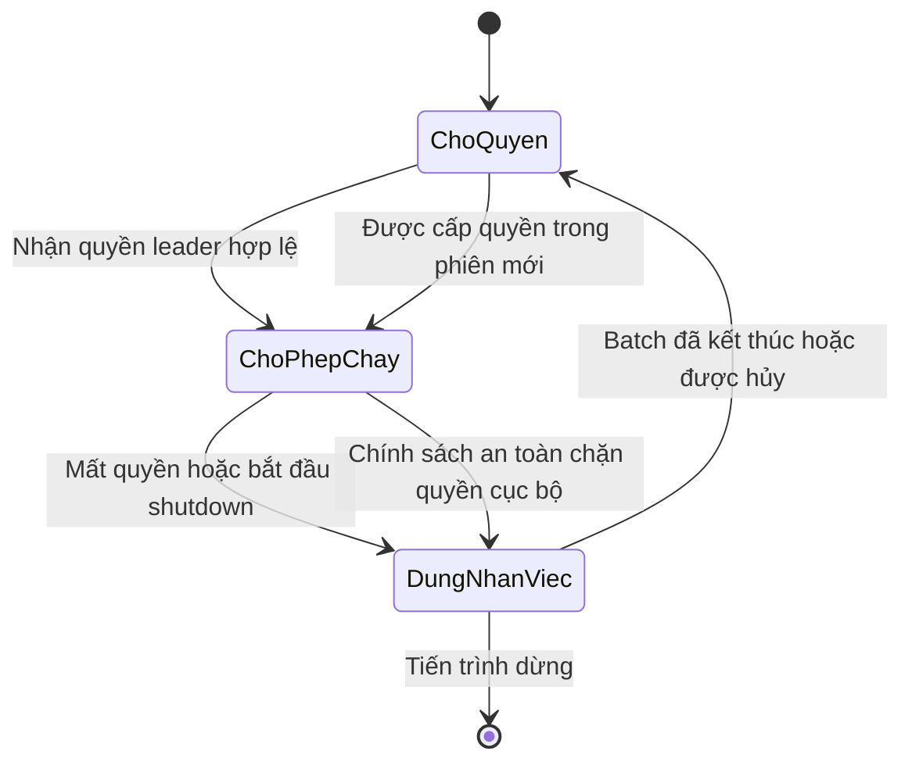

# Xử lý leader dừng, mất kết nối hoặc không gia hạn được khóa

Trong chương **Bầu leader** của Spring Cloud Kubernetes, tình huống khó nhất thường xuất hiện sau khi một Pod đã nhận quyền leader. Pod có thể dừng giữa một batch, mất đường tới Kubernetes API nhưng vẫn ghi được database, hoặc bị treo đủ lâu để Pod khác tiếp quản.

Bài học dùng một dịch vụ đối soát tồn kho, `inventory-worker`, có ba replica. Chỉ leader được khởi phát vòng đối soát; kết quả phải tiếp tục đúng khi quyền leader thay đổi. Mục tiêu là thiết kế đường dừng công việc, hiểu điều kiện bàn giao và thu thập đủ bằng chứng để xử lý sự cố.

## 1. Xác định implementation trước khi nói về “gia hạn khóa”

Spring Cloud Kubernetes có các cơ chế bầu leader khác nhau. Không thể lấy tham số của một cơ chế rồi áp dụng mặc định cho cơ chế còn lại.

| Nội dung | Fabric8 ConfigMap truyền thống | Cơ chế native leader election trong nhánh 5.0 |
| --- | --- | --- |
| Điểm nhận diện | `spring.cloud.kubernetes.leader.config-map-name` | `spring.cloud.kubernetes.leader.election.enabled=true` |
| Tài nguyên phối hợp | Bản ghi trong ConfigMap | Lease hoặc ConfigMap theo khả năng và cấu hình |
| Sự kiện ứng dụng | `OnGrantedEvent`, `OnRevokedEvent` | `StartLeadingEvent`, `StopLeadingEvent`, `NewLeaderEvent` |
| Tham số cần phân biệt | `leader.update-period` | `leader.election.lease-duration`, `renew-deadline`, `retry-period` |
| Cách học trong bài | Ví dụ Java và RBAC dùng nhánh 3.3 | Ví dụ thời gian gia hạn dùng nhánh 5.0 |

Tài liệu nhánh 5.0 vẫn mô tả cơ chế native là tính năng cần thận trọng khi lựa chọn phiên bản. Hãy dùng BOM tương thích với Spring Boot và đọc đúng tài liệu của phiên bản đang triển khai. [Spring Cloud Kubernetes 5.0 — Leader Election](https://docs.spring.io/spring-cloud-kubernetes/reference/5.0/leader-election.html).

Với Fabric8 truyền thống ở phiên bản 3.3.3, controller đọc ConfigMap, kiểm tra Pod leader có Ready hay không, rồi quyết định giữ hoặc thay bản ghi. Cập nhật dựa vào `resourceVersion` để phát hiện cạnh tranh. **`update-period` là chu kỳ kiểm tra trạng thái; nó không tạo TTL cho bản ghi ConfigMap.** [Mã nguồn Fabric8LeadershipController 3.3.3](https://github.com/spring-cloud/spring-cloud-kubernetes/blob/v3.3.3/spring-cloud-kubernetes-fabric8-leader/src/main/java/org/springframework/cloud/kubernetes/fabric8/leader/Fabric8LeadershipController.java).

Do đó, trước khi xử lý sự cố, cần ghi lại bốn thông tin: phiên bản thư viện, client đang dùng, namespace/tên tài nguyên khóa và nhóm công việc được bầu leader. Với cơ chế truyền thống, nhóm công việc tương ứng với `role`. Trong ví dụ này, role là `inventory-reconcile`.

## 2. Tách quyền leader khỏi khả năng thực hiện công việc

Có ba trạng thái cần quan sát độc lập:

- **Trạng thái bầu leader:** thư viện đang coi Pod nào giữ quyền.
- **Trạng thái worker:** tiến trình này có đang nhận việc mới hoặc còn batch chạy dở không.
- **Trạng thái dữ liệu:** database hoặc hệ thống đích còn chấp nhận lần ghi của tiến trình này không.

Một callback mất quyền leader chỉ thay đổi trạng thái trong ứng dụng nếu ứng dụng thực sự xử lý nó. Callback không tự hủy HTTP request đã gửi, transaction đã commit hoặc message đã được broker chấp nhận.

Mô hình dưới đây là chính sách điều khiển worker do ứng dụng xây dựng:



Ứng dụng khởi động với quyền chạy bị đóng. Chỉ sự kiện cấp quyền của đúng nhóm công việc mới mở quyền chạy. Sau một lần mất quyền, công việc cũ phải giữ trạng thái bị hủy dù cùng Pod được bầu lại.

Đây là lý do cần một đối tượng đại diện cho **mỗi phiên giữ quyền**, thay vì chỉ dùng một biến `boolean leader`. Nếu biến chuyển `true → false → true` trong lúc batch cũ đang ngủ, batch cũ có thể hiểu nhầm rằng nó được phép tiếp tục.

## 3. Phân loại sự cố theo điều kiện thực tế

| Tình huống | Điều cần hiểu | Cách xử lý ở worker |
| --- | --- | --- |
| SIGTERM khi rollout hoặc xóa Pod bình thường | Có cơ hội đóng worker và nhường quyền | Dừng nhận việc, hủy hoặc kết thúc batch trong thời hạn, rồi hoàn tất bàn giao |
| JVM crash, OOM kill, SIGKILL | Không có bảo đảm callback hay shutdown hook được chạy | Replica khác tiếp quản theo cơ chế bầu leader; dữ liệu phải hỗ trợ xử lý lại |
| Chỉ leader mất đường tới Kubernetes API | Leader cũ có thể vẫn kết nối database | Không dựa vào khả năng gọi database để kết luận còn quyền; cần chính sách đóng quyền và bảo vệ ghi |
| Mọi replica mất đường tới API | Không có cơ sở để hoàn tất bầu mới qua API | Giảm hoặc dừng công việc độc quyền theo chính sách đã chọn, khôi phục control plane |
| API trả `403 Forbidden` | ServiceAccount thiếu quyền hoặc RoleBinding sai | Sửa RBAC; retry liên tục không sửa được lỗi phân quyền |
| API chậm, `429` hoặc `5xx` | Có thể là quá tải hoặc gián đoạn tạm thời | Theo dõi timeout/backoff, độ trễ và vòng bầu leader |
| GC pause hoặc CPU bị throttling lâu | Callback và luồng hủy cũng có thể bị trì hoãn | Giảm batch dài, đặt timeout, bảo vệ dữ liệu khỏi worker cũ |
| Database lỗi nhưng API vẫn hoạt động | Khả năng gia hạn và khả năng làm việc là hai chuyện riêng | Dừng retry vô hạn; quyết định giữ hay nhường quyền theo loại lỗi nghiệp vụ |

Khi một replica không gọi được API, không thể suy ra rằng replica đó đã chết. Khi `kubectl` trên máy vận hành gọi API thành công, cũng chưa chứng minh kết nối từ bên trong Pod đang hoạt động.

### Trường hợp riêng của ConfigMap truyền thống

Nếu API không truy cập được, không nên kỳ vọng một `renew-deadline` không tồn tại sẽ tự động đóng quyền. Lần đọc lỗi có thể xảy ra trước khi controller cập nhật được trạng thái cục bộ; thao tác thu hồi cũng có thể thất bại khi ghi ConfigMap. Đây là suy luận vận hành từ đường xử lý lỗi trong controller, cần đưa vào thử nghiệm của phiên bản sử dụng.

Một kiểm tra API thành công sau sự cố cũng chưa đủ để mở lại worker. Cần xác lập lại quyền qua cơ chế bầu leader hoặc một quy trình khởi động lại có kiểm soát. Tránh tự gán `leader=true` khi kết nối vừa hồi phục.

## 4. Hiểu các khoảng thời gian của cơ chế native

Phần này chỉ áp dụng khi ứng dụng sử dụng cơ chế native có nhóm thuộc tính `leader.election`. Ví dụ dưới dùng các giá trị khai báo tường minh:

```yaml
spring:
  cloud:
    kubernetes:
      leader:
        election:
          enabled: true
          lock-namespace: leader-lab
          lock-name: inventory-leader
          lease-duration: 15s
          renew-deadline: 10s
          retry-period: 2s
          wait-after-renewal-failure: 3s
          wait-for-pod-ready: true
          publish-events: true
```

`lease-duration` giới hạn khoảng chờ để ứng viên khác có thể tranh quyền khi bản ghi không được gia hạn. `renew-deadline` giới hạn việc leader tiếp tục thử gia hạn trước khi từ bỏ. `retry-period` chi phối nhịp thử. Khoảng đợi sau lỗi gia hạn giảm khả năng Pod vừa mất quyền tranh lại ngay. [LeaderElectionProperties 5.0.5](https://github.com/spring-cloud/spring-cloud-kubernetes/blob/v5.0.5/spring-cloud-kubernetes-commons/src/main/java/org/springframework/cloud/kubernetes/commons/leader/election/LeaderElectionProperties.java).

Để suy nghĩ về cấu hình, cần giữ thứ tự:

```text
leaseDuration > renewDeadline > retryPeriod
```

Đây chỉ là điều kiện định hướng. Client có thể kiểm tra thêm biên an toàn hoặc hệ số jitter. Cấu hình phải đáp ứng validation của client thực tế và đủ dư địa cho độ trễ API, GC, lịch chạy thread và timeout của request.

Ví dụ lý tưởng hóa, giả sử A gia hạn và B quan sát bản ghi mới tại `12:00:04`:

| Mốc thời gian | Diễn biến |
| --- | --- |
| `12:00:04` | A gia hạn thành công, B quan sát lần đổi bản ghi |
| `12:00:05` | A bị kill đột ngột, không nhường khóa |
| Khoảng `12:00:19` | Khoảng chờ 15 giây tính từ mốc quan sát trong ví dụ đã qua |
| Lượt thử tiếp theo | B thử cập nhật khóa; khi thành công mới được bắt đầu việc |

Nếu A chỉ mất kết nối, nó có thể từ bỏ sớm hơn theo deadline gia hạn của chính nó. **A từ bỏ không đồng nghĩa B đã được cấp quyền ngay**, nhất là khi A không ghi được thao tác nhường khóa. B vẫn cần thỏa điều kiện của bản ghi và cập nhật thành công.

Các mốc trên phục vụ giải thích, không phải cam kết failover chính xác. Thời điểm quan sát bản ghi, backoff, request bị treo và client sử dụng đều ảnh hưởng kết quả. Lease hết hạn theo thuật toán cũng không có nghĩa Kubernetes tự xóa đối tượng Lease. [Kubernetes — Leases](https://kubernetes.io/docs/concepts/architecture/leases/).

Khi toàn bộ ứng viên không gọi được API, giảm `lease-duration` không giúp tạo ra leader mới. Ngược lại, đặt các khoảng quá ngắn có thể gây đổi leader liên tục khi API chỉ chậm thoáng qua.

## 5. Chuẩn bị ví dụ Fabric8 ConfigMap cho nhánh 3.3

Phần Java sau dùng `OnGrantedEvent` và `OnRevokedEvent` của Spring Integration. Ứng dụng cần Spring Boot, scheduling, một `KubernetesClient` do cấu hình Fabric8 phù hợp cung cấp và dependency leader được quản lý phiên bản bằng BOM:

```xml
<dependency>
    <groupId>org.springframework.cloud</groupId>
    <artifactId>spring-cloud-kubernetes-fabric8-leader</artifactId>
</dependency>
```

`application.yml` của ứng dụng mẫu:

```yaml
spring:
  application:
    name: inventory-worker
  cloud:
    kubernetes:
      client:
        namespace: ${POD_NAMESPACE}
      leader:
        enabled: true
        namespace: ${POD_NAMESPACE}
        role: inventory-reconcile
        config-map-name: inventory-leaders
        create-config-map: false
        update-period: 5s
        publish-failed-events: true

jobs:
  poll-delay-ms: 1000
```

Các thuộc tính này thuộc cơ chế truyền thống. Bản ghi ConfigMap được tạo trước để ứng dụng không phải có quyền tạo mới. `publish-failed-events` hỗ trợ quan sát thất bại giành quyền; ứng viên không giành được quyền có thể đơn giản là một follower bình thường. [Thuộc tính Spring Cloud Kubernetes 3.3](https://docs.spring.io/spring-cloud-kubernetes/reference/3.3/appendix.html).

Ba replica phải dùng cùng namespace, tên ConfigMap và role. Đặt tên khóa khác nhau cho từng Pod sẽ tạo nhiều nhóm bầu độc lập, dẫn đến nhiều worker cùng chạy.

Trong Pod template, dùng namespace thực tế và ServiceAccount dành cho worker:

```yaml
spec:
  serviceAccountName: inventory-worker
  terminationGracePeriodSeconds: 45
  containers:
    - name: app
      image: your-registry/inventory-worker:your-tested-tag
      env:
        - name: POD_NAMESPACE
          valueFrom:
            fieldRef:
              fieldPath: metadata.namespace
```

Đây là đoạn trích của `spec.template.spec` trong Deployment. Ví dụ giả định hostname mặc định của Pod được giữ nguyên, phù hợp cách candidate truyền thống nhận diện Pod. Tên image phải được thay bằng image đã build của ứng dụng.

### RBAC cho môi trường lab

Giả sử namespace `leader-lab` đã tồn tại. Các tài nguyên sau dành riêng cho bài thực hành:

```yaml
apiVersion: v1
kind: ServiceAccount
metadata:
  name: inventory-worker
  namespace: leader-lab
---
apiVersion: v1
kind: ConfigMap
metadata:
  name: inventory-leaders
  namespace: leader-lab
data: {}
---
apiVersion: rbac.authorization.k8s.io/v1
kind: Role
metadata:
  name: inventory-leader-election
  namespace: leader-lab
rules:
  - apiGroups: [""]
    resources: ["configmaps"]
    resourceNames: ["inventory-leaders"]
    verbs: ["get", "watch", "update", "patch"]
  - apiGroups: [""]
    resources: ["pods"]
    verbs: ["get", "list", "watch"]
---
apiVersion: rbac.authorization.k8s.io/v1
kind: RoleBinding
metadata:
  name: inventory-leader-election
  namespace: leader-lab
subjects:
  - kind: ServiceAccount
    name: inventory-worker
    namespace: leader-lab
roleRef:
  apiGroup: rbac.authorization.k8s.io
  kind: Role
  name: inventory-leader-election
```

Watcher ConfigMap trong phiên bản tham chiếu theo dõi tài nguyên theo tên. Watch có giới hạn `resourceNames` cần request mang field selector tên tương ứng; khi đổi client phải xác minh cách gọi watch/list. Quyền đọc Pod phục vụ kiểm tra Ready và theo dõi Pod leader. [Fabric8LeaderRecordWatcher 3.3.3](https://github.com/spring-cloud/spring-cloud-kubernetes/blob/v3.3.3/spring-cloud-kubernetes-fabric8-leader/src/main/java/org/springframework/cloud/kubernetes/fabric8/leader/Fabric8LeaderRecordWatcher.java), [Fabric8PodReadinessWatcher 3.3.3](https://github.com/spring-cloud/spring-cloud-kubernetes/blob/v3.3.3/spring-cloud-kubernetes-fabric8-leader/src/main/java/org/springframework/cloud/kubernetes/fabric8/leader/Fabric8PodReadinessWatcher.java).

Nếu chọn cơ chế native dùng Lease và cho phép ứng dụng tạo Lease, phần rule khóa có thể được thay bằng:

```yaml
rules:
  - apiGroups: ["coordination.k8s.io"]
    resources: ["leases"]
    resourceNames: ["inventory-leader"]
    verbs: ["get", "update"]
  - apiGroups: ["coordination.k8s.io"]
    resources: ["leases"]
    verbs: ["create"]
```

Giữ các quyền đọc Pod mà client và chế độ chờ Ready cần. Nếu implementation thực tế dùng ConfigMap làm khóa, quyền phải áp dụng cho ConfigMap tương ứng.

Không ghép `create` vào một rule có `resourceNames` rồi cho rằng ứng dụng sẽ tạo được đúng tên đó: Kubernetes không giới hạn top-level create theo tên tài nguyên theo cách này. Nếu cần tránh cấp create trong namespace, cấp phát khóa trước và xác minh client làm việc với tài nguyên đã có. [Kubernetes — RBAC và resourceNames](https://kubernetes.io/docs/reference/access-authn-authz/rbac/#referring-to-resources).

## 6. Đóng quyền cục bộ ngay khi nhận sự kiện mất leader

Lớp sau là cổng điều khiển cho đúng một role. Mỗi lần được cấp quyền tạo một `Permit` mới; permit cũ bị hủy vĩnh viễn.

```java
package example.inventory;

import java.util.concurrent.CancellationException;
import java.util.concurrent.atomic.AtomicBoolean;

import jakarta.annotation.PreDestroy;
import org.springframework.context.event.EventListener;
import org.springframework.integration.leader.Context;
import org.springframework.integration.leader.event.OnGrantedEvent;
import org.springframework.integration.leader.event.OnRevokedEvent;
import org.springframework.stereotype.Component;

@Component
public class InventoryLeaderGate {

    private static final String ROLE = "inventory-reconcile";
    private volatile Permit current;

    @EventListener
    public synchronized void onGranted(OnGrantedEvent event) {
        if (!ROLE.equals(event.getRole())) {
            return;
        }
        blockLocal();
        current = new Permit(event.getContext());
    }

    @EventListener
    public synchronized void onRevoked(OnRevokedEvent event) {
        if (ROLE.equals(event.getRole())) {
            blockLocal();
        }
    }

    public Permit snapshot() {
        return current;
    }

    @PreDestroy
    public synchronized void blockLocal() {
        Permit old = current;
        current = null;
        if (old != null) {
            old.cancelled.set(true);
        }
    }

    public static final class Permit {

        private final Context context;
        private final AtomicBoolean cancelled = new AtomicBoolean();

        private Permit(Context context) {
            this.context = context;
        }

        public void check() {
            if (cancelled.get()
                    || Thread.currentThread().isInterrupted()
                    || !context.isLeader()) {
                throw new CancellationException("Leadership no longer usable");
            }
        }
    }
}
```

Các listener chỉ chuyển trạng thái và trả về nhanh. Không chạy cả batch hoặc chờ network trong listener, vì ứng dụng cần tiếp tục xử lý sự kiện bầu leader.

Ví dụ giả định event của cùng nhóm được giao theo thứ tự; không thêm `@Async` hoặc thay event multicaster mà chưa thiết kế lại việc sắp thứ tự. `Context.isLeader()` phản ánh trạng thái thư viện biết ở local, không phải một lần xác minh đồng bộ với Kubernetes API. Việc controller công bố event khi thay leader được thể hiện trong [LeadershipController 3.3.3](https://github.com/spring-cloud/spring-cloud-kubernetes/blob/v3.3.3/spring-cloud-kubernetes-commons/src/main/java/org/springframework/cloud/kubernetes/commons/leader/LeadershipController.java).

`blockLocal()` cũng có thể được gọi bởi điều phối shutdown hoặc chính sách an toàn của ứng dụng. Nó chỉ dừng quyền chạy tại tiến trình hiện tại, không nhường khóa trên cluster. Sau khi gọi vì mất khả năng xác minh quyền, ứng dụng cần quy trình tái xác lập quyền; không tự mở lại permit dựa trên một lần ping thành công.

Với cơ chế native, cần adapter cho `StartLeadingEvent` và `StopLeadingEvent` của đúng phiên bản. Không chép nguyên listener truyền thống rồi kỳ vọng nó nhận được hai event mới.

## 7. Chia nhỏ công việc để có điểm dừng

Bật scheduling bằng `@EnableScheduling` trong cấu hình ứng dụng. Worker chụp permit một lần cho một lượt xử lý, sau đó kiểm tra lại trước từng đơn vị công việc:

```java
package example.inventory;

import java.util.concurrent.CancellationException;
import java.util.concurrent.atomic.AtomicBoolean;

import org.slf4j.Logger;
import org.slf4j.LoggerFactory;
import org.springframework.scheduling.annotation.Scheduled;
import org.springframework.stereotype.Component;

@Component
public class InventoryPoller {

    private static final Logger log =
            LoggerFactory.getLogger(InventoryPoller.class);

    private final InventoryLeaderGate gate;
    private final InventoryProcessor processor;
    private final AtomicBoolean running = new AtomicBoolean();

    public InventoryPoller(
            InventoryLeaderGate gate, InventoryProcessor processor) {
        this.gate = gate;
        this.processor = processor;
    }

    @Scheduled(fixedDelayString = "${jobs.poll-delay-ms:1000}")
    public void poll() {
        InventoryLeaderGate.Permit permit = gate.snapshot();
        if (permit == null || !running.compareAndSet(false, true)) {
            return;
        }

        try {
            for (int i = 0; i < 10; i++) {
                permit.check();
                if (!processor.processOneIdempotently(permit::check)) {
                    break;
                }
            }
        }
        catch (CancellationException cancelled) {
            log.info("Stopped current reconciliation after leadership change");
        }
        finally {
            running.set(false);
        }
    }
}
```

`InventoryProcessor` là giao diện nghiệp vụ cần có một bean triển khai:

```java
package example.inventory;

public interface InventoryProcessor {

    // false: không còn đơn vị công việc; true: đã xử lý một đơn vị.
    // Gọi assertStillLeader tại các điểm có thể dừng của đơn vị xử lý.
    boolean processOneIdempotently(Runnable assertStillLeader);
}
```

Giới hạn mười đơn vị mỗi lượt chỉ là lựa chọn minh họa. Kích thước batch nên dựa trên thời gian hoàn thành và thời gian dừng đo được.

`running` ngăn hai lượt xử lý đồng thời **trong cùng tiến trình**. Nó không phối hợp ba replica. Permit giúp batch cũ nhận ra đã bị hủy; permit không bảo vệ nguyên tử khoảng từ lần `check()` cuối đến lần ghi database.

Khi một HTTP request bị treo, kiểm tra ở đầu vòng lặp không thể ngắt ngay request đó. Cần timeout kết nối, timeout đọc, deadline nghiệp vụ và khả năng hủy của thư viện I/O. Với tác vụ submit vào executor, phải quản lý các `Future`, yêu cầu hủy khi mất quyền và kiểm tra tác vụ thật sự đã kết thúc; `cancel(true)` chỉ gửi yêu cầu interrupt.

## 8. Bảo vệ kết quả khi leader cũ còn sống

Giả sử A bị mất kết nối tới API, B được cấp quyền và bắt đầu batch mới. A sau đó thoát khỏi GC pause và tiếp tục đoạn code cũ. Cả hai vẫn có thể gửi request đến hệ thống đích.

Bầu leader phối hợp việc nhận quyền, nhưng không tự áp đặt quyền ghi tại database. Tài liệu thuật toán leader election của Kubernetes client-go cũng nêu giới hạn không bảo đảm fencing. Đây là một giới hạn kiến trúc cần xét khi thiết kế công việc phân tán. [Kubernetes client-go — leader election](https://pkg.go.dev/k8s.io/client-go/tools/leaderelection#pkg-overview).

Có hai biện pháp bổ sung, giải quyết hai vấn đề khác nhau:

| Biện pháp | Câu hỏi được giải quyết | Điều kiện thực hiện |
| --- | --- | --- |
| Idempotency theo khóa nghiệp vụ | Cùng một việc được giao lại có tạo thêm kết quả không? | Kho dữ liệu hoặc API đích nhận cùng khóa và xử lý lặp an toàn |
| Fencing tại nơi ghi | Worker thuộc phiên giữ quyền cũ còn được ghi không? | Hệ thống đích kiểm tra thế hệ/quyền sở hữu trong cùng thao tác nguyên tử với lần ghi |

### Ví dụ idempotency với PostgreSQL

Khóa phải mô tả việc cần làm, ví dụ `warehouse-7:stock-snapshot:2026-11-24T12:00Z`. Không dùng tên Pod hoặc UUID ngẫu nhiên của lần retry, vì như vậy mỗi lần chạy sẽ thành một việc khác.

```sql
CREATE TABLE reconciliation_execution (
    business_key text PRIMARY KEY,
    completed_at timestamptz NOT NULL DEFAULT now()
);

BEGIN;

INSERT INTO reconciliation_execution (business_key)
VALUES ('warehouse-7:stock-snapshot:2026-11-24T12:00Z')
ON CONFLICT DO NOTHING
RETURNING business_key;

-- Ứng dụng kiểm tra kết quả RETURNING:
-- 0 dòng: việc đã được ghi nhận; không thực hiện thay đổi nghiệp vụ.
-- 1 dòng: thực hiện thay đổi dữ liệu và ghi outbox trong transaction này.

COMMIT;
```

Các dòng bình luận thể hiện phần ứng dụng phải triển khai. Chỉ commit bản ghi `reconciliation_execution` cùng với thay đổi nghiệp vụ tương ứng. Nếu gặp lỗi sau khi insert mà chưa làm xong, rollback toàn bộ transaction để replica khác còn xử lý lại được.

Nếu phải gọi API bên ngoài, transaction database không thể thu hồi request đã thành công ở hệ thống đó. Cần idempotency key được API đích hỗ trợ hoặc outbox kết hợp consumer có khả năng khử trùng lặp. Không đánh dấu hoàn thành trước rồi hy vọng request sau đó luôn thành công.

### Fencing cần một giao thức quyền sở hữu thực sự

Một token thế hệ chỉ có ý nghĩa khi được cấp phát đáng tin cậy và hệ thống đích kiểm tra nó nguyên tử với lần ghi. Ví dụ, sau khi nơi ghi đã chấp nhận thế hệ `42`, yêu cầu từ thế hệ `41` phải bị từ chối. Cần xác định rõ khi nào thế hệ mới được công nhận và phạm vi tài nguyên được bảo vệ.

Biến đếm trong RAM của từng Pod không đáp ứng yêu cầu này. Cũng không lấy `resourceVersion` của ConfigMap hoặc `leaseTransitions` rồi mặc định coi đó là fencing token nghiệp vụ.

Với database, có thể thiết kế bảng claim/version cho công việc, cập nhật và kiểm tra quyền bằng transaction hoặc khóa hàng thích hợp. Nếu bài toán bắt buộc chống mọi lần ghi từ owner cũ, hãy để cơ chế khóa/quyền sở hữu tại chính hệ thống dữ liệu tham gia vào thiết kế, thay vì chỉ thêm một lần `isLeader()` ở phía Java.

## 9. Tổ chức shutdown để worker dừng trước khi bàn giao

Trình tự mong muốn khi dừng có kiểm soát:

1. Đóng cổng nhận công việc mới.
2. Yêu cầu dừng các batch đang chạy và hủy timer tạo việc.
3. Chờ batch kết thúc hoặc rollback trong ngân sách đã đặt.
4. Hoàn tất việc nhường quyền và dừng thành phần bầu leader.
5. Đóng executor, kết nối và tiến trình.

Với cơ chế truyền thống ở 3.3.3, `LeaderInitiator` triển khai `SmartLifecycle`, có phase `0` và gọi revoke khi stop. Thành phần điều phối worker có thể dùng phase lớn hơn để được stop trước; nó phải đợi worker dừng trong thời hạn trước khi hoàn tất callback stop. [LeaderInitiator 3.3.3](https://github.com/spring-cloud/spring-cloud-kubernetes/blob/v3.3.3/spring-cloud-kubernetes-commons/src/main/java/org/springframework/cloud/kubernetes/commons/leader/LeaderInitiator.java).

`@PreDestroy` trong gate chỉ là lớp bảo vệ cuối. Nó không đủ để bảo đảm thứ tự drain worker trước khi `SmartLifecycle` bầu leader dừng. Cần kết nối gate, scheduler và executor với cùng quy trình shutdown.

Kubernetes dành một khoảng grace period khi dừng Pod; sau thời hạn có thể kill tiến trình còn lại. Thời gian `preStop` cũng nằm trong quy trình dừng, nên một hook chỉ `sleep` làm giảm thời gian thực tế còn lại cho ứng dụng. [Kubernetes — Termination of Pods](https://kubernetes.io/docs/concepts/workloads/pods/pod-lifecycle/#termination-of-pods).

Ví dụ ngân sách thiết kế, không phải thời gian mặc định:

| Phần việc | Ngân sách dự kiến |
| --- | --- |
| Dừng nhận việc và phát yêu cầu hủy | 1 giây |
| Kết thúc/rollback batch và I/O | Tối đa 12 giây |
| Hoàn tất phối hợp và đóng tài nguyên | 7 giây |
| Dư địa cho tải và trễ điều phối | 10 giây |

Với `terminationGracePeriodSeconds: 45` trong đoạn Pod template, tổng dự kiến 30 giây còn dư địa. Cần đo cả thời gian thực tế và giới hạn timeout theo từng phase shutdown của Spring Boot.

Nếu không dừng được batch đúng hạn, phải dựa vào bảo vệ dữ liệu đã thiết kế. Không được giả định callback mất leader đã khiến tác vụ I/O lập tức biến mất.

## 10. Theo dõi sức khỏe Pod mà không làm hỏng bầu leader

Một follower khỏe mạnh vẫn phải sẵn sàng trở thành leader. Đừng định nghĩa readiness chung theo điều kiện `isLeader=true`.

Với cơ chế truyền thống có kiểm tra Ready, cách định nghĩa đó có thể tạo vòng chờ: Pod chưa là leader nên NotReady, controller thấy NotReady nên không cấp quyền. Cơ chế native có chế độ chờ Pod Ready cũng cần tránh quan hệ vòng này.

Nên tách các tín hiệu:

- **Liveness:** JVM và vòng xử lý nội bộ còn hoạt động, không bị deadlock không phục hồi.
- **Readiness:** Pod đủ khả năng phục vụ vai trò bình thường và tham gia hoạt động được thiết kế.
- **Leadership:** Pod đang được cấp quyền cho nhóm công việc nào.
- **Worker progress:** batch cuối hoàn thành khi nào, backlog còn bao nhiêu và có I/O bị treo không.

Nếu chỉ leader được phục vụ một API riêng, hãy thiết kế cơ chế định tuyến/endpoint phù hợp với API đó. Không làm mọi follower mất Ready chỉ để lọc endpoint leader.

DiscoveryClient và Spring Cloud LoadBalancer giải quyết khám phá/chọn đích gọi; chúng không thay thế quyền thực thi batch. Configuration Watcher xử lý thay đổi cấu hình; việc watcher hoạt động không chứng minh leader còn quyền.

ConfigMap dùng làm khóa nên tách khỏi ConfigMap chứa cấu hình ứng dụng. Không để các lần cập nhật bản ghi bầu leader bị đưa vào nguồn cấu hình cần refresh hoặc restart ứng dụng.

## 11. Thu thập bằng chứng và phân loại lỗi

Các lệnh dưới đây dùng PowerShell, chỉ đọc trạng thái. Giả sử Deployment gắn label `app=inventory-worker`:

```powershell
$labNamespace = 'leader-lab'

kubectl -n $labNamespace get pods -l app=inventory-worker -o wide
kubectl -n $labNamespace get configmap inventory-leaders -o yaml
kubectl -n $labNamespace logs -l app=inventory-worker --all-containers=true --prefix=true --since=10m --max-log-requests=6
kubectl -n $labNamespace get events --sort-by=.metadata.creationTimestamp
```

Với native dùng Lease, thay lệnh đọc ConfigMap bằng:

```powershell
kubectl -n $labNamespace get lease inventory-leader -o yaml
kubectl -n $labNamespace describe lease inventory-leader
```

Đối chiếu holder, thời điểm gia hạn và sự kiện local của từng Pod. Bản ghi trong API và log “được cấp quyền” có thể phản ánh hai thời điểm khác nhau, nên phải xem cùng dòng thời gian.

Kiểm tra quyền của ServiceAccount truyền thống:

```powershell
kubectl auth can-i get configmaps/inventory-leaders -n leader-lab --as=system:serviceaccount:leader-lab:inventory-worker
kubectl auth can-i update configmaps/inventory-leaders -n leader-lab --as=system:serviceaccount:leader-lab:inventory-worker
kubectl auth can-i get pods -n leader-lab --as=system:serviceaccount:leader-lab:inventory-worker
```

Tài khoản chạy lệnh `--as` cần được phép impersonate. Kết quả này kiểm tra phân quyền, chưa kiểm tra DNS, TCP, TLS hay kết nối từ Pod. Watch bị từ chối cần kiểm tra thêm verb và field selector của chính request watch.

| Bằng chứng | Hướng điều tra |
| --- | --- |
| `401` | Token, xác thực client hoặc cấu hình credential |
| `403` | ServiceAccount, namespace, Role, RoleBinding, resource và verb |
| `404` | Tên/namespace sai hoặc khóa chưa được cấp phát |
| `409` thỉnh thoảng khi tranh khóa | Có thể là xung đột cập nhật bình thường; xem replica khác đã nhận quyền chưa |
| `429`, `5xx` hoặc timeout kéo dài | Độ trễ API, throttling, control plane, kết nối từ Pod |
| Log mất quyền nhưng vẫn có batch mới | Gate chưa bao hết đường tạo việc hoặc listener xử lý sai role |
| Có leader nhưng không có tiến độ | Worker chết luồng, I/O treo, database lỗi hoặc gate bị đóng chưa tái xác lập |
| Hai Pod log cùng xử lý một business key | Kiểm tra nhóm khóa và cơ chế idempotency/fencing |

Với implementation có timer kiểm tra định kỳ, cần theo dõi việc vòng kiểm tra còn chạy sau exception. Một log lỗi duy nhất rồi im lặng không phải bằng chứng đã hồi phục.

Các metric sau là **metric ứng dụng tự định nghĩa**, không phải tên có sẵn được bảo đảm bởi Spring Cloud Kubernetes:

```text
inventory_leader_active{pod,role}                 0 hoặc 1
inventory_worker_inflight{pod,role}              số công việc đang chạy
inventory_worker_last_success_timestamp_seconds thời điểm batch thành công
inventory_leader_transition_total{pod,role}      số lần đổi quyền local
inventory_work_rejected_total{reason}           số lần bị chặn/khử trùng lặp
```

Theo dõi mất leader cùng backlog và lần thành công cuối để phát hiện ngừng xử lý. Tổng gauge leader bằng `1` chỉ là tín hiệu quan sát; dữ liệu có thể cũ hoặc bị thiếu khi scrape, nên không dùng nó làm khóa nghiệp vụ.

## 12. Thực hành bàn giao và phục hồi

Thực hành trên namespace lab riêng, với ba replica, dữ liệu thử và log có `pod`, `role`, `businessKey` cùng mã phiên worker. Mã phiên này phục vụ đối chiếu; nó không tự trở thành fencing token.

### Bước 1: Lấy đường cơ sở

Xác nhận ba Pod Ready, cùng tham gia đúng nhóm và chỉ một Pod khởi phát đối soát. Ghi lại leader hiện tại, bản ghi khóa, tiến độ batch và số kết quả theo business key.

### Bước 2: Dừng leader bình thường

Tìm tên Pod leader qua log và bản ghi khóa, rồi thay chuỗi minh họa trong lệnh:

```powershell
$leaderPod = 'inventory-worker-replace-with-observed-leader'
kubectl -n leader-lab delete pod $leaderPod --wait=false
```

Đo thời gian từ lúc bắt đầu đóng worker cũ đến batch thành công đầu tiên của worker mới. Kiểm tra batch cũ đã hoàn thành, rollback hoặc được hủy ra sao; đừng chỉ xác nhận Deployment đã tạo đủ Pod thay thế.

Xóa Pod bình thường kiểm tra shutdown có cơ hội chạy. Nó không đại diện cho JVM crash.

### Bước 3: Thử từng dạng mất khả năng phối hợp

| Kịch bản lab | Cách tạo điều kiện | Bằng chứng cần có |
| --- | --- | --- |
| Crash đột ngột | Dùng công cụ fault injection dừng JVM không qua shutdown | Không cần callback ở Pod chết; replica khác tiếp quản; việc dở được xử lý lại an toàn |
| Chỉ một Pod mất kết nối API | Dùng proxy/fault injection cho đường Kubernetes client của Pod đó, giữ đường database | Worker cũ không tạo thêm kết quả sai; ghi lại khi gate đóng và khi leader mới bắt đầu |
| Mọi Pod mất kết nối API | Chặn đường API của toàn bộ ứng viên trong lab | Không tự tuyên bố bầu mới thành công; công việc độc quyền tuân theo chính sách an toàn |
| Lỗi RBAC | Tạm thu hồi đúng quyền của ServiceAccount thử nghiệm rồi khôi phục | Có `403` rõ ràng; không sửa bằng cách giảm timeout |
| Pause vượt deadline | Dùng công cụ gây pause JVM ở môi trường thử | Khi tiến trình trở lại, batch thuộc phiên cũ không tiếp tục ghi trái quyền |
| Leader mất quyền giữa batch | Gây chuyển quyền khi còn I/O hoặc transaction đang chạy | Permit cũ bị hủy; cơ chế dữ liệu xử lý được cửa sổ cạnh tranh |

Khi tạo lỗi mạng, phải biết chính xác đường nào bị chặn. Một NetworkPolicy chặn toàn bộ egress có thể đồng thời chặn API, DNS và database, khiến phép thử không còn chứng minh được nguy cơ leader cũ vẫn ghi dữ liệu.

Nếu thử crash bằng thao tác hệ thống, cần xác nhận tiến trình thực sự đã chết. Xóa Pod cưỡng bức khỏi API không tự chứng minh tiến trình trên node mất kết nối đã dừng.

### Bước 4: Khôi phục kết nối và kiểm tra leader cũ

Đây là phần dễ bị bỏ sót. Sau khi mạng, RBAC hoặc JVM hồi phục, kiểm tra:

- Batch của phiên cũ không sống lại nhờ một biến boolean vừa chuyển về `true`.
- Pod chỉ nhận việc mới sau khi quyền hiện tại được xác lập lại.
- Retry giữ cùng business key và không tăng số kết quả hoàn thành ngoài dự kiến.
- Các lỗi fencing, trùng lặp và timeout có bằng chứng để truy vết.
- Vòng bầu leader và vòng worker đều còn tiến triển.

Khoảng trống không có leader trong thời gian phục hồi có thể là lựa chọn đúng để giữ tính đúng đắn. Mục tiêu không phải luôn có một Pod tự nhận leader, mà là có thể giải thích và kiểm chứng vì sao một lần ghi được phép xảy ra.

## 13. Tiêu chí hoàn thành bài thực hành

Một triển khai đạt yêu cầu khi có thể chứng minh được các điểm sau:

1. Đã nhận diện đúng cơ chế ConfigMap truyền thống hay native, cùng tài nguyên và nhóm bầu leader thực tế.
2. Quyền chạy mặc định đóng; cấp quyền và mất quyền được xử lý cho đúng nhóm.
3. Batch có điểm dừng, I/O có timeout và shutdown có ngân sách đo được.
4. Crash, partition và lỗi RBAC không khiến ứng dụng mở quyền chạy bằng suy đoán.
5. Idempotency hoặc giao thức quyền sở hữu tại nơi ghi bảo vệ các tác động cần thiết.
6. Leader cũ hồi phục không thể tiếp tục công việc của phiên đã bị hủy.
7. Follower khỏe mạnh vẫn sẵn sàng tham gia, các metric phản ánh cả quyền và tiến độ.

Chỉ thêm leader election khi ứng dụng thật sự có công việc cần một đầu điều phối. Với tác vụ định kỳ đơn giản hoặc công việc đã có cơ chế claim/consumer group phù hợp, hãy đánh giá Kubernetes CronJob, hàng đợi hoặc cơ chế điều phối tại database. Việc lựa chọn tính năng Spring Cloud Kubernetes nên xuất phát từ yêu cầu thực thi và phục hồi của công việc.
