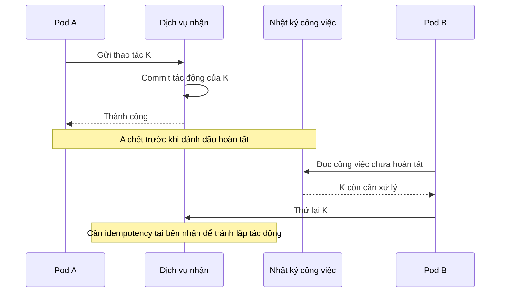

# Vì sao leader election không tự bảo đảm thực thi đúng một lần

## Mục tiêu bài học

Trong chương **Bầu leader** của module **SPRING_CLOUD_KUBERNETES**, bài học này giải thích giới hạn của việc chọn một Pod điều phối công việc. Sau bài học, bạn có thể:

- Phân biệt một leader đang được ghi nhận với một tác động nghiệp vụ được ghi nhận đúng một lần.
- Phân tích lỗi khi Pod chết, mất kết nối, tạm dừng lâu hoặc không nhận được phản hồi.
- Kết hợp leader election với khóa nghiệp vụ, transaction, idempotency, outbox và fencing.
- Chọn phép kiểm chứng dựa trên dữ liệu cuối cùng, thay vì chỉ đếm log bầu leader.

Kiến thức đầu vào: ứng dụng Spring Boot có nhiều replica, callback thay đổi leadership, transaction cơ sở dữ liệu và tác vụ nền.

## 1. Hai câu hỏi thuộc hai phạm vi khác nhau

Leader election trả lời câu hỏi: **instance nào hiện được cơ chế điều phối cho phép đảm nhận một vai trò?**

Thực thi đúng một lần cần trả lời câu hỏi khác: **với một thao tác nghiệp vụ cụ thể, tác động nào đã được commit, và mọi lần thử lại có làm phát sinh tác động mới không?**

Giả sử ba Pod cùng cung cấp dịch vụ tạo báo cáo ngày cho từng khách hàng. Chọn được Pod A làm leader giúp hạn chế việc cả ba Pod cùng quét danh sách báo cáo đến hạn. Tuy nhiên, cơ chế đó chưa lưu kết luận rằng báo cáo của khách hàng X cho ngày D đã được tạo thành công.

Hai mệnh đề sau không tương đương:

```text
Tại thời điểm t, bộ điều phối ghi nhận một leader cho vai trò R.

Trong toàn bộ thời gian sống của thao tác K,
hệ thống chỉ commit một tác động hợp lệ cho K.
```

Ngay cả khi giả định không bao giờ có hai leader cùng hoạt động, leader A vẫn có thể tạo tác động, chết trước khi ghi nhận hoàn tất, rồi leader B thử lại cùng thao tác. Trùng lặp nối tiếp đã đủ bác bỏ suy luận “một leader nên đúng một lần”; không cần xảy ra split brain.

### Các mức bảo đảm cần gọi đúng tên

| Khái niệm | Điều được bảo đảm trong phạm vi đã định nghĩa | Điều còn phải xử lý |
| --- | --- | --- |
| At-most-once | Không vượt quá một lần thử hoặc một lần áp dụng tác động, tùy hợp đồng | Có thể bỏ mất công việc |
| At-least-once | Công việc được thử lại cho đến khi thành công, nếu các điều kiện phục hồi được đáp ứng | Có thể lặp lần gọi và lần chạy |
| Exactly-once effect | Một thao tác có đúng một tác động được commit trong một phạm vi nhất quán cụ thể | Phải chứng minh cả chống lặp và khả năng hoàn tất |
| Idempotency | Lặp cùng một yêu cầu hợp lệ không tạo thêm tác động quan sát được | Không tự bảo đảm có ai sẽ thử lại |
| Leader election | Điều phối quyền đảm nhận một vai trò | Không thay thế nhật ký nghiệp vụ, transaction hoặc chống ghi từ chủ cũ |

Trong bài này, “đúng một lần” tập trung vào **tác động đã commit**, không yêu cầu JVM chỉ đi vào một phương thức đúng một lần. Một phương thức có thể được gọi nhiều lần nhưng chỉ một lần làm thay đổi dữ liệu nghiệp vụ.

## 2. Spring Cloud Kubernetes cung cấp phần nào?

Để tránh trộn API giữa các nhánh phiên bản, ví dụ callback ở bài này dùng cách triển khai Fabric8/ConfigMap được mô tả trong tài liệu Spring Cloud Kubernetes 3.3.x. Artifact là `spring-cloud-kubernetes-fabric8-leader`; ứng dụng nhận `OnGrantedEvent` và `OnRevokedEvent`. Tên ConfigMap được cấu hình qua `spring.cloud.kubernetes.leader.config-map-name`. [Tài liệu Leader Election 3.3](https://docs.spring.io/spring-cloud-kubernetes/reference/3.3/leader-election.html).

Bản ghi điều phối này không phải transaction chung với bảng báo cáo, message broker hay máy chủ HTTP bên ngoài. Việc đổi người giữ vai trò và việc tạo kết quả nghiệp vụ là hai luồng trạng thái độc lập.

Khi đọc tài liệu hoặc ứng dụng khác dùng Lease, cần xác định đúng thư viện, phiên bản, resource khóa và mô hình hết hạn. Không áp các thời hạn của một thuật toán Lease vào mọi cách triển khai ConfigMap. Các lập luận về commit, retry và idempotency ở bài này vẫn áp dụng dù resource điều phối là gì.

Tài liệu chính thức của Kubernetes `client-go` cũng nêu giới hạn rằng leader election không bảo đảm chỉ một client thực sự hành động như leader, tức chưa cung cấp fencing. Đây là một minh họa cho giới hạn điều phối, không phải khẳng định Spring đang gọi thư viện Go này. [Tài liệu client-go leaderelection](https://pkg.go.dev/k8s.io/client-go/tools/leaderelection).

## 3. Những cửa sổ lỗi mà bầu leader không đóng được

### 3.1. Tác động đã xảy ra, dấu hoàn tất chưa được lưu

Giả sử tác vụ gửi một thông báo đến dịch vụ bên ngoài:

1. A là leader và lấy thao tác `notify:X:D`.
2. A gọi dịch vụ; dịch vụ đã ghi nhận và gửi thông báo.
3. A chết trước khi cập nhật trạng thái hoàn tất trong cơ sở dữ liệu của ứng dụng.
4. B trở thành leader và thấy thao tác vẫn chưa xong.
5. B gửi lại thông báo.



Đổi thứ tự thành “đánh dấu xong trước, gọi dịch vụ sau” tạo cửa sổ ngược lại: A có thể chết sau khi đánh dấu nhưng trước khi gửi. B bỏ qua thao tác và công việc bị mất.

**Đánh dấu trước dễ mất việc; đánh dấu sau dễ lặp việc.** Muốn đóng cửa sổ này cần transaction chung hoặc một giao thức phục hồi được bên nhận hỗ trợ.

### 3.2. Timeout không chứng minh thao tác thất bại

Một HTTP timeout chỉ cho biết phía gọi chưa nhận được kết quả trong thời hạn. Có ít nhất hai khả năng:

- Yêu cầu chưa được bên nhận xử lý.
- Bên nhận đã commit nhưng phản hồi bị chậm hoặc bị mất.

Nếu retry ngay với một định danh mới, trường hợp thứ hai có thể tạo tác động lần nữa. Nếu không retry, trường hợp thứ nhất có thể bị bỏ quên. Hệ thống cần giữ định danh thao tác cũ và có cách truy vấn hoặc đối soát kết quả chưa rõ.

Lỗi này xuất hiện ngay trong một nhiệm kỳ leader và cũng có thể xuất hiện khi quyền điều phối chuyển từ A sang B.

### 3.3. Leader cũ vẫn còn công việc đang chạy

Xét một thuật toán có thời hạn giữ quyền, hoặc một tình huống controller đã chuyển quyền sau khi xác định A không còn hợp lệ:

| Thời điểm minh họa | Pod A | Pod B | Nơi nhận tác động |
| --- | --- | --- | --- |
| t0 | Có quyền điều phối, bắt đầu công việc | Chờ | Chưa có tác động |
| t1 | Bị tạm dừng lâu hoặc mất kết nối tới API server | Tiếp tục quan sát | Có thể vẫn truy cập được từ A |
| t2 | Chưa quan sát được mất quyền | Đủ điều kiện nhận quyền theo thuật toán đang dùng | Nhận yêu cầu từ B |
| t3 | Tiếp tục chạy phần việc cũ | Đang xử lý công việc mới | Có thể nhận yêu cầu từ cả A và B |

Bảng này mô tả một cửa sổ rủi ro, không ấn định thời gian chuyển quyền cho mọi implementation. Mất đường tới Kubernetes API server cũng không đồng nghĩa mất đường tới PostgreSQL, broker hoặc dịch vụ HTTP.

Callback thu hồi quyền không thể được xử lý trong một JVM đang dừng. Khi callback chạy, một yêu cầu HTTP trước đó có thể đã rời khỏi tiến trình. Hủy `Future` hoặc interrupt thread không thu hồi được một tác động đã commit ở hệ thống khác.

### 3.4. Kiểm tra quyền trước khi ghi vẫn có khoảng trống

Ví dụ sau chưa đủ để bảo vệ kết quả:

```java
if (leadershipGate.mayStartWork()) {
    // Có thể mất quyền hoặc bị tạm dừng ngay tại đây.
    remoteClient.apply(operation);
}
```

Đây là khoảng trống giữa lúc kiểm tra và lúc sử dụng quyền. Kiểm tra lần thứ hai chỉ tạo một khoảng trống mới, nhỏ hơn nhưng vẫn tồn tại. Muốn loại một chủ cũ tại thời điểm ghi, nơi nhận ghi phải tham gia kiểm tra quyền hoặc token phù hợp.

### 3.5. Một leader vẫn có thể bỏ sót lịch

Nếu mỗi Pod chỉ chạy “công việc của ngày hiện tại” khi cron kích hoạt, khoảng thời gian không có leader có thể khiến một ngày không được xử lý. Bầu được leader mới không tự phát lại những lần cron đã qua.

Vì vậy, chống lặp chỉ là một nửa yêu cầu. Nửa còn lại là lưu được danh sách công việc cần làm, phát hiện việc còn thiếu và thử lại sau khi hệ thống phục hồi.

## 4. Callback leadership nên dùng để quản lý vòng đời

Ứng dụng nên dùng callback để bật hoặc tắt việc **nhận thêm công việc mới**. Không chạy một batch dài trực tiếp bên trong listener. Với nhiều vai trò, cần lọc đúng role; API sự kiện có `getRole()` và `getContext()`. [API AbstractLeaderEvent](https://docs.spring.io/spring-integration/api/org/springframework/integration/leader/event/AbstractLeaderEvent.html).

Ví dụ cổng cục bộ cho đúng vai trò `daily-report`:

```java
import java.util.concurrent.atomic.AtomicBoolean;

import org.springframework.context.event.EventListener;
import org.springframework.integration.leader.event.OnGrantedEvent;
import org.springframework.integration.leader.event.OnRevokedEvent;
import org.springframework.stereotype.Component;

@Component
public class LeadershipGate {

    private static final String ROLE = "daily-report";
    private final AtomicBoolean accepting = new AtomicBoolean(false);

    @EventListener
    public void onGranted(OnGrantedEvent event) {
        if (ROLE.equals(event.getRole())) {
            accepting.set(true);
        }
    }

    @EventListener
    public void onRevoked(OnRevokedEvent event) {
        if (ROLE.equals(event.getRole())) {
            accepting.set(false);
        }
    }

    public boolean mayStartWork() {
        return accepting.get();
    }
}
```

Cổng này chỉ phản ánh trạng thái mà tiến trình đã quan sát. Scheduler hoặc worker dùng nó để quyết định có nhận thêm công việc không; kết quả nghiệp vụ vẫn phải được bảo vệ bên dưới. Ví dụ cũng giả định listener được xử lý theo thứ tự thông thường, không tùy ý chuyển các sự kiện sang executor có thể đảo thứ tự.

Khi được cấp quyền, worker khởi động hoặc đánh thức vòng quét công việc còn thiếu. Khi mất quyền hoặc shutdown, worker đóng cổng, yêu cầu dừng ở ranh giới an toàn và chờ có giới hạn cho việc đang chạy. Phần việc chưa rõ kết quả phải còn dấu vết để phục hồi.

Nếu A mất quyền rồi được cấp lại, hãy phân biệt hai thế hệ chạy trong ứng dụng. Một cờ boolean trở lại `true` không chứng minh task thuộc thế hệ cũ được phép tiếp tục. Có thể dùng mã thế hệ cục bộ hoặc cancellation token riêng cho mỗi vòng chạy, nhưng chúng vẫn không phải fencing ở cơ sở dữ liệu hay dịch vụ từ xa.

## 5. Định danh thao tác phải tồn tại qua mọi nhiệm kỳ

Mỗi thao tác cần một **operation key ổn định**, được suy ra từ nghiệp vụ hoặc được cấp một lần rồi lưu bền vững. Với báo cáo ngày:

```text
daily-report:<tenant-id>:<business-date>
```

Ví dụ:

```text
daily-report:9eedc6c7-f8a9-4a9c-95cd-7d9ca128e038:2026-11-23
```

Pod A, Pod B và mọi lần retry đều phải dùng cùng khóa cho cùng một báo cáo. Không dùng tên Pod, thời điểm retry hoặc UUID mới cho mỗi lần gọi làm khóa chống lặp. Những giá trị đó chỉ nhận diện lần thử.

Cần quy định thêm:

- Ngày nghiệp vụ thuộc múi giờ nào; tính một lần rồi lưu cùng công việc.
- Dữ liệu đầu vào đã chốt tại thời điểm nào; retry phải tham chiếu cùng snapshot.
- Cùng khóa nhưng khác dữ liệu đầu vào là lỗi hợp đồng, không phải yêu cầu hợp lệ mới.
- Khóa và kết quả được giữ bao lâu để bao phủ cả retry tự động, replay thủ công và thời gian phục hồi.
- Thao tác sửa báo cáo có định danh nghiệp vụ riêng và quy tắc phiên bản rõ ràng.

Không tự thêm phiên bản cấu hình mới vào khóa chỉ vì ConfigMap vừa thay đổi. Một thay đổi cấu hình không đương nhiên cho phép thực hiện lại tác động cũ. Nếu có quyền tạo bản điều chỉnh, hãy mô hình hóa đó thành thao tác mới có liên kết tới bản trước.

Một tập `Set<String>` trong RAM không đáp ứng yêu cầu này: nó biến mất khi restart và không được chia sẻ giữa các Pod. Nhật ký cần nằm ở kho bền vững mà các bên cùng truy cập theo một quy tắc nhất quán.

## 6. Ví dụ: một tác động trong cùng transaction PostgreSQL

Ví dụ sau tạo một báo cáo, ghi nhận khóa đã xử lý và tạo ý định phát sự kiện trong **cùng một cơ sở dữ liệu**. Đây là thiết kế minh họa do bài học đề xuất; leader chỉ giảm số worker tranh chấp.

### 6.1. Điều kiện áp dụng

- Ứng dụng có Spring JDBC, PostgreSQL driver và transaction manager quản lý cùng `DataSource`.
- Mỗi cặp khách hàng/ngày có một snapshot `itemCount` đã chốt, được lưu bền vững trước khi gọi service.
- Mọi đường tạo báo cáo đều đi qua cùng ràng buộc dữ liệu.
- Ví dụ dùng isolation `READ COMMITTED`; lỗi kết nối hoặc lỗi transaction được retry từ bên ngoài với cùng operation key.
- Chưa có HTTP call hoặc publish trực tiếp tới broker trong transaction này.

Schema:

```sql
CREATE TABLE processed_operation (
    operation_key text PRIMARY KEY,
    completed_at timestamptz NOT NULL DEFAULT now()
);

CREATE TABLE daily_report (
    operation_key text PRIMARY KEY
        REFERENCES processed_operation(operation_key),
    tenant_id uuid NOT NULL,
    report_date date NOT NULL,
    item_count bigint NOT NULL CHECK (item_count >= 0),
    UNIQUE (tenant_id, report_date)
);

CREATE TABLE outbox_event (
    event_key text PRIMARY KEY,
    operation_key text NOT NULL
        REFERENCES processed_operation(operation_key),
    payload jsonb NOT NULL,
    published_at timestamptz
);
```

`processed_operation` là dấu hoàn tất của đơn vị công việc. Mặc dù hàng được insert đầu tiên trong phương thức, nó chỉ trở thành dấu hoàn tất bền vững khi **toàn bộ transaction commit**. Không commit riêng hàng này trước khi tạo báo cáo.

PostgreSQL cho phép xử lý xung đột khóa duy nhất bằng `INSERT ... ON CONFLICT ... DO NOTHING`. Ví dụ dùng cơ chế đó thay cho thao tác “SELECT xem có chưa, rồi mới INSERT”, vốn có thể bị hai Pod cùng vượt qua. [PostgreSQL INSERT](https://www.postgresql.org/docs/current/sql-insert.html).

### 6.2. Service nghiệp vụ

```java
import java.sql.Date;
import java.time.LocalDate;
import java.util.Objects;
import java.util.UUID;

import org.springframework.jdbc.core.JdbcTemplate;
import org.springframework.stereotype.Service;
import org.springframework.transaction.annotation.Isolation;
import org.springframework.transaction.annotation.Transactional;

@Service
public class DailyReportService {

    private final JdbcTemplate jdbc;

    public DailyReportService(JdbcTemplate jdbc) {
        this.jdbc = jdbc;
    }

    @Transactional(isolation = Isolation.READ_COMMITTED)
    public boolean createReport(
            UUID tenantId, LocalDate businessDate, long itemCount) {

        Objects.requireNonNull(tenantId, "tenantId");
        Objects.requireNonNull(businessDate, "businessDate");
        if (itemCount < 0) {
            throw new IllegalArgumentException("itemCount must be non-negative");
        }

        String key = "daily-report:" + tenantId + ":" + businessDate;

        int inserted = jdbc.update("""
            INSERT INTO processed_operation(operation_key)
            VALUES (?)
            ON CONFLICT (operation_key) DO NOTHING
            """, key);

        if (inserted == 0) {
            Long existing = jdbc.queryForObject("""
                SELECT item_count
                FROM daily_report
                WHERE operation_key = ?
                """, Long.class, key);

            if (existing == null || existing.longValue() != itemCount) {
                throw new IllegalStateException(
                    "Operation key was reused with different input");
            }
            return false;
        }

        jdbc.update("""
            INSERT INTO daily_report(
                operation_key, tenant_id, report_date, item_count)
            VALUES (?, ?, ?, ?)
            """, key, tenantId, Date.valueOf(businessDate), itemCount);

        jdbc.update("""
            INSERT INTO outbox_event(event_key, operation_key, payload)
            VALUES (
                ?, ?,
                jsonb_build_object('operationKey', CAST(? AS text))
            )
            """, key + ":created", key, key);

        return true;
    }
}
```

Giá trị trả về `true` có nghĩa lần gọi này tạo báo cáo; `false` nghĩa báo cáo tương ứng đã tồn tại với cùng đầu vào. Nếu bảng dấu hoàn tất có hàng nhưng không có báo cáo, truy vấn phải báo lỗi để lộ vi phạm bất biến, không im lặng coi là thành công.

Scheduler gọi `DailyReportService` qua bean được inject. Trong chế độ proxy thông thường của Spring, tự gọi phương thức `@Transactional` bằng `this.createReport(...)` không kích hoạt transaction advice như một lời gọi đi qua proxy. [Spring Framework: Using @Transactional](https://docs.spring.io/spring-framework/reference/data-access/transaction/declarative/annotations.html).

Nếu A và B cùng insert một khóa, ràng buộc duy nhất phân xử tại cơ sở dữ liệu. B có thể phải chờ transaction của A. Nếu A rollback, B có thể insert và làm việc; nếu A commit, B đi nhánh đã tồn tại. Không cần hai Pod thống nhất một cờ trong RAM.

### 6.3. Những điểm chết và kết quả mong muốn

| Điểm phát sinh lỗi | Trạng thái bền vững | Cách lần thử sau xử lý |
| --- | --- | --- |
| Trước khi mở transaction | Chưa có gì | Tạo bình thường |
| Sau insert dấu nhưng trước insert báo cáo | Transaction chưa commit; các thay đổi phải rollback khi transaction thất bại | Insert lại cùng khóa |
| Sau insert báo cáo nhưng trước commit | Chưa có kết quả commit | Retry cả transaction |
| Commit thành công nhưng phản hồi về worker bị mất | Đã có dấu, báo cáo và outbox | Gặp khóa cũ, xác nhận đầu vào rồi bỏ qua |
| Sau commit nhưng trước publish sự kiện | Báo cáo và outbox đã tồn tại | Relay tiếp tục đọc outbox |

Khóa duy nhất và transaction giúp chứng minh **không có hai tác động commit cho cùng khóa trong thiết kế này**. Để nói “đúng một lần” còn phải có nguồn công việc bền vững, retry và điều kiện phục hồi để công việc chưa hoàn tất cuối cùng được chạy.

Không xóa dấu chống lặp trong khi vẫn cho phép replay các thao tác cũ. Nếu cần lưu trữ hoặc dọn dữ liệu, chính sách phải bảo toàn khả năng nhận diện kết quả đã có.


## 7. Khi tác động nằm ngoài cơ sở dữ liệu

### 7.1. Outbox lưu ý định, không tự bảo đảm giao nhận một lần

Trong ví dụ trên, báo cáo và hàng outbox cùng commit. Một relay độc lập đọc sự kiện chưa phát, publish tới broker rồi đánh dấu `published_at`.

Relay vẫn có cửa sổ lỗi:

1. Broker đã nhận sự kiện.
2. Relay chết trước khi đánh dấu đã phát.
3. Relay khác đọc lại hàng và publish cùng sự kiện lần nữa.

Vì vậy, relay cần giữ nguyên `event_key` qua mọi lần phát. Consumer dùng khóa đó trong một bảng inbox hoặc nhật ký đã xử lý. Việc ghi inbox và cập nhật nghiệp vụ của consumer cũng cần nằm trong cùng transaction nếu cùng cơ sở dữ liệu.

```text
Producer DB:
  báo cáo + outbox                     -- một transaction

Relay:
  phát event_key, có thể phát lại       -- không giả định một lần gửi

Consumer DB:
  inbox(event_key UNIQUE) + tác động    -- một transaction khác
```

Nếu consumer tiếp tục gọi HTTP hoặc gửi email, transaction inbox của nó chưa bao phủ tác động đó. Cần xét tiếp hợp đồng của bước ngoài cơ sở dữ liệu; không gắn nhãn “exactly-once toàn hệ thống” chỉ vì đã thêm outbox ở producer.

### 7.2. Idempotency key phải được bên nhận thực thi

Đối với HTTP, ứng dụng có thể gửi một định danh ổn định nếu dịch vụ đích hỗ trợ:

```http
POST /notifications
Idempotency-Key: notify:9eedc6c7-f8a9-4a9c-95cd-7d9ca128e038:2026-11-23
Content-Type: application/json

{"tenantId":"9eedc6c7-f8a9-4a9c-95cd-7d9ca128e038","businessDate":"2026-11-23"}
```

Đây là ví dụ hợp đồng của một API giả định, không phải header tự động có hiệu lực với mọi server. Bên nhận phải bảo đảm các yêu cầu đồng thời cùng khóa không cùng tạo tác động, lưu kết quả ổn định và kiểm tra trường hợp cùng khóa nhưng khác payload.

Trước khi dựa vào cơ chế này, cần hiểu phạm vi khóa, thời gian lưu khóa, hành vi khi yêu cầu đang xử lý và khả năng tra cứu kết quả. Thời gian retry tối đa của bên gọi phải phù hợp với thời gian bên nhận còn nhớ khóa.

Nếu bên nhận không hỗ trợ idempotency hoặc tra cứu đáng tin cậy, ứng dụng không thể dùng leader election để loại bỏ sự mơ hồ sau timeout. Cần lưu trạng thái “chưa xác định”, đối soát bằng mã giao dịch nghiệp vụ và có quy trình xử lý ngoại lệ. Không đổi ngay thành “thất bại” rồi tạo một thao tác mới.

## 8. Fencing loại yêu cầu từ chủ cũ

Idempotency và fencing xử lý hai vấn đề khác nhau:

- **Idempotency** nhận diện cùng một thao tác để không tạo tác động lần nữa.
- **Fencing** ngăn chủ thuộc nhiệm kỳ cũ tiếp tục ghi sau khi chủ mới đã được công nhận tại tài nguyên đích.

Một thiết kế fencing thường cấp một token tăng đơn điệu cho mỗi nhiệm kỳ hợp lệ, chẳng hạn A có token 41 và B có token 42. Các số này chỉ là ví dụ của một giao thức cần xây dựng, không phải token mặc định do Spring Cloud Kubernetes phát.

Bên nhận lưu mốc token đã chấp nhận và áp dụng quy tắc:

```text
Trong cùng cơ chế khóa/transaction của tài nguyên đích:

nếu token < mốc đã ghi nhận:
    từ chối yêu cầu từ chủ cũ
ngược lại:
    cập nhật mốc nếu cần
    kiểm tra operation key
    áp dụng tác động nếu thao tác chưa hoàn tất
```

Khi B đăng ký token 42 tại bên nhận trước khi làm công việc của nhiệm kỳ mới, một yêu cầu trễ mang token 41 bị từ chối. Yêu cầu trùng mang token 42 vẫn cần operation key; fencing không chống lặp trong cùng nhiệm kỳ và không tự sắp thứ tự các yêu cầu thuộc nhiệm kỳ đó.

Thiết kế này chỉ có ý nghĩa nếu đáp ứng đủ các điều kiện sau:

1. Cấp token gắn với việc giành quyền hợp lệ; chủ cũ không được tự xin token cao hơn rồi giả làm chủ mới.
2. Nơi nhận kiểm tra token cùng với thao tác ghi một cách nguyên tử, không “đọc token rồi ghi sau” bằng hai thao tác rời.
3. Mọi đường ghi quan trọng đều đi qua kiểm tra; không để một API phụ bỏ qua fencing.
4. Có ranh giới kích hoạt rõ ràng: bên nhận phải ghi nhận nhiệm kỳ mới trước khi coi việc loại chủ cũ có hiệu lực ở đó.

Trước ranh giới đó, một yêu cầu cũ vẫn có thể được bên nhận chấp nhận. Nếu có nhiều nơi nhận độc lập, kích hoạt ở một nơi chưa đồng nghĩa kích hoạt ở tất cả. Đây là phần phải chứng minh trong thiết kế, không thể suy ra từ một log “B became leader”.

Tên Pod, UUID, thời điểm theo đồng hồ cục bộ hoặc một biến `AtomicLong` riêng trong JVM không tạo ra epoch toàn cục hợp lệ. Cũng không coi `resourceVersion` tự động là fencing cho ứng dụng: thứ tự phiên bản resource, quan hệ với nhiệm kỳ và kiểm tra nguyên tử tại nơi ghi là các hợp đồng khác nhau. Xem ngữ nghĩa metadata trong [Kubernetes API Concepts: Resource versions](https://kubernetes.io/docs/reference/using-api/api-concepts/#resource-versions).

Với báo cáo độc lập chỉ cần tạo một hàng cho một khóa, unique constraint và transaction có thể đã đủ bảo vệ tác động. Fencing hữu ích hơn khi một leader phải liên tục thay đổi cùng tài nguyên dùng chung và các ghi cũ có thể phá trạng thái mới.

## 9. Khả năng phục hồi và vận hành trên Kubernetes

### 9.1. Lưu công việc cần làm, không chỉ lưu việc đã xong

Nhật ký chống lặp chỉ trả lời việc nào đã hoàn tất. Hệ thống còn cần biết việc nào đáng lẽ phải tồn tại.

Một luồng phục hồi phù hợp với ví dụ báo cáo:

1. Lưu các kỳ báo cáo đến hạn cùng khách hàng, ngày nghiệp vụ và snapshot đầu vào.
2. Leader quét cả kỳ hiện tại lẫn các kỳ còn thiếu trong khoảng phục hồi được hỗ trợ.
3. Worker gọi service với khóa ổn định.
4. Nếu chết sau commit nhưng trước khi cập nhật trạng thái công việc, lần thử sau nhận kết quả đã có và hoàn tất phần bookkeeping.
5. Theo dõi tuổi công việc chưa hoàn tất; retry có backoff và đường xử lý khi hết ngân sách retry.

Nếu dùng trạng thái `RUNNING` hoặc cơ chế claim công việc, phải định nghĩa cách thu hồi claim của worker đã chết. Không để một cờ `RUNNING` tồn tại vĩnh viễn chặn mọi lần thử sau.

**Safety** là không commit tác động trùng hoặc cho phép ghi cũ phá trạng thái. **Liveness** là công việc hợp lệ cuối cùng tiến tới hoàn tất khi các phụ thuộc phục hồi. Thỏa mãn một phía chưa chứng minh phía còn lại.

### 9.2. Thời hạn điều phối không phải transaction timeout

Giảm thời gian chuyển leader có thể cải thiện tốc độ phục hồi nhưng cũng làm hệ thống nhạy hơn với độ trễ API server hoặc các lần tạm dừng. Tăng thời gian giữ quyền có thể giảm dao động nhưng làm lâu hơn trước khi chủ mới được nhận quyền.

Chọn tham số theo đúng thuật toán và phiên bản đang chạy. Không có một con số TTL nào tự chứng minh đúng một lần. Transaction timeout, HTTP timeout, deadline của task và thời gian shutdown là các giới hạn khác nhau.

Khi nhận tín hiệu mất quyền, dừng nhận việc mới, kiểm tra cancellation ở ranh giới từng đơn vị công việc và giữ đường phục hồi cho kết quả chưa rõ. Một lần shutdown có kiểm soát giúp giảm cửa sổ lỗi nhưng không thay thế cơ chế chống lặp khi tiến trình bị dừng đột ngột.

### 9.3. RBAC và phạm vi khóa cần khớp giữa các replica

Các ứng viên phải dùng cùng namespace, tên resource và vai trò điều phối cho cùng công việc. Hai nhóm dùng khóa khác nhau có thể đều có leader hợp lệ nhưng cùng ghi vào một tập dữ liệu.

Dùng ServiceAccount riêng và Role theo namespace, cấp đúng resource và verb mà implementation cần. Quyền cập nhật ConfigMap/Lease không đồng nghĩa quyền ghi dữ liệu nghiệp vụ. Nếu giới hạn `get/update` bằng `resourceNames`, lưu ý top-level `create` không được giới hạn theo tên theo cùng cách; có thể tạo trước resource khóa bằng quy trình triển khai nếu implementation hỗ trợ. [Kubernetes RBAC](https://kubernetes.io/docs/reference/access-authn-authz/rbac/).

Ví dụ lệnh quan sát cho cách triển khai ConfigMap, với các tên minh họa đã được thay bằng tên thực tế của môi trường:

```bash
kubectl -n reports get configmap daily-report-leader -o yaml

kubectl auth can-i update configmaps/daily-report-leader --as=system:serviceaccount:reports:report-worker -n reports
```

Lệnh `--as` cần quyền impersonation của người kiểm tra. Kết quả kiểm tra một verb chưa chứng minh toàn bộ quyền mà client cần đã đủ. Đối với implementation dùng Lease, kiểm tra đúng resource thuộc API group `coordination.k8s.io`.

### 9.4. Sức khỏe Pod và quan sát tác động

Một Pod khỏe và sẵn sàng nhận HTTP không đồng nghĩa được phép chạy tác vụ leader. Ngược lại, follower vẫn có thể phục vụ đọc hoặc API thông thường. Readiness cũng không tự dừng scheduler và không thu hồi được một yêu cầu đang thực thi.

Log cần phân biệt:

- `operation_key`: một thao tác nghiệp vụ xuyên suốt các lần thử.
- `attempt_id`: từng lần thử, có thể thay đổi.
- `pod_uid`, vai trò và thế hệ chạy: nguồn thực thi.
- Kết quả: tạo mới, đã tồn tại, rollback, chưa xác định hoặc bị fencing từ chối.

Theo dõi cả số lần đổi leader, lỗi gia hạn/đọc khóa, độ tuổi công việc tồn, số lần chống lặp có hiệu lực, số yêu cầu bị từ chối và backlog outbox. Không dùng operation key làm nhãn metric có số lượng giá trị không giới hạn; đưa nó vào log hoặc trace.

Năm log “bắt đầu xử lý” có thể chỉ tương ứng một tác động commit. Một log “thành công” cũng có thể che một tác động bị lặp ở bên ngoài. Bằng chứng phải lấy từ bảng nghiệp vụ và trạng thái ở nơi nhận.

## 10. Thực hành kiểm chứng bằng các điểm lỗi

Chuẩn bị môi trường thử có ba replica, PostgreSQL dùng chung, nguồn công việc bền vững và một dịch vụ nhận giả lập có nhật ký tác động. Các lỗi dưới đây là tình huống cần chủ động tạo trong môi trường thử, không phải kết quả đã được chạy sẵn.

| Thí nghiệm | Cách tạo tình huống | Điều cần quan sát |
| --- | --- | --- |
| Retry cùng khóa | Gọi service nhiều lần với cùng snapshot | Một báo cáo, một dấu hoàn tất, một hàng outbox |
| Tranh chấp giữa Pod | Cho nhiều lời gọi đồng thời đi qua bean service với cùng khóa | Chỉ một lần trả tạo mới; các lần còn lại nhận đã có |
| Chết giữa transaction | Dừng tiến trình sau insert dấu, trước commit | Không có dấu hoàn tất mồ côi được commit; retry tạo được báo cáo |
| Mất phản hồi commit | Làm worker không nhận được kết quả sau khi DB đã commit | Retry nhận dữ liệu đã có, không tạo thêm báo cáo |
| Lỗi sau publish | Dừng relay sau broker acknowledge, trước đánh dấu outbox | Có thể có nhiều lần giao nhưng consumer chỉ commit một tác động |
| HTTP kết quả chưa rõ | Server giả lập commit rồi không trả response | Retry giữ nguyên idempotency key; server ghi một tác động |
| Leader cũ quay lại | Trong mô hình có chuyển quyền theo hết hạn, trì hoãn A để B nhận quyền, rồi cho A tiếp tục | Tác động trùng bị chặn; nếu có fencing, yêu cầu cũ bị từ chối sau ranh giới kích hoạt |
| Không có leader qua một kỳ | Dừng các ứng viên qua thời điểm đến hạn rồi khôi phục | Vòng quét tìm lại kỳ thiếu và hoàn tất nó |
| Cùng khóa, khác đầu vào | Gửi lại ngày/khách hàng cũ với `itemCount` khác | Báo lỗi hợp đồng, không ghi đè kết quả cũ |

Thí nghiệm timeout nên kiểm soát rõ hai nhánh “chưa commit” và “đã commit nhưng mất phản hồi”. Chỉ tăng độ trễ ngẫu nhiên dễ khiến bạn không biết mình vừa kiểm tra nhánh nào.

Với bộ dữ liệu thử chỉ gồm một thao tác, có thể kiểm tra:

```sql
SELECT operation_key, item_count
FROM daily_report;

SELECT count(*) AS completed_operations
FROM processed_operation;

SELECT event_key, published_at
FROM outbox_event;
```

Với nhiều thao tác, lọc theo khóa mục tiêu và kiểm tra cả những khóa kỳ vọng nhưng chưa xuất hiện. Ràng buộc duy nhất có thể ngăn hàng trùng, nhưng không chỉ ra một công việc hoàn toàn bị bỏ sót.

Tiêu chí đạt phải nêu rõ phạm vi: một báo cáo commit cho khóa K; một tác động ở consumer cho event K; hoặc một thông báo được dịch vụ giả lập ghi nhận cho idempotency key K. Không gộp các phạm vi này thành một kết luận chung khi mới kiểm tra một bảng.

## 11. Chọn tính năng cần cho triển khai

| Tình huống | Cơ chế nền tảng phù hợp | Vai trò của leader election |
| --- | --- | --- |
| Chỉ một instance cần quét danh sách đến hạn để giảm tải | Nguồn công việc bền vững và service idempotent | Chọn người quét, giảm tranh chấp |
| Nhiều worker xử lý các việc độc lập từ queue | Giao nhận, retry và chống lặp theo từng message/thao tác | Có thể không cần một leader chung |
| Một tác động chỉ nằm trong PostgreSQL | Unique constraint và transaction | Hỗ trợ điều phối, không phải lớp bảo vệ cuối |
| Gửi sự kiện sau khi ghi dữ liệu | Transactional outbox và consumer idempotent | Có thể điều phối relay, vẫn phải chấp nhận phát lại |
| Gọi dịch vụ bên ngoài | Idempotency tại bên nhận, tra cứu và đối soát | Không thay thế hợp đồng của dịch vụ đích |
| Chủ cũ có thể ghi đè trạng thái mới | Fencing được nơi nhận thực thi, kết hợp operation key | Cung cấp vòng đời điều phối để tích hợp giao thức |
| Công việc định kỳ phù hợp mô hình Job | CronJob/Job và nghiệp vụ có khả năng chạy lại | Có thể bỏ scheduler leader trong ứng dụng |

CronJob cũng không phải chứng minh đúng một lần: tài liệu Kubernetes nêu khả năng một thời điểm có hai Job hoặc không có Job và yêu cầu công việc có tính idempotent. Job cũng có thể khởi chạy cùng chương trình hai lần dù đặt parallelism và completions bằng một. [CronJob limitations](https://kubernetes.io/docs/concepts/workloads/controllers/cron-jobs/#job-creation), [Jobs: Handling Pod and container failures](https://kubernetes.io/docs/concepts/workloads/controllers/job/#handling-pod-and-container-failures).

Trong phạm vi tích hợp Spring với Kubernetes, DiscoveryClient và Spring Cloud LoadBalancer phục vụ tìm/chọn đích gọi; ConfigMap và Secret cung cấp dữ liệu cấu hình; Configuration Watcher hỗ trợ phản ứng với thay đổi cấu hình. Những chức năng đó không tạo transaction nghiệp vụ hay nhật ký chống lặp. Chỉ thêm thành phần giải quyết một nhu cầu cụ thể của triển khai.

## 12. Những điều phải chứng minh trước khi tuyên bố đúng một lần

Một thiết kế có cơ sở cần trả lời được các câu hỏi:

1. Đơn vị nghiệp vụ cần bảo vệ là gì và operation key nào đại diện cho nó?
2. Tác động nào nằm trong cùng transaction; tác động nào nằm ngoài?
3. Khi tác động đã commit nhưng phản hồi bị mất, lần retry lấy lại kết quả bằng cách nào?
4. Ràng buộc nào phân xử hai lời gọi cùng khóa ngay tại nơi ghi?
5. Khi leader cũ quay lại, quyền ghi của nó được giới hạn ở đâu?
6. Ai phát hiện và thử lại công việc bị bỏ dở hoặc bị lỡ lịch?
7. Khi khóa chống lặp hết hạn hoặc dữ liệu được dọn, replay cũ sẽ được xử lý thế nào?
8. Thử nghiệm đã xác minh dữ liệu ở nơi nhận, hay mới kiểm tra log leadership?

Leader election có giá trị khi cần một người điều phối. Bảo đảm cho kết quả đến từ định danh thao tác, trạng thái bền vững, ranh giới commit và quy tắc của nơi thực sự tạo tác động.
