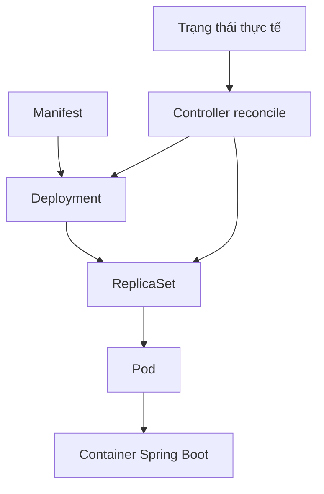
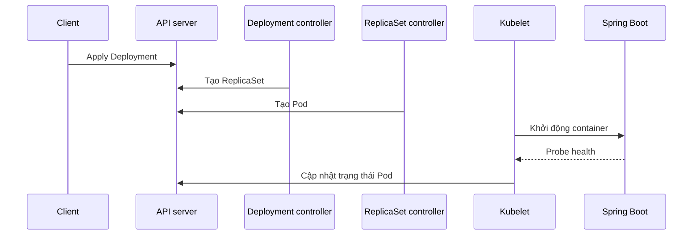

# Deployment, ReplicaSet và khai báo trạng thái mong muốn

## 1. Mô hình trạng thái mong muốn

Kubernetes vận hành workload bằng cách so sánh trạng thái thực tế trong cluster với trạng thái mà người triển khai khai báo. Manifest mô tả kết quả cần đạt: ứng dụng nào chạy, số bản sao bao nhiêu, image nào được dùng, Pod được nhận diện ra sao và cách cập nhật. Các controller liên tục quan sát tài nguyên rồi thực hiện những thay đổi cần thiết để trạng thái thực tế tiến gần trạng thái mong muốn.

Trong module `SPRING_CLOUD_KUBERNETES`, đây là nền tảng để chạy ứng dụng Spring trong Kubernetes. Spring Boot điều hành tiến trình Java bên trong container; Kubernetes điều phối Pod và cung cấp môi trường chạy; Spring Cloud Kubernetes có thể tích hợp discovery, ConfigMap, Secret, Spring Cloud LoadBalancer hoặc Configuration Watcher khi ứng dụng thực sự cần. Deployment và ReplicaSet thuộc lớp điều phối workload, không phải thư viện trong ứng dụng Spring.

Yêu cầu “chạy hai bản sao `order-service` bằng image `1.4.0`” là trạng thái mong muốn. Người vận hành ghi yêu cầu trong Deployment. Deployment tạo hoặc quản lý ReplicaSet; ReplicaSet tạo và duy trì số Pod phù hợp. Nếu một Pod mất, controller nhận ra chênh lệch và tạo Pod thay thế.



Manifest không phải kịch bản lệnh chỉ chạy một lần. Controller tiếp tục làm việc sau khi lệnh apply kết thúc, nên ghi nhận tài nguyên thành công chưa có nghĩa Pod đã sẵn sàng phục vụ.

## 2. Pod, ReplicaSet và Deployment

Pod là đơn vị nhỏ nhất Kubernetes lập lịch và triển khai. Pod có thể chứa một hoặc nhiều container dùng chung network namespace và một số tài nguyên lưu trữ. Với dịch vụ Spring Boot thông thường, một Pod thường chứa một container ứng dụng.

Pod có vòng đời hữu hạn. Khi bị xóa, bị thay thế hoặc node gặp sự cố, tên và IP Pod có thể thay đổi. Dịch vụ khác không nên dùng IP Pod làm địa chỉ ổn định; Service mới là lớp cung cấp điểm truy cập ổn định cho nhóm Pod.

ReplicaSet bảo đảm số Pod phù hợp với selector và template của nó. Nếu `spec.replicas` là `2`, ReplicaSet cố gắng duy trì hai Pod được selector nhận diện. Nếu một Pod biến mất, ReplicaSet tạo Pod mới. ReplicaSet có thể dùng trực tiếp, nhưng không cung cấp đầy đủ lịch sử rollout và rollback như Deployment.

Deployment mô tả cách quản lý một nhóm Pod stateless thông qua ReplicaSet. Nó quản lý revision, rollout, scale và rollback. Khi Pod template thay đổi, Deployment thường tạo ReplicaSet mới thay vì sửa Pod cũ tại chỗ. Deployment không nhận request HTTP và không tự cung cấp DNS; muốn client gọi ứng dụng cần Service hoặc lớp truy cập khác.

Controller đọc trạng thái hiện tại từ API server, đối chiếu với trạng thái mong muốn rồi thực hiện hành động để thu hẹp khác biệt. Một vòng reconcile có thể tạo ReplicaSet; vòng tiếp theo ReplicaSet tạo Pod; scheduler chọn node và kubelet khởi chạy container. Nếu image không tồn tại, selector sai, thiếu tài nguyên hoặc ứng dụng crash, controller không thể tự sửa nguyên nhân.

## 3. Deployment tối thiểu

```yaml
apiVersion: apps/v1
kind: Deployment
metadata:
  name: order-service
  labels:
    app.kubernetes.io/name: order-service
spec:
  replicas: 2
  selector:
    matchLabels:
      app.kubernetes.io/name: order-service
  template:
    metadata:
      labels:
        app.kubernetes.io/name: order-service
    spec:
      containers:
        - name: order-service
          image: registry.example.invalid/team/order-service:1.4.0
          ports:
            - name: http
              containerPort: 8080
```

| Trường | Vai trò |
| --- | --- |
| `apiVersion` và `kind` | Chọn loại tài nguyên Deployment |
| `metadata.name` | Tên Deployment trong namespace |
| `spec.replicas` | Số Pod mong muốn thông qua ReplicaSet |
| `spec.selector` | Điều kiện Deployment nhận diện Pod |
| `spec.template` | Mẫu dùng để tạo ReplicaSet và Pod |
| `template.metadata.labels` | Nhãn trên Pod, phải phù hợp selector |
| `containers[].image` | Image và tag mà kubelet chạy |

`spec.selector.matchLabels` phải khớp với label tương ứng trong `spec.template.metadata.labels`. Selector quá rộng có thể nhận nhầm Pod của workload khác. Deployment thật thường bổ sung requests/limits, probe, security context, policy cập nhật và cấu hình ứng dụng.

## 4. Deployment tạo ReplicaSet và rollout

Pod template là một phần của revision. Khi image đổi từ `1.4.0` sang `1.5.0`, Deployment tạo ReplicaSet mới cho template mới và giữ ReplicaSet cũ theo lịch sử rollout:

```text
Deployment order-service
├── ReplicaSet revision cũ: Pod image 1.4.0
└── ReplicaSet revision mới: Pod image 1.5.0
```

Với RollingUpdate, Deployment tăng dần Pod của ReplicaSet mới và giảm dần ReplicaSet cũ theo `maxSurge` và `maxUnavailable`. Pod chỉ được coi là sẵn sàng khi readiness đáp ứng, vì vậy readiness probe của ứng dụng Spring Boot ảnh hưởng trực tiếp tới rollout.

```yaml
spec:
  replicas: 4
  strategy:
    type: RollingUpdate
    rollingUpdate:
      maxUnavailable: 1
      maxSurge: 1
```

`maxUnavailable: 1` cho phép tối đa một replica không sẵn sàng trong quá trình cập nhật; `maxSurge: 1` cho phép thêm tối đa một Pod vượt số replica mong muốn theo quy tắc rollout. `Recreate` là chiến lược khác: dừng Pod cũ trước rồi tạo Pod mới, phù hợp khi hai phiên bản không thể chạy đồng thời nhưng có thể tạo gián đoạn.

Thay đổi `spec.template` thường tạo revision mới. Thay đổi `spec.replicas` chỉ thay đổi số lượng Pod mong muốn, không tạo revision image mới. Dùng tag bất biến hoặc digest giúp xác định chính xác binary đang chạy; tag bị ghi đè trong registry làm cho cùng một manifest có thể chạy binary khác nhau.

## 5. Spec, status và vòng đời triển khai

Trong Kubernetes, `spec` thường chứa trạng thái mong muốn và `status` do controller cập nhật để phản ánh quan sát hiện tại. Người dùng khai báo `spec`; controller ghi `status`. Không sửa `status` để làm tài nguyên trông như đã sẵn sàng.

| Phần | Ý nghĩa |
| --- | --- |
| `spec.replicas` | Mục tiêu số Pod |
| Pod template | Image, port, env, probe và tài nguyên |
| `status.replicas` | Số replica hiện được nhận diện |
| `status.readyReplicas` | Số replica đã sẵn sàng |
| `status.availableReplicas` | Số replica đạt tiêu chí available |
| `status.conditions` | Tiến độ và điều kiện rollout |

`replicas: 3` chỉ là mục tiêu. Nếu node thiếu tài nguyên hoặc image không kéo được, số Pod thực tế có thể thấp hơn. Cần xem Deployment, ReplicaSet, events, trạng thái Pod và log ứng dụng để tìm nguyên nhân.

Khi áp dụng Deployment, chuỗi xử lý thường là:

1. Client gửi manifest tới API server.
2. API server kiểm tra và lưu Deployment.
3. Deployment controller tạo hoặc cập nhật ReplicaSet.
4. ReplicaSet controller tạo Pod theo số lượng mong muốn.
5. Scheduler chọn node cho Pod chưa được gán.
6. Kubelet chuẩn bị Pod và chạy container.
7. Ứng dụng Spring Boot khởi động, probe cung cấp tín hiệu.
8. Service có thể đưa Pod sẵn sàng vào nhóm endpoint.



Thông báo `configured` chỉ xác nhận thao tác ghi tài nguyên. `kubectl rollout status` và điều kiện Deployment mới cho biết rollout đã đạt mục tiêu hay chưa.

## 6. Label, selector và owner reference

Label là cặp khóa-giá trị gắn trên tài nguyên. Selector chọn các tài nguyên có label phù hợp. Deployment dùng selector để liên kết Pod template; ReplicaSet dùng selector để nhận diện Pod; Service dùng selector để chọn endpoint.

Selector quá rộng có thể khiến Service nhận cả Pod của ứng dụng khác. Nên dùng label có ngữ nghĩa rõ:

```yaml
labels:
  app.kubernetes.io/name: order-service
  app.kubernetes.io/instance: production
  app.kubernetes.io/version: 1.4.0
```

Selector không nhất thiết chứa mọi label, nhưng mọi label mà selector yêu cầu phải có trên Pod template. Deployment thường là owner của ReplicaSet và ReplicaSet là owner của Pod. Owner reference giúp controller biết tài nguyên con thuộc về tài nguyên nào và hỗ trợ dọn dẹp hoặc rollback.

## 7. Scale, rollback và ReplicaSet trực tiếp

Scale Deployment là thay đổi `spec.replicas`. Controller điều chỉnh ReplicaSet để tổng số Pod tiến tới mục tiêu mới. Scale không thay image nếu Pod template không đổi, nhưng có thể làm tăng CPU, memory, connection pool hoặc tải tới database.

```text
Mục tiêu 2 Pod → thay đổi replicas thành 4
Deployment → ReplicaSet tạo thêm Pod
Pod ready → Service có thể nhận thêm endpoint
```

Rollback đưa Deployment về revision trước, nhưng không khôi phục dữ liệu database hoặc hoàn tác migration. Image cũ có thể không tương thích với schema do revision mới tạo. Có thể quan sát lịch sử và rollback bằng:

```text
kubectl rollout history deployment/order-service
kubectl rollout undo deployment/order-service
kubectl rollout status deployment/order-service
```

Có thể khai báo ReplicaSet trực tiếp, nhưng cách này không tự cung cấp RollingUpdate, lịch sử revision hay rollback như Deployment. Với workload stateless phục vụ qua Service, Deployment thường là abstraction phù hợp hơn. ReplicaSet trực tiếp phù hợp chủ yếu cho học tập, quan sát lớp bên dưới hoặc controller cấp cao có quy trình riêng.

## 8. Probe và tài nguyên ảnh hưởng hội tụ

Probe biến trạng thái bên trong container thành tín hiệu cho kubelet và controller. Một ứng dụng Spring Boot có thể công bố endpoint Actuator rồi khai báo probe:

```yaml
readinessProbe:
  httpGet:
    path: /actuator/health/readiness
    port: http
livenessProbe:
  httpGet:
    path: /actuator/health/liveness
    port: http
startupProbe:
  httpGet:
    path: /actuator/health
    port: http
  failureThreshold: 30
  periodSeconds: 10
```

Readiness cho biết Pod có nhận lưu lượng hay chưa. Liveness giúp kubelet phát hiện tiến trình không còn hoạt động hữu ích. Startup bảo vệ ứng dụng khởi động chậm để liveness không kết luận quá sớm. Readiness thất bại không đồng nghĩa container bị khởi động lại; liveness thất bại đủ ngưỡng có thể dẫn tới restart.

Đặt liveness phụ thuộc vào mọi downstream, chẳng hạn database, có thể tạo vòng lặp restart khi database tạm thời lỗi. Cần phân biệt trạng thái tiến trình với khả năng phục vụ nghiệp vụ và thiết kế probe theo mục tiêu đó.

Pod có thể Pending nếu cluster thiếu tài nguyên, selector node không phù hợp, taint/toleration không khớp hoặc quota ngăn tạo thêm. Requests ảnh hưởng scheduling; limits ảnh hưởng giới hạn runtime. Limit memory quá thấp có thể dẫn tới OOM kill dù Deployment và image đều đúng.

```yaml
resources:
  requests:
    cpu: 250m
    memory: 512Mi
  limits:
    cpu: 1
    memory: 1Gi
```

## 9. Quan hệ với Service, cấu hình và Spring Cloud Kubernetes

Deployment và ReplicaSet chỉ tạo và duy trì nhóm Pod. Các thành phần khác có trách nhiệm riêng:

| Thành phần | Trách nhiệm |
| --- | --- |
| Service | Chọn Pod qua selector và cung cấp điểm truy cập ổn định |
| ConfigMap | Phân phối cấu hình không nhạy cảm theo cách đã chọn |
| Secret | Phân phối dữ liệu nhạy cảm và cần kiểm soát quyền |
| RBAC | Quyết định danh tính nào được đọc hoặc theo dõi tài nguyên API |
| Spring Cloud Kubernetes | Tích hợp discovery, cấu hình, LoadBalancer hoặc watcher khi cần |

Spring Cloud Kubernetes không thay thế Deployment controller, ReplicaSet, scheduler, kubelet hay Service. Nếu Pod không được tạo, bật `DiscoveryClient` không sửa được lỗi scheduling. Nếu Service không có endpoint, tăng replica không sửa selector. Nếu bean còn giữ cấu hình cũ, cấp quyền watch cũng chưa chứng minh refresh đã áp dụng.

Ví dụ cấp ConfigMap qua biến môi trường:

```yaml
env:
  - name: ORDERS_MAXITEMS
    valueFrom:
      configMapKeyRef:
        name: order-settings
        key: max-items
```

Container nhận giá trị khi được tạo. Đổi ConfigMap không tự thay đổi biến môi trường của container hiện có; thường cần tạo Pod mới hoặc dùng cơ chế nạp lại được thiết kế rõ. Nếu ứng dụng đọc Kubernetes API để theo dõi thay đổi, cần xác định thành phần đọc tài nguyên, quyền RBAC và bean nào có thể áp dụng giá trị mới.

## 10. Quy trình kiểm chứng và chẩn đoán

Với `order-service`, quy trình có thể gồm:

1. Build image với version hoặc digest có thể truy vết.
2. Kiểm tra selector khớp label trong Pod template.
3. Khai báo requests/limits dựa trên quan sát.
4. Thiết kế startup, readiness và liveness theo hành vi thật.
5. Apply Deployment trong đúng namespace.
6. Theo dõi ReplicaSet, Pod, events và rollout status.
7. Chỉ đưa Pod vào luồng nhận request khi readiness đạt.
8. Kiểm tra Service, ConfigMap, Secret và DNS khi có dependency.
9. Nếu rollout thất bại, xác định lớp gây lỗi trước khi sửa.
10. Nếu rollback, kiểm tra tương thích schema và cấu hình.

```text
kubectl get deployment order-service
kubectl describe deployment order-service
kubectl get replicaset -l app.kubernetes.io/name=order-service
kubectl get pods -l app.kubernetes.io/name=order-service -o wide
kubectl rollout status deployment/order-service
```

| Hiện tượng | Kiểm tra trước |
| --- | --- |
| Pod Pending | Tài nguyên node, quota, taint, selector và events |
| ImagePullBackOff | Tên image, tag, registry và quyền kéo image |
| CrashLoopBackOff | Log Spring Boot, cấu hình, Secret và exception khởi động |
| Pod Running nhưng không Ready | Endpoint, cổng, readiness và dependency |
| Service không có endpoint | Selector Service, label Pod và readiness |
| Rollout bị kẹt | ReplicaSet mới, conditions, probe và resource |
| ConfigMap đổi nhưng app còn giá trị cũ | Đường phân phối, nguồn ưu tiên và cơ chế refresh |

Không nên tăng replica để che lỗi readiness hoặc cấp quyền quản trị để che lỗi RBAC. Chẩn đoán theo lớp giúp sửa đúng nơi chịu trách nhiệm.

## 11. Tự kiểm tra

### Deployment khác ReplicaSet ở điểm nào?

ReplicaSet duy trì số Pod phù hợp với selector và template. Deployment quản lý vòng đời các ReplicaSet, bao gồm revision, rollout, scale và rollback.

### Đổi `spec.replicas` có tạo revision mới không?

Thông thường không. Đây là thay đổi số lượng Pod; revision gắn với thay đổi Pod template như image hoặc cấu hình container.

### Vì sao apply thành công nhưng ứng dụng chưa gọi được?

Apply chỉ ghi tài nguyên vào API server. Pod còn phải được tạo, lập lịch, chạy container và vượt readiness. Sau đó Service, đường mạng, DNS, cấu hình và dependency cũng phải hoạt động.

### Pod bị xóa thì ai tạo Pod mới?

ReplicaSet controller quan sát số Pod thực tế và tạo Pod thay thế để tiến gần `spec.replicas`. Nếu ReplicaSet thuộc Deployment, Deployment quản lý ReplicaSet và template tương ứng.

### Spring Cloud Kubernetes có thay Deployment không?

Không. Spring Cloud Kubernetes là lớp tích hợp trong ứng dụng Spring với khả năng Kubernetes; Deployment, ReplicaSet, scheduler và kubelet vẫn điều phối workload.

### Trạng thái mong muốn có đạt ngay không?

Không nhất thiết. Việc hội tụ phụ thuộc node, registry, quyền, probe, cấu hình, dependency và tình trạng ứng dụng. Cần quan sát `spec`, `status`, events, log và các tài nguyên liên quan.

## Kết luận

Deployment mô tả cách workload stateless được triển khai và cập nhật. ReplicaSet duy trì số Pod theo template; Pod chạy container; controller liên tục đưa trạng thái thực tế về gần trạng thái mong muốn. Service, ConfigMap, Secret, RBAC và Spring Cloud Kubernetes bổ sung các khả năng truy cập, cấu hình, quyền và tích hợp riêng.

Khi thiết kế ứng dụng Spring trên Kubernetes, hãy bắt đầu từ trạng thái cần đạt rồi xác định controller và tài nguyên chịu trách nhiệm. Một manifest tốt làm rõ số replica, nhận diện Pod, cách rollout, tín hiệu readiness, giới hạn tài nguyên và cách quan sát khi trạng thái thực tế không hội tụ.

