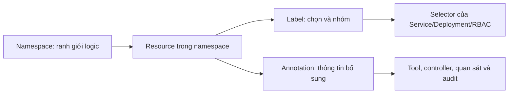
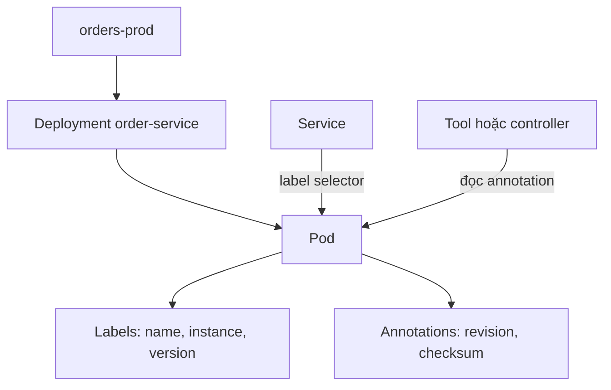

# Namespace, label và annotation

## 1. Ba cơ chế metadata có vai trò khác nhau

Trong Kubernetes, Namespace, label và annotation đều xuất hiện trong metadata nhưng giải quyết ba vấn đề khác nhau. Namespace tạo ranh giới logic cho tài nguyên. Label là dữ liệu có cấu trúc để chọn và nhóm tài nguyên. Annotation lưu thông tin bổ sung cho công cụ hoặc người vận hành, nhưng không được dùng làm selector.

Với ứng dụng Spring chạy trong Kubernetes, phân biệt này giúp thiết kế Deployment, Service, ConfigMap, Secret và RBAC rõ ràng. Spring Cloud Kubernetes có thể đọc hoặc sử dụng thông tin dịch vụ, cấu hình và tài nguyên Kubernetes; tuy nhiên, thư viện trong ứng dụng không thay đổi quy tắc namespace, selector hay metadata của cluster.



Ví dụ, một Pod có thể thuộc namespace `orders-prod`, mang label `app.kubernetes.io/name: order-service` và có annotation chứa mã build. Service dùng label để chọn Pod; công cụ triển khai dùng annotation để ghi revision; namespace giúp tách workload production khỏi staging.

## 2. Namespace là ranh giới logic

Namespace là phạm vi tên và phạm vi quản trị logic cho nhiều tài nguyên namespaced. Hai Deployment cùng tên có thể tồn tại trong hai namespace khác nhau. Khi gọi API hoặc dùng `kubectl`, phải xác định đúng namespace nếu tài nguyên không nằm ở namespace mặc định.

```yaml
apiVersion: v1
kind: Namespace
metadata:
  name: orders-prod
  labels:
    environment: production
    team: commerce
```

Deployment trong namespace đó:

```yaml
apiVersion: apps/v1
kind: Deployment
metadata:
  name: order-service
  namespace: orders-prod
spec:
  replicas: 2
  selector:
    matchLabels:
      app.kubernetes.io/name: order-service
  template:
    metadata:
      labels:
        app.kubernetes.io/name: order-service
    spec:
      containers:
        - name: order-service
          image: registry.example.invalid/team/order-service:1.4.0
```

Namespace không phải ranh giới mạng tuyệt đối. Pod ở namespace khác vẫn có thể giao tiếp nếu DNS, Service và NetworkPolicy cho phép. Namespace cũng không tự cấp quyền; RBAC RoleBinding, ServiceAccount và policy liên quan mới quyết định danh tính nào được thao tác tài nguyên.

ConfigMap, Secret, Service, Deployment, ReplicaSet và Pod thường là tài nguyên namespaced. Một số tài nguyên như Node, PersistentVolume và ClusterRole có phạm vi cluster. Không nên suy luận rằng đặt một tài nguyên vào namespace là đã cô lập mọi thứ bên dưới nó.

## 3. Tên, DNS và phạm vi truy cập

Trong một namespace, tên của tài nguyên cùng loại phải phù hợp quy tắc duy nhất của Kubernetes. Cùng một tên Service có thể tồn tại ở namespace khác. DNS Service thường bao gồm tên Service và namespace, chẳng hạn:

```text
inventory-service.orders-prod.svc.cluster.local
```

Ứng dụng trong cùng namespace thường có thể gọi tên ngắn `inventory-service`. Ứng dụng ở namespace khác nên chỉ rõ namespace khi có thể trùng tên hoặc khi thiết kế yêu cầu. Spring Boot có thể nhận URL này qua cấu hình; Spring Cloud Kubernetes chỉ cần tham gia khi ứng dụng cần mô hình discovery hoặc load balancing tích hợp.

Namespace cũng ảnh hưởng RBAC. Một Role trong `orders-prod` chỉ mô tả quyền trong namespace đó. RoleBinding tham chiếu Role có thể gán quyền cho ServiceAccount trong phạm vi đã định. ClusterRole và ClusterRoleBinding có phạm vi rộng hơn; không cấp quyền cluster chỉ vì ứng dụng cần đọc một ConfigMap trong một namespace.

## 4. Label là dữ liệu để chọn

Label là cặp khóa-giá trị có cấu trúc gắn vào object. Kubernetes và các công cụ dùng label selector để chọn một tập tài nguyên. Deployment dùng selector để liên kết Pod template; ReplicaSet dùng selector để quản lý Pod; Service dùng selector để tạo endpoint; lệnh quan sát dùng selector để lọc tài nguyên.

```yaml
metadata:
  labels:
    app.kubernetes.io/name: order-service
    app.kubernetes.io/instance: production
    app.kubernetes.io/component: backend
    app.kubernetes.io/part-of: commerce
    app.kubernetes.io/version: 1.4.0
```

Mỗi label nên biểu diễn một thuộc tính có ý nghĩa cho việc chọn, nhóm hoặc truy vấn. `name` nhận diện ứng dụng, `instance` phân biệt một bản triển khai, `component` mô tả vai trò và `version` hỗ trợ quan sát. Không đưa dữ liệu dài hoặc thay đổi liên tục vào label chỉ để lưu thông tin.

Label selector có thể dùng điều kiện bằng hoặc điều kiện tập hợp:

```text
app.kubernetes.io/name=order-service
environment in (staging, production)
tier notin (batch)
```

Selector càng rộng càng có nguy cơ chọn nhầm tài nguyên. Selector `app: backend` có thể nhận cả `order-service` và `payment-service` nếu hai ứng dụng đều dùng label đó. Selector của Service và Deployment phải được kiểm tra cùng với label thực tế trên Pod.

## 5. Annotation là dữ liệu bổ sung

Annotation cũng là cặp khóa-giá trị trong metadata, nhưng dành cho dữ liệu không dùng để nhận diện hoặc chọn object. Annotation có thể lưu mã commit, thông tin công cụ triển khai, checksum cấu hình, mô tả tích hợp, dấu vết audit hoặc chỉ thị cho một controller cụ thể.

```yaml
metadata:
  annotations:
    example.com/source-revision: "git-8f31c2a"
    example.com/release-owner: "commerce-platform"
    example.com/config-checksum: "sha256:replace-me"
```

Annotation không tự tạo hành vi. Một annotation chỉ có tác dụng nếu Kubernetes hoặc controller tương ứng được thiết kế để đọc nó. Ví dụ, một ingress controller có thể đọc annotation riêng của nó; annotation tự đặt `restart: true` không tự khởi động lại Pod nếu không có controller nào hiểu khóa đó.

Không dùng annotation cho dữ liệu cần selector. Service không chọn Pod dựa trên annotation và Deployment không dùng annotation để xác định Pod thuộc ReplicaSet. Nếu cần chọn, hãy dùng label; nếu chỉ cần ghi chú hoặc truyền tùy chọn cho một controller, hãy cân nhắc annotation.

## 6. Quan hệ giữa Namespace, label và annotation

| Cơ chế | Câu hỏi trả lời | Ví dụ sử dụng |
| --- | --- | --- |
| Namespace | Tài nguyên thuộc phạm vi logic nào? | `orders-prod` và `orders-staging` |
| Label | Tài nguyên nào được chọn hoặc cùng nhóm? | Service chọn Pod có `app.kubernetes.io/name` |
| Annotation | Thông tin hoặc chỉ thị bổ sung là gì? | Mã build, checksum, cấu hình controller |

Một object có thể dùng cả ba cơ chế. Namespace `orders-prod` giữ workload production; label xác định Pod của `order-service`; annotation ghi revision image và checksum ConfigMap. Mỗi thông tin đi vào đúng nơi sẽ giúp controller và người vận hành suy luận chính xác hơn.



## 7. Label trong Deployment và Service

Deployment selector phải khớp label trong Pod template. Service selector cũng phải khớp label của Pod mà Service cần phục vụ. Hai selector này có mục đích khác nhau nhưng đều dựa trên label.

```yaml
apiVersion: v1
kind: Service
metadata:
  name: order-service
  namespace: orders-prod
spec:
  selector:
    app.kubernetes.io/name: order-service
    app.kubernetes.io/instance: production
  ports:
    - name: http
      port: 80
      targetPort: http
```

Trong ví dụ, Service chỉ chọn Pod có cả hai label. Pod có `name: order-service` nhưng `instance: staging` sẽ không được Service production chọn. Đây là cách label giúp tách các bản triển khai mà không cần hard-code IP Pod.

Để chẩn đoán Service không có endpoint, kiểm tra namespace của Service, selector của Service, label thực tế trên Pod và trạng thái readiness. Thêm annotation vào Pod sẽ không sửa selector. Đổi label có thể làm Pod rời khỏi Service, nên thay đổi label nhận diện cần được xem như thay đổi hành vi triển khai.

## 8. Label và version trong rollout

Label `version` có thể giúp quan sát hoặc tách traffic, nhưng không tự tạo canary hoặc blue-green deployment. Nếu Service selector chỉ chọn `app.kubernetes.io/name`, cả revision cũ và mới có thể được chọn trong quá trình RollingUpdate. Nếu selector chứa thêm version, cần có quy trình cập nhật Service hoặc tài nguyên routing tương ứng.

```yaml
labels:
  app.kubernetes.io/name: order-service
  app.kubernetes.io/version: "1.5.0"
```

Không nên thay đổi các label mà selector của Deployment yêu cầu một cách tùy tiện. Một selector của Deployment có ràng buộc với Pod template và thay đổi selector có thể bị hạn chế hoặc làm mất quan hệ quản lý. Khi cần thêm label phục vụ quan sát, thêm label không nằm trong selector thường ít rủi ro hơn, nhưng vẫn cần kiểm tra công cụ downstream.

Annotation checksum thường được dùng để làm thay đổi Pod template khi nội dung ConfigMap hoặc Secret thay đổi. Khi checksum được tính lại và ghi vào annotation của Pod template, Deployment nhận thấy template đổi và tạo revision mới. Annotation tự thay đổi trên ConfigMap nhưng không được đưa vào Pod template không tự buộc Deployment rollout.

## 9. Namespace và RBAC

Namespace giúp giới hạn phạm vi Role và RoleBinding, còn RBAC mới là cơ chế cấp quyền. Ví dụ, ServiceAccount của `order-service` có thể được cấp quyền đọc một số ConfigMap trong `orders-prod`:

```yaml
apiVersion: rbac.authorization.k8s.io/v1
kind: Role
metadata:
  name: order-config-reader
  namespace: orders-prod
rules:
  - apiGroups: [""]
    resources: ["configmaps"]
    resourceNames: ["order-settings"]
    verbs: ["get"]
---
apiVersion: rbac.authorization.k8s.io/v1
kind: RoleBinding
metadata:
  name: order-config-reader
  namespace: orders-prod
subjects:
  - kind: ServiceAccount
    name: order-service
    namespace: orders-prod
roleRef:
  apiGroup: rbac.authorization.k8s.io
  kind: Role
  name: order-config-reader
```

Quyền trên chỉ cho phép `get` ConfigMap có tên `order-settings` trong namespace đã định. Nếu thành phần discovery cần liệt kê Service hoặc Pod, đó là quyền khác và cần cân nhắc phạm vi. Không cấp `cluster-admin` để xử lý lỗi `403 Forbidden` của một thao tác namespaced.

Spring Cloud Kubernetes dùng danh tính mà Pod được cấu hình khi truy cập Kubernetes API. Việc ứng dụng chạy trong namespace không đồng nghĩa ứng dụng có quyền đọc mọi tài nguyên ở namespace đó. Khi tích hợp discovery, ConfigMap, Secret hoặc Configuration Watcher, cần ghi rõ thành phần nào đọc API và Role nào cấp quyền.

## 10. Annotation trong triển khai Spring

Annotation có thể lưu dấu vết của pipeline:

```yaml
metadata:
  annotations:
    app.example.com/commit: "8f31c2a"
    app.example.com/build-time: "2026-11-24T10:30:00Z"
    app.example.com/config-revision: "orders-v7"
```

Những giá trị này hữu ích khi đối chiếu Pod đang chạy với release đã triển khai. Không nên đưa Secret, token hoặc dữ liệu nhạy cảm vào annotation vì metadata thường được nhiều người và công cụ có quyền đọc. Annotation cũng có thể làm object lớn; dữ liệu lớn nên đặt trong tài nguyên phù hợp hoặc hệ thống lưu trữ riêng.

Nếu một controller yêu cầu annotation riêng, phải dùng đúng tên khóa, giá trị và phạm vi mà controller hỗ trợ. Việc đặt annotation không hợp lệ có thể bị bỏ qua hoặc tạo hành vi ngoài dự kiến. Annotation không phải cơ chế cấu hình chung thay thế ConfigMap hoặc Secret.

## 11. Namespace cho môi trường và tenant

Có thể dùng namespace để tách `orders-dev`, `orders-staging` và `orders-prod`, nhưng namespace không tự giải quyết mọi yêu cầu isolation. Cần kết hợp quota, RBAC, NetworkPolicy, policy image, admission control và quy trình đặt tên nếu môi trường yêu cầu ranh giới mạnh hơn.

Label hỗ trợ truy vấn chéo theo môi trường:

```yaml
metadata:
  labels:
    environment: production
    team: commerce
    cost-center: cc-42
```

Không dùng namespace và label lẫn lộn. Namespace trả lời tài nguyên thuộc phạm vi nào; label trả lời tài nguyên có thuộc nhóm hoặc điều kiện nào. Một team có thể sở hữu nhiều namespace và một namespace có thể chứa nhiều component, tùy mô hình quản trị.

ResourceQuota và LimitRange thường được áp dụng theo namespace. Nếu Deployment không tạo đủ replica, quota namespace có thể là nguyên nhân dù node còn tài nguyên. Vì vậy chẩn đoán cần kiểm tra cả namespace, quota, events và quyền.

## 12. Cấu hình cho ứng dụng Spring

Deployment có thể đặt namespace, label và annotation trong manifest; ConfigMap và Secret cung cấp dữ liệu cấu hình. Spring Boot đọc dữ liệu được đưa vào environment hoặc file. Spring Cloud Kubernetes chỉ cần khi ứng dụng cần đọc Kubernetes API, discovery hoặc cơ chế watcher tích hợp.

```yaml
apiVersion: v1
kind: ConfigMap
metadata:
  name: order-settings
  namespace: orders-prod
  labels:
    app.kubernetes.io/name: order-service
  annotations:
    app.example.com/owner: commerce-platform
data:
  spring.profiles.active: production
  orders.max-items: "20"
```

Label trên ConfigMap giúp truy vấn và quản lý; annotation lưu thông tin bổ sung. Chúng không tự đưa dữ liệu `data` vào ứng dụng. Deployment phải tham chiếu ConfigMap, volume hoặc cơ chế tích hợp phù hợp.

Nếu Configuration Watcher theo dõi ConfigMap theo label hoặc namespace, cần kiểm tra phạm vi theo dõi, selector mà thành phần đó hỗ trợ và quyền RBAC. Không suy luận rằng mọi annotation hoặc label đều được watcher sử dụng; chỉ hành vi đã được cấu hình trong implementation mới có hiệu lực.

## 13. Chẩn đoán lỗi metadata

| Hiện tượng | Kiểm tra |
| --- | --- |
| `kubectl get` không thấy Deployment | Namespace hiện tại và tên tài nguyên |
| Service không có endpoint | Namespace, selector, label Pod và readiness |
| Discovery không thấy service | Namespace được tìm, quyền API, label hoặc bộ lọc discovery |
| ConfigMap không được đọc | Tên, namespace, key, mount/env và RBAC |
| Annotation không có tác dụng | Controller có hỗ trợ đúng annotation không |
| Pod thuộc nhầm nhóm | Selector quá rộng hoặc label không nhất quán |
| Không tạo được Pod mới | Quota, LimitRange, RBAC, scheduler và events |

Các lệnh quan sát minh họa:

```text
kubectl get namespaces
kubectl get deployment -n orders-prod --show-labels
kubectl get pods -n orders-prod --show-labels
kubectl get pods -n orders-prod -l app.kubernetes.io/name=order-service
kubectl describe service order-service -n orders-prod
kubectl get configmap order-settings -n orders-prod -o yaml
kubectl auth can-i get configmap/order-settings --as=system:serviceaccount:orders-prod:order-service -n orders-prod
```

Luôn chỉ rõ `-n orders-prod` khi chẩn đoán tài nguyên namespaced. Một lệnh thành công trong namespace mặc định không chứng minh workload production được cấu hình đúng.

## 14. Quy tắc thiết kế thực tế

1. Chọn namespace theo ranh giới quản trị và vòng đời, không chỉ theo tên ứng dụng.
2. Dùng label cho thuộc tính cần chọn, nhóm hoặc truy vấn.
3. Dùng annotation cho dấu vết, mô tả hoặc chỉ thị của controller hỗ trợ nó.
4. Dùng tiền tố thuộc tổ chức cho label và annotation tùy chỉnh để tránh xung đột.
5. Giữ selector ổn định và đủ cụ thể.
6. Đặt cùng bộ label cơ bản trên Deployment, Pod, Service và ConfigMap khi cần truy vết.
7. Không đưa Secret, token hoặc dữ liệu nhạy cảm vào label hay annotation.
8. Kiểm tra namespace của mọi tài nguyên namespaced và quyền ServiceAccount.
9. Khi đổi label nhận diện, kiểm tra Deployment, ReplicaSet, Service, NetworkPolicy và công cụ quan sát.
10. Chỉ dùng annotation có tài liệu hoặc controller thực sự đọc nó.

## 15. Tự kiểm tra

### Namespace có phải ranh giới mạng tuyệt đối không?

Không. Namespace là ranh giới logic và quản trị. Kết nối giữa Pod phụ thuộc Service, DNS, NetworkPolicy và cấu hình mạng của cluster.

### Service dùng label hay annotation để chọn Pod?

Service dùng label selector. Annotation không được dùng làm selector của Service.

### Có thể dùng label để lưu checksum dài không?

Label phù hợp với dữ liệu có cấu trúc để chọn và nhóm. Checksum dài hoặc thông tin triển khai thường nên đặt trong annotation; nếu checksum cần trigger rollout, đưa nó vào annotation của Pod template.

### Đổi annotation của ConfigMap có làm Deployment rollout không?

Không tự động. Deployment chỉ tạo revision khi Pod template của nó thay đổi hoặc có controller khác thực hiện rollout. Một pattern phổ biến là đưa checksum cấu hình vào annotation trong Pod template.

### Spring Cloud Kubernetes có tự tìm mọi namespace không?

Không nên giả định như vậy. Phạm vi discovery hoặc đọc cấu hình phụ thuộc implementation, cấu hình và quyền RBAC. Cần chỉ rõ namespace và quyền mà thành phần tích hợp được phép sử dụng.

### Vì sao Pod có label đúng nhưng Service vẫn không có endpoint?

Có thể Service ở namespace khác, selector thiếu điều kiện, Pod chưa readiness, cổng không khớp hoặc Service không dùng selector như thiết kế. Hãy kiểm tra toàn bộ quan hệ thay vì chỉ nhìn một label.

## Kết luận

Namespace xác định phạm vi logic và quản trị; label cung cấp dữ liệu có cấu trúc để selector chọn tài nguyên; annotation lưu thông tin bổ sung cho công cụ và người vận hành. Ba cơ chế này bổ sung cho nhau nhưng không thay thế nhau.

Khi chạy ứng dụng thuộc phạm vi `SPRING_CLOUD_KUBERNETES` trên Kubernetes, hãy thiết kế namespace, label, annotation và RBAC cùng một mô hình. Service và Deployment cần selector nhất quán; ConfigMap và Secret cần đúng namespace; Spring Cloud Kubernetes cần quyền và phạm vi đọc rõ ràng. Metadata tốt giúp controller làm việc đúng, rollout dễ quan sát và chẩn đoán lỗi nhanh hơn.

