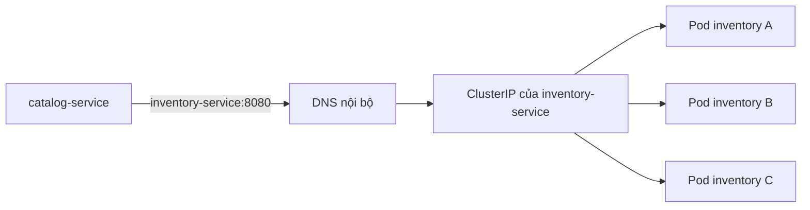
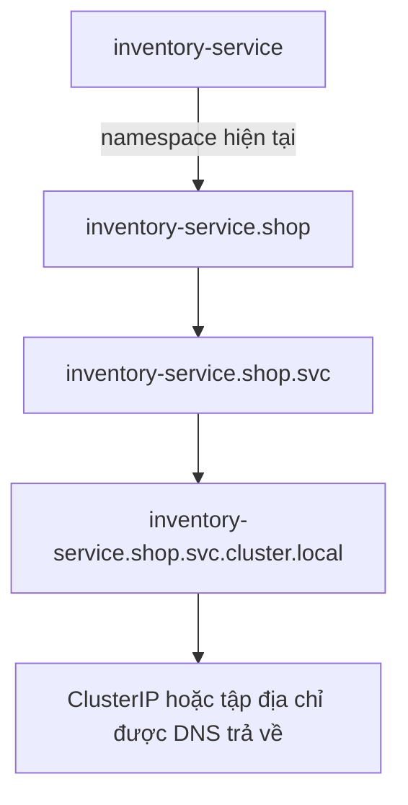

# DNS nội bộ, địa chỉ Service và cổng đích

Trong Kubernetes, Pod thường có địa chỉ IP tạm thời. Pod có thể bị thay thế sau một lần rollout, di chuyển sang node khác hoặc khởi động lại với IP mới. Ứng dụng Spring không nên lưu địa chỉ Pod làm địa chỉ gọi cố định. **Service** cung cấp một điểm truy cập ổn định, còn **DNS nội bộ** giúp ứng dụng tìm điểm truy cập đó bằng tên.

Bài học thuộc chương **Nền tảng Kubernetes** của module **Spring Cloud Kubernetes** (`SPRING_CLOUD_KUBERNETES`). Module học cách tích hợp ứng dụng Spring với Kubernetes qua `DiscoveryClient`, ConfigMap, Secret, Spring Cloud LoadBalancer và Configuration Watcher; trong bài này ta tập trung vào nền tảng mạng cần hiểu trước khi quyết định có cần discovery phía ứng dụng hay không.

Mục tiêu là đọc được một manifest Service, giải thích đường đi của yêu cầu từ tên DNS tới container, phân biệt `port` với `targetPort`, chọn địa chỉ phù hợp giữa các namespace và chẩn đoán lỗi kết nối mà không nhầm DNS với readiness, selector hoặc cổng ứng dụng.

## 1. Vì sao ứng dụng cần Service thay vì IP của Pod?

Giả sử `catalog-service` cần gọi `inventory-service`. Nếu Deployment của inventory có ba Pod:

```text
inventory Pod A: 10.42.1.10
inventory Pod B: 10.42.2.11
inventory Pod C: 10.42.3.12
```

Các IP này là địa chỉ của từng Pod trong một thời điểm. Khi Pod B bị thay thế, IP mới có thể khác. Nếu `catalog-service` gọi trực tiếp `10.42.2.11`, địa chỉ đó không phải hợp đồng ổn định.

Service tạo một địa chỉ logic và duy trì danh sách backend phù hợp:



Service thường chọn Pod bằng `selector`. Khi Pod mới có label phù hợp và sẵn sàng, tập backend phục vụ Service có thể thay đổi mà ứng dụng gọi không cần biết IP cụ thể.

Địa chỉ logic của Service không đồng nghĩa với một tiến trình riêng đang lắng nghe như một Pod. Tùy loại Service và cơ chế mạng, Kubernetes cung cấp DNS, địa chỉ ảo và quy tắc chuyển tiếp tới backend. Ứng dụng nên dùng tên và cổng của Service theo hợp đồng đã định nghĩa.

## 2. Bốn khái niệm cần tách biệt

Một cấu hình Service tối thiểu thường liên quan đến bốn thành phần:

| Thành phần | Ý nghĩa | Ví dụ |
|---|---|---|
| Tên Service | Tên DNS logic trong namespace | `inventory-service` |
| `clusterIP` | Địa chỉ ảo của Service trong cluster | `10.96.20.15` |
| `port` | Cổng mà Service công bố cho client | `8080` |
| `targetPort` | Cổng trên mỗi Pod backend | `8081` |

Nếu client gọi `inventory-service:8080`, yêu cầu tới cổng `8080` của Service. Service có thể chuyển yêu cầu tới cổng `8081` trên Pod nếu manifest đặt `targetPort: 8081`.

```text
catalog-service
  → inventory-service:8080
  → ClusterIP:8080
  → một Pod inventory:8081
  → tiến trình Java trong container
```

`containerPort` trong Pod chỉ mô tả cổng mà container dự kiến sử dụng; nó không tự tạo DNS, không tự mở Service và không tự ánh xạ `port` sang `targetPort`. Ánh xạ phục vụ lưu lượng được định nghĩa ở Service.

## 3. Manifest Service và cách đọc từng trường

Ví dụ Service cho `inventory-service`:

```yaml
apiVersion: v1
kind: Service
metadata:
  name: inventory-service
  namespace: shop
  labels:
    app.kubernetes.io/name: inventory
spec:
  selector:
    app.kubernetes.io/name: inventory
  ports:
    - name: http
      protocol: TCP
      port: 8080
      targetPort: 8081
  type: ClusterIP
```

Ý nghĩa của manifest:

- Service có tên `inventory-service` trong namespace `shop`.
- Service chỉ chọn Pod có label `app.kubernetes.io/name: inventory`.
- Client gọi cổng Service `8080`.
- Backend nhận lưu lượng ở cổng `8081`.
- `ClusterIP` là kiểu mặc định, chỉ dùng cho lưu lượng trong cluster nếu không cấu hình thêm cách phơi bày khác.
- Tên cổng `http` giúp tham chiếu có nghĩa hơn trong một số manifest và công cụ, nhưng không thay thế việc kiểm tra số cổng thật.

Deployment cần tạo Pod có label khớp selector và tiến trình trong container phải thực sự lắng nghe cổng `8081` trên interface có thể nhận lưu lượng:

```yaml
apiVersion: apps/v1
kind: Deployment
metadata:
  name: inventory
  namespace: shop
spec:
  replicas: 2
  selector:
    matchLabels:
      app.kubernetes.io/name: inventory
  template:
    metadata:
      labels:
        app.kubernetes.io/name: inventory
    spec:
      containers:
        - name: inventory
          image: example.invalid/inventory-service:demo
          ports:
            - name: http
              containerPort: 8081
```

Đoạn image là giá trị minh họa. `containerPort: 8081` làm tài liệu cho manifest; ứng dụng vẫn phải cấu hình server thực sự lắng nghe cổng đó.

## 4. DNS nội bộ của Service

Khi Service được tạo, DNS trong cluster thường cung cấp tên ngắn trong namespace và tên đầy đủ theo miền DNS của cluster. Các dạng thường gặp là:

```text
inventory-service
inventory-service.shop
inventory-service.shop.svc
inventory-service.shop.svc.cluster.local
```

Tên ngắn phù hợp khi client và Service ở cùng namespace `shop`. Nếu `catalog-service` nằm ở namespace `store`, tên ngắn `inventory-service` có thể được phân giải trong `store` và không trỏ tới Service trong `shop`. Khi gọi khác namespace, hãy dùng ít nhất:

```text
inventory-service.shop
```

Tên miền đầy đủ làm rõ đích hơn trong manifest hoặc cấu hình dùng chung giữa nhiều namespace:

```text
http://inventory-service.shop.svc.cluster.local:8080
```

`cluster.local` là miền mặc định phổ biến nhưng có thể thay đổi theo cấu hình cluster. Vì vậy, không nên hard-code miền này vào logic nếu nền tảng triển khai quy định miền khác; hãy lấy từ cấu hình môi trường khi cần.



Tên ngắn được bổ sung các search domain trong resolver của Pod. Đây là lý do cùng một chuỗi `inventory-service` có thể có ý nghĩa khác khi chạy ở namespace khác. Lỗi “không phân giải được tên” cần được kiểm tra từ chính Pod nguồn, không chỉ từ máy phát triển bên ngoài cluster.

## 5. `port`, `targetPort` và `containerPort` qua một ví dụ

Giả sử ứng dụng Java lắng nghe ở `8081`:

```yaml
containers:
  - name: inventory
    image: example.invalid/inventory-service:demo
    ports:
      - containerPort: 8081
```

Service công bố cổng `80` nhưng chuyển tới `8081`:

```yaml
ports:
  - name: http
    port: 80
    targetPort: 8081
```

Client phải gọi:

```text
http://inventory-service:80
```

Không gọi `inventory-service:8081` chỉ vì container lắng nghe `8081`. Đường đi là:

```text
client:inventory-service:80
  → Service port 80
  → backend Pod port 8081
  → ứng dụng inventory
```

Nếu muốn dùng tên cổng làm `targetPort`, Pod cần khai báo tên cổng tương ứng:

```yaml
# Pod template
ports:
  - name: http-api
    containerPort: 8081

# Service
ports:
  - name: http
    port: 80
    targetPort: http-api
```

Cách dùng tên cổng làm giảm việc lặp số, nhưng tên phải khớp và phải được kiểm tra khi đổi manifest. Với Service có nhiều cổng, mỗi cổng nên có tên duy nhất trong Service.

## 6. Selector quyết định backend, DNS chỉ tìm Service

DNS giải quyết tên Service thành thông tin của Service; nó không sửa selector sai. Một Service có thể tồn tại và có ClusterIP nhưng không có endpoint hữu ích nếu selector không khớp Pod.

Ví dụ lỗi:

```yaml
# Pod
labels:
  app: inventory

# Service
selector:
  app: inventory-service
```

Trong ví dụ này, tên label khác nhau nên Service không chọn Pod. Client có thể phân giải được `inventory-service`, nhưng yêu cầu không có backend để chuyển tiếp.

Khi kiểm tra, tách hai câu hỏi:

1. Tên Service có được phân giải không?
2. Service có endpoint sẵn sàng để nhận yêu cầu không?

Đừng kết luận DNS hỏng chỉ vì Service không có backend. Ngược lại, có endpoint cũng không bảo đảm ứng dụng nhận được response nếu `targetPort`, giao thức, readiness hoặc network policy sai.

## 7. Readiness ảnh hưởng đến tập backend

Service thường dùng trạng thái sẵn sàng của Pod để quyết định Pod có nên nhận lưu lượng thông thường hay không. Nếu readiness probe thất bại, Pod có thể vẫn đang chạy và có IP, nhưng không nên được coi là backend sẵn sàng.

```yaml
readinessProbe:
  httpGet:
    path: /actuator/health/readiness
    port: 8081
  initialDelaySeconds: 5
  periodSeconds: 10
```

Đây là cấu hình minh họa; endpoint và cổng phải khớp ứng dụng. Readiness không phải là DNS health check. Tên Service vẫn có thể phân giải trong lúc mọi Pod chưa ready. Sự khác nhau này rất hữu ích khi chẩn đoán:

```text
DNS thành công + không có backend ready
  ≠ DNS thất bại
```

Khi rollout, Pod cũ có thể bị loại khỏi tập backend trước hoặc sau khi Pod mới sẵn sàng theo chiến lược Deployment. Ứng dụng gọi Service cần timeout và xử lý lỗi tạm thời, vì việc thay đổi tập backend là một phần bình thường của vòng đời cluster.

## 8. Các kiểu Service và ảnh hưởng tới địa chỉ

### 8.1. ClusterIP

`ClusterIP` là lựa chọn mặc định cho giao tiếp nội bộ. Client trong cluster gọi DNS của Service, còn địa chỉ ảo được dùng trong mạng cluster. Đây là mô hình phổ biến cho `catalog-service` gọi `inventory-service`.

```yaml
spec:
  type: ClusterIP
  ports:
    - port: 8080
      targetPort: 8081
```

### 8.2. Headless Service

Đặt `clusterIP: None` tạo Service headless. DNS có thể trả về địa chỉ của các Pod hoặc bản ghi liên quan thay vì một ClusterIP duy nhất. Mô hình này phù hợp khi client cần biết từng Pod, chẳng hạn một số hệ thống stateful hoặc giao thức tự quản lý thành viên.

```yaml
apiVersion: v1
kind: Service
metadata:
  name: inventory-headless
  namespace: shop
spec:
  clusterIP: None
  selector:
    app.kubernetes.io/name: inventory
  ports:
    - name: http
      port: 8080
      targetPort: 8081
```

Không nên đổi sang headless chỉ để “DNS chạy nhanh hơn”. Client cần hiểu rằng kết quả có thể là nhiều địa chỉ và phải có chiến lược chọn, retry, loại bỏ địa chỉ lỗi cùng cách xử lý thay đổi Pod.

### 8.3. NodePort và LoadBalancer

`NodePort` mở một cổng trên các node để truy cập từ ngoài theo cách phụ thuộc cluster. `LoadBalancer` yêu cầu nền tảng cung cấp hoặc tích hợp bộ cân bằng tải bên ngoài. Hai kiểu này thay đổi cách truy cập từ bên ngoài; chúng không phải lý do để ứng dụng nội bộ bỏ qua DNS Service.

Đối với các lời gọi giữa Pod trong cùng cluster, hãy phân biệt URL nội bộ với địa chỉ bên ngoài. Dùng địa chỉ public để một Pod gọi Pod khác có thể thêm đường mạng, chi phí và điểm lỗi không cần thiết.

## 9. Cổng trong Spring Boot và cổng trong Kubernetes

Spring Boot có thể lắng nghe một cổng do `server.port` quyết định:

```yaml
server:
  port: 8081
```

Nếu Service đặt `targetPort: 8081`, đường đi phù hợp. Nếu ứng dụng lắng nghe `8080` nhưng Service chuyển tới `8081`, DNS vẫn hoạt động nhưng kết nối tới backend có thể bị từ chối hoặc timeout.

Một checklist ánh xạ cổng:

| Vị trí | Giá trị cần đối chiếu |
|---|---|
| Cấu hình Spring Boot | `server.port` |
| Container | Cổng tiến trình thực sự bind |
| Pod manifest | `containerPort` và tên cổng tài liệu |
| Service | `port` mà client gọi |
| Service | `targetPort` mà backend nhận |
| Client URL | Tên DNS và `port` của Service |
| Probe | Cổng và path probe |

`containerPort` không tự buộc Spring Boot đổi cổng. Cũng không nên sửa client URL theo `containerPort` nếu Service đang công bố một `port` khác.

## 10. Dùng DNS từ ứng dụng Spring

Với mô hình gọi Service trực tiếp, cấu hình ứng dụng có thể chỉ cần tên DNS và cổng Service:

```yaml
inventory:
  base-url: http://inventory-service.shop.svc.cluster.local:8080
```

Bean client đọc `inventory.base-url` và gửi yêu cầu tới địa chỉ này. Với môi trường local hoặc test ngoài cluster, giá trị có thể được thay bằng URL khác qua nguồn cấu hình tương ứng. Cách này tách tên dịch vụ khỏi image.

Nếu `catalog-service` và `inventory-service` cùng namespace, có thể dùng:

```yaml
inventory:
  base-url: http://inventory-service:8080
```

Tên đầy đủ hữu ích khi cấu hình được chia sẻ hoặc khi client gọi khác namespace. Tuy nhiên, hãy xem namespace là một phần của hợp đồng triển khai, không phải chi tiết có thể bỏ qua.

### Khi nào thêm `DiscoveryClient`?

Nếu URL DNS của Service đã đủ, việc thêm `DiscoveryClient` có thể không đem lại lợi ích tương xứng với quyền API, cache và cấu hình mới. Hãy cân nhắc discovery khi ứng dụng thật sự cần:

- Lấy danh sách instance từ tài nguyên Kubernetes.
- Lọc dịch vụ theo namespace, label hoặc metadata được hỗ trợ.
- Để client chọn instance thay vì gửi mọi yêu cầu qua tên Service.
- Tích hợp với Spring Cloud LoadBalancer theo mô hình đã chọn.

`DiscoveryClient` cung cấp thông tin để khám phá, còn LoadBalancer chọn đích. Cả hai không thay thế việc kiểm tra Service, selector, port và readiness.

## 11. RBAC khi dùng Kubernetes API để khám phá

Gọi DNS Service thường không yêu cầu ứng dụng đọc Service qua Kubernetes API. Ngược lại, `DiscoveryClient` tích hợp với API cần danh tính và quyền phù hợp. Một Role ví dụ để đọc Service và EndpointSlice trong namespace `shop`:

```yaml
apiVersion: rbac.authorization.k8s.io/v1
kind: Role
metadata:
  name: catalog-discovery-reader
  namespace: shop
rules:
  - apiGroups: [""]
    resources: ["services", "endpoints"]
    verbs: ["get", "list", "watch"]
  - apiGroups: ["discovery.k8s.io"]
    resources: ["endpointslices"]
    verbs: ["get", "list", "watch"]
```

Tài nguyên và verb thực tế phải khớp chế độ discovery, phiên bản tích hợp và cách client lấy dữ liệu. Không cấp quyền rộng hơn chỉ để che giấu lỗi `Forbidden`. Nếu ứng dụng chỉ gọi `inventory-service` qua DNS, có thể không cần Role discovery này.

Khi thấy lỗi `Forbidden`, phân biệt rõ:

```text
DNS Resolver → phân giải tên
Kubernetes API → trả dữ liệu discovery/config
RBAC → quyết định API client được phép đọc gì
```

DNS thành công không chứng minh ServiceAccount có quyền đọc Service. API bị từ chối cũng không đồng nghĩa tên DNS không tồn tại.

## 12. Quy trình chẩn đoán từ client Pod

Nên kiểm tra từ cùng namespace, cùng Pod hoặc một Pod debug có mạng tương đương với ứng dụng nguồn. Một quy trình khái quát:

### Bước 1: kiểm tra tên và namespace

Xác nhận URL đang dùng đúng tên Service và namespace. Nếu client ở `store`, nhưng Service ở `shop`, thử tên có namespace:

```text
inventory-service.shop
```

### Bước 2: kiểm tra phân giải DNS

Dùng công cụ có sẵn trong image hoặc một Pod debug phù hợp để kiểm tra resolver. Kết quả cần cho biết tên có được phân giải thành thông tin địa chỉ hay không. Không suy luận từ máy laptop nếu DNS nội bộ chỉ tồn tại trong cluster.

### Bước 3: kiểm tra Service và selector

Đối chiếu `metadata.name`, `metadata.namespace`, `spec.selector` với label Pod. Một selector sai tạo Service không có backend dù DNS vẫn trả tên.

### Bước 4: kiểm tra cổng

Đối chiếu client `port`, Service `port`, Service `targetPort`, cổng ứng dụng và probe. Nếu dùng tên cổng, xác minh tên xuất hiện đúng trong Pod.

### Bước 5: kiểm tra readiness và endpoint

Một Pod đang `Running` chưa chắc `Ready`. Kiểm tra trạng thái sẵn sàng và tập endpoint mà Service có thể sử dụng.

### Bước 6: kiểm tra mạng và ứng dụng

Nếu DNS, endpoint và cổng đều đúng nhưng kết nối vẫn thất bại, xem timeout, network policy, listener interface, TLS, HTTP path và log ứng dụng. Lỗi HTTP 404 khác với lỗi TCP refused; lỗi timeout khác với lỗi không phân giải tên.

## 13. Ma trận triệu chứng

| Triệu chứng | Nguyên nhân thường gặp | Phân biệt bằng cách nào |
|---|---|---|
| `could not resolve host` | Tên sai, namespace sai, DNS cluster có vấn đề | Kiểm tra tên đầy đủ từ Pod nguồn |
| DNS phân giải được nhưng timeout | Không có route, network policy, backend không phản hồi | Kiểm tra endpoint, policy và listener |
| `connection refused` | Có đường tới địa chỉ nhưng không có tiến trình nghe cổng đích | Đối chiếu `targetPort` với cổng Spring |
| HTTP 404 | Đã tới ứng dụng nhưng path sai | Gọi đúng path health/API và xem log server |
| Service không có backend | Selector sai hoặc Pod chưa ready | So sánh label, readiness và endpoint |
| Gọi được trong namespace này nhưng không được namespace kia | Dùng tên ngắn không đúng phạm vi | Dùng tên `service.namespace` |
| Discovery bị `Forbidden` | ServiceAccount thiếu quyền API | Kiểm tra RoleBinding và tài nguyên cần đọc |
| Client gọi sai cổng | Nhầm `containerPort` với `port` của Service | Vẽ lại ánh xạ client → Service → Pod |

Việc phân loại này giúp sửa đúng lớp. Không đổi DNS khi lỗi là `targetPort`; không mở thêm RBAC khi ứng dụng chỉ dùng DNS; không tăng timeout khi selector không có backend.

## 14. Mô hình thực hành với Spring Cloud Kubernetes

Một lộ trình tối thiểu có thể triển khai theo các bước:

1. Dựng `inventory-service` với cổng ứng dụng `8081` và readiness endpoint.
2. Tạo Service `inventory-service` với `port: 8080`, `targetPort: 8081`.
3. Dựng `catalog-service` và gọi `http://inventory-service:8080` trong cùng namespace.
4. Chuyển `catalog-service` sang namespace khác và đổi URL thành `http://inventory-service.shop:8080`.
5. Cố ý đổi selector để quan sát sự khác nhau giữa DNS thành công và không có backend.
6. Cố ý đổi `targetPort` để phân biệt `connection refused` với lỗi phân giải.
7. Chỉ sau đó thử `DiscoveryClient`, cấp RBAC tối thiểu và so sánh dữ liệu discovery với DNS Service.
8. Thêm Spring Cloud LoadBalancer khi yêu cầu cần chọn instance phía client.

Trong mỗi bước, ghi lại:

```text
tên DNS → địa chỉ/kiểu Service → cổng Service → cổng Pod → trạng thái readiness → kết quả HTTP
```

Chuỗi ghi nhận này tạo thành một bản đồ giúp người khác review manifest và log mà không phải đoán ứng dụng đang gọi địa chỉ nào.

## 15. Các nguyên tắc cần nhớ

- Dùng tên Service làm địa chỉ ổn định thay cho IP Pod.
- Xem namespace là một phần của tên khi client và Service khác namespace.
- Client gọi `port` của Service; Service chuyển tới `targetPort` trên Pod.
- `containerPort` là mô tả cổng container, không tự tạo Service.
- DNS phân giải tên không bảo đảm selector có backend ready.
- Readiness, cổng lắng nghe, selector và network policy là các lớp kiểm tra riêng.
- `ClusterIP` phù hợp cho giao tiếp nội bộ thông thường; headless thay đổi mô hình địa chỉ và yêu cầu client hiểu nhiều backend.
- Chỉ thêm `DiscoveryClient` và Spring Cloud LoadBalancer khi bài toán cần dữ liệu instance hoặc chọn đích phía ứng dụng.
- RBAC của Kubernetes API không phải điều kiện bắt buộc cho mọi lời gọi DNS Service.

Khi đã vẽ rõ đường đi `tên DNS → Service port → targetPort → Pod → ứng dụng`, các tính năng Spring Cloud Kubernetes trở nên dễ lựa chọn hơn. Ứng dụng có thể bắt đầu bằng DNS và Service ổn định, sau đó thêm discovery, load balancing hoặc watcher khi có yêu cầu vận hành cụ thể. Mỗi thành phần mới nên đi kèm một nhu cầu, một quyền truy cập và một cách kiểm chứng rõ ràng.
