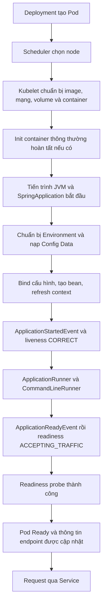

# Trình tự khởi động từ nạp cấu hình đến sẵn sàng phục vụ

## Mục tiêu của bài học

Một Pod đã hiện trạng thái `Running` nhưng request đầu tiên vẫn lỗi. Một lần triển khai khác không có log Java vì Secret chưa tồn tại. Cũng có trường hợp Spring đã in dòng “Started” nhưng tác vụ chuẩn bị dữ liệu vẫn đang chạy.

Các hiện tượng đó thuộc những giai đoạn khác nhau. Khi tích hợp Spring với Kubernetes, cần biết **ai chịu trách nhiệm cho từng bước và bằng chứng nào cho thấy ứng dụng đã đủ điều kiện nhận lưu lượng**.

Trong bài học này, bạn sẽ:

- Theo dõi đường đi từ chuẩn bị container, nạp ConfigMap và Secret, khởi tạo Spring đến readiness.
- Phân biệt trạng thái của Kubernetes với trạng thái bên trong ứng dụng.
- Chọn vị trí phù hợp cho kiểm tra cấu hình và tác vụ khởi động bắt buộc.
- Tạo một ví dụ có thể quan sát bằng log, probe, EndpointSlice và request qua Service.
- Nhận diện bước đang gặp lỗi mà không phải tăng thời gian chờ một cách tùy ý.

Ví dụ dùng **Spring Boot 3.5.x và Spring Cloud Kubernetes 3.3.x với Fabric8 Config**, qua Spring Cloud BOM tương thích. Đây là mốc để đọc cấu hình nhất quán; không trộn ví dụ với cơ chế bootstrap cũ hoặc một nhánh thư viện khác.

## 1. Có nhiều mức “đã khởi động”

| Mức quan sát | Điều đã được xác nhận | Điều chưa được xác nhận |
| --- | --- | --- |
| Pod đã được tạo | API server chấp nhận đối tượng | Pod đã có node hay container đã chạy |
| Container đang chạy | Tiến trình trong container đã bắt đầu | Spring đã đọc đủ cấu hình |
| HTTP port đã mở | Có một connector có thể nhận kết nối | Tác vụ chuẩn bị nghiệp vụ đã hoàn tất |
| Spring báo sẵn sàng | Ứng dụng đã đi qua điều kiện khởi động của nó | Kubelet đã quan sát readiness thành công |
| Pod Ready | Điều kiện Ready của Pod đạt yêu cầu hiện tại | Mọi thành phần định tuyến đã cập nhật ngay lập tức |
| Request qua Service thành công | Đường truy cập vừa thử đang hoạt động | Mọi API và mọi phụ thuộc đều hoạt động |

`Running` là phase của Pod, không phải kết quả kiểm tra nghiệp vụ. Container có thể đang khởi động hoặc khởi động lại trong phase này. Kubernetes mô tả riêng phase, trạng thái container và các condition trong [Pod Lifecycle](https://kubernetes.io/docs/concepts/workloads/pods/pod-lifecycle/).

Ngay cả `1/1 Ready` cũng chỉ phản ánh điều kiện kiểm tra đã cấu hình. Nếu readiness chỉ trả một hằng số thành công, Kubernetes không tự biết ứng dụng đang thiếu bộ quy tắc bắt buộc.

## 2. Trình tự tổng quát và chủ thể thực hiện



Sơ đồ là mô hình các mốc phụ thuộc của một ứng dụng web thông thường. Việc chuẩn bị ở node và các cơ chế probe có thể hoạt động song song; không phải mọi thao tác nội bộ đều nối tiếp đúng một hàng.

Đặc biệt, startup probe được kubelet chạy trong giai đoạn container bắt đầu hoạt động. Nếu có cấu hình probe này, kubelet chưa chạy liveness và readiness probe thông thường cho đến khi startup probe thành công.

Kubernetes quản lý việc chạy tiến trình và quan sát kết quả. Spring Boot quản lý việc đọc cấu hình, dựng ứng dụng và công bố availability. Spring Cloud Kubernetes cung cấp tích hợp cần thiết, chẳng hạn đọc ConfigMap qua API. Không có một sự kiện Spring duy nhất đồng thời thay đổi mọi trạng thái trên Kubernetes.

## 3. Trước khi JVM chạy: cấu hình có thể đã chặn container

Kubelet phải chuẩn bị các tài nguyên mà Pod tham chiếu. Secret được mount thành volume hoặc được dùng qua `secretKeyRef` không phải do bean Spring tự tạo ra.

Nếu một Secret bắt buộc chưa tồn tại, container có thể chưa bắt đầu. Khi đó, cách điều tra phù hợp là xem Pod Events và trạng thái container; việc tìm stack trace trong ứng dụng sẽ không có ích nếu Java chưa chạy.

### Init container xử lý phần chuẩn bị ở cấp Pod

Init container thông thường chạy trước container ứng dụng, theo thứ tự khai báo và cần hoàn tất thành công. Nó phù hợp với việc chuẩn bị file dùng chung hoặc thực hiện một bước kiểm tra hữu hạn ở cấp Pod. Xem [Init Containers](https://kubernetes.io/docs/concepts/workloads/pods/init-containers/).

Tuy nhiên:

- Init container kiểm tra một dịch vụ phụ thuộc thành công không bảo đảm dịch vụ đó còn hoạt động khi request tới.
- Một vòng chờ không có giới hạn có thể giữ Pod ở giai đoạn init rất lâu.
- Nếu mọi replica cùng thực hiện một thao tác thay đổi dữ liệu, phải xét tính idempotent và cơ chế phối hợp.

Không nên chuyển tất cả khởi tạo nghiệp vụ sang init container. Công việc cần các bean, cấu hình đã bind hoặc thư viện của ứng dụng thường phù hợp hơn với lifecycle của Spring.

### Hai cách nhận cấu hình nằm ở hai phía của mốc JVM

| Cách nhận | Thành phần đọc tài nguyên Kubernetes | Khi ứng dụng tiếp cận dữ liệu |
| --- | --- | --- |
| Biến môi trường từ ConfigMap/Secret | Kubelet chuẩn bị giá trị cho container | Có sẵn trong môi trường của tiến trình |
| File từ volume ConfigMap/Secret | Kubelet chuẩn bị volume | Spring hoặc mã ứng dụng đọc file sau khi bắt đầu |
| ConfigMap qua Spring Cloud Kubernetes API | Kubernetes client bên trong ứng dụng | Trong giai đoạn nạp cấu hình |
| Giá trị đóng gói trong image | Spring Boot đọc từ classpath | Trong giai đoạn nạp cấu hình |

Lựa chọn này quyết định vị trí của lỗi. Thiếu một Secret volume bắt buộc có thể chặn trước Java; không đọc được ConfigMap qua API có thể gây lỗi sau khi Java đã bắt đầu.

## 4. Nạp cấu hình trước khi dùng nó để tạo bean

Spring Boot chuẩn bị `Environment` từ các nguồn như file cấu hình, biến môi trường và tham số dòng lệnh. Với Config Data, các import được xử lý trong giai đoạn chuẩn bị cấu hình, trước khi các bean ứng dụng thông thường được tạo.

Đối với Spring Cloud Kubernetes 3.3, sử dụng:

```yaml
spring:
  config:
    import: "kubernetes:"
```

Cần có implementation phù hợp trên classpath và thông tin để tìm đúng tài nguyên. Không dùng đồng thời đường `spring.config.import` và legacy bootstrap cho cùng quá trình nạp Kubernetes PropertySource; [tài liệu PropertySource 3.3](https://docs.spring.io/spring-cloud-kubernetes/reference/3.3/property-source-config.html) nêu rõ hai cách này phải được lựa chọn riêng.

### 4.1. Cấu hình tìm nguồn phải có sẵn từ đầu

Ứng dụng cần biết:

- Có kích hoạt tích hợp Kubernetes Config hay không.
- Tên ứng dụng hoặc tên ConfigMap cần đọc.
- Namespace.
- Thông tin client và danh tính ServiceAccount khi dùng API.
- Chính sách xử lý lỗi đọc cấu hình.

Không đặt toàn bộ thông tin “làm thế nào tìm ConfigMap” vào chính ConfigMap mà ứng dụng chưa biết cách đọc. Trong ví dụ, tên ứng dụng và import nằm trong `application.yaml` đóng gói cùng image; namespace được đưa vào bằng Downward API.

Theo thứ tự chọn tên của Spring Cloud Kubernetes, `spring.cloud.kubernetes.config.name` có thể chỉ định tên riêng; nếu không, tên ứng dụng là đầu vào quan trọng. Xem [ConfigMap PropertySource](https://docs.spring.io/spring-cloud-kubernetes/reference/3.3/property-source-config/configmap-propertysource.html).

### 4.2. Giá trị có trong tài nguyên chưa chắc là giá trị cuối cùng

Một cấu hình có thể được khai báo ở nhiều nguồn. Chẳng hạn `SERVER_PORT` trong môi trường tiến trình có thể thay đổi `server.port` so với Config Data.

Vì vậy, khi điều tra, cần phân biệt:

```text
Giá trị đang lưu trong ConfigMap
    → nguồn đã được import hay chưa
    → profile và các nguồn ghi đè
    → giá trị cuối cùng trong Environment
    → giá trị đã được bind vào bean
```

Không kết luận “ConfigMap sai” chỉ vì một bean nhận giá trị khác dự kiến. Trước tiên cần kiểm tra nguồn thực tế và cấu hình triển khai. Khi ghi log phục vụ điều tra, chỉ chọn các thuộc tính không nhạy cảm như mã phiên bản cấu hình; không in toàn bộ Environment hoặc đối tượng chứa token.

## 5. Secret mount và configtree là hai bước riêng

Ví dụ chọn:

- ConfigMap không nhạy cảm được Spring Cloud Kubernetes đọc qua API.
- Secret được Kubernetes mount thành file.
- Spring Boot đọc cây file bằng `configtree:`.

Nếu có file:

```text
/etc/app-secrets/app.client-token
```

thì import:

```yaml
spring:
  config:
    import:
      - "kubernetes:"
      - "configtree:/etc/app-secrets/"
```

cho phép tên file trở thành tên thuộc tính `app.client-token`. Import này không có `optional:` vì ví dụ coi thư mục Secret là bắt buộc. Cách ánh xạ tên file được mô tả trong [Spring Boot Externalized Configuration](https://docs.spring.io/spring-boot/3.5/reference/features/external-config.html#features.external-config.files.configtree).

ServiceAccount của ứng dụng không cần quyền đọc Secret qua Kubernetes API chỉ để đọc một Secret đã được kubelet mount đúng vào container. Quyền truy cập file và cấu hình volume vẫn phải phù hợp với người dùng chạy tiến trình.

Đây cũng là lý do ví dụ tắt Kubernetes Secrets PropertySource của Spring Cloud Kubernetes: Secret đã đi theo đường file và Boot Config Data, nên không cần thêm một đường đọc API. Tài liệu [Secrets PropertySource](https://docs.spring.io/spring-cloud-kubernetes/reference/3.3/property-source-config/secrets-propertysource.html) phân biệt đọc từ mount với đọc qua API và khuyến nghị cân nhắc quyền truy cập.

Mount file thành công chưa chứng minh Spring đã import đúng đường dẫn, key được đặt đúng tên hay giá trị có ý nghĩa nghiệp vụ. Những điều kiện này cần được kiểm tra tiếp ở bước bind và validation.

## 6. Bind, validation và khởi tạo tài nguyên bắt buộc

Sau khi có các nguồn cấu hình, Spring tạo các bean theo dependency và lifecycle của chúng. Không nên hình dung rằng tất cả constructor đều chạy trước, rồi tất cả `@PostConstruct` mới chạy như hai lượt tách biệt cho toàn bộ ứng dụng.

Những lỗi thường xuất hiện ở giai đoạn này:

- Thiếu thuộc tính cần bind.
- Sai kiểu dữ liệu.
- Validation thất bại.
- Một bean không thể tạo tài nguyên bắt buộc.
- Auto-configuration cần kết nối hoặc khởi tạo thành phần mà môi trường chưa cung cấp.

### Fail-fast cho việc đọc không thay thế validation nghiệp vụ

`spring.cloud.kubernetes.config.fail-fast=true` giúp làm thất bại khởi động khi gặp lỗi đọc ConfigMap theo hành vi implementation. Nó không tự kiểm chứng rằng mọi thuộc tính nghiệp vụ đều tồn tại và hợp lệ.

Ví dụ, đọc được một ConfigMap rỗng vẫn chưa đủ để biết `app.order-code-pattern` có hợp lệ. Cần validation và kiểm tra theo miền nghiệp vụ.

Trong lab, dùng ba thuộc tính bắt buộc:

```java
package com.example.orders;

import jakarta.validation.constraints.NotBlank;
import org.springframework.boot.context.properties.ConfigurationProperties;
import org.springframework.validation.annotation.Validated;

@Validated
@ConfigurationProperties(prefix = "app")
public record StartupProperties(
        @NotBlank String releaseId,
        @NotBlank String orderCodePattern,
        @NotBlank String clientToken) {
}
```

Record được đăng ký từ lớp ứng dụng:

```java
package com.example.orders;

import org.springframework.boot.SpringApplication;
import org.springframework.boot.autoconfigure.SpringBootApplication;
import org.springframework.boot.context.properties.EnableConfigurationProperties;

@SpringBootApplication
@EnableConfigurationProperties(StartupProperties.class)
public class OrderApplication {

    public static void main(String[] args) {
        SpringApplication.run(OrderApplication.class, args);
    }
}
```

Có `spring-boot-starter-validation` trên classpath để các ràng buộc hoạt động. Token ở đây chỉ được kiểm tra không rỗng; đó chưa phải kiểm tra token có xác thực được với một hệ thống bên ngoài hay không.

Không log trực tiếp `StartupProperties`: phương thức `toString()` được sinh cho record có thể chứa trường token.

## 7. Tác vụ khởi động nằm trước mốc sẵn sàng

Với luồng khởi động thông thường của Spring Boot:

```text
Refresh ApplicationContext
    → ApplicationStartedEvent
    → LivenessState.CORRECT
    → ApplicationRunner và CommandLineRunner
    → ApplicationReadyEvent
    → ReadinessState.ACCEPTING_TRAFFIC
```

Các mốc này được mô tả trong [SpringApplication 3.5](https://docs.spring.io/spring-boot/3.5/reference/features/spring-application.html#features.spring-application.application-events-and-listeners).

Tác vụ bắt buộc để phục vụ request có thể được thực hiện bằng runner với thời gian và chính sách thất bại rõ ràng. Nếu runner ném lỗi, lần khởi động thất bại. Nếu nó trả về trong khi công việc được chuyển sang một thread khác chưa hoàn tất, Spring Boot không tự biết phải chờ thread đó.

Ví dụ cần biên dịch biểu thức nhận dạng mã đơn hàng trước khi phục vụ. Một bean vừa thực hiện bước chuẩn bị vừa cung cấp điều kiện readiness:

```java
package com.example.orders;

import java.util.concurrent.TimeUnit;
import java.util.concurrent.atomic.AtomicReference;
import java.util.regex.Pattern;

import org.slf4j.Logger;
import org.slf4j.LoggerFactory;
import org.springframework.beans.factory.annotation.Value;
import org.springframework.boot.ApplicationArguments;
import org.springframework.boot.ApplicationRunner;
import org.springframework.boot.actuate.health.Health;
import org.springframework.boot.actuate.health.HealthIndicator;
import org.springframework.stereotype.Component;

@Component("startupGate")
public class StartupGate implements ApplicationRunner, HealthIndicator {

    private static final Logger log =
            LoggerFactory.getLogger(StartupGate.class);

    private final StartupProperties properties;
    private final long labDelayMs;
    private final AtomicReference<Pattern> compiled = new AtomicReference<>();

    public StartupGate(
            StartupProperties properties,
            @Value("${lab.warmup-delay-ms:0}") long labDelayMs) {
        this.properties = properties;
        this.labDelayMs = labDelayMs;
    }

    @Override
    public void run(ApplicationArguments args) throws Exception {
        if (labDelayMs < 0 || labDelayMs > 30_000) {
            throw new IllegalArgumentException("Invalid lab warmup delay");
        }

        log.info("WARMUP_BEGIN releaseId={}", properties.releaseId());
        Pattern candidate = Pattern.compile(properties.orderCodePattern());

        // Chỉ tạo khoảng quan sát trong lab; mặc định không chờ.
        if (labDelayMs > 0) {
            TimeUnit.MILLISECONDS.sleep(labDelayMs);
        }

        compiled.set(candidate);
        log.info("WARMUP_DONE releaseId={}", properties.releaseId());
    }

    public boolean initialized() {
        return compiled.get() != null;
    }

    public boolean matches(String code) {
        Pattern pattern = compiled.get();
        return pattern != null && pattern.matcher(code).matches();
    }

    @Override
    public Health health() {
        return initialized()
                ? Health.up().build()
                : Health.outOfService().build();
    }
}
```

Biên dịch regex là công việc cục bộ, hữu hạn. Thời gian chờ trong ví dụ chỉ làm rõ khoảng cách giữa “Spring đã started” và “chuẩn bị xong”; không phải cách tổ chức warmup trong sản phẩm.

Nếu thay bằng truy cập database hoặc dịch vụ khác, client cần timeout và retry có giới hạn. Một probe ở bên ngoài không tự ngắt lời gọi mạng đang treo trong runner.

### Khi nào cần giữ một điều kiện readiness riêng?

Trong ví dụ đồng bộ, runner đã khiến Boot chờ trước khi công bố readiness. `startupGate` được thêm để điều kiện nghiệp vụ xuất hiện rõ trong phép kiểm tra và giúp minh họa cách giữ cổng readiness nếu sau này có khởi tạo bất đồng bộ.

Khi dùng khởi tạo bất đồng bộ, phải quản lý cả trạng thái thất bại, hủy và thời gian chờ. Không chỉ phát một sự kiện `REFUSING_TRAFFIC` trong `ApplicationReadyEvent` rồi kỳ vọng nó giữ nguyên: Boot còn phát `ACCEPTING_TRAFFIC` sau sự kiện đó trong luồng khởi động chuẩn.

## 8. Probe công bố và kiểm tra điều kiện nào?

Ba loại probe có hành vi khác nhau:

| Probe | Câu hỏi vận hành | Phản ứng khi thất bại đủ ngưỡng |
| --- | --- | --- |
| Startup | Container đã vượt qua điều kiện khởi động được chọn chưa? | Container có thể bị khởi động lại |
| Liveness | Tiến trình có còn ở trạng thái có thể hoạt động không? | Container có thể bị khởi động lại |
| Readiness | Hiện tại có nên đưa lưu lượng tới Pod không? | Pod không được đánh dấu sẵn sàng để nhận lưu lượng thông thường |

Khi có startup probe, nó chặn việc chạy hai probe còn lại cho đến khi thành công. Chi tiết ở [Kubernetes Probes](https://kubernetes.io/docs/concepts/workloads/pods/probes/).

Ứng dụng dùng Actuator để công bố các nhóm kiểm tra. Cấu hình lab:

```yaml
management:
  endpoint:
    health:
      probes:
        enabled: true
      group:
        readiness:
          include: readinessState,startupGate
  endpoints:
    web:
      exposure:
        include: health
```

Readiness chỉ thành công khi cả trạng thái readiness của Boot và điều kiện `startupGate` đều phù hợp. Không đưa mọi health indicator vào readiness chỉ vì chúng tồn tại.

Trong ví dụ, Actuator và API sử dụng cùng cổng 8080. Nếu dùng cổng quản trị riêng, phải xem xét việc probe thành công trong khi cổng nghiệp vụ không hoạt động. Các nhóm probe và cách đưa chúng lên cổng chính được mô tả trong [Actuator Kubernetes Probes](https://docs.spring.io/spring-boot/3.5/reference/actuator/endpoints.html#actuator.endpoints.kubernetes-probes).

Liveness nên phản ánh sức khỏe nội tại. Gắn nó với một dịch vụ bên ngoài đang lỗi có thể làm các replica khởi động lại đồng loạt. Với readiness, việc đưa phụ thuộc bên ngoài vào kiểm tra cần dựa trên khả năng phục vụ thực tế, cơ chế dự phòng và phạm vi ảnh hưởng của phụ thuộc đó.

**Readiness không tự chặn tất cả request gửi thẳng tới cổng ứng dụng.** Nó là tín hiệu cho hạ tầng. Đường truy cập trực tiếp, cấu hình xuất bản endpoint chưa sẵn sàng hoặc định tuyến khác có thể đi ngoài điều kiện này. API quan trọng vẫn cần xử lý trạng thái chưa khởi tạo một cách có chủ đích.

## 9. Ghép ví dụ triển khai

Các đoạn dưới là nội dung học tập để đưa vào một dự án lab, không phải các thao tác đã chạy trên cluster.

### 9.1. Thành phần ứng dụng

Dự án có các dependency sau, dùng version do BOM phù hợp quản lý:

```xml
<dependency>
    <groupId>org.springframework.boot</groupId>
    <artifactId>spring-boot-starter-web</artifactId>
</dependency>
<dependency>
    <groupId>org.springframework.boot</groupId>
    <artifactId>spring-boot-starter-actuator</artifactId>
</dependency>
<dependency>
    <groupId>org.springframework.boot</groupId>
    <artifactId>spring-boot-starter-validation</artifactId>
</dependency>
<dependency>
    <groupId>org.springframework.cloud</groupId>
    <artifactId>spring-cloud-starter-kubernetes-fabric8-config</artifactId>
</dependency>
```

`application.yaml` đóng gói cùng ứng dụng:

```yaml
server:
  port: 8080

spring:
  application:
    name: order-service
  config:
    import:
      - "kubernetes:"
      - "configtree:/etc/app-secrets/"
  cloud:
    kubernetes:
      client:
        namespace: ${POD_NAMESPACE}
      config:
        name: order-service
        namespace: ${POD_NAMESPACE}
        fail-fast: true
        retry:
          enabled: false
      secrets:
        enabled: false

management:
  endpoint:
    health:
      probes:
        enabled: true
      group:
        readiness:
          include: readinessState,startupGate
  endpoints:
    web:
      exposure:
        include: health
```

Lab tắt retry cho việc đọc ConfigMap để dễ quan sát lỗi đầu tiên. Trong vận hành, nếu bật retry, tổng thời gian các lần gọi và backoff phải được tính vào ngân sách khởi động. Cơ chế retry và dependency của nó phụ thuộc phiên bản; không sao chép thuộc tính của Spring Cloud Config Server sang Kubernetes Config.

Thêm một API nhỏ để thử đường nghiệp vụ:

```java
package com.example.orders;

import java.util.Map;

import org.springframework.http.HttpStatus;
import org.springframework.web.bind.annotation.GetMapping;
import org.springframework.web.bind.annotation.RequestParam;
import org.springframework.web.bind.annotation.RestController;
import org.springframework.web.server.ResponseStatusException;

@RestController
public class OrderValidationController {

    private final StartupGate gate;
    private final StartupProperties properties;

    public OrderValidationController(
            StartupGate gate, StartupProperties properties) {
        this.gate = gate;
        this.properties = properties;
    }

    @GetMapping("/orders/validate")
    public Map<String, Object> validate(@RequestParam String code) {
        if (!gate.initialized()) {
            throw new ResponseStatusException(
                    HttpStatus.SERVICE_UNAVAILABLE, "Startup is incomplete");
        }
        return Map.of(
                "valid", gate.matches(code),
                "releaseId", properties.releaseId());
    }
}
```

API không trả token. Các lớp Java của ví dụ đặt trong cùng package ứng dụng và mỗi lớp public nằm ở file tương ứng trong dự án thực hành.

### 9.2. Namespace, dữ liệu cấu hình và quyền đọc

```yaml
apiVersion: v1
kind: Namespace
metadata:
  name: startup-lab
---
apiVersion: v1
kind: ServiceAccount
metadata:
  name: order-service
  namespace: startup-lab
---
apiVersion: v1
kind: ConfigMap
metadata:
  name: order-service
  namespace: startup-lab
data:
  application.yaml: |-
    app:
      release-id: lab-r1
      order-code-pattern: "[A-Z]{3}-[0-9]{6}"
---
apiVersion: v1
kind: Secret
metadata:
  name: order-credentials
  namespace: startup-lab
type: Opaque
stringData:
  client-token: example-token-for-lab-only
---
apiVersion: rbac.authorization.k8s.io/v1
kind: Role
metadata:
  name: order-config-reader
  namespace: startup-lab
rules:
  - apiGroups: [""]
    resources: ["configmaps"]
    verbs: ["get", "list"]
---
apiVersion: rbac.authorization.k8s.io/v1
kind: RoleBinding
metadata:
  name: order-config-reader
  namespace: startup-lab
subjects:
  - kind: ServiceAccount
    name: order-service
    namespace: startup-lab
roleRef:
  apiGroup: rbac.authorization.k8s.io
  kind: Role
  name: order-config-reader
```

Giá trị Secret trên chỉ là dữ liệu giả cho lab. Role cho phép đọc ConfigMap trong namespace thử nghiệm, không cấp quyền đọc Secrets hoặc thay đổi tài nguyên. Kiểm tra cách client truy vấn thực tế trước khi thu hẹp thêm quyền; một implementation đọc theo danh sách có thể cần `list` ngay cả khi bạn chỉ quan tâm một ConfigMap.

### 9.3. Deployment và Service

Thay image minh họa bằng image của ứng dụng vừa xây dựng, rồi triển khai các tài nguyên vào cluster lab.

```yaml
apiVersion: apps/v1
kind: Deployment
metadata:
  name: order-service
  namespace: startup-lab
spec:
  replicas: 2
  selector:
    matchLabels:
      app: order-service
  template:
    metadata:
      labels:
        app: order-service
    spec:
      serviceAccountName: order-service
      containers:
        - name: app
          image: registry.example.com/learning/order-service:lab
          ports:
            - name: http
              containerPort: 8080
          env:
            - name: POD_NAMESPACE
              valueFrom:
                fieldRef:
                  fieldPath: metadata.namespace
            - name: LAB_WARMUP_DELAY_MS
              value: "15000"
          volumeMounts:
            - name: credentials
              mountPath: /etc/app-secrets
              readOnly: true
          startupProbe:
            httpGet:
              path: /actuator/health/liveness
              port: http
            periodSeconds: 2
            timeoutSeconds: 1
            failureThreshold: 60
          livenessProbe:
            httpGet:
              path: /actuator/health/liveness
              port: http
            periodSeconds: 10
            timeoutSeconds: 1
            failureThreshold: 3
          readinessProbe:
            httpGet:
              path: /actuator/health/readiness
              port: http
            periodSeconds: 2
            timeoutSeconds: 1
            failureThreshold: 3
            successThreshold: 1
      volumes:
        - name: credentials
          secret:
            secretName: order-credentials
            items:
              - key: client-token
                path: app.client-token
---
apiVersion: v1
kind: Service
metadata:
  name: order-service
  namespace: startup-lab
spec:
  selector:
    app: order-service
  ports:
    - name: http
      port: 8080
      targetPort: http
```

Ở đây startup probe gọi **liveness**, nên nó có thể thành công sau khi context khởi tạo xong, trong lúc runner vẫn đang chờ ở phần warmup. Readiness vẫn thất bại trong khoảng đó. Vì thế, ngân sách startup probe không phải deadline hoàn tất mọi công việc nghiệp vụ.

`60 × 2 = 120` giây là ngân sách danh nghĩa để cấu hình cửa sổ kiểm tra startup trong ví dụ, không phải cam kết chính xác về toàn bộ thời gian tạo Pod. Nó không bao gồm thời gian chờ scheduling, kéo image hoặc chờ Secret trước khi container chạy.

Không cần chèn một `initialDelaySeconds` lớn chỉ để che mọi giai đoạn. Probe nên kiểm tra đúng trạng thái, với ngân sách dựa trên dữ liệu đo.

## 10. Từ readiness của Spring đến lưu lượng qua Service

Khi Boot đã công bố chấp nhận lưu lượng và `startupGate` đã hoàn tất, HTTP readiness có thể trả thành công. Kubelet còn phải gọi probe và cập nhật trạng thái Pod.

Thông tin địa chỉ và điều kiện của các Pod được phản ánh qua EndpointSlice của Service. Bộ phận định tuyến hoặc proxy cần quan sát cập nhật đó. Xem [EndpointSlices và điều kiện endpoint](https://kubernetes.io/docs/concepts/services-networking/endpoint-slices/).

Một EndpointSlice có thể đã chứa địa chỉ Pod với `ready: false`; vì vậy không chỉ kiểm tra “đã có object EndpointSlice” là đủ.

Đối với ví dụ Service thông thường, không bật `publishNotReadyAddresses`. Nếu chủ động xuất bản địa chỉ chưa Ready cho mục đích riêng, cần hiểu đó là một hợp đồng khám phá khác.

### DiscoveryClient và LoadBalancer nằm ở đâu?

Gọi qua DNS của Kubernetes Service có thể không cần Spring Cloud Kubernetes DiscoveryClient. Nếu client dùng DiscoveryClient để lấy danh sách Pod rồi dùng Spring Cloud LoadBalancer, còn có bước đồng bộ hoặc cache ở client, tùy implementation và cấu hình.

Do đó:

- Boot không phải đăng ký vào Eureka để Pod xuất hiện trong Service này.
- Bật DiscoveryClient không thay thế readiness của Pod.
- Client tự chọn Pod cần tôn trọng trạng thái sẵn sàng.
- Request đi thẳng vào Pod IP khác với request đi qua đường Service đang được kiểm tra.

Kubernetes native service discovery được Spring mô tả tại [Discovery qua Service và DNS](https://docs.spring.io/spring-cloud-kubernetes/reference/3.3/discovery-kubernetes-native.html). Chỉ thêm tích hợp khám phá hoặc cân bằng tải phía client khi ứng dụng thực sự cần nó.

## 11. Quan sát trình tự trên cluster lab

### Bước 1: Xem các trạng thái ở cấp Kubernetes

Sau khi tự triển khai ví dụ:

```powershell
kubectl get pods -n startup-lab -l app=order-service -w
```

Ở cửa sổ khác:

```powershell
kubectl logs -n startup-lab -l app=order-service --prefix=true --timestamps=true --tail=100 --max-log-requests=10 -f
```

Và quan sát thông tin endpoint:

```powershell
kubectl get endpointslices -n startup-lab -l kubernetes.io/service-name=order-service -w -o yaml
```

Với khoảng chờ lab 15 giây, cần tìm khoảng thời gian giữa `WARMUP_BEGIN` và `WARMUP_DONE`. Trong khoảng này, container có thể đang chạy và liveness đã thành công, nhưng readiness chưa đạt.

Luồng log theo selector chọn các Pod có tại thời điểm bắt đầu lệnh; nếu có Pod thay thế, mở lại lệnh hoặc thu log theo tên Pod mới để không bỏ sót.

### Bước 2: Kiểm tra trực tiếp một Pod

Trong PowerShell:

```powershell
$pods = kubectl get pods -n startup-lab -l app=order-service -o json | ConvertFrom-Json
$podName = $pods.items[0].metadata.name

kubectl port-forward -n startup-lab "pod/$podName" 18080:8080
```

Tại cửa sổ khác, khi HTTP đã hoạt động:

```powershell
curl.exe -i http://localhost:18080/actuator/health/liveness
curl.exe -i http://localhost:18080/actuator/health/readiness
```

Trong giai đoạn chuẩn bị, liveness có thể trả 200 còn readiness trả 503. Ở giai đoạn sớm hơn, HTTP chưa mở nên có thể không kết nối được. Khi hoàn tất, readiness cần trả 200.

Nếu bỏ lỡ khoảng quan sát vì Pod đã khởi động xong, tạo một lượt rollout mới trong lab rồi quan sát lại. Lệnh port-forward là công cụ chẩn đoán đường trực tiếp đến Pod, không chứng minh Service đã định tuyến đúng.

### Bước 3: Kiểm tra qua Service từ một client trong cluster

Dùng một client Pod có công cụ HTTP trong namespace lab, gọi:

```text
GET http://order-service:8080/orders/validate?code=ABC-123456
```

Khi hệ thống đã sẵn sàng, kết quả dự kiến:

```json
{
  "valid": true,
  "releaseId": "lab-r1"
}
```

Có thể dùng client đang sẵn có trong môi trường học tập; ví dụ không giả định container ứng dụng chứa shell hoặc curl.

Cần ghi nhận cả trạng thái readiness và kết quả request qua Service. Khi có nhiều replica, thêm định danh Pod vào log phía server để biết request đã tới replica nào; không suy ra tất cả replica đều đã sẵn sàng chỉ từ một lần gọi thành công.

### Một timeline minh họa

```text
00,0s  Pod được tạo
03,0s  Container bắt đầu chạy
04,0s  ConfigMap và Secret đã được nạp
08,0s  Context đã refresh; liveness đủ điều kiện thành công
08,1s  WARMUP_BEGIN
23,1s  WARMUP_DONE
23,2s  Boot đi qua mốc ready
24,0s  Kubelet nhận readiness thành công
24,4s  Endpoint phù hợp được các thành phần liên quan quan sát
25,0s  Request qua Service thành công
```

Đây là số liệu giả để đọc trình tự, không phải thời gian mặc định của Spring hoặc Kubernetes.

Đối với phép đo thật, chọn rõ mốc bắt đầu:

```text
T_container_to_ready = t_PodReady - t_container_started
T_pod_to_service    = t_first_service_success - t_pod_created
```

Hai đại lượng khác nhau vì đại lượng sau còn chứa thời gian chuẩn bị ở Kubernetes và độ trễ đường truy cập. Đồng bộ đồng hồ nếu trừ timestamp từ các node hoặc nguồn log khác nhau.

## 12. Thử các lỗi theo đúng giai đoạn

Thực hiện từng thay đổi riêng trong lab, rồi trả cấu hình về trạng thái hợp lệ trước lượt tiếp theo.

| Thay đổi thử nghiệm | Giai đoạn cần quan sát | Kết quả cần hiểu |
| --- | --- | --- |
| Tham chiếu Secret không tồn tại | Kubelet chuẩn bị container/volume | Có thể chưa có log Java; xem Events |
| Bỏ key Secret đang được volume yêu cầu | Chuẩn bị volume | Lỗi có thể xảy ra trước JVM |
| Bỏ RoleBinding đọc ConfigMap | Nạp Config Data qua API | Xem lỗi quyền và chuỗi nguyên nhân khởi động |
| Xóa thuộc tính `app.release-id` ở nguồn duy nhất cung cấp nó | Bind và validation | Không được im lặng dùng một mã cấu hình giả |
| Đặt regex không hợp lệ | Runner biên dịch quy tắc | Ứng dụng không hoàn tất khởi động |
| Tăng thời gian chuẩn bị trong phạm vi lab | Runner và readiness | Pod chưa Ready trong khi tiến trình có thể vẫn sống |
| Đổi selector của Service cho sai | Sau readiness | Pod có thể Ready nhưng Service không chọn đúng backend |

Khi xóa một thuộc tính để thử validation, phải chắc không còn giá trị hợp lệ ở nguồn khác đang ghi đè hoặc cung cấp mặc định. Nếu không, bài thử không kiểm tra điều bạn định kiểm tra.

Các lệnh chẩn đoán cơ bản:

```powershell
kubectl describe pod <pod-name> -n startup-lab
kubectl logs <pod-name> -n startup-lab -c app --timestamps
kubectl logs <pod-name> -n startup-lab -c app --previous --timestamps
kubectl get configmap order-service -n startup-lab -o yaml
kubectl get endpointslices -n startup-lab -l kubernetes.io/service-name=order-service -o yaml
```

Thay `<pod-name>` bằng tên thật. `--previous` hữu ích khi container đã restart và bản log trước còn được giữ lại. Không đọc hoặc in nội dung Secret chỉ để xác nhận ứng dụng chưa Ready; kiểm tra tên tham chiếu, key và thông báo lỗi theo nhu cầu.

## 13. Tránh các thiết kế làm thứ tự khởi động trở nên khó kiểm soát

### Nạp cấu hình bắt buộc quá muộn

Nếu đợi đến `ApplicationReadyEvent` mới đi lấy cấu hình cần cho bean hoặc kết nối, nhiều thành phần đã được tạo bằng giá trị trước đó. Việc gán lại một biến không tự cấu hình lại toàn bộ tài nguyên đã dựng.

Đặt cấu hình bắt buộc vào đường nạp sớm, rồi kiểm tra nó trước khi cho ứng dụng phục vụ.

### Khởi tạo bất đồng bộ nhưng không giữ điều kiện readiness

Một runner chỉ gửi công việc vào executor rồi trả về có thể để Boot công bố sẵn sàng trong khi dữ liệu chưa được chuẩn bị. Chọn một trong hai hướng rõ ràng:

- Chờ hữu hạn trong runner cho công việc bắt buộc.
- Giữ một health indicator readiness phản ánh trạng thái thật và quản lý đầy đủ lỗi khởi tạo.

Không dùng một khoảng ngủ cố định để đoán thời điểm dịch vụ phụ thuộc sẵn sàng.

### Chờ vòng tròn giữa các ứng dụng

Nếu A chỉ Ready khi B Ready, còn B chỉ Ready khi A Ready, cả nhóm có thể không bao giờ phục vụ. Kiểm tra dependency nào thực sự bắt buộc cho request và dependency nào có thể dùng retry hoặc fallback khi chạy.

Tương tự, không yêu cầu Pod trở thành leader mới cho phép nó Ready nếu thuật toán bầu leader lại yêu cầu ứng viên phải Ready trước.

### Coi thay đổi cấu hình lúc chạy như một lần khởi động mới

ConfigMap truyền qua biến môi trường không tự cập nhật giá trị trong tiến trình đang chạy. File volume có thể được cập nhật theo cơ chế của kubelet nhưng Spring không tự bind lại mọi bean chỉ vì file thay đổi. Xem [hành vi cập nhật ConfigMap](https://kubernetes.io/docs/concepts/configuration/configmap/).

Configuration Watcher phục vụ phát hiện thay đổi và kích hoạt đường refresh được thiết kế. Nó không thay thế việc nạp cấu hình ban đầu, và refresh không đồng nghĩa mọi runner, migration hay tài nguyên đã tạo sẽ chạy lại như một lần khởi động sạch. Tham khảo [Spring Cloud Kubernetes Configuration Watcher](https://docs.spring.io/spring-cloud-kubernetes/reference/3.3/spring-cloud-kubernetes-configuration-watcher.html).

Record cấu hình và `Pattern` đã biên dịch trong lab không được thiết kế cho cập nhật nóng. Để thử một cấu hình mới của ví dụ, triển khai lại ứng dụng và quan sát lại toàn bộ chuỗi khởi động.

## 14. Tiêu chí đánh giá một lần khởi động thành công

Đối với ví dụ, cần có các bằng chứng sau:

1. Container thực sự bắt đầu và không bị lặp restart ngoài dự kiến.
2. ConfigMap được đọc từ đúng namespace; Secret được mount và import đúng đường.
3. Các thuộc tính bắt buộc bind và validation thành công.
4. Có `WARMUP_DONE` cho mã cấu hình đang triển khai.
5. Readiness trả thành công và Pod đạt condition Ready.
6. Service chọn đúng Pod và request kiểm tra nghiệp vụ trả kết quả phù hợp.

Nếu một điều kiện chưa đạt, hãy tìm mốc cuối đã có bằng chứng rồi điều tra bước ngay sau nó. Tăng timeout không sửa được Secret bị tham chiếu sai, RBAC thiếu quyền hoặc regex không hợp lệ.

### Câu hỏi tự kiểm tra

- **Tại sao không có log Java khi thiếu Secret?**  
  Vì tài nguyên được kubelet dùng để chuẩn bị container có thể chưa sẵn sàng, nên tiến trình chưa được chạy.

- **Vì sao dòng log “Started” chưa đủ để khẳng định Pod đã phục vụ?**  
  Runner, readiness probe và cập nhật đường Service còn là các mốc riêng cần quan sát.

- **Có cần cấp quyền API đọc Secrets khi dùng Secret mount và Boot configtree không?**  
  Không cần chỉ vì cách dùng đó; tiến trình đọc file đã được mount, không tự gọi API đọc Secret.

- **Nếu liveness thành công trong lúc runner còn chạy thì cấu hình có sai không?**  
  Không nhất thiết. Tiến trình có thể sống trong khi chưa đủ điều kiện nhận lưu lượng; readiness mới giữ điều kiện phục vụ.

- **Có bắt buộc dùng DiscoveryClient và Spring Cloud LoadBalancer cho ví dụ không?**  
  Không. Service và DNS của Kubernetes đã cung cấp đường truy cập cần dùng. Chọn thêm tính năng khi có yêu cầu cụ thể.

Hiểu rõ thứ tự này giúp bạn gắn lỗi với đúng giai đoạn và chỉ cho Pod nhận lưu lượng khi những điều kiện phục vụ đã được chứng minh.
