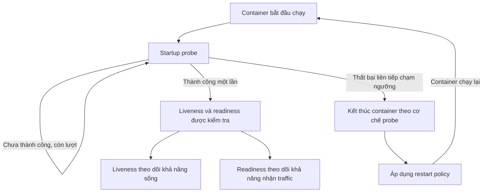

# Startup probe cho ứng dụng có thời gian khởi tạo dài

Một ứng dụng Spring có thể cần nhiều thời gian để tạo ApplicationContext, khởi tạo ORM, nạp bộ quy tắc hoặc làm nóng dữ liệu cục bộ. Nếu liveness probe thất bại đủ số lần trước khi những bước này hoàn tất, Kubernetes có thể kết thúc container rồi chạy lại từ đầu. Ứng dụng cứ khởi tạo lại mà không bao giờ đi đến trạng thái phục vụ.

Trong chương **Vòng đời Pod** của module Spring Cloud Kubernetes, startup probe giúp tách khoảng dung sai dành cho khởi động khỏi cách giám sát khi ứng dụng đã chạy ổn định. Bài này hướng dẫn chọn tín hiệu khởi động, tính ngân sách chờ và quan sát một ứng dụng Spring Boot khởi tạo chậm trên Kubernetes.

Sau bài học, bạn có thể:

- Phân biệt startup, readiness và liveness probe.
- Chọn endpoint phù hợp với điều kiện “khởi tạo xong” của ứng dụng.
- Cấu hình ngân sách chờ dựa trên số liệu thay vì tăng delay tùy ý.
- Thực hành với Spring Boot Actuator và một tác vụ khởi tạo có thời hạn.
- Phân biệt thiếu thời gian khởi động với lỗi cấu hình, thiếu tài nguyên hoặc endpoint bị chặn.

## 1. Startup probe giải quyết vấn đề nào?

Giả sử dịch vụ danh mục cần khoảng hai phút để nạp bộ quy tắc trước khi nhận request. Cấu hình liveness sau có thể quá gắt nếu endpoint chưa đáp ứng trong quá trình tạo context:

```yaml
livenessProbe:
  httpGet:
    path: /livez
    port: http
  periodSeconds: 10
  timeoutSeconds: 2
  failureThreshold: 3
```

Khi các lần kiểm tra liên tiếp thất bại chạm ngưỡng, container có thể bị kết thúc trước khi khởi tạo xong. Nếu mỗi lần chạy đều cần hai phút nhưng chỉ được chờ khoảng vài chục giây, restart không giúp tiến triển.

Startup probe kiểm tra giai đoạn đầu của **một container**. Khi nó chưa thành công, kubelet chưa thực hiện liveness và readiness probe của container đó. Một lần thành công kết thúc giai đoạn kiểm tra startup; nếu thất bại liên tiếp chạm ngưỡng, kubelet kết thúc container và áp dụng restart policy. [Các loại probe trong Kubernetes](https://kubernetes.io/docs/concepts/workloads/pods/probes/).

| Probe | Câu hỏi thiết kế | Khi thất bại |
| --- | --- | --- |
| Startup | Container đã vượt qua mốc khởi tạo đã định nghĩa chưa? | Có thể dẫn đến kết thúc và khởi động lại container |
| Readiness | Instance hiện có nên nhận traffic không? | Giữ instance ngoài các đích phục vụ thông thường |
| Liveness | Instance đang chạy có rơi vào trạng thái cần khởi động lại không? | Có thể dẫn đến kết thúc và khởi động lại container |

Chỉ tăng readiness timeout không bảo vệ container khỏi liveness đang chạy. Chỉ tăng liveness delay rất dài lại làm chậm giám sát ở những lần khởi động nhanh. Startup probe tạo một giai đoạn riêng: kết thúc sớm khi đạt điều kiện, nhưng vẫn có giới hạn khi khởi tạo không tiến triển.

## 2. Vòng đời kiểm tra gắn với container



Sau khi startup đã thành công, nó không tiếp tục giám sát và không được kích hoạt lại chỉ vì readiness chuyển sang không sẵn sàng. Một lần chạy container mới sẽ đi qua giai đoạn startup mới. Mã nguồn worker của kubelet thể hiện việc ngừng kiểm tra startup khi container đã started và chặn các probe còn lại trước mốc đó. [Mã nguồn probe worker](https://raw.githubusercontent.com/kubernetes/kubernetes/v1.35.0/pkg/kubelet/prober/worker.go).

Ba hệ quả cần phân biệt:

- Pod có phase `Running` chưa đồng nghĩa ứng dụng đã sẵn sàng.
- Startup thành công không thay thế điều kiện Ready của toàn Pod, nhất là khi có nhiều container hoặc readiness gate khác.
- Container restart trong cùng Pod không nhất thiết làm đổi tên hoặc UID của Pod. Cần xem `restartCount`, trạng thái container và log lần chạy trước. [Vòng đời container và Pod](https://kubernetes.io/docs/concepts/workloads/pods/pod-lifecycle/).

Startup probe chỉ quan sát được khi container liên quan đã chạy. Không lấy ngân sách startup của ứng dụng để giải thích thời gian Pod đang chờ được schedule, kéo image hoặc hoàn tất một init container thông thường. Những khoảng thời gian đó thuộc các giai đoạn khác.

## 3. Chọn tín hiệu “khởi tạo xong” trong Spring Boot

Ví dụ trong bài dùng Spring Boot 3.5, Java 17 trở lên và Spring Boot Actuator. Khi tích hợp Spring Cloud Kubernetes, dùng bộ phiên bản Spring Boot và Spring Cloud tương thích của dự án; không cần thêm một starter Spring Cloud Kubernetes chỉ để kubelet gọi probe HTTP.

Spring Boot cung cấp hai health group theo trạng thái availability:

- `/actuator/health/liveness` phản ánh liveness.
- `/actuator/health/readiness` phản ánh readiness.

Có thể đưa hai nhóm lên cổng HTTP chính tại `/livez` và `/readyz`. Cách này giúp kiểm tra qua web server của ứng dụng, thay vì chỉ qua một management server riêng vẫn phản hồi trong lúc cổng phục vụ chính có vấn đề. [Actuator và Kubernetes probes](https://docs.spring.io/spring-boot/3.5/reference/actuator/endpoints.html).

### Vì sao liveness tốt chưa chắc tác vụ khởi tạo đã xong?

Trong luồng khởi động chuẩn của Spring Boot, `ApplicationStartedEvent` được phát sau khi context refresh, rồi liveness chuyển sang `CORRECT`. Sau đó các `ApplicationRunner` và `CommandLineRunner` được gọi. Khi các runner hoàn tất, ứng dụng phát `ApplicationReadyEvent` và readiness chuyển sang `ACCEPTING_TRAFFIC`. [Thứ tự sự kiện khởi động](https://docs.spring.io/spring-boot/3.5/reference/features/spring-application.html).

Vì vậy, cần chọn endpoint theo mục tiêu:

| Trường hợp | Đích startup có thể chọn | Điều phải làm rõ |
| --- | --- | --- |
| Cần bảo vệ thời gian tạo context và mở endpoint liveness | `/livez` | Không dùng kết quả này để kết luận mọi runner đã xong |
| Cần giới hạn cả tác vụ khởi tạo bắt buộc chạy trong runner | `/readyz` với nhóm readiness chỉ chứa trạng thái phù hợp | Startup sẽ chờ runner hoàn tất |
| Readiness có cả DB hoặc dịch vụ bên ngoài | Một nhóm startup riêng hoặc `/livez`, tùy mục tiêu | Tránh buộc restart do dependency bên ngoài gián đoạn |
| Warm-up chạy bất đồng bộ sau khi Boot đã ready | Tín hiệu khởi tạo do ứng dụng quản lý | Boot không tự suy ra thread nền đã hoàn thành |

**Ví dụ chính cố ý dùng `/readyz` cho startup** vì điều kiện khởi động của bài là hoàn thành một runner bắt buộc, hữu hạn. Nhóm readiness của ví dụ chỉ chứa `readinessState`, không kèm kiểm tra database.

Đây là lựa chọn của tình huống minh họa, không phải quy tắc luôn dùng readiness làm startup. Nếu chỉ cần bảo vệ quá trình tạo context, dùng endpoint liveness cho startup là một lựa chọn thông dụng.

## 4. Chuẩn bị Actuator trên cổng ứng dụng

Trong một dự án Spring Boot 3.5 đã có parent hoặc BOM phù hợp, dùng các dependency sau:

```xml
<dependency>
    <groupId>org.springframework.boot</groupId>
    <artifactId>spring-boot-starter-web</artifactId>
</dependency>
<dependency>
    <groupId>org.springframework.boot</groupId>
    <artifactId>spring-boot-starter-actuator</artifactId>
</dependency>
```

Cấu hình ứng dụng:

```yaml
server:
  port: 8080

spring:
  application:
    name: catalog-slow-start

management:
  endpoints:
    web:
      exposure:
        include: health
  endpoint:
    health:
      show-details: never
      probes:
        enabled: true
        add-additional-paths: true
      group:
        liveness:
          include: livenessState
        readiness:
          include: readinessState
```

Bật probes rõ ràng giúp dùng cùng hành vi khi chạy local và trên Kubernetes. Hai đường dẫn bổ sung phục vụ trên cổng chính `8080`; manifest ở phần sau gọi đúng cổng này. Cấu hình không đặt `management.server.port` riêng.

Nếu ứng dụng có Spring Security hoặc bộ lọc riêng, phải cho phép kubelet truy cập các endpoint probe cần thiết mà không qua trang đăng nhập. Không mở toàn bộ Actuator để xử lý một lỗi 401. Khi đổi context path, health path hoặc port, đối chiếu lại URL thật thay vì giữ nguyên manifest.

Cũng không dùng `/actuator/startup` làm startup probe. Tên endpoint đó liên quan đến dữ liệu các bước khởi động, không tự biến nó thành phép kiểm tra trạng thái hoàn tất.

## 5. Tính ngân sách khởi động

Cách ước lượng thường dùng là:

```text
Ngân sách giai đoạn startup ≈ failureThreshold × periodSeconds
```

Nếu đặt thêm `initialDelaySeconds`, cần tính cả khoảng chờ trước các lần kiểm tra. Tài liệu Kubernetes dùng tích ngưỡng thất bại và chu kỳ để chọn khoảng đủ dài cho ứng dụng khởi động chậm. [Cấu hình startup probe](https://kubernetes.io/docs/tasks/configure-pod-container/configure-liveness-readiness-startup-probes/).

Ví dụ tự xây dựng cho dịch vụ danh mục:

| Số liệu đo trong môi trường gần production | Thời gian |
| --- | --- |
| Thời gian thường gặp từ container chạy đến mốc khởi tạo hoàn tất | 90 giây |
| p99 của cùng khoảng đo | 180 giây |
| Lần chậm đáng chú ý khi cold start hoặc node có tải | 220 giây |
| Ngân sách chọn cho đợt triển khai thử | Khoảng 300 giây |

Với chu kỳ 5 giây, chọn `failureThreshold: 60` tạo ngân sách danh nghĩa khoảng `60 × 5 = 300` giây. Biên còn lại là phần dung sai có chủ đích, không phải bằng chứng rằng mọi tình huống sẽ hoàn tất trong năm phút.

Các trường cần đọc đúng:

| Trường | Ý nghĩa trong cấu hình bài |
| --- | --- |
| `periodSeconds: 5` | Nhịp kiểm tra startup |
| `timeoutSeconds: 2` | Thời gian tối đa dành cho một lần kiểm tra |
| `failureThreshold: 60` | Số lần thất bại liên tiếp trước khi startup bị coi là thất bại |
| `successThreshold: 1` | Chỉ cần một lần thành công; startup và liveness yêu cầu giá trị này là 1 |
| `initialDelaySeconds` | Khoảng chờ trước khi bắt đầu kiểm tra; ví dụ để mặc định 0 |

Các ràng buộc của những trường này được định nghĩa trong Kubernetes API. [API Probe](https://kubernetes.io/docs/reference/kubernetes-api/core/pod-v1/).

Không coi tích trên là đồng hồ chính xác đến từng giây. Lịch thực thi probe, thời lượng request, thời điểm container được ghi nhận chạy và thời gian kết thúc container ảnh hưởng quan sát thực tế. Sau đó còn có thể có backoff trước lần chạy tiếp theo. Không nhân thêm `timeoutSeconds` vào công thức thành `60 × 5 × 2`.

Startup thành công sớm sẽ kết thúc giai đoạn startup sớm. Nếu ứng dụng đã đạt điều kiện ở khoảng giây 45, nó không bị bắt chờ hết ngân sách 300 giây. Đây là điểm khác với một khoảng delay cố định rất dài.

## 6. Manifest triển khai minh họa

Manifest sau dành cho namespace lab `demo` đã tồn tại. Thay image bằng image ứng dụng mà cluster có thể kéo được. Image cần chứa cấu hình ở trên và component lab ở phần kế tiếp.

```yaml
apiVersion: apps/v1
kind: Deployment
metadata:
  name: catalog-slow-start
  namespace: demo
spec:
  replicas: 2
  minReadySeconds: 10
  progressDeadlineSeconds: 900
  strategy:
    type: RollingUpdate
    rollingUpdate:
      maxSurge: 1
      maxUnavailable: 0
  selector:
    matchLabels:
      app: catalog-slow-start
  template:
    metadata:
      labels:
        app: catalog-slow-start
    spec:
      containers:
        - name: app
          image: your-registry/catalog-slow-start:lab
          ports:
            - name: http
              containerPort: 8080
          env:
            - name: SPRING_PROFILES_ACTIVE
              value: startup-lab
            - name: DEMO_STARTUP_DELAY
              value: "120"
          resources:
            requests:
              cpu: 250m
              memory: 512Mi
            limits:
              cpu: "1"
              memory: 1Gi
          startupProbe:
            httpGet:
              path: /readyz
              port: http
            periodSeconds: 5
            timeoutSeconds: 2
            failureThreshold: 60
            successThreshold: 1
          livenessProbe:
            httpGet:
              path: /livez
              port: http
            periodSeconds: 10
            timeoutSeconds: 2
            failureThreshold: 3
          readinessProbe:
            httpGet:
              path: /readyz
              port: http
            periodSeconds: 5
            timeoutSeconds: 2
            failureThreshold: 3
            successThreshold: 1
---
apiVersion: v1
kind: Service
metadata:
  name: catalog-slow-start
  namespace: demo
spec:
  selector:
    app: catalog-slow-start
  ports:
    - name: http
      port: 80
      targetPort: http
```

Một số lựa chọn trong manifest:

- Startup được chờ lâu hơn, còn liveness sau khởi động giữ chu kỳ ngắn hơn.
- Readiness vẫn được khai báo để theo dõi khả năng nhận traffic sau giai đoạn startup.
- Named port `http` cùng trỏ tới cổng ứng dụng `8080`.
- Không đặt thêm delay hàng trăm giây cho liveness; startup đã đảm nhiệm việc chờ đầu đời container.
- Giới hạn CPU và bộ nhớ là giá trị khởi đầu cho lab, cần đo lại với ứng dụng thật.

`progressDeadlineSeconds` của Deployment báo thiếu tiến triển rollout, không cấp thêm thời gian cho startup probe và không tự rollback. Đây cũng không phải giới hạn cứng cho tổng thời gian của mọi bước rollout. `minReadySeconds` và chiến lược rollout phục vụ một mục tiêu khác với ngân sách startup. [Cơ chế tiến triển Deployment](https://kubernetes.io/docs/concepts/workloads/controllers/deployment/).

## 7. Tạo tình huống khởi tạo chậm có kiểm soát

Thêm component sau trong package được ứng dụng scan. Nó chỉ hoạt động khi profile `startup-lab` được bật:

```java
package example.catalog;

import java.util.concurrent.TimeUnit;

import org.slf4j.Logger;
import org.slf4j.LoggerFactory;
import org.springframework.beans.factory.annotation.Value;
import org.springframework.boot.ApplicationArguments;
import org.springframework.boot.ApplicationRunner;
import org.springframework.context.annotation.Profile;
import org.springframework.stereotype.Component;

@Component
@Profile("startup-lab")
public class SlowStartupLab implements ApplicationRunner {

    private static final Logger log =
            LoggerFactory.getLogger(SlowStartupLab.class);

    private final long delaySeconds;

    public SlowStartupLab(
            @Value("${demo.startup.delay:120}") long delaySeconds) {
        if (delaySeconds < 0 || delaySeconds > 1800) {
            throw new IllegalArgumentException(
                    "demo.startup.delay must be between 0 and 1800 seconds");
        }
        this.delaySeconds = delaySeconds;
    }

    @Override
    public void run(ApplicationArguments args) throws InterruptedException {
        log.info("startup_lab_begin delaySeconds={}", delaySeconds);
        TimeUnit.SECONDS.sleep(delaySeconds);
        log.info("startup_lab_complete");
    }
}
```

Thuộc tính `demo.startup.delay` được hiểu là số giây trong component này; biến môi trường `DEMO_STARTUP_DELAY` trong manifest cung cấp giá trị tương ứng. `ApplicationRunner` là callback được Spring Boot gọi khi bean đó có mặt trong ứng dụng. [API ApplicationRunner](https://docs.spring.io/spring-boot/3.5/api/java/org/springframework/boot/ApplicationRunner.html).

Đây là mô phỏng chờ, không phải cách làm nhanh khởi động và cũng không mô phỏng CPU throttling. Không giữ profile này trong triển khai thật.

Trong luồng lab:

1. Spring khởi tạo context và web server.
2. Runner ghi `startup_lab_begin` rồi chờ 120 giây.
3. Liveness có thể đã tốt, nhưng readiness chưa chấp nhận traffic.
4. Startup probe vào `/readyz` tiếp tục chưa thành công.
5. Runner kết thúc; sau đó Boot chuyển readiness sang chấp nhận traffic.
6. Startup thành công, các probe còn lại được thực hiện và Pod tiến tới Ready.

Đường phát sự kiện availability trong Spring Boot phân biệt rõ mốc started với ready. [Mã nguồn EventPublishingRunListener](https://raw.githubusercontent.com/spring-projects/spring-boot/v3.5.0/spring-boot-project/spring-boot/src/main/java/org/springframework/boot/context/event/EventPublishingRunListener.java).

Nếu thay việc chờ bằng một lời gọi mạng, phải đặt timeout và xử lý lỗi có giới hạn. Nếu chuyển công việc sang một thread bất đồng bộ rồi để runner trả về ngay, mốc ready chuẩn không còn chứng minh công việc đó đã xong. Khi đó, cần thêm tín hiệu hoàn tất do ứng dụng quản lý vào thiết kế probe/readiness.

## 8. Thực hành quan sát trên cluster lab

Các lệnh dưới đây là hướng dẫn thực hành; không cần thực hiện trên cluster production. Giả sử đã tạo namespace `demo`, đóng gói ứng dụng và lưu manifest ở phần trên thành `catalog-slow-start.yaml` với image hợp lệ.

### Bước 1: Triển khai và quan sát container

```bash
kubectl apply -f catalog-slow-start.yaml
kubectl get pods -n demo -l app=catalog-slow-start -w
```

Trong terminal khác:

```bash
kubectl logs -n demo -l app=catalog-slow-start -c app --prefix=true --tail=100 -f
```

Chọn tên một Pod từ kết quả, rồi thay `<pod-name>` trong các lệnh sau:

```bash
kubectl describe pod <pod-name> -n demo
kubectl get pod <pod-name> -n demo -o jsonpath='{range .status.containerStatuses[*]}{.name}{" started="}{.started}{" ready="}{.ready}{" restarts="}{.restartCount}{"\n"}{end}'
```

Những kết quả cần đối chiếu:

| Giai đoạn | Quan sát mong đợi ở container `app` |
| --- | --- |
| Runner đang chờ, startup chưa đạt | `started=false`, `ready=false`; restart không tăng chỉ vì vài lần probe thất bại dưới ngưỡng |
| Runner hoàn tất và startup đã đạt | `started=true`; readiness sau đó có thể đạt |
| Vận hành ổn định | `ready=true`, không có vòng khởi tạo lặp |
| Startup thất bại chạm ngưỡng | Events có thông tin startup failure và kết thúc container; restart tăng sau lần chạy lại |

Một Pod vừa tạo có thể chưa có đủ field trạng thái để lệnh jsonpath in ra toàn bộ giá trị. Không suy ra lỗi chỉ từ một trường trống trước khi container được tạo.

### Bước 2: Kiểm tra endpoint trực tiếp

Port-forward tới **Pod đã chọn**:

```bash
kubectl port-forward pod/<pod-name> -n demo 18080:8080
```

Ở terminal khác, gọi khi HTTP server đã có thể phản hồi:

```bash
curl -i http://localhost:18080/livez
curl -i http://localhost:18080/readyz
```

Trong lab, có thể thấy liveness phản hồi tốt trước khi readiness phản hồi tốt. Với ánh xạ health mặc định, trạng thái chưa phục vụ thường cho HTTP 503, còn trạng thái tốt cho HTTP 200. Hãy kiểm tra cả mã HTTP thực tế, không chỉ một chuỗi trong JSON.

Kubelet đánh giá HTTP probe theo mã trạng thái và kết quả kết nối, không diễn giải JSON `status` theo nghiệp vụ. Một endpoint trả HTTP 200 nhưng body ghi `DOWN` vẫn có thể làm probe thành công. Redirect tới trang đăng nhập cũng không phải tín hiệu sức khỏe hợp lệ để dựa vào. [Mã nguồn HTTP probe](https://raw.githubusercontent.com/kubernetes/kubernetes/v1.35.0/pkg/probe/http/http.go).

Port-forward tới Pod là truy cập trực tiếp, không kiểm chứng bộ lọc readiness của Service. Việc bạn gọi được endpoint theo đường này khi Pod chưa Ready không chứng minh Service đang đưa traffic nghiệp vụ tới Pod đó.

Quan sát EndpointSlice của Service và chờ rollout:

```bash
kubectl get endpointslices -n demo -l kubernetes.io/service-name=catalog-slow-start -o yaml
kubectl rollout status deployment/catalog-slow-start -n demo --timeout=15m
```

Với Service thông thường của ví dụ, chú ý condition `ready` của endpoint. Sau khi container đạt readiness, còn có độ trễ cập nhật và điều kiện `minReadySeconds` trước khi Deployment tính replica là available.

### Bước 3: Cố ý vượt ngân sách startup

Trong lab, thay thời gian chờ thành 480 giây nhưng giữ ngân sách startup khoảng 300 giây:

```bash
kubectl set env deployment/catalog-slow-start -n demo DEMO_STARTUP_DELAY=480
kubectl get pods -n demo -l app=catalog-slow-start -w
```

Lệnh đổi biến môi trường tạo thay đổi Pod template, nên phải theo dõi các Pod của đợt triển khai mới. Khi chọn một Pod mới để kiểm tra, dùng:

```bash
kubectl describe pod <pod-name> -n demo
kubectl logs <pod-name> -n demo -c app --previous
```

Mong đợi runner chưa hoàn tất thì startup hết ngân sách; container bị kết thúc và chạy lại theo chính sách của Deployment. Log lần chạy trước giúp xác nhận nó đã vào bước khởi tạo nhưng chưa đến `startup_lab_complete`.

Vì `maxUnavailable: 0`, những replica cũ còn tốt có thể tiếp tục phục vụ trong khi replica mới chưa Ready. Không nhầm “Service vẫn có replica khỏe” với “bản triển khai mới đã thành công”.

Khôi phục giá trị lab ban đầu:

```bash
kubectl set env deployment/catalog-slow-start -n demo DEMO_STARTUP_DELAY=120
kubectl rollout status deployment/catalog-slow-start -n demo --timeout=15m
```

Không dùng cách tăng ngưỡng liên tục để làm biến mất sự kiện lỗi. Mục tiêu của thử nghiệm là chứng minh ngân sách đủ cho startup hợp lệ và vẫn chặn startup không hoàn thành trong giới hạn đã chọn.

### Bước 4: So sánh hai định nghĩa khởi động

Để hiểu lựa chọn endpoint, có thể làm một đợt lab riêng đổi riêng đích startup từ `/readyz` sang `/livez` trong manifest, giữ readiness ở `/readyz`.

Khi đó, startup có thể thành công trước lúc runner kết thúc. Pod vẫn chưa nhận traffic qua readiness, nhưng ngân sách startup không còn giới hạn thời gian runner đó. Đây là khác biệt có chủ đích giữa “context đã sống” và “mọi bước chuẩn bị bắt buộc đã xong”.

Nếu yêu cầu của hệ thống chỉ là bảo vệ việc tạo context khỏi liveness quá sớm, hành vi này có thể phù hợp. Nếu yêu cầu là phát hiện runner bắt buộc bị treo, cần một tín hiệu startup bao phủ runner hoặc một cơ chế timeout riêng.

## 9. Tích hợp với Spring Cloud Kubernetes

Startup probe là cấu hình Kubernetes và một endpoint sức khỏe do ứng dụng phục vụ. Bản thân cuộc kiểm tra HTTP đó không cần quyền đọc ConfigMap, Secret, Pod hay EndpointSlice qua Kubernetes API.

Tuy nhiên, ứng dụng Spring Cloud Kubernetes có thể sử dụng API trong lúc chuẩn bị môi trường hoặc khởi tạo bean. ConfigMap PropertySource là một ví dụ về đưa cấu hình Kubernetes vào quá trình khởi động. [Tích hợp ConfigMap PropertySource](https://docs.spring.io/spring-cloud-kubernetes/reference/property-source-config/configmap-propertysource.html).

Vì vậy, khi ứng dụng chậm hoặc thất bại trước mốc ready, cần phân biệt:

| Nguyên nhân | Hướng xử lý phù hợp |
| --- | --- |
| Tạo bean hoặc nạp dữ liệu hữu hạn mất lâu hơn bình thường | Đo startup, tối ưu hoặc tăng ngân sách có căn cứ |
| ServiceAccount không có quyền đọc nguồn cấu hình bắt buộc | Sửa Role/RoleBinding và namespace đúng phạm vi |
| ConfigMap/Secret bắt buộc thiếu hoặc sai dữ liệu | Sửa tài nguyên và quy tắc kiểm tra cấu hình |
| Kubernetes API/DNS không truy cập được | Kiểm tra kết nối và chính sách retry/timeout |
| DiscoveryClient gọi API đồng bộ trong bước chuẩn bị | Đánh giá có cần chặn startup hay có thể trì hoãn |
| Làm nóng dữ liệu qua LoadBalancer tới một dịch vụ chưa sẵn sàng | Định nghĩa giới hạn chờ, fallback hoặc loại bỏ vòng phụ thuộc |
| Configuration Watcher cập nhật cấu hình khi container vẫn chạy | Theo dõi vòng refresh và readiness; startup không tự chạy lại |

Việc tăng `failureThreshold` không sửa được một lỗi 403 hoặc cấu hình sai cú pháp. Nó chỉ cho container thêm thời gian trước khi cơ chế startup kết luận thất bại.

Tránh thiết kế vòng phụ thuộc như: dịch vụ A chỉ startup khi gọi được B, còn B chỉ startup khi gọi được A. Một ngân sách lớn hơn không phá được vòng này.

Không đưa trạng thái mọi dịch vụ downstream vào liveness. Với startup dựa trên `/readyz`, cũng cần xem lại thành phần của readiness group: nếu về sau thêm DB dùng chung, một sự cố DB có thể khiến các replica mới không vượt startup và bị restart. Khi đó, tách điều kiện khởi tạo cục bộ khỏi điều kiện dependency hoặc chọn lại đích startup.

## 10. Startup probe không làm ứng dụng khởi động nhanh hơn

Ngân sách lớn hơn chỉ làm thay đổi khoảng được chờ. Để xử lý startup chậm thực sự, ghi nhận thời gian theo từng bước:

```text
container chạy
  → chuẩn bị môi trường/cấu hình
  → tạo ApplicationContext và bean
  → mở web server
  → chạy tác vụ khởi tạo bắt buộc
  → probe startup thành công
  → readiness thành công
```

Đo đúng đoạn cần đo. Một dòng log “Started ...” không luôn đại diện cho việc runner bắt buộc đã hoàn tất. Cũng không lấy thời điểm nhấn deploy làm thời điểm container bắt đầu chạy.

CPU limit có thể gây throttling và kéo dài khởi tạo. Thiếu bộ nhớ có thể dẫn đến OOM kill; tăng startup budget không ngăn cơ chế đó. [Cách thực thi CPU và memory limits](https://kubernetes.io/docs/concepts/configuration/manage-resources-containers/).

Những câu hỏi thực tế nên trả lời bằng số liệu:

- Khởi tạo chậm ở tạo bean, ORM, mạng hay warm-up?
- Các lần chậm có trùng thời điểm node chịu tải hoặc bị CPU throttling không?
- Tất cả replica có đang đồng thời thực hiện một migration hoặc nạp cùng dữ liệu lớn không?
- Có bước không bắt buộc nào đang chặn đường ready không?
- Các lời gọi mạng có timeout rõ ràng hay có thể chờ vô hạn?
- Bộ nhớ dành cho heap, metaspace, thread stack và phần native có phù hợp với limit không?

Một migration dùng chung có thể phù hợp hơn với một Job hoặc quy trình triển khai riêng, tùy yêu cầu. Init container phù hợp với một số bước chuẩn bị trước khi ứng dụng chạy; init container thông thường phải hoàn tất và không hỗ trợ startup/liveness/readiness probe như app container. Không chuyển một vòng chờ vô hạn sang init container rồi coi vấn đề đã được giải quyết. [Đặc điểm init container](https://kubernetes.io/docs/concepts/workloads/pods/init-containers/).

## 11. Chẩn đoán theo bằng chứng

| Quan sát | Điều cần kiểm tra trước |
| --- | --- |
| `Startup probe failed: connection refused` | Web server chưa mở, sai port, bind chỉ vào loopback hoặc container vừa kết thúc |
| HTTP 404 | Path thật, context path và cấu hình đường dẫn bổ sung |
| HTTP 401/403 | Security/filter ứng dụng hoặc proxy chặn probe |
| HTTP 503 lặp trong lúc khởi tạo | Đã đến endpoint nhưng điều kiện health chưa đạt; đối chiếu log từng bước |
| Probe timeout | CPU, thread pool, GC pause hoặc health check đang làm I/O chậm |
| Container kết thúc với `OOMKilled` | Bộ nhớ và peak usage, không chỉ ngưỡng startup |
| Restart tăng nhưng không có startup failure tương ứng | Lỗi tiến trình, liveness sau startup hoặc nguyên nhân kết thúc khác |
| Pod mắc ở Pending hoặc ImagePullBackOff | Scheduling/image pull; startup probe của ứng dụng chưa phải nguyên nhân |
| Pod `Running` nhưng chưa Ready | Startup chưa xong, readiness thất bại hoặc điều kiện của container/gate khác |
| Deployment báo thiếu tiến triển | Xem replica mới, Events, readiness và tài nguyên; phân biệt rollout deadline với probe budget |

Một lỗi kiểm tra startup đơn lẻ trong lúc endpoint chưa mở có thể là điều đã dự kiến. Kết luận phải dựa vào chuỗi sự kiện: có hoàn tất trong ngân sách không, restart có tăng không và replica mới có trở thành available không.

Khi đọc log, giữ tên Pod, tên container và mốc thời gian. Với ứng dụng nhiều container, luôn xác định probe thuộc container nào; không lấy log của sidecar để kết luận trạng thái JVM.

## 12. Tự kiểm tra hiểu biết

1. Startup probe có chờ đủ toàn bộ ngân sách dù ứng dụng đã tốt sớm không?  
   **Không.** Một lần thành công đủ để kết thúc giai đoạn startup.

2. Tăng readiness `failureThreshold` có ngăn liveness giết container khi đang khởi tạo không?  
   **Không.** Hai probe có mục tiêu khác nhau; startup mới tạo giai đoạn chờ trước chúng.

3. Vì sao startup vào `/livez` có thể qua trước khi runner hoàn tất?  
   **Vì mốc liveness và mốc ready của Spring Boot khác nhau.** Phải chọn tín hiệu theo phần khởi tạo cần bao phủ.

4. Với `failureThreshold=60`, `periodSeconds=5`, `timeoutSeconds=2`, ngân sách danh nghĩa là bao nhiêu?  
   **Khoảng 300 giây**, không phải 600 giây và không phải thời điểm restart chính xác.

5. Configuration Watcher refresh cấu hình trong container đang chạy có tự kích hoạt startup probe lại không?  
   **Không chỉ vì có refresh.** Một lần chạy container mới mới đi qua giai đoạn startup mới.

6. Có cần bật DiscoveryClient hoặc cấp quyền Secret để dùng HTTP startup probe không?  
   **Không.** Chỉ bật tính năng Spring Cloud Kubernetes ứng dụng thực sự cần; quyền API thuộc các chức năng sử dụng API.

Startup probe hữu ích khi điều kiện hoàn tất được định nghĩa rõ, có ngân sách hữu hạn và có dữ liệu đo để lựa chọn ngưỡng. Một cấu hình phù hợp vừa cho ứng dụng hợp lệ đủ thời gian khởi tạo, vừa để lỗi không hoàn thành lộ ra qua Events, log và trạng thái rollout.
