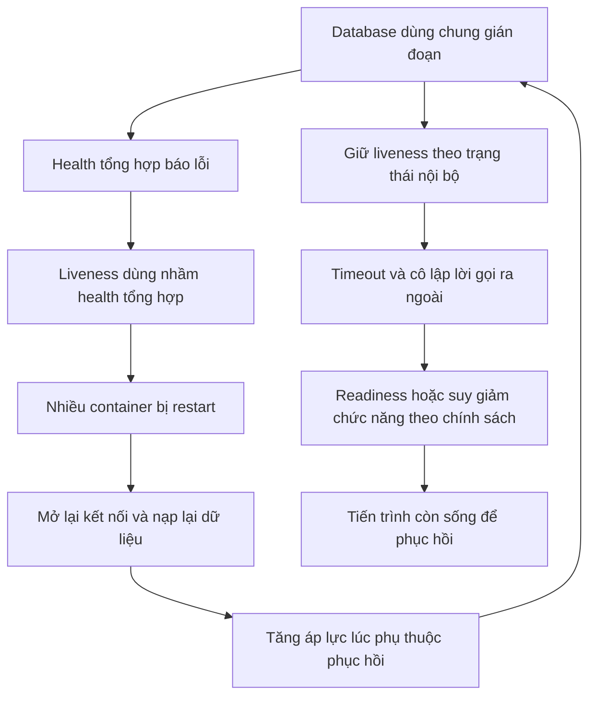

# Liveness và tránh khởi động lại vì phụ thuộc bên ngoài gián đoạn

## Mục tiêu bài học

Trong chương **Vòng đời Pod** của module **SPRING_CLOUD_KUBERNETES**, bài học này hướng dẫn thiết kế liveness để Kubernetes chỉ khởi động lại container khi việc đó có cơ sở giúp ứng dụng phục hồi.

Sau bài học, bạn có thể:

- Phân biệt lỗi nội bộ của tiến trình với lỗi database, broker, DNS hoặc HTTP API bên ngoài.
- Tách liveness, readiness và startup probe trong ứng dụng Spring.
- Tránh dùng health tổng hợp làm tín hiệu restart.
- Giữ ứng dụng còn khả năng phản hồi khi phụ thuộc chậm hoặc mất kết nối.
- Kiểm chứng hành vi bằng probe, sự kiện Kubernetes và restart count.

Ví dụ cấu hình dùng Spring Boot **3.5.x** với Actuator; phần liên hệ Spring Cloud Kubernetes dùng ngữ cảnh nhánh **3.3.x**. Chọn phiên bản thư viện theo BOM tương thích của dự án, không ghép phiên bản chỉ dựa trên tên tính năng.

## 1. Liveness là quyết định phục hồi bằng restart

Khi thiết kế liveness, câu hỏi cần đặt ra là:

> Nếu khởi động lại container này ngay bây giờ, lỗi có khả năng được khắc phục nhờ tái tạo trạng thái bên trong tiến trình không?

Một database dùng chung đang dừng không được sửa bằng cách khởi động lại mọi ứng dụng kết nối tới nó. Tương tự, restart JVM không khôi phục một dịch vụ đối tác bị gián đoạn hoặc một bản ghi DNS bị cấu hình sai.

Liveness nên tập trung vào khả năng tiến trình tiếp tục hoạt động hoặc tự phục hồi. Một trạng thái nội bộ không thể phục hồi bằng các cơ chế sẵn có có thể là lý do hợp lệ để restart. Một lời gọi mạng thất bại đơn lẻ thường chưa phải lý do đó.

### Ba loại probe dẫn tới ba hành động khác nhau

| Probe | Câu hỏi chính | Hành động khi thất bại đủ ngưỡng |
| --- | --- | --- |
| Startup | Container đã vượt qua giai đoạn khởi động mà probe đại diện chưa? | Container bị dừng, rồi xử lý theo restart policy |
| Liveness | Container còn khả năng hoạt động theo tín hiệu đã thiết kế không? | Container bị dừng, rồi xử lý theo restart policy |
| Readiness | Instance hiện có nên nhận lưu lượng phục vụ không? | Instance bị đánh dấu chưa sẵn sàng; probe vẫn tiếp tục |

Khi có startup probe, liveness và readiness chưa chạy cho tới khi startup thành công. Readiness thất bại tự nó không yêu cầu kubelet restart container. Với Deployment thông thường, restart policy là `Always`. [Kubernetes: Liveness, Readiness, and Startup Probes](https://kubernetes.io/docs/concepts/workloads/pods/probes/).

Một lần liveness failure thường làm **container trong Pod** restart; nó không đồng nghĩa tạo Pod mới với UID mới. Khi điều tra, cần phân biệt restart container, rollout Deployment, eviction và Pod bị xóa rồi được controller thay thế.

## 2. Vì sao đưa phụ thuộc bên ngoài vào liveness gây lỗi dây chuyền?

Giả sử `report-api` có ba replica, dùng chung PostgreSQL và một API cung cấp dữ liệu. Bạn cấu hình:

```yaml
# Ví dụ thiết kế không phù hợp nếu health tổng hợp chứa kiểm tra phụ thuộc.
livenessProbe:
  httpGet:
    path: /actuator/health
    port: 8080
  periodSeconds: 10
  failureThreshold: 3
```

Endpoint tổng hợp có thể chứa indicator `db` hoặc custom indicator gọi HTTP. Khi PostgreSQL gián đoạn, health tổng hợp chuyển sang trạng thái lỗi dù JVM vẫn xử lý HTTP và có thể chờ database phục hồi.

Chuỗi hệ quả có thể là:

1. Cả ba replica báo liveness thất bại.
2. Kubelet dừng các container sau khi đạt ngưỡng.
3. Các instance mới lại mở connection pool, nạp cache và chạy logic khởi tạo.
4. Database vẫn gián đoạn, hoặc vừa phục hồi nhưng phải nhận nhiều kết nối cùng lúc.
5. Ứng dụng tiếp tục restart; thời gian phục hồi của cả hệ thống dài hơn.



Đây là phân tích của tình huống mẫu: số replica, tải khởi tạo và cách dùng pool quyết định mức độ ảnh hưởng thực tế. Không cần xảy ra một vòng lặp vô hạn thì thiết kế đã có vấn đề; chỉ vài lần restart đồng loạt cũng có thể làm mất các chức năng vốn vẫn phục vụ được.

### Khi nào việc restart có cơ sở hơn?

| Tình huống | Hướng xử lý ưu tiên | Có nên gắn trực tiếp vào liveness? |
| --- | --- | --- |
| Database dùng chung mất kết nối | Timeout, phục hồi kết nối, readiness theo hợp đồng phục vụ | Không |
| API đối tác trả lỗi tạm thời | Circuit breaker, giới hạn retry, fallback hợp lệ | Không |
| Cache ngoài gián đoạn nhưng dữ liệu gốc còn dùng được | Bỏ qua cache hoặc suy giảm chức năng | Không |
| Kubernetes API server tạm không truy cập được | Giữ trạng thái còn dùng được nếu thiết kế cho phép; retry có giới hạn | Không chỉ vì API server không truy cập được |
| Worker thiết yếu bị hỏng vĩnh viễn, cơ chế tự khôi phục đã thất bại | Tín hiệu nội bộ đáng tin cậy và kế hoạch phục hồi | Có thể |
| HTTP server không còn phản hồi do trạng thái nội bộ bị kẹt | Điều tra tài nguyên và điều kiện restart | Có thể |
| Credential sai do cấu hình triển khai | Sửa cấu hình hoặc rollout có chủ đích | Restart lặp lại thường không giải quyết nguyên nhân |

Không suy ra “có thể restart” chỉ từ một exception. Cần xác định lỗi thuộc tiến trình này, điều kiện phục hồi và bằng chứng rằng tạo lại tiến trình giúp giải quyết lỗi.

## 3. Dùng health group riêng của Spring Boot

Spring Boot cung cấp các trạng thái availability và health group dành cho probe. Ví dụ này tách rõ nhóm liveness và readiness thay vì để kubelet gọi health tổng hợp.

Thêm Actuator vào ứng dụng đã có Spring Boot parent hoặc BOM:

```xml
<dependency>
    <groupId>org.springframework.boot</groupId>
    <artifactId>spring-boot-starter-actuator</artifactId>
</dependency>
```

Cấu hình ứng dụng:

```yaml
server:
  port: 8080

management:
  endpoints:
    web:
      exposure:
        include: health
  endpoint:
    health:
      show-details: never
      probes:
        enabled: true
        add-additional-paths: true
      group:
        liveness:
          include: livenessState
        readiness:
          include: readinessState
```

Các đường dẫn dùng trong ví dụ:

| Mục đích | Đường dẫn |
| --- | --- |
| Health tổng hợp cho giám sát | `/actuator/health` |
| Nhóm liveness | `/actuator/health/liveness` |
| Nhóm readiness | `/actuator/health/readiness` |
| Liveness trên cổng ứng dụng | `/livez` |
| Readiness trên cổng ứng dụng | `/readyz` |

`probes.enabled` cho phép dùng probe cả khi chạy ngoài Kubernetes. `add-additional-paths` cung cấp `/livez` và `/readyz` trên cổng ứng dụng. Spring Boot mặc định không thêm indicator khác vào hai nhóm probe; ví dụ ghi rõ thành phần nhóm để thể hiện chủ đích. [Spring Boot 3.5: Kubernetes Probes](https://docs.spring.io/spring-boot/3.5/reference/actuator/endpoints.html#actuator.endpoints.kubernetes-probes).

Tên `livenessState` và `readinessState` trong danh sách nhóm là ID của health contributor, cần viết đúng. Đây không phải tên Pod, tên Service hay tên role leader.

### Health tổng hợp có thể lỗi trong khi liveness vẫn tốt

Giả sử ứng dụng có indicator database đang hoạt động và chỉ kết nối tới database bị ngắt:

```text
/actuator/health           -> DOWN
/actuator/health/liveness  -> UP
/livez                    -> UP
```

Đây có thể là kết quả hoàn toàn hợp lệ. Health tổng hợp cho biết phụ thuộc có vấn đề; liveness cho biết việc restart tiến trình không phải biện pháp xử lý lỗi đó.

Với cấu hình readiness chỉ chứa `readinessState`, lỗi database cũng không tự làm readiness chuyển trạng thái. Ứng dụng cần quyết định riêng liệu còn phục vụ được hợp đồng đã công bố hay phải tạm rời khỏi luồng nhận request.

Không cần tắt toàn bộ health indicator để có liveness độc lập. Giữ thông tin về database hoặc broker cho giám sát, đồng thời chọn đúng nhóm cho kubelet.

## 4. Availability state không phải bộ phát hiện mọi kiểu treo

Spring Boot coi context đã refresh thành công là dấu mốc liveness hợp lệ; readiness còn gắn với việc hoàn tất các runner khởi động. Ứng dụng có thể đọc hoặc công bố thay đổi availability state. [Spring Boot 3.5: Application Availability](https://docs.spring.io/spring-boot/3.5/reference/features/spring-application.html#features.spring-application.application-availability).

Từ đó cần hiểu hai giới hạn:

- `LivenessState.CORRECT` không có nghĩa Spring tự phát hiện mọi deadlock, mọi worker đã chết hoặc mọi lỗi logic.
- Health group chỉ kiểm tra các contributor được chọn; nếu một worker quan trọng bị kẹt nhưng HTTP server vẫn phản hồi, probe có thể vẫn thành công.

Nếu ứng dụng cần tín hiệu tiến triển của worker thiết yếu, hãy định nghĩa rõ điều kiện mà tín hiệu đó đại diện. Ví dụ, worker có còn cập nhật trạng thái tiến triển khi có công việc hay không, nó có chủ động ở trạng thái chờ hợp lệ không, và cơ chế tự khôi phục nội bộ đã thử những gì.

Một heartbeat chỉ cập nhật sau mỗi lời gọi database thành công lại đưa database vào liveness theo cách gián tiếp. Khi database mất kết nối, heartbeat ngừng và ứng dụng có thể bị restart dù bản thân worker vẫn đang xử lý lỗi đúng thiết kế.

Tương tự, không công bố `LivenessState.BROKEN` chỉ vì một lời gọi HTTP đối tác timeout. Việc phân loại lỗi phải dựa trên khả năng phục hồi của tiến trình, không dựa riêng vào việc một tác vụ có thành công hay không.

## 5. Cấu hình ba probe cho một Deployment

Giả sử ứng dụng đã chứa cấu hình Actuator ở trên, dùng đường dẫn mặc định và lắng nghe cổng 8080. Namespace `training` đã tồn tại. Image dưới đây là chỗ giữ tên; cần thay bằng image ứng dụng thực tế trước khi triển khai.

```yaml
apiVersion: apps/v1
kind: Deployment
metadata:
  name: report-api
  namespace: training
spec:
  replicas: 3
  selector:
    matchLabels:
      app: report-api
  template:
    metadata:
      labels:
        app: report-api
    spec:
      terminationGracePeriodSeconds: 30
      containers:
        - name: app
          image: registry.example.com/training/report-api:1.0.0
          ports:
            - name: http
              containerPort: 8080
          startupProbe:
            httpGet:
              path: /livez
              port: http
            periodSeconds: 5
            timeoutSeconds: 2
            failureThreshold: 60
            successThreshold: 1
          livenessProbe:
            httpGet:
              path: /livez
              port: http
            periodSeconds: 10
            timeoutSeconds: 2
            failureThreshold: 3
            successThreshold: 1
          readinessProbe:
            httpGet:
              path: /readyz
              port: http
            periodSeconds: 5
            timeoutSeconds: 2
            failureThreshold: 3
            successThreshold: 2
---
apiVersion: v1
kind: Service
metadata:
  name: report-api
  namespace: training
spec:
  selector:
    app: report-api
  ports:
    - name: http
      port: 80
      targetPort: http
```

Các giá trị trên là điểm bắt đầu để thực hành, không phải mặc định phù hợp cho mọi workload.

- Startup probe cho ngân sách khởi động cỡ `60 × 5 = 300` giây. Nó dùng liveness để kiểm tra dấu mốc khởi động nội bộ.
- Sau khi startup thành công, liveness kiểm tra định kỳ và cần ba lần thất bại liên tiếp trước khi dẫn tới xử lý restart.
- Readiness cần hai lần thành công liên tiếp để được công nhận sẵn sàng sau một giai đoạn lỗi, giúp hạn chế dao động.

Thời gian phát hiện lỗi không phải đồng hồ chính xác bằng tích số ngưỡng và chu kỳ. Nó còn phụ thuộc thời điểm lỗi xuất hiện, thời lượng từng lần kiểm tra và lập lịch của kubelet. Thời gian dừng container, restart và backoff cũng nằm ngoài phép tính đơn giản này.

Startup probe có thể thành công trước khi toàn bộ runner hoàn tất; readiness tiếp tục chặn việc nhận traffic trong giai đoạn chưa sẵn sàng. Startup probe cũng chỉ có ngân sách hữu hạn: nếu ứng dụng không thể mở HTTP server vì chờ một phụ thuộc mãi mãi, cần xử lý logic khởi tạo đó.

Các trường `timeoutSeconds`, `periodSeconds`, `failureThreshold` và `successThreshold` có ngữ nghĩa riêng; liveness và startup chỉ cho phép `successThreshold: 1`. HTTP probe đánh giá mã phản hồi, không đọc ý nghĩa JSON health của ứng dụng. [Kubernetes: Configure Probes](https://kubernetes.io/docs/tasks/configure-pod-container/configure-liveness-readiness-startup-probes/).

## 6. Readiness cần theo hợp đồng phục vụ

Tách database khỏi liveness không có nghĩa mọi instance luôn phải nhận traffic khi database hỏng. Readiness cần phản ánh khả năng phục vụ có ích của instance.

### Trường hợp A: phụ thuộc là tùy chọn hoặc có fallback hợp lệ

Nếu API vẫn trả được báo cáo đã chốt từ dữ liệu cục bộ, nhưng tính năng làm mới báo cáo đang lỗi, có thể giữ readiness và chỉ báo lỗi ở thao tác bị ảnh hưởng.

Điều kiện là fallback có ý nghĩa nghiệp vụ, có giới hạn độ cũ rõ ràng và phản hồi không gây hiểu nhầm về chất lượng dữ liệu. Một response nhanh nhưng sai dữ liệu không phải phục hồi thành công.

### Trường hợp B: phụ thuộc bắt buộc cho toàn bộ request

Nếu mọi request hữu ích đều cần PostgreSQL và không có fallback, có thể đưa `db` vào readiness:

```yaml
management:
  endpoint:
    health:
      group:
        readiness:
          include: "readinessState,db"
```

Đây là thay đổi của nhóm readiness, còn nhóm liveness vẫn chỉ kiểm tra trạng thái nội bộ. Cấu hình chỉ hợp lệ khi contributor `db` thực sự tồn tại; cần có datasource và health contributor tương ứng.

Vì database được dùng chung, một outage có thể làm tất cả replica unready. Hãy xác định trước trải nghiệm phía gọi khi không còn endpoint sẵn sàng; mã lỗi và cách trả lỗi còn tùy Service, ingress, gateway và đường kết nối. Không mặc định mọi tầng đều trả HTTP 503.

### Trường hợp C: chỉ một instance bị lỗi đường kết nối

Nếu một Pod có vấn đề truy cập database nhưng các Pod khác vẫn phục vụ được, readiness có thể giúp chuyển lưu lượng sang instance còn hoạt động. Tuy nhiên, restart có giải quyết được Pod đó hay không vẫn là một câu hỏi riêng.

### Readiness không điều khiển mọi nguồn công việc

Readiness chủ yếu tham gia điều phối lưu lượng qua các thành phần có sử dụng trạng thái sẵn sàng. Nó không tự dừng scheduler, consumer của queue hoặc client gọi thẳng Pod IP.

Nếu DiscoveryClient và Spring Cloud LoadBalancer được dùng để chọn instance ở phía client, cần kiểm chứng chính sách chọn instance của cấu hình thực tế. Không suy ra mọi luồng client sẽ hành xử giống định tuyến qua Kubernetes Service.


## 7. Giữ liveness độc lập cả ở mức tài nguyên thực thi

Chỉ đổi đường dẫn probe chưa đủ nếu toàn bộ HTTP thread bị giữ bởi các lời gọi ra ngoài. Ví dụ, API đối tác ngừng trả lời, mỗi request chiếm một thread và tất cả thread phục vụ HTTP đều chờ vô hạn.

Lúc này `/livez` không gọi API đối tác nhưng cũng không có tài nguyên để trả lời. Kubelet vẫn có thể timeout và restart container. Phụ thuộc bên ngoài đã tác động tới liveness **qua cạn tài nguyên**, thay vì qua một health indicator.

### Các lớp bảo vệ cần phối hợp

| Cơ chế | Mục đích | Giới hạn cần hiểu |
| --- | --- | --- |
| Connect timeout | Chặn thời gian thiết lập kết nối quá lâu | Không thay thế timeout đọc hoặc deadline toàn yêu cầu |
| Read/response timeout | Giới hạn chờ phản hồi theo khả năng client | Không nhất thiết bao phủ thời gian chờ lấy connection hoặc xếp hàng |
| Deadline tổng thể | Giới hạn ngân sách cho cả thao tác | Cần truyền và thực thi qua các bước liên quan |
| Connection pool có giới hạn | Giới hạn kết nối và thời gian chờ lấy connection | Pool quá nhỏ có thể tạo hàng chờ; quá lớn có thể quá tải phụ thuộc |
| Bulkhead | Tách giới hạn đồng thời theo loại phụ thuộc hoặc loại công việc | Hàng chờ không giới hạn vẫn có thể làm cạn bộ nhớ |
| Circuit breaker | Từ chối nhanh lời gọi mới khi đã có đủ bằng chứng lỗi | Không tự hủy mọi lời gọi đang kẹt |
| Retry có ngân sách | Thử lại lỗi có khả năng phục hồi | Retry ở nhiều tầng dễ nhân số lần gọi |
| Backoff và jitter | Giảm việc nhiều instance thử lại cùng lúc | Không làm phụ thuộc bị hỏng trở nên khỏe |

Những cơ chế này cần được áp dụng ở đường nghiệp vụ có gọi ra ngoài, không thêm các lời gọi đó vào probe. Kiểm tra tổng thời gian của một request, gồm cả lấy connection, chờ hàng đợi, các lần retry và xử lý phản hồi.

`timeoutSeconds: 2` của kubelet chỉ là thời hạn của lần kiểm tra probe. Nó không cấu hình timeout cho JDBC hoặc HTTP client trong ứng dụng, cũng không chứng minh mọi tác vụ phía server đã bị hủy khi phía gọi hết thời gian chờ.

### Cùng cổng ứng dụng hay cổng management riêng?

Nếu chỉ kiểm tra một management server riêng còn hoạt động, trong khi cổng nghiệp vụ đã hết khả năng nhận kết nối, probe có thể báo tốt nhưng dịch vụ không phục vụ được.

Dùng `/livez` trên cổng nghiệp vụ giúp quan sát khả năng phản hồi của hạ tầng HTTP chính. Đổi lại, cần kiểm soát tải để một phụ thuộc chậm không chiếm hết hạ tầng đó. Nếu chủ động dùng cổng quản trị riêng, phải bổ sung cách kiểm chứng khả năng phục vụ của cổng nghiệp vụ.

Endpoint probe nên có đường xử lý ngắn, không chờ database, DNS ngoài, Kubernetes API hoặc dịch vụ xác thực từ xa. Chi phí của nó cần đủ thấp để vẫn phản hồi trong điều kiện tải nằm trong thiết kế.

Nếu có 50 Pod và mỗi probe thực hiện một lời gọi database sau mỗi 5 giây, riêng probe đã tạo khoảng 10 lời gọi mỗi giây. Đây là phép tính cho ví dụ mẫu, chưa tính monitor khác hay retry. Khi hệ thống đang lỗi, loại tải lặp này cần được cân nhắc đặc biệt.

## 8. Liên hệ với các thành phần Spring Cloud Kubernetes

Spring Cloud Kubernetes hỗ trợ tích hợp ứng dụng với môi trường Kubernetes, nhưng mỗi tính năng có vai trò riêng trong vòng đời vận hành.

### Pod Health Indicator không thay thế hợp đồng liveness

Ở nhánh 3.3.x, Kubernetes HealthContributor công bố thông tin như tên Pod, địa chỉ, namespace, ServiceAccount, node và việc ứng dụng đang ở trong hay ngoài Kubernetes. Tài liệu cũng cung cấp thuộc tính `management.health.kubernetes.enabled` để bật hoặc tắt contributor này. [Spring Cloud Kubernetes 3.3: Pod Health Indicator](https://docs.spring.io/spring-cloud-kubernetes/reference/3.3/pod-health-indicator.html).

Việc có thông tin Pod trong health response không chứng minh toàn bộ logic nghiệp vụ còn tiến triển. Ngược lại, không lấy được metadata Kubernetes cũng chưa chứng minh JVM cần restart.

Hãy kiểm tra thành phần thực tế của các health group, không suy ra rằng contributor nào nằm trong health tổng hợp cũng phải xuất hiện trong liveness. Ví dụ ở bài này chọn rõ `livenessState`, nên contributor Kubernetes không được tự đưa vào nhóm liveness đó.

HTTP probe thông thường gọi endpoint của ứng dụng; nó không cần ứng dụng đi gọi Kubernetes API server cho mỗi lần kiểm tra. Quyền RBAC mà DiscoveryClient hoặc chức năng đọc cấu hình cần là một vấn đề riêng.

### DiscoveryClient và Spring Cloud LoadBalancer

Khi API server hoặc cơ chế cập nhật danh sách instance gián đoạn, ứng dụng có thể tiếp tục dùng dữ liệu đã biết nếu thiết kế và cấu hình cho phép. Danh sách rỗng, danh sách cũ và không thể làm mới danh sách cần có cách xử lý rõ ràng ở đường gọi dịch vụ.

Không dùng “lần làm mới discovery gần nhất thất bại” làm bằng chứng duy nhất để báo liveness lỗi. Nếu không có đích gọi hợp lệ, request liên quan nên kết thúc có kiểm soát hoặc sử dụng fallback phù hợp.

### ConfigMap, Secret và Configuration Watcher

Phân biệt hai thời điểm:

- **Khởi động:** ứng dụng có thể chưa chạy được nếu thiếu cấu hình bắt buộc hoặc không đọc được Secret cần thiết.
- **Đang chạy:** một lần theo dõi hoặc cập nhật thất bại không nhất thiết làm bộ cấu hình đã nạp trở nên không dùng được.

Nếu credential hiện tại bị thu hồi và không còn thực hiện được tác vụ bắt buộc, xử lý readiness hoặc lỗi nghiệp vụ theo hợp đồng. Nếu ứng dụng chưa từng khởi tạo thành công vì thiếu cấu hình, sửa đường cung cấp cấu hình và chính sách khởi động; không giả báo liveness tốt để che lỗi.

Một cơ chế triển khai hoặc cập nhật cấu hình cũng có thể chủ động làm ứng dụng restart. Cần phân biệt hành động đó với restart do liveness, thông qua sự kiện, thời điểm thay đổi cấu hình và trạng thái container.

Chỉ thêm những chức năng Spring Cloud Kubernetes mà triển khai thực sự cần. Một ứng dụng chỉ cần probe Spring Boot không phải bật discovery, reload hay watcher để có liveness.

## 9. Đường probe phải truy cập được và trả đúng tín hiệu

### Tránh để xác thực làm sai ý nghĩa probe

Nếu ứng dụng dùng Spring Security, endpoint probe cần một chính sách truy cập phù hợp với kubelet. Không buộc đường probe phụ thuộc vào một máy chủ xác thực bên ngoài.

Kiểm tra riêng các đường `/livez` và `/readyz`, không chỉ đường `/actuator/health/**`. Nếu cho phép probe không xác thực, giữ phản hồi tối thiểu và vẫn áp dụng chính sách bảo vệ cho các endpoint quản trị khác.

Các dấu hiệu cấu hình sai thường gặp:

- `404`: đường dẫn hoặc base path không khớp, probe chưa bật, hoặc gọi sai cổng.
- `401/403`: chính sách xác thực hoặc phân quyền chưa cho phép probe.
- Redirect tới trang đăng nhập: đường kiểm tra không còn trực tiếp phản ánh trạng thái ứng dụng.
- Connection refused: ứng dụng chưa lắng nghe, bind sai địa chỉ, sai cổng hoặc tiến trình đã dừng.
- Timeout: cần phân biệt ứng dụng xử lý chậm, cạn tài nguyên và lỗi đường mạng.

HTTP probe coi mã từ 200 tới dưới 400 là thành công theo quy tắc của Kubernetes. Vì vậy, cần kiểm tra cả response thực tế và hành vi redirect, tránh để một trang đăng nhập trả thành công bị hiểu thành health tốt. [Kubernetes: HTTP liveness probe](https://kubernetes.io/docs/tasks/configure-pod-container/configure-liveness-readiness-startup-probes/#define-a-liveness-http-request).

### Đúng đường đi mạng

Trong cấu hình thông thường, kubelet kiểm tra địa chỉ Pod và cổng đã khai báo, không đi qua public ingress của ứng dụng. Một lần gọi thành công qua ingress chưa chứng minh kubelet truy cập được cùng endpoint.

Nếu có service mesh, proxy hoặc chính sách mạng, kiểm tra cách chúng tác động đến probe ở môi trường thực tế. Đừng đổi liveness thành một lần gọi Service của chính ứng dụng: yêu cầu đó có thể bị đưa sang replica khác và che việc replica đang được kiểm tra bị hỏng.

Không dùng TCP probe chỉ để che lỗi HTTP probe mà chưa hiểu nguyên nhân. Cổng mở chỉ cho biết kết nối TCP có thể được thiết lập, chưa chứng minh luồng xử lý HTTP cần kiểm tra còn hoạt động.

## 10. Thực hành: phụ thuộc gián đoạn nhưng container không restart

Bài thực hành này dành cho môi trường thử. Các lệnh và kết quả dưới đây mô tả cách kiểm chứng, không phải khẳng định đã được chạy trên cluster của người học.

### 10.1. Chuẩn bị và chụp trạng thái ban đầu

Chuẩn bị:

- Ba replica `report-api` với cấu hình health group và probe đã nêu.
- Một phụ thuộc thử nghiệm có thể chủ động ngắt kết nối hoặc làm chậm.
- Nếu dùng PostgreSQL, có datasource và indicator `db`; client có timeout hữu hạn.
- Một API nghiệp vụ để kiểm tra chức năng còn phục vụ được và chức năng bị ảnh hưởng.
- Không rollout, scale hoặc thay Pod trong lúc đo outage, để dễ xác định nguyên nhân thay đổi.

Quan sát trạng thái:

```bash
kubectl -n training get pods -l app=report-api -o wide
kubectl -n training get endpointslices -l kubernetes.io/service-name=report-api
```

Ghi lại tên Pod, UID, restart count của container `app` và thời điểm bắt đầu. Khi có nhiều container, kiểm tra đúng container ứng dụng thay vì chỉ nhìn một con số tổng hợp.

Mở port-forward trong một terminal riêng:

```bash
kubectl -n training port-forward deployment/report-api 18080:8080
```

Sau đó kiểm tra endpoint. Trên Windows PowerShell dùng `curl.exe`; trên môi trường có curl thông thường có thể dùng `curl`:

```powershell
curl.exe -i --max-time 3 http://localhost:18080/livez
curl.exe -i --max-time 3 http://localhost:18080/readyz
curl.exe -i --max-time 3 http://localhost:18080/actuator/health
```

Port-forward của Deployment chọn một Pod, không kiểm tra đủ ba replica. Khi cần so sánh từng replica, port-forward tới từng Pod tương ứng. Cách gọi này cũng không thay thế việc kiểm chứng đường mạng từ kubelet.

### 10.2. Ngắt một phụ thuộc tùy chọn

Trong môi trường thử, ngắt phụ thuộc tùy chọn hoặc phụ thuộc có fallback đã được xác định. Quan sát lâu hơn cửa sổ phát hiện lỗi của liveness.

Kết quả mong muốn:

- `/livez` vẫn phản hồi thành công trong giới hạn thời gian.
- `/readyz` vẫn thành công nếu instance tiếp tục đáp ứng hợp đồng phục vụ.
- API phụ thuộc có fallback hoặc báo lỗi có kiểm soát; các API không liên quan vẫn hoạt động.
- Restart count của container ứng dụng không tăng vì lỗi phụ thuộc này.

Nếu indicator tương ứng nằm trong health tổng hợp, `/actuator/health` có thể báo lỗi. Điều đó không làm thí nghiệm thất bại nếu probe đúng vẫn tốt và hành vi nghiệp vụ phù hợp.

### 10.3. Ngắt một phụ thuộc bắt buộc

Trong biến thể ứng dụng mà PostgreSQL bắt buộc cho mọi request, dùng readiness chứa `readinessState,db`. Chuẩn bị biến thể này trước khi đo để không nhầm restart do rollout với restart do outage.

Khi database gián đoạn, kỳ vọng:

```text
liveness:     vẫn thành công
readiness:    thất bại sau ngưỡng đã cấu hình
restartCount: không tăng vì outage database
traffic:      được xử lý theo chính sách khi Pod không sẵn sàng
```

Khi database phục hồi, kiểm tra pool kết nối hoạt động trở lại, readiness phục hồi và request nghiệp vụ thành công mà không cần can thiệp restart thủ công.

### 10.4. Làm phụ thuộc phản hồi rất chậm

Lỗi “không trả lời” thường bộc lộ việc thiếu timeout rõ hơn lỗi “trả ngay HTTP 500”. Tạo tải có kiểm soát cùng với độ trễ phụ thuộc và theo dõi:

- Số lời gọi đang chờ, mức dùng pool và độ dài hàng đợi.
- Độ trễ `/livez` trên chính cổng ứng dụng.
- CPU, bộ nhớ, thời gian GC và số thread đang hoạt động.
- Số retry, số lần circuit breaker từ chối và lỗi request.

Nếu liveness timeout, kiểm tra việc giới hạn tài nguyên và tổng ngân sách chờ. Tăng `failureThreshold` có thể trì hoãn restart nhưng không tự sửa hàng chờ vô hạn hoặc thread bị giữ quá lâu.

### 10.5. Kiểm tra lỗi nội bộ và khởi động chậm

Cần kiểm tra cả chiều ngược lại: liveness có phát hiện được điều kiện nội bộ mà bạn chủ động thiết kế để restart hay không?

Trong ứng dụng thử có cơ chế tạo lỗi được kiểm soát, làm HTTP server hoặc thành phần được liveness đại diện không thể phục hồi. Xác minh probe thất bại đủ ngưỡng, sự kiện ghi đúng lý do và container được khởi động lại theo policy. Không dùng việc ngắt database làm phép thay thế cho lỗi nội bộ.

Với khởi động chậm, tạo độ trễ ở giai đoạn phù hợp trong ngân sách startup probe. Kỳ vọng không bị liveness kill sớm, chưa nhận traffic khi chưa ready và cuối cùng phục vụ được. Kiểm tra thêm trường hợp vượt ngân sách startup để biết hành động khi ứng dụng không khởi động được.

### Ma trận chấp nhận

| Tình huống | Liveness | Readiness | Restart vì probe |
| --- | --- | --- | --- |
| Chạy bình thường | Thành công | Thành công | Không |
| Phụ thuộc tùy chọn lỗi, còn phục vụ đúng hợp đồng | Thành công | Có thể giữ thành công | Không |
| Phụ thuộc bắt buộc lỗi và được đưa vào readiness | Thành công | Thất bại | Không do readiness |
| HTTP server kẹt lâu, probe không phản hồi | Thất bại | Có thể thất bại | Có, khi đủ điều kiện |
| Chưa vượt qua startup probe | Chưa thực hiện | Chưa thực hiện | Chỉ nếu startup thất bại đủ ngưỡng |
| Cấu hình probe sai đường hoặc bị chặn xác thực | Có thể thất bại dù ứng dụng còn chạy | Có thể thất bại | Có thể có; cần sửa cấu hình |

Một thí nghiệm chỉ đạt khi vừa tránh restart không cần thiết, vừa giữ được phản hồi có giới hạn và phục hồi sau outage. Restart count không tăng nhưng mọi request bị treo vô hạn vẫn là thất bại của thiết kế.

## 11. Điều tra restart dựa trên bằng chứng

Khi container restart trong lúc database gián đoạn, không kết luận ngay database nằm trong liveness. Có thể tồn tại nhiều chuỗi nguyên nhân khác nhau.

Ví dụ PowerShell sau dùng tên Pod minh họa; thay bằng Pod thực tế đang điều tra:

```powershell
$podName = 'report-api-abc123-xyz89'

kubectl -n training describe pod $podName
kubectl -n training get pod $podName -o yaml
kubectl -n training logs $podName -c app --previous
kubectl -n training get events --field-selector "involvedObject.name=$podName" --sort-by=.lastTimestamp
```

`--previous` chỉ có ích khi còn log của lần chạy container trước đó. Sự kiện Kubernetes cũng có thời gian lưu hữu hạn; nên thu thập trong khoảng xảy ra lỗi.

| Bằng chứng | Hướng điều tra |
| --- | --- |
| Sự kiện liveness probe failed rồi container bị dừng | Đúng path/port, HTTP status, thời gian phản hồi, thành phần health group |
| Readiness probe failed nhưng restart count không tăng | Có thể là hành vi đúng theo chính sách phục vụ |
| Trạng thái kết thúc có reason `OOMKilled` | Áp lực bộ nhớ, heap/native memory, giới hạn container |
| Ứng dụng tự thoát kèm stack trace | Exception khởi động hoặc runtime, không nhất thiết do probe |
| Pod mới có UID khác | Rollout, eviction, xóa Pod hoặc controller thay thế |
| Probe timeout dưới tải và phụ thuộc chậm | Cạn thread/pool, CPU throttling, GC hoặc lỗi mạng |
| `CrashLoopBackOff` | Đây là biểu hiện backoff sau các lần dừng; cần tìm lý do dừng trước đó |

Không dùng riêng exit code 137 để khẳng định OOM; cần đối chiếu reason, sự kiện và số liệu tài nguyên. Cũng không so sánh restart count của Pod cũ với Pod mới rồi kết luận lỗi đã hết, vì Pod mới bắt đầu một vòng đời khác.

Các tín hiệu vận hành hữu ích gồm tỷ lệ lỗi request, độ trễ theo từng phụ thuộc, trạng thái readiness, độ trễ probe, restart theo container và số replica thực sự phục vụ được. Ghép chúng theo thời gian để phân biệt nguyên nhân với hệ quả.

## 12. Quy tắc thiết kế áp dụng vào dự án

Một cấu hình liveness phù hợp cần có bốn thuộc tính:

1. **Có mục tiêu phục hồi:** thất bại biểu thị điều kiện mà restart tiến trình có cơ sở giúp giải quyết.
2. **Độc lập với outage bên ngoài:** không trực tiếp kiểm tra database, broker, discovery hoặc API đối tác chỉ để quyết định restart.
3. **Phản hồi có giới hạn:** đường probe ngắn; đường nghiệp vụ có timeout, giới hạn đồng thời và hàng chờ phù hợp để không làm probe chết đói.
4. **Được kiểm chứng hai chiều:** outage phụ thuộc không tạo restart hàng loạt, còn lỗi nội bộ được thiết kế để restart vẫn được phát hiện.

Readiness quyết định có nên nhận công việc phục vụ tại thời điểm hiện tại; startup bảo vệ giai đoạn khởi động; liveness quyết định khi nào cần tái tạo tiến trình. Giữ đúng ranh giới này giúp ứng dụng Spring trên Kubernetes còn khả năng quan sát và tự phục hồi trong lúc các phụ thuộc bị gián đoạn.
