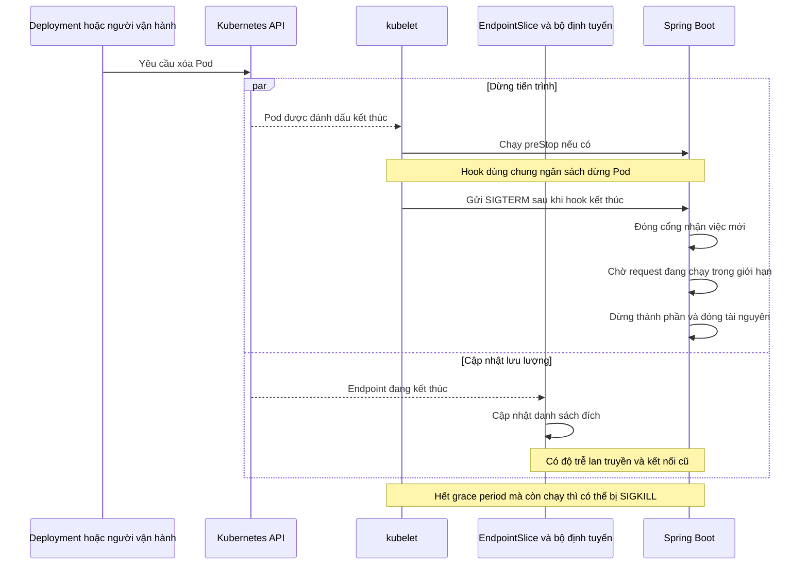

# Graceful shutdown và ngừng nhận yêu cầu mới

Một Pod có thể chuyển sang `Terminating` khi vẫn còn yêu cầu HTTP đang chạy. Nếu ứng dụng đóng ngay web server hoặc database connection pool, người dùng có thể nhận lỗi dù thao tác gần hoàn tất. Nếu ứng dụng tiếp tục nhận việc mới đến giây cuối, tiến trình lại có thể không kết thúc trong thời gian Kubernetes cho phép.

Bài học thuộc chương **Vòng đời Pod** của Spring Cloud Kubernetes. Ta dùng dịch vụ `catalog-api` có hai replica để thiết kế quá trình dừng: giảm lưu lượng tới Pod cũ, đóng cửa nhận yêu cầu mới, hoàn tất công việc đã nhận và giải phóng tài nguyên trong ngân sách xác định.

Ví dụ Java dùng Spring Boot 3.5, Spring MVC và embedded Tomcat. Với WebFlux hoặc server khác, cần kiểm tra hành vi tương ứng. Graceful shutdown HTTP là khả năng của Spring Boot; chỉ thêm Spring Cloud Kubernetes khi ứng dụng thực sự sử dụng DiscoveryClient, cấu hình Kubernetes, Spring Cloud LoadBalancer hoặc tính năng tích hợp khác.

## 1. Ba lớp điều khiển khi dừng

| Lớp | Trách nhiệm | Giới hạn |
| --- | --- | --- |
| Service, EndpointSlice, Ingress hoặc bộ cân bằng tải | Giảm lựa chọn Pod đang dừng cho lưu lượng mới | Thay đổi cần lan truyền; cache và kết nối cũ có thể còn tồn tại |
| Web server và cổng nhận việc | Ngừng cho yêu cầu mới đi vào xử lý | Cách từ chối phụ thuộc server, giao thức và thời điểm |
| Logic nghiệp vụ và tài nguyên phụ thuộc | Hoàn tất, hủy hoặc lưu tiến độ công việc đã nhận | Cần timeout và chính sách phục hồi cho phần không làm xong |

**Readiness không phải công tắc đóng mọi kết nối.** Client biết Pod IP có thể gọi thẳng Pod; proxy có thể còn giữ backend cũ; kết nối keep-alive đã thiết lập cũng không tự biến mất khi endpoint đổi trạng thái.

**Graceful shutdown có thời hạn.** Nó tạo cơ hội cho công việc đang chạy hoàn tất, không bảo đảm mọi request đều thành công trong mọi sự cố.

Với API ghi dữ liệu, database có thể đã commit nhưng phản hồi chưa tới client thì Pod dừng. Client sẽ có khả năng retry một thao tác đã thành công. Cần idempotency hoặc cách kiểm tra trạng thái nghiệp vụ, thay vì coi “không nhận response” là “chưa thực hiện”.

## 2. Hiểu các nhánh chạy song song khi kết thúc Pod

Giả sử container nhận SIGTERM theo cấu hình thông thường và không dùng stop signal tùy chỉnh:



Kubelet chạy `preStop` trước khi gửi tín hiệu dừng cho container đó. Cùng lúc, control plane cập nhật endpoint. Không có hàng rào đồng bộ bảo đảm mọi bộ định tuyến đã bỏ Pod trước khi Spring bắt đầu shutdown. [Kubernetes — Pod Termination Flow](https://kubernetes.io/docs/concepts/workloads/pods/pod-termination/#pod-termination-flow).

EndpointSlice có các điều kiện `terminating`, `ready` và `serving`. Với Service thông thường, endpoint đang kết thúc không còn Ready cho lưu lượng mới; một số proxy có thể dùng endpoint đang kết thúc nhưng còn phục vụ nếu không có đích khác. `publishNotReadyAddresses` cũng thay đổi cách thể hiện Ready. [Kubernetes — EndpointSlice conditions](https://kubernetes.io/docs/concepts/services-networking/endpoint-slices/#conditions).

Do đó, một lần đọc `ready=false` chưa chứng minh mọi đường gọi đã ngừng. Cần đo lưu lượng tại Pod, phía caller và bộ định tuyến thật.

## 3. Bật cơ chế chờ HTTP của Spring Boot

Ứng dụng mẫu cần web và Actuator, với phiên bản do Spring Boot BOM phù hợp quản lý:

```xml
<dependency>
    <groupId>org.springframework.boot</groupId>
    <artifactId>spring-boot-starter-web</artifactId>
</dependency>
<dependency>
    <groupId>org.springframework.boot</groupId>
    <artifactId>spring-boot-starter-actuator</artifactId>
</dependency>
```

`application.yml`:

```yaml
server:
  port: 8080
  shutdown: graceful

spring:
  application:
    name: catalog-api
  lifecycle:
    timeout-per-shutdown-phase: 20s

management:
  endpoints:
    web:
      exposure:
        include: health
  endpoint:
    health:
      probes:
        enabled: true
        add-additional-paths: true
```

Khai báo `server.shutdown: graceful` tường minh giúp người đọc biết chủ đích cấu hình. Trong nhánh Boot 3.5 được tham chiếu, graceful shutdown được hỗ trợ cho các embedded web server và diễn ra khi application context đóng. `timeout-per-shutdown-phase` giới hạn thời gian chờ theo phase. [Spring Boot 3.5 — Graceful Shutdown](https://docs.spring.io/spring-boot/3.5/reference/web/graceful-shutdown.html).

Cần hiểu đúng hai giới hạn:

- `20s` không phải timeout của từng HTTP request trong hoạt động bình thường.
- `20s` không phải thời gian tối đa cho toàn bộ shutdown. Nhiều phase có thể làm tổng thời gian dài hơn, chưa kể hook và bước đóng tài nguyên khác.

Mỗi đường xử lý vẫn cần timeout nghiệp vụ, timeout gọi downstream và transaction timeout phù hợp. Graceful shutdown không biến một thao tác I/O treo vô hạn thành công việc có thời gian kết thúc dự đoán được.

### Từ chối yêu cầu mới không luôn là HTTP 503

Trong nhánh tham chiếu, Tomcat, Jetty và Reactor Netty ngăn yêu cầu mới ở tầng mạng; Undertow có thể nhận kết nối rồi trả `503`. Kết quả client thấy còn phụ thuộc proxy và kết nối tái sử dụng.

Riêng Tomcat, API graceful shutdown mô tả việc từ chối kết nối mới và yêu cầu trên kết nối cũ đang idle. Cần thử cả kết nối mới và persistent connection theo cách hệ thống sử dụng. [TomcatWebServer — shutDownGracefully](https://docs.spring.io/spring-boot/3.5/api/java/org/springframework/boot/web/embedded/tomcat/TomcatWebServer.html).

Đừng đặt tiêu chí rằng mọi request bị từ chối phải nhận `503`. Client có thể thấy đóng kết nối, connection refused hoặc lỗi từ proxy.

## 4. Dùng readiness và liveness đúng mục đích

Với cấu hình trên, cổng ứng dụng có:

| Đường dẫn | Mục đích |
| --- | --- |
| `/livez` | Phản ánh liveness |
| `/readyz` | Phản ánh readiness |

`add-additional-paths` đưa các nhóm health ra cổng chính. Nếu có management port riêng, management server còn trả lời không chứng minh cổng nghiệp vụ còn hoạt động. Spring Boot quản lý trạng thái `ACCEPTING_TRAFFIC` và `REFUSING_TRAFFIC` trong vòng đời ứng dụng. [Spring Boot — Kubernetes Probes](https://docs.spring.io/spring-boot/3.5/reference/actuator/endpoints.html#actuator.endpoints.kubernetes-probes).

Khi shutdown đã bắt đầu, probe có thể không truy cập được vì chính web server đang dừng. Không đòi hỏi luôn quan sát được một response readiness `503`.

Chính sách cho dịch vụ mẫu:

- Readiness cho biết replica có nên nhận lưu lượng mới.
- Liveness không chuyển thành lỗi chỉ vì replica đang drain.
- Lỗi database dùng chung không được tự động biến thành liveness lỗi và gây restart đồng loạt.
- Đường health phải truy cập được theo cấu hình security dành cho kubelet; `401` hoặc `403` do chặn nhầm probe không phải bằng chứng drain thành công.

Nếu thêm downstream vào readiness, cần cân nhắc trường hợp mọi replica cùng NotReady. Đây là quyết định về khả năng phục vụ, không phải điều kiện mặc định để graceful shutdown hoạt động.

## 5. Ghép với Deployment và Service

Manifest dành cho namespace lab `lifecycle-lab` đã tồn tại. Image cần chứa ứng dụng mẫu và cấu hình ở trên:

```yaml
apiVersion: apps/v1
kind: Deployment
metadata:
  name: catalog-api
  namespace: lifecycle-lab
spec:
  replicas: 2
  strategy:
    type: RollingUpdate
    rollingUpdate:
      maxUnavailable: 0
      maxSurge: 1
  selector:
    matchLabels:
      app: catalog-api
  template:
    metadata:
      labels:
        app: catalog-api
    spec:
      terminationGracePeriodSeconds: 75
      containers:
        - name: app
          image: your-registry/catalog-api:your-tested-tag
          ports:
            - name: http
              containerPort: 8080
          env:
            - name: POD_NAME
              valueFrom:
                fieldRef:
                  fieldPath: metadata.name
          startupProbe:
            httpGet:
              path: /livez
              port: http
            periodSeconds: 2
            failureThreshold: 30
          livenessProbe:
            httpGet:
              path: /livez
              port: http
            periodSeconds: 10
            timeoutSeconds: 2
            failureThreshold: 3
          readinessProbe:
            httpGet:
              path: /readyz
              port: http
            periodSeconds: 2
            timeoutSeconds: 1
            failureThreshold: 1
          lifecycle:
            preStop:
              exec:
                command: ["sh", "-c", "sleep 5"]
---
apiVersion: v1
kind: Service
metadata:
  name: catalog-api
  namespace: lifecycle-lab
spec:
  selector:
    app: catalog-api
  ports:
    - name: http
      port: 80
      targetPort: http
```

`maxUnavailable: 0` và `maxSurge: 1` cho phép có replica thay thế Ready trước khi giảm replica cũ trong rollout, nếu cluster đủ tài nguyên. Chúng không thay thế drain và không bảo đảm đủ capacity khi có thêm sự cố.

Image dùng `preStop.exec` phải có `sh` và `sleep`. Với image distroless, phải chọn cách khác phù hợp. Nếu cluster hỗ trợ lifecycle sleep handler, có thể dùng handler native thay cho shell; cần xác minh hỗ trợ trên phiên bản cluster.

### Năm giây preStop thực sự làm gì?

Nó trì hoãn SIGTERM, tạo thời gian cho cập nhật định tuyến lan truyền trong khi ứng dụng còn phục vụ. Spring chưa tự bước vào graceful shutdown chỉ vì lệnh `sleep` đang chạy.

Một request tới Pod trong khoảng này vẫn có thể được nhận. Nếu mục tiêu là giảm lỗi do proxy còn giữ backend cũ, việc server tiếp tục phục vụ trước khi đóng cổng có thể là hành vi mong muốn.

Năm giây chỉ là số minh họa. Hãy đo độ trễ endpoint, Ingress/load balancer và kiểu kết nối của client để chọn khoảng đệm. [Spring Boot — Kubernetes Container Lifecycle](https://docs.spring.io/spring-boot/3.5/how-to/deployment/cloud.html#deployment.cloud.kubernetes.container-lifecycle).

Nếu nghiệp vụ cần ngừng nhận việc ngay khi bắt đầu drain chủ động, phải có cổng nhận việc cục bộ và trigger rõ ràng. Tăng `sleep` không thực hiện chính sách đó.

## 6. Tính ngân sách cho toàn bộ quá trình dừng

`terminationGracePeriodSeconds` dùng cho quá trình dừng Pod; đồng hồ bắt đầu trước khi `preStop` hoàn tất. Nó không phải một khoảng riêng được cộng sau hook. [Kubernetes — Container Lifecycle Hooks](https://kubernetes.io/docs/concepts/containers/container-lifecycle-hooks/).

Cách dự trù bảo thủ:

```text
T_pod
  > T_preStop
  + T_HTTP_drain
  + T_cac_phase_con_lai
  + T_dong_tai_nguyen
  + T_du_phong
```

Đây là ngân sách thiết kế, không khẳng định mọi hoạt động đều chạy tuần tự. Nếu có nhiều container hoặc service mesh, cần xét thêm thứ tự và thời gian dừng của chúng.

Ví dụ cho ứng dụng có một worker nền:

| Phần việc | Ngân sách |
| --- | --- |
| preStop đợi định tuyến | 5 giây |
| Phase chờ HTTP | Tối đa 20 giây |
| Một phase dừng worker có giới hạn | Tối đa 20 giây |
| Đóng tài nguyên còn lại, theo kết quả đo | 5 giây |
| Dự phòng cho scheduling và tải | 10 giây |
| Tổng dự trù | 60 giây |

`75` giây trong manifest còn dư địa so với dự trù này. Ứng dụng chỉ có HTTP có thể cần ít hơn. Thêm phase hoặc thay timeout thì phải tính lại.

Cũng đối chiếu timeout các tầng khác. Request hoàn tất sau 15 giây nhưng Ingress chỉ chờ 10 giây thì client vẫn lỗi, dù server chờ drain 20 giây. Retry còn có thể tăng tải khi capacity đang giảm.

Với request kéo dài hàng phút hoặc vô hạn, nên thiết kế checkpoint, tác vụ bất đồng bộ có trạng thái hoặc giao thức reconnect. Grace period rất lớn làm rollout chậm mà chưa xử lý được tình huống node crash.

## 7. Bảo đảm JVM nhận tín hiệu dừng

Khi tự viết entrypoint cho executable jar, ưu tiên exec form:

```dockerfile
ENTRYPOINT ["java", "-jar", "/app/app.jar"]
```

Nếu cần script, dùng `exec` ở lệnh cuối:

```sh
#!/bin/sh
set -eu
exec java -jar /app/app.jar
```

Mục tiêu là để Java nhận tín hiệu hoặc được init/launcher chuyển tiếp đúng cách. Shell làm tiến trình cha mà không chuyển tín hiệu có thể khiến JVM không shutdown như dự kiến. Với buildpack hay launcher có sẵn, kiểm tra cơ chế thực tế thay vì thay entrypoint tùy tiện. [Docker — JSONArgsRecommended](https://docs.docker.com/reference/build-checks/json-args-recommended/).

Không dùng nút stop IDE làm bằng chứng duy nhất vì cách dừng có thể khác SIGTERM. SIGKILL và OOM kill không cho ứng dụng cơ hội hoàn tất callback.

## 8. Cổng nhận yêu cầu cho drain chủ động

Cấu hình Boot là nền tảng cho graceful shutdown HTTP. Một số ứng dụng còn cần đóng cửa nhận việc nghiệp vụ trước khi context đóng, hoặc chia sẻ trạng thái đó với producer nội bộ.

Lớp sau có `beginDrain()` gọi nhiều lần an toàn. Nó phát readiness và giữ một cờ đóng cổng của ứng dụng:

```java
package example.catalog;

import java.util.concurrent.atomic.AtomicBoolean;

import org.slf4j.Logger;
import org.slf4j.LoggerFactory;
import org.springframework.boot.availability.AvailabilityChangeEvent;
import org.springframework.boot.availability.ReadinessState;
import org.springframework.context.ApplicationContext;
import org.springframework.context.event.ContextClosedEvent;
import org.springframework.context.event.EventListener;
import org.springframework.stereotype.Component;

@Component
public class RequestAdmission {

    private static final Logger log =
            LoggerFactory.getLogger(RequestAdmission.class);

    private final AtomicBoolean draining = new AtomicBoolean();
    private final ApplicationContext context;

    public RequestAdmission(ApplicationContext context) {
        this.context = context;
    }

    public boolean isDraining() {
        return draining.get();
    }

    public void beginDrain() {
        if (draining.compareAndSet(false, true)) {
            AvailabilityChangeEvent.publish(
                    context, ReadinessState.REFUSING_TRAFFIC);
            log.info("Business request admission is closed");
        }
    }

    @EventListener
    public void onContextClosed(ContextClosedEvent event) {
        if (event.getApplicationContext() == context) {
            beginDrain();
        }
    }
}
```

Spring Boot cho phép ứng dụng công bố `AvailabilityChangeEvent` để cập nhật availability. Sự kiện biểu diễn trạng thái; nơi nhận công việc vẫn phải thi hành quyết định tương ứng. [AvailabilityChangeEvent API](https://docs.spring.io/spring-boot/3.5/api/java/org/springframework/boot/availability/AvailabilityChangeEvent.html).

Với Spring MVC, kiểm tra trước khi cho yêu cầu nghiệp vụ đi tiếp:

```java
package example.catalog;

import java.io.IOException;

import jakarta.servlet.FilterChain;
import jakarta.servlet.ServletException;
import jakarta.servlet.http.HttpServletRequest;
import jakarta.servlet.http.HttpServletResponse;
import org.springframework.stereotype.Component;
import org.springframework.web.filter.OncePerRequestFilter;

@Component
public class DrainingRequestFilter extends OncePerRequestFilter {

    private final RequestAdmission admission;

    public DrainingRequestFilter(RequestAdmission admission) {
        this.admission = admission;
    }

    @Override
    protected boolean shouldNotFilter(HttpServletRequest request) {
        String prefix = request.getContextPath() + "/api/";
        return !request.getRequestURI().startsWith(prefix);
    }

    @Override
    protected void doFilterInternal(
            HttpServletRequest request,
            HttpServletResponse response,
            FilterChain chain) throws ServletException, IOException {
        if (admission.isDraining()) {
            response.setStatus(HttpServletResponse.SC_SERVICE_UNAVAILABLE);
            response.setContentType("application/json");
            response.getWriter().write(
                    "{\"code\":\"INSTANCE_DRAINING\"}");
            return;
        }
        chain.doFilter(request, response);
    }
}
```

Filter chỉ áp dụng cho `/api/`; `/livez` và `/readyz` không bị chặn. Request đã qua kiểm tra trước lúc đóng cổng được coi là đã nhận và được phép chạy tiếp trong giới hạn drain.

Giới hạn của ví dụ:

- Filter không đếm request async, không dừng consumer hoặc đóng WebSocket.
- Khi server từ chối ở tầng mạng, request không tới filter và không nhận JSON này.
- Một thành phần khác phát `REFUSING_TRAFFIC` không tự đổi cờ `draining`. Cần một đường điều phối nhất quán.
- `ContextClosedEvent` giúp đóng cổng khi shutdown; nó không chạy ở đầu `preStop.sleep`.
- Muốn gọi `beginDrain()` trước SIGTERM, cần trigger nội bộ được kiểm soát và kế hoạch dừng tiếp theo. Ví dụ không tạo HTTP endpoint drain công khai.

Listener nên chuyển trạng thái nhanh. Không chờ drain dài trong `ContextClosedEvent`; hãy đặt việc chờ có giới hạn trong cơ chế lifecycle phù hợp.

Với WebFlux, dùng thành phần lọc reactive tương ứng và tránh blocking event loop. Servlet filter này không áp dụng cho pipeline WebFlux.

## 9. HTTP kết thúc chưa chắc công việc nền kết thúc

Controller có thể trả `202 Accepted` rồi đưa việc vào executor. HTTP đã hoàn tất nhưng nghiệp vụ vẫn đang chạy.

| Nguồn công việc | Cần ngừng | Cần kiểm chứng với việc đã nhận |
| --- | --- | --- |
| HTTP đồng bộ | Nhận request mới | Response, transaction và downstream đã hoàn tất |
| Executor hoặc `@Async` | Submit thêm việc | Future, khả năng interrupt, checkpoint |
| Scheduler | Tạo lượt chạy mới | Batch có điểm dừng và tiến độ lưu bền |
| Message consumer | Poll hoặc nhận thêm theo client | Ack/commit sau xử lý, khả năng redelivery |
| WebSocket, SSE, streaming | Mở session/stream mới | Báo kết thúc, reconnect, deadline |

Không đóng datasource hoặc HTTP client khi request đang chạy còn cần dùng. Worker tự quản lý có thể dùng `SmartLifecycle` để sắp thứ tự dừng: phase cao dừng trước phase thấp; `stop(Runnable)` phải gọi callback sau khi quá trình dừng hoàn tất. Quan hệ phụ thuộc bean cũng ảnh hưởng thứ tự. [Spring Framework — SmartLifecycle](https://docs.spring.io/spring-framework/docs/6.2.x/javadoc-api/org/springframework/context/SmartLifecycle.html).

Một `@PreDestroy` chứa `Thread.sleep` không thay thế quản lý công việc. Khi hook đó chạy, các bước stop của thành phần lifecycle khác có thể đã được thực hiện.

Hết ngân sách thì phải quyết định rõ: hủy an toàn, rollback, lưu checkpoint hoặc chấp nhận redelivery. Một thread còn giữ việc trong RAM không phải nơi lưu bền cho tác vụ đã được xác nhận tiếp nhận.

## 10. Liên hệ với Spring Cloud Kubernetes

Nếu caller dùng Service DNS, ứng dụng thường không phải tự “deregister khỏi Service” bằng API. Service và endpoint controller quản lý việc chọn Pod; caller vẫn cần xử lý độ trễ cập nhật và lỗi kết nối khi bàn giao.

Nếu caller dùng DiscoveryClient và Spring Cloud LoadBalancer chọn Pod trực tiếp, kiểm tra thêm danh sách instance, cache và kết nối tái sử dụng. Trong nhánh Spring Cloud Kubernetes 3.3, `spring.cloud.kubernetes.discovery.include-not-ready-addresses` mặc định `false`; bật nó có thể làm caller chọn địa chỉ chưa Ready. [Spring Cloud Kubernetes 3.3 — Application Properties](https://docs.spring.io/spring-cloud-kubernetes/reference/3.3/appendix.html).

Một watcher nhận event không chứng minh mọi caller đã cập nhật cache. Phải biết nguồn khám phá đang dùng là Endpoints hay EndpointSlice theo phiên bản và cấu hình thực tế.

ConfigMap và Secret có thể cung cấp cấu hình ứng dụng qua cơ chế triển khai phù hợp, nhưng không thay thế lifecycle. Không mặc định một thay đổi cấu hình động sẽ tái cấu hình ngay web server hoặc đối tượng đã tạo lúc startup.

Configuration Watcher không drain HTTP. Nếu chiến lược cập nhật cấu hình làm restart ứng dụng hoặc thay Pod, đường dừng vẫn cần kiểm chứng. Không cần cấp quyền RBAC sửa Pod, sửa endpoint hay đọc Secret chỉ để sử dụng graceful shutdown tiêu chuẩn.

## 11. Endpoint chậm dành cho thực hành

Endpoint chỉ dùng trong lab, không ghi dữ liệu và trả tên Pod xử lý:

```java
package example.catalog;

import java.util.Map;

import org.slf4j.Logger;
import org.slf4j.LoggerFactory;
import org.springframework.beans.factory.annotation.Value;
import org.springframework.http.HttpStatus;
import org.springframework.web.bind.annotation.GetMapping;
import org.springframework.web.bind.annotation.RequestHeader;
import org.springframework.web.bind.annotation.RequestParam;
import org.springframework.web.bind.annotation.RestController;
import org.springframework.web.server.ResponseStatusException;

@RestController
public class ShutdownLabController {

    private static final Logger log =
            LoggerFactory.getLogger(ShutdownLabController.class);

    private final String podName;

    public ShutdownLabController(
            @Value("${POD_NAME:local}") String podName) {
        this.podName = podName;
    }

    @GetMapping("/api/lab/slow")
    public Map<String, Object> slow(
            @RequestParam(defaultValue = "8") int seconds,
            @RequestHeader(
                    value = "X-Request-ID", defaultValue = "lab") String id)
            throws InterruptedException {
        if (seconds < 0 || seconds > 40) {
            throw new ResponseStatusException(
                    HttpStatus.BAD_REQUEST, "seconds must be from 0 to 40");
        }

        log.info("request-start pod={} id={} seconds={}",
                podName, id, seconds);
        Thread.sleep(seconds * 1000L);
        log.info("request-end pod={} id={}", podName, id);

        return Map.of("pod", podName, "requestId", id, "seconds", seconds);
    }
}
```

`Thread.sleep` cố ý tạo request chậm dễ quan sát. Nó không phải cách xử lý công việc nền hoặc cách dùng blocking trong WebFlux.

Chuẩn bị hai replica Ready và một Pod client có `curl` trong cùng namespace, tên `lifecycle-client`. Các image cần được chuẩn bị trước; dùng dữ liệu thử khi gây dừng.

### Thử A: Request đã nhận hoàn tất trước khi tiến trình dừng

Chọn Pod đích thực tế:

```powershell
$labNamespace = 'lifecycle-lab'
kubectl -n $labNamespace get pods -l app=catalog-api -o wide

$targetPod = 'catalog-api-replace-with-observed-pod'
$targetIp = kubectl -n $labNamespace get pod $targetPod -o 'jsonpath={.status.podIP}'
```

Terminal thứ nhất gửi trực tiếp tới Pod đã chọn:

```powershell
kubectl -n $labNamespace exec lifecycle-client -- curl --max-time 45 -sS -H 'X-Request-ID: graceful-001' "http://${targetIp}:8080/api/lab/slow?seconds=8"
```

Terminal thứ hai khai báo lại `$targetPod` hoặc thay bằng tên Pod trực tiếp, vì biến không được chia sẻ giữa các terminal. Xem log để xác nhận request đã bắt đầu, rồi xóa Pod bình thường:

```powershell
kubectl -n lifecycle-lab logs $targetPod --since=2m
kubectl -n lifecycle-lab delete pod $targetPod --wait=false
```

Đối chiếu `request-start`, thời điểm graceful shutdown bắt đầu và `request-end` cùng response client. Vì có `preStop` năm giây, cần xác nhận request còn chạy khi Spring bắt đầu graceful shutdown thì phép thử mới chứng minh được quá trình chờ.

Gọi Pod IP kiểm tra vòng đời server, chưa kiểm tra việc chuyển đích của Service.

### Thử B: Lưu lượng mới qua Service

Từ client:

```powershell
kubectl -n lifecycle-lab exec lifecycle-client -- curl --max-time 10 -sS 'http://catalog-api/api/lab/slow?seconds=0'
```

Lặp lại dưới tải có kiểm soát trong lúc rollout hoặc xóa một Pod. Theo dõi ở các terminal phù hợp:

```powershell
kubectl -n lifecycle-lab get pods -l app=catalog-api -w
kubectl -n lifecycle-lab get endpointslices -l kubernetes.io/service-name=catalog-api -o yaml
kubectl -n lifecycle-lab logs -l app=catalog-api --all-containers=true --prefix=true --since=5m --max-log-requests=6
```

`-w` chạy liên tục, nên đặt ở terminal riêng. Dùng công cụ sinh tải để thử concurrency và persistent connection; một lần gọi đơn lẻ không đại diện mọi kiểu kết nối.

Ghi nhận request tới Pod đang dừng, request bị từ chối và request chuyển sang Pod Ready khác. Có Ingress hoặc service mesh thì thử thêm qua chính đường đó.

`kubectl port-forward service/...` chọn một Pod cho phiên forward; không dùng nó làm bằng chứng cân bằng tải hoặc chuyển đích của Service.

### Thử C: Request vượt thời gian HTTP drain

Gửi request `seconds=35` rồi dừng Pod sau khi xác nhận request bắt đầu. Với `preStop` năm giây và phase HTTP 20 giây, request có thể vượt khoảng được chờ.

Quan sát timeout, response bị cắt hoặc đóng kết nối theo server và proxy. Không mặc định request luôn nhận `503` hay timeout đã rollback mọi tác động.

Bài thử này không nhất thiết gây SIGKILL: server có thể hết thời gian chờ rồi đóng ứng dụng trước khi ngân sách Pod cạn. Muốn thử cưỡng bức dừng phải có kịch bản fault injection riêng và bằng chứng tiến trình bị kill.

## 12. Chẩn đoán khi rollout vẫn lỗi

| Hiện tượng | Điều tra |
| --- | --- |
| Không có log shutdown của Spring | Tín hiệu tới JVM, entrypoint, launcher, crash, OOM |
| `FailedPreStopHook` | Image có công cụ cần thiết, lệnh và quyền thực thi |
| Gần như không còn thời gian HTTP drain | Hook dùng bao nhiêu giây, grace period và phase khác |
| Client lỗi dù có `request-end` | Response gửi đủ chưa, timeout proxy/client, kết nối tầng khác |
| Nhận request trong `preStop` | Phân biệt khoảng còn phục vụ có chủ đích với sau khi đóng cổng |
| Nhận việc sau lúc cổng drain đã đóng | Đường nhận việc chưa được kiểm tra hoặc còn producer nền |
| Service không còn endpoint phục vụ | Readiness replica mới, capacity, rollout strategy |
| HTTP dừng nhưng Pod còn treo | Worker, executor, consumer, non-daemon thread, callback |
| Exit code `137` | Có thể SIGKILL; xem reason, OOMKilled, event và thời gian |
| Có PDB nhưng vẫn đứt request | PDB không quản lý drain HTTP hoặc bảo vệ mọi kiểu xóa Pod |

Thu thập bằng chứng:

```powershell
kubectl -n lifecycle-lab describe pod $targetPod
kubectl -n lifecycle-lab get events --sort-by=.metadata.creationTimestamp
kubectl -n lifecycle-lab get deployment catalog-api -o yaml
```

Thu log và trạng thái trước khi Pod bị xóa hẳn hoặc dùng log tập trung. `kubectl logs --previous` đọc container trước trong một Pod còn tồn tại; nó không tìm lại mọi Pod đã xóa.

Metric hữu ích gồm HTTP đang xử lý, công việc nền đang chạy, thời điểm drain bắt đầu, số yêu cầu bị từ chối và tổng thời gian shutdown. Phân biệt metric tự định nghĩa với metric thư viện thật sự xuất ra.

## 13. Tiêu chí hoàn thành

Triển khai đạt yêu cầu khi chứng minh được:

1. SIGTERM tới JVM và Spring thực hiện graceful shutdown.
2. Phân biệt được khoảng `preStop` còn phục vụ với thời điểm từ chối request mới.
3. Request đã nhận và đủ ngắn hoàn tất trong ngân sách đo được.
4. Request quá dài có cách thất bại và phục hồi xác định.
5. Readiness, endpoint và caller được quan sát qua đúng đường gọi.
6. Worker, consumer và tài nguyên phụ thuộc có thứ tự dừng rõ ràng nếu được sử dụng.
7. Hook, các phase và phần dự phòng nằm trong ngân sách Pod.
8. API ghi dữ liệu không dựa vào graceful shutdown để bảo đảm xử lý đúng một lần.

Một thiết kế có thể kiểm chứng phải giải thích được: khi nào Pod ngừng được chọn làm đích, khi nào ứng dụng ngừng nhận việc, việc nào được hoàn tất và việc nào sẽ xử lý lại. Đó là cơ sở để rollout, scale down và cập nhật cấu hình diễn ra có kiểm soát.
