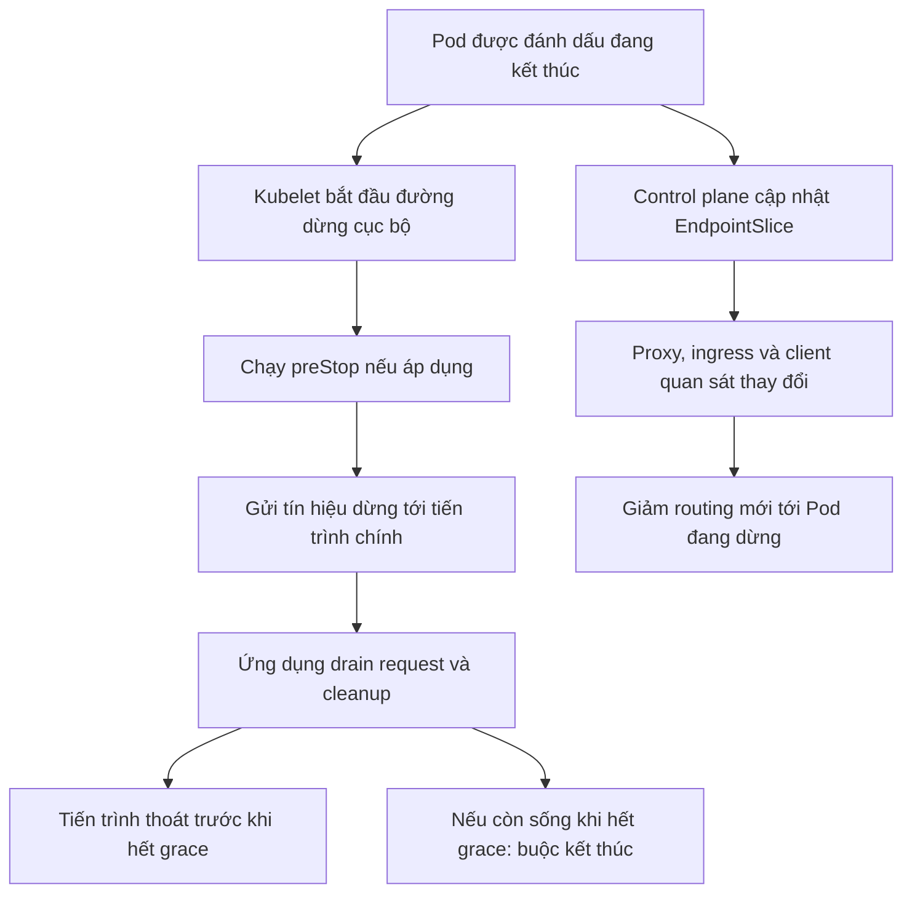

# preStop và terminationGracePeriodSeconds

Một ứng dụng Spring có thể đang xử lý request khi Pod bị thay thế trong rolling update hoặc scale down. Nếu tiến trình dừng ngay, request đang chạy có thể bị cắt. Nếu tiến trình dừng quá chậm, Kubernetes có thể buộc kết thúc container trước khi cleanup hoàn tất.

Trong chương **Vòng đời Pod** của module Spring Cloud Kubernetes, hai cấu hình `preStop` và `terminationGracePeriodSeconds` giúp thiết kế quá trình kết thúc có giới hạn. Để sử dụng đúng, cần ghép chúng với graceful shutdown của Spring Boot và cách traffic được cập nhật trong hệ thống.

Ví dụ xuyên suốt bài là một dịch vụ có request kéo dài 20 giây. Khi xóa một Pod trong lab, mục tiêu là để request đã nhận có cơ hội hoàn tất, giảm request mới gửi vào Pod đang dừng và kết thúc tiến trình trong ngân sách đã chọn.

Sau bài này, bạn có thể:

- Giải thích thứ tự giữa hook `preStop`, tín hiệu dừng và quá trình shutdown của JVM.
- Tính ngân sách chung cho hook, drain request và cleanup.
- Viết manifest đặt cấu hình đúng cấp Pod và container.
- Quan sát shutdown bằng log ứng dụng, trạng thái Pod và EndpointSlice.
- Phân biệt shutdown bình thường với hook lỗi, tiến trình không nhận tín hiệu hoặc tình huống bị buộc kết thúc.

## 1. Mỗi cấu hình chịu trách nhiệm cho phần nào?

| Thành phần | Trách nhiệm | Không tự bảo đảm |
| --- | --- | --- |
| `lifecycle.preStop` | Thực hiện một hành động trước đường gửi tín hiệu dừng container | Hoàn tất transaction hoặc loại Pod khỏi mọi cache routing |
| `terminationGracePeriodSeconds` | Đặt khoảng dung sai cho quá trình kết thúc Pod | Ứng dụng thực sự dùng khoảng đó để drain đúng cách |
| `server.shutdown: graceful` | Yêu cầu web server Spring Boot dừng theo chế độ graceful | Mọi tác vụ nền tự biết dừng hoặc có checkpoint |
| `spring.lifecycle.timeout-per-shutdown-phase` | Giới hạn thời gian chờ theo phase shutdown của Spring | Tổng thời gian shutdown toàn JVM bằng đúng một phase |
| Readiness và EndpointSlice | Truyền trạng thái phục vụ cho đường routing | Mọi client và kết nối đang mở đổi đích tức thì |

`preStop` được khai báo cho **từng container**. `terminationGracePeriodSeconds` trong PodSpec là ngân sách ở **cấp Pod**, mặc định là 30 giây nếu không cấu hình. Hook được chạy trước tín hiệu dừng trong đường kết thúc thông thường, khi container còn chạy và có thời gian grace phù hợp. [Quá trình kết thúc Pod](https://kubernetes.io/docs/concepts/workloads/pods/pod-termination/).

Giả định của ví dụ là container Linux chạy JVM và dùng tín hiệu dừng thông thường `SIGTERM`. Image hoặc cấu hình stop signal riêng có thể thay đổi tín hiệu thực tế; cần kiểm tra chúng nếu có tùy chỉnh.

## 2. Điều gì diễn ra khi xóa Pod?

Không nên hình dung shutdown là một chuỗi toàn cục “mọi load balancer đã cập nhật xong, rồi mới dừng ứng dụng”. Có hai nhánh diễn ra song song:



Không có mũi tên từ “mọi bên đã cập nhật routing” sang “hook được phép hoàn tất”, vì Kubernetes không cung cấp hàng rào đồng bộ toàn hệ thống như vậy.

Tại nhánh kubelet, cần nhớ thứ tự chính:

```text
ngân sách grace đã bắt đầu
    → preStop
    → tín hiệu dừng
    → shutdown trong ứng dụng
    → kết thúc bình thường hoặc bị buộc kết thúc
```

Thời gian chạy hook được trừ khỏi thời gian còn lại dành cho container. Đây cũng là hành vi thể hiện trong mã kubelet: tính grace, chạy hook rồi chuyển phần thời gian còn lại cho runtime dừng container. [Mã nguồn xử lý dừng container](https://raw.githubusercontent.com/kubernetes/kubernetes/v1.35.0/pkg/kubelet/kuberuntime/kuberuntime_container.go).

Ở nhánh routing, EndpointSlice có các condition `ready`, `serving` và `terminating`. Với Service thông thường, endpoint đang kết thúc không còn được xem là đích ready cho traffic thông thường; nó vẫn có thể còn xuất hiện trong EndpointSlice trong lúc drain. Một số proxy có cách xử lý riêng đối với endpoint vừa serving vừa terminating. [Các condition của EndpointSlice](https://kubernetes.io/docs/concepts/services-networking/endpoint-slices/).

Hai hệ quả thực tế:

1. Endpoint còn xuất hiện trong danh sách không có nghĩa nó còn là đích bình thường; phải xem condition.
2. Cập nhật EndpointSlice không buộc mọi connection pool, keep-alive, ingress hoặc cache discovery đổi trạng thái ngay lập tức.

Một khoảng chờ ngắn trước khi JVM đóng cổng có thể giúp giảm cửa sổ request bị gửi vào nơi vừa dừng. Nó không phải cam kết không còn request lỗi.

## 3. preStop dùng chung ngân sách với ứng dụng

Sai lầm thường gặp:

```text
preStop ngủ 10 giây
terminationGracePeriodSeconds = 30
→ tưởng JVM còn được thêm 30 giây sau hook
```

Cách tính phù hợp hơn:

```text
G ≥ H + A + M

G: ngân sách termination grace
H: thời gian preStop
A: tổng thời gian ứng dụng cần sau tín hiệu dừng
M: biên dự phòng cho độ trễ và biến động
```

Đây là công thức lập kế hoạch, không phải một đồng hồ chính xác đến từng giây. Phần `A` phải bao gồm các bước drain và cleanup thực tế, không chỉ một timeout lấy từ cấu hình.

Ví dụ tự xây dựng cho lab:

| Phần công việc | Ngân sách dự kiến |
| --- | --- |
| Chờ lan truyền routing trong `preStop` | 10 giây |
| Phase drain HTTP của Spring Boot | Tối đa 30 giây theo cấu hình |
| Các bước cleanup khác đã đo trong lab | Khoảng 5 giây |
| Biên dự phòng | 15 giây |
| `terminationGracePeriodSeconds` chọn ban đầu | 60 giây |

Một diễn biến có thể xảy ra:

```text
t ≈ 0s    kubelet bắt đầu đường dừng; cập nhật routing diễn ra song song
t ≈ 0–10s preStop chờ, ứng dụng vẫn có thể xử lý request
t ≈ 10s   gửi SIGTERM; Spring bắt đầu graceful shutdown
t ≈ 10–40s drain request còn lại theo giới hạn phase HTTP
t ≈ 40–45s cleanup khác trong ví dụ
t < 60s   tiến trình thoát, còn biên dự phòng
```

Đây là ví dụ phân bổ, không yêu cầu ứng dụng luôn dùng hết từng khoảng. Nếu không còn request, graceful shutdown có thể kết thúc sớm.

Không dựa vào phần gia hạn ngắn mà kubelet có thể yêu cầu khi hook chạy quá thời gian. Nếu hook và cleanup cần lâu hơn, hãy cấu hình ngân sách đủ và xác minh bằng đo đạc.

### Vì sao timeout Spring không phải tổng thời gian dừng?

Spring quản lý các `SmartLifecycle` theo phase. Timeout theo shutdown phase áp dụng cho nhóm bean ở phase tương ứng; nhiều phase cùng các destruction callback có thể làm tổng thời gian dài hơn một timeout đơn lẻ. [API quản lý lifecycle theo phase](https://docs.spring.io/spring-framework/docs/6.2.x/javadoc-api/org/springframework/context/support/DefaultLifecycleProcessor.html).

Vì vậy, đặt `spring.lifecycle.timeout-per-shutdown-phase: 30s` không chứng minh toàn bộ JVM sẽ thoát trong 30 giây. Phải đo từ lúc nhận tín hiệu dừng đến lúc tiến trình thực sự kết thúc.

## 4. Chọn handler cho preStop

### Native sleep

Ví dụ chính dùng Kubernetes 1.34 trở lên, nơi `PodLifecycleSleepAction` đã đạt stable:

```yaml
lifecycle:
  preStop:
    sleep:
      seconds: 10
```

Native sleep được kubelet thực hiện, nên không cần image chứa shell hoặc binary `sleep`. Nó trì hoãn bước gửi tín hiệu dừng tiếp theo; **không đóng băng JVM hoặc tạm dừng các thread xử lý request**. [Trạng thái tính năng SleepAction](https://kubernetes.io/docs/reference/command-line-tools-reference/feature-gates/), [Mã nguồn lifecycle handler](https://raw.githubusercontent.com/kubernetes/kubernetes/v1.35.0/pkg/kubelet/lifecycle/handlers.go).

Với cluster cũ hơn, phải đối chiếu hỗ trợ tính năng và feature gate thực tế, không chỉ phiên bản của `kubectl`.

### Exec có lệnh sleep trong image

Nếu chọn chạy lệnh trong container:

```yaml
lifecycle:
  preStop:
    exec:
      command: ["/bin/sh", "-c", "sleep 10"]
```

Đoạn này cần cả `/bin/sh` và lệnh `sleep` hoạt động trong image. Image tối giản hoặc distroless có thể không có chúng. Nếu image có binary `sleep` nhưng không có shell, có thể dùng đường dẫn binary thật làm command trực tiếp; không mặc định đường dẫn giống nhau giữa mọi image.

Chỉ chọn **một** handler phù hợp, không khai báo cả `sleep` và `exec` cho cùng hook.

### HTTP hook

HTTP hook phù hợp khi ứng dụng có một hành động chuẩn bị dừng riêng, chẳng hạn đóng cổng nhận công việc nền hoặc chuyển sang chế độ drain.

Hành động đó cần:

- Trả về nhanh và có giới hạn.
- Chịu được gọi lặp.
- Phân biệt rõ “báo bắt đầu drain” với “đã dừng toàn bộ ứng dụng”.
- Hoạt động qua đúng port, path và chính sách truy cập từ kubelet.

Kubernetes `httpGet` thực hiện GET, nên không thay được một API chỉ hỗ trợ POST. Không thêm một endpoint có tác động quản trị công khai chỉ để cho hook gọi được.

Với ví dụ HTTP thuần của bài, chưa cần một API drain riêng. Khoảng chờ native sleep và graceful shutdown là đủ để minh họa các giai đoạn.

### Hook không phải giao dịch exactly-once

Hook có thể được gửi lại trong một số tình huống. Hãy thiết kế nó idempotent: gọi lần hai không được tạo thêm tác động nghiệp vụ không mong muốn. Hook cũng không phải nơi duy nhất để lưu trạng thái công việc quan trọng. [Đặc tính giao nhận lifecycle hook](https://kubernetes.io/docs/concepts/containers/container-lifecycle-hooks/).

## 5. Cấu hình Spring Boot graceful shutdown

Ví dụ sử dụng Spring Boot 3.5 với web server nhúng, Java 17 trở lên. Trong một dự án Boot đã có parent hoặc BOM phù hợp, dùng:

```xml
<dependency>
    <groupId>org.springframework.boot</groupId>
    <artifactId>spring-boot-starter-web</artifactId>
</dependency>
<dependency>
    <groupId>org.springframework.boot</groupId>
    <artifactId>spring-boot-starter-actuator</artifactId>
</dependency>
```

Cấu hình ứng dụng:

```yaml
server:
  port: 8080
  shutdown: graceful

spring:
  application:
    name: catalog-drain
  lifecycle:
    timeout-per-shutdown-phase: 30s

management:
  endpoints:
    web:
      exposure:
        include: health
  endpoint:
    health:
      probes:
        enabled: true
        add-additional-paths: true
```

Đặt `server.shutdown` rõ ràng giúp người đọc thấy chủ đích. Khi context đóng, web server dành thời gian cho request đã nhận hoàn tất và ngừng nhận request mới theo cơ chế của server. Tomcat, Jetty, Reactor Netty và Undertow không nhất thiết từ chối request mới bằng cùng một mã HTTP hay cùng một cách ở tầng mạng. [Graceful shutdown của Spring Boot](https://docs.spring.io/spring-boot/3.5/reference/web/graceful-shutdown.html).

Hai đường `/livez` và `/readyz` được dùng trên cổng chính trong manifest. Nếu ứng dụng có security/filter riêng, bảo đảm các probe truy cập đúng chính sách; không mở toàn bộ Actuator để giải quyết một lỗi probe.

### Đảm bảo JVM nhận được tín hiệu dừng

Nếu tự viết entrypoint cho image chạy trực tiếp Java, phần lệnh có thể là:

```dockerfile
ENTRYPOINT ["java", "-jar", "/app/app.jar"]
```

Nếu dùng wrapper shell để chuẩn bị môi trường, lệnh cuối nên thay thế shell bằng JVM:

```sh
exec java -jar /app/app.jar
```

Nếu wrapper giữ JVM làm tiến trình con mà không chuyển tiếp tín hiệu, runtime có thể gửi tín hiệu cho wrapper nhưng JVM không đi vào đường shutdown mong muốn. Tăng grace không sửa được lỗi đó. Với image dùng init process hoặc launcher của buildpack, kiểm tra cơ chế chuyển tiếp tín hiệu thực tế thay vì thay entrypoint tùy tiện. [ENTRYPOINT và xử lý tín hiệu](https://docs.docker.com/reference/dockerfile/).

### preStop khác @PreDestroy

`preStop` là hook do Kubernetes điều phối trước bước dừng container. `@PreDestroy` là destruction callback của bean do Spring quản lý khi context đóng. Chúng thuộc hai lớp vòng đời khác nhau; thêm annotation không tạo ra một hook Kubernetes. [Destruction callback với @PreDestroy](https://docs.spring.io/spring-framework/reference/core/beans/annotation-config/postconstruct-and-predestroy-annotations.html).

Không giữ `@PreDestroy` chờ I/O vô hạn. Mọi callback vẫn nằm trong thời gian mà container còn được phép sống, và `SIGKILL` không cho JVM cơ hội hoàn tất callback.

## 6. Manifest đặt ngân sách và hook đúng cấp

Ví dụ dưới đây dùng namespace lab `demo` đã tồn tại, Kubernetes 1.34 trở lên và một image ứng dụng có controller lab ở phần kế tiếp. Thay image bằng image thật mà cluster có thể kéo.

```yaml
apiVersion: apps/v1
kind: Deployment
metadata:
  name: catalog-drain
  namespace: demo
spec:
  replicas: 2
  minReadySeconds: 5
  strategy:
    type: RollingUpdate
    rollingUpdate:
      maxSurge: 1
      maxUnavailable: 0
  selector:
    matchLabels:
      app: catalog-drain
  template:
    metadata:
      labels:
        app: catalog-drain
    spec:
      terminationGracePeriodSeconds: 60
      containers:
        - name: app
          image: your-registry/catalog-drain:lab
          ports:
            - name: http
              containerPort: 8080
          env:
            - name: SPRING_PROFILES_ACTIVE
              value: termination-lab
          lifecycle:
            preStop:
              sleep:
                seconds: 10
          startupProbe:
            httpGet:
              path: /livez
              port: http
            periodSeconds: 5
            timeoutSeconds: 2
            failureThreshold: 30
          readinessProbe:
            httpGet:
              path: /readyz
              port: http
            periodSeconds: 3
            timeoutSeconds: 2
            failureThreshold: 2
          livenessProbe:
            httpGet:
              path: /livez
              port: http
            periodSeconds: 10
            timeoutSeconds: 2
            failureThreshold: 3
---
apiVersion: v1
kind: Service
metadata:
  name: catalog-drain
  namespace: demo
spec:
  selector:
    app: catalog-drain
  ports:
    - name: http
      port: 80
      targetPort: http
```

Vị trí cấu hình cần kiểm tra:

```text
Deployment.spec.template.spec.terminationGracePeriodSeconds
Deployment.spec.template.spec.containers[i].lifecycle.preStop
```

Không đặt `terminationGracePeriodSeconds` cạnh `replicas`, cũng không đặt Pod-level grace bên trong `lifecycle`.

Các probe trong ví dụ phục vụ quan sát sức khỏe; chúng không thay thế hook hay graceful shutdown. Không cần cố tình làm liveness thất bại để bắt đầu quy trình rollout. Xóa Pod bình thường đã tạo đường kết thúc cần quan sát.

Với workload có nhiều container, không cộng thêm một ngân sách grace độc lập cho mỗi container. Các app container thông thường cũng không có thứ tự dừng mặc định phù hợp cho mọi phụ thuộc. Nếu có proxy hoặc sidecar, phải thiết kế và kiểm chứng thêm thứ tự kết thúc theo loại sidecar đang dùng.

## 7. Controller lab tạo request đủ dài để quan sát

Đặt controller trong package được Spring Boot scan. Profile `termination-lab` giúp tách endpoint mô phỏng khỏi cấu hình triển khai thật.

```java
package example.catalog;

import java.util.Map;
import java.util.UUID;
import java.util.concurrent.TimeUnit;

import org.slf4j.Logger;
import org.slf4j.LoggerFactory;
import org.springframework.beans.factory.annotation.Value;
import org.springframework.context.annotation.Profile;
import org.springframework.http.HttpStatus;
import org.springframework.web.bind.annotation.GetMapping;
import org.springframework.web.bind.annotation.RequestParam;
import org.springframework.web.bind.annotation.RestController;
import org.springframework.web.server.ResponseStatusException;

@RestController
@Profile("termination-lab")
public class SlowWorkController {

    private static final Logger log =
            LoggerFactory.getLogger(SlowWorkController.class);

    private final String pod;

    public SlowWorkController(@Value("${HOSTNAME:local}") String pod) {
        this.pod = pod;
    }

    @GetMapping("/work")
    public Map<String, Object> work(
            @RequestParam(name = "seconds", defaultValue = "20")
            int seconds) throws InterruptedException {
        if (seconds < 1 || seconds > 90) {
            throw new ResponseStatusException(
                    HttpStatus.BAD_REQUEST,
                    "seconds must be between 1 and 90");
        }

        String requestId = UUID.randomUUID().toString();
        log.info("work_started pod={} requestId={} seconds={}",
                pod, requestId, seconds);

        TimeUnit.SECONDS.sleep(seconds);

        log.info("work_completed pod={} requestId={}", pod, requestId);
        return Map.of(
                "pod", pod,
                "requestId", requestId,
                "seconds", seconds);
    }
}
```

Đoạn mã chỉ mô phỏng request đồng bộ bằng chờ có giới hạn. Nó không cập nhật dữ liệu, không chứng minh tính đúng đắn của transaction và không mô phỏng tác vụ được giao sang một executor độc lập.

Log có request ID giúp ghép một lần bắt đầu với một lần hoàn tất. Dù đã có `work_completed`, vẫn cần xem kết quả phía client: ghi log xong không chứng minh toàn bộ response đã tới nơi.

## 8. Lab: request đang chạy có hoàn tất khi xóa Pod không?

Các lệnh sau dành cho môi trường thực hành. Giả sử đã đóng gói ứng dụng và lưu manifest thành `catalog-drain.yaml` với image hợp lệ.

### Bước 1: Triển khai và chọn đúng Pod

```bash
kubectl apply -f catalog-drain.yaml
kubectl rollout status deployment/catalog-drain -n demo --timeout=5m
kubectl get pods -n demo -l app=catalog-drain -o wide
```

Chọn một Pod đang Ready. Dùng đúng tên đó thay cho `<pod-name>` trong toàn bộ một lần thử, tránh gửi request vào Pod này rồi xóa Pod khác.

Theo dõi log của Pod đã chọn ở terminal riêng:

```bash
kubectl logs <pod-name> -n demo -c app --timestamps=true -f
```

Trước khi xóa, có thể mở thêm quan sát EndpointSlice:

```bash
kubectl get endpointslices -n demo -l kubernetes.io/service-name=catalog-drain -o yaml --watch
```

### Bước 2: Gửi request trực tiếp tới Pod đã chọn

Mở port-forward:

```bash
kubectl port-forward pod/<pod-name> -n demo 18080:8080
```

Ở terminal khác, bắt đầu request 20 giây:

```bash
curl --max-time 90 -i "http://localhost:18080/work?seconds=20"
```

Khi thấy log `work_started`, chuyển sang terminal quản lý và xóa Pod trong vài giây tiếp theo:

```bash
kubectl delete pod <pod-name> -n demo --wait=false
```

Không dùng force delete cho lần kiểm tra graceful này. `--wait=false` chỉ để lệnh trả về sớm nhằm tiếp tục quan sát; nó không đặt grace bằng 0.

Với cấu hình 60 giây grace, hook 10 giây và timeout phase HTTP 30 giây, request 20 giây đã nhận trước khi xóa có cơ hội hoàn tất. Những bằng chứng cần thu thập gồm:

- Client nhận HTTP 200 cùng request ID đã quan sát.
- Có log `work_completed` tương ứng.
- Log graceful shutdown bắt đầu sau giai đoạn hook.
- JVM thoát trước khi ngân sách grace hết.
- Deployment tạo hoặc giữ replica thay thế đạt Ready.

Đây là kết quả cần kiểm chứng trong môi trường của bạn, không phải cam kết mọi request 20 giây đều thành công trong mọi tình trạng node, mạng và server.

### Bước 3: Đọc EndpointSlice theo condition

Trong lúc Pod đang kết thúc, endpoint cũ có thể vẫn tồn tại với trạng thái minh họa:

```yaml
conditions:
  ready: false
  serving: true
  terminating: true
```

Điều này có thể phù hợp với giai đoạn container vẫn còn phục vụ những kết nối đang drain. Khi ứng dụng ngừng phục vụ, `serving` cũng có thể thay đổi trước khi endpoint biến mất. Đừng yêu cầu phải xóa ngay dòng địa chỉ IP mới coi là rút khỏi traffic thông thường. [Thực hành luồng kết thúc Pod và endpoint](https://kubernetes.io/docs/tutorials/services/pods-and-endpoint-termination-flow/).

Port-forward kiểm tra trực tiếp khả năng hoàn tất request trên một Pod. Nó đi ngoài đường routing Service nên chưa chứng minh ingress, Service hoặc Spring Cloud LoadBalancer ngừng chọn Pod đúng lúc.

Muốn kiểm tra phần routing, cần chạy một đợt quan sát riêng qua Service hoặc ingress thật, ghi Pod trả lời cho từng request và đối chiếu thời điểm xóa. Không dùng port-forward tới Service để kết luận về cân bằng tải: công cụ có thể chọn một Pod cho đường tunnel đó.

### Bước 4: So sánh với ngân sách dừng quá ngắn

Chờ Deployment có replica Ready, chọn lại một Pod và thiết lập lại port-forward cùng log cho Pod đó. Bắt đầu request dài hơn:

```bash
curl --max-time 90 -i "http://localhost:18080/work?seconds=45"
```

Sau khi có `work_started`, dùng một lần xóa có grace ngắn trong lab:

```bash
kubectl delete pod <pod-name> -n demo --grace-period=15 --wait=false
```

Nếu hook dùng khoảng 10 giây, ứng dụng còn rất ít thời gian trong ngân sách 15 giây để drain request 45 giây. Client có thể gặp lỗi kết nối hoặc response không hoàn tất. Ngay cả với grace 60 giây, request 45 giây cũng chưa được bảo đảm, vì phase HTTP của ví dụ chỉ chờ tối đa 30 giây sau khi graceful shutdown bắt đầu.

Thử nghiệm này minh họa **hai giới hạn khác nhau**: giới hạn ở nền tảng và giới hạn trong ứng dụng. Cần cấu hình cả hai theo yêu cầu thực tế.

Sau mỗi lần xóa, Pod cũ có thể đã bị xóa khỏi API nên không còn để truy vấn trạng thái. Hãy giữ log và kết quả quan sát trong lúc thực hiện hoặc dùng hệ thống thu thập log của lab. `kubectl logs --previous` hữu ích cho container restart trong một Pod còn tồn tại; nó không tự lấy log của một Pod đã bị xóa.

## 9. Đo để chọn thời gian chờ và grace

Một cấu hình kiểu “sleep 10, grace 60” chỉ là điểm bắt đầu. Để điều chỉnh, cần đo ít nhất các khoảng sau:

| Khoảng đo | Dùng để quyết định |
| --- | --- |
| Từ khi Pod bắt đầu kết thúc đến khi request mới hầu như không còn đến từ đường routing đang dùng | Thời gian chờ trước khi đóng cổng ứng dụng |
| Từ lúc nhận tín hiệu đến khi request cuối hoàn tất | Thời gian drain HTTP |
| Thời gian dừng consumer, scheduler và executor | Ngân sách tác vụ nền và thứ tự lifecycle |
| Thời gian đóng kết nối, flush có giới hạn và cleanup khác | Phần còn lại của thời gian ứng dụng |
| Từ bắt đầu đường dừng đến khi tiến trình thoát | Kiểm chứng tổng ngân sách grace |

Phân biệt request **mới được chọn đích** với request tiếp tục trên connection đã mở. Một cache discovery đã loại Pod không nhất thiết xóa ngay kết nối có sẵn trong connection pool.

Dùng nhiều lần thử, tải gần thực tế và các percentile phù hợp. Một lần gọi curl thành công chưa đủ kết luận không có lỗi trong rolling update chịu tải. Đặc biệt kiểm tra HTTP keep-alive, kết nối dài, streaming hoặc WebSocket nếu ứng dụng sử dụng chúng.

Nếu request có thể chạy hàng chục phút, giữ một HTTP request đến hết trong mỗi lần rollout có thể không phải thiết kế phù hợp. Có thể cần chia công việc thành job, trả về mã theo dõi và lưu tiến độ bền vững. Tăng grace rất lớn cũng kéo dài scale down, cập nhật và thu hồi tài nguyên.

## 10. Liên hệ với Spring Cloud Kubernetes

Các tính năng của module cần phối hợp theo đúng trách nhiệm:

- **DiscoveryClient và Spring Cloud LoadBalancer:** client có thể giữ danh sách instance hoặc kết nối riêng. Đo đường cập nhật và lựa chọn instance thực tế, không suy ra mọi client đã đổi đích từ một bản đọc EndpointSlice.
- **ConfigMap và Secret:** cấu hình dùng cho shutdown phải được đọc đúng nguồn, có giá trị hợp lệ và nhất quán với manifest. Không giả định cập nhật timeout trong Spring cũng thay đổi PodSpec.
- **Configuration Watcher:** một đợt refresh trong JVM đang sống không đồng nghĩa kubelet đang kết thúc container. Không trông chờ `preStop` cho mọi lần refresh cấu hình.
- **Leader election và tác vụ nền:** phải đóng cổng nhận việc, xử lý công việc đang chạy và nhường quyền theo thiết kế. Ngủ trước SIGTERM không tự dừng scheduler hoặc ngăn leader lấy thêm việc.

Native sleep và việc JVM nhận tín hiệu dừng không cần ServiceAccount của ứng dụng được cấp quyền tự xóa Pod hoặc sửa EndpointSlice. Quyền API cho discovery hay đọc nguồn cấu hình là phần riêng. Người vận hành lab cần các quyền phù hợp để đọc trạng thái, log, port-forward và xóa Pod.

Chỉ bật những thành phần Spring Cloud Kubernetes ứng dụng thực sự sử dụng. Một HTTP service có thể dùng lifecycle của Kubernetes và graceful shutdown của Boot mà không cần thêm DiscoveryClient chỉ để dừng đúng cách.

## 11. Những đường kết thúc phải phân biệt

### Probe failure có thể dùng ngân sách khác

Hook không chỉ liên quan đến lệnh xóa Pod; một số đường kubelet dừng container do liveness/startup failure cũng có thể chạy `preStop`. Nếu cấu hình `terminationGracePeriodSeconds` ngay trong startup hoặc liveness probe, giá trị đó có thể thay ngân sách Pod cho lần dừng do probe tương ứng. [Grace ở cấp probe](https://kubernetes.io/docs/tasks/configure-pod-container/configure-liveness-readiness-startup-probes/).

Vì vậy, không chỉ kiểm tra grace 60 giây trong PodSpec rồi kết luận mọi đường dừng đều có 60 giây. Một hook chờ quá dài còn có thể làm chậm việc phục hồi container thật sự không khỏe.

### Hook lỗi hoặc bị gọi lặp

Một `exec` thiếu shell, sai đường dẫn script hoặc HTTP hook bị từ chối có thể sinh `FailedPreStopHook`. Hook lỗi không tạo thêm thời gian cho JVM. Hành động quản trị trong hook phải chịu được retry, và không được coi “đã gọi hook” là bằng chứng cleanup đã xong.

Output của lệnh hook không tự trở thành log nghiệp vụ trong `kubectl logs`. Dùng Events để tìm lỗi hook và log/metric có chủ đích trong thành phần quản lý drain. Không chỉ thêm `echo` rồi cho rằng chắc chắn quan sát được nó ở log tiến trình Java.

### Force delete, node mất hoặc tiến trình đã chết

Một container đã chết không thể chạy cleanup Java. Khi node mất đột ngột hoặc tiến trình bị kill trực tiếp, không thể đòi hỏi hook và destruction callback đều thực thi.

Force delete cũng không phải phép thử graceful shutdown. Việc đối tượng Pod biến mất khỏi API không tự chứng minh tiến trình trên node đã dừng, nhất là khi node không liên lạc được. [Giới hạn của force deletion](https://kubernetes.io/docs/concepts/workloads/pods/pod-termination/).

Với công việc có tác động bên ngoài, cần checkpoint, idempotency hoặc cơ chế bảo vệ tại nơi ghi dữ liệu. Không để tính đúng đắn của hệ thống phụ thuộc vào giả định “preStop luôn chạy đúng một lần và ghi xong mọi thứ”.

## 12. Chẩn đoán theo triệu chứng

| Quan sát | Hướng kiểm tra |
| --- | --- |
| Không có log graceful shutdown dù có hook chờ | Tín hiệu thật, entrypoint/wrapper, JVM còn sống và cấu hình Boot |
| Hook kết thúc nhưng JVM bị cắt khi đang drain | Tổng grace có tính cả hook và các phase cleanup chưa? |
| `FailedPreStopHook` | Binary/shell tồn tại, script có quyền chạy, HTTP path/port/security đúng |
| Vẫn có request tới Pod đang Terminating | Độ trễ routing, cache client, keep-alive hoặc truy cập trực tiếp |
| Endpoint IP còn trong EndpointSlice | Đọc `ready`, `serving`, `terminating`; không chỉ nhìn danh sách IP |
| HTTP drain tốt nhưng job nền bị lặp | Thiếu vòng đời worker, checkpoint hoặc quy tắc chống trùng |
| Pod dừng lâu dù không còn request HTTP | Hook, destruction callback, phase khác, executor hoặc sidecar |
| Client báo lỗi nhưng log có `work_completed` | Phần ghi response, connection bị đóng và timeout ở client/proxy |
| Exit code 137 | Đối chiếu reason và Events; không suy ra chỉ từ mã này rằng grace đã hết |
| Grace rất lớn nhưng node vẫn gián đoạn | Phân biệt dừng có điều phối với lỗi node hoặc tiến trình đột ngột |

Đừng chỉ sửa bằng cách tăng mọi timeout. Xác định giai đoạn nào đang tiêu tốn thời gian, đường kết thúc nào đang diễn ra và thành phần nào giữ request hoặc công việc chưa thoát.

## 13. Tự kiểm tra hiểu biết

1. `preStop` ngủ 10 giây, Pod grace là 30 giây: JVM có thêm nguyên 30 giây sau hook không?  
   **Không.** Hook tiêu thụ một phần ngân sách chung.

2. Native sleep có làm JVM ngừng xử lý request trong 10 giây không?  
   **Không.** Nó trì hoãn bước dừng tiếp theo; tiến trình vẫn có thể xử lý công việc.

3. `spring.lifecycle.timeout-per-shutdown-phase=30s` có giới hạn toàn bộ shutdown ở 30 giây không?  
   **Không.** Phải tính các phase và callback thực tế.

4. Endpoint đang terminating còn xuất hiện trong EndpointSlice có luôn là lỗi không?  
   **Không.** Cần xem condition và hành vi của consumer routing.

5. Port-forward tới Pod rồi xóa Pod chứng minh điều gì?  
   **Chứng minh được một phần hành vi drain trên Pod đã chọn.** Nó chưa xác nhận mọi đường Service/ingress/client đều đổi routing đúng lúc.

6. Ngủ trong hook có thay cho graceful shutdown và vòng đời worker không?  
   **Không.** Ứng dụng vẫn phải ngừng nhận việc, hoàn tất hoặc hủy công việc có giới hạn và thoát.

Một cấu hình dừng phù hợp phải có ngân sách đủ cho toàn bộ đường kết thúc, tín hiệu đến đúng tiến trình và bằng chứng rằng request/công việc được xử lý theo yêu cầu. `preStop` tạo bước chuẩn bị; grace đặt giới hạn bên ngoài; ứng dụng quyết định cách sử dụng phần thời gian còn lại.
