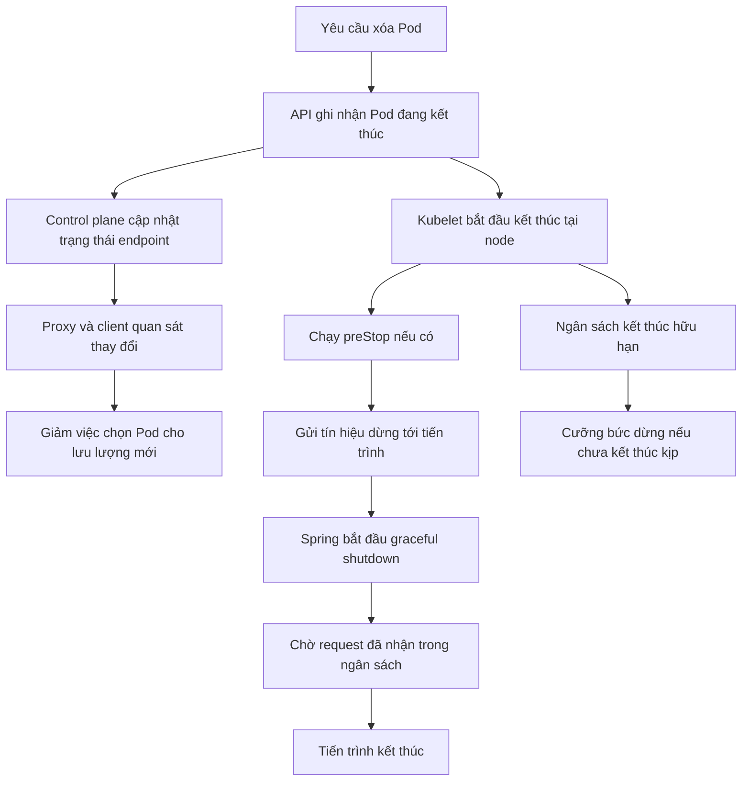

# Yêu cầu đang xử lý khi Pod bị loại khỏi Service

## Mục tiêu bài học

Trong chương **Vòng đời Pod** của module **SPRING_CLOUD_KUBERNETES**, bài học này giải thích điều gì xảy ra với một HTTP request đã đến ứng dụng khi Pod không còn được chọn làm đích của Service.

Sau bài học, bạn có thể:

- Phân biệt thay đổi readiness, thay đổi endpoint và dừng tiến trình.
- Giải thích vì sao request đang chạy có thể hoàn tất sau khi Pod bị rút khỏi tập đích phục vụ.
- Phối hợp graceful shutdown của Spring Boot với thời gian kết thúc Pod.
- Kiểm chứng bằng request ID, log, EndpointSlice và kết quả phía client.
- Xử lý trường hợp response bị mất dù tác động nghiệp vụ đã commit.

Ví dụ ứng dụng dùng Spring Boot **3.5.x**, Spring MVC và embedded Tomcat. Khi dùng phiên bản, web server hoặc service mesh khác, cần kiểm chứng lại hành vi từ chối request mới và đóng kết nối.

## 1. Rút khỏi Service không phải lệnh hủy request

Giả sử client gửi request R qua Service đến Pod A. A đã nhận request, chạy controller và đang thực hiện một thao tác mất 20 giây. Sau đó readiness của A chuyển sang false.

Điều thay đổi là khả năng A được chọn cho lưu lượng mới qua đường định tuyến có sử dụng trạng thái readiness. Kubernetes không gửi một lệnh “hủy R” vào controller đang chạy.

Nếu tiến trình vẫn sống, kết nối vẫn còn và không có tầng nào hết timeout, R có thể hoàn tất bình thường trên A. Request cũng không tự được chuyển sang Pod B.

Cần tách ba loại trạng thái:

| Trạng thái | Nội dung | Có tự hủy request đang chạy không? |
| --- | --- | --- |
| Readiness của ứng dụng/Pod | Instance có nên nhận lưu lượng phục vụ lúc này không | Không |
| Endpoint và dữ liệu định tuyến | Những backend nào được dùng để chọn đích | Không phải giao thức hủy tác vụ trong ứng dụng |
| Trạng thái tiến trình và web server | Còn nhận request không, còn chờ request cũ không, đã thoát chưa | Có thể làm request hoàn tất hoặc bị gián đoạn |

Cụm từ “Pod bị loại khỏi Service” thường là cách nói tắt. Service không sở hữu một transaction HTTP của ứng dụng. Với Service có selector, danh sách backend được công bố qua EndpointSlice và được thành phần định tuyến sử dụng.

### Bốn tình huống có thể nhìn giống nhau nhưng khác bản chất

| Tình huống | Tiến trình còn chạy? | Request đã nhận |
| --- | --- | --- |
| Chỉ chuyển readiness sang false | Thường còn | Tiếp tục theo logic ứng dụng; chưa có shutdown tự động |
| Bỏ Pod khỏi selector của Service | Có thể còn | Không tự bị hủy chỉ vì đổi nhãn |
| Xóa Pod theo quy trình bình thường | Còn trong một khoảng kết thúc | Có cơ hội hoàn tất nếu graceful shutdown và thời gian cho phép |
| Tiến trình chết đột ngột, node hỏng hoặc bị kill cưỡng bức | Có thể dừng ngay hoặc không còn liên lạc được | Có thể mất kết nối và không có kết quả rõ ràng |

Từ một ảnh chụp “endpoint không còn ready” không thể suy ra request đã xong, bị rollback hay chưa bao giờ đến server.

## 2. Luồng điều khiển và kết nối mạng không thay đổi tức thời cùng nhau

Một request đi qua nhiều lớp:

```text
Client
  -> ingress hoặc gateway, nếu có
  -> Service hoặc proxy chọn backend
  -> kết nối tới Pod A
  -> HTTP server
  -> controller / transaction / lời gọi ra ngoài
```

Khi trạng thái backend thay đổi, controller, proxy và cache phía client cần thời gian quan sát và áp dụng thay đổi. Trong khoảng đó, một số nơi có thể còn chọn A.

Đối với kết nối đã được thiết lập, hành vi còn phụ thuộc cơ chế định tuyến, connection tracking, proxy và giao thức. Thay đổi danh sách đích cho kết nối mới không tự dịch chuyển một TCP connection đang gắn với A.

### Kết nối không đồng nghĩa request

- Một request đang chạy là một đơn vị xử lý HTTP cụ thể.
- Một kết nối HTTP/1.1 keep-alive có thể được tái sử dụng cho nhiều request nối tiếp.
- HTTP/2 có thể có nhiều stream trên cùng kết nối.
- Gateway có thể giữ pool kết nối tới backend riêng với pool phía client.

Vì thế, “không mở thêm kết nối tới A” chưa đồng nghĩa “không có thêm request tới A trên kết nối cũ”. Web server, gateway và client cần phối hợp việc ngừng nhận request hoặc stream mới.

Không mặc định một keep-alive connection luôn được giữ hay luôn bị đóng ngay khi endpoint đổi trạng thái. Đây là hành vi cần kiểm chứng theo đường mạng thực tế.

### EndpointSlice cho biết điều gì?

Với cấu hình Service thông thường trong ví dụ, có thể quan sát các trạng thái minh họa sau:

| Giai đoạn | ready | serving | terminating |
| --- | --- | --- | --- |
| Pod đang phục vụ bình thường | true | true | false |
| Pod không ready nhưng chưa bị xóa | false | false | false |
| Pod đang kết thúc nhưng còn khả năng phục vụ | false | có thể true | true |
| Pod đang kết thúc và không còn phục vụ | false | false | true |

`serving` phản ánh khả năng phục vụ mà không gộp điều kiện kết thúc; `terminating` cho biết endpoint đang kết thúc. Endpoint có thể còn hiện diện trong quá trình này. `serving: true` không phải bộ đếm request đang chạy hoặc biên nhận rằng mọi response đã giao xong. [Kubernetes: EndpointSlices — Conditions](https://kubernetes.io/docs/concepts/services-networking/endpoint-slices/#conditions).

Có các ngoại lệ cần biết khi đọc trạng thái: `publishNotReadyAddresses` làm thay đổi cách công bố ready; một số service proxy có thể dùng endpoint vừa serving vừa terminating khi mọi endpoint khả dụng đều đang terminating. Ví dụ thực hành không bật `publishNotReadyAddresses` và luôn giữ replica khác còn phục vụ.

## 3. Khi xóa Pod, định tuyến và shutdown diễn ra song song

Đối với một lần xóa Pod bình thường, có thể hình dung hai nhánh công việc:



Không có một hàng rào chung bảo đảm tất cả proxy đã cập nhật endpoint trước khi ứng dụng nhận tín hiệu dừng. Ngược lại, việc một proxy đã ngừng chọn Pod cũng không chứng minh tiến trình đã bắt đầu shutdown.

Kubelet chạy `preStop` trước khi gửi tín hiệu dừng thông thường tới tiến trình chính; thời gian hook nằm trong ngân sách kết thúc Pod. Hết thời gian mà container chưa dừng, nó có thể bị cưỡng bức kết thúc. [Kubernetes: Pod Termination Flow](https://kubernetes.io/docs/concepts/workloads/pods/pod-termination/#pod-termination-flow).

Ví dụ timeline dưới đây chỉ minh họa một lần chạy, không phải thứ tự thời gian được Kubernetes bảo đảm:

```text
t=0s   Request R đã vào Pod A.
t=4s   Có yêu cầu xóa A.
t=5s   Một proxy đã áp dụng endpoint mới; nơi khác có thể chưa cập nhật.
t=4..9s  preStop cho ứng dụng thêm một khoảng vẫn còn phục vụ.
t=9s   Ứng dụng nhận tín hiệu dừng, ngừng nhận request mới và drain.
t=20s  R hoàn tất trên A; response có thể về client.
t>20s  Ứng dụng kết thúc sau khi các bước shutdown hoàn tất.
```

Nếu client hết deadline tại t=15s, nó có thể đã báo timeout trước khi A hoàn tất. Nếu proxy đóng kết nối sớm, server có thể hoàn thành công việc nhưng không còn đường giao response.

### Readiness false chưa khởi động graceful shutdown

Một ứng dụng chủ động công bố `REFUSING_TRAFFIC` chỉ thay đổi trạng thái sẵn sàng. Nếu context chưa đóng, web server có thể vẫn nhận request qua Pod IP hoặc một đường định tuyến còn dữ liệu cũ.

Nếu cần đóng nhận công việc mới tại chính ứng dụng trước khi dừng, phải có cơ chế admission/drain tương ứng. Cơ chế đó cần phân biệt công việc mới với công việc đã được chấp nhận; không hủy tất cả chỉ vì readiness vừa chuyển false.

## 4. Graceful shutdown của Spring bảo vệ phần nào?

Cấu hình mẫu cho Spring Boot 3.5.x:

```yaml
server:
  port: 8080
  shutdown: graceful

spring:
  lifecycle:
    timeout-per-shutdown-phase: 40s

management:
  endpoints:
    web:
      exposure:
        include: health
  endpoint:
    health:
      show-details: never
      probes:
        enabled: true
        add-additional-paths: true
      group:
        liveness:
          include: livenessState
        readiness:
          include: readinessState
```

Ứng dụng cần `spring-boot-starter-web` và `spring-boot-starter-actuator`, được quản lý phiên bản bằng cấu hình Spring Boot/BOM tương thích của dự án.

Trong Spring Boot 3.5, graceful shutdown gắn với đóng application context và cho request hiện có một khoảng hoàn tất. Cách từ chối request mới khác nhau theo web server; kết nối persistent cũng ảnh hưởng hành vi. Ví dụ này chọn Tomcat để giới hạn phạm vi thực hành. [Spring Boot 3.5: Graceful Shutdown](https://docs.spring.io/spring-boot/3.5/reference/web/graceful-shutdown.html).

`timeout-per-shutdown-phase` là timeout **theo từng phase**, không phải lời cam kết rằng tổng thời gian kết thúc toàn bộ ứng dụng chỉ là 40 giây. Ngoài HTTP server còn có thể có lifecycle bean, executor và các bước dọn tài nguyên khác.

Trong graceful shutdown, Spring chuyển readiness theo vòng đời ứng dụng; endpoint HTTP cũng có thể ngừng nhận kết nối nên bạn không nhất thiết còn đọc được trạng thái probe qua HTTP lúc đó. [Spring Boot 3.5: Application Lifecycle and Probe States](https://docs.spring.io/spring-boot/3.5/reference/actuator/endpoints.html#actuator.endpoints.kubernetes-probes.lifecycle).

### Những điều cấu hình trên không tự bảo đảm

- Gateway, load balancer hoặc client sẽ chờ đủ lâu để nhận response.
- Request đã spawn tác vụ nền sẽ được web server tiếp tục theo dõi tới khi tác vụ đó xong.
- Một transaction đã commit sẽ được hoàn tác nếu client mất kết nối.
- WebSocket, SSE hoặc stream kéo dài vô hạn sẽ kết thúc được trong ngân sách.
- Consumer queue và scheduler sẽ tự ngừng nhận việc theo readiness HTTP.

Các executor, consumer và scheduler cần quy tắc đóng nhận việc, chờ việc đang chạy và phục hồi riêng. Một controller trả `202 Accepted` sau khi tạo công việc bền vững cũng có hợp đồng khác với một request chờ trả kết quả đồng bộ.

### Tín hiệu dừng phải tới được JVM

Với container Java thông thường, nên để JVM là tiến trình chính hoặc bảo đảm wrapper chuyển tiếp tín hiệu đúng. Ví dụ entrypoint dạng exec:

```dockerfile
ENTRYPOINT ["java", "-jar", "/app/app.jar"]
```

Nếu wrapper shell không chuyển tiếp tín hiệu, ứng dụng có thể không chạy được đường graceful shutdown trước khi hết thời gian. Phải kiểm chứng bằng log bắt đầu và kết thúc shutdown, không chỉ nhìn thuộc tính YAML.

## 5. Phân bổ một ngân sách chung cho quá trình kết thúc

Một mô hình tính ngân sách cho triển khai cụ thể:

```text
T_grace >= T_preStop
           + T_drain_HTTP
           + T_shutdown_khac
           + T_du_phong
```

Đây là mô hình lập kế hoạch, không phải công thức nội bộ của Kubernetes. Nếu các bước chạy song song thì thời gian thực tế khác; nếu có nhiều phase chờ nối tiếp thì phải cộng đủ phần có thể phát sinh.

Ví dụ chọn:

| Phần ngân sách | Giá trị mẫu | Giả định |
| --- | --- | --- |
| preStop | 5 giây | Khoảng hỗ trợ lan truyền thay đổi định tuyến |
| Chờ HTTP đang xử lý | Tối đa 40 giây theo phase đã cấu hình | Request hợp lệ có thời gian còn lại phù hợp |
| Các bước shutdown khác | 10 giây | Đã đo cho ứng dụng cụ thể |
| Dự phòng | 10 giây | Độ trễ lập lịch và biến động |
| terminationGracePeriodSeconds | 65 giây | Không có phase khác làm vượt tổng dự kiến |

Không đặt `preStop: sleep 30` với grace period cũng 30 giây rồi kỳ vọng Spring còn thêm 40 giây để drain. Hook đã tiêu thụ phần lớn ngân sách trước khi JVM bắt đầu xử lý tín hiệu dừng.

Khoảng chờ 5 giây chỉ là giá trị minh họa. Nó không chứng minh mọi ingress, proxy hoặc cache đều cập nhật xong. Cần đo độ trễ từ lúc endpoint đổi trạng thái tới lúc không còn request mới được chọn vào Pod.

Nếu request mất nhiều phút, tăng grace period có thể không phải giải pháp phù hợp cho rollout. Có thể chuyển công việc sang mô hình bất đồng bộ có lưu trạng thái và API tra cứu kết quả.

### Deployment và Service mẫu

Namespace `training` đã tồn tại. Thay image bằng image của ứng dụng thử; image cần có `/bin/sh` và `sleep` để chạy hook minh họa.

```yaml
apiVersion: apps/v1
kind: Deployment
metadata:
  name: report-api
  namespace: training
spec:
  replicas: 2
  strategy:
    type: RollingUpdate
    rollingUpdate:
      maxUnavailable: 0
      maxSurge: 1
  selector:
    matchLabels:
      app: report-api
  template:
    metadata:
      labels:
        app: report-api
    spec:
      terminationGracePeriodSeconds: 65
      containers:
        - name: app
          image: registry.example.com/training/report-api:1.0.0
          env:
            - name: POD_NAME
              valueFrom:
                fieldRef:
                  fieldPath: metadata.name
            - name: SPRING_PROFILES_ACTIVE
              value: termination-lab
          ports:
            - name: http
              containerPort: 8080
          lifecycle:
            preStop:
              exec:
                command: ["/bin/sh", "-c", "sleep 5"]
          readinessProbe:
            httpGet:
              path: /readyz
              port: http
            periodSeconds: 2
            timeoutSeconds: 1
            failureThreshold: 1
          livenessProbe:
            httpGet:
              path: /livez
              port: http
            periodSeconds: 10
            timeoutSeconds: 2
            failureThreshold: 3
          startupProbe:
            httpGet:
              path: /livez
              port: http
            periodSeconds: 5
            timeoutSeconds: 2
            failureThreshold: 60
---
apiVersion: v1
kind: Service
metadata:
  name: report-api
  namespace: training
spec:
  selector:
    app: report-api
  ports:
    - name: http
      port: 80
      targetPort: http
```

Trong lần xóa Pod, trạng thái terminating của endpoint được xử lý bởi control plane; hook sleep không tự đổi readiness. Khi chỉ chủ động rút một Pod khỏi phục vụ mà chưa xóa, cần cơ chế thay đổi readiness như phần thực hành.

`maxUnavailable: 0` và `maxSurge: 1` giúp rollout có kế hoạch giữ năng lực phục vụ, nhưng không phải bảo đảm mọi request thành công và không áp dụng như hàng rào cho mọi kiểu xóa Pod hoặc sự cố node.


## 6. Ứng dụng thử có request chậm và điều khiển readiness

Đặt controller sau trong package được Spring Boot scan. Profile `termination-lab` chỉ dành cho môi trường thực hành; các endpoint điều khiển cần nằm trong phạm vi truy cập quản trị của môi trường đó.

```java
import java.util.Map;
import java.util.UUID;

import org.slf4j.Logger;
import org.slf4j.LoggerFactory;
import org.springframework.boot.availability.AvailabilityChangeEvent;
import org.springframework.boot.availability.ReadinessState;
import org.springframework.context.ApplicationEventPublisher;
import org.springframework.context.annotation.Profile;
import org.springframework.http.HttpStatus;
import org.springframework.web.bind.annotation.GetMapping;
import org.springframework.web.bind.annotation.PostMapping;
import org.springframework.web.bind.annotation.RequestHeader;
import org.springframework.web.bind.annotation.RequestMapping;
import org.springframework.web.bind.annotation.RequestParam;
import org.springframework.web.bind.annotation.RestController;
import org.springframework.web.server.ResponseStatusException;

@RestController
@Profile("termination-lab")
@RequestMapping("/lab")
public class TerminationLabController {

    private static final Logger log =
            LoggerFactory.getLogger(TerminationLabController.class);

    private final ApplicationEventPublisher events;
    private final String podName =
            System.getenv().getOrDefault("POD_NAME", "local");

    public TerminationLabController(ApplicationEventPublisher events) {
        this.events = events;
    }

    @GetMapping("/slow")
    public Map<String, Object> slow(
            @RequestParam(name = "seconds", defaultValue = "20") int seconds,
            @RequestHeader(name = "X-Request-Id", required = false)
                    String suppliedId) throws InterruptedException {

        if (seconds < 1 || seconds > 90) {
            throw new ResponseStatusException(
                    HttpStatus.BAD_REQUEST, "seconds must be in [1, 90]");
        }

        String requestId = suppliedId == null || suppliedId.isBlank()
                ? UUID.randomUUID().toString()
                : suppliedId;

        log.info("START requestId={} pod={} seconds={}",
                requestId, podName, seconds);

        Thread.sleep(seconds * 1000L);

        log.info("END requestId={} pod={}", requestId, podName);
        return Map.of(
                "requestId", requestId,
                "pod", podName,
                "seconds", seconds);
    }

    @PostMapping("/drain")
    public Map<String, String> drain() {
        AvailabilityChangeEvent.publish(
                events, this, ReadinessState.REFUSING_TRAFFIC);
        return Map.of("pod", podName, "state", "REFUSING_TRAFFIC");
    }

    @PostMapping("/resume")
    public Map<String, String> resume() {
        AvailabilityChangeEvent.publish(
                events, this, ReadinessState.ACCEPTING_TRAFFIC);
        return Map.of("pod", podName, "state", "ACCEPTING_TRAFFIC");
    }
}
```

API `AvailabilityChangeEvent.publish` cho phép công bố trạng thái mới qua application event publisher. [Spring Boot 3.5: AvailabilityChangeEvent](https://docs.spring.io/spring-boot/3.5/api/java/org/springframework/boot/availability/AvailabilityChangeEvent.html).

Trong ví dụ:

- `/lab/slow` chỉ mô phỏng xử lý đồng bộ bằng sleep; không tạo tác động nghiệp vụ.
- `/lab/drain` thay đổi readiness, **chưa** đóng server hay tạo bộ lọc từ chối request mới tại ứng dụng.
- `/lab/resume` phục hồi readiness để chuẩn bị phép thử tiếp theo, không dùng để đảo ngược một context đang shutdown.
- Header `X-Request-Id` chỉ dùng đối chiếu log, không phải cơ chế chống lặp tự động.

Sleep trong controller phục vụ quan sát vòng đời request, không phải cách triển khai công việc dài trong sản phẩm.

## 7. Thực hành thứ nhất: chỉ đổi readiness

Các bước sau mô tả thí nghiệm cần thực hiện trong môi trường thử, không phải kết quả đã được chạy sẵn.

### 7.1. Chuẩn bị đường gọi và quan sát

Ngoài Deployment và Service mẫu, chuẩn bị một Pod `traffic-client` trong namespace `training`, có công cụ `curl` và quyền mạng gọi Service lẫn Pod IP của ứng dụng.

Client này dùng Service DNS thực sự:

```text
http://report-api.training.svc.cluster.local
```

Dùng các terminal riêng để theo dõi:

```bash
kubectl -n training get pods -l app=report-api -o wide
kubectl -n training get endpointslices -l kubernetes.io/service-name=report-api -o yaml
kubectl -n training logs -l app=report-api -c app --prefix --since=2m --tail=100
```

Cần quan sát tất cả EndpointSlice của Service, không chỉ một slice bất kỳ. Ghi lại Pod name, UID và IP tương ứng.

Không dùng `kubectl port-forward service/report-api ...` làm phép chứng minh Service đã ngừng chọn Pod. Port-forward chọn một Pod và tạo đường chuyển tiếp riêng; nó không mô phỏng đầy đủ đường định tuyến Service cần kiểm tra. Port-forward gắn với Pod đang bị xóa cũng có thể tự mất kết nối và làm sai cách diễn giải kết quả.

### 7.2. Bắt đầu một request đủ dài để quan sát

Trong terminal của bên gọi:

```bash
kubectl -n training exec traffic-client -- curl -v --max-time 90 -H "X-Request-Id: readiness-001" "http://report-api.training.svc.cluster.local/lab/slow?seconds=25"
```

Ngay khi log `START requestId=readiness-001` xuất hiện, xác định Pod A đã nhận request và tra Pod IP của A. Không chọn một Pod khác rồi kết luận về request này.

### 7.3. Đổi readiness đúng instance

Giả sử IP của A là `10.244.1.12`; đây là giá trị minh họa, cần thay bằng IP đã tra:

```bash
kubectl -n training exec traffic-client -- curl -sS -X POST "http://10.244.1.12:8080/lab/drain"
```

Gọi trực tiếp Pod IP ở bước điều khiển để bảo đảm thay đổi đúng A. Nếu gọi endpoint drain qua Service, request có thể đến replica khác.

Theo dõi đến khi Pod readiness và endpoint của A phản ánh không sẵn sàng. Có độ trễ từ event trong ứng dụng tới lần probe tiếp theo và cập nhật định tuyến; không chỉ chờ response của `/lab/drain` rồi coi mọi lớp đã cập nhật.

### 7.4. So sánh request cũ và request mới

Request `readiness-001` có thể vẫn hoàn tất trên A và trả JSON chứa tên A. Đồng thời, tạo request mới qua Service bằng kết nối mới:

```bash
kubectl -n training exec traffic-client -- curl -sS --http1.1 -H "Connection: close" -H "X-Request-Id: readiness-002" "http://report-api.training.svc.cluster.local/lab/slow?seconds=1"
```

Sau khi thay đổi định tuyến đã lan truyền, request mới theo cấu hình mẫu nên đi tới replica còn ready. Quan sát nhiều lần với ID riêng, thay vì suy ra từ một response đơn lẻ.

Trong khi A vẫn chạy và chỉ bị đổi readiness, gọi mới trực tiếp tới A có thể vẫn thành công:

```bash
kubectl -n training exec traffic-client -- curl -sS "http://10.244.1.12:8080/lab/slow?seconds=1"
```

Điều đó phù hợp với controller mẫu: readiness không phải cơ chế chặn mạng hoặc từ chối mọi request tại ứng dụng.

Phục hồi readiness của A trước khi làm thí nghiệm tiếp theo:

```bash
kubectl -n training exec traffic-client -- curl -sS -X POST "http://10.244.1.12:8080/lab/resume"
```

Chờ Pod được công nhận ready trở lại. Phép thử này đạt khi xác minh được đồng thời: request cũ không bị hủy chỉ vì readiness false, và request mới qua Service được điều hướng theo trạng thái đã hội tụ.

## 8. Thực hành thứ hai: xóa Pod và chờ request đang chạy

### 8.1. Tạo request đang xử lý trước khi xóa

Bắt đầu một request mới qua Service:

```bash
kubectl -n training exec traffic-client -- curl -v --max-time 90 -H "X-Request-Id: deletion-001" "http://report-api.training.svc.cluster.local/lab/slow?seconds=25"
```

Dựa vào log START, xác định Pod đang xử lý `deletion-001`. Trong các terminal quan sát, theo dõi log của đúng Pod và thay đổi EndpointSlice.

Ví dụ PowerShell, thay tên Pod minh họa bằng tên thực tế:

```powershell
$targetPod = 'report-api-abc123-xyz89'

kubectl -n training logs -f $targetPod -c app --timestamps
```

Giữ luồng log hoặc hệ thống thu thập log hoạt động trước khi xóa, vì Pod bị xóa có thể không còn truy vấn log bằng tên đó về sau.

### 8.2. Xóa theo quy trình bình thường

Ở terminal khác:

```powershell
$targetPod = 'report-api-abc123-xyz89'

kubectl -n training delete pod $targetPod --wait=false
```

Lệnh này không ghi đè grace period đã khai báo của Pod. Không dùng xóa cưỡng bức để kiểm tra khả năng graceful shutdown bình thường.

Theo dõi các bằng chứng:

1. Pod được ghi nhận đang terminating.
2. Endpoint của Pod thay đổi điều kiện; có thể vẫn còn trong EndpointSlice một thời gian.
3. Hook kết thúc, JVM nhận tín hiệu và log graceful shutdown bắt đầu.
4. Request `deletion-001` có log END và client nhận đủ response.
5. Các bước shutdown hoàn tất, sau đó tiến trình thoát.

Trong cấu hình mẫu, request 25 giây bắt đầu trước lúc xóa có cơ hội hoàn tất trong ngân sách. Điều kiện là thời gian còn lại, proxy timeout và đường kết nối đều cho phép; YAML không phải bằng chứng thay cho kết quả đo.

ReplicaSet có thể tạo Pod thay thế. Pod mới không tiếp quản stack xử lý, TCP connection hoặc transaction đang chạy của request trên Pod cũ.

### 8.3. Vượt ngân sách để hiểu giới hạn

Lặp lại với request dài hơn, chẳng hạn 80 giây, rồi xóa ngay sau khi thấy START:

```bash
kubectl -n training exec traffic-client -- curl -v --max-time 100 -H "X-Request-Id: deletion-long-001" "http://report-api.training.svc.cluster.local/lab/slow?seconds=80"
```

Thời gian còn lại có thể vượt cả ngân sách HTTP lẫn ngân sách kết thúc Pod. Client có thể nhận lỗi kết nối hoặc không có response đầy đủ. Không hứa một thời điểm lỗi chính xác hay một mã HTTP cố định, vì còn nhiều lớp tham gia.

So sánh log shutdown, thời điểm dừng tiến trình và kết quả client. Nếu chỉ nhìn thấy Pod mới đã Running, bạn chưa chứng minh request trên Pod cũ hoàn tất.

### 8.4. Kiểm tra qua ingress/gateway thật

Sau khi kiểm tra đường Service, lặp lại qua đường người dùng thực sự sử dụng. Cần kiểm tra ít nhất:

- Request đã vào backend trước khi endpoint đổi trạng thái.
- Request mới trong khoảng lan truyền cập nhật.
- Kết nối keep-alive và các kết nối mới.
- HTTP/2 hoặc giao thức stream nếu sản phẩm có sử dụng.
- Deadline của client, timeout của proxy và thời gian chờ backend.

Một phép thử qua ClusterIP không chứng minh cấu hình draining của cloud load balancer hay service mesh cũng đúng.

## 9. Response bị mất không xác định được kết quả nghiệp vụ

Bài thử dùng sleep và không ghi dữ liệu. Với ứng dụng thật, có thể xảy ra chuỗi sau:

```text
1. Pod A nhận POST tạo thao tác K.
2. A commit thay đổi trong cơ sở dữ liệu.
3. A bắt đầu gửi response.
4. Kết nối bị đóng trong quá trình kết thúc Pod.
5. Client thấy lỗi và chưa biết K đã thành công hay chưa.
```

Không có response không đồng nghĩa transaction đã rollback. Ngược lại, một log END trước khi ghi response ra mạng chưa chứng minh client đã nhận đủ response.

Client retry một POST không có cơ chế chống lặp có thể tạo tác động lần nữa. Hệ thống nên có định danh thao tác ổn định, quy tắc idempotency ở nơi ghi và khả năng tra cứu kết quả đã commit.

Phân biệt các định danh:

| Định danh | Mục đích |
| --- | --- |
| Request/attempt ID | Theo dõi một lần gọi và đối chiếu log |
| Operation/idempotency key | Nhận diện cùng thao tác nghiệp vụ qua các lần retry |
| Pod UID | Nhận diện vòng đời instance thực thi |
| Transaction/result ID | Tra cứu kết quả đã lưu bền vững |

Retry phải nằm trong deadline và ngân sách đã định nghĩa; không mặc định gateway có thể phát lại mọi request sang replica khác. Ngay cả thao tác đọc cũng có thể tốn tài nguyên lớn nếu nhiều tầng đồng thời retry.

Nếu nghiệp vụ có tác động ngoài cơ sở dữ liệu, như phát message hoặc gọi dịch vụ khác, graceful HTTP shutdown không tạo transaction chung cho các hệ thống đó. Cần thiết kế bảo vệ tác động và phục hồi riêng.

## 10. Request dài, streaming và công việc nền

### HTTP request đồng bộ có thời gian hữu hạn

Đặt thời gian xử lý tối đa và ngân sách shutdown phù hợp với thời gian còn lại của những request đã được chấp nhận. Nếu request có thể chờ phụ thuộc vô hạn, quá trình drain cũng không có điểm kết thúc đáng tin cậy.

Client hoặc proxy có thể hết timeout trước server. Việc hủy phía client có được truyền tới công việc phía server hay không còn tùy stack và logic ứng dụng; không suy ra tác vụ đã dừng từ lỗi phía client.

### WebSocket, SSE và stream kéo dài

Các kết nối sống lâu có thể không tự hoàn tất trước rollout. Ứng dụng cần giao thức kết thúc hoặc chuyển phiên phù hợp: thông báo đóng, cho phép client kết nối lại, tiếp tục từ mốc đã xác nhận và giới hạn thời gian chờ.

Không thể giải quyết stream vô hạn chỉ bằng cách đặt một grace period “đủ dài”. Cần xác định trạng thái nào phải lưu bền vững để một lần kết nối lại không làm mất hay lặp dữ liệu quan trọng.

### Tác vụ tách khỏi HTTP request

Nếu controller đẩy công việc sang executor rồi trả response, phần việc đó không còn đồng nghĩa một HTTP request đang hoạt động. Cần quản lý vòng đời executor và trạng thái công việc.

Một luồng shutdown phù hợp có thể là:

```text
đóng nhận công việc mới
  -> chờ hoặc checkpoint công việc đang chạy
  -> trả lại/ghi nhận công việc chưa xong để phục hồi
  -> đóng tài nguyên phụ thuộc theo thứ tự phù hợp
  -> kết thúc tiến trình
```

Không đóng datasource hoặc HTTP client trước khi những tác vụ cần chúng hoàn tất. Không để một vòng lặp scheduler vẫn sinh công việc mới trong lúc hệ thống đang cố drain.

## 11. Liên hệ với Spring Cloud Kubernetes

### DiscoveryClient và Spring Cloud LoadBalancer

Có hai kiểu đường gọi cần phân biệt:

- Client gọi tên Service và để hạ tầng Service chọn backend.
- Client lấy danh sách instance rồi chọn và gọi địa chỉ Pod trực tiếp.

Với đường thứ hai, cache discovery, chu kỳ cập nhật và chính sách lọc instance của client ảnh hưởng thời điểm ngừng chọn Pod. Việc Service đã thay đổi tập backend không tự sửa một địa chỉ Pod mà client đang giữ hoặc một connection pool đang mở.

Cần kiểm chứng nguồn dữ liệu discovery và chính sách chọn instance của phiên bản đang dùng. Nếu RBAC làm client không quan sát được thay đổi resource, phải phát hiện lỗi cập nhật thay vì giả định danh sách backend luôn mới.

Dù chọn backend bằng cách nào, một request đã chạy trên A vẫn cần lifecycle phía A để kết thúc có kiểm soát. Spring Cloud LoadBalancer không di chuyển request đang chạy sang B.

### ConfigMap, Secret và Configuration Watcher

Một thay đổi cấu hình có thể chỉ được refresh, hoặc có thể dẫn tới một cơ chế restart được triển khai chủ động. Xác định đúng hành động thay vì coi mọi cập nhật đều có cùng tác động tới request.

Nếu thao tác cập nhật thực sự đóng context hoặc thay Pod, hãy kiểm tra đường graceful shutdown tương ứng. Đối với request đang chạy, cũng cần quy định nó dùng snapshot cấu hình nào, tránh thay đổi tài nguyên đang được sử dụng mà không có vòng đời rõ ràng.

### Sức khỏe Pod và observability

Metadata của Pod giúp gắn request với đúng instance. Trạng thái healthy hoặc ready không phải bằng chứng rằng mọi request cũ đã trả xong.

Một bộ log/trace hữu ích cần nối được request ID, operation key nếu có, Pod UID, thời điểm bắt đầu xử lý, commit, kết thúc xử lý và bắt đầu shutdown. Kết quả cuối cùng phía client vẫn là một nguồn bằng chứng riêng.

Không cần bật thêm discovery, watcher hoặc một cơ chế reload chỉ để có graceful shutdown HTTP. Chọn tính năng Spring Cloud Kubernetes theo nhu cầu thực tế của đường triển khai.

## 12. Đọc kết quả và xử lý lỗi thường gặp

| Quan sát | Khả năng cần kiểm tra | Hành động phù hợp |
| --- | --- | --- |
| Request cũ hoàn tất sau readiness false | Thường là hành vi đúng | Xác nhận đúng Pod và client đã nhận response |
| Request mới vẫn tới Pod sau khi đổi trạng thái | Chưa hội tụ, tái sử dụng kết nối, client gọi Pod trực tiếp hoặc chính sách định tuyến khác | Phân loại kết nối và đo thời gian lan truyền |
| Request ngắn bị cắt ngay khi dừng | JVM không nhận tín hiệu đúng, graceful chưa hoạt động hoặc proxy đóng sớm | Kiểm tra entrypoint, log shutdown và từng timeout |
| preStop kết thúc rất muộn, JVM ít thời gian drain | Ngân sách hook chiếm phần lớn grace period | Tính lại tổng ngân sách và giảm công việc trong hook |
| Log END có nhưng client báo lỗi | Response chưa giao xong hoặc client đã hết deadline | Kiểm tra trace mạng/proxy và trạng thái nghiệp vụ |
| Stream làm Pod lâu kết thúc | Không có giao thức đóng hoặc thời gian sống không hữu hạn | Thiết kế drain và tiếp tục phiên |
| Pod biến mất khỏi API nhưng chưa rõ tiến trình cũ đã dừng | Có thể liên quan xóa cưỡng bức hoặc node không liên lạc được | Xác minh trạng thái tại node và bảo vệ ghi từ instance cũ |

Xóa cưỡng bức không chờ xác nhận đầy đủ rằng tiến trình cũ đã dừng trên node; vì vậy không dùng việc Pod mất khỏi API làm bằng chứng công việc đã kết thúc. [Kubernetes: Forced Pod termination](https://kubernetes.io/docs/concepts/workloads/pods/pod-termination/#forced-pod-termination).

Các điều kiện EndpointSlice trong quá trình kết thúc có thể được đối chiếu bằng [hướng dẫn quan sát Pod và endpoint khi termination của Kubernetes](https://kubernetes.io/docs/tutorials/services/pods-and-endpoint-termination-flow/). Dùng trạng thái endpoint để hiểu định tuyến; dùng log, dữ liệu đã commit và kết quả client để hiểu số phận request.

Một thiết kế hoàn chỉnh cần đạt đồng thời: giảm việc nhận công việc mới vào instance đang rút, cho việc đã nhận một khoảng hoàn tất có giới hạn, và có cách phục hồi khi kết quả vẫn không rõ. Việc Pod rời khỏi tập đích của Service chỉ giải quyết một phần của quá trình đó.
