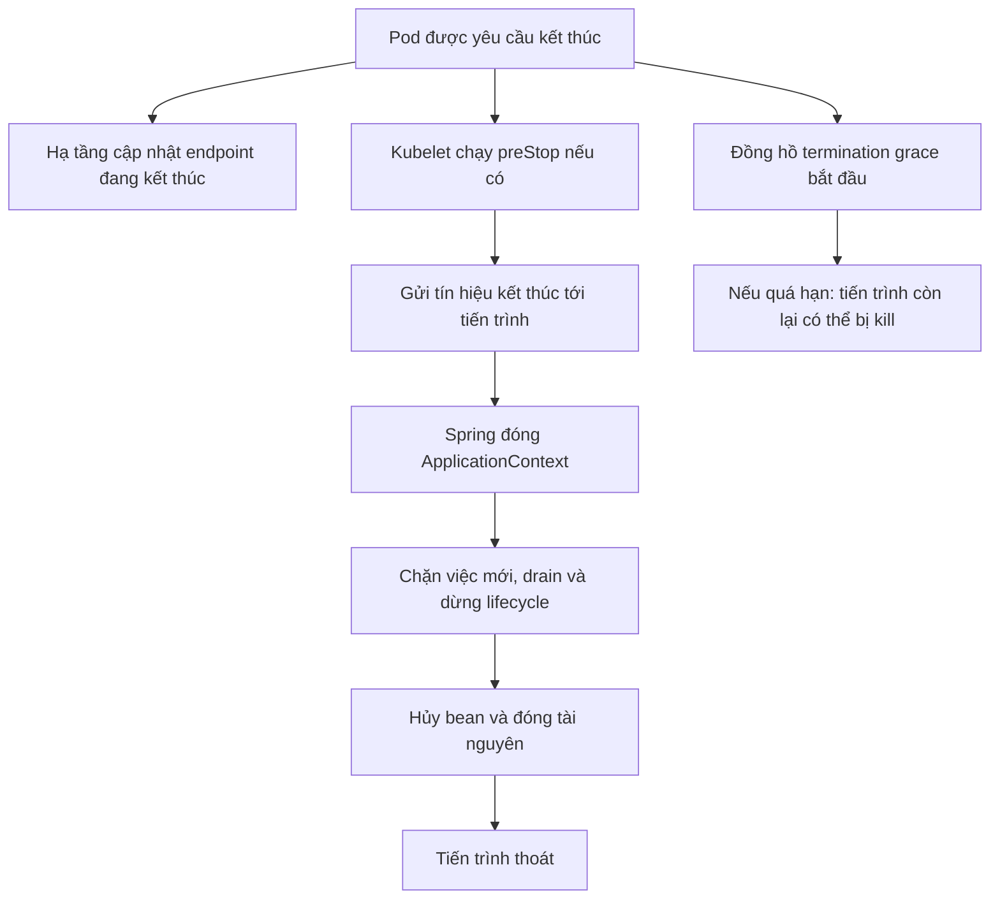

# Giải phóng tài nguyên và vai trò leader khi dừng

## Mục tiêu của bài học

Một Pod đang giữ vai trò leader có thể vừa nhận request HTTP, vừa chạy vòng xử lý nền, vừa giữ kết nối tới database và Kubernetes API. Khi Pod bị thay thế, việc tiến trình biến mất chưa chứng minh rằng công việc đã được bàn giao đúng.

Hai lỗi thường gặp là nhường quyền quá sớm trong khi tác vụ cũ còn ghi dữ liệu, hoặc đóng client quá sớm khiến bước checkpoint và thu hồi quyền không thể hoàn tất.

Trong phạm vi Spring Cloud Kubernetes, bài học này giúp bạn:

- Thiết kế thứ tự ngừng nhận việc, xử lý công việc đang chạy, nhường quyền và đóng tài nguyên.
- Phân biệt graceful shutdown của HTTP với việc dừng tác vụ leader.
- Chọn vị trí phù hợp giữa sự kiện đóng context, `SmartLifecycle` và callback hủy bean.
- Hiểu giới hạn của việc thu hồi quyền khi hết thời gian, mất API hoặc tiến trình bị kill.
- Xác minh bằng dấu vết công việc và trạng thái điều phối, thay vì chỉ nhìn Pod đã bị xóa.

Các chi tiết về phase và ConfigMap dưới đây được đối chiếu với **Spring Cloud Kubernetes Fabric8 Leader 3.3.0**, cùng cách đóng context và graceful shutdown của Spring Boot 3.5. Khi dùng implementation khác, phải kiểm tra lifecycle, sự kiện và chính sách release của implementation đó.

## 1. Bốn mục tiêu khác nhau khi một leader dừng

| Mục tiêu | Ví dụ bằng chứng | Điều chưa được chứng minh |
| --- | --- | --- |
| Ngừng nhận việc mới | Cổng nhận việc đã đóng, consumer ngừng lấy batch mới | Việc cũ đã hoàn tất |
| Kết thúc hoặc bàn giao việc cũ | Transaction kết thúc, checkpoint hợp lệ, không còn tác vụ được chấp nhận đang chạy | Bản ghi leader đã được cập nhật |
| Ngừng giữ quyền điều phối | Bản ghi đúng role được thu hồi hoặc một leader mới được quan sát | Lệnh ghi cũ đang ở hệ thống đích đã bị vô hiệu |
| Giải phóng tài nguyên | Executor kết thúc, client và file được đóng đúng chủ sở hữu | Mọi tác động bên ngoài đều hoàn tất đúng một lần |

Một quy trình dừng tốt phải có hợp đồng cho cả bốn mục tiêu. Không dùng log `shutdown complete` thay cho bằng chứng về dữ liệu và bàn giao công việc.

Tình huống xuyên suốt bài là một nhóm ba Pod `batch-report`. Chỉ leader nhận đơn vị công việc từ nguồn chung. Mỗi đơn vị phải ghi kết quả, lưu checkpoint và xác nhận hoàn tất theo hợp đồng xử lý.

## 2. Kubernetes cho ứng dụng một cửa sổ để dừng

Trong luồng xóa Pod thông thường, Kubernetes ghi nhận yêu cầu kết thúc, kubelet thực hiện bước dừng container và gửi tín hiệu kết thúc theo cấu hình. Với cấu hình thông thường, tiến trình nhận `SIGTERM`; nếu vẫn chưa dừng khi hết thời gian cho phép, nó có thể nhận `SIGKILL`.

Đây là cơ hội để dọn dẹp, không phải bảo đảm mọi callback đều chạy. Xem [Termination of Pods](https://kubernetes.io/docs/concepts/workloads/pods/pod-termination/).

Hai nhánh cần được phân biệt:



Cập nhật đường định tuyến và việc dừng ứng dụng diễn ra qua các thành phần khác nhau. Không giả định mọi proxy và mọi client đều ngừng gửi request trước khi JVM bắt đầu đóng.

### preStop dùng chung ngân sách với việc dừng ứng dụng

Thời gian chạy `preStop` nằm trong cửa sổ `terminationGracePeriodSeconds`; hook phải kết thúc trước khi tín hiệu dừng thông thường được gửi. Nếu hook chiếm gần hết thời gian, Spring còn rất ít thời gian để drain.

Hook cũng cần xử lý được việc gọi lặp lại. Cơ chế và giới hạn này được mô tả trong [Container Lifecycle Hooks](https://kubernetes.io/docs/concepts/containers/container-lifecycle-hooks/).

Một hook chỉ ngủ vài giây có thể tạo khoảng đệm cho hạ tầng định tuyến. Nó không tự chặn consumer, không checkpoint và không bảo đảm mọi client đã cập nhật endpoint.

Tiến trình Java cần nhận đúng tín hiệu. Nếu entrypoint dùng shell bao ngoài, phải bảo đảm shell chuyển tiếp tín hiệu hoặc dùng `exec` để tiến trình Java trở thành tiến trình được dừng trực tiếp.

## 3. Thứ tự dừng mong muốn ở cấp nghiệp vụ

Đối với nhánh dừng có điều phối, thiết kế mục tiêu như sau:

```text
1. Đánh dấu trạng thái đang dừng, vĩnh viễn không mở lại cổng nhận việc.
2. Ngừng nhận request hoặc đơn vị công việc mới theo từng đường vào.
3. Dừng các trigger có thể sinh thêm việc.
4. Hoàn tất, checkpoint hoặc hủy hợp tác những việc đã được nhận.
5. Kết thúc việc sử dụng quyền leader ở phía ứng dụng.
6. Cho cơ chế điều phối thử thu hồi hoặc giải phóng quyền.
7. Đóng các tài nguyên không còn người sử dụng.
8. Thoát tiến trình trong ngân sách còn lại.
```

Đây là mục tiêu cho thứ tự trong ứng dụng. Nó không điều khiển tuyệt đối thời điểm một Pod khác được phép tiếp quản.

Ví dụ, trong cơ chế ConfigMap 3.3.0, ứng viên kiểm tra readiness của Pod leader. Nếu Pod cũ không còn Ready trong lúc đang drain, một ứng viên khác có thể thử giành quyền trước khi Pod cũ tới bước thu hồi quyền cục bộ.

Vì vậy, hai yêu cầu phải được xử lý riêng:

- **Thứ tự đóng trong một JVM:** không đóng client trước khi công việc cần client đó kết thúc.
- **Quyền tác động giữa nhiều Pod:** hệ thống đích phải chặn ghi cũ không còn hợp lệ khi có nguy cơ chồng lấn.

Chỉ đổi thứ tự callback không giải quyết được toàn bộ bài toán độc quyền ghi.

## 4. Spring dừng lifecycle trước khi hủy bean

Trong luồng đóng context thông thường, Spring thực hiện các mốc chính:

```text
ContextClosedEvent
    → LifecycleProcessor dừng các thành phần lifecycle
    → Hủy singleton bean và gọi callback hủy tương ứng
    → Đóng các phần còn lại của context
```

Có thể đối chiếu trực tiếp trình tự này trong [AbstractApplicationContext](https://raw.githubusercontent.com/spring-projects/spring-framework/v6.2.0/spring-context/src/main/java/org/springframework/context/support/AbstractApplicationContext.java).

Hệ quả thực tế: nếu cơ chế leader đã thu hồi quyền trong bước lifecycle, việc chỉ bắt đầu drain ở `@PreDestroy` có thể quá muộn.

| Cơ chế | Vai trò phù hợp trong quy trình dừng |
| --- | --- |
| `ContextClosedEvent` | Đóng cổng nhận việc sớm, đặt cờ đang dừng, phát tín hiệu ngừng trigger |
| `SmartLifecycle.stop(Runnable)` | Điều phối việc dừng có thứ tự, chờ tác vụ hoàn tất theo hợp đồng |
| `@PreDestroy`, `destroyMethod`, `AutoCloseable` do container quản lý | Dọn tài nguyên còn lại sau khi người sử dụng đã dừng |

Listener đóng context nên ngắn và idempotent. Nếu nó bị chặn bởi một lời gọi mạng rất lâu, các bước lifecycle phía sau có thể chưa được bắt đầu.

Không đăng ký thêm nhiều shutdown hook JVM để đoán thứ tự với hook của Spring. Hãy đặt điều phối vào cơ chế lifecycle có thứ tự rõ ràng.

## 5. SmartLifecycle và điểm thu hồi leader của ConfigMap 3.3.0

`SmartLifecycle` khởi động theo phase từ thấp lên cao và dừng theo chiều ngược lại. Quan hệ phụ thuộc tường minh có thể ảnh hưởng thứ tự; các bean cùng phase không tạo ra một thứ tự nghiệp vụ mà bạn nên dựa vào.

Với dừng bất đồng bộ, callback của `stop(Runnable)` phải được gọi khi bước dừng tương ứng thực sự hoàn tất. Xem [hợp đồng SmartLifecycle](https://docs.spring.io/spring-framework/docs/current/javadoc-api/org/springframework/context/SmartLifecycle.html).

### 5.1. Một cách bố trí phase cho nhánh dừng bình thường

Ở tag 3.3.0, `LeaderInitiator`:

- Có phase bằng `0`.
- Khi dừng, ngừng lịch kiểm tra, đóng watcher và gọi `leadershipController.revoke()`.

Nguồn là [LeaderInitiator 3.3.0](https://raw.githubusercontent.com/spring-cloud/spring-cloud-kubernetes/v3.3.0/spring-cloud-kubernetes-commons/src/main/java/org/springframework/cloud/kubernetes/commons/leader/LeaderInitiator.java).

Do đó, một thành phần drain công việc có phase `1000` có thể được bố trí dừng trước leader initiator ở phase `0`, nếu quan hệ phụ thuộc và các lifecycle khác không làm thay đổi giả định.

| Thành phần | Mốc bố trí minh họa khi dừng |
| --- | --- |
| Cổng nhận việc | Đóng ngay khi context bắt đầu đóng |
| Web server graceful shutdown | Pha dừng sớm do Spring Boot quản lý |
| Thành phần drain tác vụ nền | Phase `1000` trong ví dụ |
| LeaderInitiator ConfigMap 3.3.0 | Phase `0` |
| Client và tài nguyên do bean sở hữu | Dọn sau khi các bên sử dụng đã ngừng |

Phase `1000` chỉ là lựa chọn minh họa, không phải hằng số mặc định của sản phẩm. Nếu client cũng có lifecycle riêng, cần kiểm tra phase và dependency của client; không được mặc định mọi client chỉ đóng ở bước hủy bean.

### 5.2. Thứ tự cục bộ không giữ follower đứng chờ

Trong implementation này, logic thu hồi đọc leader hiện tại, kiểm tra có phải chính candidate hay không, rồi cập nhật ConfigMap bằng resource version. Đồng thời, logic giành quyền xem readiness của Pod đang giữ role.

Chi tiết ở [Fabric8LeadershipController 3.3.0](https://raw.githubusercontent.com/spring-cloud/spring-cloud-kubernetes/v3.3.0/spring-cloud-kubernetes-fabric8-leader/src/main/java/org/springframework/cloud/kubernetes/fabric8/leader/Fabric8LeadershipController.java).

Vì thế:

- Không xem phase như một distributed lock bổ sung.
- Không coi việc hạ readiness là thông báo “hãy đợi tôi drain xong” cho thuật toán bầu leader.
- Không coi `stop()` của một bean đã trở về là bằng chứng mọi tác động ở database đã được chặn.

Thiết kế phải chịu được khả năng Pod cũ còn một đoạn xử lý trong khi Pod mới đã có quyền.

## 6. Đóng cổng nhận việc mà không bỏ sót việc vừa được nhận

Một lỗi đua phổ biến:

```text
Thread A kiểm tra: vẫn được nhận việc.
Thread B bắt đầu shutdown và thấy chưa có việc đang chạy.
Thread B tiếp tục đóng tài nguyên.
Thread A mới tăng bộ đếm rồi bắt đầu xử lý.
```

Một cờ `AtomicBoolean` đứng riêng không giải quyết quan hệ giữa kiểm tra điều kiện và ghi nhận công việc. Hai thao tác đó cần cùng một ranh giới đồng bộ hoặc một cơ chế tương đương.

Ví dụ sau chỉ quản lý **quyền nhận việc trong JVM và bộ đếm in-flight**. Nó chưa phải distributed fencing hoặc một worker hoàn chỉnh.

```java
package com.example.report;

import java.time.Duration;
import java.util.concurrent.TimeUnit;
import java.util.concurrent.atomic.AtomicBoolean;

import org.springframework.stereotype.Component;

@Component
public class WorkGate {

    private boolean leader;
    private boolean closing;
    private int inFlight;

    public synchronized void leadershipChanged(boolean granted) {
        leader = granted && !closing;
    }

    public synchronized Ticket tryEnter() {
        if (closing || !leader) {
            return null;
        }
        inFlight++;
        return new Ticket(this);
    }

    public synchronized void beginShutdown() {
        closing = true;
    }

    public synchronized int inFlight() {
        return inFlight;
    }

    public synchronized boolean awaitEmpty(Duration timeout)
            throws InterruptedException {
        long deadline = System.nanoTime() + timeout.toNanos();

        while (inFlight != 0) {
            long remaining = deadline - System.nanoTime();
            if (remaining <= 0) {
                return false;
            }
            TimeUnit.NANOSECONDS.timedWait(this, remaining);
        }

        return true;
    }

    private synchronized void leave() {
        inFlight--;
        if (inFlight == 0) {
            notifyAll();
        }
    }

    public static final class Ticket implements AutoCloseable {

        private final WorkGate gate;
        private final AtomicBoolean closed = new AtomicBoolean();

        private Ticket(WorkGate gate) {
            this.gate = gate;
        }

        @Override
        public void close() {
            if (closed.compareAndSet(false, true)) {
                gate.leave();
            }
        }
    }
}
```

Một đơn vị công việc dùng ticket:

```java
WorkGate.Ticket ticket = gate.tryEnter();
if (ticket == null) {
    return; // Không nhận đơn vị công việc mới.
}

try (ticket) {
    // Kiểm tra quyền ghi ở hệ thống đích nếu cần fencing.
    // Thực hiện tác động nghiệp vụ.
    // Ghi checkpoint và xác nhận hoàn tất theo hợp đồng xử lý.
}
```

Ticket chỉ được đóng khi phần việc mà nó đại diện đã thực sự kết thúc. Nếu phương thức chỉ khởi chạy một thao tác bất đồng bộ rồi trả về, cần giữ ticket tới khi thao tác đó hoàn tất.

Nếu cấp ticket trước khi đưa việc vào executor, phải trả ticket khi submit bị từ chối. Nếu hủy một việc còn nằm trong queue và nó sẽ không bao giờ chạy khối `finally`, đường hủy phải trả ticket đó đúng một lần.

Bộ đếm bằng không chỉ có ý nghĩa nếu mọi đường bắt đầu, hoàn tất, lỗi và hủy đều được hạch toán đúng.

## 7. Nối sự kiện leader và trạng thái đóng context

Với cơ chế ConfigMap/Spring Integration của ví dụ, có thể nối các tín hiệu vào `WorkGate` như sau:

```java
package com.example.report;

import org.springframework.context.ApplicationContext;
import org.springframework.context.event.ContextClosedEvent;
import org.springframework.context.event.EventListener;
import org.springframework.integration.leader.event.OnGrantedEvent;
import org.springframework.integration.leader.event.OnRevokedEvent;
import org.springframework.stereotype.Component;

@Component
public class LeadershipSignals {

    private static final String ROLE = "batch-report";

    private final WorkGate gate;
    private final ApplicationContext applicationContext;

    public LeadershipSignals(
            WorkGate gate, ApplicationContext applicationContext) {
        this.gate = gate;
        this.applicationContext = applicationContext;
    }

    @EventListener
    public void granted(OnGrantedEvent event) {
        if (ROLE.equals(event.getRole())) {
            gate.leadershipChanged(true);
        }
    }

    @EventListener
    public void revoked(OnRevokedEvent event) {
        if (ROLE.equals(event.getRole())) {
            gate.leadershipChanged(false);
            // Phát yêu cầu hủy hợp tác nếu hợp đồng tác vụ yêu cầu.
        }
    }

    @EventListener
    public void closing(ContextClosedEvent event) {
        if (event.getApplicationContext() == applicationContext) {
            gate.beginShutdown();
        }
    }
}
```

Đặc điểm quan trọng là `beginShutdown()` không thể bị một `OnGrantedEvent` tới muộn mở lại cổng. Trạng thái đang dừng của tiến trình có ưu tiên cao hơn việc nhận một sự kiện cấp quyền.

Lọc theo role để không vô tình điều khiển tác vụ khác. So sánh context giúp tránh phản ứng sai với sự kiện từ một context con khi ứng dụng có nhiều context.

Mất quyền leader cũng có thể xảy ra khi Pod vẫn đang chạy bình thường. Handler revoke cần ngừng nhận việc và phát tín hiệu dừng thích hợp; không được chờ tới shutdown toàn bộ ứng dụng mới xử lý.

Listener chỉ cập nhật trạng thái và gửi tín hiệu. Không chạy toàn bộ quá trình drain dài ngay trong listener vì luồng phát sự kiện có thể bị giữ lại.

### Hợp đồng cho thành phần drain có phase

Thuật toán minh họa của một `SmartLifecycle` quản lý worker:

```text
getPhase() = 1000

stop(callback):
    Đóng WorkGate một cách idempotent.
    Dừng poller, consumer admission và periodic trigger.
    Chờ các việc đã nhận kết thúc trong ngân sách riêng.

    Nếu mọi việc hoàn tất:
        Xác nhận checkpoint/ack đã xong theo hợp đồng.
        Dừng executor riêng và xác nhận không còn worker.
        Ghi DRAIN_COMPLETE.
        Gọi callback hoàn tất phase.

    Nếu hết ngân sách:
        Ghi DRAIN_INCOMPLETE kèm task ID còn lại.
        Yêu cầu hủy hợp tác, xử lý checkpoint/khôi phục theo chính sách.
        Không ghi nhãn thành công cho công việc chưa kết thúc.
        Chuyển sang nhánh thất bại đã được thiết kế.
```

Đây là giả mã điều phối; worker, checkpoint và chính sách quá hạn phải được triển khai theo ứng dụng cụ thể. Một nhánh “gọi callback rồi để việc còn chạy” không có cùng ý nghĩa với drain thành công.

Không xếp chính tác vụ chờ drain vào executor vừa bị shutdown hoặc đang bị các worker chiếm hết. Nếu không, coordinator có thể không bao giờ được chạy.

Nếu quá hạn, framework hoặc Kubernetes vẫn có thể tiếp tục các bước dừng tiếp theo. Việc không gọi callback không tạo ra quyền giữ leader vô thời hạn, và ném exception cũng không phải cách buộc toàn bộ quy trình đóng context dừng lại ở đó.

## 8. Giữ đúng tài nguyên tới đúng thời điểm

Nguyên tắc chung là **dừng bên sử dụng trước, đóng tài nguyên sau**.

| Tài nguyên | Thứ tự xử lý phù hợp | Sai lầm thường gặp |
| --- | --- | --- |
| Executor do ứng dụng tạo | Ngừng sinh việc, chọn drain/hủy queue, chờ worker, kết thúc executor | Gọi shutdown rồi coi mọi thread đã dừng |
| Database pool | Kết thúc transaction/checkpoint cần thiết rồi mới đóng pool | Đóng pool trước khi worker ghi checkpoint |
| HTTP client nghiệp vụ | Chờ hoặc hủy lời gọi đang chạy theo hợp đồng rồi đóng client | Chỉ interrupt thread và cho rằng request từ xa đã bị hủy |
| Consumer/producer message | Ngừng lấy mới, xử lý in-flight, ack/commit/flush đúng thứ tự rồi đóng | Ack trước khi hiệu ứng được lưu bền vững |
| Kubernetes client | Giữ sống cho những thành phần còn cần đọc/cập nhật quyền, rồi để chủ sở hữu đóng | Tự đóng client dùng chung trước bước revoke |
| Watcher riêng | Dừng đăng ký và callback thuộc quyền sở hữu của mình | Đóng nhầm watcher được thư viện khác quản lý |
| File và buffer riêng | Hoàn tất ghi/flush, đóng handle; xét nơi lưu nếu cần phục hồi | Tin rằng flush vào bộ đệm đã tương đương dữ liệu bền vững |

### shutdown không đồng nghĩa đã kết thúc

Với `ExecutorService`:

- `shutdown()` không nhận việc mới và cho phép việc đã submit tiếp tục.
- `awaitTermination(...)` chờ trạng thái kết thúc trong một khoảng thời gian.
- `shutdownNow()` cố ngừng việc đang chạy và trả về việc còn chờ, nhưng không bảo đảm mọi thao tác dừng ngay.

Hợp đồng ở [Java ExecutorService](https://docs.oracle.com/en/java/javase/17/docs/api/java.base/java/util/concurrent/ExecutorService.html) là cơ sở để phân biệt những bước này.

Các tác vụ cần tôn trọng interruption hoặc token hủy hợp tác ở những điểm an toàn. Request hoặc transaction đã được hệ thống khác nhận không nhất thiết biến mất khi thread phía gọi bị interrupt.

### Mỗi tài nguyên cần một chủ sở hữu đóng rõ ràng

Một bean sở hữu client riêng có thể cung cấp `close()` và được Spring quản lý bằng destroy method. Nếu client được inject từ auto-configuration và dùng chung, không tự đóng nó trong một listener nghiệp vụ.

Các callback hủy bean và cơ chế destroy method được mô tả trong [Spring Bean Lifecycle Callbacks](https://docs.spring.io/spring-framework/reference/core/beans/factory-nature.html).

Dọn dẹp cần idempotent: gọi lặp lại không xóa dữ liệu của chủ sở hữu mới và không làm hỏng một client chung. Khi có lỗi đóng một tài nguyên, ghi lại lỗi và xử lý tiếp các tài nguyên độc lập theo thứ tự đã định; đừng che mất nguyên nhân làm shutdown thất bại.

## 9. Nhường quyền là cập nhật có điều kiện, không phải xóa tài nguyên chung

### Với ConfigMap của ví dụ

Bản ghi leader nằm trong dữ liệu ConfigMap theo role, chẳng hạn:

```yaml
data:
  leader.id.batch-report: batch-report-7c9db8c8cf-a1b2c
```

Bước thu hồi đúng cần tôn trọng định danh hiện đang giữ role và cơ chế cạnh tranh của thư viện. Không chạy `kubectl delete configmap` trong `@PreDestroy` để “giải phóng leader”.

Một ConfigMap có thể chứa nhiều role. Việc xóa cả object có thể ảnh hưởng các nhóm khác; một lệnh xóa hoặc sửa không kiểm tra owner cũng có thể phá bản ghi mà Pod mới vừa ghi.

Tương tự, không xóa ConfigMap cấu hình hoặc Secret dùng chung khi một replica dừng. Chúng là đầu vào của triển khai, không phải tài nguyên riêng cần mỗi Pod thu gom.

### Khi cập nhật thu hồi thất bại

Nếu Kubernetes API mất kết nối, trả lỗi quyền hoặc có tranh chấp phiên bản, Pod không thể tự tuyên bố rằng quyền đã được giải phóng thành công.

Cần phân biệt:

```text
Ứng dụng đã đóng cổng nhận việc
    ≠ mọi việc cũ đã kết thúc
    ≠ API đã xác nhận cập nhật thu hồi
    ≠ follower đã nhận được trạng thái mới
```

Trong luồng kiểm tra ConfigMap của ví dụ không có một lease TTL mà bạn có thể mặc định chờ hết. Ứng viên dựa vào trạng thái Pod và logic của implementation để tiếp quản.

### Với implementation dùng Lease

Một implementation dùng Lease có thể giải phóng bản ghi khi đóng có điều phối, hoặc để ứng viên chờ điều kiện hết hiệu lực nếu release không xảy ra hoặc không thành công.

Hết hiệu lực lease không có nghĩa API server tự xóa object. Cũng không nên tự xóa Lease chung để ép follower tiếp quản.

Spring Cloud Kubernetes còn có cơ chế native với nhóm sự kiện khác như `StartLeadingEvent` và `StopLeadingEvent`; không áp dụng nguyên listener của ví dụ ConfigMap vào mọi phiên bản. Xem [các cơ chế Leader Election](https://docs.spring.io/spring-cloud-kubernetes/reference/leader-election.html).

## 10. Bảo vệ tác động nghiệp vụ khi hai thế hệ leader chồng lấn

Một tình huống có thể xảy ra:

```text
Pod A đã gửi lệnh ghi nhưng phản hồi bị chậm.
Pod A mất quyền hoặc bắt đầu dừng.
Pod B nhận quyền và xử lý đơn vị công việc tiếp theo.
Lệnh ghi cũ từ Pod A tới hệ thống đích muộn hơn.
```

Một cờ leader trong bộ nhớ Pod A không đủ để hệ thống đích biết nên chấp nhận hay từ chối lệnh đó.

### Idempotency và fencing giải quyết các phần khác nhau

- **Idempotency key** giúp cùng một đơn vị công việc được thử lại mà không tạo tác động trùng theo hợp đồng đã định.
- **Checkpoint** giúp Pod mới biết công việc nào đã hoàn tất và phần nào cần khôi phục.
- **Fencing token** hoặc cơ chế tương đương giúp hệ thống đích từ chối tác động của một thế hệ chủ sở hữu cũ.

Ví dụ khái niệm: hệ thống điều phối nghiệp vụ cấp epoch tăng đơn điệu cho role. Mỗi lệnh ghi mang epoch. Database chỉ chấp nhận lệnh nếu epoch phù hợp với chủ sở hữu được công nhận tại thời điểm ghi.

Việc kiểm tra epoch và thực hiện tác động phải nằm trong cùng ranh giới nhất quán thích hợp. “Đọc epoch thấy đúng rồi ghi sau đó” vẫn để lại khoảng đua.

Không lấy tên Pod, timestamp tự sinh hoặc `resourceVersion` rồi mặc định đó là một fencing token có thể so sánh và thực thi đúng ở database.

Mã leader election của [Kubernetes client-go](https://raw.githubusercontent.com/kubernetes/client-go/v0.32.0/tools/leaderelection/leaderelection.go) cũng nêu rõ cơ chế bầu leader không tự cung cấp fencing. Nguồn này minh họa giới hạn thuật toán; ứng dụng Fabric8 trong ví dụ không gọi thư viện Go.

### Khi drain quá hạn

Nếu không thể chứng minh mọi tác động cũ đã kết thúc, kết quả phải là “chưa hoàn tất” cùng danh sách việc cần khôi phục, thay vì “đã bàn giao sạch”.

Một chính sách có thể yêu cầu:

1. Chặn mọi đơn vị công việc mới.
2. Hủy hợp tác phần việc có thể hủy.
3. Hoàn tất hoặc rollback các ranh giới transaction còn kiểm soát được.
4. Lưu trạng thái khôi phục bền vững ở nơi vẫn còn truy cập được.
5. Để idempotency và quyền ghi ở hệ thống đích bảo vệ khi Pod mới tiếp quản.

Không thể giữ an toàn chỉ bằng cách kéo dài vô hạn thời gian chờ JVM. Node vẫn có thể mất điện, tiến trình vẫn có thể bị kill và đối tượng Pod vẫn có thể bị xóa cưỡng bức.

## 11. Cấu hình ngân sách dừng

Cấu hình Spring Boot minh họa:

```yaml
server:
  shutdown: graceful

spring:
  lifecycle:
    timeout-per-shutdown-phase: 20s

management:
  endpoint:
    health:
      probes:
        enabled: true
  endpoints:
    web:
      exposure:
        include: health
```

Graceful shutdown của embedded web server hỗ trợ dừng nhận request mới và chờ request hiện có theo hành vi server. Nó không tự quản lý mọi consumer hoặc executor nghiệp vụ. Xem [Spring Boot Graceful Shutdown](https://docs.spring.io/spring-boot/3.5/reference/web/graceful-shutdown.html).

Đặc biệt, `timeout-per-shutdown-phase` là thời gian theo phase, không phải tổng thời gian dừng JVM. Nó cũng không phải cơ chế cưỡng bức ngắt mọi lời gọi đồng bộ đang bị treo trong callback; client và tác vụ vẫn cần timeout riêng.

Ví dụ ngân sách theo giả thiết đã đo:

| Phần việc | Ngân sách minh họa |
| --- | --- |
| preStop nếu sử dụng | 5 giây |
| HTTP đang xử lý | 20 giây |
| Pha drain tác vụ nền | 20 giây |
| Gọi API thu hồi quyền | 5 giây |
| Dọn tài nguyên còn lại | 5 giây |
| Dự phòng | 10 giây |
| Tổng theo cách cộng bảo thủ | 65 giây |

Một số công việc có thể chạy đồng thời, nhưng không nên dựa vào điều đó nếu chưa chứng minh thứ tự thật. Với ngân sách này, đặt `terminationGracePeriodSeconds: 80` tạo khoảng dự phòng lớn hơn tổng đã tính; đây không phải giá trị khuyến nghị chung cho mọi hệ thống.

```yaml
# Trích phần Pod template; không phải Deployment đầy đủ.
spec:
  terminationGracePeriodSeconds: 80
  containers:
    - name: app
      image: registry.example.com/learning/batch-report:lab
      ports:
        - name: http
          containerPort: 8080
      readinessProbe:
        httpGet:
          path: /actuator/health/readiness
          port: http
        periodSeconds: 2
        timeoutSeconds: 1
        failureThreshold: 3
```

Image là chỗ cần thay bằng ứng dụng lab của bạn. Ví dụ không bắt buộc một `preStop`. Nếu bổ sung hook ngủ bằng exec, image phải có công cụ được gọi và thời gian ngủ vẫn phải tính vào tổng ngân sách.

Nếu dùng hook gọi một endpoint nội bộ để bắt đầu drain sớm, endpoint cần idempotent, được kiểm soát truy cập và chỉ đóng cổng/phát tín hiệu nhanh. Không để nó chờ vô hạn rồi mới cho JVM nhận tín hiệu dừng.

## 12. Bố trí lab để quan sát thứ tự thật

### Điều kiện chuẩn bị

Dùng một cluster thử nghiệm với namespace `lifecycle-lab` và ba replica có nhãn `app: batch-report`. Ứng dụng có Spring Boot Web, Actuator và module:

```xml
<dependency>
    <groupId>org.springframework.cloud</groupId>
    <artifactId>spring-cloud-kubernetes-fabric8-leader</artifactId>
</dependency>
```

Dependency sử dụng BOM tương thích để nhận đúng mốc Spring Cloud Kubernetes đã chọn.

Cấu hình leader cho ví dụ ConfigMap:

```yaml
spring:
  cloud:
    kubernetes:
      client:
        namespace: ${POD_NAMESPACE}
      leader:
        enabled: true
        role: batch-report
        namespace: ${POD_NAMESPACE}
        config-map-name: report-leaders
        create-config-map: false
        update-period: 5s
```

`POD_NAMESPACE` lấy từ Downward API. Tạo trước ConfigMap `report-leaders` trong namespace này, cùng ServiceAccount/RoleBinding phù hợp.

Ứng dụng cần quyền đọc và cập nhật ConfigMap điều phối, watch dữ liệu điều phối theo cách client sử dụng, và đọc/watch Pod phục vụ kiểm tra readiness. Quyền có thể cần `list` tùy request thực tế. Không cần cấp quyền xóa toàn bộ ConfigMap hoặc đọc Secret chỉ để thu hồi leader.

Lab phải có worker sử dụng `WorkGate`, thành phần drain có lifecycle đã mô tả, và nơi ghi checkpoint hoặc ledger có thể quan sát được. Các đoạn mã trong bài minh họa từng phần; chúng chưa tạo thành một dự án worker hoàn chỉnh.

### Các mốc log cần thêm vào đường điều phối

```text
WORK_ACCEPTED       pod, role, taskId, generation
STOP_BEGIN          pod, reason, inFlight
ADMISSION_CLOSED    pod, inFlight
WORK_FINISHED       pod, taskId, checkpoint
DRAIN_COMPLETE      pod, inFlight=0
DRAIN_INCOMPLETE    pod, remainingTaskIds
LEADERSHIP_REVOKED  pod, role
CLIENTS_CLOSED      pod, resource
```

Generation ở log chỉ hỗ trợ liên kết dấu vết; nó chưa trở thành fencing token nếu hệ thống đích chưa thực thi quy tắc tương ứng.

Ghi nhận việc được chấp nhận ngay tại ranh giới admission. Log được in muộn hoặc gom từ nhiều thread có thể đảo thứ tự hiển thị; dùng task ID, bộ đếm và thứ tự sự kiện của ứng dụng để đối chiếu.

### Theo dõi trước khi gây dừng

```powershell
kubectl get pods -n lifecycle-lab -l app=batch-report -w
```

```powershell
kubectl logs -n lifecycle-lab -l app=batch-report --prefix=true --timestamps=true --tail=100 --max-log-requests=10 -f
```

```powershell
kubectl get configmap report-leaders -n lifecycle-lab -w -o yaml
```

Mở luồng log trước khi xóa Pod để giữ được bằng chứng của tiến trình sắp kết thúc. Sau khi Pod đã bị xóa, không giả định có thể lấy lại log cũ bằng một lệnh `kubectl logs` mới.

Lấy đúng Pod đang là leader:

```powershell
$record = kubectl get configmap report-leaders -n lifecycle-lab -o json | ConvertFrom-Json
$leaderPod = $record.data.'leader.id.batch-report'

if ([string]::IsNullOrWhiteSpace($leaderPod)) {
    throw "Chua co leader cho role batch-report"
}

[DateTimeOffset]::UtcNow.ToString("O")
kubectl delete pod $leaderPod -n lifecycle-lab --wait=false
```

Đây là thử nghiệm kết thúc có điều phối. Lệnh không đại diện đầy đủ cho OOM kill, mất node hoặc tiến trình biến mất đột ngột.

### Kết quả cần đối chiếu

Ở nhánh drain thành công, tìm bằng chứng rằng:

- Pod cũ không nhận đơn vị công việc mới sau khi cổng đã đóng.
- Công việc đã nhận có kết quả hoàn tất hoặc trạng thái khôi phục đúng.
- Client cần cho checkpoint chưa bị đóng sớm.
- Bản ghi role không bị xóa trái quyền hoặc làm mất role khác.
- Pod mới có thể tiếp tục và dữ liệu không có tác động trùng ngoài hợp đồng.
- Trường hợp Pod mới có quyền sớm hơn dự kiến vẫn được bảo vệ bởi cơ chế quyền ghi ở hệ thống đích.

Đừng chỉ yêu cầu log cấp quyền của Pod mới phải nằm sau log drain của Pod cũ. Khi có nhiều nguồn trạng thái và độ trễ quan sát, bất biến về dữ liệu và quyền tác động mới là tiêu chí quyết định.

## 13. Thử các nhánh thất bại

| Kịch bản lab | Điều cần xác minh |
| --- | --- |
| Dừng leader khi có việc ngắn đang chạy | Việc được drain, checkpoint hoàn tất, không nhận việc mới |
| Dừng leader khi queue còn nhiều việc | Chính sách xử lý queue rõ ràng, ticket được trả đúng và không mất việc |
| Tác vụ chậm hơn ngân sách | Có `DRAIN_INCOMPLETE`, không báo hoàn tất giả và có đường khôi phục |
| Ngắt đường tới Kubernetes API khi dừng | Không coi thử revoke là đã cập nhật thành công; client không bị đóng nhầm trước đó |
| Leader mất quyền khi JVM vẫn chạy | Admission dừng ngay, tác vụ cũ tuân theo hủy/fencing cần thiết |
| Dừng đột ngột bằng công cụ thử lỗi phù hợp | Checkpoint và idempotency vẫn bảo vệ dù không có callback shutdown |
| Một thao tác từ Pod cũ bị trì hoãn tới sau khi Pod mới nhận quyền | Hệ thống đích từ chối hoặc xử lý an toàn tác động cũ theo hợp đồng |

Không dùng force delete object Pod làm bằng chứng container trên node đã thực sự chết. Khi node bị cô lập, hai trạng thái đó có thể không trùng nhau.

Không trông đợi `OnRevokedEvent`, `@PreDestroy` hay flush log chạy sau `SIGKILL`. Quy trình phục hồi phải dựa vào trạng thái được lưu bền vững và cơ chế điều phối mà các Pod còn sống có thể quan sát.

Nếu có retry ở client gọi API nghiệp vụ, giữ idempotency key xuyên qua lần thử lại; một request bị ngắt kết nối trong lúc shutdown có thể đã tạo hiệu ứng ở server.

## 14. Chẩn đoán những lỗi thường gặp

| Hiện tượng | Hướng kiểm tra |
| --- | --- |
| Có log nhường quyền nhưng worker còn ghi | Admission, in-flight, thế hệ tác vụ, cancellation và fencing |
| Checkpoint lỗi vì client đã đóng | Thứ tự lifecycle, quan hệ phụ thuộc và chủ sở hữu client |
| Shutdown vượt dự kiến dù mỗi phase đặt 20 giây | Tổng nhiều phase, preStop, callback đồng bộ và timeout client |
| Worker vẫn nhận việc sau STOP_BEGIN | Có đường vào không đi qua gate hoặc listener đóng quá muộn |
| Gate không bao giờ về in-flight bằng không | Ticket bị bỏ quên, queued task bị hủy không trả ticket hoặc tác vụ mạng không timeout |
| Sự kiện granted muộn làm tác vụ chạy lại | Trạng thái closing chưa có ưu tiên vĩnh viễn trong lần dừng |
| Không release được nhưng Pod vẫn thoát | Lỗi API/RBAC, thời gian còn lại không đủ hoặc client bị đóng trước |
| Follower không tiếp quản như dự kiến | Cơ chế lock thực tế, namespace/role, readiness ứng viên và khả năng truy cập API |
| Dữ liệu bị lặp sau rollout | Thời điểm ack/checkpoint, idempotency và quyền ghi giữa hai thế hệ |
| Chỉ thấy tiến trình bị kill, thiếu log cuối | Grace period, preStop, tín hiệu entrypoint và khả năng giữ log trước khi Pod bị xóa |

Không sửa các lỗi này bằng cách xóa thủ công tài nguyên điều phối dùng chung hoặc tăng replica một cách máy móc. Trước tiên xác định ranh giới nào chưa được bảo vệ và bước nào đã thật sự hoàn tất.

## 15. Câu hỏi tự kiểm tra

1. **Graceful shutdown của HTTP có tự drain mọi tác vụ leader không?**  
   Không. Tác vụ nền, queue và client riêng cần lifecycle và chính sách dừng của chúng.

2. **Tại sao chỉ dùng `@PreDestroy` để drain có thể quá muộn?**  
   Vì thành phần leader có thể đã dừng và thử thu hồi quyền trong bước lifecycle trước khi bean bị hủy.

3. **Phase drain cao hơn phase leader có bảo đảm không bao giờ có hai Pod cùng tác động không?**  
   Không. Phase điều khiển thứ tự trong context; follower và hệ thống đích nằm ngoài JVM đó.

4. **Gọi `shutdownNow()` có chứng minh worker và request từ xa đã dừng không?**  
   Không. Đây là nỗ lực hủy; cần xác minh kết thúc thực tế và bảo vệ các tác động bên ngoài.

5. **Có nên xóa ConfigMap hoặc Lease dùng chung để “nhả khóa” không?**  
   Không. Dùng cơ chế release có điều kiện của implementation và giữ nguyên dữ liệu thuộc chủ sở hữu hoặc role khác.

6. **Một quy trình dừng thành công cần chứng minh điều gì?**  
   Không nhận việc mới, xử lý đúng việc cũ, không đóng tài nguyên sớm, bàn giao quyền theo cơ chế thực tế và giữ dữ liệu đúng khi có sự cố.

Thiết kế giải phóng tài nguyên và bàn giao leader cần kết hợp thứ tự lifecycle với hợp đồng xử lý dữ liệu. Khi cả hai được quan sát rõ ràng, việc thay Pod mới trở thành một lần chuyển giao có thể kiểm chứng.
