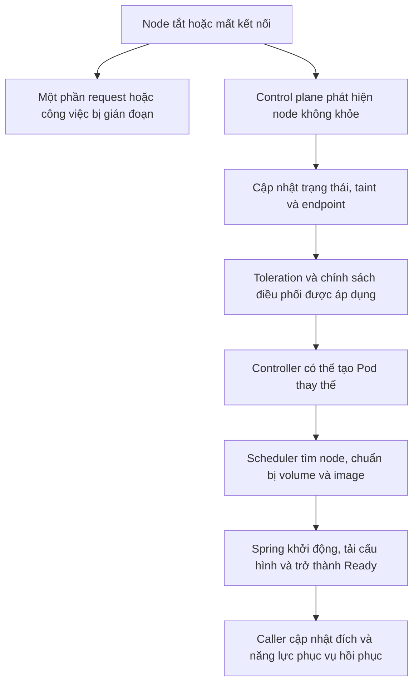

# Ảnh hưởng của eviction, node hỏng và scale down

Một ứng dụng Spring chạy ổn trên một Pod chưa chắc tiếp tục đúng khi Pod đó bị đẩy khỏi node, node mất kết nối hoặc số replica bị giảm. Ba tình huống cùng làm giảm năng lực phục vụ, nhưng có cơ chế khởi phát, thời gian phản ứng và cơ hội dừng an toàn khác nhau.

Bài học thuộc chương **Vòng đời Pod** của Spring Cloud Kubernetes. Ta dùng dịch vụ `catalog-api` có ba replica để phân tích tác động lên HTTP, dữ liệu, công việc nền và khả năng phục hồi. Mục tiêu là chọn đúng biện pháp: PDB cho gián đoạn qua Eviction API, tài nguyên và phân bố Pod cho sự cố node, chính sách autoscaling cho giảm replica, cùng cơ chế nghiệp vụ chịu được tiến trình mất đột ngột.

## 1. Đầu tiên phải xác định ai làm Pod rời khỏi hệ thống

| Tình huống | Bên khởi phát | Vai trò của PDB | Cơ hội graceful shutdown |
| --- | --- | --- | --- |
| Eviction qua API, ví dụ drain thông thường | Công cụ hoặc controller gọi `pods/eviction` | API kiểm tra ngân sách trước khi chấp nhận | Có khi node và kubelet còn hoạt động, trong grace period |
| Node-pressure eviction | Kubelet cần thu hồi tài nguyên | Không được PDB ngăn chặn | Phụ thuộc ngưỡng soft/hard; có thể dừng ngay |
| Node tắt nguồn, kernel panic hoặc mất mạng | Sự cố hạ tầng, sau đó control plane phản ứng | Không ngăn được gián đoạn | Không bảo đảm có callback hoặc tín hiệu đến JVM |
| Scale down Deployment hoặc StatefulSet | Thay đổi số replica mong muốn, thủ công hoặc autoscaler | Không phải hàng rào chống giảm replica | Thường có đường dừng bình thường nếu node còn hoạt động |
| Xóa Pod trực tiếp | Người vận hành hoặc controller dùng DELETE | Bỏ qua kiểm tra PDB của Eviction API | Phụ thuộc grace period và trạng thái node |

Không phải mọi gián đoạn do con người chủ động đều được PDB chặn. Xóa Pod trực tiếp và rollout là những ví dụ cần phân biệt với thao tác qua Eviction API. [Kubernetes — Disruptions](https://kubernetes.io/docs/concepts/workloads/pods/disruptions/).

Cũng cần phân biệt **container restart** với **Pod bị thay thế**:

- Container có thể restart trong cùng Pod; Pod UID vẫn giữ nguyên.
- Pod bị eviction hoặc bị xóa không được chuyển nguyên trạng sang node khác.
- Controller có thể tạo Pod mới với UID mới; tên và IP có thể đổi.
- Pod đứng riêng, không có controller phù hợp, không tự có replica thay thế chỉ vì trước đó đã chạy được.
- Khi scale từ ba xuống hai, controller duy trì mục tiêu hai; nó không tạo lại Pod thứ ba chỉ vì Pod cũ vừa dừng.

Khi chẩn đoán, theo dõi Pod UID, owner, node, thời điểm và desired replicas. Chỉ nhìn số lần restart sẽ bỏ sót nhiều lần thay Pod.

## 2. Eviction API và PodDisruptionBudget bảo vệ đến đâu?

Eviction API kiểm tra xem việc loại Pod có vi phạm PDB đang chọn Pod đó hay không. Yêu cầu có thể nhận `429 Too Many Requests` vì chưa đủ ngân sách, nhưng `429` cũng có thể đến từ giới hạn request API. Cần đọc nội dung lỗi. [Kubernetes — API-initiated Eviction](https://kubernetes.io/docs/concepts/scheduling-eviction/api-eviction/).

Với ba Pod đều Ready và PDB `minAvailable: 2`, ngân sách thông thường cho phép loại một Pod. Nếu một Pod đã không khỏe, việc tiếp tục loại một Pod khỏe có thể bị chặn. Gián đoạn ngoài ý muốn vẫn làm giảm số Pod khỏe và ảnh hưởng ngân sách cho thao tác tiếp theo.

`disruptionsAllowed` là trạng thái controller tính toán, không phải khóa đặt trước cho một người vận hành. Khi nhiều thao tác đồng thời, phải quan sát kết quả thực tế.

PDB không làm các việc sau:

- Tạo thêm replica hoặc tài nguyên node.
- Bảo đảm hai Pod còn lại đủ sức chịu toàn bộ tải.
- Bảo vệ khỏi node-pressure eviction, mất điện hoặc kernel panic.
- Ép mọi controller sử dụng Eviction API.
- Buộc ứng dụng hoàn tất transaction, HTTP hay công việc nền.
- Ngăn mọi thao tác scale xuống dưới số Pod bạn mong muốn về mặt nghiệp vụ.

Ví dụ, PDB yêu cầu hai Pod khỏe không có nghĩa là lệnh đổi desired replicas xuống một sẽ bị từ chối. Việc giảm replica và kiểm tra ngân sách eviction là hai đường điều khiển khác nhau.

### Đừng để cấu hình PDB vô tình chọn sai đối tượng

Dùng selector trùng nhóm Pod cần bảo vệ. Với `policy/v1`, selector rỗng `{}` chọn mọi Pod trong namespace. Một PDB chỉ khai báo `minAvailable` hoặc `maxUnavailable`, không dùng cả hai. Nếu dùng phần trăm, phải tính cả quy tắc làm tròn. [Kubernetes — Configure a PDB](https://kubernetes.io/docs/tasks/run-application/configure-pdb/).

Có thể cân nhắc `unhealthyPodEvictionPolicy: AlwaysAllow` trên cluster hỗ trợ để drain được Pod Running nhưng chưa khỏe. Chính sách này không cho phép bỏ qua ngân sách với mọi Pod khỏe; phải hiểu đúng phạm vi trước khi dùng. Một Pod lỗi readiness có thể chính là lý do drain mắc lại.

## 3. Node-pressure eviction: ứng dụng có thể không được chờ

Kubelet có thể cần thu hồi memory, dung lượng filesystem, inode hoặc PID. Khi loại Pod vì áp lực node, nó không tuân theo PDB hay bảo đảm grace period khai báo ở Pod. Hard threshold dùng khoảng dừng `0s`; soft threshold phụ thuộc cấu hình eviction của kubelet. Pod bị loại được đặt phase `Failed`. [Kubernetes — Node-pressure Eviction](https://kubernetes.io/docs/concepts/scheduling-eviction/node-pressure-eviction/).

Không được suy luận:

```text
terminationGracePeriodSeconds: 45
⇒ mọi loại eviction đều cho JVM 45 giây dọn dẹp
```

Một JVM bị loại ngay có thể mất công việc chỉ lưu trong RAM, request chưa trả response và log chưa chuyển tới hệ thống tập trung.

### Phân biệt các tín hiệu bộ nhớ

| Tín hiệu | Hướng hiểu |
| --- | --- |
| Java `OutOfMemoryError` | JVM không cấp phát được một loại vùng nhớ; cần xem loại lỗi và cấu hình JVM |
| Container `OOMKilled` | Tiến trình bị kill do điều kiện OOM; kiểm tra limit và sự kiện liên quan |
| Pod `Failed` với reason `Evicted` | Pod bị kubelet loại; xem thông điệp memory, storage hoặc tài nguyên thiếu |
| CPU throttling | Có thể làm chậm xử lý, GC và shutdown; không đồng nghĩa Pod bị eviction |

`requests` ảnh hưởng lập lịch và là thông tin quan trọng khi quản lý tài nguyên. `limits` giới hạn việc sử dụng theo cơ chế của từng tài nguyên. QoS hoặc priority cao không khiến Pod miễn nhiễm với mọi kiểu sự cố. [Kubernetes — Resource Management](https://kubernetes.io/docs/concepts/configuration/manage-resources-containers/).

Đối với Spring/JVM, bộ nhớ container gồm heap, metaspace, direct buffer, thread stack và các phần native khác. Đặt heap sát toàn bộ memory limit có thể khiến tiến trình bị kill dù heap chưa đạt mức mong đợi.

Cần quản lý cả log, file tạm và writable layer. Tăng memory không giải quyết được `DiskPressure`; tăng ephemeral-storage request cũng không làm local filesystem trở thành nơi lưu bền.

## 4. Node hỏng: tách thời gian mất phục vụ khỏi thời gian tạo Pod mới

Node tắt nguồn có thể làm request thất bại ngay tại thời điểm sự cố. Control plane cần thời gian nhận biết qua trạng thái node và heartbeat/Lease; sau đó mới thực hiện các bước điều phối thích hợp. [Kubernetes — Nodes](https://kubernetes.io/docs/concepts/architecture/nodes/).

Một dòng thời gian khái niệm:



Các nhánh có thể chạy song song; Pod thay thế không bảo đảm xuất hiện ngay sau khi node đổi trạng thái. Thời gian mất endpoint và thời gian đủ capacity cũng không nhất thiết trùng nhau.

Nhiều Pod được tự động thêm toleration `300` giây cho `node.kubernetes.io/not-ready` và `node.kubernetes.io/unreachable` nếu chưa khai báo tường minh. Đây là thời gian chờ liên quan đến taint, không phải cam kết ứng dụng phục hồi đúng sau năm phút. DaemonSet và cấu hình riêng có thể khác. [Kubernetes — Taint-based Evictions](https://kubernetes.io/docs/concepts/scheduling-eviction/taint-and-toleration/#taint-based-evictions).

Một ngân sách phục hồi có thể phân tích thành:

```text
T_phuc_hoi_capacity
  ≈ T_phat_hien
  + T_cho_chinh_sach_va_dieu_phoi
  + T_lap_lich
  + T_chuan_bi_image_volume
  + T_khoi_dong_va_ready
  + T_cap_nhat_duong_goi
```

Công thức phục vụ điều tra, không thay thế đo đạc. Có thể không cần đợi Pod mới để tiếp tục phục vụ nếu các replica còn lại đủ capacity.

### Mất kết nối không chứng minh tiến trình đã chết

Node có thể mất đường tới control plane nhưng ứng dụng vẫn gọi được database hoặc broker. Vì thế, “Pod không còn được API coi là hoạt động” chưa đồng nghĩa “tiến trình cũ không còn khả năng ghi”.

Với singleton worker hoặc StatefulSet, phải xét quyền sở hữu dữ liệu và fencing. Force delete có thể giải phóng danh tính trên API trong khi tiến trình cũ chưa được xác nhận đã dừng, tạo nguy cơ trùng owner hoặc split brain. [Kubernetes — Force Delete StatefulSet Pods](https://kubernetes.io/docs/tasks/run-application/force-delete-stateful-set-pod/).

Nếu Pod mới chờ attach volume, phải điều tra node và cơ chế storage trước khi ép detach hay tạo owner mới. PVC tồn tại không có nghĩa mọi dữ liệu local, buffer hoặc transaction chưa commit đều đã được bảo toàn.

## 5. Scale down: mục tiêu mới là ít Pod hơn

Có hai việc dễ nhầm:

| Kiểu giảm quy mô | Mục tiêu thay đổi | Tác động chính |
| --- | --- | --- |
| Giảm replica ứng dụng | `spec.replicas` hoặc scale subresource | Ít tiến trình ứng dụng hơn; một phần Pod bị kết thúc |
| Giảm số node | Capacity hạ tầng | Pod cần chuyển chỗ hoặc được tạo lại; desired replicas của ứng dụng có thể vẫn giữ nguyên |

Công cụ giảm node thường cần drain và kiểm tra khả năng chuyển workload; hành vi cụ thể phụ thuộc implementation. Không suy ra mọi autoscaler đều tôn trọng PDB hoặc có cùng điều kiện dừng chỉ từ tên gọi.

HPA thay đổi quy mô workload theo metric và chính sách. Nếu HPA đang quản lý Deployment, một lệnh scale thủ công có thể bị vòng reconcile thay đổi lại.

Khi giảm replica, ứng dụng phải chấp nhận việc một replica bất kỳ có thể rời đi:

- Không giữ session quan trọng duy nhất trong RAM của Pod.
- Không chia công việc cố định theo danh sách Pod IP chưa có cơ chế cập nhật.
- Dừng nhận việc mới, chờ việc đang chạy trong giới hạn khi có cơ hội.
- Với consumer, chuẩn bị rebalance và redelivery theo cơ chế broker.
- Với leader, đóng quyền chạy cục bộ và bảo vệ kết quả khi chuyển quyền.

Scale down có thể giảm tổng số connection pool nhưng làm tăng tải trên từng replica. Cache lạnh sau các lần thay Pod và retry dồn về replica còn lại có thể kéo độ trễ lên cao dù số Pod vẫn đáp ứng cấu hình tối thiểu.

### Ví dụ tính capacity

Giả sử phép đo cho thấy một Pod phục vụ ổn định khoảng `80 request/giây` với loại tải đang xét. Hệ thống nhận `150 request/giây`:

| Pod thực sự phục vụ | Capacity lý tưởng hóa | Mức dùng theo phép tính đơn giản |
| --- | --- | --- |
| 3 | 240 request/giây | Khoảng 62,5% |
| 2 | 160 request/giây | Khoảng 93,8% |
| 1 | 80 request/giây | Khoảng 187,5% |

Hai Pod Ready không có nghĩa là còn biên an toàn. Các con số chỉ minh họa; capacity không luôn tăng tuyến tính vì database, phân bố tải và tài nguyên dùng chung.

## 6. Một cấu hình nền để thực hành

Giả sử namespace `pod-resilience-lab` đã tồn tại, cluster có nhiều worker node và image chứa ứng dụng Spring Boot có web cùng Actuator. Các giá trị tài nguyên dưới đây phục vụ minh họa, cần thay bằng kết quả đo của ứng dụng.

Image được giả định chạy executable jar và chuyển tiếp đúng tín hiệu tới JVM. Các `args` là tham số dòng lệnh Spring Boot:

```yaml
apiVersion: apps/v1
kind: Deployment
metadata:
  name: catalog-api
  namespace: pod-resilience-lab
spec:
  replicas: 3
  minReadySeconds: 10
  strategy:
    type: RollingUpdate
    rollingUpdate:
      maxUnavailable: 0
      maxSurge: 1
  selector:
    matchLabels:
      app: catalog-api
  template:
    metadata:
      labels:
        app: catalog-api
    spec:
      terminationGracePeriodSeconds: 45
      topologySpreadConstraints:
        - maxSkew: 1
          topologyKey: kubernetes.io/hostname
          whenUnsatisfiable: ScheduleAnyway
          labelSelector:
            matchLabels:
              app: catalog-api
      containers:
        - name: app
          image: your-registry/catalog-api:your-tested-tag
          args:
            - "--server.port=8080"
            - "--server.shutdown=graceful"
            - "--spring.lifecycle.timeout-per-shutdown-phase=20s"
            - "--management.endpoint.health.probes.enabled=true"
            - "--management.endpoint.health.probes.add-additional-paths=true"
          ports:
            - name: http
              containerPort: 8080
          env:
            - name: POD_NAME
              valueFrom:
                fieldRef:
                  fieldPath: metadata.name
            - name: POD_UID
              valueFrom:
                fieldRef:
                  fieldPath: metadata.uid
          resources:
            requests:
              cpu: 250m
              memory: 512Mi
              ephemeral-storage: 128Mi
            limits:
              cpu: "1"
              memory: 1Gi
              ephemeral-storage: 1Gi
          startupProbe:
            httpGet:
              path: /livez
              port: http
            periodSeconds: 3
            failureThreshold: 40
          readinessProbe:
            httpGet:
              path: /readyz
              port: http
            periodSeconds: 2
            failureThreshold: 1
          livenessProbe:
            httpGet:
              path: /livez
              port: http
            periodSeconds: 10
            failureThreshold: 3
---
apiVersion: v1
kind: Service
metadata:
  name: catalog-api
  namespace: pod-resilience-lab
spec:
  selector:
    app: catalog-api
  ports:
    - name: http
      port: 80
      targetPort: http
---
apiVersion: policy/v1
kind: PodDisruptionBudget
metadata:
  name: catalog-api
  namespace: pod-resilience-lab
spec:
  minAvailable: 2
  selector:
    matchLabels:
      app: catalog-api
```

Cần đọc cấu hình theo từng trách nhiệm:

| Cấu hình | Ý nghĩa | Không bảo đảm |
| --- | --- | --- |
| `replicas: 3` | Mục tiêu của Deployment khi không bị bộ điều khiển khác đổi | Ba Pod luôn tồn tại và phục vụ tốt |
| `minAvailable: 2` | Ngân sách kiểm tra với eviction phù hợp | Đủ capacity hoặc ngăn mọi lệnh giảm replica |
| `ScheduleAnyway` theo hostname | Ưu tiên trải Pod giữa các node | Mỗi Pod chắc chắn trên một node riêng |
| `maxUnavailable: 0` | Chính sách cập nhật Deployment | Chặn node crash hoặc thay PDB |
| `terminationGracePeriodSeconds: 45` | Cơ hội dừng trong đường kết thúc bình thường | Hard eviction hoặc node mất điện vẫn chờ 45 giây |

`ScheduleAnyway` là ưu tiên, còn `DoNotSchedule` là ràng buộc lập lịch có thể khiến Pod Pending khi thiếu miền phù hợp. Phân bố Pod cũng có thể mất cân bằng sau khi xóa hoặc scale down; scheduler không tự chuyển mọi Pod đang chạy để cân lại. [Kubernetes — Pod Topology Spread Constraints](https://kubernetes.io/docs/concepts/scheduling-eviction/topology-spread-constraints/).

Nếu phải chịu lỗi cả zone, cần thiết kế thêm theo `topology.kubernetes.io/zone` và capacity tại các zone còn lại. Ba node cùng một zone vẫn có chung miền lỗi.

Spring Boot dùng `timeout-per-shutdown-phase` cho từng phase, không phải cho toàn bộ vòng đời dừng. Nếu có thêm worker, consumer hoặc `preStop`, phải tính tổng thời gian và thứ tự đóng tài nguyên. [Spring Boot — Graceful Shutdown](https://docs.spring.io/spring-boot/3.5/reference/web/graceful-shutdown.html).

Readiness phải phản ánh khả năng nhận lưu lượng; liveness không nên thất bại chỉ vì API server hoặc dependency dùng chung đang lỗi. Nếu Spring Security được bật, bảo đảm kubelet gọi được các đường probe theo chính sách đã thiết kế.

## 7. Giới hạn tốc độ scale down bằng HPA

Sau phần thực hành scale thủ công, có thể bổ sung HPA. Ví dụ yêu cầu Metrics API hoạt động và ứng dụng có CPU request phù hợp:

```yaml
apiVersion: autoscaling/v2
kind: HorizontalPodAutoscaler
metadata:
  name: catalog-api
  namespace: pod-resilience-lab
spec:
  scaleTargetRef:
    apiVersion: apps/v1
    kind: Deployment
    name: catalog-api
  minReplicas: 3
  maxReplicas: 9
  metrics:
    - type: Resource
      resource:
        name: cpu
        target:
          type: Utilization
          averageUtilization: 70
  behavior:
    scaleDown:
      stabilizationWindowSeconds: 300
      policies:
        - type: Pods
          value: 1
          periodSeconds: 60
```

`stabilizationWindowSeconds` dùng lịch sử khuyến nghị để giảm dao động khi metric thay đổi. Policy trên giới hạn tốc độ giảm theo số Pod trong khoảng đánh giá, không ra lệnh cứ đúng mỗi phút xóa một Pod. CPU utilization còn phụ thuộc CPU request. [Kubernetes — Horizontal Pod Autoscaling](https://kubernetes.io/docs/concepts/workloads/autoscaling/horizontal-pod-autoscale/).

Ba điểm cần phối hợp:

1. `minReplicas` là sàn HPA sử dụng trong điều chỉnh thông thường; nó không phải admission control ngăn mọi người có quyền sửa Deployment.
2. Giảm tối đa một Pod trong một khoảng không bảo đảm Pod còn lại đủ capacity. Cần theo dõi latency, error rate và backlog.
3. Metric CPU có thể không phản ánh công việc đang chờ I/O, consumer lag hoặc cache chưa nóng. Chọn metric phải phù hợp loại tải.

Không dùng PDB để thay chính sách scale down. Cũng không giảm toleration, grace period và stabilization window cùng lúc rồi chỉ đo số Pod: sẽ khó biết thay đổi nào làm thời gian phục hồi tốt hơn hoặc làm lỗi tăng lên.

## 8. Ứng dụng Spring cần chịu được thay Pod như thế nào?

### Dữ liệu và tiến độ công việc

| Loại trạng thái | Khi Pod hoặc node mất | Thiết kế cần xem xét |
| --- | --- | --- |
| Cache/session trong RAM | Không tự chuyển sang replica mới | Cache có thể tái tạo, session dùng kho phù hợp nếu cần chia sẻ |
| File ở writable layer hoặc `emptyDir` | Không phải dữ liệu bền qua thay Pod; node hỏng có thể làm mất truy cập | Dùng storage phù hợp hoặc coi là dữ liệu tạm |
| PVC/PV | Có lifecycle và giới hạn attach/topology riêng | Kiểm tra mode truy cập, CSI, thời gian khôi phục, backup |
| Transaction database | Tùy trạng thái commit, rollback và kết nối | Phải xác định kết quả nghiệp vụ sau lỗi |
| Công việc nền chưa lưu checkpoint | Có thể mất tiến độ hoặc bị chạy lại | Ghi tiến độ bền vững, chia nhỏ và xử lý lặp an toàn |

`emptyDir` có thể tồn tại qua container restart trong cùng Pod, nhưng không phải cơ chế giữ dữ liệu khi Pod bị thay thế.

Đối với công việc có tác động bên ngoài, nên xác định khóa nghiệp vụ ổn định. Retry cùng một công việc phải giữ cùng idempotency key; tên Pod hoặc UUID mới cho mỗi lần retry sẽ không giúp khử trùng lặp.

Nếu kết quả và bản ghi “đã xử lý” nằm trong database, chúng cần transaction phù hợp. Nếu gọi API bên ngoài, transaction local không thu hồi được request đã thành công ở phía đó. Có thể cần outbox và hỗ trợ idempotency của hệ thống đích.

Với bài toán một owner duy nhất, fencing tại nơi ghi giải quyết nguy cơ owner cũ vẫn còn sống. Một cờ leader trong RAM hoặc một lần `isLeader()` trước transaction không tự chặn được mọi lần ghi muộn.

### Đường gọi giữa các dịch vụ

Khi một Pod biến mất, caller có thể vẫn giữ connection hoặc danh sách instance cũ trong một khoảng. Thiết kế timeout có giới hạn, retry có backoff và tránh retry đồng loạt.

Chỉ retry tự động khi biết thao tác an toàn hoặc có idempotency. Lỗi kết nối sau khi gửi request không chứng minh server chưa thực hiện thao tác.

Nếu dùng Kubernetes Service DNS, có thể không cần thêm DiscoveryClient chỉ để phục hồi sau thay Pod. Nếu dùng Spring Cloud LoadBalancer chọn Pod trực tiếp, cần quan sát cả cache instance và connection pool phía caller.

Trong Spring Cloud Kubernetes 3.3, `spring.cloud.kubernetes.discovery.include-not-ready-addresses` mặc định `false`. Bật nó có thể khiến caller chọn địa chỉ chưa Ready, đi ngược mục tiêu tránh Pod chưa sẵn sàng. Nguồn khám phá Endpoints hay EndpointSlice còn phụ thuộc phiên bản và cấu hình. [Spring Cloud Kubernetes — Application Properties](https://docs.spring.io/spring-cloud-kubernetes/reference/3.3/appendix.html).

### Cấu hình và RBAC lúc replica mới khởi động

Pod mới cần nạp lại cấu hình, Secret và hoàn thành khởi tạo. Nếu ứng dụng lấy dữ liệu qua API, `403` do ServiceAccount hoặc RoleBinding sai có thể khiến replica thay thế không trở thành Ready dù image cũ từng chạy tốt.

Phải phân biệt lỗi quyền với lỗi API tạm thời; retry nhiều lần không sửa được RBAC. Chỉ cấp quyền cần cho tính năng thật sự sử dụng.

Configuration Watcher xử lý cập nhật cấu hình, không thay thế Deployment, PDB hoặc việc khôi phục tiến trình trên node hỏng. Nếu một thay đổi cấu hình gây restart đồng loạt, nó còn có thể làm giảm capacity trong lúc cluster đang xử lý gián đoạn khác.

## 9. Chuẩn bị bằng chứng trước khi gây gián đoạn

Các lệnh trong bài dùng PowerShell và dành cho cluster lab. Trước khi thử, ghi nhận phiên bản cluster, controller đang quản lý ứng dụng, HPA có hoạt động không và Pod phân bố ở đâu.

```powershell
$labNamespace = 'pod-resilience-lab'

kubectl -n $labNamespace get deployment catalog-api
kubectl -n $labNamespace get hpa
kubectl -n $labNamespace get pdb catalog-api -o wide
kubectl -n $labNamespace get pods -l app=catalog-api -o wide
kubectl -n $labNamespace get pods -l app=catalog-api -o 'custom-columns=NAME:.metadata.name,UID:.metadata.uid,NODE:.spec.nodeName,PHASE:.status.phase,REASON:.status.reason'
kubectl get nodes
```

Để nhận diện replica trả lời, có thể thêm endpoint chỉ dùng trong lab vào ứng dụng mẫu:

```java
package example.catalog;

import java.util.Map;
import java.util.Objects;

import org.springframework.web.bind.annotation.GetMapping;
import org.springframework.web.bind.annotation.RestController;

@RestController
public class LabInstanceController {

    @GetMapping("/lab/instance")
    public Map<String, String> instance() {
        return Map.of(
                "pod", Objects.toString(System.getenv("POD_NAME"), "local"),
                "uid", Objects.toString(System.getenv("POD_UID"), "local"));
    }
}
```

Đây là endpoint chẩn đoán cho bài thực hành; nó không phải probe đánh giá readiness. Cấu hình security nếu có phải cho phép client lab gọi theo chính sách đã định.

Chuẩn bị một Pod client có `curl`, tên `resilience-client`, ở ngoài node sẽ gây sự cố. Gọi qua Service:

```powershell
kubectl -n $labNamespace exec resilience-client -- curl --max-time 5 -sS http://catalog-api/lab/instance
```

Một request có thể không đi qua mọi replica. Dùng một công cụ sinh tải phù hợp để đo nhiều request, persistent connection và tỷ lệ lỗi; giữ lại Pod UID trả lời cùng request ID khi có.

## 10. Thực hành ba đường gián đoạn riêng biệt

Ban đầu chỉ triển khai Deployment, Service và PDB, chưa áp HPA. Mỗi phép thử bắt đầu từ ba replica khỏe, tải thử có kiểm soát và dữ liệu có thể khôi phục.

### Thử A: Drain node qua Eviction API

Chọn một worker node lab chứa Pod của bài. Drain tác động đến workload trên cả node, không chỉ namespace đang xem, nên phải kiểm tra mọi Pod trên node trước:

```powershell
$labNode = 'replace-with-dedicated-lab-worker'

kubectl get pods --all-namespaces --field-selector "spec.nodeName=$labNode" -o wide
kubectl -n $labNamespace get pdb catalog-api -o yaml
kubectl drain $labNode --ignore-daemonsets --timeout=5m
```

Đây là node dành riêng cho phép thử, không phải control-plane node hay node chứa công việc ngoài phạm vi lab. Lệnh không bật chế độ bỏ qua eviction và không tự cho phép xóa dữ liệu `emptyDir`.

Theo dõi ở terminal khác:

```powershell
kubectl -n pod-resilience-lab get pods -l app=catalog-api -w
kubectl -n pod-resilience-lab get pdb catalog-api -w
```

Kỳ vọng:

- Node bị đánh dấu không nhận Pod mới theo đường lập lịch thông thường.
- Eviction Pod khỏe bị giới hạn theo ngân sách.
- Controller cố duy trì ba replica bằng Pod mới trên node phù hợp.
- Nếu thiếu capacity hoặc Pod mới không Ready, drain có thể chờ hoặc timeout.
- Service vẫn có thể phát sinh lỗi ngắn tùy kết nối và ứng dụng; PDB không cam kết không có HTTP lỗi.

`--ignore-daemonsets` bỏ qua Pod do DaemonSet quản lý trong quá trình drain, không có nghĩa là các Pod đó đã dừng. `--disable-eviction` làm drain dùng DELETE và bỏ kiểm tra PDB, nên không dùng nó trong phép thử ngân sách. [Kubernetes — kubectl drain](https://kubernetes.io/docs/reference/kubectl/generated/kubectl_drain/).

Sau khi hoàn tất thử nghiệm và node đủ điều kiện trở lại:

```powershell
kubectl uncordon $labNode
```

Uncordon cho phép lập lịch trở lại; nó không khôi phục Pod UID cũ hoặc tự đưa mọi Pod đã chuyển đi về node ban đầu.

### Thử B: Scale xuống dưới minAvailable

Khi không có HPA đang reconcile và ba replica đã khỏe, giảm mục tiêu xuống một trong lab:

```powershell
kubectl -n pod-resilience-lab scale deployment catalog-api --replicas=1
kubectl -n pod-resilience-lab get deployment catalog-api
kubectl -n pod-resilience-lab get pods -l app=catalog-api -o wide
kubectl -n pod-resilience-lab get pdb catalog-api -o wide
```

Kỳ vọng quan trọng: PDB `minAvailable: 2` không khiến yêu cầu scale tự bị từ chối. Desired replicas trở thành một; khi trạng thái hội tụ, có thể chỉ còn một Pod phục vụ và không còn ngân sách eviction Pod khỏe đó.

Trong giai đoạn chuyển tiếp, số Pod liệt kê có thể lớn hơn một do Pod đang Terminating. Phải phân biệt desired replicas, Pod còn tồn tại, Pod Ready và năng lực thực tế.

Sau khi đã ghi nhận kết quả, khôi phục mục tiêu:

```powershell
kubectl -n pod-resilience-lab scale deployment catalog-api --replicas=3
kubectl -n pod-resilience-lab rollout status deployment/catalog-api --timeout=3m
```

Cuối cùng mới áp dụng HPA ở phần trước và quan sát hành vi theo metric. Nếu thử điều khiển thủ công khi HPA đang chạy, phải ghi nhận đó là hai tác nhân cùng thay đổi quy mô, không kết luận lỗi dựa trên một lần đọc.

### Thử C: Node mất liên lạc hoặc dừng đột ngột

Trong môi trường có quyền điều khiển worker lab, dùng công cụ fault injection hoặc cơ chế quản lý VM để gây đúng một loại lỗi đã chọn:

1. Xác nhận Pod và node đích, cùng các replica còn khỏe.
2. Gây dừng worker đột ngột hoặc cô lập đường liên lạc đã xác định.
3. Ghi thời điểm client bắt đầu lỗi và khi node đổi Ready/taint.
4. Theo dõi endpoint, trạng thái Pod cũ và Pod mới.
5. Ghi thời điểm Pod mới Ready và tải đạt mức ổn định.
6. Khôi phục hạ tầng, kiểm tra tiến trình cũ và công việc có bị chạy lại không.

Drain không mô phỏng node mất điện. Cordon cũng chỉ ngăn lập lịch mới, không chứng minh ứng dụng trên node đã chết.

Với partition, phải biết đường nào bị ngắt. Ngắt control plane nhưng giữ đường database tạo tình huống khác với tắt hoàn toàn máy. Không force delete để làm biểu đồ phục hồi đẹp hơn khi chưa xác nhận quyền ghi của tiến trình cũ đã bị thu hồi.

### Thử bổ sung: Pressure eviction và OOM

Nếu cần kiểm chứng pressure eviction, thực hiện trên worker lab có giới hạn và quy trình dọn dẹp riêng. Công cụ gây tải phải tạo đúng áp lực node; chỉ cho một container vượt memory limit có thể dẫn tới `OOMKilled`, không chứng minh kubelet đã thực hiện node-pressure eviction.

Bằng chứng cần có gồm condition của node, reason/message Pod, event và cấu hình eviction liên quan. Không kết luận chỉ từ việc một tiến trình Java đã biến mất.

## 11. Điều tra theo triệu chứng, không chỉ đếm replica

| Triệu chứng | Hướng điều tra |
| --- | --- |
| Drain liên tục bị `429` | Nội dung lỗi, PDB selector, currentHealthy, desiredHealthy, disruptionsAllowed |
| Pod thay thế Pending | Resource requests, node còn lại, taint, affinity/spread, quota hoặc volume topology |
| Pod mới chạy nhưng chưa Ready | Cấu hình, Secret, RBAC, dependency, startup và đường probe |
| Pod mới chờ volume | Trạng thái node cũ, attach/detach, CSI, quyền sở hữu dữ liệu |
| Node NotReady nhưng Pod cũ còn Terminating | Kubelet có liên lạc được không, toleration và tiến trình thực tế |
| Nhiều Pod Failed/Evicted | Message tài nguyên thiếu, áp lực node và phân bố workload |
| Chỉ còn một replica dù PDB yêu cầu hai | Desired replicas, HPA, tác nhân scale; không coi PDB là minReplicas |
| Pod đủ Ready nhưng latency tăng | Capacity mỗi Pod, retry, CPU throttling, GC, downstream, cache |
| Hai worker cùng tạo tác động | Idempotency key, cơ chế claim, leader cũ hồi phục và fencing |

Các lệnh đọc trạng thái:

```powershell
$problemPod = 'replace-with-observed-pod'
$problemNode = 'replace-with-observed-node'

kubectl -n $labNamespace describe pod $problemPod
kubectl describe node $problemNode
kubectl -n $labNamespace get events --sort-by=.metadata.creationTimestamp
kubectl -n $labNamespace get endpointslices -l kubernetes.io/service-name=catalog-api -o yaml
kubectl -n $labNamespace get hpa catalog-api -o yaml
kubectl -n $labNamespace logs $problemPod --all-containers=true --since=10m
kubectl top nodes
kubectl -n $labNamespace top pods -l app=catalog-api
```

Lệnh đọc HPA chỉ có kết quả khi đã tạo HPA. `kubectl top` cần hệ thống metric tương ứng và thể hiện mẫu sử dụng hiện tại; nó không thay thế lịch sử thời điểm node bị pressure.

`kubectl logs --previous` có ích khi container đã restart trong một Pod vẫn còn tồn tại. Nó không tự tìm lại mọi Pod đã bị xóa. Nên thu log tập trung cùng Pod UID và node để nối được dòng thời gian.

Một báo cáo sự cố tối thiểu nên giữ:

- Desired replicas, Ready/Available replicas và vị trí các Pod.
- Thời điểm bắt đầu lỗi, node đổi trạng thái, eviction/deletion và Pod mới Ready.
- Error rate, latency và backlog trong toàn bộ khoảng phục hồi.
- Công việc mất tiến độ, retry, trùng lặp bị chặn và lần ghi bị từ chối do quyền cũ.
- Thay đổi nào do HPA, drain, người vận hành hoặc công cụ quản lý node thực hiện.

Đừng dùng “Pod mới đã Running” làm thời điểm kết thúc sự cố. Chỉ kết thúc phép đo khi chức năng cần thiết và mức phục vụ đã trở lại tiêu chí đặt trước.

## 12. Tiêu chí hoàn thành

Triển khai đạt yêu cầu khi có thể giải thích và chứng minh:

1. Đã phân loại đúng API eviction, pressure eviction, node hỏng và scale down.
2. Hiểu PDB bảo vệ đường nào, không nhầm nó với replica tối thiểu hoặc capacity dự phòng.
3. Đã quan sát UID và owner khi Pod bị thay thế, thay vì coi đó là chuyển nguyên Pod sang node khác.
4. Replica được phân bố và có đủ tài nguyên để chịu mức lỗi đã chọn.
5. Graceful shutdown được dùng khi có cơ hội, còn tính đúng đắn dữ liệu không phụ thuộc hoàn toàn vào callback.
6. Caller xử lý được đích cũ, timeout và retry mà không tạo tác động lặp sai.
7. HPA, chính sách node và thời gian khởi động cùng nằm trong mục tiêu phục hồi.
8. Tiến trình cũ hồi phục không làm phát sinh owner ghi dữ liệu trái quyền.
9. Kết quả thử nghiệm đo được cả lỗi người dùng và tiến độ nghiệp vụ.

Spring Cloud Kubernetes giúp ứng dụng tích hợp với môi trường cluster, nhưng khả năng chịu eviction, node hỏng và scale down còn phụ thuộc controller, tài nguyên, hạ tầng và thiết kế dữ liệu. Lựa chọn tính năng nên bắt đầu từ loại lỗi cần chịu và bằng chứng phục hồi cần thu thập.
