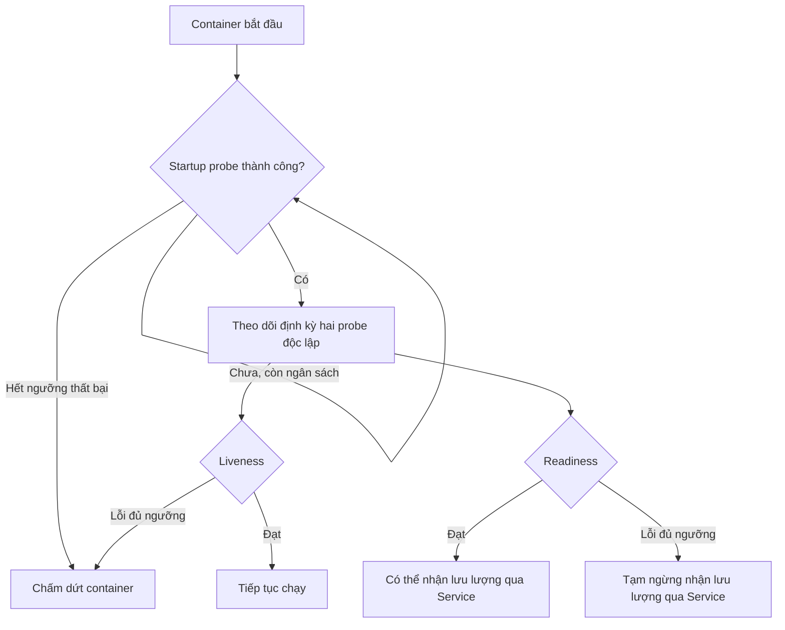

# Tách liveness và readiness bằng Spring Boot Actuator

## Mục tiêu và phạm vi

Trong chương **Actuator và sức khỏe** của module **SPRING_CLOUD_KUBERNETES**, bài học này giúp bạn thiết kế tín hiệu sức khỏe để Kubernetes đưa ra đúng hành động: tạm ngừng chuyển lưu lượng đến một instance hoặc khởi động lại container của instance đó.

Sau bài học, bạn có thể:

- Phân biệt liveness, readiness và startup probe qua tác động vận hành.
- Cấu hình hai health group riêng bằng Spring Boot Actuator.
- Chọn đường dẫn, cổng và ngưỡng kiểm tra phù hợp cho một ứng dụng Java.
- Quan sát readiness thay đổi mà không làm tăng số lần restart.
- Tránh biến sự cố ConfigMap, Secret, DiscoveryClient hoặc hệ thống phụ thuộc thành vòng lặp restart.

Ví dụ dùng Java 17 trở lên, Spring Boot **3.5.x**, ứng dụng Spring MVC có cổng HTTP `8080` và context path mặc định. Dependency được quản lý bởi Spring Boot của dự án. Nếu ứng dụng có Spring Cloud Kubernetes, hãy giữ bộ phiên bản Spring Boot/Spring Cloud tương thích mà dự án đã chọn; bài học không yêu cầu thêm một Kubernetes starter chỉ để cung cấp probe.

## 1. Ba câu hỏi dẫn đến ba hành động

Giả sử `orders-api` có ba replica. Một replica đang nạp lại dữ liệu cục bộ, còn hai replica vẫn phục vụ được. Khởi động lại replica đang nạp dữ liệu có thể khiến nó phải làm lại công việc từ đầu. Tạm đưa nó ra khỏi tập đích nhận lưu lượng phù hợp hơn.

Ngược lại, nếu trạng thái nội bộ đã hỏng và instance không thể tự phục hồi, việc giữ container chạy vô hạn không đem lại lợi ích. Khi đó mới cần tín hiệu cho phép nền tảng khởi động lại.

| Kiểm tra | Câu hỏi | Hành động khi thất bại đủ ngưỡng |
| --- | --- | --- |
| Liveness | Instance có còn ở trạng thái có thể hoạt động hoặc tự phục hồi không? | Kubelet chấm dứt container lỗi; việc chạy lại tuân theo restart policy |
| Readiness | Instance có sẵn sàng nhận lưu lượng lúc này không? | Container mất trạng thái ready; Pod không được dùng như đích sẵn sàng của Service thông thường |
| Startup | Instance đã vượt qua giai đoạn khởi động được bảo vệ chưa? | Container bị chấm dứt nếu khởi động không thành công trong ngân sách cho phép |

Startup probe chỉ điều phối giai đoạn đầu. Khi nó chưa thành công, kubelet chưa thực hiện liveness/readiness probe. Sau thành công, hai probe còn lại hoạt động độc lập; readiness thất bại không tự kích hoạt restart. Đây là hành vi của kubelet, không phải chức năng của DiscoveryClient. [Nguồn: Kubernetes — Probes](https://kubernetes.io/docs/concepts/workloads/pods/probes/).



Với một Deployment, restart do liveness thường xảy ra bên trong **cùng Pod**, nên tên Pod có thể giữ nguyên trong khi `restartCount` tăng. Không dùng việc “tên Pod chưa đổi” để kết luận container chưa restart. [Nguồn: Kubernetes — Pod lifecycle](https://kubernetes.io/docs/concepts/workloads/pods/pod-lifecycle/).

## 2. Spring Boot cung cấp trạng thái gì?

Spring Boot có `ApplicationAvailability` lưu hai trạng thái độc lập trong bộ nhớ:

| Trạng thái | Giá trị bình thường | Giá trị báo lỗi hoặc từ chối |
| --- | --- | --- |
| `LivenessState` | `CORRECT` | `BROKEN` |
| `ReadinessState` | `ACCEPTING_TRAFFIC` | `REFUSING_TRAFFIC` |

`BROKEN` diễn tả lỗi trạng thái nội bộ mà ứng dụng không tự phục hồi được. `REFUSING_TRAFFIC` diễn tả việc instance chưa muốn nhận lưu lượng. Hai giá trị này có mục đích khác nhau; chúng không phải hai tên gọi cho cùng một cờ “healthy”. [LivenessState](https://docs.spring.io/spring-boot/3.5/api/java/org/springframework/boot/availability/LivenessState.html), [ReadinessState](https://docs.spring.io/spring-boot/3.5/api/java/org/springframework/boot/availability/ReadinessState.html).

Actuator dùng hai health indicator để đưa trạng thái đó ra HTTP:

- `LivenessStateHealthIndicator`: đọc trạng thái liveness.
- `ReadinessStateHealthIndicator`: đọc trạng thái readiness.

Đây là các indicator về availability, không phải bộ kiểm thử toàn bộ nghiệp vụ của ứng dụng. Một endpoint liveness trả thành công không chứng minh mọi truy vấn SQL, mọi route hoặc mọi kết nối downstream đều hoạt động. [Liveness indicator](https://docs.spring.io/spring-boot/3.5/api/java/org/springframework/boot/actuate/availability/LivenessStateHealthIndicator.html), [Readiness indicator](https://docs.spring.io/spring-boot/3.5/api/java/org/springframework/boot/actuate/availability/ReadinessStateHealthIndicator.html).

Mặc định, Boot đánh dấu ứng dụng live sau khi application context được refresh; readiness chuyển sang chấp nhận lưu lượng sau khi các `ApplicationRunner` và `CommandLineRunner` hoàn tất. Nếu bạn tự khởi chạy tác vụ nền để nạp dữ liệu sau thời điểm đó, Boot không tự biết dữ liệu nghiệp vụ vẫn chưa sẵn sàng. Hãy chủ động thiết kế tín hiệu readiness cho tác vụ ấy, thay vì giả định “Spring đã khởi động” đồng nghĩa với “nghiệp vụ đã sẵn sàng”. [Nguồn: Spring Boot — Application Availability](https://docs.spring.io/spring-boot/3.5/reference/features/spring-application.html#features.spring-application.application-availability).

## 3. Cấu hình Actuator với hai nhóm riêng

### 3.1. Dependency

Với một dự án Spring MVC đã có dependency management của Spring Boot, cần hai starter sau:

```xml
<dependency>
    <groupId>org.springframework.boot</groupId>
    <artifactId>spring-boot-starter-web</artifactId>
</dependency>
<dependency>
    <groupId>org.springframework.boot</groupId>
    <artifactId>spring-boot-starter-actuator</artifactId>
</dependency>
```

Không đặt phiên bản riêng cho Actuator nếu dự án đã quản lý bằng Spring Boot parent/BOM. Actuator là thành phần cung cấp endpoint; Kubernetes manifest là nơi yêu cầu kubelet sử dụng endpoint. Chỉ thêm starter không tự tạo probe trong Deployment. [Nguồn: Spring Boot — Enabling production-ready features](https://docs.spring.io/spring-boot/3.5/reference/actuator/enabling.html).

### 3.2. Cấu hình ứng dụng

```yaml
server:
  port: 8080
  shutdown: graceful

spring:
  application:
    name: orders-api
  lifecycle:
    timeout-per-shutdown-phase: 20s

management:
  endpoints:
    web:
      exposure:
        include: health
  endpoint:
    health:
      show-details: never
      show-components: never
      probes:
        enabled: true
        add-additional-paths: true
      group:
        liveness:
          include: livenessState
        readiness:
          include: readinessState
```

Đây là cấu hình mẫu của bài học, cần ghép vào cấu hình ứng dụng thay vì tạo hai khóa `management` trùng nhau.

`probes.enabled: true` giúp dùng cùng cấu hình khi chạy local. `add-additional-paths: true` cung cấp `/livez` và `/readyz` trên cổng ứng dụng. Hai danh sách `include` chỉ rõ thành phần quyết định từng nhóm. `show-details` và `show-components` giữ phản hồi probe gọn, không công khai cấu trúc health. [Nguồn: Spring Boot — Common application properties](https://docs.spring.io/spring-boot/3.5/appendix/application-properties/index.html).

Với cấu hình trên:

| Đường dẫn | Mục đích |
| --- | --- |
| `/actuator/health` | Health tổng hợp, phục vụ quan sát/chẩn đoán theo chính sách truy cập |
| `/actuator/health/liveness` | Health group liveness |
| `/actuator/health/readiness` | Health group readiness |
| `/livez` | Đường dẫn bổ sung của liveness trên cổng ứng dụng |
| `/readyz` | Đường dẫn bổ sung của readiness trên cổng ứng dụng |

Khi không tùy biến ánh xạ HTTP, `UP` thường trả `200`, còn `DOWN` và `OUT_OF_SERVICE` trả `503`. Vì health tổng hợp có thể chứa database và các contributor khác, không lấy `/actuator/health` làm liveness. Boot mặc định không thêm các kiểm tra hệ thống ngoài vào hai probe group. [Nguồn: Spring Boot — Health và Kubernetes probes](https://docs.spring.io/spring-boot/3.5/reference/actuator/endpoints.html#actuator.endpoints.kubernetes-probes).

### 3.3. Chọn cổng thật sự cần kiểm tra

Nếu đặt `management.server.port: 8081`, một HTTP server quản trị có thể vẫn phản hồi trong khi cổng nghiệp vụ `8080` gặp vấn đề. Với bài học này, kubelet gọi `/livez` và `/readyz` trên **8080**, kể cả khi sau này ứng dụng tách cổng quản trị.

Hãy xác nhận đường dẫn thực tế nếu đổi context path, base path hoặc lớp proxy. Kubelet kiểm tra Pod trực tiếp, không sử dụng URL Ingress có thể đã viết lại đường dẫn. Cấu hình cổng và đường dẫn quản trị được mô tả riêng trong [Spring Boot — Monitoring over HTTP](https://docs.spring.io/spring-boot/3.5/reference/actuator/monitoring.html).

Nếu có Spring Security, cho phép kubelet GET đúng hai URL probe theo security policy của ứng dụng. Kiểm tra phản hồi thực tế: trang đăng nhập, `401`, `403` hoặc redirect không phải kết quả sức khỏe mong muốn. Không giải quyết bằng cách mở toàn bộ `/actuator/**` hay tắt xác thực cho API nghiệp vụ. Cấu hình mẫu chỉ expose `health`; các endpoint như `env`, `configprops` hoặc `shutdown` không cần thiết để làm probe.

## 4. Manifest mẫu và cách hiểu các ngưỡng

Mẫu sau dành cho namespace thực hành `probe-lab` đã được chuẩn bị. Image là **placeholder**: thay bằng image của ứng dụng có cấu hình ở trên và có thể được cluster pull. Các con số là điểm xuất phát cho bài thực hành, không phải giá trị tối ưu cho mọi hệ thống.

```yaml
apiVersion: apps/v1
kind: Deployment
metadata:
  name: orders-api
  namespace: probe-lab
spec:
  replicas: 1
  selector:
    matchLabels:
      app: orders-api
  template:
    metadata:
      labels:
        app: orders-api
    spec:
      terminationGracePeriodSeconds: 30
      containers:
        - name: orders-api
          image: your-registry.example/orders-api:probe-lab
          ports:
            - name: http
              containerPort: 8080
          startupProbe:
            httpGet:
              path: /livez
              port: http
            periodSeconds: 5
            timeoutSeconds: 2
            failureThreshold: 36
          livenessProbe:
            httpGet:
              path: /livez
              port: http
            periodSeconds: 10
            timeoutSeconds: 2
            failureThreshold: 3
            successThreshold: 1
          readinessProbe:
            httpGet:
              path: /readyz
              port: http
            periodSeconds: 5
            timeoutSeconds: 2
            failureThreshold: 2
            successThreshold: 2
---
apiVersion: v1
kind: Service
metadata:
  name: orders-api
  namespace: probe-lab
spec:
  selector:
    app: orders-api
  ports:
    - name: http
      port: 80
      targetPort: http
```

Một replica giúp dễ nhìn thấy thay đổi trong lab; triển khai cần tính sẵn sàng cao thường phải có nhiều replica.

Cách đọc lựa chọn của ví dụ:

- Startup có ngân sách xấp xỉ `36 × 5 = 180 giây` trước khi bị coi là thất bại kéo dài. Dùng số liệu khởi động thực tế để điều chỉnh.
- Liveness cần ba lần thất bại liên tiếp; một phản hồi chậm đơn lẻ chưa đủ để restart.
- Readiness cần hai lần thất bại để rút lưu lượng, rồi hai lần thành công để trở lại ready. Điều này giảm dao động khi trạng thái chập chờn.
- `timeoutSeconds: 2` yêu cầu endpoint phản hồi nhanh; không đặt một chuỗi truy vấn mạng kéo dài trong mỗi lần probe.

Không xem `failureThreshold × periodSeconds` là đồng hồ chính xác đến từng giây. Thời điểm bắt đầu lỗi, thời gian chờ phản hồi, lịch kubelet và việc cập nhật trạng thái đều ảnh hưởng độ trễ. `successThreshold` của startup/liveness phải bằng 1; readiness được phép dùng ngưỡng lớn hơn. [Nguồn: Kubernetes — Configure probes](https://kubernetes.io/docs/tasks/configure-pod-container/configure-liveness-readiness-startup-probes/).

Startup đang kiểm tra `/livez`, nên có thể thành công trước khi các tác vụ chuẩn bị nghiệp vụ kết thúc. Readiness tiếp tục giữ instance ngoài luồng lưu lượng trong giai đoạn đó. Không cần ép liveness thất bại chỉ vì ứng dụng vẫn đang warm up.

## 5. Chọn phụ thuộc nào được phép ảnh hưởng đến probe

Hãy bắt đầu từ một câu hỏi vận hành: **Nếu kiểm tra này thất bại, hành động mà Kubernetes thực hiện có giúp ích không?**

| Tình huống của orders-api | Liveness | Readiness và xử lý đề xuất |
| --- | --- | --- |
| Trạng thái nội bộ hỏng, không có đường tự phục hồi | Có thể báo lỗi | Nên đồng thời ngừng nhận lưu lượng |
| Đang dựng lại chỉ mục cục bộ mà API bắt buộc phải dùng | Giữ live nếu tiến trình vẫn phục hồi được | Từ chối lưu lượng cho đến khi chỉ mục dùng được |
| Database dùng chung ngừng hoạt động | Không gắn lỗi database vào liveness | Chọn theo hợp đồng dịch vụ; cân nhắc mất toàn bộ replica ready |
| Dịch vụ gợi ý sản phẩm lỗi nhưng API đặt hàng có fallback | Giữ live | Giữ ready nếu phần chức năng đã cam kết vẫn phục vụ được |
| Kubernetes API tạm thời không truy cập được nhưng ứng dụng vẫn có cấu hình và địa chỉ đã cache | Giữ live | Không tự rút traffic nếu vẫn đáp ứng đúng nghiệp vụ |
| Cấu hình mới không hợp lệ, cấu hình cũ vẫn dùng được | Không restart chỉ vì lần refresh lỗi | Giữ bản hợp lệ gần nhất, ghi log/metric và đánh giá mức ảnh hưởng |

Bảng là gợi ý thiết kế cho tình huống giả định, không phải thuật toán tự động có sẵn trong Spring Cloud Kubernetes.

Ví dụ: nếu mọi replica dùng chung một database và tất cả đều đưa `db` vào readiness, database lỗi sẽ khiến mọi replica cùng unready. Quyết định này có thể phù hợp với API không còn làm được công việc nào, nhưng cũng có thể ngăn các route vẫn phục vụ được. Cần chọn theo hợp đồng API và cơ chế fallback, thay vì mặc định đưa mọi indicator vào readiness.

Chỉ khi đã chấp nhận hành vi đó và ứng dụng thật sự có JDBC health contributor `db`, bạn mới cân nhắc:

```yaml
management:
  endpoint:
    health:
      group:
        readiness:
          include: readinessState,db
```

Đây là **phương án thay thế** cho phần readiness trong cấu hình trước, không phải khối YAML thứ hai để nối nguyên trạng. Kiểm tra tên contributor thực tế; không chép `db` vào một ứng dụng không có DataSource.

Khi cần kiểm tra phụ thuộc tốn thời gian, có thể thiết kế một tác vụ nền đánh giá với timeout hữu hạn rồi để indicator đọc kết quả được cache. Thiết kế ấy cần giới hạn độ cũ của kết quả, chính sách phục hồi và tránh nhiều replica cùng thăm dò dồn dập. Endpoint probe nên rẻ và ít gây thêm tải trong lúc hệ thống đang gặp sự cố.

## 6. Đặt đúng vai trò của Spring Cloud Kubernetes

Spring Cloud Kubernetes có Kubernetes health contributor cung cấp ngữ cảnh như Pod, namespace, service account và node. Có thể tắt contributor này bằng `management.health.kubernetes.enabled=false` khi không cần. Thông tin nhận diện Pod không thay thế một hợp đồng readiness cho nghiệp vụ. [Nguồn: Spring Cloud Kubernetes — Pod Health Indicator](https://docs.spring.io/spring-cloud-kubernetes/reference/pod-health-indicator.html).

Trong phạm vi module này, cần phân biệt:

- **DiscoveryClient** tìm các instance; **Spring Cloud LoadBalancer** chọn instance phía client. Chúng không thay kubelet quyết định restart container.
- **ConfigMap/Secret** cung cấp cấu hình; **Configuration Watcher** tham gia luồng cập nhật cấu hình đã thiết kế. Một lần refresh lỗi không tự chứng minh trạng thái nội bộ đã hỏng.
- **RBAC** kiểm soát quyền gọi Kubernetes API. Probe HTTP trong bài không cần cấp thêm quyền `get/list/watch` Pod hoặc Secret cho service account của ứng dụng.
- **Actuator** công bố tín hiệu. **Kubelet** đọc tín hiệu theo manifest.

Nếu service chỉ cần HTTP probes, Spring Boot Actuator đã đáp ứng phần đó. Chỉ chọn thêm khả năng Spring Cloud Kubernetes khi có nhu cầu ứng dụng rõ ràng, chẳng hạn discovery qua API hoặc cơ chế tải/cập nhật cấu hình tương ứng.

## 7. Bài thực hành: quan sát hai hành vi khác nhau

### 7.1. Chuẩn bị fixture điều khiển trạng thái

Trong một ứng dụng lab nằm riêng, đặt lớp sau trong package được component scan. Chỉ bật profile `probe-lab` cho thực hành. Fixture giả định không có Spring Security; nếu dự án có Security, các POST điều khiển phải tuân theo xác thực và CSRF của dự án. Không mang các API gây lỗi này vào môi trường thật hoặc public chúng qua Ingress.

```java
package com.example.orders;

import org.springframework.boot.availability.AvailabilityChangeEvent;
import org.springframework.boot.availability.LivenessState;
import org.springframework.boot.availability.ReadinessState;
import org.springframework.context.ApplicationEventPublisher;
import org.springframework.context.annotation.Profile;
import org.springframework.http.ResponseEntity;
import org.springframework.web.bind.annotation.PostMapping;
import org.springframework.web.bind.annotation.RequestMapping;
import org.springframework.web.bind.annotation.RestController;

@RestController
@Profile("probe-lab")
@RequestMapping("/lab/availability")
public class AvailabilityLabController {

    private final ApplicationEventPublisher events;

    public AvailabilityLabController(ApplicationEventPublisher events) {
        this.events = events;
    }

    @PostMapping("/refuse")
    public ResponseEntity<Void> refuse() {
        AvailabilityChangeEvent.publish(
                events, this, ReadinessState.REFUSING_TRAFFIC);
        return ResponseEntity.noContent().build();
    }

    @PostMapping("/accept")
    public ResponseEntity<Void> accept() {
        AvailabilityChangeEvent.publish(
                events, this, ReadinessState.ACCEPTING_TRAFFIC);
        return ResponseEntity.noContent().build();
    }

    @PostMapping("/break")
    public ResponseEntity<Void> breakInstance() {
        AvailabilityChangeEvent.publish(
                events, this, ReadinessState.REFUSING_TRAFFIC);
        AvailabilityChangeEvent.publish(
                events, this, LivenessState.BROKEN);
        return ResponseEntity.noContent().build();
    }
}
```

`AvailabilityChangeEvent.publish` cho phép thành phần ứng dụng cập nhật availability state. Việc phát sự kiện không trực tiếp gọi Kubernetes API, không tự restart JVM và không tự chặn mọi request tới controller; tác động vận hành xuất hiện khi kubelet đọc probe rồi cập nhật trạng thái. [Nguồn: AvailabilityChangeEvent API](https://docs.spring.io/spring-boot/3.5/api/java/org/springframework/boot/availability/AvailabilityChangeEvent.html).

Đóng gói fixture cùng cấu hình, thay image trong manifest, đồng thời thêm vào container của bản lab:

```yaml
env:
  - name: SPRING_PROFILES_ACTIVE
    value: probe-lab
```

Nếu ứng dụng cần profile khác, giữ chúng trong danh sách profile phù hợp. Sau khi triển khai manifest lab, chờ Pod ready. Các lệnh dưới dùng PowerShell và `curl.exe` để tránh alias `curl`.

### 7.2. Lấy mốc trước khi gây lỗi

```powershell
kubectl -n probe-lab rollout status deployment/orders-api
kubectl -n probe-lab get pods -l app=orders-api

$probePod = kubectl -n probe-lab get pods -l app=orders-api -o jsonpath='{.items[0].metadata.name}'
kubectl -n probe-lab get pod $probePod -o jsonpath='{.metadata.uid}{" "}{.status.containerStatuses[0].restartCount}'
kubectl -n probe-lab describe pod $probePod
```

Ghi lại Pod UID, restart count và thời điểm quan sát. Fixture có một container và một replica; nếu mở rộng mô hình, phải chọn đúng Pod và đúng container.

Mở terminal thứ hai, giữ lệnh port-forward chạy:

```powershell
kubectl -n probe-lab port-forward pod/$probePod 18080:8080
```

Biến PowerShell không tự chia sẻ giữa các terminal. Trong terminal thứ hai, gán lại `$probePod` bằng lệnh lấy tên Pod ở trên, hoặc thay trực tiếp bằng tên Pod đã ghi nhận.

Từ terminal thứ ba:

```powershell
curl.exe -i http://127.0.0.1:18080/livez
curl.exe -i http://127.0.0.1:18080/readyz
```

Cả hai phải trả `200` khi ứng dụng đã sẵn sàng. Nếu không, sửa cấu hình đường dẫn/cổng trước khi tiếp tục.

### 7.3. Từ chối lưu lượng nhưng giữ nguyên container

```powershell
curl.exe -i -X POST http://127.0.0.1:18080/lab/availability/refuse
curl.exe -i http://127.0.0.1:18080/livez
curl.exe -i http://127.0.0.1:18080/readyz
kubectl -n probe-lab get pods -l app=orders-api -w
```

Kỳ vọng:

| Quan sát | Kết quả |
| --- | --- |
| `POST /refuse` | `204` |
| `GET /livez` | `200`, trạng thái `UP` |
| `GET /readyz` | `503`, trạng thái `OUT_OF_SERVICE` |
| Pod sau khi readiness lỗi đủ ngưỡng | `READY 0/1`; phase vẫn có thể là `Running` |
| Restart count so với mốc đầu | Không tăng do lỗi readiness này |

Dừng watch bằng Ctrl+C, rồi xem EndpointSlice:

```powershell
kubectl -n probe-lab get endpointslices -l kubernetes.io/service-name=orders-api -o yaml
```

Với Service mẫu, endpoint ứng với Pod sẽ có `conditions.ready: false`; địa chỉ có thể vẫn tồn tại trong EndpointSlice. Không yêu cầu địa chỉ phải bị xóa mới kết luận readiness đã có tác dụng. Bài thực hành không dùng `publishNotReadyAddresses: true`, vì tùy chọn đó làm thay đổi ý nghĩa ready được công bố. [Nguồn: Kubernetes — EndpointSlice conditions](https://kubernetes.io/docs/concepts/services-networking/endpoint-slices/#conditions).

Port-forward tới **Pod** vẫn cho phép gọi API điều khiển khi Pod unready. Điều này hữu ích để phục hồi lab, nhưng không chứng minh Service còn chuyển traffic đến Pod. Muốn đánh giá đường đi của lưu lượng, cần một client khác trong cluster gọi `http://orders-api.probe-lab` và đối chiếu EndpointSlice. Khi một replica duy nhất unready, Service không còn backend ready; lỗi client nhìn thấy phụ thuộc đường mạng, proxy và timeout, không nhất thiết là HTTP `503`.

### 7.4. Phục hồi readiness

```powershell
curl.exe -i -X POST http://127.0.0.1:18080/lab/availability/accept
curl.exe -i http://127.0.0.1:18080/readyz
kubectl -n probe-lab get pods -l app=orders-api -w
```

Endpoint readiness trở lại `200` trước khi kubelet nhất thiết đã ghi nhận đủ hai lần thành công. Chờ `READY 1/1`, dừng watch, rồi đọc lại restart count và EndpointSlice. Kết quả đạt là Pod trở lại ready mà không phải khởi động lại container.

### 7.5. Báo trạng thái nội bộ hỏng

Chỉ thực hiện sau khi ghi lại bằng chứng của bước trước:

```powershell
curl.exe -i -X POST http://127.0.0.1:18080/lab/availability/break
curl.exe -i http://127.0.0.1:18080/livez
kubectl -n probe-lab get pods -l app=orders-api -w
```

Fixture đặt cả readiness từ chối lẫn liveness hỏng. `/livez` trả `503` trước khi container bị chấm dứt, nếu bạn gọi kịp. Sau đủ ngưỡng liveness, quan sát restart count tăng, sự kiện probe lỗi và ứng dụng khởi động lại.

Port-forward có thể ngắt khi container restart; mở lại để kiểm tra. Trạng thái lỗi chỉ nằm trong bộ nhớ fixture, nên sau khởi động Boot sẽ thực hiện lại vòng đời availability bình thường. Đây là mô phỏng đường tín hiệu, không phải phép thử deadlock thật.

Nếu cần xem lần chạy trước:

```powershell
kubectl -n probe-lab logs $probePod -c orders-api --previous
kubectl -n probe-lab describe pod $probePod
```

Đối chiếu cùng Pod UID. Nếu UID đã đổi, hãy phân biệt việc Pod bị thay thế do rollout/eviction với container restart bên trong Pod cũ.

## 8. Readiness khi kết thúc ứng dụng

Khi rolling update hoặc thu nhỏ số replica, Pod có thể đang xử lý request dài. Cần phối hợp readiness với graceful shutdown để giảm request bị cắt ngang.

Cấu hình `server.shutdown: graceful` và `spring.lifecycle.timeout-per-shutdown-phase: 20s` trong bài cho phép web server dành thời gian hoàn tất request đang xử lý. Thuộc tính thứ hai là timeout **mỗi shutdown phase**, không phải cam kết rằng tổng thời gian kết thúc ứng dụng luôn đúng 20 giây. Cách từ chối request mới còn tùy web server và kết nối đang mở. [Nguồn: Spring Boot — Graceful shutdown](https://docs.spring.io/spring-boot/3.5/reference/web/graceful-shutdown.html).

Giá trị `terminationGracePeriodSeconds: 30` của manifest cần được đánh giá cùng hook kết thúc, các phase dừng, thời gian drain và đặc điểm request thực tế. Đừng suy luận “30 lớn hơn 20 nên mọi request chắc chắn an toàn”. Readiness và cập nhật đường truyền traffic không diễn ra tức thì; một kết nối cũ hoặc client gọi trực tiếp Pod IP vẫn cần được xử lý đúng ở ứng dụng.

## 9. Chẩn đoán theo hành động đã xảy ra

| Hiện tượng | Hướng kiểm tra đầu tiên | Cách xử lý theo nguyên nhân |
| --- | --- | --- |
| Pod `Running` nhưng `READY 0/1` | HTTP readiness, event, group membership | Tìm lý do từ chối lưu lượng; không mặc định cần restart |
| Restart liên tục lúc khởi động | Event startup/liveness, log lần trước, thời gian startup | Tăng ngân sách startup theo số liệu hoặc sửa công việc khởi động bị treo |
| Database lỗi kéo theo nhiều restart | Liveness có trỏ vào health tổng hợp không? | Tách liveness khỏi kiểm tra database |
| `/readyz` trả `404` | Cấu hình probe, đường dẫn bổ sung, context path | Xác nhận alias đã bật và đúng cổng |
| Probe trả `401` hoặc `403` | Security filter và URL được phép | Cho phép đúng GET probe theo chính sách |
| Probe thành công nhưng cổng API bị nghẽn | Probe có đang đi cổng quản trị riêng không? | Kiểm tra trên cổng phục vụ ứng dụng và xem thread/connection pressure |
| Readiness bật/tắt liên tục | Timeout, ngưỡng, tải và cách kiểm tra phụ thuộc | Giảm chi phí kiểm tra, thêm ổn định khi hồi phục, đo lại độ trễ |
| Restart count tăng dù liveness vẫn tốt | Last state, exit code, OOMKilled, sự kiện | Phân biệt probe với tiến trình tự thoát, giới hạn bộ nhớ và nguyên nhân khác |

Trước khi tăng timeout, thu thập log, event và số liệu tài nguyên. Một liveness timeout vì CPU bị thiếu không có cùng cách xử lý với lỗi trạng thái nội bộ. Chỉ sửa thông số probe có thể che triệu chứng mà không giải quyết sức ép tài nguyên.

## 10. Tiêu chí hoàn thành bài thực hành

Bạn đã đạt mục tiêu khi giải thích và quan sát được các điểm sau:

1. Hai URL probe thuộc hai health group riêng và dùng đúng cổng ứng dụng.
2. Khi chủ động từ chối readiness, Pod unready nhưng restart count giữ nguyên.
3. Khi phục hồi readiness, EndpointSlice trở lại ready sau khi đạt ngưỡng thành công.
4. Khi chủ động báo liveness hỏng, kubelet khởi động lại container sau ngưỡng thất bại; có bằng chứng từ event và restart count.
5. Một lần refresh ConfigMap/Secret lỗi hoặc Kubernetes API lỗi không mặc nhiên trở thành lý do báo liveness hỏng.
6. Mỗi phụ thuộc được đưa vào readiness đều có lý do gắn với hành vi API và tác động khi tất cả replica cùng mất phụ thuộc.
7. Các API điều khiển lỗi chỉ tồn tại trong fixture lab; triển khai thật giữ endpoint probe tối giản và chính sách truy cập thích hợp.

Bài học cốt lõi là chọn **tín hiệu gắn với hành động**: readiness giúp tạm điều chỉnh nơi nhận lưu lượng; liveness chỉ nên cho phép restart khi hành động đó có cơ hội khôi phục instance.

