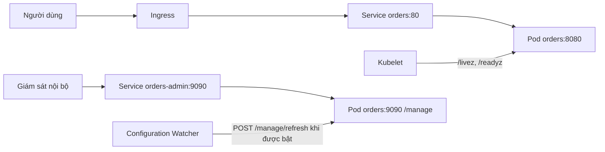

# Management port và định tuyến tới endpoint quản trị

Trong một ứng dụng Spring Cloud Kubernetes, API nghiệp vụ, probe của kubelet, hệ thống giám sát và Configuration Watcher có thể cùng truy cập một Pod nhưng cần những cổng, đường dẫn và quyền khác nhau. Nếu chỉ đổi `management.server.port` rồi giữ nguyên Service, probe và thông tin discovery, API vẫn có thể hoạt động trong khi giám sát hoặc cập nhật cấu hình bị lỗi.

Bài học thuộc chương **Actuator và sức khỏe** của module **SPRING_CLOUD_KUBERNETES**. Mục tiêu là thiết kế được đường đi từ từng bên gọi đến đúng endpoint quản trị, đồng thời nhận biết phần nào do Spring Boot cung cấp và phần nào cần Spring Cloud Kubernetes.

## 1. Kết quả cần đạt và tình huống xuyên suốt

Sau bài học, bạn cần có thể:

- Tính đúng URL Actuator khi dùng chung hoặc tách cổng quản trị.
- Nối đúng cổng ứng dụng, cổng container, `targetPort`, cổng Service và backend của Ingress.
- Chọn nơi đặt probe để kiểm tra được khả năng tiếp nhận kết nối của ứng dụng.
- Giới hạn đường truy cập quản trị và cấu hình Watcher khi Actuator không dùng URL mặc định.
- Khoanh vùng lỗi theo từng chặng thay vì mở thêm endpoint hoặc cấp thêm RBAC để thử.

Giả sử dịch vụ `orders` có API `GET /api/orders`, chạy hai replica trong namespace `apps`. Thiết kế minh họa:

| Bên gọi | Địa chỉ đích | Mục đích |
| --- | --- | --- |
| Người dùng qua Ingress | Service `orders:80` → Pod `8080` | Gọi API nghiệp vụ |
| Kubelet | Trực tiếp Pod `8080`, `/livez` và `/readyz` | Kiểm tra vòng đời container và trạng thái sẵn sàng |
| Hệ thống giám sát | Pod `9090` hoặc Service `orders-admin:9090` | Đọc `/manage/health`, thu thập `/manage/prometheus` |
| Configuration Watcher, nếu sử dụng | Từng instance, cổng `9090`, `/manage/refresh` | Yêu cầu ứng dụng nạp lại cấu hình |

Cổng `9090` trong bài là cổng quản trị của ứng dụng, độc lập với cổng của chính máy chủ Prometheus. Các giá trị này là lựa chọn cho ví dụ, không phải cổng bắt buộc của framework.



## 2. Phân biệt cổng lắng nghe với cổng được định tuyến

`server.port` và `management.server.port` cấu hình listener của tiến trình Spring. Trong manifest Pod, `containerPort` mô tả cổng mà container sử dụng; khai báo này không khởi động listener và không tạo Service.

Một request qua Service còn cần ánh xạ `spec.ports[].port` sang `targetPort`. Ví dụ, client gọi `orders:80`, nhưng kết nối tới container được chuyển đến `8080`. Nếu `targetPort` là tên, tên đó phải khớp cổng được đặt tên trong Pod. Đây là ánh xạ mạng của Kubernetes, không phải phép đổi cổng trong cấu hình Spring. [Tham khảo Service và ánh xạ cổng](https://kubernetes.io/docs/concepts/services-networking/service/).

Với thiết kế của bài:

```text
API:
orders.apps.svc.cluster.local:80
  -> Service targetPort: http
  -> Pod containerPort tên http: 8080
  -> server.port: 8080

Quản trị:
orders-admin.apps.svc.cluster.local:9090
  -> Service targetPort: management
  -> Pod containerPort tên management: 9090
  -> management.server.port: 9090
```

Việc tạo thêm Service quản trị chỉ cung cấp một cách truy cập tới listener đã tồn tại. Ngược lại, xóa Service đó không làm listener `9090` biến mất: các bên có đường mạng tới Pod IP vẫn có thể thử kết nối trực tiếp.

## 3. Tính đúng đường dẫn Actuator

Các ví dụ thuộc tính Spring Boot trong bài được đối chiếu với tài liệu dòng 3.5; phần Watcher tham chiếu Spring Cloud Kubernetes dòng 3.3. Dự án cần dùng các phiên bản tương thích thông qua BOM Spring Cloud của mình, không tự ghép các bản mới nhất của từng thư viện.

Spring Boot dùng prefix Actuator mặc định `/actuator`. Có thể đổi bằng `management.endpoints.web.base-path`. Khi tách cổng quản trị, prefix này nằm dưới `management.server.base-path`; khi dùng chung cổng, nó nằm dưới context path tương ứng của ứng dụng web. [Quy tắc cổng và đường dẫn của Spring Boot](https://docs.spring.io/spring-boot/3.5/reference/actuator/monitoring.html).

Bảng sau xét ứng dụng Servlet; mỗi hàng là một cấu hình độc lập:

| Cấu hình | URL health trực tiếp |
| --- | --- |
| `server.port=8080`, không tách cổng, không đổi path | `http://<pod-ip>:8080/actuator/health` |
| Như trên, thêm `server.servlet.context-path=/shop` | `http://<pod-ip>:8080/shop/actuator/health` |
| `server.port=8080`, `management.server.port=9090`, base path Actuator `/manage`, không đổi management server base path | `http://<pod-ip>:9090/manage/health` |
| Như hàng trước, thêm `management.server.base-path=/ops` | `http://<pod-ip>:9090/ops/manage/health` |

Không ghép `/shop` vào URL management riêng chỉ vì API nghiệp vụ có context path đó. Với WebFlux, cần xét `spring.webflux.base-path` thay cho thuộc tính Servlet.

Một quy tắc thực hành hữu ích là viết ra ba phần trước khi sửa manifest:

```text
scheme + host:cổng thực tế + đường dẫn thực tế
```

Sau đó mới xác định mỗi bên gọi lấy host, cổng và đường dẫn từ đâu. Ví dụ, kubelet lấy cổng từ probe, Ingress lấy cổng Service từ backend, còn Watcher có thể lấy cổng và base path quản trị từ metadata.

## 4. Cấu hình ứng dụng minh họa

Giả sử dự án đã có web starter và một controller phục vụ `/api/orders`. Thêm Actuator; chỉ thêm registry Prometheus nếu thực sự cần scrape định dạng Prometheus:

```xml
<dependency>
    <groupId>org.springframework.boot</groupId>
    <artifactId>spring-boot-starter-actuator</artifactId>
</dependency>
<dependency>
    <groupId>io.micrometer</groupId>
    <artifactId>micrometer-registry-prometheus</artifactId>
</dependency>
```

Không ghi version riêng ở đây vì chúng được quản lý bởi cấu hình dependency của dự án. Để chỉ cung cấp health endpoint, không cần thêm DiscoveryClient hay quyền gọi Kubernetes API.

Cấu hình `application.yml` của ví dụ:

```yaml
spring:
  application:
    name: orders

server:
  port: 8080

management:
  server:
    port: 9090
    address: 0.0.0.0
  endpoints:
    web:
      base-path: /manage
      exposure:
        include: health,prometheus
  endpoint:
    health:
      show-details: never
      show-components: never
      probes:
        enabled: true
        add-additional-paths: true
```

Ứng dụng minh họa không cấu hình context path. `0.0.0.0` cho phép listener quản trị nhận kết nối qua địa chỉ IPv4 của Pod. Nếu bind management vào `127.0.0.1`, kiểm tra bên trong container có thể thành công nhưng truy cập từ Pod khác tới Pod IP sẽ không tới được listener đó. Spring Boot chỉ cho phép cấu hình địa chỉ management riêng khi cổng management khác cổng chính. [Cấu hình địa chỉ management](https://docs.spring.io/spring-boot/3.5/reference/actuator/monitoring.html#actuator.monitoring.customizing-management-server-address).

Cấu hình exposure chỉ chọn endpoint được đưa ra HTTP. Nó không tạo endpoint thiếu dependency và không thiết lập quyền HTTP. Nếu dự án có Spring Security, cần cấu hình quyền phù hợp; các lệnh gọi minh họa bên dưới giả định health được phép đọc và bên giám sát có quyền đọc metrics khi cần.

## 5. Probe cần kiểm tra đúng listener

Khi Actuator chạy trên cổng riêng, endpoint health có thể trả thành công trong lúc cổng API gặp sự cố tiếp nhận kết nối. Thuộc tính `add-additional-paths` đưa nhóm liveness và readiness ra cổng chính tại `/livez` và `/readyz`. Vì vậy ví dụ dùng hai đường này trên `8080`. Đây là kiểm tra qua listener nghiệp vụ, không phải một phép thử đầy đủ mọi chức năng của API. [Spring Boot: Kubernetes probes](https://docs.spring.io/spring-boot/3.5/reference/actuator/endpoints.html#actuator.endpoints.kubernetes-probes).

Đoạn Deployment dưới đây giả định namespace `apps` đã có và image mẫu được thay bằng image ứng dụng của bạn. Cấu hình ở mục 4 phải được đóng gói hoặc cung cấp cho container.

```yaml
apiVersion: apps/v1
kind: Deployment
metadata:
  name: orders
  namespace: apps
spec:
  replicas: 2
  selector:
    matchLabels:
      app: orders
  template:
    metadata:
      labels:
        app: orders
    spec:
      containers:
        - name: orders
          image: registry.example.test/orders:1.0
          ports:
            - name: http
              containerPort: 8080
            - name: management
              containerPort: 9090
          startupProbe:
            httpGet:
              path: /livez
              port: http
            periodSeconds: 5
            timeoutSeconds: 2
            failureThreshold: 30
          livenessProbe:
            httpGet:
              path: /livez
              port: http
            periodSeconds: 10
            timeoutSeconds: 2
            failureThreshold: 3
          readinessProbe:
            httpGet:
              path: /readyz
              port: http
            periodSeconds: 5
            timeoutSeconds: 2
            failureThreshold: 3
```

Các khoảng thời gian là giá trị khởi đầu để thực hành; cần điều chỉnh theo thời gian khởi động và đặc điểm tải. `startupProbe` trì hoãn việc chạy liveness/readiness cho đến khi startup probe thành công. Readiness thất bại làm Pod không được dùng như backend sẵn sàng; liveness thất bại đủ ngưỡng dẫn đến khởi động lại container. Probe HTTP thông thường gọi Pod trực tiếp, không đi vòng qua Service hay Ingress. [Cấu hình probe của Kubernetes](https://kubernetes.io/docs/tasks/configure-pod-container/configure-liveness-readiness-startup-probes/).

Nếu muốn đặt probe trên management port, dùng đúng `port: management` và `/manage/health/liveness` hoặc `/manage/health/readiness`. Khi đó cần chấp nhận giới hạn là phép kiểm tra đi qua listener quản trị.

Không lấy health tổng hợp làm liveness chỉ để có nhiều thành phần được kiểm tra. Một lỗi hệ thống dùng chung như cơ sở dữ liệu không nên mặc nhiên khiến tất cả replica bị restart. Nhóm readiness cũng cần phản ánh quyết định ứng dụng có nên nhận lưu lượng trong tình huống đó.

## 6. Tạo hai Service với trách nhiệm rõ ràng

Service nghiệp vụ chỉ cung cấp cổng API. Service quản trị là tùy chọn cho những client cần địa chỉ DNS ổn định:

```yaml
apiVersion: v1
kind: Service
metadata:
  name: orders
  namespace: apps
spec:
  type: ClusterIP
  selector:
    app: orders
  ports:
    - name: http
      port: 80
      targetPort: http
---
apiVersion: v1
kind: Service
metadata:
  name: orders-admin
  namespace: apps
  labels:
    app: orders
    purpose: management
spec:
  type: ClusterIP
  selector:
    app: orders
  ports:
    - name: management
      port: 9090
      targetPort: management
```

Hai selector cùng chọn các Pod `app=orders`, nhưng mỗi Service chuyển tiếp tới một cổng khác nhau. Với cấu hình này:

```text
http://orders.apps.svc.cluster.local/api/orders
http://orders-admin.apps.svc.cluster.local:9090/manage/health
```

Địa chỉ sau không phải đường hợp lệ tới Actuator trong thiết kế này:

```text
http://orders.apps.svc.cluster.local/manage/health
```

Nó vẫn đi vào `8080`, vì Service `orders` chỉ trỏ tới cổng nghiệp vụ. Đổi path không khiến Service tự chuyển sang `9090`.

Với DiscoveryClient và Spring Cloud LoadBalancer, lời gọi nghiệp vụ phải dùng service ID `orders`, không dùng `orders-admin`. Nếu một Service có nhiều cổng, cấu hình lựa chọn cổng discovery một cách rõ ràng, chẳng hạn `spring.cloud.kubernetes.discovery.primary-port-name=http`, theo implementation và phiên bản đang dùng. Không dựa vào thứ tự cổng để chọn cổng nghiệp vụ. [Quy tắc chọn cổng của DiscoveryClient](https://docs.spring.io/spring-cloud-kubernetes/reference/discovery-client.html).

Để đo metrics của từng replica, hệ thống giám sát nên khám phá và scrape từng Pod/endpoint tại `9090`, path `/manage/prometheus`. Scrape lặp lại một địa chỉ ClusterIP có thể đi vào các replica khác nhau, làm mất ý nghĩa chuỗi số liệu theo instance. Khi dùng Prometheus Operator, cấu hình ServiceMonitor tương ứng với tên cổng Service `management` và path này; CRD/operator phải có sẵn. Không thể giả định `orders-admin` luôn cung cấp được chẩn đoán cho Pod chưa ready, vì việc chọn backend còn phụ thuộc trạng thái endpoint.

## 7. Ingress chỉ chuyển tiếp những đường thực sự cần

Giả sử cluster có IngressClass `nginx`, ví dụ dưới đây chỉ định tuyến `/api` về Service nghiệp vụ. Ứng dụng vẫn nhận nguyên đường `/api/orders`; ví dụ không sử dụng rewrite:

```yaml
apiVersion: networking.k8s.io/v1
kind: Ingress
metadata:
  name: orders
  namespace: apps
spec:
  ingressClassName: nginx
  rules:
    - host: orders.example.test
      http:
        paths:
          - path: /api
            pathType: Prefix
            backend:
              service:
                name: orders
                port:
                  number: 80
```

Ingress cần controller tương ứng để xử lý. Backend của nó tham chiếu **cổng Service**, ở đây là `80`; nó không tham chiếu trực tiếp `containerPort: 8080`. [Cách Ingress định tuyến tới Service](https://kubernetes.io/docs/concepts/services-networking/ingress/).

Thiết kế này không khai báo route tới `/manage`. Nếu cần truy cập quản trị từ một mạng vận hành, hãy xác định riêng hostname, phương thức xác thực, TLS và đường backend `orders-admin:9090`. Đổi prefix thành một tên khó đoán không thay thế việc giới hạn truy cập.

Khi reverse proxy có rewrite, phải phân biệt đường bên ngoài với đường ứng dụng nhận. Ví dụ, `/ops/orders/health` có thể được rewrite thành `/manage/health`; kubelet gọi Pod trực tiếp vẫn phải dùng đường tại ứng dụng, không sao chép đường ngoài Ingress.

## 8. Tách cổng cần đi cùng chính sách truy cập

Có bốn quyết định độc lập:

| Lớp | Câu hỏi phải trả lời |
| --- | --- |
| Endpoint và dependency | Endpoint có tồn tại và được phép hoạt động không? |
| HTTP exposure | Endpoint có được đưa ra HTTP không? |
| Quyền trong ứng dụng | Danh tính nào được đọc metrics hoặc thực hiện refresh? |
| Mạng và định tuyến | Nguồn nào tới được listener, qua Service hay trực tiếp Pod IP? |

Spring Security có thể áp dụng quy tắc cho Actuator; nếu tự khai báo `SecurityFilterChain`, cần kiểm soát cả Actuator và phần còn lại của ứng dụng. Probe nên được phép gọi các đường đã chọn mà không bị đưa tới trang đăng nhập. Với endpoint `POST`, kiểm tra thêm chính sách CSRF phù hợp với cách client xác thực; không vô hiệu hóa toàn bộ bảo vệ chỉ để khắc phục một lỗi 403. [Bảo mật HTTP endpoint của Spring Boot](https://docs.spring.io/spring-boot/3.5/reference/actuator/endpoints.html#actuator.endpoints.security).

RBAC Kubernetes điều khiển quyền truy cập Kubernetes API, chẳng hạn ai được đọc ConfigMap, Secret hoặc Service. Nó không tự bảo vệ HTTP `POST /manage/refresh` của ứng dụng. Token ServiceAccount cũng không tự trở thành thông tin đăng nhập hợp lệ cho Spring Security nếu chưa có cơ chế xác thực được cấu hình để xử lý nó. [Phạm vi của Kubernetes RBAC](https://kubernetes.io/docs/reference/access-authn-authz/rbac/).

Ví dụ NetworkPolicy bên dưới chủ ý để nguyên khả năng truy cập cổng nghiệp vụ `8080` từ mọi nguồn mà cụm vốn định tuyến được, đồng thời chỉ cho hai nhóm Pod truy cập `9090`: Prometheus trong namespace `monitoring` và Watcher trong namespace `platform-ops`. Các namespace và nhãn Pod phải khớp môi trường thực tế.

```yaml
apiVersion: networking.k8s.io/v1
kind: NetworkPolicy
metadata:
  name: orders-management-access
  namespace: apps
spec:
  podSelector:
    matchLabels:
      app: orders
  policyTypes:
    - Ingress
  ingress:
    - ports:
        - protocol: TCP
          port: 8080
    - from:
        - namespaceSelector:
            matchLabels:
              kubernetes.io/metadata.name: monitoring
          podSelector:
            matchLabels:
              app: prometheus
        - namespaceSelector:
            matchLabels:
              kubernetes.io/metadata.name: platform-ops
          podSelector:
            matchLabels:
              app: config-watcher
      ports:
        - protocol: TCP
          port: 9090
```

Trong một mục `from`, hai selector cùng áp dụng; hai mục `from` là hai nguồn được cho phép thay thế nhau. NetworkPolicy cần CNI hỗ trợ, không lọc theo HTTP path, và các policy áp dụng lên Pod cộng dồn quyền cho phép. Một policy khác mở rộng `9090` có thể làm mất giới hạn mong muốn. Nếu nguồn bị cô lập egress, cần cho phép chiều đi tương ứng. Hãy kiểm tra cả kubelet probe và lưu lượng thực tế trên CNI của cụm. [Ngữ nghĩa NetworkPolicy](https://kubernetes.io/docs/concepts/services-networking/network-policies/).

`ClusterIP` cung cấp phạm vi định tuyến nội bộ, không tự tạo danh sách client được phép. Với endpoint thay đổi trạng thái, cần cơ chế xác thực và phân quyền phù hợp ngoài giới hạn mạng.

## 9. Configuration Watcher phải biết management port và base path

Phần này chỉ áp dụng nếu đã chọn cập nhật cấu hình bằng Configuration Watcher qua HTTP. Nếu cập nhật ConfigMap/Secret bằng rolling restart là đủ, có thể giữ cấu hình health/metrics ở các mục trước và không triển khai luồng refresh.

Với HTTP implementation, Watcher dùng DiscoveryClient tìm các instance cần nhận thông báo rồi gọi endpoint refresh. URL mặc định không phù hợp với ứng dụng đã chuyển Actuator sang `9090/manage`. Cần cung cấp thông tin cổng và prefix đúng cho Watcher. [Spring Cloud Kubernetes 3.3: Watcher và management port riêng](https://docs.spring.io/spring-cloud-kubernetes/reference/3.3/spring-cloud-kubernetes-configuration-watcher.html#_non_default_management_port_and_actuator_path).

Có thể thêm annotation vào **Service `orders` mà Watcher dùng để khám phá instance**:

```shell
kubectl -n apps annotate service orders 'boot.spring.io/actuator=http://:9090/manage' --overwrite
```

Đây là dạng giá trị annotation dành cho Watcher, không phải URL để dán nguyên vào `curl`. Phần host được lấy từ instance được khám phá; với ví dụ, đích mong muốn là:

```text
POST http://<instance-ip>:9090/manage/refresh
```

Annotation chứa base path quản trị, không nối sẵn `/refresh`. Nó không mở listener, không đổi `targetPort` của Service và không cấu hình quyền HTTP. Một lựa chọn khác là đặt `spring.cloud.kubernetes.configuration.watcher.actuatorPath` cùng `spring.cloud.kubernetes.configuration.watcher.actuatorPort` trên ứng dụng **Watcher**; chọn cơ chế nhất quán với phạm vi ứng dụng được quản lý.

Để luồng refresh hoạt động, ứng dụng đích còn phải có endpoint refresh của Spring Cloud và đưa nó ra HTTP. Ví dụ thay giá trị exposure hiện tại bằng:

```properties
management.endpoints.web.exposure.include=health,prometheus,refresh
```

Đây là thay đổi tùy chọn cho thiết kế có Watcher; cấu hình health/metrics ban đầu không cung cấp refresh. Luồng đầy đủ cần đáp ứng các điều kiện:

1. Watcher có RBAC đọc/theo dõi đúng tài nguyên trong đúng namespace và chọn đúng ứng dụng nhận thông báo.
2. Instance được tìm thấy có host và thông tin quản trị phù hợp với phiên bản/implementation discovery đang dùng.
3. Listener quản trị nhận kết nối trên Pod IP, cổng `9090`; NetworkPolicy và chiều egress cho phép.
4. Ứng dụng cho phép danh tính của Watcher thực hiện `POST /manage/refresh` theo cơ chế xác thực đã chọn.
5. Nguồn ConfigMap/Secret đã được ứng dụng nạp và thay đổi thực sự có thể được áp dụng qua cơ chế refresh.

Service `orders-admin` không phải điều kiện bắt buộc nếu Watcher đã gọi trực tiếp từng instance. Một request refresh gửi tới ClusterIP chỉ đi vào một backend được chọn, không bảo đảm cập nhật cả hai replica. Việc đổi URL cũng không khiến mọi giá trị đã tạo sẵn trong bean hoặc mọi biến môi trường của tiến trình tự thay đổi.

## 10. Thực hành kiểm tra theo từng chặng

Các lệnh dưới đây dành cho người học chạy trên cụm thử nghiệm đã triển khai ứng dụng, không giả định có thể truy cập Pod IP trực tiếp từ máy cá nhân.

### 10.1. Kiểm tra Pod và các ánh xạ cổng

```shell
kubectl -n apps get pods -l app=orders -o wide
kubectl -n apps get service orders orders-admin -o yaml
kubectl -n apps get endpointslices -l kubernetes.io/service-name=orders-admin -o yaml
```

Đối chiếu selector, tên cổng, số cổng và địa chỉ endpoint trước khi chỉnh ứng dụng. Nếu không có backend sẵn sàng, xem probe và sự kiện của Pod bằng `kubectl describe pod <pod-name> -n apps`.

### 10.2. Kiểm tra một Pod qua port-forward

Trong một terminal, thay `orders-xxxxx` bằng tên Pod thật:

```shell
kubectl -n apps port-forward pod/orders-xxxxx 18080:8080 19090:9090
```

Trong terminal khác, dùng `curl.exe` trên Windows hoặc `curl` trên hệ thống tương ứng:

```shell
curl.exe -i http://127.0.0.1:18080/livez
curl.exe -i http://127.0.0.1:18080/readyz
curl.exe -i http://127.0.0.1:19090/manage/health
curl.exe -i http://127.0.0.1:19090/manage/prometheus
curl.exe -i http://127.0.0.1:18080/manage/health
```

Khi Pod đã sẵn sàng và quyền HTTP phù hợp, ba health URL đầu trả thành công; metrics cần registry và quyền truy cập tương ứng. URL cuối không phục vụ Actuator với thiết kế này; mã cụ thể có thể bị ảnh hưởng bởi chuỗi bảo mật hoặc fallback routing.

Port-forward cho phép kiểm tra ứng dụng qua một kênh truy cập riêng của Kubernetes, cần quyền API phù hợp. Kết quả thành công không chứng minh DNS Service, Ingress, NetworkPolicy hoặc đường đi Pod-to-Pod đều đúng. [Kubernetes: port-forward](https://kubernetes.io/docs/tasks/access-application-cluster/port-forward-access-application-cluster/).

### 10.3. Kiểm tra từ đúng nơi gọi

Nếu container bên gọi có sẵn công cụ HTTP, thử từ Pod giám sát hoặc Pod chẩn đoán được cấp đúng nhãn/quyền:

```shell
curl -i http://orders-admin.apps.svc.cluster.local:9090/manage/health
```

Tiếp theo, thử từ một Pod thử nghiệm không thuộc nguồn được cho phép để xác nhận giới hạn mạng. Kết quả cần đối chiếu với tất cả policy đang áp dụng. Với Watcher, xem đích thực tế trong log và trạng thái từng replica sau một thay đổi cấu hình an toàn; không chỉ nhìn một phản hồi 200 từ Service.

## 11. Bảng khoanh vùng sự cố

| Dấu hiệu | Chặng cần kiểm tra | Cách xử lý có căn cứ |
| --- | --- | --- |
| `Connection refused` trên `9090` | Listener và địa chỉ bind | Kiểm tra cấu hình được nạp, cổng thực tế, listener có chỉ bind loopback không |
| Hết thời gian kết nối từ Pod khác | Định tuyến, ingress/egress policy, mesh nếu có | So sánh nguồn được phép với nguồn lỗi; kiểm tra policy của cả hai đầu |
| Service không tới được backend | Selector, EndpointSlice, readiness, `targetPort` | Đối chiếu nhãn Pod, tên cổng và backend sẵn sàng |
| `/actuator/health` trả 404 sau khi đổi prefix | Base path | Gọi `/manage/health` trên đúng listener |
| `/manage/health` trả 404 trên API port | Cổng đích | Sửa caller sang management port; không thêm route nghiệp vụ để che lỗi |
| Probe trả 401/403 hoặc đi tới đăng nhập | Quyền HTTP của đường probe | Cho phép đúng `/livez`, `/readyz` hoặc health group đã chọn |
| Health trả 503 | Nội dung health/status mapping | Xem trạng thái nhóm health và lifecycle; phân biệt với lỗi không kết nối được |
| Health quản trị tốt nhưng API không nhận kết nối | Listener được kiểm tra khác listener API | Kiểm tra `/readyz` trên cổng chính và khả năng phục vụ request nghiệp vụ |
| Watcher gọi nhầm `8080/actuator/refresh` | Metadata và cấu hình Watcher | Đối chiếu annotation Service hoặc actuator path/port trên Watcher |
| `POST /manage/refresh` trả 403 | Xác thực, quyền và CSRF | Xem quy tắc HTTP; cấp quyền Kubernetes đọc ConfigMap không sửa được lỗi HTTP này |
| Metrics trả 404 | Registry, exposure và path scrape | Kiểm tra dependency Prometheus, cấu hình endpoint và `/manage/prometheus` |
| Chỉ một replica đổi cấu hình | Đích request và danh sách instance | Xác nhận Watcher gửi đến từng instance; kiểm tra kết quả theo Pod |

## 12. Bài tập áp dụng

Với dịch vụ `orders` trong bài, thực hiện các thay đổi trên môi trường thử nghiệm và ghi lại URL thực tế của từng bên gọi:

1. Đổi management port từ `9090` sang `9191`. Xác định những nơi cần cập nhật nếu giữ Service quản trị ở cổng ngoài `9090`.
2. Đổi base path từ `/manage` sang `/internal-actuator`. Giữ probe trên `/livez`, `/readyz` ở cổng chính; giải thích vì sao không sao chép prefix mới vào probe đó.
3. Cho ứng dụng có Servlet context path `/shop` nhưng vẫn tách management port. Tính URL health trực tiếp và kiểm tra cấu hình route API tương ứng.
4. So sánh một request tới `orders-admin` với hai request trực tiếp tới hai Pod khi cần quan sát hoặc refresh cả hai replica.

Gợi ý tự kiểm tra: ở bài 1, listener, `containerPort`, `targetPort` được đặt tên, policy cho cổng đích và thông tin Watcher phải thống nhất; cổng ngoài của Service có thể giữ `9090`. Ở bài 2, cập nhật đường scrape, thao tác quản trị và base path Watcher. Ở bài 3, với management server base path mặc định, health vẫn là `http://<pod-ip>:9090/manage/health`; API sẽ có thêm `/shop` và route `/api` cũ cần được xem lại.

Khi lựa chọn tính năng cho triển khai, hãy bắt đầu từ nhu cầu thực tế: Actuator cho sức khỏe; registry và cơ chế scrape khi cần metrics; DiscoveryClient và Spring Cloud LoadBalancer khi cần khám phá/cân bằng tải phía client; Configuration Watcher khi cần luồng cập nhật cấu hình đó. Tách management port là một lựa chọn vận hành, không phải lý do tự động bổ sung tất cả thành phần Spring Cloud Kubernetes hoặc cấp quyền đọc Secret cho mọi ứng dụng.