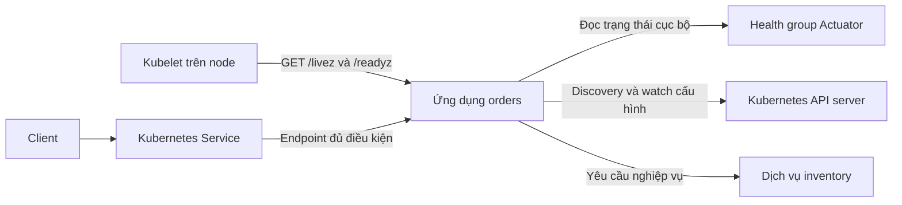

# Kiểm thử probe khi API server hoặc dịch vụ phụ thuộc gián đoạn

Một ứng dụng Spring đang phục vụ bình thường có thể tạm thời mất kết nối tới Kubernetes API server mà vẫn xử lý được yêu cầu. Ngược lại, tiến trình Java vẫn chạy nhưng một chức năng nghiệp vụ đã ngừng hoạt động vì dịch vụ phụ thuộc bị lỗi. Nếu cả hai tình huống đều làm liveness thất bại, Kubernetes có thể khởi động lại hàng loạt container mà không khắc phục được nguyên nhân.

Bài học thuộc chương **Actuator và sức khỏe** của **SPRING_CLOUD_KUBERNETES**. Mục tiêu là kiểm chứng khả năng suy giảm có kiểm soát và tự phục hồi của ứng dụng tích hợp Kubernetes: từ DiscoveryClient tới việc sử dụng ConfigMap, Secret, Spring Cloud LoadBalancer và Configuration Watcher khi thực sự cần thiết.

## 1. Xác định chính sách trước khi gây lỗi

Sau bài học, bạn có thể phân biệt trạng thái sống của tiến trình, khả năng nhận lưu lượng và tình trạng kết nối tới control plane; thiết kế ma trận kiểm thử; thu bằng chứng từ HTTP, Pod, EndpointSlice và log; chứng minh ứng dụng tự phục hồi sau lỗi bên ngoài.

Giả sử dịch vụ `orders` có hai bản sao, gọi một dịch vụ bắt buộc tên `inventory` và sử dụng Kubernetes DiscoveryClient. Chính sách mẫu là:

| Tình huống | Liveness mong đợi | Readiness mong đợi | Bằng chứng cần có |
| --- | --- | --- | --- |
| Bình thường, đã khởi động xong | HTTP 200 | HTTP 200 | Request thành công, restart ổn định |
| Chỉ mất kết nối từ Pod tới API, dữ liệu hiện có vẫn dùng được | HTTP 200 | HTTP 200 | Discovery/cấu hình có thể chậm cập nhật; không restart do liveness |
| `inventory` bắt buộc bị lỗi | HTTP 200 | HTTP 503 | Pod chuyển không sẵn sàng; container vẫn chạy |
| Phụ thuộc tùy chọn bị lỗi và đã có fallback | HTTP 200 | HTTP 200 | Chức năng tương ứng suy giảm, có metric hoặc health riêng |
| Phụ thuộc phục hồi | HTTP 200 | Tự về HTTP 200 | Nhận lưu lượng trở lại, không cần rollout |
| Lỗi nội tại khiến tiến trình không thể tiếp tục phục vụ | Có thể thất bại | Thường thất bại | Restart chỉ hợp lý khi có khả năng sửa được lỗi nội tại |

Đây là **chính sách của ví dụ**, không phải hành vi được bảo đảm cho mọi ứng dụng Spring Cloud Kubernetes. Nếu mỗi yêu cầu nghiệp vụ bắt buộc gọi Kubernetes API và không có cách phục vụ thay thế, cần đánh giá readiness theo chức năng thực tế đó.

## 2. Hiểu đường đi của probe

Kubelet gửi HTTP probe tới địa chỉ Pod và cổng đã cấu hình. Probe không đi qua Kubernetes Service rồi mới tới ứng dụng.



Startup probe bảo vệ giai đoạn khởi động; liveness có thể dẫn tới khởi động lại container; readiness điều khiển điều kiện nhận lưu lượng thông thường. Nếu cấu hình startup probe, liveness và readiness chỉ bắt đầu sau khi startup probe thành công. [Kubernetes: các loại probe](https://kubernetes.io/docs/concepts/workloads/pods/probes/).

Readiness thất bại không đồng nghĩa tiến trình dừng. Request trực tiếp tới Pod có thể vẫn được trả lời. Cập nhật trạng thái và lớp cân bằng tải cần thời gian; kết nối có sẵn cũng có thể tiếp tục được sử dụng. Đo bằng kết nối mới thay vì coi readiness là cơ chế cắt mọi kết nối ngay lập tức.

Ba nhóm thông tin cần tách:

1. **Availability:** ứng dụng còn sống và đã sẵn sàng nhận yêu cầu hay chưa.
2. **Khả năng phục vụ nghiệp vụ:** phụ thuộc bắt buộc có đáp ứng trong ngân sách thời gian hay không.
3. **Tích hợp Kubernetes:** discovery hoặc watch cấu hình còn cập nhật dữ liệu được hay không.

Một Pod có thể phục vụ được nghiệp vụ trong khi tạm mất khả năng cập nhật dữ liệu Kubernetes.

Pod Health Indicator của Spring Cloud Kubernetes cung cấp thông tin liên quan tới Pod và môi trường Kubernetes; có thể tắt bằng `management.health.kubernetes.enabled=false`. Không diễn giải riêng trạng thái `UP` của contributor này thành bằng chứng rằng mọi thao tác API vẫn thành công. [Pod Health Indicator](https://docs.spring.io/spring-cloud-kubernetes/reference/pod-health-indicator.html).

Spring Cloud Commons mặc định để DiscoveryClientHealthIndicator gọi `getServices()`. Thuộc tính `spring.cloud.discovery.client.health-indicator.use-services-query=false` chuyển sang `probe()`; điều này không tự tạo phép kiểm tra mạng đầu cuối tới API server. Cần hiểu implementation và cache đang dùng. [Spring Cloud Commons: Health Indicators](https://docs.spring.io/spring-cloud-commons/reference/spring-cloud-commons/common-abstractions.html#_health_indicators).

## 3. Chuẩn bị ứng dụng và phạm vi lab

Các ví dụ Actuator và Java bên dưới dùng API của Spring Boot 3.5 và Java 17. Sử dụng Spring Cloud BOM tương thích với Spring Boot của dự án, không ghép tùy ý các phiên bản starter.

Ứng dụng cần:

- `spring-boot-starter-web`.
- `spring-boot-starter-actuator`.
- Một Kubernetes discovery starter, chẳng hạn `spring-cloud-starter-kubernetes-fabric8`.
- `@EnableScheduling` trên lớp cấu hình hoặc lớp ứng dụng để chạy kiểm tra phụ thuộc nền.

Nếu dùng Kubernetes Java Client hoặc HTTP DiscoveryClient qua DiscoveryServer, đích cần gây lỗi sẽ khác. Xác định đúng implementation trước khi thử. [DiscoveryClient for Kubernetes](https://docs.spring.io/spring-cloud-kubernetes/reference/discovery-client.html).

Lab sử dụng namespace riêng `probe-lab`, Deployment `orders`, Service `orders` cổng 8080 và `inventory` giả lập. Image `orders` do bạn build từ ứng dụng có mã minh họa dưới đây. Các tên tệp trong lệnh là tên để lưu những ví dụ tương ứng khi thực hành.

Không cần bật thêm đọc Secret qua API, Configuration Watcher hoặc Spring Cloud LoadBalancer chỉ để dùng Actuator. Nếu ứng dụng thực tế sử dụng chúng, bổ sung các tình huống ở phần 10.

## 4. Tách liveness và readiness bằng health group

Cấu hình ứng dụng:

```yaml
server:
  port: 8080

management:
  endpoints:
    web:
      exposure:
        include: health
  endpoint:
    health:
      show-details: never
      probes:
        enabled: true
        add-additional-paths: true
      group:
        liveness:
          include: livenessState
        readiness:
          include: readinessState,inventory

probe:
  inventory-uri: http://inventory:8080/health
```

`inventory` là tên bean HealthIndicator ở phần tiếp theo. `/livez` và `/readyz` là đường dẫn bổ sung trên cổng ứng dụng chính. Hai group cũng có đường dẫn `/actuator/health/liveness` và `/actuator/health/readiness`.

Spring Boot hỗ trợ chỉ định contributor cho từng health group và đưa các đường probe bổ sung lên cổng ứng dụng. Nếu group tham chiếu contributor không tồn tại, startup có thể thất bại theo cấu hình mặc định; cần sửa tên hoặc cấu hình thay vì tắt kiểm tra membership. [Spring Boot: health groups và Kubernetes probes](https://docs.spring.io/spring-boot/3.5/reference/actuator/endpoints.html#actuator.endpoints.kubernetes-probes).

Các lựa chọn của ví dụ:

- Liveness chỉ phản ánh `livenessState`, không gọi database, discovery hoặc `inventory`.
- Readiness ghép trạng thái sẵn sàng của Spring Boot với phụ thuộc bắt buộc `inventory`.
- `/actuator/health` là health tổng hợp để chẩn đoán; manifest không dùng endpoint này làm liveness.
- Trạng thái `DOWN` trả HTTP 503 theo mapping mặc định. Nếu dự án tùy biến mapping, kiểm tra mã HTTP thực tế.
- `show-details: never` tránh trả chi tiết hạ tầng trong probe. Cấu hình Spring Security vẫn phải cho phép kubelet truy cập đúng endpoint.

Probe availability không cần quyền RBAC. ServiceAccount dành cho các thao tác Kubernetes API của ứng dụng.

## 5. HealthIndicator đọc kết quả kiểm tra nền

Một readiness endpoint gọi nhiều dịch vụ đồng bộ mỗi lần kubelet truy vấn có thể tạo tải lớn khi phụ thuộc chậm. Trong lab, tác vụ nền kiểm tra `inventory`; HealthIndicator chỉ đọc snapshot trong bộ nhớ.

```java
package example.probes;

import java.net.URI;
import java.net.http.HttpClient;
import java.net.http.HttpRequest;
import java.net.http.HttpResponse;
import java.time.Duration;
import java.util.concurrent.CompletableFuture;
import java.util.concurrent.TimeUnit;

import org.springframework.beans.factory.annotation.Value;
import org.springframework.boot.actuate.health.Health;
import org.springframework.boot.actuate.health.HealthIndicator;
import org.springframework.scheduling.annotation.Scheduled;
import org.springframework.stereotype.Component;

@Component("inventory")
public class InventoryCheck implements HealthIndicator {

    private record Snapshot(boolean reachable, long checkedAtNanos) {}

    private final HttpClient client = HttpClient.newBuilder()
            .connectTimeout(Duration.ofMillis(300))
            .followRedirects(HttpClient.Redirect.NEVER)
            .build();

    private final HttpRequest request;
    private volatile Snapshot snapshot =
            new Snapshot(false, System.nanoTime());

    public InventoryCheck(@Value("${probe.inventory-uri}") String uri) {
        this.request = HttpRequest.newBuilder(URI.create(uri))
                .timeout(Duration.ofMillis(600))
                .GET()
                .build();
    }

    public boolean checkNow() {
        CompletableFuture<HttpResponse<Void>> pending =
                client.sendAsync(request, HttpResponse.BodyHandlers.discarding());
        try {
            int status = pending.get(800, TimeUnit.MILLISECONDS).statusCode();
            return status >= 200 && status < 300;
        }
        catch (InterruptedException ex) {
            Thread.currentThread().interrupt();
            return false;
        }
        catch (Exception ex) {
            return false;
        }
        finally {
            // Việc hủy I/O bên dưới phụ thuộc implementation.
            pending.cancel(true);
        }
    }

    @Scheduled(fixedDelay = 2000)
    public void sample() {
        snapshot = new Snapshot(checkNow(), System.nanoTime());
    }

    @Override
    public Health health() {
        Snapshot current = snapshot;
        long ageMillis = TimeUnit.NANOSECONDS.toMillis(
                System.nanoTime() - current.checkedAtNanos());

        if (ageMillis > 6000) {
            return Health.down().withDetail("reason", "sample-expired").build();
        }

        return current.reachable()
                ? Health.up().build()
                : Health.down().withDetail("reason", "inventory-unavailable").build();
    }
}
```

Thiết kế có những đặc điểm sau:

- Trước mẫu thành công đầu tiên, readiness chưa sẵn sàng.
- Mỗi lần chờ kết quả nền có ngân sách 800 ms, không retry trong vòng kiểm tra.
- HealthIndicator không làm I/O nên probe không phải chờ upstream.
- Snapshot quá 6 giây bị coi là hết hạn, tránh giữ `UP` vô thời hạn khi tác vụ nền ngừng chạy.
- Độ trễ phát hiện lỗi gồm chu kỳ lấy mẫu, thời gian kiểm tra và ngưỡng readiness.
- Khi vận hành, phải theo dõi lỗi lấy mẫu, tài nguyên client, giới hạn đồng thời và việc hủy request. Timeout không thay thế quản lý I/O.

Thêm hai endpoint minh họa:

```java
package example.probes;

import org.springframework.http.ResponseEntity;
import org.springframework.web.bind.annotation.GetMapping;
import org.springframework.web.bind.annotation.RestController;

@RestController
public class ProbeDemoController {

    private final InventoryCheck inventory;

    public ProbeDemoController(InventoryCheck inventory) {
        this.inventory = inventory;
    }

    @GetMapping("/ping")
    public String ping() {
        return "orders-alive";
    }

    @GetMapping("/api/stock")
    public ResponseEntity<String> stock() {
        return inventory.checkNow()
                ? ResponseEntity.ok("inventory-reachable")
                : ResponseEntity.status(503).body("inventory-unavailable");
    }
}
```

`/api/stock` chỉ minh họa lời gọi phụ thuộc, chưa kiểm chứng dữ liệu hoặc giao dịch. Hệ thống thật cần thêm synthetic request theo nghiệp vụ quan trọng; endpoint health của phụ thuộc trả 200 chưa chứng minh mọi thao tác đọc/ghi đều thành công.

## 6. Khai báo tài nguyên Kubernetes

### 6.1. Inventory giả lập

Lưu thành `inventory-lab.yaml`:

```yaml
apiVersion: v1
kind: Namespace
metadata:
  name: probe-lab
---
apiVersion: apps/v1
kind: Deployment
metadata:
  name: inventory
  namespace: probe-lab
spec:
  replicas: 1
  selector:
    matchLabels:
      app: inventory
  template:
    metadata:
      labels:
        app: inventory
    spec:
      containers:
        - name: inventory
          image: busybox:1.36
          command: ["sh", "-c"]
          args:
            - |
              mkdir -p /www
              printf 'ok\n' > /www/health
              exec httpd -f -p 8080 -h /www
          ports:
            - name: http
              containerPort: 8080
          readinessProbe:
            httpGet:
              path: /health
              port: http
            periodSeconds: 2
            timeoutSeconds: 1
---
apiVersion: v1
kind: Service
metadata:
  name: inventory
  namespace: probe-lab
spec:
  selector:
    app: inventory
  ports:
    - port: 8080
      targetPort: http
```

### 6.2. ServiceAccount, RBAC và orders

Lưu thành `orders-lab.yaml`. Thay `registry.example.com/lab/orders-probe:1.0` bằng image ứng dụng đã build và đẩy tới registry mà cluster truy cập được.

```yaml
apiVersion: v1
kind: ServiceAccount
metadata:
  name: orders
  namespace: probe-lab
---
apiVersion: rbac.authorization.k8s.io/v1
kind: Role
metadata:
  name: orders-discovery-read
  namespace: probe-lab
rules:
  - apiGroups: [""]
    resources: ["pods", "services", "endpoints"]
    verbs: ["get", "list", "watch"]
  - apiGroups: ["discovery.k8s.io"]
    resources: ["endpointslices"]
    verbs: ["get", "list", "watch"]
---
apiVersion: rbac.authorization.k8s.io/v1
kind: RoleBinding
metadata:
  name: orders-discovery-read
  namespace: probe-lab
subjects:
  - kind: ServiceAccount
    name: orders
    namespace: probe-lab
roleRef:
  apiGroup: rbac.authorization.k8s.io
  kind: Role
  name: orders-discovery-read
---
apiVersion: apps/v1
kind: Deployment
metadata:
  name: orders
  namespace: probe-lab
spec:
  replicas: 2
  selector:
    matchLabels:
      app: orders
  template:
    metadata:
      labels:
        app: orders
    spec:
      serviceAccountName: orders
      containers:
        - name: orders
          image: registry.example.com/lab/orders-probe:1.0
          ports:
            - name: http
              containerPort: 8080
          env:
            - name: SPRING_CLOUD_KUBERNETES_DISCOVERY_ALL_NAMESPACES
              value: "false"
            - name: SPRING_CLOUD_KUBERNETES_CLIENT_NAMESPACE
              valueFrom:
                fieldRef:
                  fieldPath: metadata.namespace
          startupProbe:
            httpGet:
              path: /livez
              port: http
            periodSeconds: 2
            timeoutSeconds: 2
            failureThreshold: 60
          livenessProbe:
            httpGet:
              path: /livez
              port: http
            periodSeconds: 10
            timeoutSeconds: 2
            failureThreshold: 3
          readinessProbe:
            httpGet:
              path: /readyz
              port: http
            periodSeconds: 5
            timeoutSeconds: 2
            failureThreshold: 2
            successThreshold: 2
---
apiVersion: v1
kind: Service
metadata:
  name: orders
  namespace: probe-lab
spec:
  selector:
    app: orders
  ports:
    - port: 8080
      targetPort: http
```

Role chỉ đọc tài nguyên discovery trong namespace lab. Thu hẹp thêm theo implementation và tính năng dùng thật; ví dụ không cấp quyền đọc Secret hay ConfigMap, không cho discovery toàn cluster.

Startup probe có ngân sách danh nghĩa `60 × 2 = 120` giây. Vì kiểm tra `/livez`, nó chỉ xác nhận ứng dụng đã sống; readiness tiếp tục quản lý điều kiện nhận lưu lượng khi `inventory` chưa khỏe.

`failureThreshold × periodSeconds` là ước lượng thiết kế, không phải thời hạn chính xác. Pha lần probe kế tiếp, timeout, lịch thực thi và thời gian truyền trạng thái đều ảnh hưởng kết quả.

## 7. Thu bằng chứng baseline

Các lệnh dùng PowerShell. Khôi phục xong từng thí nghiệm trước khi chuyển sang thí nghiệm khác.

```powershell
kubectl apply -f inventory-lab.yaml
kubectl apply -f orders-lab.yaml
kubectl -n probe-lab rollout status deployment/inventory --timeout=120s
kubectl -n probe-lab rollout status deployment/orders --timeout=180s

$ordersPods = kubectl -n probe-lab get pods -l app=orders -o json | ConvertFrom-Json
$targetPod = $ordersPods.items[0].metadata.name
kubectl -n probe-lab label pod $targetPod fault-case=sck-probe --overwrite

$baseline = kubectl -n probe-lab get pod $targetPod -o json | ConvertFrom-Json
$baselineUid = $baseline.metadata.uid
$baselineRestart = ($baseline.status.containerStatuses |
    Where-Object { $_.name -eq 'orders' }).restartCount
$baselineContainerId = ($baseline.status.containerStatuses |
    Where-Object { $_.name -eq 'orders' }).containerID
```

Mở terminal khác, gán `$targetPod` bằng tên Pod đã chọn và giữ port-forward chạy:

```powershell
kubectl -n probe-lab port-forward "pod/$targetPod" 18080:8080
```

Từ terminal khác nữa, kiểm tra:

```powershell
curl.exe --max-time 3 -i http://127.0.0.1:18080/livez
curl.exe --max-time 3 -i http://127.0.0.1:18080/readyz
curl.exe --max-time 3 -i http://127.0.0.1:18080/actuator/health/inventory
curl.exe --max-time 3 -i http://127.0.0.1:18080/ping
curl.exe --max-time 3 -i http://127.0.0.1:18080/api/stock
```

Cả năm endpoint phải phù hợp baseline khỏe. Ghi thời điểm, mã HTTP và độ trễ; baseline chưa đúng thì chưa gây lỗi.

Kiểm tra đường qua Service bằng kết nối mới:

```powershell
kubectl -n probe-lab run probe-client --image=busybox:1.36 --restart=Never --command -- sleep 3600
kubectl -n probe-lab wait --for=condition=Ready pod/probe-client --timeout=90s
kubectl -n probe-lab exec probe-client -- wget -T 3 -q -O - http://orders:8080/ping
```

Port-forward tới Pod và request qua Service kiểm tra hai đường đi khác nhau. Không dùng thành công của port-forward để kết luận client qua Service vẫn được phục vụ.

Những nguồn bằng chứng cần thu:

```powershell
kubectl -n probe-lab get pods -l app=orders -w
kubectl -n probe-lab get endpointslices -l kubernetes.io/service-name=orders -o yaml
kubectl -n probe-lab logs $targetPod -c orders --since=5m
kubectl -n probe-lab describe pod $targetPod
```

Lệnh theo dõi kéo dài cần terminal riêng. Trong EndpointSlice, chú ý địa chỉ và `conditions.ready`. Endpoint có thể vẫn được biểu diễn trong tài nguyên nhưng không đủ điều kiện nhận lưu lượng thông thường.

## 8. Thí nghiệm A: Pod mất kết nối Kubernetes API

### 8.1. Giới hạn phạm vi và xác minh fault injection

Không dừng API server của cluster. Chỉ cô lập egress của Pod mang nhãn `fault-case=sck-probe`.

Trước khi áp dụng NetworkPolicy, xác nhận:

- CNI thực thi egress NetworkPolicy.
- Policy khác không đồng thời cho phép toàn bộ egress của Pod thử nghiệm.
- Đã xác định đích API mà client thực sự sử dụng.
- DNS và `inventory` có đường truy cập được phép.
- Service mesh hoặc proxy không làm thay đổi đường kết nối ngoài dự kiến.

NetworkPolicy cộng dồn quyền cho phép; policy mới không ghi đè một policy khác đang cho phép cùng lưu lượng. CNI có thể xử lý kết nối có sẵn và địa chỉ Service sau NAT khác nhau. Vì vậy, `kubectl apply` thành công chưa chứng minh API bị chặn. [Kubernetes Network Policies](https://kubernetes.io/docs/concepts/services-networking/network-policies/).

Có thể dùng ephemeral container trong cùng network namespace của Pod để kiểm tra mà không đòi hỏi image ứng dụng có `curl`:

```powershell
kubectl -n probe-lab debug "pod/$targetPod" --container=netcheck --image=curlimages/curl:8.10.1 -- sleep 3600

kubectl -n probe-lab exec $targetPod -c netcheck -- curl --insecure --connect-timeout 1 --max-time 2 -sS -o /dev/null -w "%{http_code}" https://kubernetes.default.svc:443/version
```

Tài khoản thực hành cần quyền tạo ephemeral container; đợi container chạy trước khi `exec`. Nếu không có quyền, dùng công cụ chẩn đoán trong cùng network namespace mà môi trường lab hỗ trợ.

HTTP 200, 401 hoặc 403 trong phép thử này đều chứng minh nhận được HTTP từ API; 401/403 chưa chứng minh ServiceAccount ứng dụng có quyền. `--insecure` chỉ dùng chẩn đoán transport ở lab; ứng dụng vẫn phải xác minh TLS bằng CA phù hợp. Nếu ứng dụng dùng API endpoint khác, thay đích curl theo endpoint đó.

### 8.2. Chặn API nhưng giữ DNS và inventory

Lưu thành `orders-api-cut.yaml`:

```yaml
apiVersion: networking.k8s.io/v1
kind: NetworkPolicy
metadata:
  name: orders-api-cut
  namespace: probe-lab
spec:
  podSelector:
    matchLabels:
      app: orders
      fault-case: sck-probe
  policyTypes:
    - Egress
  egress:
    - to:
        - namespaceSelector:
            matchLabels:
              kubernetes.io/metadata.name: kube-system
          podSelector:
            matchLabels:
              k8s-app: kube-dns
      ports:
        - protocol: UDP
          port: 53
        - protocol: TCP
          port: 53
    - to:
        - podSelector:
            matchLabels:
              app: inventory
      ports:
        - protocol: TCP
          port: 8080
```

Rule `inventory` chọn Pod trong cùng namespace. Rule DNS giả định DNS cluster có các nhãn trên; với NodeLocal DNSCache hoặc bố trí DNS khác, phải điều chỉnh theo thực tế.

```powershell
kubectl apply -f orders-api-cut.yaml

kubectl -n probe-lab exec $targetPod -c netcheck -- curl --insecure --connect-timeout 1 --max-time 2 -sS -o /dev/null -w "%{http_code}" https://kubernetes.default.svc:443/version

kubectl -n probe-lab exec $targetPod -c netcheck -- curl --connect-timeout 1 --max-time 2 -i http://inventory:8080/health
```

Mỗi lần curl tạo kết nối mới. Cần thấy API thất bại do transport, còn `inventory` trả 200. Nhận 403 từ API nghĩa là transport chưa bị chặn; `inventory` cũng lỗi nghĩa là chưa cô lập đúng nguyên nhân.

API server chạy trên node hoặc đi qua cơ chế mạng đặc biệt có thể không bị policy này chặn. Nếu không chứng minh được fault injection, ghi nhận thí nghiệm không hợp lệ và dùng cơ chế cô lập theo Pod của CNI hoặc proxy thử nghiệm. Không kết luận đã chịu được mất API chỉ vì policy tồn tại.

Watch mở từ trước có thể còn hoạt động. Ngoài kết nối mới, quan sát reconnect hoặc thao tác API của client ứng dụng; không mặc định policy cắt ngay mọi socket.

### 8.3. Quan sát và khôi phục

Giữ lỗi qua nhiều chu kỳ probe, chẳng hạn 90 giây trong lab này, đồng thời gọi lại các endpoint. Thời lượng đó không bảo đảm bao phủ mọi chu kỳ resync hoặc retry của DiscoveryClient.

Kỳ vọng theo chính sách mẫu:

- `/livez` tiếp tục trả 200.
- `/readyz` và `/api/stock` tiếp tục trả 200 vì `inventory` vẫn truy cập được.
- UID, container ID và `restartCount` của `orders` giữ nguyên.
- Log có thể ghi nhận lỗi kết nối hoặc reconnect của Kubernetes client.
- Health tổng hợp có thể thay đổi hoặc vẫn `UP`, tùy contributor và cache; không dùng làm bằng chứng duy nhất.
- Không hứa discovery cập nhật instance mới trong khi không đọc được API.

Để đánh giá discovery, thay đổi endpoint của Service giả lập rồi quan sát `DiscoveryClient.getInstances(...)` từ đường chẩn đoán nội bộ hiện có. So sánh với Service/EndpointSlice mà tài khoản vận hành nhìn thấy. Response từ cache chưa chứng minh dữ liệu còn mới.

Khôi phục:

```powershell
kubectl -n probe-lab delete networkpolicy orders-api-cut
kubectl -n probe-lab exec $targetPod -c netcheck -- curl --insecure --connect-timeout 1 --max-time 2 -sS -o /dev/null -w "%{http_code}" https://kubernetes.default.svc:443/version
```

Đợi client reconnect và xác nhận dữ liệu discovery cập nhật được. HTTP từ API trở lại chỉ chứng minh transport đã phục hồi.

### 8.4. Khác biệt với mất API toàn cluster

Thí nghiệm này là **Pod không tới được API**, trong khi control plane vẫn phục vụ kubelet và tài khoản vận hành. Nó không mô phỏng đầy đủ sự cố API toàn cluster.

Nếu API thật sự ngừng phục vụ, kubelet có thể tiếp tục probe theo cấu hình đã nhận, nhưng báo cáo trạng thái Pod, cập nhật EndpointSlice và reconcile có thể đình trệ. Không suy ra mọi readiness thất bại lập tức được phản ánh tới toàn bộ lớp cân bằng tải. `kubectl`, `exec` và port-forward cũng có thể không dùng được.

Kiểm thử control plane toàn phần cần môi trường chuyên biệt và nguồn quan sát qua data plane chuẩn bị trước. Không dùng kết quả cô lập một Pod để tuyên bố đã kiểm chứng trường hợp đó.

## 9. Thí nghiệm B: phụ thuộc bắt buộc gián đoạn

### 9.1. Làm inventory ngừng phục vụ

Sau khi thí nghiệm A khôi phục hoàn toàn:

```powershell
kubectl -n probe-lab scale deployment/inventory --replicas=0
kubectl -n probe-lab get pods -l app=inventory
kubectl -n probe-lab get endpointslices -l kubernetes.io/service-name=inventory -o yaml
```

Đợi các Pod inventory kết thúc và không còn endpoint sẵn sàng. Kiểm tra lại các endpoint qua port-forward của Pod.

| Đường kiểm tra | Kết quả sau khi lỗi đã được phát hiện | Ý nghĩa |
| --- | --- | --- |
| `/livez` | HTTP 200 | Web server còn phục vụ probe |
| `/readyz` | HTTP 503 | Snapshot phụ thuộc bắt buộc là `DOWN` |
| `/actuator/health/inventory` | HTTP 503 | Contributor phản ánh lỗi phụ thuộc |
| `/ping` | HTTP 200 | Xử lý cục bộ vẫn hoạt động |
| `/api/stock` | HTTP 503 | Lời gọi phụ thuộc thất bại có giới hạn thời gian |
| Pod Ready | `False` sau ngưỡng readiness | Không đủ điều kiện nhận lưu lượng thông thường |
| Restart của `orders` | Không tăng | Không restart vì lỗi bên ngoài |

Cả hai bản sao `orders` dùng chung `inventory` nên có thể cùng không sẵn sàng. Đây là hệ quả có chủ đích của readiness nghiêm ngặt trong ví dụ, không tạo ra bản sao khỏe thay thế cho một phụ thuộc chung đã hỏng.

Khi Service không còn endpoint sẵn sàng, client có thể thấy timeout hoặc lỗi kết nối; Ingress hay proxy phía trước có thể tự trả 503. Phân biệt HTTP của Actuator trên Pod với lỗi client qua Service quan sát được.

### 9.2. Đo thời gian chuyển trạng thái

Độ trễ có thể gồm:

```text
Chờ mẫu nền kế tiếp
+ thời gian nhận ra inventory lỗi
+ thời gian đạt failureThreshold của readiness
+ thời gian truyền trạng thái tới EndpointSlice và data plane
```

Không đặt assertion “đúng giây thứ 10 Pod phải mất khỏi Service”. Lấy mẫu đến khi điều kiện đạt hoặc hết giới hạn quan sát rồi ghi thời điểm thực tế.

```powershell
$deadline = (Get-Date).AddSeconds(60)
$becameUnready = $false

do {
    $podState = kubectl -n probe-lab get pod $targetPod -o json | ConvertFrom-Json
    if ($podState.metadata.uid -ne $baselineUid) {
        throw 'Pod đã bị thay thế; phải đánh giá lại thí nghiệm.'
    }

    $ready = $podState.status.conditions |
        Where-Object { $_.type -eq 'Ready' }

    if ($ready.status -eq 'False') {
        $becameUnready = $true
        break
    }
    Start-Sleep -Seconds 2
} while ((Get-Date) -lt $deadline)

if (-not $becameUnready) {
    throw 'Chưa quan sát được Pod không sẵn sàng trong cửa sổ kiểm thử.'
}
```

Trong thời gian giữ lỗi, tiếp tục lấy mẫu `/livez` và số lần restart qua nhiều chu kỳ liveness. Readiness thất bại đúng chưa đủ chứng minh liveness đúng.

### 9.3. Chứng minh tự phục hồi

```powershell
kubectl -n probe-lab scale deployment/inventory --replicas=1
kubectl -n probe-lab rollout status deployment/inventory --timeout=120s
kubectl -n probe-lab wait --for=condition=Ready pod/$targetPod --timeout=120s

$after = kubectl -n probe-lab get pod $targetPod -o json | ConvertFrom-Json
$afterRestart = ($after.status.containerStatuses |
    Where-Object { $_.name -eq 'orders' }).restartCount
$afterContainerId = ($after.status.containerStatuses |
    Where-Object { $_.name -eq 'orders' }).containerID

[pscustomobject]@{
    SamePod = ($after.metadata.uid -eq $baselineUid)
    SameContainer = ($afterContainerId -eq $baselineContainerId)
    RestartUnchanged = ($afterRestart -eq $baselineRestart)
}
```

Xác nhận `/readyz`, `/api/stock` và request từ `probe-client` tới Service thành công trở lại. `successThreshold: 2` tránh nhận lưu lượng lại ngay sau một mẫu probe thành công đơn lẻ.

Nếu chỉ hết lỗi sau restart `orders`, chưa đạt mục tiêu tự phục hồi. Kiểm tra cache, connection pool, retry hoặc circuit breaker không hồi phục.

## 10. Mở rộng sát với triển khai thực tế

### 10.1. Phụ thuộc chậm thay vì lỗi nhanh

Scale về 0 thường tạo lỗi nhanh, không đại diện request bị treo. Dùng stub hoặc proxy thử nghiệm để trì hoãn phản hồi, bỏ gói tin hoặc trả HTTP 500 trong phạm vi lab.

Đo độ trễ `/livez`, `/readyz`, số request chờ, thread, connection pool và tài nguyên I/O. Kiểm tra snapshot hết hạn khi tác vụ nền đình trệ và khả năng tự phục hồi khi upstream trở lại bình thường.

Với mã mẫu, health endpoint chỉ đọc snapshot. Nếu readiness vẫn treo theo upstream, xem group có chứa contributor làm I/O khác không. Nếu web server bão hòa, liveness vẫn có thể timeout dù contributor không gọi mạng; phải đánh giá tài nguyên và tải thực tế.

### 10.2. Mất quyền RBAC

Trong namespace lab, có thể tạm bỏ RoleBinding rồi khôi phục:

```powershell
kubectl -n probe-lab delete rolebinding orders-discovery-read

# Quan sát lỗi 403 khi có thao tác mới hoặc list/watch lại.

kubectl -n probe-lab create rolebinding orders-discovery-read --role=orders-discovery-read --serviceaccount=probe-lab:orders
```

RoleBinding dùng chung cho hai Pod, khác phạm vi với chặn egress một Pod. Watch hoặc cache hiện có có thể khiến lỗi chưa biểu hiện ngay.

| Dấu hiệu | Hướng kiểm tra |
| --- | --- |
| HTTP 403 từ API | RBAC, namespace, resource và verb |
| HTTP 401 | Token và xác thực |
| TLS handshake thất bại | CA, tên máy chủ, chứng chỉ |
| Connect timeout hoặc connection refused | Đường mạng, policy, proxy hoặc API endpoint |
| Read timeout | Đích nhận kết nối nhưng phản hồi vượt ngân sách thời gian |

Không tăng quyền thành `cluster-admin` để làm probe xanh. Probe availability không cần đọc API; discovery chỉ cần quyền đúng phạm vi.

### 10.3. ConfigMap, Secret và Configuration Watcher

Mất API có thể trì hoãn việc lấy cấu hình mới, trong khi giá trị đã nạp vẫn dùng được. Startup và runtime phải kiểm tra riêng.

| Cách tích hợp | Điều nên kiểm chứng |
| --- | --- |
| Đọc cấu hình qua API lúc startup | Có khởi động được không; fail-fast, retry và dự phòng nào đang áp dụng |
| Cấu hình đã nạp trong bộ nhớ | Giá trị hiện tại còn đủ an toàn để tiếp tục phục vụ không |
| ConfigMap/Secret qua volume | File đang có và khả năng đồng bộ; không giả định file tự biến mất khi API tạm lỗi |
| Secret qua biến môi trường | Giá trị của tiến trình hiện tại; không mong tự đổi chỉ vì Secret thay đổi |
| Configuration Watcher | Nhận sự kiện, gọi refresh và hội tụ cấu hình sau phục hồi |

Không in Secret để kiểm thử. Dùng dấu mốc phiên bản không nhạy cảm và chứng minh ứng dụng thực sự chuyển sang phiên bản mới.

Với Configuration Watcher, phân biệt lỗi tiến trình watcher, lỗi API của watcher và lỗi gọi ứng dụng đích. Readiness của `orders` không tự chứng minh toàn chuỗi hoạt động.

### 10.4. DiscoveryClient và Spring Cloud LoadBalancer

Request thành công khi mất API có thể dùng instance từ cache của discovery hoặc LoadBalancer. Kiểm tra riêng:

1. Instance cũ vẫn hoạt động khi API mất kết nối.
2. Instance cũ bị loại bỏ trong lúc ứng dụng chưa đọc được API.
3. Instance mới xuất hiện nhưng chưa tới được cache.
4. Sau phục hồi, client cập nhật danh sách và ngừng chọn endpoint đã lỗi.

Không giả định TTL chung cho mọi implementation hoặc cho rằng LoadBalancer bảo đảm dữ liệu luôn mới.

Nếu chỉ cần gọi một Kubernetes Service ổn định bằng DNS, đánh giá liệu ứng dụng có thực sự cần DiscoveryClient và Spring Cloud LoadBalancer hay không. Giảm tích hợp không cần thiết cũng giảm đường phụ thuộc API phải vận hành.

### 10.5. Startup khi lỗi đã tồn tại

Ứng dụng đang chạy chịu được mất API không chứng minh ứng dụng mới cũng khởi động được.

Trong lần thử riêng, tạo bản sao thử nghiệm được cô lập ngay từ đầu, giữ các bản sao baseline. Quan sát lỗi khởi tạo discovery hoặc đọc cấu hình, thời gian startup, startup probe và readiness.

Với mã mẫu, `inventory` lỗi không chủ động làm tiến trình thoát: tác vụ nền phản ánh lỗi, `/livez` có thể đạt, `/readyz` giữ 503. Nếu dự án có bước khởi tạo đồng bộ bắt buộc gọi API hoặc upstream, startup có thể khác; phải ghi hành vi thật và chính sách mong muốn.

## 11. Khoanh vùng lỗi thường gặp

| Hiện tượng | Nguyên nhân cần kiểm tra | Hành động |
| --- | --- | --- |
| Mất API khiến container restart | Liveness trỏ health tổng hợp hoặc chứa contributor gọi API | Kiểm tra manifest và membership liveness |
| Chặn API nhưng luôn “đạt” | Fault injection chưa tác dụng, watch cũ còn sống hoặc chỉ đọc cache | Chứng minh kết nối mới thất bại và hành vi client thật |
| Inventory lỗi nhưng readiness 200 | Include sai group, sai bean hoặc mẫu chưa cập nhật | Kiểm tra cấu hình, lịch lấy mẫu và cửa sổ quan sát |
| Actuator khỏe nhưng ứng dụng không nhận request | Cổng quản trị tách biệt hoặc web server chính bão hòa | Probe cổng ứng dụng và kiểm tra request nghiệp vụ |
| Probe nhận 401, 403 hoặc redirect | Spring Security hoặc proxy chặn endpoint | Cho phép đúng đường probe theo chính sách |
| Tất cả bản sao unready | Readiness kiểm tra phụ thuộc chung bị lỗi | Đánh giá fallback và chính sách nhận lưu lượng |
| Readiness dao động | Upstream chập chờn, timeout quá sát hoặc thiếu ổn định khi hồi phục | Đo độ trễ, điều chỉnh ngưỡng có chủ đích |
| Readiness false nhưng vẫn thấy traffic | Kết nối cũ, gọi thẳng Pod hoặc discovery chưa hội tụ | Dùng kết nối mới và quan sát đúng tuyến |
| Mất log trước lỗi | Container restart hoặc Pod bị thay thế | Đối chiếu UID, container ID, restart và log `--previous` nếu có |

Khi thử một lỗi, tránh đồng thời thay image, probe và RBAC. Nhiều biến đổi cùng lúc khiến kết quả khó giải thích.

## 12. Tiêu chí nghiệm thu và báo cáo

| Trường | Nội dung phải ghi |
| --- | --- |
| Đối tượng | Namespace, Pod, UID, container ID, image và phiên bản thư viện |
| Chính sách | Phụ thuộc bắt buộc, tùy chọn và fallback |
| Probe | Đường dẫn, cổng, timeout, period và các threshold |
| Baseline | HTTP, độ trễ, Ready, endpoint và restart trước lỗi |
| Bằng chứng lỗi | Đích đã chặn hoặc trạng thái stub, phạm vi tác động |
| Trong lỗi | HTTP probe, request nghiệp vụ, Ready, EndpointSlice, log và tài nguyên |
| Sau phục hồi | HTTP thành công, discovery/cấu hình hội tụ, UID và restart giữ nguyên |
| Giới hạn | Cache, watch chưa reconnect, CNI không hỗ trợ hoặc startup chưa kiểm thử |

Chỉ ghi đạt khi lỗi đã được chứng minh có tác dụng, phản ứng đúng chính sách, không restart ngoài dự kiến và có bằng chứng tự phục hồi. Không gây được lỗi phải ghi **chưa đủ bằng chứng**.

## 13. Khôi phục môi trường lab

Luôn gỡ lỗi mạng trước khi kết thúc:

```powershell
kubectl -n probe-lab delete networkpolicy orders-api-cut --ignore-not-found
kubectl -n probe-lab scale deployment/inventory --replicas=1
kubectl -n probe-lab rollout status deployment/inventory --timeout=120s
kubectl -n probe-lab wait --for=condition=Ready pods -l app=orders --timeout=120s
kubectl -n probe-lab label pod $targetPod fault-case-
kubectl -n probe-lab delete pod probe-client --ignore-not-found
```

Nếu đã thử gỡ RoleBinding, khôi phục nó trước khi kiểm tra discovery. Dừng các phiên port-forward và theo dõi log. Ephemeral container `netcheck` kết thúc khi lệnh hết thời gian; không dùng nó làm thành phần triển khai chính thức.

Kiểm tra lần cuối readiness, request nghiệp vụ và dữ liệu discovery/cấu hình đã phục hồi, đồng thời không còn policy thử nghiệm. Kết quả này cùng danh tính container và số lần restart cho biết ứng dụng có phục hồi sau lỗi phụ thuộc đúng thiết kế hay không.

