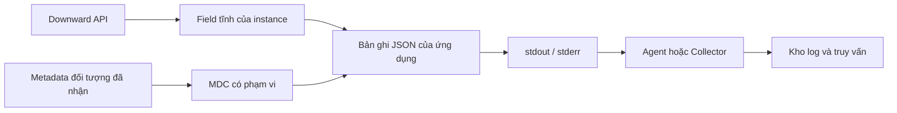

# Đưa thông tin tài nguyên vào ngữ cảnh ghi log

## Mục tiêu và bối cảnh

Trong chương **Khả năng quan sát** của module **SPRING_CLOUD_KUBERNETES**, bài học này hướng dẫn gắn định danh tài nguyên Kubernetes vào log để trả lời hai câu hỏi: **instance nào đã ghi log** và **instance ấy đang xử lý tài nguyên nào**.

Giả sử `orders-api` có ba replica. Configuration Watcher phát hiện thay đổi cấu hình, nhưng chỉ một replica cập nhật thất bại. Dòng `Refresh failed` không cho biết Pod nào, namespace nào, đối tượng nào hay giai đoạn nào bị lỗi. Ngữ cảnh tài nguyên giúp nối các bằng chứng này mà không phải ghi toàn bộ ConfigMap hoặc Secret.

Sau bài học, bạn có thể:

- Đưa thông tin Pod vào mọi log có cấu trúc bằng Downward API và Spring Boot.
- Gắn metadata của ConfigMap, Secret, Service hoặc EndpointSlice vào phạm vi xử lý tương ứng.
- Quản lý MDC khi tái sử dụng thread và khi chuyển sang xử lý bất đồng bộ.
- Phân biệt thông tin tài nguyên, mã tương quan nghiệp vụ và trace/span.
- Lọc log theo instance, tài nguyên và kết quả, đồng thời kiểm soát dữ liệu nhạy cảm và chi phí lưu trữ.

Ví dụ dùng Java 17 trở lên, Spring Boot **3.5.x**, SLF4J và Logback mặc định của một ứng dụng Spring MVC. Cấu hình JSON dựa trên khả năng có sẵn của Boot 3.5; không mặc định áp dụng nguyên trạng cho mọi phiên bản cũ. Giữ bộ phiên bản Spring Boot/Spring Cloud tương thích của dự án khi tích hợp Spring Cloud Kubernetes.

## 1. Phân biệt nơi phát log và đối tượng được xử lý

Hai nhóm thông tin sau thường cùng xuất hiện trên một bản ghi nhưng có vòng đời khác nhau:

| Nhóm | Ví dụ | Vòng đời phù hợp |
| --- | --- | --- |
| Nơi phát sinh log | service, cluster, namespace của Pod, tên Pod, Pod UID, container | Gắn với instance đang chạy |
| Đối tượng đang được xử lý | loại tài nguyên, namespace, tên, UID, resourceVersion | Gắn với một tác vụ hoặc sự kiện |

Ví dụ, một Pod thuộc namespace `platform` có thể xử lý ConfigMap ở namespace `payments` nếu được cấp quyền phù hợp. Vì vậy, `k8s_namespace` của Pod và `resource_namespace` của ConfigMap không được dùng thay nhau.

Bài học dùng schema ứng dụng sau. Đây là **quy ước do ví dụ định nghĩa**, không phải các field Spring Cloud Kubernetes tự động tạo:

| Field | Ý nghĩa |
| --- | --- |
| `service_name` | Tên logic của ứng dụng |
| `service_version` | Phiên bản do quy trình build/deploy cung cấp |
| `k8s_cluster` | Định danh cluster do nền tảng cung cấp |
| `k8s_namespace`, `k8s_pod`, `k8s_pod_uid` | Định danh Pod phát log |
| `k8s_node`, `k8s_container` | Node và container phát log |
| `resource_api_version`, `resource_kind` | API version và loại đối tượng đang xử lý |
| `resource_namespace`, `resource_name` | Vị trí và tên đối tượng |
| `resource_uid`, `resource_version` | Định danh lần tồn tại và phiên bản đối tượng |
| `event_type`, `outcome` | Loại sự kiện và kết quả theo quy ước ứng dụng |

Tên có thể được tái sử dụng sau khi một object bị xóa. UID giúp phân biệt lần tồn tại cũ với lần tạo lại, kể cả khi namespace và tên giống nhau. Tên Pod cũng không thay thế được Pod UID. [Nguồn: Kubernetes — Object names and IDs](https://kubernetes.io/docs/concepts/overview/working-with-objects/names/).

Giữ `resourceVersion` dưới dạng chuỗi do API cung cấp. Không diễn giải nó thành thời gian, không tự tăng và không dùng phép so sánh số để suy ra thứ tự chung giữa mọi tài nguyên. Quan sát “đã nhận phiên bản X” cũng chưa chứng minh cấu hình X đã được áp dụng thành công. [Nguồn: Kubernetes — API concepts](https://kubernetes.io/docs/reference/using-api/api-concepts/).

## 2. Chọn nơi bổ sung metadata

Có ba cách bổ sung thông tin, tùy điều bạn cần quan sát:

| Cách | Phù hợp khi | Giới hạn cần hiểu |
| --- | --- | --- |
| Ứng dụng nhận thông tin chính nó qua Downward API | Cần thấy định danh Pod ngay trong stdout hoặc `kubectl logs` | Chỉ có những field được Downward API hỗ trợ |
| Collector bổ sung metadata Kubernetes | Cần chuẩn hóa log của nhiều ứng dụng | Cần cấu hình liên kết log với Pod và quyền của collector |
| Ứng dụng gắn metadata đối tượng đang xử lý | Cần biết ConfigMap/Secret/Service nào liên quan đến một thao tác | Ứng dụng phải có metadata tại đúng ranh giới xử lý |

Collector có thể nhận diện Pod phát log, nhưng không tự biết một đoạn code vừa xử lý `orders-config` hay `orders-credentials` nếu ứng dụng không công bố thông tin ấy. Ngược lại, ứng dụng không cần tự truy vấn API server mỗi lần ghi log chỉ để bổ sung tên Pod.

Một luồng triển khai điển hình:



Kubernetes thu thập luồng stdout/stderr của container qua cơ chế logging của runtime; lưu trữ và tìm kiếm tập trung cần hệ thống phía sau. Không giả định log còn tồn tại dài hạn chỉ vì `kubectl logs` đang đọc được. [Nguồn: Kubernetes — Logging architecture](https://kubernetes.io/docs/concepts/cluster-administration/logging/).

OpenTelemetry có Kubernetes Attributes Processor để bổ sung metadata. Nếu nền tảng đã dùng cơ chế đó, hãy thống nhất schema và nguồn ưu tiên khi dữ liệu ứng dụng trùng với metadata của collector; không để một field có hai ý nghĩa. [Nguồn: OpenTelemetry — Kubernetes collector components](https://opentelemetry.io/docs/platforms/kubernetes/collector/components/).

## 3. Đưa thông tin Pod vào container bằng Downward API

Downward API cho phép truyền một số field của Pod vào container mà ứng dụng không phải gọi Kubernetes API. Những field cần trong bài gồm `metadata.name`, `metadata.namespace`, `metadata.uid` và `spec.nodeName`. Hai field cluster và container trong ví dụ được khai báo tường minh, không giả định có `fieldRef` tương ứng. [Nguồn: Kubernetes — Downward API](https://kubernetes.io/docs/concepts/workloads/pods/downward-api/).

Đây là phần container trong Pod template của Deployment:

```yaml
env:
  - name: POD_NAME
    valueFrom:
      fieldRef:
        fieldPath: metadata.name
  - name: POD_NAMESPACE
    valueFrom:
      fieldRef:
        fieldPath: metadata.namespace
  - name: POD_UID
    valueFrom:
      fieldRef:
        fieldPath: metadata.uid
  - name: NODE_NAME
    valueFrom:
      fieldRef:
        fieldPath: spec.nodeName
  - name: CONTAINER_NAME
    value: orders-api
  - name: CLUSTER_NAME
    value: training
  - name: APP_VERSION
    value: "1.0.0"
```

Cách khai báo `env[].valueFrom.fieldRef` được kubelet xử lý khi chuẩn bị container. Chỉ để nhận các field trên, ứng dụng không cần quyền `get/list/watch` Pod và không cần thêm Kubernetes client dependency. Biến môi trường là lựa chọn phù hợp cho định danh instance; không dùng nó như cơ chế theo dõi liên tục metadata thay đổi trong lúc chạy. [Nguồn: Kubernetes — Expose Pod information through environment variables](https://kubernetes.io/docs/tasks/inject-data-application/environment-variable-expose-pod-information/).

Không đưa toàn bộ labels/annotations vào log theo kiểu sao chép tự động. Chỉ chọn các khóa có ích và đã được thống nhất, chẳng hạn phiên bản hoặc môi trường triển khai. Node name cũng chỉ cần công bố nếu việc điều tra cần tới thông tin đó.

## 4. Cấu hình JSON để field tĩnh xuất hiện trên mọi log

Với Spring Boot 3.5 và logging mặc định, đặt cấu hình sau trong ứng dụng thực hành:

```yaml
spring:
  application:
    name: orders-api
  main:
    banner-mode: "off"

logging:
  structured:
    format:
      console: logstash
    json:
      add:
        service_name: "${spring.application.name}"
        service_version: "${APP_VERSION:dev}"
        k8s_cluster: "${CLUSTER_NAME:local}"
        k8s_namespace: "${POD_NAMESPACE:local}"
        k8s_pod: "${POD_NAME:local}"
        k8s_pod_uid: "${POD_UID:local}"
        k8s_node: "${NODE_NAME:local}"
        k8s_container: "${CONTAINER_NAME:local}"
```

`logging.structured.format.console` chọn bộ định dạng JSON. `logging.structured.json.add` bổ sung các field cố định; Logstash JSON của Boot cũng ghi các cặp key/value trong MDC. Trong bài, các khóa dùng dấu gạch dưới để giữ schema phẳng và dễ kiểm tra. Không cần cài thêm một encoder Logstash bên ngoài chỉ để dùng cấu hình này. [Nguồn: Spring Boot — Structured logging](https://docs.spring.io/spring-boot/3.5/reference/features/logging.html#features.logging.structured).

Giá trị `local` là fallback cho chạy ngoài cluster, không phải định danh Kubernetes thật. Nếu log của workload trong cluster vẫn mang `k8s_pod_uid=local`, hãy kiểm tra manifest hoặc cấu hình deployment; đừng chấp nhận nó như dữ liệu chuẩn.

Các thông tin nhận diện tĩnh phải có từ giai đoạn khởi tạo logging, qua môi trường hoặc cấu hình sẵn có lúc khởi động. Không đợi một bean khởi tạo xong mới đưa Pod identity vào MDC của thread `main` rồi kỳ vọng mọi thread khác tự nhận được. Logging được khởi tạo sớm hơn application context. Nếu dự án đã có cấu hình Logback tùy biến, phải tích hợp encoder/appender cấu trúc tương ứng thay vì giả định thuộc tính JSON sẽ tự thay encoder hiện có. [Nguồn: Spring Boot — Logging configuration](https://docs.spring.io/spring-boot/3.5/how-to/logging.html).

Các thuộc tính cụ thể cần được đối chiếu với phiên bản Boot của dự án. Không ghép cấu hình này thành hai khóa `logging` trùng nhau trong cùng một YAML document. [Tham chiếu thuộc tính Spring Boot 3.5](https://docs.spring.io/spring-boot/3.5/appendix/application-properties/index.html).

Ưu điểm của field tĩnh ở lớp định dạng là log startup, request, scheduled task và callback đều mang cùng định danh instance. MDC chỉ cần dành cho phần ngữ cảnh thay đổi theo thao tác.

## 5. Gắn metadata tài nguyên theo phạm vi xử lý

### 5.1. Vì sao phải đóng phạm vi MDC?

MDC là nơi chứa key/value gắn với thread ghi log trong Logback. Khi thread pool tái sử dụng một thread, dữ liệu chưa dọn có thể bị gắn nhầm vào thao tác kế tiếp. Thread con cũng không tự động nhận bản sao MDC của thread cha. [Nguồn: Logback — Mapped diagnostic context](https://logback.qos.ch/manual/mdc.html).

Ví dụ lỗi:

```java
MDC.put("resource_name", "orders-config");
reloadConfiguration();
// Không dọn MDC: tác vụ tiếp theo có thể bị gắn orders-config.
```

Dùng `MDC.clear()` ở một thư viện dùng chung cũng quá rộng: nó có thể xóa `traceId`, `spanId` hoặc các khóa do lớp bên ngoài sở hữu. Với scope lồng nhau, cần **khôi phục giá trị cũ của những khóa mình thay đổi**, không chỉ xóa chúng.

### 5.2. Helper chỉ quản lý các khóa tài nguyên

Ví dụ này độc lập với Fabric8 hoặc Kubernetes Java Client. Adapter của ứng dụng lấy metadata từ object đã nhận rồi chuyển vào record; không phát sinh một API call mới để phục vụ log.

```java
package com.example.orders;

import java.util.LinkedHashMap;
import java.util.Map;
import org.slf4j.MDC;

public final class ResourceLogContext implements AutoCloseable {

    public record ResourceRef(
            String apiVersion,
            String kind,
            String namespace,
            String name,
            String uid,
            String resourceVersion) {
    }

    private final Map<String, String> previous = new LinkedHashMap<>();
    private boolean closed;

    private ResourceLogContext(ResourceRef resource) {
        put("resource_api_version", resource.apiVersion());
        put("resource_kind", resource.kind());
        put("resource_namespace", resource.namespace());
        put("resource_name", resource.name());
        put("resource_uid", resource.uid());
        put("resource_version", resource.resourceVersion());
    }

    public static ResourceLogContext open(ResourceRef resource) {
        return new ResourceLogContext(resource);
    }

    private void put(String key, String value) {
        previous.put(key, MDC.get(key));
        MDC.put(key, value == null || value.isBlank() ? "-" : value);
    }

    @Override
    public void close() {
        if (closed) {
            return;
        }
        previous.forEach((key, value) -> {
            if (value == null) {
                MDC.remove(key);
            } else {
                MDC.put(key, value);
            }
        });
        closed = true;
    }
}
```

Quy tắc sử dụng: mở và đóng scope trên cùng thread, theo thứ tự lồng nhau. Đối với tài nguyên cấp cluster như Node, namespace không tồn tại; quy ước `"-"` thể hiện trường hợp ấy mà không giả mạo namespace của Pod.

Các API `get`, `put` và `remove` hỗ trợ quản lý từng khóa. `MDC.putCloseable` xóa khóa khi đóng, nên không mặc định thay thế helper này nếu cần khôi phục giá trị của scope bên ngoài. [Nguồn: SLF4J — MDC API](https://www.slf4j.org/apidocs/org/slf4j/MDC.html).

### 5.3. Đặt scope ở đúng ranh giới

Trong callback hoặc service xử lý một tài nguyên, mở scope trước khi thực hiện thao tác và đóng khi thao tác kết thúc:

```java
try (var scope = ResourceLogContext.open(resourceRef)) {
    log.atInfo()
            .addKeyValue("event_type", eventType)
            .addKeyValue("outcome", "observed")
            .log("resource-change-received");

    // Gọi luồng xử lý cấu hình/discovery đã được triển khai.
    // Chỉ ghi outcome=applied sau khi có kết quả áp dụng thực tế.
}
```

Đoạn trên minh họa vị trí gắn log; `resourceRef`, `eventType` và `log` thuộc adapter/service của ứng dụng, không phải API callback chung cho mọi phiên bản Spring Cloud Kubernetes.

Nếu xử lý lỗi cần metadata tài nguyên, hãy bắt và ghi lỗi **bên trong** scope. Nếu đợi scope đóng xong mới ghi, các khóa tài nguyên đã được khôi phục và có thể không còn trong bản ghi lỗi.

## 6. Thực hành quan sát hai replica và kiểm tra rò rỉ ngữ cảnh

Các tệp Java và manifest dưới đây là ví dụ để người học tạo trong **dự án lab riêng**. Không cần đọc Secret thật hoặc cài Configuration Watcher để kiểm tra cơ chế gắn context.

### 6.1. Tạo log có và không có scope tài nguyên

Ứng dụng lab có `spring-boot-starter-web`, main class Spring Boot và cấu hình JSON ở phần trước. Logging starter đã được starter web đưa vào; không cần thêm Kubernetes client chỉ cho bài thực hành.

Đặt lớp sau cùng package được component scan:

```java
package com.example.orders;

import java.util.List;
import org.slf4j.Logger;
import org.slf4j.LoggerFactory;
import org.springframework.beans.factory.annotation.Value;
import org.springframework.boot.ApplicationArguments;
import org.springframework.boot.ApplicationRunner;
import org.springframework.context.annotation.Profile;
import org.springframework.stereotype.Component;

@Component
@Profile("resource-log-lab")
public class ResourceLogLab implements ApplicationRunner {

    private static final Logger log =
            LoggerFactory.getLogger(ResourceLogLab.class);

    private final String namespace;

    public ResourceLogLab(
            @Value("${POD_NAMESPACE:local}") String namespace) {
        this.namespace = namespace;
    }

    @Override
    public void run(ApplicationArguments args) {
        var resources = List.of(
                new ResourceLogContext.ResourceRef(
                        "v1", "ConfigMap", namespace, "orders-config",
                        "demo-configmap-uid", "demo-rv-a"),
                new ResourceLogContext.ResourceRef(
                        "v1", "Secret", namespace, "orders-credentials",
                        "demo-secret-uid", "demo-rv-b"));

        log.info("resource-context-demo-start");

        for (var resource : resources) {
            try (var scope = ResourceLogContext.open(resource)) {
                log.atInfo()
                        .addKeyValue("event_type", "DEMO")
                        .addKeyValue("outcome", "observed")
                        .log("resource-context-demo-item");
            }
        }

        log.info("resource-context-demo-finished");
    }
}
```

Các UID và resourceVersion trong fixture là chuỗi **giả lập**, không phải metadata đọc từ cluster. Lớp này không tải Secret, không refresh cấu hình và không chứng minh một bản cấu hình đã được áp dụng. Nó chỉ tạo các log để kiểm tra schema và vòng đời context.

Chạy local với profile `resource-log-lab`. Khi không có biến môi trường Kubernetes, kỳ vọng field nhận diện mang fallback `local`, còn hai dòng item có metadata giả lập riêng biệt.

### 6.2. Triển khai hai replica

Chuẩn bị namespace `observability-lab` trong cluster thực hành và đóng gói ứng dụng thành image mà cluster pull được. Thay image placeholder trong manifest sau; lưu manifest trong dự án lab với tên bạn chọn.

```yaml
apiVersion: apps/v1
kind: Deployment
metadata:
  name: orders-api
  namespace: observability-lab
spec:
  replicas: 2
  selector:
    matchLabels:
      app: orders-api
  template:
    metadata:
      labels:
        app: orders-api
    spec:
      automountServiceAccountToken: false
      containers:
        - name: orders-api
          image: your-registry.example/orders-api:resource-log-lab
          ports:
            - name: http
              containerPort: 8080
          env:
            - name: SPRING_PROFILES_ACTIVE
              value: resource-log-lab
            - name: POD_NAME
              valueFrom:
                fieldRef:
                  fieldPath: metadata.name
            - name: POD_NAMESPACE
              valueFrom:
                fieldRef:
                  fieldPath: metadata.namespace
            - name: POD_UID
              valueFrom:
                fieldRef:
                  fieldPath: metadata.uid
            - name: NODE_NAME
              valueFrom:
                fieldRef:
                  fieldPath: spec.nodeName
            - name: CONTAINER_NAME
              value: orders-api
            - name: CLUSTER_NAME
              value: training
            - name: APP_VERSION
              value: "1.0.0"
```

Fixture không gọi Kubernetes API, nên không cần mount service account token. Không sao chép lựa chọn này sang ứng dụng đang dùng DiscoveryClient hoặc cơ chế đọc/watch cấu hình qua API nếu chúng vẫn cần token để xác thực.

Lab tập trung vào log nên không cần Service hoặc Ingress. Hai replica chạy cùng schema và cùng `service_name`, nhưng phải có Pod name/UID khác nhau.

### 6.3. Đối chiếu metadata và bản ghi

Các lệnh dưới dùng PowerShell sau khi bạn đã triển khai manifest lab:

```powershell
kubectl -n observability-lab rollout status deployment/orders-api
kubectl -n observability-lab get pods -l app=orders-api -o custom-columns='NAME:.metadata.name,UID:.metadata.uid,NAMESPACE:.metadata.namespace,NODE:.spec.nodeName'

$rawLog = kubectl -n observability-lab logs -l app=orders-api -c orders-api --since=10m --tail=-1
$events = $rawLog |
    Where-Object { $_.TrimStart().StartsWith('{') } |
    ForEach-Object { $_ | ConvertFrom-Json }

$items = $events |
    Where-Object { $_.message -eq 'resource-context-demo-item' }

$items |
    Select-Object service_name,k8s_namespace,k8s_pod,k8s_pod_uid,resource_kind,resource_name,resource_version,outcome

$items | Group-Object k8s_pod_uid
```

Không thêm `--prefix=true` hoặc `--timestamps=true` vào bước parse này vì chúng thêm dữ liệu phía trước JSON. `--tail=-1` tránh chỉ nhận phần đuôi ngắn khi lấy log theo selector. Nếu ứng dụng đã chạy quá 10 phút, điều chỉnh `--since` cho phù hợp. [Nguồn: kubectl logs](https://kubernetes.io/docs/reference/kubectl/generated/kubectl_logs/).

Đoạn lọc dòng bắt đầu bằng `{` chỉ phục vụ lab; pipeline production phải có chính sách rõ ràng cho bản ghi không parse được, không âm thầm bỏ qua log lỗi định dạng.

Ví dụ bản ghi rút gọn, trình bày nhiều dòng cho dễ đọc:

```json
{
  "message": "resource-context-demo-item",
  "level": "INFO",
  "service_name": "orders-api",
  "service_version": "1.0.0",
  "k8s_cluster": "training",
  "k8s_namespace": "observability-lab",
  "k8s_pod": "orders-api-example-abcde",
  "k8s_pod_uid": "example-pod-uid",
  "k8s_container": "orders-api",
  "resource_api_version": "v1",
  "resource_kind": "ConfigMap",
  "resource_namespace": "observability-lab",
  "resource_name": "orders-config",
  "resource_uid": "demo-configmap-uid",
  "resource_version": "demo-rv-a",
  "event_type": "DEMO",
  "outcome": "observed"
}
```

Bản ghi thực tế còn timestamp, logger, thread và các field của formatter. Mỗi event được encoder xuất thành một JSON record; không tự nối chuỗi JSON hoặc pretty-print từng event ra nhiều dòng stdout.

Kiểm tra dòng kết thúc:

```powershell
$events |
    Where-Object { $_.message -eq 'resource-context-demo-finished' } |
    Select-Object k8s_pod,k8s_pod_uid,resource_kind,resource_name
```

Kỳ vọng `k8s_pod` và `k8s_pod_uid` vẫn có giá trị, còn `resource_kind` và `resource_name` không còn tồn tại trên dòng kết thúc của fixture. Nếu vẫn còn `orders-credentials`, context đã bị rò rỉ hoặc có lớp khác đưa field vào sai phạm vi.

Với hai Pod không restart và log startup còn đầy đủ, fixture tạo bốn dòng item: hai dòng cho mỗi Pod. Nếu số lượng khác, đối chiếu thời gian truy vấn, restart, log rotation và số Pod thực tế trước khi kết luận lỗi MDC.

## 7. Xử lý bất đồng bộ mà không gắn nhầm tài nguyên

Scope MDC trong bài là scope **đồng bộ trên một thread**. Ví dụ sau đóng scope quá sớm:

```java
try (var scope = ResourceLogContext.open(resourceRef)) {
    executor.execute(() -> process(resourceRef));
}
```

Task chạy sau đó trên thread khác có thể không có metadata. Giữ scope mở ở thread cha lâu hơn cũng không giải quyết việc truyền context.

Một lựa chọn đơn giản khi task đã nhận metadata tường minh là mở scope **bên trong task**:

```java
executor.execute(() -> {
    try (var scope = ResourceLogContext.open(resourceRef)) {
        process(resourceRef);
    }
});
```

`resourceRef` nên là snapshot metadata bất biến tại lúc nhận sự kiện. Không giữ một object có thể tiếp tục bị cập nhật rồi đọc metadata vào thời điểm muộn, khiến log dùng sai phiên bản.

Nếu cần truyền toàn bộ logging/observation context, dùng cơ chế đã được ứng dụng chọn cho executor. Spring có `ContextPropagatingTaskDecorator`, nhưng cần cấu hình hệ sinh thái context propagation và accessor phù hợp; không giả định nó tự biết mọi khóa MDC tùy biến. Cũng không coi việc cấu hình một executor là đã bao phủ `CompletableFuture` dùng executor khác. [Nguồn: Spring Framework — ContextPropagatingTaskDecorator](https://docs.spring.io/spring-framework/docs/6.2.x/javadoc-api/org/springframework/core/task/support/ContextPropagatingTaskDecorator.html).

Với WebFlux/Reactor, một request có thể chuyển thread. Không bao một `Mono` chưa subscribe bằng try-with-resources rồi mong MDC tồn tại khi pipeline thực thi. Sử dụng Reactor Context và cơ chế bridge đã cấu hình; việc khôi phục ThreadLocal phụ thuộc chế độ propagation và accessor đăng ký. [Nguồn: Reactor — Context propagation](https://projectreactor.io/docs/core/release/reference/advanced-contextPropagation.html).

## 8. Liên kết với các khả năng Spring Cloud Kubernetes

### 8.1. Cập nhật cấu hình

Khi tích hợp ConfigMap, Secret và Configuration Watcher, hãy xác định rõ ai quan sát thay đổi, ai gửi thông báo và ai áp dụng cấu hình. Log tại từng nơi nên phản ánh đúng điều nơi đó thực sự biết:

| Giai đoạn | Nội dung đáng ghi | Kết luận chưa được phép suy ra |
| --- | --- | --- |
| Watcher nhận sự kiện | Định danh tài nguyên, loại sự kiện, thời điểm | Mọi replica đã áp dụng thành công |
| Gửi yêu cầu refresh | Đích logic, mã tương quan, kết quả gửi | Ứng dụng đã dùng cấu hình mới |
| Ứng dụng nhận refresh | Pod identity, mã tương quan nếu có | Mọi bean hoặc connection pool đã đổi |
| Hoàn tất áp dụng | Kết quả theo cơ chế áp dụng thực tế, độ trễ | Không còn lỗi ở bất kỳ replica nào |

Nếu thông báo chỉ chứa namespace và tên, log chỉ những metadata nhận được. Không điền resourceVersion hiện tại vào rồi khẳng định đó chính là version của sự kiện ban đầu. Muốn nối các chặng, cần một mã tương quan được thiết kế và truyền qua luồng tương ứng; bài học không giả định Spring Cloud Kubernetes tự truyền mã đó.

### 8.2. Discovery và cân bằng tải

Với DiscoveryClient và Spring Cloud LoadBalancer, log điều tra có thể cần `service_id`, namespace đích, kết quả discovery hoặc địa chỉ instance đã chọn. Hãy đặt tên field thể hiện **đích được gọi**, tránh ghi đè các field định danh Pod phát log.

Ví dụ, `k8s_pod` luôn chỉ nguồn log; nếu biết Pod đích, dùng một field riêng như `target_pod`. Không suy ra Pod đích chỉ từ tên Kubernetes Service, vì một Service có thể dẫn đến nhiều backend.

Tránh log toàn bộ danh sách endpoint ở mỗi request. Ưu tiên sự kiện thay đổi tập endpoint, lỗi có ích cho điều tra và mức chi tiết có thời hạn.

### 8.3. Thông tin Actuator không tự trở thành logging context

Spring Cloud Kubernetes có InfoContributor bổ sung thông tin Pod vào endpoint info; có thể tắt bằng `management.info.kubernetes.enabled=false`. Khả năng đó không có nghĩa mỗi log đã có sẵn metadata tài nguyên hoặc scope MDC. Đường dẫn HTTP thực tế phụ thuộc cấu hình Actuator. [Nguồn: Spring Cloud Kubernetes — Info Contributor](https://docs.spring.io/spring-cloud-kubernetes/reference/info-contributor.html).

Nếu chỉ cần định danh Pod cho log, Downward API cộng cấu hình logging là đủ cho phần nhu cầu ấy. Chỉ bổ sung chức năng discovery, API watch hoặc cơ chế cấu hình của Spring Cloud Kubernetes khi ứng dụng thật sự cần.

## 9. Trace, dữ liệu nhạy cảm và chi phí truy vấn

### 9.1. Định danh tài nguyên không thay thế trace

Pod UID giúp biết nơi phát log; trace ID giúp nối một luồng xử lý qua nhiều service. Một Pod phục vụ nhiều trace, và một trace có thể đi qua nhiều Pod.

Khi ứng dụng đã tích hợp Micrometer Tracing, hãy giữ `traceId` và `spanId` do tracing quản lý. Không tự đặt chúng bằng Pod UID, không tạo trace ID chỉ để làm đẹp log, và không xóa chúng khi đóng scope tài nguyên. Một callback nền không nằm trong trace có thể không có các field này; đó không tự nó là lỗi. [Nguồn: Spring Boot — Logging correlation IDs](https://docs.spring.io/spring-boot/3.5/reference/actuator/tracing.html#actuator.micrometer-tracing.logging).

### 9.2. Ghi metadata tối thiểu

Đối với Secret, không log `data`, `stringData`, token, password, connection string có credential hoặc toàn bộ object bằng `toString()`. Base64 không làm nội dung Secret trở thành an toàn để ghi log. Ngay cả tên Secret cũng có thể cần kiểm soát theo chính sách nội bộ. [Nguồn: Kubernetes — Good practices for Secrets](https://kubernetes.io/docs/concepts/security/secrets-good-practices/).

Áp dụng cùng nguyên tắc cho ConfigMap: nó có thể chứa thông tin nhạy cảm do cách sử dụng của tổ chức. Chọn allowlist metadata, không dump toàn bộ Environment, HTTP header hoặc payload refresh.

Đối với lỗi, ưu tiên mã nguyên nhân đã kiểm soát, loại lỗi và HTTP status khi phù hợp. Chỉ ghi message/stack trace khi đã đánh giá nguy cơ chứa credential hoặc payload; không mặc định mọi exception từ client thư viện đều an toàn.

### 9.3. Phân biệt field tìm kiếm với label lập chỉ mục

Pod UID, resourceVersion, trace ID và tên tài nguyên tạo mới liên tục có thể có rất nhiều giá trị. Chúng hữu ích để điều tra, nhưng không nên tự động trở thành label có cardinality cao trong mọi backend.

Một chính sách khởi đầu để thảo luận với đội vận hành:

| Dữ liệu | Cách sử dụng đề xuất |
| --- | --- |
| service, cluster, namespace | Bộ lọc chính; cân nhắc làm label/index nếu tập giá trị được kiểm soát |
| Pod UID, resource UID/version | Giữ trong log; chọn chiến lược index theo backend và lưu lượng |
| trace ID, mã tương quan | Truy vấn chính xác khi điều tra một luồng |
| Secret payload, token, password | Không thu thập vào log |

Đây là gợi ý thiết kế, không phải cấu hình chung cho Loki, Elasticsearch và mọi hệ thống khác. Cân bằng tốc độ truy vấn với chi phí ingest, index và lưu trữ.

## 10. Điều tra và tiêu chí hoàn thành

Một luồng điều tra hữu ích là thu hẹp theo **thời gian → service/cluster → tài nguyên → Pod UID → kết quả**. Không chỉ tìm chuỗi tên tài nguyên trong message, vì field có cấu trúc cho phép phân biệt nguồn log với đối tượng được xử lý.

| Dấu hiệu | Điểm cần kiểm tra |
| --- | --- |
| Log trong cluster vẫn có Pod UID là `local` | Biến Downward API, manifest đã rollout, cấu hình logging được nạp |
| Chỉ log thread main có metadata Pod | Có đang đặt định danh tĩnh trong MDC của main thay vì lớp định dạng không? |
| Log thao tác B mang tên tài nguyên A | Thiếu đóng scope, lỗi khôi phục giá trị hoặc truyền context sai |
| Log có message nhưng thiếu field MDC | Encoder có hỗ trợ MDC không; log có thật sự phát bên trong scope không? |
| Metadata mất sau khi chuyển executor | Scope được mở ở thread nào; task có mang snapshot metadata không? |
| Cùng tên Pod nhưng bằng chứng không khớp | So sánh Pod UID, cluster, namespace và thời điểm |
| Collector và ứng dụng ghi hai namespace khác nhau | Phân biệt namespace nguồn, namespace đối tượng và quy tắc merge |
| Có log nhận thay đổi nhưng không có log áp dụng | Kiểm tra từng chặng refresh và kết quả thực tế của từng replica |

Bạn hoàn thành bài thực hành khi:

1. Mọi log qua formatter của ứng dụng có định danh instance, kể cả log ngoài scope tài nguyên.
2. Hai replica được phân biệt bằng Pod UID và khớp metadata từ `kubectl get pods`.
3. Hai dòng demo trong mỗi Pod mang đúng ConfigMap/Secret giả lập.
4. Dòng kết thúc không còn giữ các khóa tài nguyên của dòng trước.
5. Log không chứa nội dung Secret hoặc toàn bộ cấu hình.
6. Có phương án rõ ràng cho tác vụ đổi thread, thay vì mặc định MDC tự truyền.
7. Các kết luận “observed”, “requested” và “applied” được ghi đúng theo bằng chứng của từng bước.

Ngữ cảnh tốt giúp biết một instance đã làm gì với một tài nguyên cụ thể. Giá trị của nó nằm ở định danh rõ ràng, phạm vi đúng và kết quả có bằng chứng.

