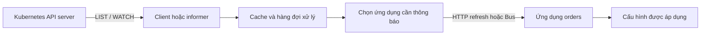
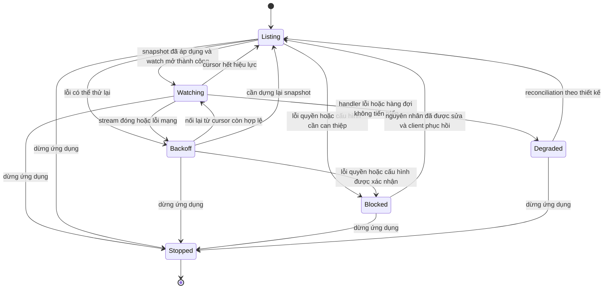

# Theo dõi lỗi truy cập Kubernetes API và vòng đời watch

Một ứng dụng Spring vẫn có thể trả HTTP 200 trong khi DiscoveryClient không cập nhật được địa chỉ backend hoặc Configuration Watcher không nhận được thay đổi ConfigMap. Quan sát riêng request nghiệp vụ chưa đủ: cần biết thành phần nào đang gọi Kubernetes API, watch của nó có phục hồi được không và dữ liệu đã nhận có được áp dụng hay chưa.

Bài học thuộc chương **Khả năng quan sát** của module **SPRING_CLOUD_KUBERNETES**. Nội dung tập trung vào lỗi truy cập Kubernetes API và vòng đời theo dõi thay đổi, gắn với khám phá dịch vụ, cập nhật ConfigMap/Secret và vận hành Pod. Các tín hiệu dưới đây giúp quyết định khắc phục quyền, mạng, client hay pipeline xử lý sự kiện.

## 1. Xác định đúng thành phần cần quan sát

Trước khi tìm một dòng log lỗi, hãy vẽ đường đi của dữ liệu. Không phải mọi ứng dụng dùng Spring Cloud Kubernetes đều trực tiếp mở một watch tới API server.

| Cách triển khai | Nơi cần tìm lỗi Kubernetes API | Ảnh hưởng có thể thấy |
| --- | --- | --- |
| DiscoveryClient dùng Fabric8 hoặc Kubernetes Java Client trực tiếp | Tiến trình có client và thao tác API tương ứng | Danh sách instance không cập nhật, lời gọi qua Spring Cloud LoadBalancer chọn địa chỉ cũ |
| HTTP DiscoveryClient qua DiscoveryServer | Theo dõi HTTP ở ứng dụng và Kubernetes API ở DiscoveryServer | Ứng dụng gọi server lỗi hoặc server trả dữ liệu chưa cập nhật |
| Configuration Watcher triển khai riêng | Pod Watcher và các client bên trong nó | Không thấy thay đổi hoặc không phát được thông báo refresh |
| Ứng dụng đọc file ConfigMap/Secret được mount | Đường cập nhật volume và cơ chế nạp cấu hình đã chọn | File đã đổi nhưng giá trị trong ứng dụng vẫn cũ |

Spring Cloud Kubernetes hỗ trợ các implementation discovery khác nhau; namespace và nơi cấu hình cũng khác giữa client trực tiếp và DiscoveryServer. Cần đối chiếu implementation thực tế trước khi chọn logger, hook hay quyền API. [Tài liệu DiscoveryClient](https://docs.spring.io/spring-cloud-kubernetes/reference/3.3/discovery-client.html).

Không dùng từ “watch” như một bảo đảm về giao thức. Trong tài liệu discovery dòng 3.3, catalog watch còn mô tả cơ chế phát heartbeat theo lịch. Heartbeat này không phải `BOOKMARK` của Kubernetes API và không chứng minh mọi kết nối watch cấp thấp đều khỏe. Các cấu hình cụ thể cần được đối chiếu với phiên bản đang dùng; không ghép tùy ý các bản client ngoài BOM tương thích của dự án.

Tình huống xuyên suốt: `orders` chạy trong namespace `apps`; một Watcher cần theo dõi ConfigMap cho dịch vụ này. Sau một thay đổi cấu hình, ứng dụng vẫn dùng giá trị cũ. Cần phân biệt ít nhất bốn chặng:



Watch hoạt động chỉ xác nhận một phần đường đi. Label không khớp, thông báo refresh thất bại hoặc cấu hình không hỗ trợ cập nhật động đều có thể tạo cùng biểu hiện ở cuối chuỗi.

## 2. Hiểu vòng đời LIST rồi WATCH

Để minh họa, bài dùng mô hình phổ biến: client lấy snapshot bằng LIST, rồi theo dõi thay đổi từ `resourceVersion` của snapshot đó. Một số phiên bản Kubernetes/client hỗ trợ cách khởi tạo stream khác; không suy rằng mọi implementation luôn phát đúng các request minh họa.

```text
1. LIST ConfigMap trong apps với cùng phạm vi và selector cần theo dõi.
2. Áp dụng đầy đủ snapshot vào cache.
3. Lấy metadata.resourceVersion của collection làm cursor khởi đầu.
4. Mở WATCH từ cursor đó.
5. Nhận thay đổi, cập nhật cache và chuyển công việc sang bộ xử lý.
6. Nếu stream đóng, xác định cần nối lại hay lấy snapshot mới.
7. Khi ứng dụng dừng, hủy watch và tác vụ phục hồi có kiểm soát.
```

Request dạng minh họa:

```http
GET /api/v1/namespaces/apps/configmaps

GET /api/v1/namespaces/apps/configmaps?watch=true&resourceVersion=81234&timeoutSeconds=300&allowWatchBookmarks=true
```

`81234` chỉ là giá trị ví dụ do API server trả về. Không tự tăng cursor hoặc lấy cursor của một object bất kỳ thay cho phiên bản collection của snapshot ban đầu. Bài chỉ sử dụng `resourceVersion` làm cursor; không lấy hiệu hai giá trị này để tính độ trễ theo giây. [Cơ chế phát hiện thay đổi của Kubernetes API](https://kubernetes.io/docs/reference/using-api/api-concepts/#efficient-detection-of-changes).

Có thể biểu diễn trạng thái quan sát như sau:



Đây là mô hình để thiết kế log và metric, không phải tên state bắt buộc trong thư viện. Một snapshot đã khởi tạo không đồng nghĩa stream đang kết nối; stream đang kết nối cũng không đồng nghĩa callback đã xử lý hết hàng đợi.

### Những sự kiện không được diễn giải sai

- `ADDED`, `MODIFIED`, `DELETED` mô tả thay đổi đối tượng trong phạm vi theo dõi. Chúng không tự xác nhận cấu hình đã được ứng dụng đích áp dụng.
- `BOOKMARK` cung cấp mốc tiến triển của stream, không phải thay đổi dữ liệu nghiệp vụ. Máy chủ không bảo đảm gửi nó theo chu kỳ cố định, kể cả khi client yêu cầu.
- Event `ERROR` cần đọc đối tượng trạng thái bên trong. Kết nối ban đầu thành công không có nghĩa stream sẽ không báo lỗi sau đó.
- Không có thay đổi trong thời gian dài có thể hoàn toàn bình thường. Không phát cảnh báo “watch chết” chỉ vì không nhận `MODIFIED` trong vài phút.

Khi dùng informer, việc gọi lại handler theo chu kỳ resync có thể xuất phát từ dữ liệu cache. Nó không nhất thiết là một lần LIST mới qua mạng. Vì vậy, số callback hoặc log “resync thành công” không đủ chứng minh kết nối API server mới được kiểm tra. [Ví dụ SharedInformer của Fabric8](https://github.com/fabric8io/kubernetes-client/blob/main/doc/CHEATSHEET.md#sharedinformers).

## 3. Phân loại lỗi trước khi quyết định retry

Lỗi cần được gắn với thao tác và giai đoạn: `get`, `list`, mở watch, đọc stream hay xử lý callback. Cùng mã HTTP nhưng khác request có thể dẫn tới cách khắc phục khác nhau.

| Tín hiệu | Cách hiểu ban đầu | Điều cần xác minh hoặc thực hiện |
| --- | --- | --- |
| DNS, connect timeout, connection refused | Chưa thiết lập được kết nối tới đích | DNS trong Pod, API endpoint, cổng, route, egress policy, proxy hoặc mesh |
| TLS handshake/certificate error | Không xác minh được kết nối bảo mật | CA, hostname/SAN, thời gian hệ thống và cấu hình trust |
| `401 Unauthorized` | Thông tin xác thực không được chấp nhận | Token/chứng chỉ, audience, thời hạn và cách client đọc lại credential |
| `403 Forbidden` | Request bị từ chối theo danh tính/phạm vi hiện tại | User được máy chủ nhận diện, verb, API group, resource và namespace |
| `404 Not Found` | Đích request không tồn tại hoặc không được phục vụ | Object cụ thể, namespace, group/version/resource và API được cluster hỗ trợ |
| `400 Bad Request` | Request không hợp lệ | Selector, tham số hoặc giá trị không đúng; retry nguyên request thường không giải quyết |
| `410 Gone` / trạng thái `Expired` khi watch | Lịch sử cần để tiếp tục từ cursor không còn dùng được | Dựng lại snapshot và mở watch theo cursor mới |
| `429 Too Many Requests` | Request đang bị giới hạn hoặc từ chối do tải/chính sách | Tôn trọng `Retry-After` nếu có, backoff và kiểm tra tổng tải của các client |
| `5xx` hoặc gateway lỗi | Có thể có sự cố tạm thời ở server hoặc đường trung gian | Retry có kiểm soát và đối chiếu tín hiệu control plane |
| EOF/stream đóng | Có thể là hết thời gian watch, shutdown hoặc mất kết nối | Lý do đóng, thời lượng phiên và quá trình phục hồi sau đó |
| Callback ném exception hoặc queue tăng liên tục | Lỗi xử lý phía client dù transport có thể còn tốt | Handler, deadlock, pool, backpressure và reconciliation |

Nếu credential không được gửi, máy chủ có thể xử lý request dưới danh tính anonymous và trả `403`; không dựa riêng mã HTTP để kết luận đã xác thực thành công. Với `404`, cần phân biệt GET một ConfigMap không tồn tại với LIST/WATCH vào một API collection sai.

Một lỗi `403` hữu ích phải dẫn tới câu mô tả cụ thể, chẳng hạn:

```text
Danh tính system:serviceaccount:apps:orders-runtime
không được watch configmaps thuộc core API group trong namespace apps.
```

Không thay mô tả này bằng “Kubernetes bị lỗi” rồi cấp `cluster-admin`. Nếu deployment vô tình mở rộng sang tất cả namespace, sửa phạm vi có thể đúng hơn mở rộng quyền.

### Xử lý đúng `410 Gone`

Khi cursor quá cũ, mở lại stream với chính cursor đó có thể tạo vòng lặp lỗi. Với mô hình LIST rồi WATCH, quá trình khôi phục cần lấy lại trạng thái hiện tại, thay thế/reconcile cache theo hợp đồng của client rồi mở watch từ phiên bản snapshot mới. Đối chiếu cả lỗi lúc mở kết nối và event `ERROR` bên trong stream. [Kubernetes: khôi phục khi lịch sử watch hết hiệu lực](https://kubernetes.io/docs/reference/using-api/api-concepts/#efficient-detection-of-changes).

Relist phải nhận biết đối tượng đã bị xóa trong khoảng mất kết nối. Chỉ thêm các object hiện còn trên server vào một cache cũ có thể giữ lại object không tồn tại. Khi dùng informer của thư viện, để cơ chế chuẩn quản lý cache; không xóa/chỉnh trực tiếp cấu trúc nội bộ từ một luồng giám sát bên ngoài.

### Xử lý đúng credential và tải

ServiceAccount hiện đại thường dùng token có thời hạn được chiếu vào Pod và được kubelet luân chuyển. Client cần sử dụng cơ chế credential phù hợp với vòng đời đó; sao chép token một lần vào một chuỗi cấu hình cố định có thể gây lỗi về sau. Không in token ra log để kiểm tra. [ServiceAccount và token](https://kubernetes.io/docs/concepts/security/service-accounts/).

Lỗi `429` có thể liên quan API Priority and Fairness. Đội vận hành có thể đối chiếu các metric control plane như `apiserver_flowcontrol_rejected_requests_total` và thời gian chờ hàng đợi nếu có quyền truy cập. Không suy rằng tăng retry phía ứng dụng sẽ làm server phục hồi nhanh hơn. [API Priority and Fairness](https://kubernetes.io/docs/concepts/cluster-administration/flow-control/).

## 4. Thiết kế log cho cả lỗi và phục hồi

Mỗi dòng log cần giúp nối được lỗi với watch cụ thể, nhưng không chứa payload của Secret hay toàn bộ cấu hình. Một schema tự thiết kế có thể gồm:

| Trường | Ví dụ hoặc ý nghĩa |
| --- | --- |
| `component` | `configuration-watcher`, `discovery-server`, `orders-runtime` |
| `client` | `fabric8` hoặc `kubernetes-java` |
| `watch_scope` | Tên ổn định như `apps-configmaps`; không phải một ID ngẫu nhiên |
| `operation`, `phase` | `watch` / `open`, `stream`, `callback` |
| `api_group`, `resource`, `target_namespace` | `core`, `configmaps`, `apps` |
| `outcome`, `http_status`, `reason` | Phân loại chuẩn hóa; status có thể không tồn tại ở lỗi transport |
| `attempt`, `retry_delay_ms`, `elapsed_ms` | Phân biệt vòng lặp tức thời với phục hồi có backoff |
| `watch_session` | ID phiên kết nối dùng trong log để liên kết các mốc |
| `resource_version` | Cursor khi thực sự cần điều tra; không dùng làm nhãn metric |

Các dòng JSON dưới đây là định dạng minh họa do ứng dụng hoặc lớp quan sát bổ sung phát ra, không phải log mặc định được Spring Cloud Kubernetes bảo đảm cung cấp:

```json
{"event":"watch_open_failed","component":"configuration-watcher","watch_scope":"apps-configmaps","operation":"watch","phase":"open","resource":"configmaps","target_namespace":"apps","http_status":403,"reason":"forbidden","attempt":1}
{"event":"watch_closed","component":"configuration-watcher","watch_scope":"apps-configmaps","phase":"stream","reason":"transport","retry_delay_ms":2400,"watch_session":"w-17"}
{"event":"relist_completed","component":"configuration-watcher","watch_scope":"apps-configmaps","reason":"expired","snapshot_applied":true,"elapsed_ms":340}
{"event":"watch_recovered","component":"configuration-watcher","watch_scope":"apps-configmaps","disconnected_ms":2800,"watch_session":"w-18"}
```

Đặt chính sách mức log theo ý nghĩa vận hành:

- `INFO`: khởi tạo hoàn tất, chuyển trạng thái quan trọng, phục hồi và dừng theo yêu cầu.
- `DEBUG`: chi tiết reconnect dự kiến hoặc sự kiện thường xuyên khi điều tra có giới hạn.
- `WARN`: mất kết nối tạm thời, cần relist hoặc số lần retry tăng bất thường.
- `ERROR`: lỗi quyền/cấu hình kéo dài, không thể đồng bộ hoặc mất khả năng xử lý bắt buộc theo chính sách của hệ thống.

Không ghi stack trace đầy đủ ở mỗi lần reconnect cùng nguyên nhân. Có thể ghi lần đầu, đếm số lần lặp, phát bản tổng hợp theo cửa sổ thời gian và luôn giữ log phục hồi. Đặc biệt, đóng watch khi nhận SIGTERM phải được nhận diện là shutdown, tránh tạo cảnh báo giả đúng lúc rolling deployment.

Cấu hình mức log khởi đầu có thể là:

```yaml
logging:
  level:
    org.springframework.cloud.kubernetes: INFO
    io.fabric8.kubernetes.client: WARN
    io.kubernetes.client: WARN
    com.example.platform.kubernetes: INFO
```

Package cuối là logger do dự án tự sở hữu. Chỉ bật DEBUG tạm thời cho đúng package đang dùng; không bật đồng loạt HTTP wire logging hoặc dump request/response body. Với Watcher, tài liệu có hướng dẫn logger chuyên biệt để điều tra việc chọn nguồn cấu hình và phát thông báo. [Logging của Configuration Watcher](https://docs.spring.io/spring-cloud-kubernetes/reference/3.3/spring-cloud-kubernetes-configuration-watcher.html).

Tên logger, callback và khả năng gắn interceptor phụ thuộc phiên bản client. Giữ BOM tương thích, kiểm tra dependency thực tế và không thêm một client khác chỉ để lấy logger. Đối với Kubernetes Java Client, mã Reflector là một nơi thể hiện riêng luồng list/watch và xử lý lỗi; cần xem đúng tag của phiên bản dự án khi tích hợp hook. [Mã nguồn ReflectorRunnable](https://raw.githubusercontent.com/kubernetes-client/java/master/util/src/main/java/io/kubernetes/client/informer/cache/ReflectorRunnable.java).

## 5. Metric cần trả lời được câu hỏi cụ thể

Các tên `platform_k8s_*` trong phần này là **metric đề xuất do bạn tự instrument**, không phải bộ metric có sẵn của Spring Cloud Kubernetes. Nếu chưa gắn log adapter, listener hoặc instrumentation vào client thực tế, các chuỗi này sẽ không tự xuất hiện tại Actuator.

| Metric đề xuất khi xuất sang Prometheus | Loại | Hợp đồng đo |
| --- | --- | --- |
| `platform_k8s_api_calls_total` | Counter | Lần gọi API theo `operation` và `outcome`; với watch chỉ đếm kết quả mở phiên, không đếm mỗi event thành request |
| `platform_k8s_watch_connected` | Gauge 0/1 | Client quan sát phiên watch đang mở; không phải chứng minh toàn bộ pipeline còn tiến triển |
| `platform_k8s_watch_disconnects_total` | Counter | Số lần mất một phiên đã mở, phân loại `reason` hữu hạn |
| `platform_k8s_watch_reconnects_total` | Counter | Số phiên mở lại thành công sau một lần gián đoạn |
| `platform_k8s_relist_total` | Counter | Số lần thực hiện relist, tách nguyên nhân và kết quả |
| `platform_k8s_cache_initialized` | Gauge 0/1 | Đã áp dụng đầy đủ snapshot khởi tạo/khôi phục theo hợp đồng cache; không khẳng định dữ liệu luôn mới |
| `platform_k8s_watch_disconnected_seconds` | Gauge | Thời gian liên tục chưa có phiên mở, bằng 0 khi đã nối lại |
| `platform_k8s_callback_duration_seconds` | Timer/histogram | Thời gian xử lý callback, tách khỏi thời gian chờ kết nối |
| `platform_k8s_event_queue_depth` | Gauge | Công việc đang chờ xử lý nếu có hàng đợi mà bạn quan sát được |

Nên gắn `resource`, `target_namespace` và `watch_scope` từ tập cấu hình hữu hạn. Nhãn `outcome` có thể chuẩn hóa thành `success`, `unauthorized`, `forbidden`, `expired`, `throttled`, `server_error`, `transport`, `invalid_request`, `other`. Các nhãn hạ tầng như Pod/instance có thể được hệ thống scrape bổ sung.

Không đưa `resourceVersion`, token, thông báo exception nguyên văn, object UID, URL đầy đủ hoặc ID phiên watch vào nhãn metric. Chúng tạo nhiều time series và có thể làm lộ dữ liệu. ID phiên phù hợp hơn với log đã giới hạn truy cập.

Khi dùng Micrometer, counter ghi số lần xảy ra và thường được phân tích bằng tốc độ tăng; gauge biểu diễn trạng thái tại thời điểm lấy mẫu. Timer đã có count cho các lần được đo thời gian, nên không cần tạo thêm counter trùng ý nghĩa cho chính các mẫu đó. [Counter của Micrometer](https://docs.micrometer.io/micrometer/reference/concepts/counters.html), [Gauge của Micrometer](https://docs.micrometer.io/micrometer/reference/concepts/gauges.html).

### Quy tắc cập nhật tín hiệu

Mã giả sau mô tả hợp đồng quan sát; hook cụ thể phải được nối vào implementation đang dùng:

```text
khi bắt đầu một scope bắt buộc:
    connected = 0
    cache_initialized = 0
    bắt đầu đo thời gian chưa kết nối

khi LIST trả về:
    ghi kết quả API
    chỉ đánh dấu cache_initialized = 1 sau khi snapshot được áp dụng đầy đủ

khi WATCH thực sự mở:
    ghi kết quả mở phiên
    connected = 1
    kết thúc khoảng gián đoạn
    nếu là phiên phục hồi: tăng reconnects

khi stream đã mở bị đóng:
    connected = 0
    bắt đầu khoảng gián đoạn nếu chưa có
    tăng disconnects theo lý do đã chuẩn hóa
    để client/informer sở hữu việc phục hồi

khi cursor hết hiệu lực:
    đánh dấu trạng thái nhất quán của cache không còn được bảo đảm
    theo dõi relist và quá trình áp dụng snapshot mới
    không giả vờ dữ liệu đã mới chỉ vì một request mở phiên thành công

khi callback lỗi:
    ghi lỗi xử lý và trạng thái queue/reconciliation
    không tự suy ra transport đã bị ngắt

khi dừng:
    hủy watch và retry task
    phân biệt shutdown với sự cố cần phục hồi
```

Nếu chưa khởi tạo được cache, dùng tín hiệu đó cùng thời gian khởi động để cảnh báo. Nếu đã có snapshot nhưng mất kết nối, có thể giữ snapshot cuối theo chính sách ứng dụng, đồng thời đánh dấu trạng thái suy giảm. Không đổi timestamp “dữ liệu đã cập nhật” ở mỗi vòng retry thất bại.

## 6. Không nhầm tuổi sự kiện với độ mới dữ liệu

Một namespace ít thay đổi có thể không có event trong nhiều giờ. Tuổi của event cuối, tuổi LIST cuối và tuổi object có ý nghĩa khác nhau:

| Quan sát | Điều có thể kết luận | Điều chưa thể kết luận |
| --- | --- | --- |
| Không có `MODIFIED` gần đây | Chưa quan sát một thay đổi loại đó | Watch đã hỏng |
| Có `BOOKMARK` | Stream đã xác nhận mốc tiến triển tương ứng | Handler phía sau đã xử lý xong hoặc bookmark sẽ tiếp tục đến theo lịch |
| Watch đang mở | Client chưa quan sát kết thúc phiên | Không có kết nối nửa mở hoặc callback bị treo |
| LIST thành công gần đây | API đã trả snapshot tại lần đọc đó | Snapshot đã được ứng dụng cuối áp dụng |
| `cache_initialized=1` | Đã dựng được cache theo hợp đồng đo | Cache sẽ đúng vô thời hạn dù mất kết nối |

Không dùng `metadata.creationTimestamp` để tính thời gian truyền một lần sửa ConfigMap. Trường này là thời điểm tạo object, không phải thời điểm của từng lần cập nhật. Không diễn giải số chênh `resourceVersion` thành mili giây.

Nếu cần bằng chứng đầu cuối, có thể thiết kế canary riêng trong môi trường thử nghiệm hoặc luồng vận hành đã được chấp thuận: sửa một annotation vô hại trên ConfigMap canary thuộc đúng namespace/selector, rồi xác nhận pipeline xử lý nhìn thấy phiên bản mới. Dùng đồng hồ của bộ đo để tính từ lúc phát thay đổi đến lúc nhận xác nhận; không ghi giá trị Secret vào tín hiệu canary.

Canary chỉ chứng minh phạm vi mà nó thực sự đi qua. Một ConfigMap canary không chứng minh watch Secret ở namespace khác còn tốt; việc callback nhận được object cũng chưa chứng minh mọi replica ứng dụng đã refresh. Hệ thống không yêu cầu refresh động thì không cần triển khai thêm canary thay đổi cấu hình cho mục đích đó.

## 7. Cảnh báo theo thời gian gián đoạn và khả năng phục hồi

Ví dụ PromQL sau giả định đã triển khai các metric tự định nghĩa ở mục 5. Ngưỡng chỉ để minh họa và cần dựa trên thời gian phục hồi chấp nhận được của hệ thống.

Phát hiện lỗi quyền xuất hiện trong cửa sổ năm phút:

```promql
sum by (watch_scope, target_namespace, resource, outcome) (
  increase(platform_k8s_api_calls_total{outcome=~"unauthorized|forbidden"}[5m])
) > 0
```

Tín hiệu này dùng để điều tra, không tự chứng minh lỗi vẫn đang diễn ra: request có thể đã phục hồi sau đó. Khi cảnh báo, kết hợp trạng thái hiện tại và khoảng gián đoạn; tránh chỉ gắn `for` vào một counter lịch sử rồi coi đó là kiểm tra lỗi liên tục.

Ví dụ cảnh báo scope bắt buộc mất kết nối kéo dài:

```yaml
groups:
  - name: kubernetes-client-watch
    rules:
      - alert: KubernetesWatchDisconnected
        expr: platform_k8s_watch_disconnected_seconds > 120
        for: 1m
        labels:
          severity: warning
        annotations:
          summary: "Watch Kubernetes chưa phục hồi trong thời gian cho phép"
```

Với cách đo ở trên, điều kiện bắt đầu đúng sau hai phút gián đoạn và phải giữ thêm một phút để phát cảnh báo. Chỉ áp dụng cho các scope đang được yêu cầu hoạt động; watch đã bị tắt có chủ đích hoặc ứng dụng đang shutdown cần được xử lý trong thiết kế cảnh báo.

Dashboard nên đặt cạnh nhau:

1. Lỗi API theo operation/outcome, tốc độ reconnect và relist.
2. Thời gian gián đoạn, cache đã khởi tạo chưa, queue depth và thời gian callback.
3. Thay đổi số instance discovery hoặc kết quả chọn ứng dụng nhận thông báo.
4. Kết quả gửi refresh và trạng thái áp dụng theo từng replica, nếu hệ thống dùng luồng đó.

Theo dõi cả việc mất metric: khi Pod chết hoặc exporter không scrape được, điều kiện dựa trên một series không còn tồn tại có thể không phát như mong muốn. Cần có cảnh báo sức khỏe scrape/workload riêng. Không tăng polling tới API server ở mỗi request `/health` chỉ để tạo thêm bằng chứng kết nối.

## 8. Runbook xác minh lỗi quyền và phạm vi

Các lệnh dưới đây dành cho người học chạy trên cluster được phép kiểm tra. Chúng không yêu cầu lấy nội dung Secret.

### 8.1. Xác định Pod và ServiceAccount thật

```shell
kubectl -n apps get pods -l app=orders -o wide
kubectl -n apps get pod orders-xxxxx -o jsonpath='{.spec.serviceAccountName}'
kubectl -n apps get pod orders-xxxxx -o jsonpath='{.spec.automountServiceAccountToken}'
kubectl -n apps get serviceaccount orders-runtime -o yaml
```

Thay tên Pod và ServiceAccount bằng giá trị thực tế. Nếu Pod không khai báo `automountServiceAccountToken`, còn phải xét cấu hình ServiceAccount và volume projection thực tế; một trường trống không đủ kết luận token được mount hay không.

Khi lỗi nằm ở Watcher hoặc DiscoveryServer, thực hiện bước này với Pod của thành phần đó. Kiểm tra ServiceAccount của `orders` sẽ không giải thích được một watch do Pod Watcher sở hữu.

### 8.2. Kiểm tra từng verb trên đúng resource

Giả sử RoleBinding gán trực tiếp cho ServiceAccount `orders-runtime`, có thể kiểm tra:

```shell
kubectl auth can-i get configmaps -n apps --as=system:serviceaccount:apps:orders-runtime
kubectl auth can-i list configmaps -n apps --as=system:serviceaccount:apps:orders-runtime
kubectl auth can-i watch configmaps -n apps --as=system:serviceaccount:apps:orders-runtime
kubectl auth can-i list services -n apps --as=system:serviceaccount:apps:orders-runtime
kubectl auth can-i watch endpointslices.discovery.k8s.io -n apps --as=system:serviceaccount:apps:orders-runtime
```

`get`, `list`, `watch` là các quyền khác nhau. `get=yes` không bảo đảm informer khởi tạo hoặc theo dõi được. Resource cuối chỉ phù hợp nếu implementation thực tế dùng EndpointSlice; client dùng Endpoints cần kiểm tra resource tương ứng.

Lệnh `--as` yêu cầu người vận hành có quyền impersonation. Nếu quyền được cấp qua nhóm, cần mô phỏng đúng các nhóm liên quan với `--as-group` khi được phép; hoặc thực hiện phép kiểm tra bằng đúng credential của workload qua công cụ chẩn đoán phù hợp. Một kết quả thành công từ tài khoản quản trị cá nhân không xác minh quyền workload. [kubectl auth can-i](https://kubernetes.io/docs/reference/kubectl/generated/kubectl_auth/kubectl_auth_can-i/).

Kết quả quyền hợp lệ cũng chưa chứng minh đường mạng, TLS và credential thực tế trong Pod đều đúng. Ngược lại, lỗi impersonation của tài khoản đang kiểm tra không phải lỗi `watch` của ServiceAccount đích.

### 8.3. Khoanh vùng namespace và resource

Ví dụ phần rule cần cho một thành phần chỉ đọc/theo dõi ConfigMap trong namespace `apps`:

```yaml
apiVersion: rbac.authorization.k8s.io/v1
kind: Role
metadata:
  name: configmap-observer
  namespace: apps
rules:
  - apiGroups: [""]
    resources: ["configmaps"]
    verbs: ["get", "list", "watch"]
```

Role phải được gắn bằng RoleBinding thích hợp mới có tác dụng. Đây chỉ là quyền ConfigMap cho ví dụ, không phải bộ quyền đầy đủ để triển khai mọi loại DiscoveryClient hay Configuration Watcher. Không tự bổ sung quyền Secret nếu thành phần không dùng đến nó.

Nếu watch mở trên toàn cluster nhưng chỉ có Role ở `apps`, cần kiểm tra lại ý định chọn namespace. Phân quyền hạn chế bằng tên resource cũng cần đối chiếu request LIST/WATCH và field selector thực tế, không suy rằng quyền GET cho một tên sẽ tự áp dụng cho collection watch.

## 9. Runbook xác minh transport, stream và handler

Sau khi xác minh đúng danh tính/phạm vi, tiếp tục theo thứ tự:

1. **Transport:** kiểm tra API endpoint mà client thực sự dùng, DNS, cổng, CA, egress policy và proxy từ đúng Pod. Có thể dùng công cụ chẩn đoán được cấp quyền; không bỏ xác minh TLS để che lỗi CA.
2. **Mở phiên:** xác định HTTP status hoặc lỗi transport. Lưu thời gian request, thao tác và reason đã chuẩn hóa.
3. **Đọc stream:** xác định phiên mở bao lâu, đóng do timeout dự kiến hay reset bất thường, có event `ERROR` không.
4. **Phục hồi:** tìm lần mở lại thành công hoặc relist hoàn tất. Không kết thúc điều tra ở dòng “will retry”.
5. **Xử lý:** kiểm tra callback, executor, hàng đợi và dữ liệu trong cache mà thành phần thực sự sử dụng.
6. **Áp dụng:** với Watcher, kiểm tra nguồn có được chọn không, thông báo gửi tới ứng dụng nào và kết quả theo từng instance.

Có thể đọc log và sự kiện Kubernetes bằng:

```shell
kubectl -n apps logs pod/orders-xxxxx --since=15m
kubectl -n apps logs pod/orders-xxxxx --previous
kubectl -n apps describe pod orders-xxxxx
kubectl -n apps get events --sort-by=.metadata.creationTimestamp
```

`--previous` chỉ có ích khi có container trước đó; với Pod nhiều container, chọn đúng `-c`. Kubernetes Events không tự chứa mọi lỗi HTTP mà thư viện Java đã nhận. Hãy đối chiếu log phía client và thông tin vận hành API server nếu có quyền.

Dấu hiệu lỗi callback thường là watch vẫn mở nhưng queue tăng, thời gian xử lý kéo dài hoặc không có xác nhận áp dụng. Tránh làm request chậm hay thao tác nghiệp vụ dài ngay trong callback nếu nó chặn luồng xử lý sự kiện. Callback nên có tính idempotent và có cơ chế reconciliation; không coi stream watch là một hàng đợi nghiệp vụ bảo đảm mỗi sự kiện chỉ được giao đúng một lần.

## 10. Retry, timeout và probe phải phục vụ việc phục hồi

Với lỗi tạm thời, nguyên tắc chung là backoff có giới hạn và jitter; nếu server cung cấp `Retry-After`, tôn trọng yêu cầu chờ đó. Không thêm vòng retry vô hạn bên ngoài một informer vốn đã có cơ chế reconnect, vì có thể tạo nhiều watch trùng nhau và làm tải tăng.

```text
lỗi transport hoặc server tạm thời:
    dùng retry/backoff mà implementation hỗ trợ
    theo dõi thời gian gián đoạn và số lần thử

cursor hết hiệu lực:
    để cơ chế list/watch dựng lại snapshot
    xác nhận phục hồi cache và stream

lỗi quyền hoặc request sai kéo dài:
    phát tín hiệu cần can thiệp
    sửa credential, RBAC, phạm vi hoặc request
    không lặp nhanh một request không đổi
```

Connection timeout, read timeout của HTTP client, thời hạn watch phía server và thời gian chờ xử lý callback là các ngân sách khác nhau. Watch vốn là request sống lâu; áp một timeout ngắn dành cho GET thông thường có thể gây reconnect liên tục. Tên thuộc tính và ý nghĩa timeout phụ thuộc implementation: không chuyển nguyên cấu hình Fabric8 sang Kubernetes Java Client hoặc ngược lại. [Thuộc tính client của Spring Cloud Kubernetes](https://docs.spring.io/spring-cloud-kubernetes/reference/3.3/appendix.html), [cấu hình Fabric8](https://github.com/fabric8io/kubernetes-client#configuring-the-client).

Probe cũng cần phản ánh nhu cầu nghiệp vụ:

- Không gắn liveness trực tiếp với khả năng gọi API server. Control plane gián đoạn không nhất thiết được khắc phục bằng restart toàn bộ ứng dụng.
- Nếu chưa có danh sách backend bắt buộc hoặc chưa có cấu hình an toàn để phục vụ, readiness có thể chưa đạt theo chính sách đã thiết kế.
- Nếu ứng dụng vẫn hoạt động an toàn với snapshot cuối trong một khoảng thời gian, giữ phục vụ và phát trạng thái suy giảm/cảnh báo có thể phù hợp hơn loại tất cả replica ngay lập tức.

Thời gian chấp nhận dữ liệu cũ phải được xác định theo loại dữ liệu. Địa chỉ backend cũ, cấu hình giao diện và Secret cần luân chuyển có mức rủi ro khác nhau; không dùng một ngưỡng duy nhất mà thiếu quyết định vận hành rõ ràng.

## 11. Bài tập và tiêu chí chứng minh phục hồi

Trên môi trường thử nghiệm biệt lập, thiết kế các phép thử sau bằng mock server, proxy thử lỗi hoặc thay đổi quyền/phạm vi có thể hoàn nguyên. Không tạo tải để ép API server production trả `429`.

| Tình huống | Tín hiệu cần thấy | Bằng chứng kết thúc |
| --- | --- | --- |
| GET được phép nhưng WATCH bị từ chối | Lỗi quyền ở đúng verb/phase, không báo nhầm DNS | Sau khi sửa quyền, stream mở và thay đổi thử nghiệm được xử lý |
| Stream đóng theo thời hạn dự kiến | Đóng phiên, reconnect có kiểm soát, ít nhiễu log | Phiên mới hoạt động mà không restart Pod |
| Cursor hết hiệu lực | Phân loại `expired`, relist được theo dõi | Snapshot mới áp dụng, object đã xóa không còn trong cache |
| Gián đoạn mạng ngắn | Thời gian disconnected tăng, retry có khoảng chờ | Reconnect/relist theo nhu cầu và pipeline tiếp tục tiến triển |
| Namespace không phát sinh thay đổi | Không có event dữ liệu nhưng không phát cảnh báo sai | Các tín hiệu kết nối/kiểm tra phạm vi vẫn phù hợp |
| Handler xử lý chậm hoặc lỗi | Queue/callback bất thường dù watch có thể đang mở | Hàng đợi được xử lý hoặc reconciliation hoàn tất |
| Watcher nhận đổi ConfigMap nhưng refresh bị từ chối | Chặng watch thành công, chặng gửi thông báo lỗi | Đúng ứng dụng và các replica cần thiết áp dụng được thay đổi |

Một biên bản điều tra ngắn nên ghi: thành phần sở hữu API client, phiên bản client, phạm vi watch, danh tính, thao tác lỗi, nguyên nhân, thời điểm mất/phục hồi và bằng chứng dữ liệu đã được xử lý. Chỉ có “Pod đã restart” hoặc “hết log lỗi” chưa đủ chứng minh khôi phục.

Cuối cùng, chỉ quan sát các cơ chế thực sự được chọn cho triển khai. Nếu ứng dụng dùng DNS Service và cấu hình cập nhật bằng rolling restart, không cần thêm watch trực tiếp hoặc cấp quyền Kubernetes API chỉ để phục vụ dashboard. Khi đã dùng discovery động hoặc Configuration Watcher, khả năng thấy rõ mất đồng bộ và phục hồi là một phần của việc vận hành tính năng đó.
