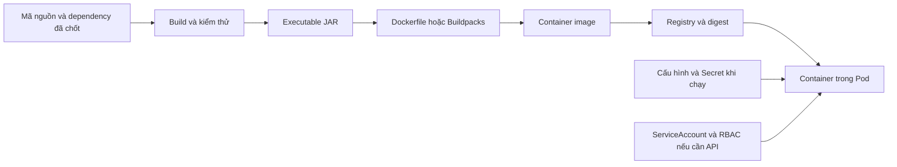

# Xây dựng executable JAR và container image

Bài học thuộc chương **Đóng gói ứng dụng** của module **SPRING_CLOUD_KUBERNETES**. Mục tiêu là biến một ứng dụng Spring Boot thành executable JAR, tạo container image từ JAR đó và xác định hợp đồng chạy để image có thể được đưa lên Kubernetes.

Spring Cloud Kubernetes cung cấp tích hợp DiscoveryClient, ConfigMap, Secret và các khả năng liên quan đến Spring Cloud LoadBalancer, Configuration Watcher. Những tính năng này được lựa chọn theo nhu cầu ứng dụng; bước đóng gói không tự cấp quyền RBAC, không tạo Service và không biến mọi cấu hình thành cấu hình có thể cập nhật nóng.

## 1. Kết quả cần đạt

Sau bài học, bạn có thể:

- Phân biệt JAR thông thường, executable JAR, container image và container đang chạy.
- Đóng gói bằng Spring Boot Maven Plugin hoặc Gradle Plugin và chọn đúng artifact để phát hành.
- Tạo image bằng Dockerfile hoặc Cloud Native Buildpacks, chạy thử và xác định lỗi thuộc giai đoạn nào.
- Tách cấu hình môi trường và thông tin xác thực khỏi artifact, đồng thời chọn đúng phần tích hợp Kubernetes.
- Chuẩn bị entrypoint, cổng, bộ nhớ, quyền người dùng và health endpoint cho một Pod.

Tình huống xuyên suốt là dịch vụ `catalog-service`, phục vụ HTTP trên cổng `8080`. Dịch vụ cần dùng cùng một bản image ở môi trường kiểm thử và môi trường vận hành, trong khi địa chỉ dịch vụ phụ thuộc, cấu hình nghiệp vụ và thông tin xác thực được cung cấp khi chạy.

## 2. Bốn đối tượng cần phân biệt

| Đối tượng | Chứa gì? | Cách sử dụng | Không thay thế cho |
| --- | --- | --- | --- |
| JAR thông thường | Class và resource của một module; thường không đóng gói đầy đủ thư viện để chạy độc lập | Dùng làm thư viện hoặc chạy với classpath phù hợp | Một executable JAR đã được Spring Boot đóng gói |
| Executable JAR | Mã ứng dụng, thư viện runtime và cơ chế khởi động của Spring Boot | `java -jar ...` với Java runtime tương thích | Java runtime và thư viện hệ điều hành |
| Container image | Các layer filesystem, Java runtime, ứng dụng và metadata khởi chạy | Được đẩy lên registry, sau đó runtime tạo container | Cấu hình riêng của mỗi môi trường và danh tính Kubernetes |
| Container | Một phiên chạy từ image, với process, giới hạn tài nguyên và các mount được cấp | Chạy bằng Docker hoặc trong Pod | Image bất biến dùng cho lần triển khai tiếp theo |

“Executable” ở đây nghĩa là chạy được bằng `java -jar`; không yêu cầu nhúng shell script để thực thi trực tiếp bằng `./app.jar`.



Điểm cần giữ xuyên suốt quy trình: artifact chứa **mã và mặc định an toàn**; môi trường chạy cung cấp **cấu hình triển khai và quyền truy cập**. Một image có thể đi qua nhiều môi trường mà không phải biên dịch lại.

## 3. Chuẩn bị dự án và quy ước ví dụ

Các đoạn build dưới đây áp dụng cho một dự án Spring Boot đã có lớp `@SpringBootApplication` và wrapper của công cụ build. Chỉ chọn **Maven hoặc Gradle** cho dự án của bạn. Đây là các phần cấu hình cần bổ sung vào dự án hiện hữu, không phải toàn bộ `pom.xml` hoặc `build.gradle`.

Giả định của bài thực hành:

- Biên dịch với Java 21 và chạy trên Java 21; phiên bản Spring Boot được chọn phải hỗ trợ Java này.
- Dự án có starter web tương ứng với phiên bản Spring Boot và `spring-boot-starter-actuator` để phục vụ HTTP và health endpoint.
- Phiên bản Spring Boot plugin khớp với phiên bản Spring Boot của dự án.
- Nếu thêm Spring Cloud Kubernetes, dự án đã import BOM `spring-cloud-dependencies` tương thích với Spring Boot. Không tự gán các phiên bản starter Kubernetes rời rạc.
- Docker daemon truy cập được khi build image; trên Windows sử dụng chế độ Linux containers cho Dockerfile Linux trong bài.
- Chỉ phần kiểm chứng trên cụm cần `kubectl`, một namespace thử nghiệm và quyền triển khai phù hợp.

Spring Cloud release train được chọn theo dòng Spring Boot, không theo tên image hoặc phiên bản Kubernetes. Kiểm tra bảng tương thích và dùng bản vá được dự án hỗ trợ trước khi áp dụng ví dụ. [Spring Cloud: chọn phiên bản và BOM](https://spring.io/projects/spring-cloud/).

Các lệnh hệ điều hành trong bài dùng **PowerShell**. Trên Linux/macOS, đổi `.\mvnw.cmd` thành `./mvnw` và `.\gradlew.bat` thành `./gradlew`; các lệnh Docker và Kubernetes giữ nguyên ý nghĩa.

### 3.1. Chỉ đưa tính năng cần thiết vào runtime

Đừng thêm starter `all` chỉ vì ứng dụng chạy trên Kubernetes. Việc lựa chọn dependency ảnh hưởng đến dung lượng JAR, auto-configuration được kích hoạt và yêu cầu truy cập Kubernetes API.

| Nhu cầu | Cách tích hợp phù hợp | Hệ quả đối với gói chạy |
| --- | --- | --- |
| Gọi `http://inventory` qua Kubernetes Service và DNS | HTTP client thông thường với tên Service | Không cần DiscoveryClient chỉ để phân giải DNS |
| Dùng abstraction `DiscoveryClient` | Chọn starter discovery của một Kubernetes client | Thêm client runtime; chuẩn bị ServiceAccount và quyền đọc tài nguyên cần thiết |
| Nạp ConfigMap/Secret qua Kubernetes API | Chọn starter config tương ứng | Chuẩn bị cơ chế import của phiên bản đang dùng và RBAC tối thiểu |
| Nhận biến môi trường hoặc file được Kubernetes mount | Dùng cơ chế external configuration của Spring Boot | Không cần client Kubernetes chỉ để đọc các dữ liệu đã được cung cấp |
| Cân bằng tải trong ứng dụng | Spring Cloud LoadBalancer và nguồn instance thích hợp | Kiểm chứng đường đi thực tế của request; không giả định tương đương cân bằng tải của Service |
| Theo dõi thay đổi bằng Configuration Watcher | Triển khai thành phần watcher theo kiến trúc được chọn | Quản lý như workload riêng, với quyền và kênh thông báo riêng |

Ví dụ, nếu thực sự cần Fabric8 DiscoveryClient thì dependency thuộc họ `spring-cloud-starter-kubernetes-fabric8`; nếu cần config thì dùng `spring-cloud-starter-kubernetes-fabric8-config`. Chỉ dùng một họ client trong cùng ứng dụng, tránh trộn Fabric8 với Kubernetes Java Client. [Danh mục starter Spring Cloud Kubernetes](https://docs.spring.io/spring-cloud-kubernetes/reference/getting-started.html).

### 3.2. Cấu hình mặc định dùng cho bài thực hành

Đặt các giá trị sau trong cấu hình ứng dụng của dự án thực hành:

```yaml
spring:
  application:
    name: catalog-service
  lifecycle:
    timeout-per-shutdown-phase: 20s

server:
  port: 8080
  shutdown: graceful

management:
  endpoints:
    web:
      exposure:
        include: health
  endpoint:
    health:
      probes:
        enabled: true
      show-details: never
```

Việc bật probe rõ ràng giúp dùng cùng endpoint khi chạy JAR, Docker và Pod. Nếu ứng dụng có Spring Security, cấu hình cho phép tác nhân probe truy cập đúng health endpoint; không mở toàn bộ Actuator để giải quyết lỗi `401`.

## 4. Tạo executable JAR bằng Maven

### 4.1. Cấu hình đóng gói

Trong dự án Maven kế thừa `spring-boot-starter-parent`, bổ sung hoặc hợp nhất các phần sau:

```xml
<packaging>jar</packaging>

<properties>
    <java.version>21</java.version>
</properties>

<build>
    <finalName>catalog-service</finalName>
    <plugins>
        <plugin>
            <groupId>org.springframework.boot</groupId>
            <artifactId>spring-boot-maven-plugin</artifactId>
            <executions>
                <execution>
                    <id>repackage</id>
                    <goals>
                        <goal>repackage</goal>
                    </goals>
                </execution>
            </executions>
        </plugin>
    </plugins>
</build>
```

Execution có id `repackage` được viết rõ để thể hiện bước chuyển JAR sang cấu trúc chạy được. Parent của Spring Boot đã cấu hình execution này, nên nếu dự án đã kế thừa đầy đủ thì thường chỉ cần khai báo plugin. Nếu dùng parent nội bộ, phải quản lý phiên bản plugin và execution phù hợp; import BOM quản lý dependency không tự cấu hình plugin build.

Goal `repackage` làm việc trên archive được tạo ở phase `package`. Nó không thay thế bước biên dịch hoặc `jar` thông thường. [Spring Boot Maven Plugin: executable archive](https://docs.spring.io/spring-boot/maven-plugin/packaging.html).

### 4.2. Build và kiểm tra artifact

```powershell
.\mvnw.cmd clean verify
jar tf .\target\catalog-service.jar | Select-String 'BOOT-INF/classes|BOOT-INF/lib|layers.idx'
java -jar .\target\catalog-service.jar
```

`verify` đi qua các phase trước đó, trong đó có `package`; các kiểm thử tích hợp chỉ chạy nếu dự án đã gắn chúng vào lifecycle tương ứng. Không dùng `-DskipTests` như mặc định cho bản phát hành.

Mở terminal thứ hai khi ứng dụng đã khởi động:

```powershell
Invoke-RestMethod http://localhost:8080/actuator/health/liveness
Invoke-RestMethod http://localhost:8080/actuator/health/readiness
```

Kết quả mong đợi của cấu hình demo là trạng thái `UP` sau khi ứng dụng sẵn sàng. Sau phép thử, dừng ứng dụng trước khi dùng lại cổng `8080` cho container.

Những điểm cần quan sát:

- `BOOT-INF/classes` chứa class và resource ứng dụng; `BOOT-INF/lib` chứa các dependency runtime được đóng gói.
- Manifest của executable JAR được plugin quản lý: lớp launcher và lớp main của ứng dụng có vai trò khác nhau. Không sửa `Main-Class` tùy tiện để chữa lỗi khởi động.
- Một file có hậu tố `.original` thường là archive trước khi repackage; không chọn nó làm artifact chạy.
- Tên file ổn định `catalog-service.jar` chỉ giúp Dockerfile sao chép đúng đầu vào; danh tính phát hành vẫn phải gắn với phiên bản, commit và checksum.

Nếu có nhiều lớp main, cấu hình `mainClass` trong Spring Boot plugin. Nếu module chỉ là thư viện dùng chung, nó thường nên phát hành JAR thông thường; executable JAR dành cho module ứng dụng được triển khai.

## 5. Phương án tương đương với Gradle

Dự án Gradle cần áp dụng plugin Java, Spring Boot và cơ chế quản lý dependency phù hợp. Với Groovy DSL, cấu hình tên đầu ra và toolchain như sau:

```groovy
java {
    toolchain {
        languageVersion = JavaLanguageVersion.of(21)
    }
}

tasks.named('bootJar') {
    archiveFileName = 'catalog-service.jar'
}
```

Build và chạy:

```powershell
.\gradlew.bat clean build
jar tf .\build\libs\catalog-service.jar | Select-String 'BOOT-INF/classes|BOOT-INF/lib'
java -jar .\build\libs\catalog-service.jar
```

`bootJar` tạo executable JAR. Khi plugin được áp dụng đúng, `build` cũng đi qua quá trình tạo artifact này. Task `jar` có thể đồng thời tạo một JAR với classifier `plain`; đó là artifact khác. [Spring Boot Gradle Plugin: executable và plain archive](https://docs.spring.io/spring-boot/gradle-plugin/packaging.html).

Nếu chỉ gọi `bootJar`, không được suy ra rằng mọi kiểm thử đã chạy. Dùng lifecycle build phù hợp cho pipeline, rồi lấy chính xác `build/libs/catalog-service.jar` để tạo image.

## 6. Xác nhận JAR chạy được trước khi tạo image

Một JAR chạy tốt trong IDE chưa chắc là executable JAR đúng: IDE có thể cung cấp classpath, biến môi trường và working directory mà gói phát hành không có.

Trước khi chuyển sang image, kiểm chứng:

1. Khởi chạy bằng `java -jar` từ artifact vừa build, không dùng nút Run của IDE.
2. Java runtime cùng major version với cấu hình demo; không để Java trên PATH khác Java của công cụ build.
3. Health endpoint hoạt động, log được ghi ra console và ứng dụng không cần file nằm trên máy lập trình viên.
4. Nếu mã ứng dụng cần database hoặc dịch vụ khác, cung cấp dependency thử nghiệm hoặc profile phù hợp; phân biệt thiếu dependency bên ngoài với lỗi đóng gói.
5. Nếu có Spring Cloud Kubernetes starter, kiểm soát cấu hình local để không vô tình đọc kubeconfig hay gọi cụm cá nhân trong phép thử đóng gói.

Với cấu hình thực hành chỉ nhận biến môi trường/file và không sử dụng Kubernetes API, có thể tắt từng tích hợp không dùng:

```yaml
spring:
  cloud:
    kubernetes:
      discovery:
        enabled: false
      config:
        enabled: false
      secrets:
        enabled: false
```

Áp dụng đúng tên thuộc tính của phiên bản đang dùng và bảo đảm không còn import `kubernetes:` đang hoạt động trong chế độ thử này. Khi ứng dụng cần các tính năng đó trên cụm, bật lại theo cấu hình triển khai; không dùng việc tắt chúng để che lỗi RBAC. [Thuộc tính cấu hình Spring Cloud Kubernetes](https://docs.spring.io/spring-cloud-kubernetes/reference/appendix.html).

## 7. Tạo image bằng Dockerfile

### 7.1. Dockerfile tối thiểu, chạy bằng người dùng không phải root

Ví dụ này sử dụng artifact Maven đã build ở phần trước. Trong dự án thực hành, tạo `Dockerfile` với nội dung:

```dockerfile
ARG JAVA_RUNTIME_IMAGE=eclipse-temurin:21-jre
FROM ${JAVA_RUNTIME_IMAGE}

WORKDIR /opt/catalog
COPY --chown=10001:10001 target/catalog-service.jar app.jar

USER 10001:10001
EXPOSE 8080
ENTRYPOINT ["java", "-jar", "/opt/catalog/app.jar"]
```

Ở đây Java runtime nằm trong base image, còn wrapper Maven, compiler và mã nguồn không cần được đưa vào image chạy. UID/GID số `10001` được dùng nhất quán với ví dụ Pod phía dưới; ứng dụng phải hoạt động mà không cần ghi vào thư mục cài đặt.

Với Gradle, đổi duy nhất đường dẫn nguồn của `COPY` thành `build/libs/catalog-service.jar`. Không dùng `COPY target/*.jar app.jar` khi thư mục có thể chứa nhiều JAR; lỗi chọn artifact rất dễ bị hiểu nhầm thành lỗi Spring.

`ENTRYPOINT` ở dạng JSON để Java là process chính và nhận tín hiệu dừng trực tiếp. `EXPOSE` là metadata mô tả cổng; nó không publish cổng trên máy chủ và không tạo Kubernetes Service.

Có thể giới hạn build context cho Dockerfile Maven bằng `.dockerignore` trong dự án thực hành:

```dockerignore
**
!Dockerfile
!target/
!target/catalog-service.jar
```

Đây là allowlist chỉ phù hợp với Dockerfile sao chép JAR đã build. Nếu chuyển sang Dockerfile biên dịch mã nguồn trong builder stage, phải cho phép các đầu vào build tương ứng.

### 7.2. Build và smoke test image

```powershell
docker build --tag catalog-service:0.1.0 .
docker image inspect catalog-service:0.1.0
docker run --rm --name catalog-service-demo --memory=512m -p 8080:8080 -e 'JAVA_TOOL_OPTIONS=-XX:MaxRAMPercentage=60.0' catalog-service:0.1.0
```

Lệnh cuối chạy ở foreground. Từ terminal thứ hai:

```powershell
Invoke-RestMethod http://localhost:8080/actuator/health/readiness
docker logs catalog-service-demo
docker stop --time 30 catalog-service-demo
```

Điều cần xác nhận là image khởi động được, trả lời health endpoint và kết thúc có kiểm soát. `--rm` sẽ xóa container khi nó dừng; image vẫn còn để dùng ở bước tiếp theo.

`MaxRAMPercentage=60.0` chỉ là giá trị khởi đầu để thực hành với image Dockerfile này. Heap không phải toàn bộ bộ nhớ Java: còn metaspace, code cache, thread stack, direct buffer và bộ nhớ native. Đo thực tế trước khi đặt giới hạn sản xuất. Không tự cộng nhiều cách thiết lập heap như `-Xmx` và cấu hình do buildpack tính toán rồi giả định kết quả.

### 7.3. Tối ưu layer khi đã có đường chạy đúng

Dockerfile trên đặt toàn bộ JAR vào một layer. Khi thay đổi một class, layer chứa cả JAR sẽ thay đổi. Layered JAR cho phép tách phần ít thay đổi và phần thường thay đổi để công cụ build có thể dùng lại cache.

Các nhóm thường gặp là `dependencies`, `spring-boot-loader`, `snapshot-dependencies` và `application`. Tối ưu này chủ yếu giúp tái sử dụng layer và giảm dữ liệu phải truyền cho các bản phát hành sau; không bảo đảm tổng dung lượng image đầu tiên giảm đáng kể. [Spring Boot: efficient container images](https://docs.spring.io/spring-boot/reference/packaging/container-images/efficient-images.html).

Với dòng Spring Boot hỗ trợ `jarmode=tools`, có thể kiểm tra và trích xuất bằng:

```powershell
java -Djarmode=tools -jar .\target\catalog-service.jar list-layers
java -Djarmode=tools -jar .\target\catalog-service.jar extract --layers --destination .\target\extracted
```

Khi chuyển sang Dockerfile nhiều stage, stage chuẩn bị trích xuất JAR, stage runtime sao chép từng nhóm theo thứ tự ít thay đổi trước. Đường dẫn chạy phụ thuộc layout đã trích xuất. Không ghép ngẫu nhiên lệnh `layertools`, `tools` và tên lớp launcher từ các thế hệ Spring Boot khác nhau. Dùng Dockerfile tương ứng với phiên bản ứng dụng. [Spring Boot: Dockerfile và jarmode](https://docs.spring.io/spring-boot/reference/packaging/container-images/dockerfiles.html).

## 8. Tạo image bằng Cloud Native Buildpacks

Cloud Native Buildpacks là phương án phù hợp khi muốn giao việc chuẩn bị Java runtime và bố trí layer cho builder thay vì duy trì Dockerfile của ứng dụng.

### 8.1. Maven

Sau bước kiểm thử, chạy:

```powershell
.\mvnw.cmd spring-boot:build-image '-Dspring-boot.build-image.imageName=catalog-service:0.1.0'
```

Goal này tạo image thông qua Docker daemon và bảo đảm phase đóng gói cần thiết được chạy. Đừng gọi nó với suy nghĩ đây chỉ là thao tác đổi định dạng một file mà không liên quan lifecycle Maven.

Khi builder được chọn sử dụng Paketo Java buildpacks, có thể thêm cấu hình sau vào `configuration` của Spring Boot Maven Plugin để chọn Java 21:

```xml
<configuration>
    <image>
        <env>
            <BP_JVM_VERSION>21</BP_JVM_VERSION>
        </env>
    </image>
</configuration>
```

`BP_JVM_VERSION` là cấu hình build của buildpack phù hợp, không phải biến đổi phiên bản Java của một container đã tạo. Builder phải hỗ trợ phiên bản Java yêu cầu. Chốt builder/run image trong CI theo chính sách dự án và kiểm tra tài liệu plugin trước khi thay đổi. [Spring Boot Maven Plugin: OCI image và cấu hình buildpack](https://docs.spring.io/spring-boot/maven-plugin/build-image.html).

### 8.2. Gradle

Lệnh tương ứng:

```powershell
.\gradlew.bat bootBuildImage --imageName=catalog-service:0.1.0
```

Nếu cần thiết lập phiên bản Java qua Paketo trong Gradle Groovy DSL:

```groovy
tasks.named('bootBuildImage') {
    environment = ['BP_JVM_VERSION': '21']
}
```

`bootBuildImage` cần truy cập Docker daemon; hãy chạy `build` và các kiểm thử cần thiết trước khi coi image là ứng viên phát hành. Buildpacks tạo image có người dùng chạy không phải root, nhưng UID và filesystem layout phụ thuộc builder/run image; không áp dụng UID `10001` của Dockerfile ở trên một cách máy móc. [Spring Boot Gradle Plugin: OCI image](https://docs.spring.io/spring-boot/gradle-plugin/packaging-oci-image.html).

Khi smoke test image Buildpacks, trước tiên dùng cấu hình JVM mà builder cung cấp; không mặc định thêm `JAVA_TOOL_OPTIONS` dành cho ví dụ Dockerfile. Kiểm tra log khởi động để hiểu cơ chế tính toán bộ nhớ đang dùng.

### 8.3. Lựa chọn một đường build cho pipeline

| Tiêu chí | Dockerfile | Cloud Native Buildpacks |
| --- | --- | --- |
| Ai duy trì Java runtime và bố trí filesystem? | Đội dự án thông qua Dockerfile/base image | Nền tảng builder và run image được lựa chọn |
| Tùy biến thư viện hệ điều hành | Trực tiếp nhưng phải tự quản lý | Theo khả năng builder/buildpack hoặc nền tảng được mở rộng |
| Tối ưu layer | Tự thiết kế hoặc dùng layered JAR | Do buildpack xử lý theo khả năng hỗ trợ |
| Lệnh chính | `docker build` | `spring-boot:build-image` hoặc `bootBuildImage` |
| Điểm phải chốt | Base image, JAR, Dockerfile, kiến trúc | Builder, run image, buildpack, cấu hình build, kiến trúc |

Cả hai cách đều tạo image để registry và Kubernetes sử dụng. Chọn một cách chính cho bản phát hành để tránh hai artifact mang cùng tên nhưng có runtime hoặc cách khởi chạy khác nhau.

## 9. Tách cấu hình, Secret và quyền Kubernetes khỏi image

### 9.1. Quy tắc build một lần, cung cấp cấu hình khi chạy

| Thông tin | Có thể nằm trong JAR/image? | Nguồn phù hợp khi triển khai |
| --- | --- | --- |
| Mã nghiệp vụ, dependency | Có | Build từ mã nguồn đã xác định |
| Mặc định như cổng HTTP | Có | Có thể được ghi đè theo cấu hình runtime |
| Địa chỉ endpoint theo môi trường | Tránh gắn cố định | Biến môi trường hoặc ConfigMap |
| Mật khẩu, private key, token | Không | Secret được cấp khi chạy hoặc hệ thống quản lý bí mật |
| Kubernetes API token, kubeconfig cá nhân | Không | Danh tính workload do cụm cấp khi cần |
| Tính năng discovery/config được bật hay tắt | Có mặc định rõ ràng | Cấu hình runtime phù hợp với kiến trúc |

Xóa một Secret khỏi layer cuối không xóa nó khỏi các layer trước. Vì vậy không `COPY` Secret vào image rồi `RUN rm`, và không truyền thông tin xác thực runtime bằng build argument hay lưu trong Dockerfile.

Kubernetes có thể đưa ConfigMap vào container bằng biến môi trường hoặc volume. Biến môi trường từ ConfigMap không tự thay đổi trong process đang chạy; file được mount có cơ chế cập nhật riêng, nhưng điều đó không có nghĩa Spring tự đọc lại và bind lại mọi bean. [Kubernetes: ConfigMaps](https://kubernetes.io/docs/concepts/configuration/configmap/).

### 9.2. Nạp file cấu hình bằng Spring Boot

Nếu Kubernetes mount `application.yaml` vào `/etc/catalog/application.yaml`, ứng dụng có thể nạp file đó bằng biến môi trường:

```text
SPRING_CONFIG_IMPORT=file:/etc/catalog/application.yaml
```

Nếu Secret được mount thành các file có tên khóa dưới `/etc/catalog-secrets/`, một cách khác là:

```text
SPRING_CONFIG_IMPORT=configtree:/etc/catalog-secrets/
```

Đây là hai ví dụ nạp cấu hình khác nhau; khi cần dùng đồng thời, khai báo các location theo đúng cú pháp của phiên bản Spring Boot. Dùng `optional:` chỉ khi thiếu nguồn đó thật sự được chấp nhận; với cấu hình bắt buộc, để ứng dụng báo lỗi rõ ràng thường dễ vận hành hơn. [Spring Boot: external configuration và configuration tree](https://docs.spring.io/spring-boot/reference/features/external-config.html).

### 9.3. Khi nào cần ServiceAccount và RBAC?

Phân biệt hai đường dữ liệu:

- **Kubernetes cấp dữ liệu vào container:** biến môi trường và volume đã được khai báo trong Pod. Ứng dụng chỉ đọc dữ liệu đã có; không cần tự gọi API để lấy chúng.
- **Ứng dụng gọi Kubernetes API:** DiscoveryClient hoặc config integration truy cập tài nguyên trên cụm. Khi đó phải cấp danh tính, quyền truy cập theo namespace và loại tài nguyên thực sự dùng.

Build image không thể tạo RoleBinding cho ứng dụng. Không nhúng kubeconfig của người phát triển để vượt lỗi `Forbidden`, và không cấp quyền quản trị cụm để làm phép smoke test vượt qua.

Configuration Watcher là thành phần quan sát và thông báo thay đổi; việc thêm nó vào kiến trúc không khiến tất cả thuộc tính trong ứng dụng đều có thể refresh. Triển khai watcher, quyền theo dõi và cơ chế nhận cập nhật phải được thiết kế riêng. [Spring Cloud Kubernetes Configuration Watcher](https://docs.spring.io/spring-cloud-kubernetes/reference/spring-cloud-kubernetes-configuration-watcher.html).

Nếu chiến lược cập nhật là rollout Pod khi ConfigMap/Secret đổi, vẫn giữ nguyên image; bản triển khai mới khởi động lại để nhận cấu hình mới. Nếu chiến lược là refresh, cần kiểm chứng cụ thể loại bean và thuộc tính nào được cập nhật.

## 10. Đưa image đến registry và kiểm chứng trên Kubernetes

### 10.1. Danh tính image và khả năng kéo image

Image có trên Docker của laptop chưa có nghĩa node Kubernetes có thể chạy được nó. Với cụm dùng registry, ví dụ sau mô tả quy trình đặt tên và push:

```powershell
docker tag catalog-service:0.1.0 registry.example.com/training/catalog-service:0.1.0
docker push registry.example.com/training/catalog-service:0.1.0
```

`registry.example.com` là địa chỉ minh họa: thay bằng registry đã được cấp, xác thực bằng cơ chế của registry và cấu hình quyền pull cho cụm nếu cần. Với cụm local, dùng cơ chế load image của loại cụm đó thay cho giả định mọi Docker daemon dùng chung kho image.

Tag là tên có thể trỏ sang nội dung khác; digest xác định nội dung image. Khi phát hành, lưu commit, checksum JAR, nguồn base/builder và digest registry trả về. Dùng tham chiếu `repository@sha256:...` với digest thật nếu cần khóa chính xác nội dung triển khai. `imagePullPolicy: Always` không làm một tag có thể bị ghi đè trở nên bất biến. [Kubernetes: image tag, digest và pull policy](https://kubernetes.io/docs/concepts/containers/images/).

Ngoài tên và quyền pull, kiến trúc cũng phải phù hợp. Image chỉ có `linux/amd64` không mặc nhiên chạy được trên node ARM64. Chọn build đúng kiến trúc hoặc xuất bản multi-platform image bằng công cụ được pipeline hỗ trợ.

### 10.2. Một Deployment kiểm chứng hợp đồng chạy

Manifest sau dùng **image Dockerfile với UID 10001** và đường cấu hình bằng biến môi trường/file; không bật tích hợp gọi Kubernetes API. Nó minh họa hợp đồng chạy của gói ứng dụng, không phải manifest đầy đủ cho mọi trường hợp Spring Cloud Kubernetes.

```yaml
apiVersion: apps/v1
kind: Deployment
metadata:
  name: catalog-service
spec:
  replicas: 1
  selector:
    matchLabels:
      app: catalog-service
  template:
    metadata:
      labels:
        app: catalog-service
    spec:
      automountServiceAccountToken: false
      terminationGracePeriodSeconds: 30
      securityContext:
        runAsNonRoot: true
        runAsUser: 10001
        runAsGroup: 10001
        fsGroup: 10001
      containers:
        - name: app
          image: registry.example.com/training/catalog-service:0.1.0
          imagePullPolicy: IfNotPresent
          ports:
            - name: http
              containerPort: 8080
          env:
            - name: SPRING_CLOUD_KUBERNETES_DISCOVERY_ENABLED
              value: "false"
            - name: SPRING_CLOUD_KUBERNETES_CONFIG_ENABLED
              value: "false"
            - name: SPRING_CLOUD_KUBERNETES_SECRETS_ENABLED
              value: "false"
            - name: JAVA_TOOL_OPTIONS
              value: "-XX:MaxRAMPercentage=60.0"
          resources:
            requests:
              cpu: 250m
              memory: 256Mi
            limits:
              memory: 512Mi
          securityContext:
            allowPrivilegeEscalation: false
            readOnlyRootFilesystem: true
            capabilities:
              drop: ["ALL"]
          volumeMounts:
            - name: tmp
              mountPath: /tmp
          startupProbe:
            httpGet:
              path: /actuator/health/liveness
              port: http
            periodSeconds: 5
            failureThreshold: 30
          readinessProbe:
            httpGet:
              path: /actuator/health/readiness
              port: http
            periodSeconds: 5
          livenessProbe:
            httpGet:
              path: /actuator/health/liveness
              port: http
            periodSeconds: 10
      volumes:
        - name: tmp
          emptyDir:
            sizeLimit: 128Mi
```

Thay tên image trước khi triển khai. Cấu hình `readOnlyRootFilesystem` yêu cầu ứng dụng chỉ ghi ở mount được cấp, chẳng hạn `/tmp` trong demo. Nếu thư viện cần thư mục ghi khác, bổ sung volume phù hợp; không mặc định chuyển toàn bộ process về root. [Kubernetes: security context](https://kubernetes.io/docs/tasks/configure-pod-container/security-context/).

Nếu ứng dụng cần gọi Kubernetes API, thay đổi hợp đồng này: dùng ServiceAccount riêng, bật cơ chế cấp token phù hợp, gắn Role/RoleBinding tối thiểu và bật lại đúng tính năng. Nếu thay bằng image Buildpacks, kiểm tra lại UID, thư mục cần ghi và thiết lập bộ nhớ theo image đó.

Ba probe có mục đích khác nhau:

- `startupProbe` cho phép ứng dụng có thời gian khởi động trước khi các probe còn lại bắt đầu hoạt động.
- `readinessProbe` mô tả khả năng nhận traffic; thất bại readiness không tự yêu cầu restart container.
- `livenessProbe` phát hiện tình trạng cần khởi động lại; tránh ràng buộc nó với database hoặc Kubernetes API bên ngoài.

Ví dụ dùng chung cổng ứng dụng cho Actuator để phép thử chạm tới HTTP server đang phục vụ request. Nếu tách management port, cần cân nhắc việc health vẫn trả lời trong khi cổng nghiệp vụ bị lỗi. [Spring Boot: Kubernetes probes](https://docs.spring.io/spring-boot/reference/actuator/endpoints.html).

Entrypoint trực tiếp tới Java giúp nhận `SIGTERM`. Timeout graceful shutdown của demo là 20 giây, còn thời gian chờ Pod là 30 giây. Đây chỉ là ngân sách minh họa: ứng dụng thực tế có thể có nhiều shutdown phase và còn thời gian lan truyền thay đổi endpoint. Đo thời gian kết thúc trước khi quyết định cấu hình. [Spring Boot: graceful shutdown](https://docs.spring.io/spring-boot/reference/web/graceful-shutdown.html).

### 10.3. Quan sát lần chạy đầu

Giả sử manifest được lưu thành `catalog-deployment.yaml` trong dự án thực hành và namespace `training` đã tồn tại:

```powershell
kubectl apply -n training -f .\catalog-deployment.yaml
kubectl rollout status -n training deployment/catalog-service
kubectl get pods -n training -l app=catalog-service
kubectl logs -n training deployment/catalog-service
kubectl port-forward -n training deployment/catalog-service 8080:8080
```

Từ terminal thứ hai, gọi lại endpoint readiness trên `localhost:8080`. `port-forward` chỉ giúp kiểm chứng HTTP trong phép thử này; nó không chứng minh Kubernetes Service, DNS hoặc tuyến ingress đã được cấu hình đúng.

Nếu Pod không hoạt động, lấy tên Pod từ kết quả `get pods`, rồi xem `kubectl describe pod -n training <pod-name>` và log của container. Chẩn đoán theo giai đoạn sẽ nhanh hơn đổi dependency hoặc tăng quyền ngay lập tức.

## 11. Các lỗi thường gặp và cách khoanh vùng

| Triệu chứng | Giai đoạn thường cần xem trước | Kiểm tra cụ thể |
| --- | --- | --- |
| `no main manifest attribute` | Chọn artifact hoặc cấu hình build | Đã lấy executable JAR chưa? Maven đã repackage hay Gradle đã chạy bootJar chưa? |
| Thiếu class khi chạy ngoài IDE | Dependency runtime | Dependency có bị đánh dấu sai scope/configuration không? JAR có các thư viện cần thiết không? |
| `UnsupportedClassVersionError` | Java runtime | Java chạy container có tương thích bytecode đã biên dịch không? |
| Build Docker không tìm thấy JAR | Đầu vào build | Đã build chưa? Build context, tên artifact và `.dockerignore` có đúng không? |
| Buildpacks không kết nối Docker | Công cụ build image | Docker daemon có chạy và context có truy cập được không? |
| `ImagePullBackOff` | Phân phối image | Tên/digest có tồn tại, quyền pull và kết nối registry có đúng không? |
| `exec format error` | Kiến trúc image | OS/CPU của image có khớp node không? |
| Container khởi động rồi thoát | Khởi tạo ứng dụng | Đọc log lỗi cấu hình, dependency bên ngoài và working directory |
| `Forbidden` từ Kubernetes API | Danh tính và RBAC | ServiceAccount, namespace và quyền đúng loại tài nguyên; image build không cấp các quyền này |
| `Permission denied` | Quyền filesystem | UID thực tế có đọc JAR và ghi được vào đúng volume không? |
| Container bị `OOMKilled` | Bộ nhớ Pod/process | Giới hạn container, heap và bộ nhớ ngoài heap; xem trạng thái kết thúc và số liệu thực tế |
| Readiness `404`, `401` hoặc timeout | Hợp đồng HTTP | Cổng, path, starter Actuator, security và thời gian khởi động |
| Đổi ConfigMap nhưng giá trị vẫn cũ | Chiến lược cập nhật cấu hình | Đang dùng env hay file? Có refresh được thiết kế không, hay cần rollout? |

Không kết luận “container image bị lỗi” chỉ vì Pod không Ready. Image có thể hoàn toàn chạy được nhưng thiếu Secret, không được cấp quyền API hoặc không kết nối được dependency trên mạng của cụm.

## 12. Bài thực hành hoàn chỉnh

Thực hiện theo một đường build duy nhất để có thể giải thích nguồn gốc của image cuối:

1. Chọn Maven hoặc Gradle, ghi rõ Java và bộ phiên bản Spring Boot/Spring Cloud tương thích của dự án.
2. Dùng web và Actuator cho phép thử; chỉ thêm starter Spring Cloud Kubernetes khi có một nhu cầu đã xác định.
3. Build kèm kiểm thử, xác định đúng executable JAR, chạy bằng `java -jar` và gọi readiness.
4. Chọn Dockerfile hoặc Buildpacks; tạo image với tag gắn được với commit, rồi smoke test image.
5. Ghi lại Java runtime, người dùng chạy, entrypoint, cổng và thư mục cần ghi của image.
6. Chạy cùng image hai lần với một cấu hình không nhạy cảm khác nhau, chẳng hạn `SERVER_PORT`; đổi port mapping tương ứng và xác nhận không cần build lại.
7. Đưa image lên registry hoặc load vào cụm local bằng cơ chế phù hợp, sau đó kiểm chứng Pod và health endpoint.
8. Nếu tích hợp Kubernetes API, kiểm chứng riêng ServiceAccount/RBAC và chức năng discovery/config; kết quả health không thay thế phép thử chức năng này.
9. Dừng một container hoặc thay Pod để quan sát shutdown, đối chiếu với ngân sách thời gian kết thúc.

Ví dụ bước 6 cho image đã chọn:

```powershell
docker run --rm -p 8081:8081 -e SERVER_PORT=8081 catalog-service:0.1.0
```

Trong terminal khác:

```powershell
Invoke-RestMethod http://localhost:8081/actuator/health/readiness
```

Image ID không thay đổi khi chỉ truyền biến môi trường khác. Ngược lại, thay dependency hoặc mã Java phải tạo artifact/image mới. Đây là ranh giới cần hiểu trước khi đưa ConfigMap, Secret và Configuration Watcher vào bài toán vận hành.

### Tiêu chí hoàn thành

- Có một executable JAR chạy được ngoài IDE và xác định được artifact nguồn.
- Có một image chạy bằng người dùng không phải root, health endpoint truy cập được và có hợp đồng cấu hình rõ ràng.
- Không chứa Secret hoặc kubeconfig cá nhân trong JAR, image hoặc cấu hình build.
- Có bằng chứng image dùng cùng nội dung qua các môi trường, cùng thông tin tag/digest phục vụ truy vết.
- Phân biệt được lỗi đóng gói, lỗi phân phối image, lỗi cấu hình runtime và lỗi RBAC.
- Giải thích được tại sao ứng dụng chọn hoặc không chọn DiscoveryClient, config starter, Spring Cloud LoadBalancer và Configuration Watcher.

### Câu hỏi tự kiểm tra

1. Vì sao chạy tốt trong IDE không chứng minh `target/catalog-service.jar` là executable JAR hợp lệ?
2. Khi `catalog-service.jar.original` và `catalog-service.jar` cùng tồn tại, bạn lấy file nào cho Dockerfile? Dựa vào điều gì?
3. Vì sao thêm `EXPOSE 8080` không khiến trình duyệt tự truy cập được ứng dụng trong container?
4. Nếu gọi được Kubernetes Service qua DNS, khi nào mới cần thêm DiscoveryClient?
5. Vì sao cùng image vẫn có thể chạy sai ở môi trường khác dù checksum image giống nhau?
6. ConfigMap đã đổi nhưng process dùng biến môi trường vẫn đọc giá trị cũ: cần xử lý ở bước build hay chiến lược cập nhật runtime?
7. Vì sao đổi một dòng mã Java vẫn có thể làm Docker phải truyền lại một layer lớn khi dùng Dockerfile tối thiểu?
8. Nếu readiness thành công nhưng DiscoveryClient bị `Forbidden`, những kết quả này cho biết hai điều khác nhau nào?
