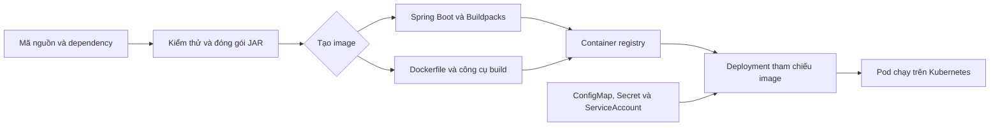

# Lựa chọn buildpack hoặc Dockerfile

Trong chương **Đóng gói ứng dụng** của module **SPRING_CLOUD_KUBERNETES**, bài học này giúp bạn chọn cách tạo container image cho ứng dụng Spring chạy trên Kubernetes. Hai lựa chọn được xét là **Cloud Native Buildpacks** thông qua Spring Boot và **Dockerfile** do nhóm phát triển quản lý.

Cả hai có thể tạo image chứa cùng mã ứng dụng, DiscoveryClient, thành phần đọc ConfigMap hoặc Secret và Spring Cloud LoadBalancer. Khác biệt nằm ở cách tạo, kiểm soát và bảo trì image. Việc chọn buildpack hay Dockerfile không tự cấp quyền Kubernetes, tạo Service hay triển khai Configuration Watcher.

## 1. Kết quả cần đạt

Sau bài học, bạn có thể:

- Giải thích builder, buildpack, run image và Dockerfile đảm nhiệm việc gì.
- Tạo image cho một ứng dụng Spring Boot bằng hai cách, với cùng phiên bản Java.
- So sánh khả năng tùy biến, cache, cập nhật runtime và chi phí vận hành.
- Giữ cấu hình theo môi trường, thông tin xác thực và quyền Kubernetes bên ngoài image.
- Đề xuất một lựa chọn dựa trên yêu cầu cụ thể và bằng chứng đo được.

Bài học tập trung vào **ứng dụng JVM**. Native image là một phương án đóng gói khác, có yêu cầu AOT, tài nguyên build và kiểm thử riêng; bật buildpack không mặc nhiên chuyển ứng dụng sang native image.

## 2. Xác định đúng ranh giới giữa build và triển khai

Một quy trình triển khai có thể được nhìn như sau:



Image cần chứa mã ứng dụng, dependency và runtime cần thiết. Deployment quyết định image nào được chạy, giới hạn tài nguyên, cấu hình được đưa vào container và danh tính ServiceAccount.

Ví dụ, `orders-service` dùng DiscoveryClient để tìm `inventory-service`. Image chứa thư viện và mã gọi DiscoveryClient; namespace, ServiceAccount và quyền đọc tài nguyên được xác định khi triển khai. Không có bước đóng gói nào thay thế được cấu hình RBAC.

Tương tự, một image dùng ở cả staging và production có thể nhận các giá trị timeout khác nhau từ ConfigMap. Đây là cơ sở để **build một lần, đưa cùng image qua các môi trường**, thay vì tạo một image chứa sẵn thông tin của từng cluster.

## 3. Buildpack hoạt động như thế nào?

### 3.1. Các thành phần chính

**Cloud Native Buildpacks — CNB** cung cấp quy trình tạo image từ ứng dụng theo các thành phần có thể tái sử dụng:

| Thành phần | Trách nhiệm |
| --- | --- |
| Builder image | Cung cấp môi trường build, lifecycle và các buildpack đã được tập hợp |
| Buildpack | Nhận diện ứng dụng và đóng góp thành phần cần thiết, chẳng hạn JVM hoặc cách chạy JAR |
| Run image | Cung cấp nền hệ điều hành cho image ứng dụng khi chạy |
| Application image | Kết quả cuối cùng được đẩy lên registry và dùng trong Deployment |

Builder image không phải image cuối cùng của ứng dụng. Lựa chọn builder là lựa chọn một bộ công cụ và quy ước; lựa chọn run image là lựa chọn nền runtime tương thích.

Trong cách dùng ở bài này, Maven trên máy hoặc CI đóng gói ứng dụng; Spring Boot Maven Plugin sử dụng buildpacks để tạo OCI image. Không nên suy rằng toàn bộ quá trình Maven đều diễn ra bên trong builder. Những nền tảng CNB khác có thể nhận trực tiếp mã nguồn và tổ chức quy trình khác.

### 3.2. Điều buildpack giúp nhóm phát triển

Nhóm ứng dụng có thể dùng một cấu hình chung để chọn Java, tạo các lớp image và thống nhất cách khởi động. Nhóm nền tảng quản lý builder và quy trình cập nhật thay vì yêu cầu từng dịch vụ tự viết toàn bộ Dockerfile.

Spring Boot hỗ trợ lệnh `spring-boot:build-image` và image tạo ra chạy bằng người dùng không phải root. Tuy nhiên, lệnh này **vẫn cần truy cập Docker daemon**. “Không cần Dockerfile” không có nghĩa là “không cần hạ tầng build container”. Xem [Spring Boot: Packaging OCI Images](https://docs.spring.io/spring-boot/3.5/maven-plugin/build-image.html).

Buildpack cũng không xóa bỏ trách nhiệm của nhóm: vẫn cần kiểm tra dependency, nguồn builder, phiên bản JVM, image đầu ra và hành vi thực tế khi Pod chạy.

## 4. Dockerfile cung cấp mức kiểm soát nào?

Dockerfile mô tả các bước tạo image: chọn base image, sao chép artifact, thêm thư viện hệ điều hành nếu cần, xác định người dùng, thư mục làm việc và lệnh khởi động.

Lựa chọn này phù hợp khi ứng dụng có yêu cầu mà bộ buildpack hiện có chưa đáp ứng thuận tiện, chẳng hạn:

- Thư viện JNI phải đi cùng một bộ thư viện hệ điều hành xác định.
- Quy định nội bộ yêu cầu dùng base image cụ thể.
- Một executable phụ trợ hoặc agent cần bố trí theo cấu trúc riêng.
- Quy trình CI đã chuẩn hóa Dockerfile và có đội chịu trách nhiệm cập nhật mẫu dùng chung.

Đổi lại, nhóm phải quản lý nhiều chi tiết hơn: phiên bản base image, quyền truy cập file, người dùng runtime, các layer, cache và đường đi của bản vá.

Dockerfile không tự động tạo image nhỏ hoặc an toàn hơn. Kết quả phụ thuộc vào nội dung và quy trình duy trì nó. Docker khuyến nghị dùng base image phù hợp, giới hạn thành phần runtime và tách các giai đoạn bằng multi-stage build khi có ích. Xem [Docker: Building best practices](https://docs.docker.com/build/building/best-practices/).

## 5. So sánh trước khi chọn

| Tiêu chí | Buildpack qua Spring Boot | Dockerfile |
| --- | --- | --- |
| Công sức bắt đầu | Ít bước với ứng dụng Spring Boot thông thường | Phải mô tả và duy trì cách tạo image |
| Quản lý Java | Khai báo qua cấu hình buildpack và builder hỗ trợ | Chọn trực tiếp base image có Java phù hợp |
| Thêm thành phần hệ điều hành | Có thể cần binding, buildpack bổ sung hoặc builder riêng | Chủ động viết bước cài đặt hoặc dùng base nội bộ |
| Phân lớp ứng dụng | Được công cụ tổ chức theo khả năng buildpack | Cần thiết kế thứ tự và nội dung các lớp |
| Cập nhật nền runtime | Có thể rebuild hoặc rebase khi tương thích | Thường rebuild từ base image đã cập nhật |
| Quy ước khởi động | Theo launcher và thành phần của buildpack | Theo ENTRYPOINT và CMD do nhóm quy định |
| CI | Cần môi trường phù hợp với plugin và builder | Phụ thuộc công cụ build Dockerfile được chọn |
| Hỗ trợ nhiều kiến trúc | Phải xác nhận builder, run image và buildpack cùng hỗ trợ | Phải xác nhận base image, công cụ build và thư viện cùng hỗ trợ |
| Bảo trì nhiều dịch vụ | Thuận lợi khi có builder được quản lý chung | Thuận lợi khi có Dockerfile hoặc base image chuẩn được quản lý chung |

Đây là các hướng đánh giá, không phải cam kết về hiệu năng. Không thể kết luận image buildpack luôn lớn hơn, Dockerfile luôn build nhanh hơn hay một bên luôn khởi động nhanh hơn nếu chưa đo trên cùng điều kiện.

## 6. Chuẩn bị ứng dụng dùng chung cho hai phương án

### 6.1. Giả định cho ví dụ

Các đoạn cấu hình dưới đây dành cho một ứng dụng:

- Tên ứng dụng: `orders-service`.
- Spring Boot dòng `3.5.x`, chạy JVM Java `21`.
- Có Maven Wrapper, dependency web và Actuator.
- Đã quản lý phiên bản Spring Cloud và Spring Cloud Kubernetes tương thích với Spring Boot của dự án.
- Sinh Spring Boot executable JAR tại `target/orders-service.jar`.

Đây là mốc phiên bản của ví dụ, không phải khẳng định về phiên bản mới nhất. Dự án thực tế cần chốt patch version, BOM và phiên bản plugin trong cấu hình build.

Máy thực hành cần JDK 21, Docker đang chạy ở chế độ Linux containers và khả năng tải dependency hoặc image cần thiết. Nếu dùng Windows PowerShell, thay `./mvnw` bằng `.\mvnw.cmd`; các lệnh được viết một dòng để dễ chuyển giữa các shell.

**Các tên file, lệnh và manifest trong bài là ví dụ để người học áp dụng vào ứng dụng thực hành; không biểu thị rằng chúng đã được tạo hoặc chạy trong module này.**

### 6.2. Cấu hình Maven liên quan đến đóng gói

Nếu dự án kế thừa `spring-boot-starter-parent`, có thể hợp nhất cấu hình sau vào phần `build` hiện có:

```xml
<build>
    <finalName>orders-service</finalName>
    <plugins>
        <plugin>
            <groupId>org.springframework.boot</groupId>
            <artifactId>spring-boot-maven-plugin</artifactId>
            <configuration>
                <layers>
                    <enabled>true</enabled>
                </layers>
                <image>
                    <builder>paketobuildpacks/builder-jammy-java-tiny:latest</builder>
                    <env>
                        <BP_JVM_VERSION>21</BP_JVM_VERSION>
                    </env>
                </image>
            </configuration>
        </plugin>
    </plugins>
</build>
```

Ở đây parent quản lý phiên bản plugin và cấu hình thực thi `repackage`. Nếu không dùng parent này, cần khai báo phiên bản plugin tương ứng và gắn goal `repackage` vào lifecycle để `package` tạo executable JAR; chỉ import BOM dependency không tự cấu hình Maven plugin.

`BP_JVM_VERSION` điều khiển Java được đưa vào image bởi buildpack. Phiên bản JDK dùng để biên dịch và mức bytecode của ứng dụng cũng phải tương thích; thay biến này không tự biến bytecode Java mới thành bytecode Java cũ.

Tag `latest` của builder chỉ giúp rút gọn ví dụ thực hành. Trong CI, thay bằng tham chiếu phiên bản hoặc digest đã được duyệt; đồng thời quản lý run image tương thích. Chỉ cố định builder mà để một run-image tag có thể thay đổi vẫn chưa khóa toàn bộ đầu vào.

## 7. Phương án A: tạo image bằng buildpack

### 7.1. Build image

Tại thư mục gốc của ứng dụng ví dụ:

```shell
./mvnw spring-boot:build-image -Dspring-boot.build-image.imageName=orders-service:bp-lab
```

Goal `build-image` bảo đảm lifecycle đến `package` đã chạy trước khi tạo image. Không cần thêm `-DskipTests` vào luồng mặc định. Nếu gắn việc tạo image vào lifecycle Maven, cần chọn goal phù hợp như `build-image-no-fork` để tránh chạy lifecycle lặp không cần thiết.

Tên `orders-service:bp-lab` là tag image phục vụ so sánh; nó không phải phiên bản của Spring Boot hoặc Java.

Kiểm tra metadata của image đã tạo:

```shell
docker image inspect orders-service:bp-lab --format '{{.Config.User}}'
docker image inspect orders-service:bp-lab --format '{{.Os}}/{{.Architecture}}'
docker image inspect orders-service:bp-lab --format '{{json .Config.Entrypoint}} {{json .Config.Cmd}}'
```

Quan sát người dùng runtime, kiến trúc và cách khởi động. Với buildpack, launcher có thể tham gia quá trình thiết lập JVM trước khi ứng dụng chạy; không nên thay entrypoint theo thói quen từ image tự viết.

### 7.2. Chạy thử ngoài cluster

Chuẩn bị profile `local` không phụ thuộc Kubernetes API, đồng thời cung cấp các dịch vụ phụ thuộc cần thiết của ứng dụng. Sau đó chạy:

```shell
docker run --rm --memory=1g -p 8080:8080 -e SPRING_PROFILES_ACTIVE=local orders-service:bp-lab
```

Ở một terminal khác:

```shell
curl http://localhost:8080/actuator/health
```

Chỉ đặt `SPRING_PROFILES_ACTIVE=local` chưa tự tạo profile hay tắt mọi integration. Cần thực sự cấu hình profile đó, bao gồm cách xử lý các config import hoặc tính năng Kubernetes mà ứng dụng đang dùng. Nếu ứng dụng bắt buộc khởi động trong cluster, thực hiện smoke test bằng một Deployment thử nghiệm thay cho bước local.

Paketo có các thành phần cấu hình JVM lúc khởi động, trong đó Memory Calculator tính ngân sách heap theo giới hạn bộ nhớ và phần ngoài heap. Vì vậy phải thử với giới hạn tương tự Pod; không so sánh một container không có limit với một container bị giới hạn chặt. Xem [Paketo: Java Buildpack Reference](https://paketo.io/docs/reference/java-reference/).

## 8. Phương án B: Dockerfile phân lớp

### 8.1. Đóng gói JAR trước

```shell
./mvnw clean package
```

Xác nhận artifact chính là `target/orders-service.jar`. Tránh wildcard rộng khi thư mục build có nhiều JAR, chẳng hạn JAR thường, JAR executable hoặc artifact của nhiều module.

Ví dụ dưới đây dùng tính năng `jarmode=tools` của Spring Boot dòng đã chọn để tách các layer. Không sao chép nguyên xi cú pháp `layertools` hoặc launcher class từ một dòng Spring Boot khác. Spring Boot cũng lưu ý chế độ này không dùng với archive có gắn launch script kiểu fully executable. Xem [Spring Boot: Dockerfiles](https://docs.spring.io/spring-boot/3.5/reference/packaging/container-images/dockerfiles.html).

### 8.2. Dockerfile mẫu

```dockerfile
FROM eclipse-temurin:21-jre-jammy AS extract
WORKDIR /workspace
COPY target/orders-service.jar application.jar
RUN java -Djarmode=tools -jar application.jar extract --layers --destination extracted

FROM eclipse-temurin:21-jre-jammy
WORKDIR /app

RUN groupadd --gid 10001 app \
    && useradd --uid 10001 --gid app --no-create-home --shell /usr/sbin/nologin app

COPY --from=extract --chown=10001:10001 /workspace/extracted/dependencies/ ./
COPY --from=extract --chown=10001:10001 /workspace/extracted/spring-boot-loader/ ./
COPY --from=extract --chown=10001:10001 /workspace/extracted/snapshot-dependencies/ ./
COPY --from=extract --chown=10001:10001 /workspace/extracted/application/ ./

USER 10001:10001
EXPOSE 8080
ENTRYPOINT ["java", "-jar", "application.jar"]
```

Những điểm cần hiểu:

1. Giai đoạn `extract` chỉ giải nén JAR đã build; nó không biên dịch Maven và không khởi động ứng dụng Spring.
2. Các lớp dependency ít đổi được sao chép trước lớp ứng dụng để tăng cơ hội tái sử dụng cache.
3. `application.jar` ở layout đã trích xuất tham chiếu các thư viện đi cùng; không được chỉ sao chép riêng file này rồi bỏ các thư mục khác.
4. Người dùng `10001` được tạo rõ ràng và dùng khi chạy. Lệnh `groupadd` và `useradd` ở đây dựa trên nền Ubuntu Jammy; không giả định chúng có trong image distroless hoặc Alpine.
5. ENTRYPOINT dạng exec giúp Java trực tiếp nhận tín hiệu của container. Với script trung gian tự viết, cần chuyển tiếp tín hiệu đúng, thường bằng `exec`.
6. `EXPOSE 8080` mô tả cổng dự kiến; nó không tạo Kubernetes Service hay tự mở cổng ra ngoài.

Tag `21-jre-jammy` vẫn có thể thay đổi nội dung. Pipeline phát hành nên thay các tham chiếu `FROM` bằng digest đã kiểm tra và có quy trình nâng digest khi cập nhật.

### 8.3. Giới hạn build context

Vì Dockerfile này chỉ nhận JAR đã biên dịch, có thể dùng một `.dockerignore` theo kiểu chỉ cho phép các đầu vào cần thiết:

```text
*
!Dockerfile
!target/
target/*
!target/orders-service.jar
```

Quy tắc trên dành riêng cho cấu trúc ví dụ. Nếu chuyển sang biên dịch Maven bên trong Dockerfile, phải thiết kế lại context để có mã nguồn, wrapper và cấu hình cần thiết.

Không đưa `kubeconfig`, ServiceAccount token, private key hoặc mật khẩu registry vào context rồi dùng `COPY . .`. Nếu quá trình build cần truy cập kho artifact riêng, sử dụng cơ chế secret tạm thời của công cụ build; không truyền bí mật bằng `ARG` hoặc `ENV` trong Dockerfile. Xem [Docker: Build secrets](https://docs.docker.com/build/building/secrets/).

### 8.4. Build và chạy

```shell
docker build --pull -t orders-service:df-lab .
docker image inspect orders-service:df-lab --format '{{.Config.User}}'
docker image inspect orders-service:df-lab --format '{{.Os}}/{{.Architecture}}'
docker run --rm --memory=1g -p 8080:8080 -e SPRING_PROFILES_ACTIVE=local orders-service:df-lab
```

Dừng container của phương án A trước khi dùng lại cổng 8080. Chạy cùng kiểm tra health và nghiệp vụ với cùng profile, dữ liệu đầu vào và giới hạn tài nguyên.

Nếu tự đặt heap qua `JAVA_TOOL_OPTIONS` trong phương án Dockerfile, hãy dành bộ nhớ cho metaspace, thread stack, direct buffer và native library. Không đặt `-Xmx` bằng toàn bộ memory limit của container.

## 9. Cùng image contract khi đưa lên Kubernetes

### 9.1. Nội dung nào thuộc image, nội dung nào thuộc môi trường?

| Nội dung | Nơi quản lý phù hợp | Có cần tạo lại image khi thay đổi? |
| --- | --- | --- |
| Mã xử lý và dependency Spring Cloud Kubernetes | JAR trong image | Có |
| Phiên bản JRE hoặc thư viện hệ điều hành | Các lớp runtime của image | Cần image mới qua rebuild hoặc cơ chế cập nhật tương thích |
| Timeout, namespace được phép truy vấn | Cấu hình triển khai hoặc ConfigMap | Không nhất thiết; còn tùy cơ chế ứng dụng nhận thay đổi |
| Mật khẩu và token nghiệp vụ | Secret hoặc hệ quản lý bí mật | Không; cần xử lý việc nạp lại hoặc xoay vòng đúng cách |
| Quyền đọc Service, Endpoint hoặc cấu hình | Role, RoleBinding và ServiceAccount | Không |
| Probe, requests và limits | Manifest của workload | Không |

ConfigMap đưa qua biến môi trường không tự cập nhật giá trị trong tiến trình đang chạy. Volume cấu hình có cơ chế cập nhật riêng, nhưng file đổi cũng chưa đồng nghĩa bean Spring đã nhận giá trị mới. Configuration Watcher và cơ chế refresh hoặc restart cần được thiết kế theo phiên bản, cách nạp cấu hình và loại bean. Xem [Kubernetes: ConfigMaps](https://kubernetes.io/docs/concepts/configuration/configmap/).

Secret cần được cung cấp khi chạy và giới hạn quyền truy cập; đưa thông tin vào Secret không hợp thức hóa việc đóng sẵn nó trong layer image. Xem [Kubernetes: Secrets](https://kubernetes.io/docs/concepts/configuration/secret/).

### 9.2. Manifest có thể dùng cho cả hai cách đóng gói

Trước khi dùng ví dụ, đẩy image đã chọn lên registry mà cluster truy cập được. Ví dụ, sau khi thay `registry.example.com` bằng registry thực và đăng nhập bằng cơ chế của môi trường:

```shell
docker tag orders-service:bp-lab registry.example.com/training/orders-service:bp-lab
docker push registry.example.com/training/orders-service:bp-lab
```

Nếu chọn Dockerfile, thay tag nguồn và đích tương ứng. Ghi lại digest do registry trả về. Với registry riêng, cấu hình `imagePullSecrets` hoặc cơ chế xác thực của node; thông tin đăng nhập của CI không tự được chuyển cho kubelet.

Manifest dưới đây có ba giả định:

- Namespace `training` và ServiceAccount `orders-service` đã tồn tại.
- RBAC chỉ cấp các quyền mà tính năng Spring Cloud Kubernetes đang bật thực sự cần.
- Ứng dụng có Actuator, probe được bật và các endpoint probe truy cập được trên cổng 8080.

**`IMAGE_REF` là chỗ giữ chỗ**, cần thay bằng tham chiếu thật, ví dụ tên repository kèm `@sha256:` và digest đầy đủ do registry trả về. Không áp dụng manifest khi chưa thay giá trị này.

```yaml
apiVersion: apps/v1
kind: Deployment
metadata:
  name: orders-service
  namespace: training
spec:
  replicas: 1
  selector:
    matchLabels:
      app: orders-service
  template:
    metadata:
      labels:
        app: orders-service
    spec:
      serviceAccountName: orders-service
      terminationGracePeriodSeconds: 40
      containers:
        - name: orders-service
          image: IMAGE_REF
          ports:
            - name: http
              containerPort: 8080
          env:
            - name: MANAGEMENT_ENDPOINT_HEALTH_PROBES_ENABLED
              value: "true"
            - name: SERVER_SHUTDOWN
              value: graceful
            - name: SPRING_LIFECYCLE_TIMEOUT_PER_SHUTDOWN_PHASE
              value: 25s
          resources:
            requests:
              cpu: 250m
              memory: 512Mi
            limits:
              cpu: "1"
              memory: 1Gi
          securityContext:
            runAsNonRoot: true
            allowPrivilegeEscalation: false
            capabilities:
              drop:
                - ALL
          startupProbe:
            httpGet:
              path: /actuator/health/liveness
              port: http
            periodSeconds: 5
            failureThreshold: 36
          readinessProbe:
            httpGet:
              path: /actuator/health/readiness
              port: http
            periodSeconds: 5
          livenessProbe:
            httpGet:
              path: /actuator/health/liveness
              port: http
            periodSeconds: 10
```

Các giá trị tài nguyên và thời gian là điểm bắt đầu cho bài thực hành, không phải cấu hình tối ưu cho mọi ứng dụng. Thời hạn 25 giây áp dụng cho mỗi shutdown phase của Spring; nếu có nhiều phase hoặc xử lý dài, phải đo tổng thời gian và điều chỉnh grace period của Pod.

Manifest không ép một UID cụ thể để tránh giả định UID của image buildpack giống Dockerfile. `runAsNonRoot` vẫn phải được kiểm tra với metadata và quyền file thực tế. Nếu bổ sung `readOnlyRootFilesystem`, cần xác định các đường dẫn phải ghi và mount volume phù hợp, đặc biệt thư mục tạm. Xem [Kubernetes: Security Context](https://kubernetes.io/docs/tasks/configure-pod-container/security-context/).

Không thay launcher của image buildpack bằng `command: ["java", ...]` chỉ để trông giống Dockerfile: thao tác đó có thể bỏ qua thành phần chuẩn bị môi trường runtime.

Probe là kiểm tra của Kubernetes; chỉ viết `HEALTHCHECK` trong Dockerfile không thay thế các probe này. Cấu hình Spring Security phải cho phép kubelet gọi endpoint probe. Liveness không nên phụ thuộc trực tiếp vào database hoặc Kubernetes API đang tạm thời lỗi, vì có thể gây khởi động lại hàng loạt. Xem [Spring Boot: Kubernetes Probes](https://docs.spring.io/spring-boot/3.5/reference/actuator/endpoints.html#actuator.endpoints.kubernetes-probes).

### 9.3. Các tính năng Spring Cloud Kubernetes không đổi theo cách build

- **DiscoveryClient:** cần dependency, cấu hình discovery và đường truy cập nguồn dữ liệu discovery. Với client gọi Kubernetes API trực tiếp, ServiceAccount cần quyền phù hợp; chuyển sang Dockerfile không giải quyết lỗi `403 Forbidden`.
- **ConfigMap và Secret:** phân biệt cơ chế đọc qua API với cơ chế Kubernetes mount hoặc đưa vào biến môi trường. Đọc qua API có yêu cầu quyền của ứng dụng; mount cấu hình không có nghĩa ứng dụng cũng phải được cấp quyền list Secret.
- **Spring Cloud LoadBalancer:** cần dependency và cấu hình đúng nếu ứng dụng thực sự dùng cân bằng tải phía client. Image buildpack không tự thêm thư viện này. Nếu chỉ cần truy cập một Kubernetes Service qua DNS, đánh giá xem có cần thêm tầng client hay không.
- **Configuration Watcher:** là thành phần cần triển khai và cấp quyền riêng theo mô hình đã chọn; không xuất hiện tự động khi build image ứng dụng.

Một image không nên chứa `kubectl` chỉ để JVM thực hiện discovery. Client library sử dụng API không cần gọi CLI; không thêm công cụ quản trị cluster vào runtime nếu không có nhu cầu cụ thể.

## 10. Cache, bản vá và khả năng tái tạo

### 10.1. Cache giúp gì?

Layer dependency ít thay đổi có thể được dùng lại khi chỉ sửa mã nghiệp vụ. Điều này có thể giảm thời gian build hoặc lượng dữ liệu phải chuyển. Tuy nhiên, kết quả còn phụ thuộc cache còn tồn tại trên CI hay node, thứ tự layer và việc dependency có đổi hay không.

Cache build, cache image ở registry và cache image trên node là ba thứ khác nhau. Một lần build nhanh không bảo đảm Pod trên node mới sẽ pull nhanh; một image đã có trên node cũng không chứng minh quy trình build hiệu quả.

### 10.2. Rebase có phạm vi giới hạn

Với image CNB phù hợp, **rebase** có thể thay các lớp run image mà không build lại toàn bộ ứng dụng. Cần bảo đảm run image mới tương thích và vẫn thực hiện kiểm tra, phát hành image mới. Rebase không tự sửa dependency Maven dễ bị lỗi, và không bảo đảm cập nhật JRE do buildpack đóng góp trong lớp khác. Xem [Cloud Native Buildpacks: Rebase](https://buildpacks.io/docs/for-app-developers/concepts/rebase/).

Với Dockerfile, thường cập nhật base image rồi rebuild. Nếu chỉ build lại mà vẫn dùng base digest cũ thì không tự nhận bản vá mới.

Cả hai trường hợp đều cần đưa **image mới** vào Deployment. Pod đang chạy không tự đổi hệ điều hành hoặc JRE khi registry có tag mới.

### 10.3. Cố định đầu vào và ghi nhận đầu ra

Một quy trình phát hành nên lưu:

- Commit mã nguồn, dependency đã giải quyết và phiên bản công cụ build.
- Builder, run image hoặc các base image, kèm digest liên quan.
- Kiến trúc mục tiêu và cấu hình ảnh hưởng quá trình build.
- Digest image đầu ra, kết quả kiểm thử và thông tin thành phần cần kiểm kê.

Cố định đầu vào giúp điều tra và tái tạo có kiểm soát; chưa đủ để khẳng định hai lần build luôn có digest giống hệt nếu còn timestamp hoặc nguồn không xác định. Triển khai theo digest giúp tham chiếu chính xác nội dung đã kiểm tra, còn tag có thể trỏ sang nội dung khác. Xem [Kubernetes: Images](https://kubernetes.io/docs/concepts/containers/images/).

Khi đổi builder, base image hoặc JVM vendor, hãy coi đó là thay đổi runtime cần kiểm thử. “Cùng Java 21” chưa bảo đảm mọi cấu hình TLS, thư viện native và hành vi bộ nhớ đều giống nhau.

## 11. Quy trình ra quyết định bằng một thử nghiệm nhỏ

### 11.1. Giữ điều kiện so sánh nhất quán

Dùng cùng commit, tập dependency, kiến trúc CPU, cấu hình nghiệp vụ và ngân sách tài nguyên. Ghi rõ JRE vendor và patch version của từng image; nếu chúng khác, không quy mọi chênh lệch cho cách đóng gói.

Với Java trên ARM và AMD64, phải kiểm tra cả thư viện native. Không chỉ đổi tên tag hoặc ép platform rồi cho rằng image chạy được trên mọi node.

### 11.2. Thu thập bằng chứng

| Phép kiểm tra | Điều cần ghi nhận |
| --- | --- |
| Build khi chưa có cache | Thời gian và lượng dữ liệu tải về |
| Build lại sau khi chỉ sửa một class | Các lớp được tái sử dụng và thời gian build |
| Pull trên node chưa có image | Thời gian và dung lượng tải thực tế |
| Khởi động với cùng CPU/memory limit | Thời gian đến khi readiness thành công |
| Chạy tải giống nhau | Bộ nhớ, CPU, độ trễ và lỗi |
| Dừng Pod khi có request đang chạy | Tín hiệu dừng, request hoàn tất và thời gian thoát |
| Đọc cấu hình và discovery trong cluster | Tính năng cần thiết hoạt động với quyền giới hạn |
| Cập nhật runtime có bản vá | Các bước, thời gian và mức can thiệp thủ công |

Đừng dùng riêng kích thước hiện trên máy Docker để kết luận lượng dữ liệu qua mạng; kích thước layer nén, layer được chia sẻ và cache có thể làm kết quả khác nhau.

### 11.3. Ba tình huống lựa chọn

**Tình huống A — nhiều dịch vụ Spring thông thường:** đội có builder được quản lý chung, không cần thư viện OS đặc biệt, muốn thống nhất Java và quy trình cập nhật. Buildpack là điểm bắt đầu hợp lý. Cần xác nhận CI truy cập được daemon, builder và nguồn tải runtime.

**Tình huống B — thư viện JNI và base nội bộ bắt buộc:** ứng dụng phụ thuộc thư viện native đã được kiểm chứng trên một nền OS cụ thể. Nếu builder hiện có chưa đáp ứng và chưa có người duy trì builder riêng, Dockerfile thường giúp mô tả yêu cầu trực tiếp hơn. Đội ứng dụng phải nhận trách nhiệm cập nhật base và thư viện.

**Tình huống C — CI bị hạn chế công cụ:** pipeline không có Docker daemon phù hợp với Spring Boot plugin. Đây là vấn đề về hạ tầng build cần giải quyết trước. Chuyển sang một Dockerfile không tự loại bỏ nhu cầu công cụ build; hãy xác nhận pipeline có backend được hỗ trợ, quyền cần thiết và đường truy cập registry.

Nếu doanh nghiệp đã có builder tùy chỉnh đáp ứng yêu cầu của tình huống B, buildpack vẫn có thể phù hợp. Quyết định dựa trên năng lực nền tảng thực có, không chỉ dựa trên tên công nghệ.

## 12. Chẩn đoán lỗi đúng tầng

| Hiện tượng | Kiểm tra trước | Điều không nên kết luận vội |
| --- | --- | --- |
| Buildpack không kết nối được Docker | Daemon, context, endpoint và quyền của CI | Buildpack không hỗ trợ ứng dụng |
| Không tải được JVM hoặc dependency | Egress, proxy, CA và kho nội bộ | Kubernetes RBAC bị sai |
| Dockerfile không tìm thấy JAR | Tên artifact, lifecycle repackage và build context | Cần dùng wildcard rộng hơn |
| `UnsupportedClassVersionError` | Java dùng để biên dịch và JRE trong image | DiscoveryClient có lỗi |
| `exec format error` | Kiến trúc image, node và native executable | Chỉ tăng memory limit là đủ |
| Chạy local được nhưng Pod lỗi quyền file | UID/GID, đường dẫn phải ghi và securityContext | Cần chạy container bằng root |
| Discovery hoặc đọc cấu hình trả `403` | ServiceAccount, RoleBinding, namespace và resource | Cần đổi buildpack sang Dockerfile |
| Pod `OOMKilled` hoặc JVM thiếu ngân sách khởi động | Limit, heap, ngoài heap, thread và log JVM | Luôn sửa được bằng một giá trị `-Xmx` |
| `ImagePullBackOff` | Tham chiếu image, quyền registry, kết nối và imagePullSecrets | JAR chắc chắn bị hỏng |
| Sửa ConfigMap nhưng ứng dụng giữ giá trị cũ | Cách đưa cấu hình vào và chiến lược refresh/restart | Phải build lại image với ConfigMap mới |

Nếu dùng image tối giản không có shell hoặc `curl`, dùng log, events, probe hoặc công cụ debug được môi trường cho phép. Không cần thêm một bộ công cụ quản trị vào mọi image chỉ để phục vụ một lần điều tra.

## 13. Bài thực hành và tự đánh giá

Với ứng dụng `orders-service` có sẵn:

1. Tạo hai image từ cùng commit theo phương án buildpack và Dockerfile; ghi nhận Java, kiến trúc và user runtime.
2. Chạy cùng smoke test và một request nghiệp vụ, sau đó thử dừng container đúng hạn.
3. Triển khai lần lượt từng image trong namespace thực hành với cùng requests, limits và cấu hình cần thiết.
4. Kiểm chứng một tính năng Spring Cloud Kubernetes thực sự sử dụng, chẳng hạn discovery hoặc đọc ConfigMap. Xác nhận quyền theo cách truy cập thực tế.
5. Chỉ sửa timeout trong cấu hình môi trường. Quan sát khi nào ứng dụng nhận giá trị mới và có cần rollout hay refresh, không đưa cấu hình đó vào image.
6. So sánh quy trình cập nhật runtime cho hai cách. Viết một quyết định ngắn gồm yêu cầu, bằng chứng, lựa chọn và người chịu trách nhiệm bảo trì.

Bạn hiểu bài khi giải thích được các câu hỏi sau mà không chỉ trả lời bằng tên công cụ:

- Ai quản lý bản vá OS, ai quản lý JRE và ai quản lý dependency ứng dụng?
- Vì sao image không có Dockerfile vẫn có thể cần Docker daemon lúc build?
- Vì sao rebase không thay thế việc cập nhật dependency Maven?
- Khi gặp `403` từ Kubernetes API, bằng chứng nào giúp phân biệt lỗi phân quyền với lỗi đóng gói?
- Vì sao hai cách tạo image có thể dùng cùng manifest, nhưng không nên bị ép dùng cùng entrypoint?
- Khi chỉ cần gọi Kubernetes Service qua DNS, thành phần Spring Cloud Kubernetes nào thực sự còn cần thiết?

Kết quả cần có là một image có thể kiểm chứng, chạy với cấu hình và quyền phù hợp, cùng quyết định mà đội có khả năng duy trì. Buildpack phù hợp khi quy ước chung đáp ứng nhu cầu; Dockerfile phù hợp khi mức kiểm soát bổ sung có lý do rõ ràng và có người chịu trách nhiệm.
