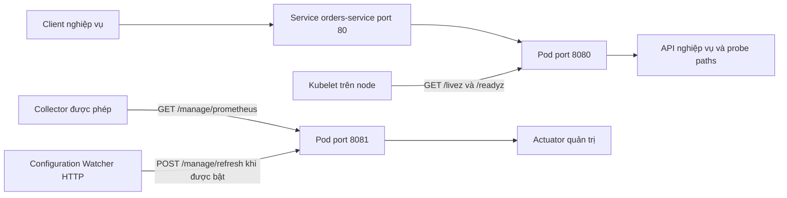

# Endpoint quản trị, cổng ứng dụng và cổng probe

Trong chương **Đóng gói ứng dụng** của module **SPRING_CLOUD_KUBERNETES**, việc xác định rõ endpoint và cổng giúp image Spring chạy đúng khi đưa vào Pod. Một ứng dụng có thể phục vụ request nghiệp vụ, cung cấp dữ liệu giám sát và nhận lệnh refresh cấu hình, nhưng các luồng đó không nhất thiết đi qua cùng cổng hoặc cùng chính sách truy cập.

Bài học này xây dựng một ví dụ xuyên suốt: `orders-service` phục vụ HTTP nghiệp vụ trên `8080`, đặt Spring Boot Actuator trên `8081` và để Kubernetes kiểm tra sức khỏe qua các đường dẫn chuyên biệt trên cổng nghiệp vụ. Qua đó, bạn sẽ hiểu ảnh hưởng đến DiscoveryClient, Spring Cloud LoadBalancer và Configuration Watcher, thay vì chỉ khai báo thêm `containerPort` trong manifest.

## 1. Mục tiêu và giả định

Sau bài học, bạn có thể:

- Phân biệt endpoint HTTP, cổng lắng nghe, cổng Service và cổng mà probe kiểm tra.
- Chọn dùng chung hoặc tách riêng cổng Actuator theo nhu cầu triển khai.
- Cấu hình startup, readiness và liveness probe với đúng địa chỉ đích.
- Giới hạn việc truy cập endpoint quản trị mà vẫn cho kubelet kiểm tra sức khỏe.
- Chẩn đoán lỗi chọn nhầm cổng discovery hoặc sai URL refresh của Configuration Watcher.

Ví dụ cấu hình Spring Boot sử dụng dòng `3.5.x`, ứng dụng web có Actuator, không đặt servlet context path hoặc WebFlux base path và dùng HTTP nội bộ. Đây là mốc phiên bản cho ví dụ; dự án phải chọn Spring Cloud và Spring Cloud Kubernetes tương thích với phiên bản Spring Boot thực tế.

Các đoạn YAML và lệnh là tài liệu thực hành, không phải thông báo rằng một ứng dụng hoặc cluster đã được tạo trong module này. Namespace `training`, image và các thành phần giám sát trong ví dụ cần được chuẩn bị ở môi trường thực hành.

## 2. Bốn khái niệm cần tách bạch

| Khái niệm | Ví dụ | Ý nghĩa |
| --- | --- | --- |
| Endpoint HTTP | `GET /api/orders/42` | Một thao tác ứng dụng xử lý khi nhận request |
| Cổng ứng dụng | `server.port=8080` | Nơi web server phục vụ request nghiệp vụ |
| Cổng quản trị | `management.server.port=8081` | Nơi Actuator phục vụ endpoint khi được cấu hình cổng riêng |
| Cổng probe | `httpGet.port: http` trỏ tới `8080` | Cổng mà kubelet kết nối để thực hiện một lần kiểm tra |

**Cổng probe không mặc nhiên là một listener thứ ba.** Nó có thể chính là cổng ứng dụng hoặc cổng quản trị. Kubernetes chọn đích kiểm tra; ứng dụng phải thực sự có server lắng nghe và handler phù hợp ở đích đó.

Một endpoint cũng không chỉ được xác định bằng đường dẫn. Để kiểm tra đầy đủ, cần biết:

```text
scheme + host + port + path + HTTP method + yêu cầu xác thực
```

Chẳng hạn, `GET http://POD_IP:8080/readyz` khác với `GET http://POD_IP:8081/manage/health/readiness`, dù cả hai có thể phản ánh cùng health group. `POST /manage/refresh` lại có tác dụng và yêu cầu quyền khác hẳn một phép đọc health.

Trong Kubernetes, tài nguyên `Endpoints` hoặc `EndpointSlice` mô tả địa chỉ backend của Service. Không nhầm các tài nguyên này với endpoint HTTP của Spring Actuator.

## 3. Vẽ rõ đường đi của request

Mô hình chính của bài học:



Ở mô hình này:

- Client gọi `orders-service:80`; Service chuyển tiếp đến cổng `8080` của Pod.
- Kubelet kiểm tra chính Pod, không gọi qua địa chỉ cân bằng tải của Service.
- Collector hoặc Watcher truy cập cổng quản trị theo cách chúng được cấu hình tìm đích.
- Service nghiệp vụ không cần khai báo `8081` chỉ để probe hoạt động.

Nếu probe gọi Service, một lần kiểm tra có thể đi tới Pod khác còn khỏe và che khuất lỗi của Pod đang cần đánh giá. Manifest probe phải chỉ đến listener của container đang được kiểm tra.

## 4. Hai cách bố trí Actuator

### 4.1. Dùng chung cổng

Cấu hình tối giản có thể là:

```yaml
server:
  port: 8080

management:
  endpoints:
    web:
      exposure:
        include: health
  endpoint:
    health:
      probes:
        enabled: true
```

Khi không tách management port, API nghiệp vụ và các health endpoint dùng chung cổng `8080`. Với giả định không đổi base path, các đường dẫn probe là:

```text
GET :8080/actuator/health/liveness
GET :8080/actuator/health/readiness
```

Cách này giảm số listener và cấu hình định tuyến. Tuy nhiên, nếu Ingress chuyển tiếp toàn bộ đường dẫn về Service, Actuator có thể đi cùng đường truy cập bên ngoài. Cần quy tắc HTTP và quyền truy cập phù hợp; chỉ đặt đường dẫn dưới `/actuator` không tạo ra một vùng mạng riêng.

### 4.2. Tách cổng quản trị

Tách `8081` giúp quản lý luồng giám sát hoặc quản trị khác với luồng nghiệp vụ. Đổi lại, một health request trên server quản trị chưa chứng minh server nghiệp vụ vẫn nhận được kết nối.

Ví dụ: listener `8081` vẫn trả health thành công, trong khi listener `8080` hoặc tài nguyên phục vụ request nghiệp vụ đang có vấn đề. Vì vậy, mô hình chính sẽ giữ Actuator quản trị trên `8081` nhưng đưa health paths bổ sung lên `8080`.

| Nhu cầu triển khai | Hướng cân nhắc |
| --- | --- |
| Chỉ cần health, ứng dụng nhỏ, cấu hình mạng đơn giản | Dùng chung cổng và giới hạn endpoint |
| Cần tách luồng metrics, thao tác vận hành hoặc chính sách theo cổng | Cổng quản trị riêng |
| Muốn probe phản ánh khả năng nhận HTTP của server chính | Kiểm tra health path trên cổng nghiệp vụ |
| Muốn cô lập hoàn toàn lỗi tài nguyên giữa quản trị và nghiệp vụ | Cần đánh giá thêm kiến trúc tiến trình; hai cổng trong cùng JVM chưa đủ |

Spring Boot cho phép đổi management port, địa chỉ bind và base path. Khi management port riêng, base path Actuator được tính theo management server; khi dùng chung, context path của ứng dụng có ảnh hưởng. Xem [Spring Boot: Monitoring and Management Over HTTP](https://docs.spring.io/spring-boot/3.5/reference/actuator/monitoring.html).

## 5. Cấu hình Spring Boot cho mô hình hai cổng

### 5.1. Các dependency cần thiết

Ứng dụng ví dụ cần web starter phù hợp và `spring-boot-starter-actuator`. Nếu muốn có `/manage/prometheus`, thêm `micrometer-registry-prometheus` với phiên bản do cơ chế quản lý dependency của dự án cung cấp.

```xml
<dependency>
    <groupId>org.springframework.boot</groupId>
    <artifactId>spring-boot-starter-actuator</artifactId>
</dependency>
<dependency>
    <groupId>io.micrometer</groupId>
    <artifactId>micrometer-registry-prometheus</artifactId>
</dependency>
```

Chỉ thêm `prometheus` vào danh sách exposure chưa tạo ra endpoint nếu thiếu thành phần hỗ trợ nó. `/manage/metrics` và `/manage/prometheus` cũng không phải cùng định dạng dữ liệu; collector Prometheus phải dùng endpoint xuất định dạng phù hợp.

Không cần cài toàn bộ starter Spring Cloud Kubernetes chỉ để cung cấp health endpoint. Các thành phần discovery, đọc cấu hình và load balancing chỉ được thêm khi ứng dụng thực sự cần.

### 5.2. Cấu hình ứng dụng

```yaml
spring:
  application:
    name: orders-service

server:
  port: 8080
  address: 0.0.0.0

management:
  server:
    port: 8081
    address: 0.0.0.0
  endpoints:
    web:
      base-path: /manage
      exposure:
        include: health,info,prometheus
  endpoint:
    health:
      show-details: never
      show-components: never
      probes:
        enabled: true
        add-additional-paths: true
```

Ý nghĩa của từng phần:

- `server.port` và `management.server.port` quyết định listener thực sự của ứng dụng.
- `0.0.0.0` cho phép nhận kết nối IPv4 qua giao diện của Pod. Nếu chỉ bind loopback, luồng đi vào Pod IP không thể dùng listener đó.
- `/manage` là base path của Actuator trong ví dụ, không phải tiền tố của API nghiệp vụ.
- `probes.enabled` bật các health group liên quan một cách rõ ràng, kể cả khi chạy thử ngoài Kubernetes.
- `add-additional-paths` tạo `/livez` và `/readyz` trên server chính.
- `show-details` và `show-components` giới hạn thông tin trong phản hồi health; chúng không thay thế xác thực hoặc chính sách mạng.

Bảng địa chỉ mong đợi:

| Đích | Đường dẫn | Mục đích |
| --- | --- | --- |
| Pod `8080` | `/api/orders/...` | API nghiệp vụ của ứng dụng mẫu |
| Pod `8080` | `/livez` | Liveness trên server chính |
| Pod `8080` | `/readyz` | Readiness trên server chính |
| Pod `8081` | `/manage/health` | Health tổng hợp cho vận hành |
| Pod `8081` | `/manage/health/liveness` | Health group liveness |
| Pod `8081` | `/manage/health/readiness` | Health group readiness |
| Pod `8081` | `/manage/prometheus` | Dữ liệu metrics khi dependency và quyền phù hợp |
| Pod `8081` | `/manage/refresh` | Chưa được mở trong cấu hình cơ sở; chỉ thêm khi cần |

Các path bổ sung là cơ chế có sẵn của Spring Boot, không cần tự viết một controller luôn trả `200 OK`. Tuy nhiên, probe HTTP trên server chính vẫn không phải kiểm thử toàn bộ hành trình nghiệp vụ qua DNS, Ingress và database. Xem [Spring Boot: Kubernetes Probes](https://docs.spring.io/spring-boot/3.5/reference/actuator/endpoints.html#actuator.endpoints.kubernetes-probes).

### 5.3. Đừng chỉ thay manifest khi đổi cổng

Khai báo `containerPort: 8081` không khiến Spring mở cổng đó. Ngược lại, không khai báo `containerPort` cũng không phải cách chặn một listener đang hoạt động.

Khi đổi management port qua ConfigMap, cần bảo đảm ứng dụng nhận giá trị đúng lúc khởi động và triển khai Pod mới nếu thay đổi yêu cầu tái tạo listener. Không giả định một lệnh refresh sẽ chuyển web server đang chạy sang cổng khác.

## 6. Phân biệt startup, liveness và readiness

| Probe | Câu hỏi cần trả lời | Hành động khi thất bại đủ ngưỡng |
| --- | --- | --- |
| Startup | Container đã vượt qua giai đoạn khởi động được chấp nhận chưa? | Kubelet xử lý việc khởi động lại container theo chính sách |
| Liveness | Instance có đang ở trạng thái cần khởi động lại để phục hồi không? | Container bị khởi động lại theo chính sách |
| Readiness | Instance hiện có nên nhận traffic thông thường không? | Pod không còn đủ điều kiện ready để nhận traffic thông thường qua Service |

Startup probe thành công không đồng nghĩa ứng dụng đã hoàn thành mọi công việc để nhận request. Với startup probe trỏ `/livez`, readiness vẫn chịu trách nhiệm chờ điều kiện `/readyz`.

Khi có startup probe, các probe liveness và readiness chưa bắt đầu cho tới khi startup probe thành công. Readiness thất bại tự nó không yêu cầu khởi động lại tiến trình. Các cơ chế khác như OOM hoặc tiến trình thoát vẫn có thể gây restart độc lập. Xem [Kubernetes: Configure Liveness, Readiness and Startup Probes](https://kubernetes.io/docs/tasks/configure-pod-container/configure-liveness-readiness-startup-probes/).

### 6.1. Không dùng health tổng hợp cho mọi mục đích

Một health tổng hợp có thể gồm database, dung lượng đĩa và các contributor của thư viện. Nếu trỏ liveness vào health tổng hợp, một hệ thống dùng chung tạm thời lỗi có thể dẫn đến restart đồng loạt các Pod.

Với ứng dụng Spring Cloud Kubernetes, việc Kubernetes API tạm thời không truy cập được không mặc nhiên có nghĩa phải khởi động lại JVM. Instance có thể còn thông tin discovery đã biết hoặc vẫn phục vụ một số API không cần truy vấn cluster ngay lúc đó.

Readiness cần phản ánh khả năng nhận traffic của chính ứng dụng. Việc đưa một hệ thống ngoài vào readiness phải dựa trên hành vi nghiệp vụ: nếu tất cả instance cùng phụ thuộc một dịch vụ đang hỏng, loại toàn bộ Pod khỏi phục vụ cũng có chi phí riêng.

### 6.2. Không biến probe thành tác vụ gây tác dụng phụ

Probe cần nhẹ, có thời hạn và không thay đổi trạng thái nghiệp vụ. Không dùng endpoint tạo đơn hàng, endpoint refresh cấu hình hoặc một truy vấn nặng làm phép thử liveness.

Nếu ứng dụng cần thực hiện công việc khởi tạo dài, hãy thiết kế readiness tương ứng. Tăng thời gian chờ chỉ để giấu một đường dẫn sai, lỗi xác thực hoặc dependency không bao giờ khởi tạo được sẽ làm chậm việc phát hiện lỗi.

## 7. Deployment và Service khớp với cấu hình

### 7.1. Deployment

Giả định image đã chứa cấu hình ở phần 5. Thay `IMAGE_REF` bằng image thực đã được đẩy lên registry; namespace và quyền pull image phải được chuẩn bị trước.

```yaml
apiVersion: apps/v1
kind: Deployment
metadata:
  name: orders-service
  namespace: training
spec:
  replicas: 2
  selector:
    matchLabels:
      app: orders-service
  template:
    metadata:
      labels:
        app: orders-service
    spec:
      containers:
        - name: orders-service
          image: IMAGE_REF
          ports:
            - name: http
              containerPort: 8080
            - name: management
              containerPort: 8081
          startupProbe:
            httpGet:
              path: /livez
              port: http
            timeoutSeconds: 2
            periodSeconds: 5
            failureThreshold: 36
          livenessProbe:
            httpGet:
              path: /livez
              port: http
            timeoutSeconds: 2
            periodSeconds: 10
            failureThreshold: 3
          readinessProbe:
            httpGet:
              path: /readyz
              port: http
            timeoutSeconds: 2
            periodSeconds: 5
            failureThreshold: 3
            successThreshold: 1
          resources:
            requests:
              cpu: 250m
              memory: 512Mi
            limits:
              cpu: "1"
              memory: 1Gi
```

`port: http` trong probe tham chiếu tên cổng của container, được định nghĩa là `8080`. Nó không tham chiếu trường `port` của Service.

`36 × 5` cho một ngân sách startup xấp xỉ `180` giây theo chu kỳ kiểm tra của ví dụ. Không coi phép nhân này là thời điểm chính xác kubelet buộc phải restart; thời gian thực tế còn liên quan lần kiểm tra đầu tiên, timeout và lịch thực thi. Các giá trị cần được điều chỉnh từ số đo khởi động và tải thực.

Không đặt `httpGet.host` thành DNS Service hoặc `127.0.0.1` để “chọn Pod”. Với mô hình Pod thông thường ở đây, để kubelet dùng đích mặc định là Pod IP.

Nếu thêm sidecar hoặc service mesh, phải kiểm chứng cấu hình probe sau khi admission hoặc injection hoàn tất; manifest được nộp vào chưa chắc là cấu hình cuối mà kubelet sử dụng.

### 7.2. Service nghiệp vụ

```yaml
apiVersion: v1
kind: Service
metadata:
  name: orders-service
  namespace: training
  labels:
    app: orders-service
    purpose: business
    primary-port-name: http
spec:
  selector:
    app: orders-service
  ports:
    - name: http
      port: 80
      targetPort: http
  type: ClusterIP
```

Một client trong cùng namespace gọi `http://orders-service/api/orders/42`. Port mặc định HTTP là `80`; `targetPort: http` đưa request đến cổng container mang tên `http`, tức `8080`.

Service này không cung cấp cổng `8081`. Collector có thể được cấu hình tìm Pod trực tiếp, hoặc đội vận hành có thể tạo Service quản trị riêng nếu công cụ cần. Tên `management` không có ý nghĩa bảo mật đặc biệt trong Kubernetes. Xem [Kubernetes: Service](https://kubernetes.io/docs/concepts/services-networking/service/).

Khi dùng cơ chế Service thông thường, backend unready không được chọn để nhận traffic thông thường. Các cách truy cập Pod trực tiếp, kết nối đã tồn tại hoặc cấu hình đặc biệt như `publishNotReadyAddresses` cần được xét riêng; readiness không phải một lệnh chặn mọi gói tin vào Pod.

## 8. Giới hạn endpoint quản trị mà không làm hỏng probe

### 8.1. Kiểm tra theo nhiều lớp

Để một request quản trị thành công, cần kiểm tra riêng:

1. Thành phần cung cấp endpoint đã có trong ứng dụng.
2. Endpoint không bị vô hiệu hoặc bị giới hạn access ở cấu hình Actuator.
3. Endpoint được expose qua HTTP.
4. Request tìm đúng scheme, host, port và path.
5. Luồng mạng được phép đi tới listener.
6. Cơ chế bảo mật HTTP cho phép danh tính và thao tác đó.

Mở `management.endpoints.web.exposure.include` chỉ giải quyết một phần. Một Service `ClusterIP` cũng không phải cơ chế xác thực ứng dụng.

Bảng quyền mục tiêu cho ví dụ:

| Request | Quy tắc mong muốn |
| --- | --- |
| `GET :8080/livez` và `GET :8080/readyz` | Kubelet gọi được, không chuyển hướng đăng nhập, trả thông tin tối thiểu |
| `GET :8081/manage/prometheus` | Chỉ collector được ủy quyền |
| `GET :8081/manage/info` | Chỉ bên vận hành được ủy quyền nếu thực sự cần |
| `POST :8081/manage/refresh` | Chỉ bên thực hiện refresh, khi tính năng được triển khai |
| Endpoint như `env`, `heapdump` hoặc `shutdown` | Giữ ngoài danh sách exposure nếu không có nhu cầu cụ thể |
| API nghiệp vụ | Theo quyền của ứng dụng, không suy từ quyền probe |

Nếu đã có Spring Security, cần tích hợp các quy tắc này vào các `SecurityFilterChain` hiện có. Cấu hình matcher cho Actuator có thể dùng `EndpointRequest` để theo endpoint, còn các đường dẫn health bổ sung trên server chính phải được bao phủ đúng. Khi tự khai báo filter chain, không dựa vào việc Spring Boot sẽ tự bảo vệ phần còn lại của ứng dụng. Xem [Spring Boot: EndpointRequest API](https://docs.spring.io/spring-boot/3.5/api/java/org/springframework/boot/actuate/autoconfigure/security/servlet/EndpointRequest.html).

Không dùng `permitAll("/**")` để sửa lỗi probe. Cũng không nhúng token quản trị dài hạn vào HTTP header của probe trong manifest chỉ để vượt qua một quy tắc xác thực quá rộng.

Với HTTP probe, dải mã thành công của kubelet không chỉ có `200`. Một redirect đăng nhập có thể gây đánh giá sai hoặc cảnh báo tùy cách chuyển hướng; mục tiêu kiểm chứng của ví dụ là phản hồi health trực tiếp, không có redirect. Dùng `curl -i` để quan sát cả status và header thay vì chỉ nhìn nội dung cuối cùng.

### 8.2. Chính sách mạng theo cổng

Ví dụ sau chỉ minh họa ingress tới `orders-service`:

- Cổng `8080` nhận request từ Pod có `role: business-client` trong namespace `training`.
- Cổng `8081` nhận request từ collector trong namespace `observability` hoặc Watcher trong namespace `platform-system`.
- Cluster dùng CNI hỗ trợ NetworkPolicy và không có policy khác mở rộng các nguồn này.

```yaml
apiVersion: networking.k8s.io/v1
kind: NetworkPolicy
metadata:
  name: orders-service-ingress
  namespace: training
spec:
  podSelector:
    matchLabels:
      app: orders-service
  policyTypes:
    - Ingress
  ingress:
    - from:
        - podSelector:
            matchLabels:
              role: business-client
      ports:
        - protocol: TCP
          port: 8080
    - from:
        - namespaceSelector:
            matchLabels:
              kubernetes.io/metadata.name: observability
          podSelector:
            matchLabels:
              app: metrics-collector
        - namespaceSelector:
            matchLabels:
              kubernetes.io/metadata.name: platform-system
          podSelector:
            matchLabels:
              app: configuration-watcher
      ports:
        - protocol: TCP
          port: 8081
```

Trong mỗi phần tử `from`, namespace selector và Pod selector cùng xuất hiện tạo điều kiện kết hợp. Hai phần tử `from` của rule quản trị là hai nguồn thay thế. Các label phải khớp tài nguyên thực tế.

NetworkPolicy chuẩn kiểm soát kết nối theo mạng và cổng, không phân biệt `GET /manage/prometheus` với `POST /manage/refresh` trên cùng listener. Vì vậy, collector được vào `8081` vẫn cần bị giới hạn đúng thao tác ở lớp HTTP.

Các policy được cộng dồn quyền cho phép. Một policy khác mở `8081` cho toàn namespace có thể làm phạm vi thực tế rộng hơn ví dụ này. Nếu client cũng bị giới hạn egress, cần cho phép kết nối từ phía client.

Theo mô hình NetworkPolicy chuẩn, traffic từ node đang chạy Pod có ngoại lệ; không dùng Pod selector để mô tả kubelet như một Pod client thông thường. Cần kiểm chứng probe thực tế nếu nền tảng có thêm host firewall, chính sách CNI mở rộng hoặc service mesh. Xem [Kubernetes: Network Policies](https://kubernetes.io/docs/concepts/services-networking/network-policies/).

Nếu có Ingress controller, gateway hoặc nguồn nghiệp vụ khác, bổ sung đúng nguồn thực tế cho `8080`. Cấu hình trên không tự cung cấp một đường Ingress công khai.

## 9. Ảnh hưởng tới DiscoveryClient và LoadBalancer

### 9.1. Không quảng bá cổng quản trị làm cổng nghiệp vụ

Giả sử một Service có cả `http` và `management`. Nếu client chọn sai port, lệnh gọi lấy đơn hàng có thể đi vào Actuator, trả `404` hoặc lỗi xác thực, trong khi Pod và discovery vẫn có vẻ hoạt động bình thường.

Spring Cloud Kubernetes có cơ chế chọn cổng chính khi Service có nhiều cổng, bao gồm label `primary-port-name` và thuộc tính `spring.cloud.kubernetes.discovery.primary-port-name`. Thứ tự và hành vi cụ thể cần đối chiếu phiên bản đang dùng. Không dựa vào việc “cổng đầu tiên trong YAML chắc chắn là cổng đúng”. Xem [Spring Cloud Kubernetes: DiscoveryClient](https://docs.spring.io/spring-cloud-kubernetes/reference/discovery-client.html).

Service nghiệp vụ của ví dụ chỉ có một cổng, đồng thời nêu rõ label `primary-port-name: http`. Label là metadata phục vụ logic chọn cổng của client liên quan; nó không thay đổi quy tắc `targetPort` của Kubernetes.

Nếu tạo Service quản trị riêng cùng chọn các Pod đó, cần tránh đưa nó vào tập dịch vụ nghiệp vụ mà client khám phá. Dùng label và cơ chế lọc discovery phù hợp với implementation, thay vì để một tên dịch vụ quản trị vô tình xuất hiện trong danh sách phục vụ nghiệp vụ.

### 9.2. Chẩn đoán cả host và port của ServiceInstance

DNS qua Service và discovery trả từng instance có thể dẫn tới các loại địa chỉ khác nhau. Đừng lấy `Service.port=80` rồi mặc nhiên dùng nó cho một địa chỉ Pod chỉ đang nghe `8080`.

Khi kiểm chứng client, ghi nhận:

```text
serviceId
host
port
scheme
metadata liên quan đến chọn cổng
```

Sau đó đối chiếu với tài nguyên Service, backend và listener thực tế. Với Spring Cloud LoadBalancer, phải xác định cả chế độ hoặc supplier đang dùng; cấu hình chọn port của DiscoveryClient không mặc nhiên áp dụng giống hệt cho mọi chế độ LoadBalancer.

Nếu chỉ cần gọi một Service ổn định qua DNS, có thể không cần cân bằng tải phía client. Việc tách management port không tạo thêm nhu cầu sử dụng Spring Cloud LoadBalancer.

## 10. Configuration Watcher cần tìm đúng endpoint refresh

### 10.1. Đổi cổng hoặc base path phải đổi cả đích refresh

Cấu hình cơ sở của bài chưa expose `refresh`. Khi chọn refresh qua HTTP, cần đồng thời có:

- Thành phần Spring Cloud cung cấp endpoint refresh tương ứng và cơ chế nạp lại cấu hình thực sự phù hợp.
- Exposure cho endpoint cần thiết.
- URL quản trị đúng, cùng quyền HTTP và luồng mạng phù hợp.
- Configuration Watcher được triển khai và cấu hình theo phiên bản.

Ví dụ mở thêm endpoint khi đã đáp ứng các điều kiện đó:

```yaml
management:
  endpoints:
    web:
      exposure:
        include: health,info,prometheus,refresh
```

Đây là phần cập nhật cho cấu hình `management` đã có, không phải một key `management` thứ hai trong cùng tài liệu YAML.

Trong mô hình đang dùng, đích là `POST :8081/manage/refresh`. Gọi `POST :8080/actuator/refresh` theo thói quen sẽ sai cả cổng lẫn base path.

Tài liệu Configuration Watcher mô tả annotation `boot.spring.io/actuator` trên Service để thông báo cổng và path quản trị khác mặc định. Với mô hình ví dụ, phần metadata có thể bổ sung:

```yaml
metadata:
  annotations:
    boot.spring.io/actuator: "http://:8081/manage"
```

Giá trị này là định dạng metadata mà Watcher hiểu; không phải URL hoàn chỉnh để sao chép nguyên xi vào trình duyệt. Phải kiểm tra URL thực tế Watcher dựng ra từ host discovery, cổng và base path. Annotation không tạo listener hoặc Service port mới.

Watcher cũng có các tùy chọn cho actuator path và port của chính nó khi tìm đích. Không đặt các tùy chọn đó vào ứng dụng đích rồi cho rằng Watcher tự nhận được. Xem [Spring Cloud Kubernetes: Configuration Watcher](https://docs.spring.io/spring-cloud-kubernetes/reference/spring-cloud-kubernetes-configuration-watcher.html).

### 10.2. Ba loại quyền không thay thế nhau

| Câu hỏi | Cơ chế liên quan |
| --- | --- |
| Watcher có được đọc hoặc theo dõi tài nguyên cấu hình trong Kubernetes không? | ServiceAccount và RBAC |
| Watcher có kết nối được tới địa chỉ quản trị của instance không? | Định tuyến, listener, NetworkPolicy và nền tảng mạng |
| Watcher có được gọi thao tác refresh qua HTTP không? | Cơ chế xác thực và phân quyền của ứng dụng hoặc lớp proxy liên quan |

Role cho phép đọc ConfigMap không tự cấp quyền gọi `POST /manage/refresh`. Một bearer token dùng với Kubernetes API cũng không tự trở thành token hợp lệ với Spring Security của ứng dụng.

Nếu endpoint refresh được bảo vệ, cần xác nhận implementation Watcher được chọn có đường cung cấp danh tính phù hợp, hoặc có cơ chế trung gian đã được thiết kế và kiểm chứng. Không bỏ xác thực trên toàn bộ cổng quản trị chỉ vì Watcher nhận `401`.

Một lỗi `403` từ Kubernetes API khác lỗi `403` từ endpoint quản trị. Trường hợp thứ hai còn có thể liên quan CSRF đối với request `POST`. Cần xem URL, server trả lỗi và log tương ứng trước khi sửa quyền. Không tắt CSRF toàn ứng dụng theo phản xạ; xác định riêng cách bảo vệ thao tác giữa các dịch vụ.

### 10.3. Refresh phải đến đúng phạm vi instance

Nếu một lệnh refresh được gửi qua Service cân bằng tải, một request thường chỉ được chuyển đến một backend. Không lấy việc một Pod đã đổi giá trị để kết luận mọi replica đã đổi.

Khi chọn HTTP refresh theo từng instance, xác nhận danh sách instance và kết quả của từng lần gọi. Nếu chọn Spring Cloud Bus, đường vận chuyển sự kiện và điều kiện thành công khác với HTTP trực tiếp.

ConfigMap hoặc Secret được cập nhật, file mount thay đổi và bean ứng dụng nhận giá trị mới là các sự kiện khác nhau. Đổi cấu hình ảnh hưởng listener hoặc thành phần không hỗ trợ refresh có thể cần rollout thay vì cố gọi endpoint nhiều lần.

## 11. Kiểm chứng cấu hình bằng đường đi cụ thể

### 11.1. Kiểm tra Pod và cấu hình đã áp dụng

Sau khi triển khai ứng dụng thực hành:

```shell
kubectl -n training get pods -l app=orders-service -o wide
kubectl -n training get deployment orders-service -o yaml
kubectl -n training get service orders-service -o yaml
kubectl -n training get endpointslices -l kubernetes.io/service-name=orders-service -o yaml
```

Đối chiếu listener được cấu hình, port name, `targetPort`, probe path và điều kiện ready của backend. Khi xem log khởi động, kiểm tra cả server nghiệp vụ lẫn server quản trị; đừng chỉ tìm một dòng báo mở `8080`.

### 11.2. Kiểm tra từng cổng qua port-forward

Mở một terminal:

```shell
kubectl -n training port-forward deployment/orders-service 18080:8080 18081:8081
```

Ở terminal khác, dùng `curl`; trên Windows PowerShell có thể gọi rõ `curl.exe`:

```shell
curl -i http://127.0.0.1:18080/livez
curl -i http://127.0.0.1:18080/readyz
curl -i http://127.0.0.1:18081/manage/health
curl -i http://127.0.0.1:18080/manage/health
```

Ở trạng thái sẵn sàng, các probe path cần trả health trực tiếp. Request `:18080/manage/health` không được cung cấp endpoint health quản trị trong mô hình hai cổng này; tùy quy tắc bảo mật, nó có thể bị từ chối trước khi tới bước tìm handler.

Port-forward tới Deployment chọn một Pod. Lặp lại kiểm chứng cho từng Pod khi điều tra sự khác biệt giữa các replica.

**Port-forward chỉ giúp kiểm tra listener và handler.** Nó không chứng minh kubelet, client qua Service hoặc Watcher từ namespace khác đi được đúng đường mạng. Sau bước này, phải kiểm tra thêm từ nguồn truy cập thực tế.

### 11.3. Kiểm tra quyền bằng kết quả mong đợi

| Nguồn và request | Kết quả cần kiểm chứng |
| --- | --- |
| Kubelet → Pod `8080/livez` | Probe thành công trực tiếp khi instance sống |
| Kubelet → Pod `8080/readyz` | Phản ánh đúng khả năng sẵn sàng |
| Client nghiệp vụ được phép → Service `80` | API nghiệp vụ hoạt động theo quyền |
| Collector hợp lệ → `8081/manage/prometheus` | Có metrics đúng định dạng |
| Client không được phép → `8081` | Bị giới hạn theo chính sách đã thiết kế |
| Watcher → từng instance `8081/manage/refresh` | Thành công khi refresh được triển khai và có danh tính hợp lệ |
| Request quản trị từ bên ngoài qua Ingress | Không đi qua một route ngoài dự kiến |

`200` tại một endpoint không đủ để chứng minh toàn hệ thống đúng. Cần kiểm tra cả các request phải bị từ chối và mỗi nguồn có vai trò riêng.

## 12. Bảng chẩn đoán nhanh

| Hiện tượng | Nguyên nhân cần kiểm tra | Hướng xử lý |
| --- | --- | --- |
| `Connection refused` ở `8081` | Chưa mở management listener, cấu hình chưa được nạp hoặc chỉ bind loopback | Kiểm tra cấu hình lúc khởi động và địa chỉ bind |
| Probe trả `404` | Sai port, base path hoặc chưa bật health paths | Đối chiếu listener và probe path thực tế |
| Probe trả `401` hoặc `403` | Quy tắc Spring Security, proxy hoặc policy HTTP chặn probe | Chỉ mở đúng health path và thao tác cần thiết |
| Probe đi vào trang đăng nhập | Rule xác thực áp dụng cho health hoặc có redirect | Sửa matcher và kiểm tra status cùng header |
| Management health tốt nhưng nghiệp vụ treo | Probe chỉ đi qua server quản trị riêng | Dùng health paths trên server chính và đo hành vi khi tải |
| Tất cả Pod restart khi database hỏng | Liveness phụ thuộc health tổng hợp hoặc hệ thống ngoài | Tách mục tiêu liveness khỏi dependency dùng chung |
| Service có Pod nhưng không có backend sẵn sàng | Readiness chưa thành công hoặc selector không đúng | Xem conditions, probe events và EndpointSlice |
| Client nhận `404` từ lệnh gọi nghiệp vụ | Discovery hoặc LoadBalancer chọn management port | Kiểm tra host, port và cấu hình chọn cổng |
| Watcher gọi `/actuator/refresh` thất bại | Đã đổi management port hoặc base path nhưng chưa cập nhật metadata | Xác nhận URL thực tế và cấu hình phía Watcher |
| Watcher đọc ConfigMap được nhưng refresh bị `403` | RBAC và bảo mật HTTP bị đánh đồng; có thể liên quan CSRF | Phân loại đúng server trả lỗi và quyền của request |
| Một replica đổi cấu hình, replica khác không đổi | Chỉ gọi một backend hoặc không xử lý đủ instance | Kiểm tra chiến lược refresh và kết quả từng instance |
| Port-forward chạy được nhưng collector timeout | Sai đường mạng, selector, policy hoặc địa chỉ mà collector sử dụng | Kiểm tra từ collector thực và cả egress lẫn ingress |

Với lỗi probe, xem events và log của container tương ứng. Thay `POD_NAME` bằng tên Pod thực:

```shell
kubectl -n training describe pod POD_NAME
kubectl -n training logs POD_NAME -c orders-service --tail=200
kubectl -n training logs POD_NAME -c orders-service --previous --tail=200
```

Lệnh `--previous` hữu ích khi container đã restart và instance trước còn log; lỗi không có log trước không tự chứng minh ứng dụng chưa từng gặp vấn đề.

## 13. Thực hành có kiểm soát

Dùng namespace thử nghiệm và giữ cùng một image khi so sánh bố trí cổng:

1. Chạy phương án dùng chung cổng với chỉ endpoint health. Xác định đường dẫn nào có thể tới qua Service.
2. Chuyển sang cấu hình hai cổng, expose health paths bổ sung trên server chính và cập nhật probe đồng bộ.
3. Kiểm tra lần lượt cổng `8080`, `8081` và Service `80`; ghi lại phản hồi và đường đi của request.
4. Trong một bản cấu hình thử nghiệm, đặt sai readiness path. Quan sát Pod unready trong khi tiến trình vẫn chạy, sau đó khôi phục.
5. Kiểm tra rằng client nghiệp vụ không gọi được thao tác quản trị ngoài quyền, đồng thời kubelet vẫn probe thành công.
6. Nếu ứng dụng có Configuration Watcher, kiểm tra URL refresh sau khi đổi base path và xác nhận tất cả replica nhận thay đổi phù hợp.
7. Ghi lại bộ endpoint cần thiết, nguồn được phép truy cập và cơ chế bảo vệ ở từng lớp.

Tự đánh giá bằng các câu hỏi:

- Vì sao `containerPort: 8081` chưa đủ để mở Actuator?
- Vì sao cổng probe không nhất thiết là một cổng riêng?
- Với `Service.port=80` và `targetPort=8080`, kubelet nên kiểm tra cổng nào trong mô hình này?
- Vì sao Actuator trên cổng riêng có thể báo khỏe trong lúc server nghiệp vụ gặp sự cố?
- Một Role cho phép Watcher đọc Secret có cho phép nó gọi endpoint refresh không?
- Nếu refresh thông qua một địa chỉ Service cân bằng tải, làm sao biết mọi replica đã được cập nhật?
- Khi không cần refresh, metrics hoặc discovery, thành phần và endpoint nào có thể không đưa vào triển khai?

Một cấu hình tốt giúp mỗi bên gọi đúng đích và thực hiện đúng vai trò: client dùng cổng nghiệp vụ, kubelet kiểm tra trạng thái của chính instance, còn collector và thành phần quản trị chỉ truy cập các endpoint được cấp quyền rõ ràng.
