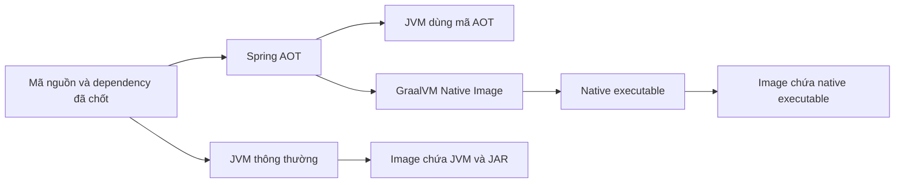
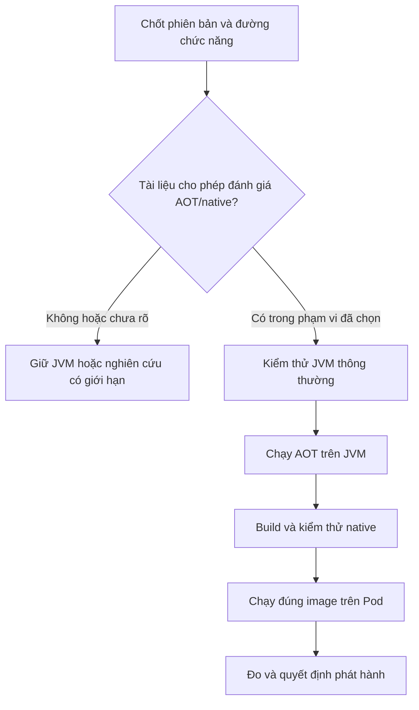

# Điều kiện hỗ trợ AOT hoặc native image theo bộ thư viện

Bài học thuộc chương **Đóng gói ứng dụng** của module **SPRING_CLOUD_KUBERNETES**. Trọng tâm là xác định khi nào một ứng dụng Spring sử dụng tích hợp Kubernetes có thể chạy với Spring AOT hoặc được biên dịch thành GraalVM native executable, và khi nào nên giữ cách chạy JVM thông thường.

Không thể kết luận chỉ từ câu “Spring Boot hỗ trợ native”. Kết quả phụ thuộc vào **bộ phiên bản, các thư viện thực sự có trên classpath, tính năng được bật và mô hình cập nhật cấu hình** của ứng dụng. DiscoveryClient, ConfigMap, Secret, Spring Cloud LoadBalancer và Configuration Watcher có các điều kiện khác nhau; khả năng của một thành phần không tự mở rộng sang toàn bộ module.

## 1. Mục tiêu và tình huống thực hành

Sau bài học, bạn có thể:

- Phân biệt Spring AOT, chế độ chạy JVM dùng mã AOT, GraalVM native executable và container image.
- Lập danh sách điều kiện hỗ trợ theo phiên bản và từng đường tích hợp, thay vì đánh giá theo tên framework chung.
- Phân biệt cấu hình quyết định sự tồn tại của bean với giá trị được cung cấp cho bean khi khởi động.
- Nhận diện ràng buộc về refresh, service ID của LoadBalancer, metadata cho reflection/resource và thư viện client Kubernetes.
- Thiết kế kiểm chứng tăng dần từ JVM đến native và đánh giá trên Pod với danh tính, RBAC, TLS, DNS và health endpoint thực tế.

Tình huống: đội phát triển muốn giảm thời gian khởi động của `catalog-service`. Ứng dụng hiện đọc cấu hình từ Kubernetes, gọi `inventory` và có thể nhận thay đổi cấu hình. Trước khi đổi lệnh build, đội phải xác định chính xác đường đọc cấu hình, cách khám phá dịch vụ và yêu cầu cập nhật khi đang chạy.

## 2. Bốn khái niệm không nên gộp thành một

| Khái niệm | Việc xảy ra | Điều cần kiểm chứng |
| --- | --- | --- |
| JVM thông thường | Spring tạo context khi khởi động dựa trên classpath và môi trường lúc chạy | Cấu hình và chức năng hoạt động đúng trên JVM |
| Spring AOT | Phân tích cấu trúc ứng dụng tại build time, tạo mã khởi tạo và thông tin hỗ trợ runtime | Cấu trúc bean có thể xác định trước; thư viện tương thích với phép biến đổi |
| JVM dùng mã AOT | Vẫn chạy trên JVM nhưng dùng phần khởi tạo đã sinh | Có kiểm chứng riêng cho kết quả Spring AOT |
| GraalVM native executable | Phân tích và biên dịch thành chương trình máy cho nền tảng cụ thể | Metadata, hành vi runtime, ABI và toàn bộ dependency tương thích |

Container image là lớp đóng gói triển khai, không phải một trong các cơ chế khởi tạo trên. Image có thể chứa JVM cùng JAR, hoặc chứa native executable. “Cloud Native Buildpacks” cũng không đồng nghĩa mọi image do Buildpacks tạo đều là GraalVM native.

Native executable không cần JVM để chạy, nhưng vẫn có yêu cầu về hệ điều hành, kiến trúc và thư viện hệ thống tùy cách liên kết. Startup và bộ nhớ có thể cải thiện; mức cải thiện phải được đo bằng workload của ứng dụng. [Spring Boot: giới thiệu GraalVM native image](https://docs.spring.io/spring-boot/reference/packaging/native-image/introducing-graalvm-native-images.html).



Mỗi mũi tên cần có bằng chứng phù hợp. JVM chạy tốt chưa chứng minh AOT đúng; AOT chạy tốt trên JVM chưa chứng minh native đã có đủ metadata.

## 3. Đọc tuyên bố hỗ trợ theo đúng phiên bản

### 3.1. Ví dụ đối chiếu tài liệu Spring Cloud Kubernetes

Các tài liệu được đối chiếu khi soạn bài ngày **24/11/2026** cho thấy sự khác biệt giữa các dòng:

| Tài liệu mang phiên bản | Phạm vi tuyên bố quan sát được | Cách sử dụng thông tin |
| --- | --- | --- |
| Spring Cloud Kubernetes 3.3.3 | Chưa hỗ trợ Spring Boot AOT transformations hoặc native images | Không xem AOT trên JVM là cách đi vòng để có hỗ trợ |
| Spring Cloud Kubernetes 5.0.5 | Vẫn tuyên bố chưa hỗ trợ AOT/native | Không suy ra hỗ trợ chỉ vì số major đã tăng |
| Spring Cloud Kubernetes 5.1.0 | Tài liệu native mang nhãn preview; trình bày điều kiện build của Configuration Watcher | Chỉ đánh giá phạm vi được mô tả; không coi đây là xác nhận cho mọi starter/client/tính năng |

Nguồn cho hai dòng chưa hỗ trợ: [Spring Cloud Kubernetes 3.3](https://docs.spring.io/spring-cloud-kubernetes/reference/3.3/index.html), [Spring Cloud Kubernetes 5.0](https://docs.spring.io/spring-cloud-kubernetes/reference/5.0/index.html). Phạm vi preview được nêu tại [AOT and Native Images của Spring Cloud Kubernetes](https://docs.spring.io/spring-cloud-kubernetes/reference/native-images.html), trang hiển thị phiên bản 5.1.0 ở thời điểm đối chiếu.

Những đường dẫn theo dòng phiên bản hoặc không ghim phiên bản có thể thay đổi nội dung về sau. Khi áp dụng vào dự án, lưu tên phiên bản hiển thị và đối chiếu lại tài liệu của artifact thực tế. Bảng này minh họa cách đọc bằng chứng, không chọn sẵn bộ dependency cho mọi dự án.

### 3.2. Ba mức kết luận khác nhau

- **Có tuyên bố hỗ trợ với điều kiện:** có thể tiếp tục thử nghiệm trong phạm vi được mô tả, sau khi đáp ứng điều kiện.
- **Có thể build/chạy trong thử nghiệm:** chỉ chứng minh một cấu hình và tập đường chạy đã qua thử nghiệm; chưa thay thế tuyên bố hỗ trợ của thư viện.
- **Chưa được xác nhận hoặc không hỗ trợ:** cần giữ đường triển khai được hỗ trợ, hoặc coi nghiên cứu native là thử nghiệm riêng có giới hạn rõ ràng.

Chẳng hạn, một Kubernetes client có metadata cho native không tự chứng minh auto-configuration, property source hoặc cơ chế discovery của Spring Cloud Kubernetes cùng tương thích. Chiều ngược lại cũng vậy: core framework có AOT không bảo đảm mọi HTTP transport, codec hoặc plugin được ứng dụng thêm vào đều đúng.

## 4. Điều kiện hỗ trợ là giao của nhiều lớp

Có thể dùng mô hình sau để đánh giá:

```text
Ứng viên native phù hợp
  = bộ phiên bản tương thích
  + đường chức năng được thư viện hỗ trợ
  + mô hình bean phù hợp AOT
  + metadata đủ cho đường chạy động
  + native toolchain và nền tảng chạy phù hợp
  + kiểm chứng chức năng, vận hành và hiệu năng đạt yêu cầu
```

Thiếu một lớp thì chưa đủ căn cứ phát hành native. Thêm memory cho builder không sửa được mô hình refresh không tương thích; thêm reflection hint không cấp RBAC cho Pod.

### 4.1. Kiểm kê bộ thư viện

Trước khi chọn profile native, ghi lại ít nhất các mục sau cho dự án thực hành:

| Thành phần cần ghi nhận | Thông tin phải xác định | Lý do |
| --- | --- | --- |
| Java và Spring Boot | Phiên bản chính xác, plugin build đi kèm | Ràng buộc toolchain và cơ chế AOT |
| Spring Cloud release train | BOM và phiên bản thực tế được resolve | Chọn tổ hợp phù hợp với Spring Boot |
| Spring Cloud Kubernetes | Artifact và phiên bản từng module dùng | Xác định phạm vi tích hợp và tuyên bố hỗ trợ |
| Kubernetes client | Fabric8 hoặc Kubernetes Java Client, kèm transport | Không chỉ API facade mà cả implementation phải chạy được |
| Spring Cloud Commons/LoadBalancer | Có sử dụng hay chỉ được kéo bắc cầu | Kiểm tra context refresh và service ID |
| Thư viện ứng dụng | JSON, database driver, migration, HTTP client, observability | Lỗi native có thể đến từ dependency ngoài Kubernetes |
| Native Build Tools/GraalVM | Phiên bản plugin, compiler và Java tương ứng | Metadata và tùy chọn build có thể khác theo thế hệ |
| Nền tảng image | Builder/run image, OS, CPU, libc và CA certificate | Binary build được chưa chắc chạy được trong image đích |

Dùng BOM tương thích để quản lý dependency Spring Cloud, rồi xem cây dependency đã resolve; không chỉ nhìn các phiên bản được gõ trực tiếp trong file build. [Spring Cloud: chọn release train](https://spring.io/projects/spring-cloud/).

Ví dụ lệnh khảo sát trong một dự án Maven thực hành:

```powershell
.\mvnw.cmd dependency:tree '-Dincludes=org.springframework.cloud:*,io.fabric8:*,io.kubernetes:*'
```

Lệnh lọc này chỉ giúp quan sát các nhóm liên quan; khi chốt kết luận vẫn cần xem dependency bắc cầu khác như HTTP transport, JSON codec và thư viện native. Không thêm cả hai họ Kubernetes client chỉ để thử xem họ nào build qua.

### 4.2. Bảng đánh giá theo đường chức năng

| Đường chức năng | Câu hỏi cần trả lời trước AOT/native | Bằng chứng chức năng cần có |
| --- | --- | --- |
| Gọi Service qua DNS | Có thật sự cần client Kubernetes trong ứng dụng không? | DNS, HTTP và TLS hoạt động trong image đích |
| DiscoveryClient | Chính phiên bản starter, client và đường watch/cache này có được hỗ trợ không? | Tra cứu instance, thay Pod, cập nhật danh sách và reconnect |
| ConfigMap/Secret qua API | Cơ chế nạp cấu hình và khởi tạo client có tương thích không? | Đọc đúng namespace, TLS/CA, xác thực và lỗi thiếu quyền |
| ConfigMap/Secret được mount | Spring chỉ đọc file/biến môi trường hay còn refresh context? | Bind giá trị lúc khởi động và chiến lược cập nhật rõ ràng |
| Spring Cloud LoadBalancer | Service ID có được khai báo trước và nguồn instance có tương thích không? | Request qua đúng supplier, xử lý đổi instance và trường hợp không có instance |
| Configuration Watcher | Đang đánh giá workload watcher hay ứng dụng được thông báo? | Detector cần thiết có trong build; phía nhận xử lý theo cơ chế được hỗ trợ |

Hãy đánh giá đúng đường sẽ dùng ở production. Test discovery bằng danh sách instance giả không chứng minh Fabric8 client có thể xác thực và watch API trên một Pod thực.

## 5. Cấu hình tại build time và cấu hình tại runtime

### 5.1. Cấu trúc bean được xác định sớm

Spring AOT xử lý cấu trúc context dựa vào classpath và môi trường dùng khi xử lý AOT. Những thuộc tính quyết định có tạo bean hay không, cũng như profile chọn cấu hình, phải được tính đến ở giai đoạn này. [Spring Framework: giới hạn của AOT](https://docs.spring.io/spring-framework/reference/core/aot.html).

Xét cấu hình minh họa độc lập sau:

```java
package example.nativeprobe;

import org.springframework.boot.autoconfigure.condition.ConditionalOnProperty;
import org.springframework.context.annotation.Bean;
import org.springframework.context.annotation.Configuration;

@Configuration(proxyBeanMethods = false)
public class AuditConfiguration {

    @Bean
    @ConditionalOnProperty(
            name = "feature.audit.enabled",
            havingValue = "true")
    AuditMarker auditMarker() {
        return new AuditMarker("audit");
    }

    public record AuditMarker(String channel) {
    }
}
```

Nếu `feature.audit.enabled` là `false` hoặc chưa được đặt khi AOT đánh giá điều kiện, bean `auditMarker` sẽ không được đưa vào kết quả đó. Việc đặt `FEATURE_AUDIT_ENABLED=true` khi khởi động native không tự sinh lại bean đã bị loại.

Ngược lại, một giá trị như `partner.base-url` được đọc để khởi tạo một bean đã tồn tại có thể được cấp khi khởi động, nếu đường binding tương ứng được hỗ trợ. Không được từ giới hạn bean graph suy ra mọi giá trị cấu hình hoặc Secret đều phải bị đóng vào binary.

| Loại cấu hình | Ví dụ | Giai đoạn cần chú ý |
| --- | --- | --- |
| Quyết định sự tồn tại của bean | `feature.audit.enabled` trên `@ConditionalOnProperty` | Môi trường chạy AOT |
| Chọn cấu hình có bean khác nhau | `@Profile("cluster")` | Profile dùng khi chạy AOT |
| Giá trị cho bean đã có | URL, timeout, ngưỡng nghiệp vụ | Thường có thể cấp trước khi ứng dụng khởi động |
| Đổi cấu trúc context sau khi chạy | Tạo lại bean qua context refresh | Phải đối chiếu giới hạn framework và Spring Cloud |
| Dữ liệu do dịch vụ bên ngoài trả về | Danh sách Pod/endpoint từ nguồn discovery đã được hỗ trợ | Có thể đổi trong runtime mà không đồng nghĩa đổi bean graph |

### 5.2. Không đưa môi trường production vào bước AOT

Đặt chính xác các cờ cấu trúc cần thiết khi AOT chạy, nhưng giữ thông tin xác thực và địa chỉ riêng của môi trường ở runtime. Cấu hình build phải được kiểm soát để không vô tình dùng kubeconfig cá nhân hoặc gọi API production khi đang sinh mã.

Một profile build có thể mô tả topology dự kiến, còn Pod cấp ConfigMap/Secret lúc khởi động. Nếu hai môi trường cần tập bean khác nhau, phải thiết kế lại cấu hình để dùng topology chung phù hợp, hoặc phát hành những biến thể được quản lý riêng. Không hứa hẹn một binary thay được mọi profile tùy ý.

Với Maven, `-Pnative` kích hoạt **Maven profile**; `spring.profiles.active` là **Spring profile**. Hai cơ chế này không tự thay thế nhau. Thuộc tính JVM của process AOT cũng cần được truyền đúng cho process đó. [Spring Boot Maven Plugin: xử lý AOT và môi trường build](https://docs.spring.io/spring-boot/maven-plugin/aot.html).

## 6. Reflection, resource, proxy và metadata

### 6.1. Vì sao build thành công vẫn có thể lỗi lúc gọi API?

GraalVM cần biết các thành phần sẽ được truy cập động. Đường xử lý HTTP đầu tiên có thể chạy tốt, nhưng một nhánh deserialize lỗi, một resource chỉ dùng khi retry hoặc một proxy ít được gọi vẫn có thể thiếu metadata.

| Cơ chế động | Ví dụ trong ứng dụng tích hợp Kubernetes | Điều cần kiểm chứng |
| --- | --- | --- |
| Reflection/binding | DTO nhận từ đối tác hoặc model được codec khởi tạo | Constructor, field/method được truy cập đúng |
| Resource trên classpath | Template, schema, cấu hình đi kèm thư viện | Resource cần thiết có trong executable |
| Proxy | Interface được thư viện tạo proxy khi chạy | Tập interface và cơ chế proxy được hỗ trợ |
| Java serialization | Đường xử lý dùng `ObjectInputStream` | Metadata serialization phù hợp, nếu thật sự dùng |
| JNI/thư viện native | Transport, compression hoặc crypto bổ sung | Binary và thư viện liên quan đúng nền tảng |

Reachability metadata là đầu vào để compiler giữ lại các phần cần cho truy cập động. Nó không khôi phục một cơ chế tạo class tùy ý nếu cơ chế đó không nằm trong khả năng native được hỗ trợ. [GraalVM: reachability metadata](https://www.graalvm.org/latest/reference-manual/native-image/metadata/).

### 6.2. Bổ sung hint có phạm vi rõ ràng

Ưu tiên metadata/hint do framework và thư viện chính thức cung cấp. Nếu mã ứng dụng có một đường binding hoặc nạp resource động chưa được nhận diện, có thể đăng ký bổ sung; ví dụ sau minh họa API của Spring:

```java
package example.nativeprobe;

import org.springframework.aot.hint.RuntimeHints;
import org.springframework.aot.hint.RuntimeHintsRegistrar;
import org.springframework.aot.hint.annotation.RegisterReflectionForBinding;
import org.springframework.context.annotation.Configuration;
import org.springframework.context.annotation.ImportRuntimeHints;

@Configuration(proxyBeanMethods = false)
@RegisterReflectionForBinding(PartnerHintsConfiguration.PartnerPayload.class)
@ImportRuntimeHints(PartnerHintsConfiguration.TemplateHints.class)
public class PartnerHintsConfiguration {

    public record PartnerPayload(String code, String description) {
    }

    public static class TemplateHints implements RuntimeHintsRegistrar {
        @Override
        public void registerHints(RuntimeHints hints, ClassLoader classLoader) {
            hints.resources().registerPattern("partner-templates/*.json");
        }
    }
}
```

Ví dụ giả định ứng dụng thực sự có DTO và resource tương ứng. Không cần sao chép nó chỉ vì có starter Kubernetes; những DTO được Spring nhìn thấy qua chữ ký endpoint có thể đã được framework xử lý. Đăng ký đúng nhu cầu giúp dễ giải thích nguyên nhân và giảm phạm vi giữ lại.

Nếu dùng tracing agent để thu thập metadata, phải chạy các luồng tiêu biểu: thành công, lỗi, retry, mất kết nối và nhánh ít dùng. Agent chỉ quan sát những đường được thực thi; kết quả quan sát chưa bao phủ toàn bộ chương trình. [GraalVM: tracing agent](https://www.graalvm.org/latest/reference-manual/native-image/metadata/AutomaticMetadataCollection/).

Thêm hint có thể giải quyết một lỗi thiếu metadata đã được xác định. Nó không thay đổi tuyên bố hỗ trợ của Spring Cloud Kubernetes, không bật lại bean bị loại lúc AOT và không làm context refresh trở thành tính năng được hỗ trợ.

## 7. Các ràng buộc cần xét riêng trong Spring Cloud Kubernetes

### 7.1. Context refresh và cập nhật cấu hình

Spring Cloud Commons nêu rằng context refresh không được hỗ trợ với Spring AOT transformations và native images; cấu hình tương ứng là:

```yaml
spring:
  cloud:
    refresh:
      enabled: false
```

Giới hạn này áp dụng cả khi dùng AOT trên JVM. Không thiết kế đường cập nhật dựa vào `/actuator/refresh` hoặc `@RefreshScope` rồi coi native chỉ là thay định dạng artifact. [Spring Cloud Context: refresh scope và AOT](https://docs.spring.io/spring-cloud-commons/reference/spring-cloud-commons/application-context-services.html).

Tách ba sự kiện để phân tích:

1. ConfigMap hoặc Secret trên API server thay đổi.
2. Container nhận giá trị mới qua cơ chế đang sử dụng.
3. Đối tượng nghiệp vụ của ứng dụng sử dụng giá trị mới.

Ba sự kiện không tự kéo theo nhau. Với biến môi trường, process đã chạy không tự nhận giá trị mới. Với file mount, file có thể đổi nhưng bean không tự được tạo lại. Một chiến lược phù hợp có thể là tạo Pod mới để bind cấu hình khi khởi động; chiến lược này còn phải được thiết kế về rollout, readiness và tính nhất quán nghiệp vụ.

Ví dụ, thay ngưỡng khuyến mãi không nhất thiết cần đổi image. Nhưng nếu ứng dụng hiện thực hiện thay đổi qua `@RefreshScope`, đội cần quyết định giữ JVM thông thường hay chuyển sang cơ chế cập nhật khác được kiểm chứng. Tắt refresh mà bỏ qua yêu cầu cập nhật nghiệp vụ sẽ làm mất chức năng, dù binary vẫn khởi động.

### 7.2. LoadBalancer: biết trước service ID, không cần biết trước mọi Pod

Spring Cloud LoadBalancer có hỗ trợ AOT/native với điều kiện khai báo rõ các service ID. Một cách khai báo trong cấu hình dùng khi AOT là:

```yaml
spring:
  cloud:
    loadbalancer:
      eager-load:
        clients:
          - inventory
          - pricing
```

Có thể dùng `@LoadBalancerClient(name = "inventory")` nếu phù hợp với cấu hình dự án. Danh sách này mô tả các context theo service ID cần được chuẩn bị; nó không phải danh sách IP Pod.

Tuy vậy, nguồn instance cũng phải tương thích. LoadBalancer hỗ trợ native không chứng minh Kubernetes DiscoveryClient đi kèm đã được hỗ trợ ở phiên bản của bạn. [Spring Cloud LoadBalancer: điều kiện AOT/native](https://docs.spring.io/spring-cloud-commons/reference/spring-cloud-commons/loadbalancer.html).

Nếu ứng dụng chỉ gọi HTTP thông thường qua Kubernetes Service/DNS, không thêm tầng LoadBalancer và DiscoveryClient khi chưa có nhu cầu. Việc giảm dependency phải dựa vào yêu cầu thực tế; không được âm thầm thay đổi thuật toán hoặc đường định tuyến mà nghiệp vụ đang dựa vào.

### 7.3. Configuration Watcher và phạm vi preview

Ở tài liệu preview 5.1.0, các cờ quyết định detector Secret hoặc HA của **watcher** cần được truyền cho JVM chạy `process-aot`. Mẫu đối số được tài liệu mô tả là:

```text
-Dspring-boot.aot.jvmArguments=-Dspring.cloud.kubernetes.secrets.enabled=true -Dspring.cloud.kubernetes.configuration.watcher.ha.enabled=true
```

Đây là cờ cấu trúc, không chứa dữ liệu Secret. Chỉ áp dụng trong quy trình build watcher tương ứng; không sao chép sang mọi ứng dụng khách. Xem [điều kiện preview của Configuration Watcher](https://docs.spring.io/spring-cloud-kubernetes/reference/native-images.html).

Watcher có thể là một workload khác với `catalog-service`. Watcher quan sát được thay đổi không chứng minh ứng dụng native phía nhận có thể refresh context. Phải đánh giá hai tiến trình và giao thức cập nhật giữa chúng riêng biệt.

## 8. Quy trình kiểm chứng tăng dần

Các bước sau là quy trình để người học áp dụng cho dự án thực hành. Không chạy thử native trên một cấu hình đã bị thư viện tuyên bố không hỗ trợ rồi dùng việc build qua để gọi đó là triển khai được hỗ trợ.



### 8.1. Bước 1: tạo baseline JVM

Giữ một bản JVM chạy được, cùng tập API và kịch bản chức năng sẽ so sánh. Nếu baseline đã lỗi API permission hoặc TLS thì cần xử lý lớp vận hành đó trước khi quy lỗi cho native.

Tối thiểu, baseline phải chứng minh:

- Nhận cấu hình đúng theo môi trường và không log thông tin xác thực.
- Gọi dependency qua đường mạng dự kiến.
- Hoạt động đúng khi dependency trả lỗi hoặc tạm mất kết nối.
- Có health endpoint và chính sách readiness/liveness phù hợp.

### 8.2. Bước 2: kiểm chứng kết quả Spring AOT trên JVM

Sử dụng JAR đã có mã AOT, rồi bật chế độ tương ứng khi chạy:

```powershell
java '-Dspring.aot.enabled=true' -jar .\target\native-probe.jar
```

Chạy cùng các luồng chức năng của baseline. Bước này giúp phát hiện sai lệch bean graph và cấu hình AOT trước khi trả chi phí biên dịch native. Nó chưa kiểm tra đầy đủ giới hạn native vì JVM vẫn có thể thực hiện các truy cập động mà binary cần metadata riêng. [Spring Boot: kiểm thử AOT trên JVM](https://docs.spring.io/spring-boot/how-to/native-image/testing-native-applications.html).

### 8.3. Bước 3: kiểm chứng native executable

Khi build native qua, chạy binary hoặc image native thực sự. Đừng chạy lại JAR trên JVM rồi coi đó là test native.

Dùng các request bao phủ serialization, error handler, retry và đường dữ liệu tùy chọn. Nếu một thư viện chỉ được gọi sau lần mất kết nối đầu tiên, phép thử khởi động rồi gọi một health endpoint chưa đụng đến đường đó.

### 8.4. Bước 4: kiểm chứng trên Pod

Chạy image với ServiceAccount, namespace, volume, DNS, CA certificate và chính sách mạng như môi trường đích. Kết quả thử nghiệm dùng kubeconfig của máy lập trình viên chưa chứng minh workload dùng danh tính in-cluster hoạt động đúng.

Nếu ứng dụng thực sự gọi Kubernetes API, giữ quyền tối thiểu theo tài nguyên và động từ cần dùng. Native không bỏ yêu cầu RBAC. Nếu ứng dụng chỉ đọc file/biến môi trường và dùng DNS, không cần thêm API client chỉ để được gọi là ứng dụng Kubernetes.

## 9. Ví dụ lệnh build có điều kiện

### 9.1. Phạm vi áp dụng của ví dụ

Các lệnh dưới đây dành cho dự án thực hành tên `native-probe` đã có một bộ Spring Boot/GraalVM tương thích và một đường chức năng được phép đánh giá native. Chúng không xác nhận mọi Spring Cloud Kubernetes starter đều được hỗ trợ.

Quy ước:

- Dùng PowerShell với Maven Wrapper hoặc Gradle Wrapper đã có trong dự án thực hành.
- Các phiên bản được quản lý trong dự án; không chọn ngẫu nhiên Java 21, Java 25 hay builder mới nhất.
- Nếu tài liệu của bộ Spring Cloud Kubernetes đang dùng chưa hỗ trợ AOT/native, chỉ dùng ví dụ cho baseline Spring Boot phù hợp, hoặc tiếp tục phát hành JVM.
- Chọn Maven hoặc Gradle; không trộn hai pipeline để đánh giá cùng artifact.

### 9.2. Maven: chuẩn bị plugin và artifact

Với dự án kế thừa `spring-boot-starter-parent`, hợp nhất phần build sau vào cấu hình hiện có:

```xml
<build>
    <finalName>native-probe</finalName>
    <plugins>
        <plugin>
            <groupId>org.springframework.boot</groupId>
            <artifactId>spring-boot-maven-plugin</artifactId>
        </plugin>
        <plugin>
            <groupId>org.graalvm.buildtools</groupId>
            <artifactId>native-maven-plugin</artifactId>
            <configuration>
                <imageName>native-probe</imageName>
            </configuration>
        </plugin>
    </plugins>
</build>
```

Parent cung cấp cấu hình profile cần thiết cho dòng Spring Boot tương ứng. Nếu dự án không dùng parent đó, phải cấu hình các execution và phiên bản plugin tương đương; import dependency BOM không tự tạo mọi execution AOT.

Trước hết chạy kiểm thử JVM:

```powershell
.\mvnw.cmd clean verify
```

Để thử cờ `feature.audit.enabled` của ví dụ ở phần 5, build JAR có AOT với cùng cấu hình refresh dự kiến:

```powershell
.\mvnw.cmd -Pnative clean package '-Dspring-boot.aot.jvmArguments=-Dspring.cloud.refresh.enabled=false -Dfeature.audit.enabled=true'
java '-Dspring.aot.enabled=true' -jar .\target\native-probe.jar --spring.cloud.refresh.enabled=false --feature.audit.enabled=true
```

Đối số ngoài `spring-boot.aot.jvmArguments` được Maven/plugin đọc; các `-D` nằm bên trong được truyền cho JVM dùng để xử lý AOT. Duy trì cùng cờ cấu trúc cho các lần build native, không chỉ cho lần thử JVM AOT.

Ví dụ tạo executable bằng Native Build Tools trên máy có native toolchain phù hợp:

```powershell
.\mvnw.cmd -Pnative native:compile '-Dspring-boot.aot.jvmArguments=-Dspring.cloud.refresh.enabled=false -Dfeature.audit.enabled=true'
```

Binary đích phụ thuộc nền tảng build; trên Windows thường có hậu tố `.exe`, còn binary Windows không thể được sao chép vào Linux container để chạy. Cần build cho đúng nền tảng đích. [Spring Boot: hai cách tạo native application](https://docs.spring.io/spring-boot/how-to/native-image/developing-your-first-application.html).

### 9.3. Build image native bằng Buildpacks

Để đi theo đường container Linux, dùng builder có native support và hệ Java phù hợp. Với cấu hình Maven ở trên:

```powershell
.\mvnw.cmd -Pnative spring-boot:build-image '-Dspring-boot.build-image.imageName=native-probe:aot-lab' '-Dspring-boot.aot.jvmArguments=-Dspring.cloud.refresh.enabled=false -Dfeature.audit.enabled=true'
docker run --rm -p 8080:8080 -e SPRING_CLOUD_REFRESH_ENABLED=false -e FEATURE_AUDIT_ENABLED=true native-probe:aot-lab
```

Ví dụ giả định ứng dụng web lắng nghe cổng `8080`. Xác nhận trong log build rằng đường native được dùng và kiểm tra process khởi động trong image; tên tag có chữ `native` không phải bằng chứng.

Builder thực hiện biên dịch trong môi trường của nó. Chốt builder/run image, phiên bản compiler và kiến trúc; không mặc định mọi JDK được Spring Boot hỗ trợ để chạy JVM đều đủ điều kiện native với builder đang chọn.

### 9.4. Gradle: tác vụ tương ứng

Với dự án đã áp dụng Spring Boot plugin và GraalVM Native Build Tools plugin đúng phiên bản, những task thường dùng gồm:

| Mục đích | Lệnh PowerShell |
| --- | --- |
| Kiểm thử và build JVM | `.\gradlew.bat clean build` |
| Xử lý AOT ứng dụng | `.\gradlew.bat processAot` |
| Tạo executable native | `.\gradlew.bat nativeCompile` |
| Chạy native test | `.\gradlew.bat nativeTest` |
| Tạo image native khi plugin đã được cấu hình đúng | `.\gradlew.bat bootBuildImage --imageName=native-probe:aot-lab` |

Cấu hình môi trường và JVM arguments cho `processAot` qua DSL phù hợp với phiên bản plugin. Không sao chép đối số `spring-boot.aot.jvmArguments` của Maven rồi giả định Gradle tự hiểu. [Spring Boot Gradle Plugin: AOT](https://docs.spring.io/spring-boot/gradle-plugin/aot.html).

Mỗi task kiểm tra một lớp khác nhau. `processAot` thành công không có nghĩa native test đã chạy; native test dùng context test cũng không thay thế phép thử executable phát hành với cấu hình runtime thật.

## 10. Kịch bản xác nhận theo bộ thư viện và tính năng

Bảng dưới là mẫu kế hoạch cho người học. Chỉ giữ những dòng tương ứng với tính năng thực sự dùng và ghi kết quả riêng cho JVM, JVM AOT, native local và native trên Pod.

| Kịch bản | Cách tạo điều kiện | Kết quả cần quan sát |
| --- | --- | --- |
| Binding cấu hình lúc khởi động | Dùng hai bộ URL/timeout không nhạy cảm trên cùng binary | Giá trị runtime được dùng đúng trong topology đã build |
| Cờ điều kiện bean | Build với cờ tắt, rồi chỉ bật cờ khi chạy | Hiểu rằng bean đã loại không tự được bổ sung; không dùng cấu hình này để phát hành |
| Deserialize đường thành công | Trả payload có các trường đại diện | DTO và codec hoạt động trên native |
| Deserialize/lỗi nghiệp vụ | Trả payload lỗi, trường thiếu hoặc nhánh hợp lệ khác | Error handler không gặp lỗi metadata ẩn |
| TLS tới Kubernetes API | Dùng CA và endpoint của cụm thử nghiệm | Client tin cậy certificate đúng cách, không tắt kiểm tra TLS |
| RBAC đúng | Cấp đúng quyền theo namespace | API được truy cập theo yêu cầu, không cần quyền quản trị |
| RBAC bị từ chối | Bỏ một quyền trong môi trường thử nghiệm có kiểm soát | Có lỗi truy cập rõ ràng; không nhầm với lỗi native compiler |
| Thay Pod phía `inventory` | Thực hiện rollout workload phụ thuộc trong cụm thử nghiệm | Nguồn instance được cập nhật và request phục hồi theo thiết kế |
| Watch mất kết nối | Tạo gián đoạn mạng có kiểm soát trong lab | Reconnect/resync hoạt động với client đang chọn |
| Không có instance khả dụng | Dừng workload phụ thuộc trong lab | Timeout/fallback đúng yêu cầu; không crash do nhánh chưa được thử |
| ConfigMap/Secret đổi | Áp dụng chiến lược rollout hoặc cơ chế được thiết kế | Giá trị mới được dùng đúng thời điểm và không cần context refresh không được hỗ trợ |
| Restart Pod | Tạo Pod mới dùng cùng image và cấu hình dự kiến | Danh tính, mount và cấu hình được khởi tạo lại đúng |
| Health và shutdown | Gọi probe, sau đó dừng Pod trong lab | Readiness phản ánh đúng; process kết thúc trong ngân sách đã thiết kế |

Không cần dùng native test cho mọi unit test. Giữ kiểm thử nhanh trên JVM và tập trung kiểm thử native vào các điểm khác biệt; mức bao phủ phải gắn với đường chạy của ứng dụng, không chỉ số lượng test xanh.

Khi ghi bằng chứng, gắn kết quả với commit, dependency graph, cờ AOT, native toolchain, digest image, namespace và kịch bản. Nếu một trong các thành phần đó đổi, kết luận cũ có thể cần kiểm chứng lại.

## 11. Chọn phương án triển khai theo yêu cầu thật

### 11.1. Trường hợp A: đang dùng Spring Cloud Kubernetes 3.3.x và refresh

`catalog-service` dùng DiscoveryClient, nạp ConfigMap qua API và dựa vào `@RefreshScope` để thay đổi bean. Với tài liệu dòng 3.3 đang nêu chưa hỗ trợ AOT/native, việc bật profile native chưa tạo ra một đường triển khai được hỗ trợ.

Quyết định phù hợp trong ví dụ này là tiếp tục JVM thông thường, tối ưu startup bằng số liệu và tách nghiên cứu native nếu có mục tiêu rõ ràng. Đổi cơ chế cập nhật hoặc bộ thư viện là thay đổi thiết kế, cần đánh giá chức năng; không chỉ là đổi tham số build.

### 11.2. Trường hợp B: Spring Boot dùng DNS và cấu hình cấp lúc khởi động

Ứng dụng chỉ gọi `http://inventory` bằng HTTP client thông thường, nhận cấu hình từ file/biến môi trường và chấp nhận rollout khi cấu hình đổi. Nếu không cần abstraction của Spring Cloud Kubernetes, có thể không đưa starter đó vào classpath.

Khi các dependency còn lại có native support phù hợp, đây là một ứng viên đơn giản hơn để đánh giá AOT/native. Việc bỏ starter phải giữ nguyên yêu cầu nghiệp vụ, đường mạng và cách cập nhật cấu hình đã thống nhất. Kubernetes vẫn triển khai container bình thường mà không bắt buộc ứng dụng có client Kubernetes.

### 11.3. Trường hợp C: muốn thử Configuration Watcher native preview

Đánh giá watcher như một workload riêng theo phiên bản preview cụ thể. Giữ ứng dụng phía nhận trên JVM nếu nó còn cần cơ chế chỉ được hỗ trợ ở chế độ đó. Một kiến trúc có thể dùng cách đóng gói khác nhau cho từng workload, miễn giao thức cập nhật và khả năng vận hành đã được kiểm chứng.

Không nâng kết luận “watcher của bản này qua thử nghiệm” thành “tất cả ứng dụng Spring Cloud Kubernetes đã hỗ trợ native”.

### 11.4. Đánh giá lợi ích bằng số liệu

So sánh trong điều kiện tương đương về CPU/memory limit, dữ liệu, kết nối và dependency bên ngoài:

- Thời gian từ lúc process bắt đầu đến lúc readiness thành công.
- Thời gian từ lúc Pod được tạo đến lúc có thể nhận traffic; đây còn bao gồm scheduling và kéo image.
- Bộ nhớ khi nhàn rỗi và dưới tải đại diện.
- Throughput, độ trễ đuôi và thời gian phục hồi sau lỗi.
- Chi phí build, dung lượng cache CI, thời gian điều tra lỗi và khả năng quan sát.

Đừng gộp thời gian tải cấu hình từ API hoặc chờ dependency vào lợi ích do compiler. Native có thể khởi tạo process nhanh hơn mà thời gian đạt readiness vẫn bị chi phối bởi mạng hoặc công việc khởi động của ứng dụng.

## 12. Khoanh vùng lỗi trước khi sửa

| Triệu chứng | Lớp nghi ngờ | Hướng kiểm tra đầu tiên |
| --- | --- | --- |
| JVM thường chạy, AOT thiếu bean | Cấu trúc context khi build | Profile, điều kiện bean và JVM arguments của process AOT |
| AOT JVM chạy, native lỗi reflection/resource | Reachability metadata | Loại truy cập động và nhánh chức năng gây lỗi |
| Build native lỗi liên kết | Toolchain/thư viện hệ thống | Compiler, OS/CPU, libc và dependency native |
| Image báo không chạy được file | Nền tảng binary | Định dạng executable, kiến trúc và thư viện runtime |
| Native khởi động nhưng API trả `Forbidden` | Danh tính và RBAC | ServiceAccount, namespace, loại tài nguyên và quyền |
| Lỗi bắt tay TLS trên Pod | Trust/configuration | CA certificate, hostname, transport và đường mount |
| Đổi ConfigMap mà bean giữ giá trị cũ | Mô hình cập nhật | Env/file/API, binding lúc khởi động và chiến lược rollout |
| Service mới không được LoadBalancer xử lý đúng | Context/service ID và nguồn instance | Service ID đã khai báo lúc AOT chưa; supplier có tương thích không? |
| Bắt đầu thành công, reconnect mới lỗi | Nhánh chưa được bao phủ | Watch, retry, codec và metadata của đường phục hồi |
| Chỉ test mock thành công | Thiếu bằng chứng tích hợp | Lặp lại với artifact thật và client thực trên cụm thử nghiệm |

Không sửa mọi lỗi bằng cách thêm hint cho cả package hoặc bật khởi tạo tất cả class tại build time. Phải xác định thành phần và giai đoạn gây lỗi; trạng thái, token hoặc kết nối không nên bị ghi nhận như dữ liệu cố định của executable.

Nếu workaround làm thay đổi dependency graph hoặc cách khởi tạo client, ghi rõ và chạy lại những kịch bản bị ảnh hưởng. Một workaround cục bộ không tự trở thành cam kết hỗ trợ của upstream.

## 13. Bài thực hành và tiêu chí hoàn thành

Thực hiện trên một dự án lab đã được chọn, không trên workload production:

1. Liệt kê tính năng thực sự dùng: DNS, DiscoveryClient, API config, file mount, LoadBalancer, refresh và watcher.
2. Chốt bộ phiên bản, đọc tuyên bố hỗ trợ của từng thành phần và ghi một kết luận có phạm vi.
3. Đánh dấu các thuộc tính quyết định bean; tách chúng khỏi URL, timeout và dữ liệu xác thực cần cấp lúc chạy.
4. Với tổ hợp chưa hỗ trợ, dừng đường phát hành AOT/native và giải thích phương án JVM. Với tổ hợp được phép đánh giá, tiếp tục baseline JVM rồi AOT JVM.
5. Build native và chạy các đường thành công, lỗi, retry, deserialize cùng dependency thực tương ứng.
6. Kiểm chứng trên Pod bằng danh tính và quyền tối thiểu; kiểm tra health, shutdown và việc cập nhật cấu hình.
7. Đo lợi ích, ghi giới hạn còn lại và quyết định giữ JVM, triển khai thử native trong phạm vi đã chứng minh hoặc tiếp tục nghiên cứu.

Mẫu ghi kết luận cho dự án thực hành:

```text
Bộ phiên bản: Java / Boot / Cloud BOM / Kubernetes / client / GraalVM
Tính năng trong phạm vi: ...
Nguồn tuyên bố hỗ trợ và phiên bản tài liệu: ...
Cấu trúc bean và cờ AOT: ...
Nguồn cấu hình runtime: ...
Chiến lược khi cấu hình đổi: ...
Kết quả JVM / AOT JVM / native / Pod: ...
Image digest và nền tảng: ...
Giới hạn hoặc kịch bản chưa kiểm chứng: ...
Quyết định triển khai và lý do: ...
```

Hoàn thành bài khi bạn có thể giải thích vì sao chính **tổ hợp đang dùng** đủ hoặc chưa đủ điều kiện. Không lấy một binary build thành công hay một endpoint trả `UP` làm kết luận chung cho mọi tính năng của Spring Cloud Kubernetes.

### Câu hỏi tự kiểm tra

1. Vì sao Spring Boot hỗ trợ native chưa đủ để xác nhận ứng dụng dùng Spring Cloud Kubernetes hỗ trợ native?
2. Nếu tài liệu một dòng phiên bản ghi không hỗ trợ cả AOT transformations và native image, chạy AOT trên JVM có bỏ qua giới hạn đó không?
3. Cờ quyết định bean bị tắt lúc AOT khác gì với URL của một bean đã có được cấp lúc khởi động?
4. Vì sao thay Secret lúc runtime không nên được xử lý bằng cách nhúng giá trị thật vào native executable?
5. LoadBalancer cần biết trước service ID có đồng nghĩa mọi IP Pod phải được biết trước lúc build không?
6. Watcher nhận được sự kiện ConfigMap đổi có chứng minh ứng dụng native có thể thực hiện context refresh không?
7. Native executable chạy ngoài cluster chưa kiểm tra những điều kiện nào của ServiceAccount, RBAC, DNS và TLS?
8. Khi AOT JVM thành công nhưng native chỉ lỗi ở nhánh reconnect, bạn cần bằng chứng gì trước khi bổ sung metadata?
9. Bạn sẽ so sánh số liệu nào để quyết định lợi ích native có đáng với chi phí build và vận hành?
