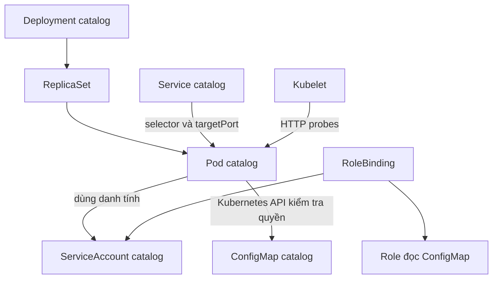

# Deployment tối thiểu cho ứng dụng Spring Cloud Kubernetes

Một manifest Deployment cần mô tả được ứng dụng chạy bằng image nào, Kubernetes nhận diện các Pod bằng nhãn nào và điều kiện nào cho biết ứng dụng đã sẵn sàng. Với Spring Cloud Kubernetes, còn phải xác định ứng dụng có gọi Kubernetes API hay không, dùng danh tính nào và cần đọc tài nguyên gì.

Bài này thuộc chương **Manifest triển khai** của module **SPRING_CLOUD_KUBERNETES**. Ta xây dựng một ví dụ nhỏ có thể kiểm chứng: ứng dụng `catalog` đọc thông điệp từ ConfigMap bằng Spring Cloud Kubernetes, trả thông điệp qua HTTP và công bố health probes cho Kubernetes.

Sau bài học, bạn có thể:

- Đọc quan hệ giữa Deployment, ReplicaSet, Pod và Service.
- Viết Deployment có selector, image, environment, resources và probes nhất quán.
- Gắn ServiceAccount và quyền đọc cấu hình vào đúng namespace.
- Phân biệt việc chạy được container với việc tích hợp Spring Cloud Kubernetes hoạt động.
- Triển khai, quan sát, cập nhật và tìm lỗi theo từng tầng.

## 1. Xác định nghĩa của “tối thiểu”

“Tối thiểu” trong bài là một cấu hình nhỏ đủ để chứng minh một nhu cầu tích hợp cụ thể. Đây không phải tập hợp ít trường YAML nhất được API chấp nhận, cũng chưa phải toàn bộ cấu hình vận hành production.

Nhu cầu của ví dụ:

| Thành phần | Quyết định |
| --- | --- |
| Workload | Ứng dụng HTTP stateless, một replica để thực hành |
| Tích hợp Spring Cloud Kubernetes | Đọc ConfigMap bằng Fabric8 client khi khởi động |
| Cấu hình nghiệp vụ | `catalog.message` |
| Phạm vi API | ConfigMap trong namespace `spring-cloud-lab` |
| Truy cập ứng dụng | ClusterIP Service và port-forward để kiểm tra từ máy học |
| Theo dõi sức khỏe | Startup, liveness và readiness probes của Spring Boot Actuator |
| Cập nhật cấu hình | Tạo Pod mới bằng rollout có kiểm soát |

DiscoveryClient, Secret, Spring Cloud LoadBalancer và Configuration Watcher là các khả năng khác của module. Chúng được đưa vào kiến trúc khi có nhu cầu tương ứng. Ví dụ ban đầu chỉ đọc ConfigMap, vì vậy không cấp thêm quyền đọc Secret hoặc khám phá toàn bộ service catalog.

Nếu ứng dụng chỉ dùng DNS của Kubernetes Service và cấu hình được kubelet đưa vào qua environment hoặc volume, ứng dụng có thể không cần trực tiếp gọi Kubernetes API. Khi đó phải đánh giá lại dependency, ServiceAccount và việc mount API token.

## 2. Chuẩn bị hợp đồng của image ứng dụng

Trước khi viết manifest, cần có một image đáp ứng các điều kiện sau:

1. Ứng dụng có web server và endpoint `GET /message`.
2. Đã thêm `spring-cloud-starter-kubernetes-fabric8-config` với phiên bản do bộ BOM tương thích của dự án quản lý.
3. Có Spring Boot Actuator, cung cấp được các health group liveness/readiness.
4. Dùng cơ chế Config Data với `spring.config.import=kubernetes:`; không đồng thời bật cơ chế legacy bootstrap.
5. Image khởi chạy ứng dụng ở foreground và nhận được environment do Kubernetes truyền vào.
6. Web server lắng nghe trên interface mà Pod khác có thể truy cập, không bị cấu hình chỉ bind `127.0.0.1`.
7. Các endpoint probe được phép truy cập theo security của ứng dụng.

Không trộn hai họ starter Fabric8 và Kubernetes Java Client trong ví dụ này. Việc chọn starter phải nhất quán với cách client được cấu hình.

Một controller minh họa cho hợp đồng `/message`:

```java
package com.example.catalog;

import java.util.Map;

import org.springframework.core.env.Environment;
import org.springframework.web.bind.annotation.GetMapping;
import org.springframework.web.bind.annotation.RestController;

@RestController
public class CatalogController {

    private final String message;

    public CatalogController(Environment environment) {
        this.message = environment.getRequiredProperty("catalog.message");
    }

    @GetMapping("/message")
    public Map<String, String> message() {
        return Map.of("message", message);
    }
}
```

Controller cần nằm trong vùng component scan của ứng dụng Spring Boot. `getRequiredProperty` làm quá trình tạo bean thất bại nếu thuộc tính không tồn tại, giúp phát hiện trường hợp chưa nạp cấu hình. Để kiểm chứng nguồn cấu hình, không cung cấp giá trị dự phòng cho `catalog.message` trong image hoặc environment.

Ví dụ này đọc giá trị một lần trong constructor. Sửa ConfigMap không tự làm trường `message` thay đổi.

Cơ chế import được mô tả trong [Spring Cloud Kubernetes — Kubernetes PropertySource implementations](https://docs.spring.io/spring-cloud-kubernetes/reference/property-source-config.html).

## 3. Các tài nguyên phối hợp như thế nào?



Hai luồng cần phân biệt:

- **Luồng khởi động:** JVM khởi động → Spring đọc các thiết lập import → client xác thực bằng ServiceAccount → đọc ConfigMap → tạo bean ứng dụng → chuyển sang trạng thái sẵn sàng.
- **Luồng request:** client gọi Service → hệ thống mạng chuyển kết nối tới Pod phù hợp → ứng dụng xử lý `/message`.

Service không cấp quyền Kubernetes API. RoleBinding không tạo route HTTP. Readiness không thay thế kiểm chứng giá trị cấu hình nghiệp vụ.

Trong các phần tiếp theo, mỗi khối YAML có tên tệp để người học lưu khi thực hành. Tất cả tài nguyên có namespace trong ví dụ đều dùng `spring-cloud-lab`.

## 4. Namespace, ServiceAccount và quyền đọc ConfigMap

### 4.1. Namespace

Tệp `00-namespace.yaml`:

```yaml
apiVersion: v1
kind: Namespace
metadata:
  name: spring-cloud-lab
```

Namespace tạo phạm vi tên cho Deployment, ServiceAccount, Role, RoleBinding, ConfigMap và Service. Bản thân Namespace là tài nguyên cấp cluster nên không có `metadata.namespace`.

### 4.2. Danh tính và cấu hình

Tệp `10-config-access.yaml`:

```yaml
apiVersion: v1
kind: ServiceAccount
metadata:
  name: catalog
  namespace: spring-cloud-lab
---
apiVersion: rbac.authorization.k8s.io/v1
kind: Role
metadata:
  name: catalog-config-reader
  namespace: spring-cloud-lab
rules:
  - apiGroups: [""]
    resources: ["configmaps"]
    verbs: ["get", "list"]
---
apiVersion: rbac.authorization.k8s.io/v1
kind: RoleBinding
metadata:
  name: catalog-config-reader
  namespace: spring-cloud-lab
subjects:
  - kind: ServiceAccount
    name: catalog
    namespace: spring-cloud-lab
roleRef:
  apiGroup: rbac.authorization.k8s.io
  kind: Role
  name: catalog-config-reader
---
apiVersion: v1
kind: ConfigMap
metadata:
  name: catalog
  namespace: spring-cloud-lab
data:
  catalog.message: "Xin chào từ ConfigMap của catalog"
```

Đọc các mối liên hệ:

- Deployment sẽ chọn ServiceAccount `catalog`.
- Role định nghĩa thao tác đọc ConfigMap trong namespace.
- RoleBinding gắn Role đó với đúng ServiceAccount.
- ConfigMap `catalog` chứa một thuộc tính có giá trị kiểu chuỗi.

`apiGroups: [""]` biểu diễn core API group, nơi ConfigMap được định nghĩa. Trong `roleRef`, API group là `rbac.authorization.k8s.io` vì đối tượng được tham chiếu là Role.

Quyền `list` cho phép đọc danh sách và nội dung ConfigMap trong namespace; nó không chỉ giới hạn vào đối tượng tên `catalog`. Ví dụ dùng `get/list` để phù hợp cơ chế đọc cấu hình theo namespace, không bật watch hoặc thao tác ghi. Nếu phiên bản đang dùng có chế độ đọc từng tài nguyên theo tên, có thể thiết kế quyền hẹp hơn sau khi đối chiếu cơ chế truy xuất của client. Không thêm `resourceNames` vào một quyền list rồi mặc định client hiện tại vẫn hoạt động.

Cách đọc tài nguyên và khả năng thu hẹp quyền phụ thuộc phiên bản Spring Cloud Kubernetes; xem [Using a ConfigMap PropertySource](https://docs.spring.io/spring-cloud-kubernetes/reference/property-source-config/configmap-propertysource.html).

Ứng dụng không được cấp quyền đọc Secret, sửa ConfigMap hay quản lý Deployment bởi Role này. Quyền thực tế vẫn có thể rộng hơn nếu cùng ServiceAccount được gắn các binding khác. ServiceAccount và việc cấp quyền là hai bước riêng, như mô tả trong [Kubernetes — Service Accounts](https://kubernetes.io/docs/concepts/security/service-accounts/).

## 5. Deployment mẫu

Tệp `20-deployment.yaml`:

```yaml
apiVersion: apps/v1
kind: Deployment
metadata:
  name: catalog
  namespace: spring-cloud-lab
  labels:
    app.kubernetes.io/name: catalog
spec:
  replicas: 1
  selector:
    matchLabels:
      app.kubernetes.io/name: catalog
  template:
    metadata:
      labels:
        app.kubernetes.io/name: catalog
    spec:
      serviceAccountName: catalog
      automountServiceAccountToken: true
      containers:
        - name: app
          image: registry.example.com/training/catalog:1.0.0
          imagePullPolicy: IfNotPresent
          ports:
            - name: http
              containerPort: 8080
          env:
            - name: SPRING_APPLICATION_NAME
              value: catalog
            - name: SPRING_CONFIG_IMPORT
              value: "kubernetes:"
            - name: SPRING_CLOUD_KUBERNETES_CLIENT_NAMESPACE
              valueFrom:
                fieldRef:
                  fieldPath: metadata.namespace
            - name: SPRING_CLOUD_KUBERNETES_CONFIG_NAME
              value: catalog
            - name: SPRING_CLOUD_KUBERNETES_CONFIG_FAIL_FAST
              value: "true"
            - name: SPRING_CLOUD_KUBERNETES_SECRETS_ENABLED
              value: "false"
            - name: SPRING_CLOUD_KUBERNETES_DISCOVERY_ENABLED
              value: "false"
            - name: SERVER_PORT
              value: "8080"
            - name: MANAGEMENT_ENDPOINT_HEALTH_PROBES_ENABLED
              value: "true"
            - name: MANAGEMENT_ENDPOINTS_WEB_EXPOSURE_INCLUDE
              value: health
            - name: MANAGEMENT_HEALTH_KUBERNETES_ENABLED
              value: "false"
          resources:
            requests:
              cpu: "250m"
              memory: "512Mi"
            limits:
              cpu: "1000m"
              memory: "1Gi"
          startupProbe:
            httpGet:
              path: /actuator/health/liveness
              port: http
            periodSeconds: 5
            timeoutSeconds: 2
            failureThreshold: 36
          livenessProbe:
            httpGet:
              path: /actuator/health/liveness
              port: http
            periodSeconds: 10
            timeoutSeconds: 2
            failureThreshold: 3
          readinessProbe:
            httpGet:
              path: /actuator/health/readiness
              port: http
            periodSeconds: 5
            timeoutSeconds: 2
            failureThreshold: 3
```

`registry.example.com/training/catalog:1.0.0` là địa chỉ minh họa. Phải thay bằng image thật đã build, có đúng dependency và endpoint nêu ở phần 2. Chỉ sửa YAML không thể bổ sung thư viện còn thiếu trong image.

Các giả định của manifest:

- Management endpoint dùng cùng cổng `8080` và base path mặc định `/actuator`.
- Image đã có cấu hình JVM phù hợp giới hạn container `1Gi`.
- Cluster cho phép các tài nguyên, resources và kết nối tới Kubernetes API theo chính sách của môi trường.
- Không có cấu hình bổ sung trong image làm thay đổi các hành vi đang minh họa.

### 5.1. Selector và Pod template phải khớp

Ba chỗ có thể chứa label nhưng có vai trò khác nhau:

| Vị trí | Vai trò trong ví dụ |
| --- | --- |
| `metadata.labels` của Deployment | Nhãn cho chính đối tượng Deployment |
| `spec.selector.matchLabels` | Xác định tập Pod do Deployment quản lý |
| `spec.template.metadata.labels` | Nhãn được gắn lên các Pod mới |

Nhãn trên Deployment không tự thay thế nhãn trên Pod template. Selector phải khớp label của template. Với `apps/v1`, selector của Deployment không thể thay đổi sau khi tạo; chọn label ổn định và tránh để hai controller quản lý các tập Pod chồng lấn. Xem [Kubernetes — Deployments](https://kubernetes.io/docs/concepts/workloads/controllers/deployment/).

Không dùng image version làm selector nếu version đó phải đổi ở mỗi lần phát hành. Có thể đặt version ở một label bổ sung ngoài selector.

### 5.2. ServiceAccount phải nằm trong Pod spec

Đường dẫn đúng là:

```text
Deployment
└── spec
    └── template
        └── spec
            ├── serviceAccountName
            └── containers
```

`serviceAccountName` không phải trường của từng container. Tất cả container trong một Pod cùng sử dụng danh tính ServiceAccount của Pod.

Bài này giữ `automountServiceAccountToken: true` vì client cần xác thực với Kubernetes API. Không cần tạo thủ công một Secret chứa token dài hạn. Nếu workload không dùng Kubernetes API, có thể bỏ nhu cầu này và cân nhắc tắt automount sau khi xác định các thành phần còn dùng token.

### 5.3. Các thiết lập import cần có trước khi đọc ConfigMap

`SPRING_APPLICATION_NAME`, `SPRING_CONFIG_IMPORT`, namespace và tên ConfigMap được đưa vào environment. Chúng xác định cách tìm nguồn cấu hình ngay trong quá trình khởi động.

Nếu chỉ đặt thông tin cần để tìm ConfigMap bên trong chính ConfigMap đó, ứng dụng chưa chắc có đủ thông tin để bắt đầu nạp nó. Trong ví dụ, các giá trị giúp tìm nguồn được tách rõ khỏi thuộc tính nghiệp vụ `catalog.message`.

Namespace lấy từ `metadata.namespace` của Pod qua Downward API, thay vì hard-code thêm một bản sao trong environment. Cơ chế này không yêu cầu ứng dụng gọi API để hỏi namespace. Thứ tự xác định namespace của thư viện được mô tả trong [Spring Cloud Kubernetes — Namespace resolution](https://docs.spring.io/spring-cloud-kubernetes/reference/property-source-config/namespace-resolution.html).

`fail-fast=true` làm lỗi nạp ConfigMap phù hợp phạm vi xử lý của thư viện khiến startup thất bại. Nó không thay thế việc kiểm tra thuộc tính bắt buộc. Trong ví dụ, controller còn yêu cầu `catalog.message` tồn tại và kết quả HTTP phải đúng giá trị mong đợi.

### 5.4. Quyền và tính năng được chọn cùng nhau

`SPRING_CLOUD_KUBERNETES_SECRETS_ENABLED=false` và `SPRING_CLOUD_KUBERNETES_DISCOVERY_ENABLED=false` làm rõ phạm vi ví dụ. Không cấp quyền khám phá service hoặc đọc Secret chỉ vì tên ứng dụng có “Kubernetes”.

`MANAGEMENT_HEALTH_KUBERNETES_ENABLED=false` tắt Kubernetes Pod Health Contributor. Các probe trong bài sử dụng health group liveness/readiness của Spring Boot. Hai cơ chế này có mục đích khác nhau; khi cần thông tin sức khỏe/metadata Pod từ contributor, hãy đánh giá lại cấu hình và quyền tương ứng. Xem [Spring Cloud Kubernetes — Pod Health Indicator](https://docs.spring.io/spring-cloud-kubernetes/reference/pod-health-indicator.html).

## 6. Resources và probes làm cho trạng thái triển khai có ý nghĩa

### 6.1. Resources là điểm bắt đầu để đo

Trong ví dụ:

- CPU request là `250m`, CPU limit là `1000m`.
- Memory request là `512Mi`, memory limit là `1Gi`.
- Những giá trị này cần được kiểm chứng với startup và workload thực tế.

Memory limit không phải kích thước heap. Heap, metaspace, stack, native buffers và agent đều cần nằm trong ngân sách phù hợp. Nếu image dùng buildpack có bộ tính bộ nhớ, cần giữ cấu hình của bộ tính đó nhất quán với limit.

Request ảnh hưởng lập lịch; limit ảnh hưởng cách runtime thực thi giới hạn. Các chính sách ResourceQuota hoặc LimitRange trong namespace cũng có thể làm yêu cầu triển khai bị từ chối. Xem [Resource Management for Pods and Containers](https://kubernetes.io/docs/concepts/configuration/manage-resources-containers/).

### 6.2. Mỗi probe trả lời một câu hỏi

| Probe | Câu hỏi | Hành vi khi thất bại tới ngưỡng |
| --- | --- | --- |
| Startup | Ứng dụng đã hoàn thành giai đoạn khởi động được theo dõi chưa? | Container có thể bị khởi động lại |
| Liveness | Tiến trình ứng dụng có còn ở trạng thái có thể tiếp tục hoạt động không? | Container có thể bị khởi động lại |
| Readiness | Pod có sẵn sàng nhận request lúc này không? | Pod bị đánh dấu không sẵn sàng; readiness tự nó không restart container |

Khi startup probe được cấu hình, liveness và readiness chưa bắt đầu kiểm tra cho tới khi startup probe thành công. Với thông số minh họa, ngân sách startup xấp xỉ `36 × 5 = 180` giây; cần hiệu chỉnh theo thời gian đo được.

HTTP probe đi tới Pod, không cần đi vòng qua Service. Đặt sai path, port hoặc security có thể làm Pod không Ready dù JVM vẫn chạy. Xem [Configure Liveness, Readiness and Startup Probes](https://kubernetes.io/docs/tasks/configure-pod-container/configure-liveness-readiness-startup-probes/).

Các path trong manifest dựa vào health group của Actuator. Không dùng lỗi tạm thời của API server hoặc hệ thống bên ngoài làm lý do restart tất cả instance qua liveness. Một khi cấu hình đã được nạp, việc API server gián đoạn không tự chứng minh JVM của ứng dụng hỏng. Xem [Spring Boot — Kubernetes Probes](https://docs.spring.io/spring-boot/reference/actuator/endpoints.html).

## 7. Service để gọi ứng dụng bằng địa chỉ ổn định

Tệp `30-service.yaml`:

```yaml
apiVersion: v1
kind: Service
metadata:
  name: catalog
  namespace: spring-cloud-lab
spec:
  type: ClusterIP
  selector:
    app.kubernetes.io/name: catalog
  ports:
    - name: http
      port: 80
      targetPort: http
```

Luồng cổng của ví dụ:

```text
Client trong namespace
    -> http://catalog:80/message
    -> Service catalog, port 80
    -> Pod được chọn, named port http
    -> ứng dụng lắng nghe TCP 8080
```

`containerPort: 8080` mô tả cổng của container; nó không buộc Spring Boot phải lắng nghe ở cổng đó. `SERVER_PORT=8080` cấu hình cổng ứng dụng. `targetPort: http` tham chiếu tên port `http` trong Pod.

Service selector chọn **Pod labels**, không chọn tên Deployment. Các EndpointSlice do Kubernetes quản lý thể hiện những endpoint liên quan tới Service; quan sát cả địa chỉ, cổng và điều kiện readiness khi tìm lỗi. Xem [Kubernetes — Service](https://kubernetes.io/docs/concepts/services-networking/service/).

`type: ClusterIP` không mở ứng dụng trực tiếp ra Internet. Kiểu Service này cũng không phải Spring Cloud LoadBalancer. Spring Cloud LoadBalancer là cơ chế ở phía client trong ứng dụng; nó chỉ cần thiết khi cách gọi dịch vụ của ứng dụng yêu cầu chức năng đó.

## 8. Triển khai theo thứ tự và kiểm tra trạng thái

Các lệnh dưới đây dùng PowerShell tại thư mục người học lưu bốn tệp manifest. Đây là quy trình thực hành trên cluster thử nghiệm đã được cấp quyền phù hợp.

### 8.1. Kiểm tra context và tạo namespace

```powershell
kubectl config current-context
kubectl apply -f .\00-namespace.yaml
```

Người chạy `kubectl` cần quyền tạo tài nguyên tương ứng. Quyền của người triển khai khác quyền ServiceAccount của Pod.

### 8.2. Áp dụng cấu hình và RBAC trước workload

```powershell
kubectl apply --dry-run=server -f .\10-config-access.yaml
kubectl apply -f .\10-config-access.yaml
```

Namespace phải tồn tại trước khi server dry-run tài nguyên namespaced. Dry-run không tạo namespace thật cho các bước sau.

Nếu được phép impersonate ServiceAccount, kiểm tra:

```powershell
kubectl auth can-i get configmaps/catalog -n spring-cloud-lab --as=system:serviceaccount:spring-cloud-lab:catalog
kubectl auth can-i list configmaps -n spring-cloud-lab --as=system:serviceaccount:spring-cloud-lab:catalog
kubectl auth can-i list secrets -n spring-cloud-lab --as=system:serviceaccount:spring-cloud-lab:catalog
kubectl auth can-i update configmaps -n spring-cloud-lab --as=system:serviceaccount:spring-cloud-lab:catalog
```

Với đúng các binding của ví dụ, kết quả kỳ vọng là `yes`, `yes`, `no`, `no`. Nếu kết quả rộng hơn, xem thêm các binding đang cấp quyền cho cùng danh tính.

`--as` không tự cấp quyền impersonation cho người đang chạy lệnh. Lỗi không được impersonate là lỗi quyền kiểm tra của người vận hành, chưa kết luận được quyền của ứng dụng. Tham khảo [kubectl auth can-i](https://kubernetes.io/docs/reference/kubectl/generated/kubectl_auth/kubectl_auth_can-i/).

### 8.3. Kiểm tra và áp dụng Deployment, Service

```powershell
kubectl apply --dry-run=server -f .\20-deployment.yaml -f .\30-service.yaml
kubectl diff -f .\20-deployment.yaml -f .\30-service.yaml
kubectl apply -f .\20-deployment.yaml -f .\30-service.yaml
kubectl rollout status deployment/catalog -n spring-cloud-lab --timeout=300s
```

`kubectl diff` có thể trả exit code `1` khi có khác biệt, không nhất thiết là lỗi. Server dry-run giúp phát hiện schema hoặc admission không chấp nhận manifest; nó không chứng minh image kéo được, ứng dụng có endpoint đúng hay client đọc ConfigMap thành công.

Giới hạn `300s` ở đây là thời gian lệnh rollout status chờ kết quả. Nó không sửa startup probe, không tăng CPU và không đảm bảo Deployment sẽ Ready.

### 8.4. Quan sát các đối tượng đã tạo

```powershell
kubectl get deployment,replicaset,pods,service -n spring-cloud-lab
kubectl get pods -n spring-cloud-lab -l app.kubernetes.io/name=catalog --show-labels
kubectl describe deployment catalog -n spring-cloud-lab
kubectl get endpointslices -n spring-cloud-lab -l kubernetes.io/service-name=catalog
```

`Running` chỉ là trạng thái phase của Pod; xem thêm cột Ready, restart count và rollout status. Trong bài một container, mục tiêu ban đầu là Pod `1/1` Ready và Deployment có replica khả dụng.

Nếu đang có nhiều Pod trong rollout, chọn Pod đúng revision trước khi đọc log. Đừng mặc định Pod đầu tiên trong một danh sách là Pod mới nhất.

## 9. Kiểm chứng HTTP và nguồn ConfigMap

### 9.1. Gọi qua port-forward

```powershell
kubectl port-forward service/catalog -n spring-cloud-lab 18080:80
```

Giữ lệnh này chạy và mở cửa sổ PowerShell khác:

```powershell
curl.exe -fsS http://localhost:18080/message
curl.exe -fsS http://localhost:18080/actuator/health/liveness
curl.exe -fsS http://localhost:18080/actuator/health/readiness
```

Kết quả endpoint nghiệp vụ phải chứa:

```json
{
  "message": "Xin chào từ ConfigMap của catalog"
}
```

Các endpoint probe trả trạng thái `UP` khi instance đạt trạng thái tương ứng. Giá trị thông điệp đúng mới là bằng chứng trực tiếp cho mục tiêu nghiệp vụ của bài, với điều kiện không có nguồn cấu hình khác ghi đè cùng key.

Port-forward tới Service chọn một Pod và tạo tunnel; nó không phải phép thử đầy đủ cho DNS, ClusterIP hoặc đường đi thực tế qua hệ thống mạng của Service. Xem [kubectl port-forward](https://kubernetes.io/docs/reference/kubectl/generated/kubectl_port-forward/).

Nếu đã có Pod chẩn đoán tên `diag` chứa `curl` trong namespace, có thể kiểm tra thêm từ bên trong cluster:

```powershell
kubectl exec diag -n spring-cloud-lab -- curl -fsS http://catalog/message
```

Lệnh này chỉ dùng khi Pod chẩn đoán đã được chuẩn bị. NetworkPolicy hoặc chính sách mạng vẫn có thể giới hạn đường gọi.

### 9.2. Kiểm chứng rằng thay đổi cấu hình cần Pod mới

Sửa `catalog.message` trong `10-config-access.yaml`, rồi áp dụng:

```powershell
kubectl apply -f .\10-config-access.yaml
```

Ở thiết kế hiện tại, Pod không tự rollout và controller không tự đọc lại trường đã gán trong constructor. Tạo tiến trình mới để kiểm tra cấu hình mới:

```powershell
kubectl rollout restart deployment/catalog -n spring-cloud-lab
kubectl rollout status deployment/catalog -n spring-cloud-lab --timeout=300s
```

Khởi động lại port-forward nếu tunnel cũ đã kết thúc hoặc vẫn trỏ tới Pod cũ, sau đó gọi `/message`. Giá trị mới phải xuất hiện.

Bài này không triển khai Configuration Watcher và không thiết kế bean refresh. Watcher là lựa chọn cho nhu cầu cập nhật động; không nên kỳ vọng chỉ tạo một ConfigMap là đủ để mọi bean tự thay đổi.

## 10. Tìm lỗi theo từng tầng

| Hiện tượng | Tầng cần kiểm tra | Bằng chứng nên đọc |
| --- | --- | --- |
| API từ chối manifest | Schema, namespace, admission hoặc quyền người triển khai | Output của apply/dry-run và message cụ thể |
| Pod `Pending` | Scheduling, resources hoặc điều kiện node | Pod events, requests, quota và điều kiện node |
| `ImagePullBackOff` | Image, registry và quyền kéo image | Events, tên image/tag, imagePullSecrets |
| `CrashLoopBackOff` | Ứng dụng hoặc cấu hình startup | Log lần chạy hiện tại và `--previous` |
| Lỗi `401` khi gọi Kubernetes API | Xác thực client | ServiceAccount, token mount, endpoint và credential client |
| Lỗi `403 Forbidden` | Quyền hoặc namespace truy cập | Danh tính trong message, resource/verb, RoleBinding |
| Timeout tới Kubernetes API | Đường mạng hoặc endpoint | NetworkPolicy, cấu hình kết nối và log client |
| Không có `catalog.message` | Nạp Config Data hoặc nội dung ConfigMap | Starter trong image, import, namespace, tên ConfigMap và key |
| Probe trả `404` | Endpoint hoặc base path | Actuator, path, management port và image thực tế |
| Probe trả `401/403` | Security HTTP của ứng dụng | Quy tắc bảo vệ endpoint probe |
| Pod Running nhưng chưa Ready | Startup/readiness hoặc ứng dụng chưa sẵn sàng | Probe events và log startup |
| Service không gọi được | Selector, endpoint, port hoặc mạng | Pod labels, EndpointSlice, targetPort và kết nối nội bộ |

Các lệnh thường dùng sau khi đã xác định Pod cần điều tra:

```powershell
$podName = "catalog-thay-bang-ten-pod-thuc-te"

kubectl describe pod $podName -n spring-cloud-lab
kubectl logs $podName -n spring-cloud-lab -c app
kubectl logs $podName -n spring-cloud-lab -c app --previous
kubectl get pod $podName -n spring-cloud-lab -o yaml
kubectl get events -n spring-cloud-lab --sort-by=.metadata.creationTimestamp
```

`$podName` là chỗ người học phải điền tên Pod thật, không phải tên Deployment. `--previous` chỉ có ích nếu container đó đã có lần chạy trước còn được lưu log.

Ba lỗi dễ bị nhầm:

- Quyền người dùng `kubectl` đọc ConfigMap không chứng minh Pod đọc được ConfigMap bằng ServiceAccount của nó.
- Tạo ClusterIP Service không yêu cầu ứng dụng sử dụng DiscoveryClient để tự đăng ký như một registry ngoài Kubernetes.
- `imagePullSecrets` phục vụ việc kéo image từ registry; nó không đồng nghĩa ứng dụng được quyền list Secret qua Kubernetes API.

## 11. Thay đổi và rollback có giới hạn rõ ràng

Khi cập nhật image, sửa trường `image` trong manifest và áp dụng lại Deployment. Dùng tag bất biến hoặc digest để nhận diện đúng nội dung. Ghi đè một tag cũ trong registry không tự tạo thay đổi Pod template; với `IfNotPresent`, node còn có thể dùng image đã cache.

Các thao tác quan sát revision:

```powershell
kubectl rollout history deployment/catalog -n spring-cloud-lab
kubectl rollout status deployment/catalog -n spring-cloud-lab --timeout=300s
```

Trong tình huống cần quay lại Pod template trước đó và revision còn tồn tại:

```powershell
kubectl rollout undo deployment/catalog -n spring-cloud-lab
kubectl rollout status deployment/catalog -n spring-cloud-lab --timeout=300s
```

Rollback Deployment không khôi phục nội dung ConfigMap hay các tài nguyên RBAC đã sửa độc lập. Với ConfigMap cùng tên, Pod của phiên bản cũ vẫn có thể đọc cấu hình mới khi khởi động. Vì thế, việc quản lý phiên bản cấu hình phải đi cùng kế hoạch phát hành khi tiến tới production.

Một replica giúp quan sát ví dụ đơn giản, nhưng không cung cấp độ sẵn sàng cao. Rolling update có thể tạo thêm Pod tạm thời; cần đủ tài nguyên và không được suy ra rằng mọi tình huống đều không gián đoạn.

## 12. Chỉ mở rộng manifest khi chức năng cần đến

| Nhu cầu bổ sung | Điều cần thiết kế thêm |
| --- | --- |
| DiscoveryClient | Starter/client phù hợp, phạm vi namespace, tài nguyên discovery và quyền đọc tương ứng |
| Đọc Secret qua API | Cách nạp, phạm vi quyền, bảo vệ dữ liệu và tránh ghi giá trị ra log |
| Spring Cloud LoadBalancer | Cách client chọn instance, cache, timeout và mối quan hệ với Kubernetes Service |
| Configuration Watcher | Controller hoặc thành phần triển khai tương ứng, RBAC, đường gọi refresh/bus và thiết kế bean cập nhật |
| Thông tin sức khỏe Pod | Pod Health Contributor và dữ liệu/quyền cần cho cách client đang dùng |
| Nhiều replica | Tài nguyên cho rollout, readiness đáng tin cậy và trạng thái nghiệp vụ không phụ thuộc một Pod |
| Truy cập từ ngoài cluster | Ingress/Gateway hoặc phương án công bố dịch vụ phù hợp |

Ví dụ, khi bật discovery theo EndpointSlice, cần xét tài nguyên `endpointslices` thuộc API group `discovery.k8s.io`. Không chỉ bật một biến môi trường mà giữ nguyên Role chỉ đọc ConfigMap rồi kỳ vọng discovery hoạt động. Yêu cầu cụ thể được mô tả trong [Spring Cloud Kubernetes — DiscoveryClient for Kubernetes](https://docs.spring.io/spring-cloud-kubernetes/reference/discovery-client.html).

Có thể tự đánh giá bài thực hành bằng các câu hỏi:

- Deployment selector có khớp Pod template và Service selector không?
- Image thật có đúng dependency, cổng HTTP và endpoint đã cam kết không?
- Pod dùng ServiceAccount nào, đọc ConfigMap ở namespace nào?
- Quyền đọc hiện tại có bao gồm tài nguyên hoặc thao tác không cần thiết không?
- `/message` có trả đúng giá trị từ ConfigMap mà không dựa vào một giá trị dự phòng không?
- Probes có biểu diễn startup, liveness và readiness theo đúng mục đích không?
- Khi ConfigMap đổi, có xác định được lúc nào tiến trình mới bắt đầu dùng cấu hình mới không?
- Có phân biệt được kết quả port-forward với kết quả gọi qua mạng nội bộ Service không?

Một Deployment rõ ràng phải cho phép lần theo được từ yêu cầu ứng dụng tới từng trường cấu hình, từ danh tính của Pod tới quyền API và từ trạng thái Ready tới request nghiệp vụ thực sự.
