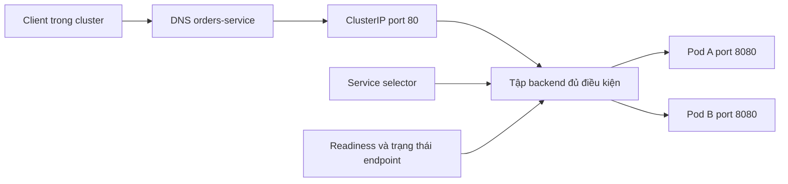

# Service và selector khớp đúng Pod

Trong chương **Manifest triển khai** của module **SPRING_CLOUD_KUBERNETES**, bài học này giải quyết một lỗi thường gặp: ứng dụng Spring đã chạy trong Pod, Service đã có tên DNS, nhưng request vẫn không tới đúng instance. Nguyên nhân có thể nằm ở selector chọn sai tập Pod, cổng đích không phù hợp hoặc backend chưa sẵn sàng.

Một Service hoạt động đúng là nền tảng cho cả truy cập bằng DNS lẫn các tính năng như DiscoveryClient và Spring Cloud LoadBalancer. ConfigMap, Secret hoặc Configuration Watcher không thể tự sửa một Service đang trỏ nhầm Pod. Vì vậy, cần hiểu quan hệ giữa nhãn, selector, EndpointSlice và listener trước khi thêm các lớp tích hợp Spring Cloud Kubernetes.

## 1. Mục tiêu và phạm vi

Sau bài học, bạn có thể:

- Đối chiếu selector của Service với nhãn thực tế trên Pod.
- Phân biệt selector của Deployment với selector của Service.
- Tạo Deployment và Service có danh tính ổn định qua các lần rollout.
- Kiểm tra namespace, EndpointSlice, readiness và ánh xạ cổng theo một trình tự rõ ràng.
- Phân biệt bộ lọc Service của DiscoveryClient với cơ chế Kubernetes chọn Pod.

Ví dụ dùng một ứng dụng Spring Boot có web starter và Actuator, phục vụ HTTP ở `8080`. Các thuộc tính probe minh họa phù hợp với Spring Boot dòng `3.5.x`; dự án cần quản lý các phiên bản Spring Cloud tương thích riêng.

Bài tập trung vào **Service ClusterIP có selector**, với backend là Pod thông thường. Service không có selector, ExternalName và headless Service có cách sử dụng riêng; không suy toàn bộ kết luận về DNS hoặc định tuyến của ví dụ sang các mô hình đó.

Các tên file, manifest, lệnh và kết quả dưới đây là ví dụ dành cho môi trường thực hành. Chúng không biểu thị rằng tài nguyên đã được tạo hoặc lệnh đã được chạy trong module.

## 2. Service chọn một tập Pod như thế nào?

### 2.1. So khớp nhãn, không so khớp tên Deployment

Với một Service có selector:

```yaml
spec:
  selector:
    app.kubernetes.io/name: orders
    app.kubernetes.io/instance: orders-main
    app.kubernetes.io/component: api
```

Một Pod được chọn khi:

1. Pod nằm trong cùng namespace với Service.
2. Pod có đủ ba nhãn trên.
3. Giá trị của từng nhãn khớp chính xác.

Có thể diễn đạt bằng điều kiện:

```text
Pod.namespace = Service.namespace
AND Pod.labels["app.kubernetes.io/name"] = "orders"
AND Pod.labels["app.kubernetes.io/instance"] = "orders-main"
AND Pod.labels["app.kubernetes.io/component"] = "api"
```

Pod có thể mang thêm nhãn như phiên bản hoặc nhóm triển khai; các nhãn bổ sung không làm mất kết quả khớp nếu selector không yêu cầu chúng.

Service không tìm Pod bằng tên Deployment, tên container, image repository hoặc tên ứng dụng Spring. Việc dùng cùng một tên cho nhiều tài nguyên là quy ước giúp đọc dễ hơn, không phải liên kết ngầm mà Kubernetes tự suy ra.

### 2.2. Các điều kiện trong Service selector là AND

Ba dòng selector không có nghĩa là khớp bất kỳ một nhãn nào. Chúng phải đồng thời đúng.

`Service.spec.selector` là map nhãn bằng nhau. Không đặt `matchLabels`, `matchExpressions` hoặc biểu thức kiểu `version in (v1,v2)` vào vị trí này như cách dùng với một số loại selector khác.

Lệnh `kubectl get pods -l 'version in (v1,v2)'` có thể là một truy vấn hợp lệ, nhưng điều đó không làm `Service.spec.selector` hỗ trợ cùng cấu trúc biểu thức. Xem [Kubernetes: Labels and Selectors](https://kubernetes.io/docs/concepts/overview/working-with-objects/labels/).

### 2.3. Một bảng đối chiếu nhỏ

Giả sử Service ở namespace `training`, dùng selector ba nhãn ở trên:

| Pod giả định | Namespace | name | instance | component | Khớp selector? |
| --- | --- | --- | --- | --- | --- |
| orders-a | training | orders | orders-main | api | Có |
| orders-b | training | orders | orders-main | api | Có, dù có thêm nhãn version mới |
| orders-worker | training | orders | orders-main | worker | Không: sai component |
| orders-test | training | orders | orders-test | api | Không: sai instance |
| orders-prod | production | orders | orders-main | api | Không: khác namespace |
| orders-not-ready | training | orders | orders-main | api | Có; readiness là bước đánh giá khác |

Trong bảng, `name`, `instance` và `component` là cách viết ngắn cho ba key `app.kubernetes.io/...`. Chúng không phải trường `metadata.name` của Pod.

## 3. Đặt nhãn đúng vị trí trong Deployment và Service

Có ba nơi dễ bị nhầm:

| Vị trí | Nhãn mô tả đối tượng nào? | Có trực tiếp làm Service chọn Pod không? |
| --- | --- | --- |
| `Deployment.metadata.labels` | Đối tượng Deployment | Không |
| `Deployment.spec.template.metadata.labels` | Các Pod được tạo từ template | Có, khi Pod được tạo mang các nhãn đó |
| `Service.metadata.labels` | Đối tượng Service | Không; có thể được công cụ discovery hoặc giám sát dùng để lọc Service |

Khai báo nhãn ở `Deployment.metadata.labels` không tự sao chép nhãn đó vào Pod. Tương tự, thêm `app: orders` vào metadata của Service không tương đương với thêm điều kiện vào `Service.spec.selector`.

Ngoài ra, Deployment có selector riêng:

```text
Deployment.spec.selector
    -> xác định danh tính tập Pod mà controller quản lý

Service.spec.selector
    -> xác định tập Pod dùng làm backend của Service
```

Với Deployment `apps/v1`, selector phải phù hợp với nhãn trong Pod template và không thể đổi sau khi Deployment đã được tạo. Selector của Service có thể được cập nhật, nhưng việc đổi nó làm thay đổi tập backend phục vụ traffic. Đây là hai loại thay đổi có tác động khác nhau. Xem [Kubernetes: Deployments](https://kubernetes.io/docs/concepts/workloads/controllers/deployment/).

Một Service có thể phục vụ Pod từ nhiều workload nếu nhãn phù hợp. Nó không cần owner reference tới một Deployment cụ thể. Ngược lại, không nên thiết kế các controller độc lập có selector quản lý chồng lấn; việc một Service chủ động chọn nhiều nhóm Pod không đồng nghĩa controller của những nhóm đó cũng nên có selector giống nhau.

## 4. Ví dụ manifest xuyên suốt

### 4.1. Chuẩn bị ứng dụng

Ứng dụng ví dụ:

- Tên Spring: `orders-service`.
- Deployment: `orders-api`.
- Service: `orders-service`.
- Namespace: `training`.
- Cổng ứng dụng: `8080`.
- Cổng Service: `80`.
- Pod thuộc nhóm `orders-main` và component `api`.

Cấu hình tối thiểu cho ứng dụng thực hành:

```yaml
spring:
  application:
    name: orders-service

server:
  port: 8080
  address: 0.0.0.0

management:
  endpoints:
    web:
      exposure:
        include: health
  endpoint:
    health:
      probes:
        enabled: true
```

Ứng dụng cần có Actuator và cho phép kubelet đọc đúng health paths. Nếu có Spring Security, phải tích hợp quy tắc probe phù hợp. Ở đây dùng chung cổng nghiệp vụ và Actuator để tập trung vào quan hệ Service–Pod.

### 4.2. Deployment

Thay `IMAGE_REF` bằng image thật đã được kiểm chứng. Namespace `training` và quyền pull image cần tồn tại trước khi triển khai.

```yaml
apiVersion: apps/v1
kind: Deployment
metadata:
  name: orders-api
  namespace: training
  labels:
    app.kubernetes.io/name: orders
    app.kubernetes.io/instance: orders-main
spec:
  replicas: 2
  selector:
    matchLabels:
      app.kubernetes.io/name: orders
      app.kubernetes.io/instance: orders-main
      app.kubernetes.io/component: api
  template:
    metadata:
      labels:
        app.kubernetes.io/name: orders
        app.kubernetes.io/instance: orders-main
        app.kubernetes.io/component: api
        app.kubernetes.io/version: "1.0.0"
        track: stable
    spec:
      containers:
        - name: orders
          image: IMAGE_REF
          ports:
            - name: http
              containerPort: 8080
          env:
            - name: POD_NAME
              valueFrom:
                fieldRef:
                  fieldPath: metadata.name
            - name: POD_NAMESPACE
              valueFrom:
                fieldRef:
                  fieldPath: metadata.namespace
            - name: APP_VERSION
              value: "1.0.0"
          startupProbe:
            httpGet:
              path: /actuator/health/liveness
              port: http
            periodSeconds: 5
            timeoutSeconds: 2
            failureThreshold: 36
          readinessProbe:
            httpGet:
              path: /actuator/health/readiness
              port: http
            periodSeconds: 5
            timeoutSeconds: 2
            failureThreshold: 3
          livenessProbe:
            httpGet:
              path: /actuator/health/liveness
              port: http
            periodSeconds: 10
            timeoutSeconds: 2
            failureThreshold: 3
          resources:
            requests:
              cpu: 250m
              memory: 512Mi
            limits:
              cpu: "1"
              memory: 1Gi
```

Các giá trị tài nguyên và probe là điểm bắt đầu thực hành, cần điều chỉnh bằng số đo. Cặp nhãn phiên bản và `APP_VERSION` chỉ giúp nhận diện bản triển khai; nguồn phát hành phải giữ chúng phù hợp với image thật.

Selector của Deployment không chứa `version` hoặc `pod-template-hash`. Điều này cho phép controller thay các Pod bằng phiên bản mới mà vẫn giữ danh tính ổn định.

### 4.3. Service

```yaml
apiVersion: v1
kind: Service
metadata:
  name: orders-service
  namespace: training
  labels:
    app.kubernetes.io/name: orders
    purpose: business
spec:
  type: ClusterIP
  selector:
    app.kubernetes.io/name: orders
    app.kubernetes.io/instance: orders-main
    app.kubernetes.io/component: api
  ports:
    - name: http
      protocol: TCP
      port: 80
      targetPort: http
```

Ba điều kiện trong Service selector đều xuất hiện ở Pod template. Tên Deployment là `orders-api` vẫn không gây vấn đề: selector không yêu cầu tên Deployment bằng tên Service.

Nhãn `purpose: business` nằm trên Service, phục vụ việc phân loại Service. Nó không phải điều kiện chọn Pod, vì không nằm trong `spec.selector`.

### 4.4. Một endpoint nhận diện instance cho bài thực hành

Để biết request đang đến Pod nào, có thể thêm controller sau vào package được ứng dụng quét:

```java
import java.util.Map;

import org.springframework.web.bind.annotation.GetMapping;
import org.springframework.web.bind.annotation.RestController;

@RestController
public class InstanceController {

    @GetMapping("/api/instance")
    public Map<String, String> instance() {
        Map<String, String> env = System.getenv();
        return Map.of(
                "pod", env.getOrDefault("POD_NAME", "local"),
                "namespace", env.getOrDefault("POD_NAMESPACE", "local"),
                "version", env.getOrDefault("APP_VERSION", "unknown")
        );
    }
}
```

Dữ liệu trên lấy từ biến môi trường được khai báo trong manifest; endpoint không cần quyền đọc Pod qua Kubernetes API. Nó giúp quan sát bài thực hành, không nên tùy ý cung cấp thông tin hạ tầng ra bên ngoài mà không xét quyền truy cập của ứng dụng.

## 5. Khớp Pod chưa đủ: phải ánh xạ đúng cổng

Đường đi của ví dụ:



Các trường có ý nghĩa khác nhau:

| Trường | Trong ví dụ | Vai trò |
| --- | --- | --- |
| `Service.spec.ports[].port` | `80` | Cổng client gọi trên Service |
| `Service.spec.ports[].targetPort` | `http` | Tên cổng cần giải quyết trên Pod được chọn |
| `container.ports[].name` | `http` | Tên cổng phía Pod |
| `container.ports[].containerPort` | `8080` | Số cổng tương ứng với tên đó |
| `server.port` của Spring | `8080` | Listener thực tế của ứng dụng |

Client cùng namespace có thể gọi:

```text
http://orders-service/api/instance
```

HTTP mặc định dùng cổng `80`. Một client ở namespace khác có thể dùng tên có namespace như `orders-service.training`; việc DNS tìm được Service không làm selector của Service đó chọn Pod ở namespace của client.

Khai báo `containerPort: 8080` không tự mở socket. Spring vẫn phải lắng nghe ở cổng đó và nhận kết nối qua địa chỉ Pod, thay vì chỉ bind loopback.

### 5.1. Named targetPort giúp thay đổi có kiểm soát

Giả sử trong một lần rollout, Pod cũ định nghĩa `http=8080`, Pod mới định nghĩa `http=9090` và ứng dụng mới thực sự nghe `9090`. Service giữ `targetPort: http` có thể ánh xạ tới số cổng phù hợp của từng Pod.

Điều kiện là tên, protocol, probe và cấu hình listener của mỗi bản đều chính xác. Nếu dùng `targetPort: 8080` dạng số cố định, Pod mới chỉ nghe `9090` sẽ không được phục vụ đúng qua cấu hình đó.

Với cổng dạng số, dùng giá trị YAML là số; đừng dùng chuỗi `"8080"` để biểu diễn một cổng số. `targetPort` hỗ trợ cả số và tên, nên kiểu dữ liệu có ý nghĩa.

Service có thể ánh xạ cổng client khác cổng Pod và hỗ trợ named targetPort. Xem [Kubernetes: Service](https://kubernetes.io/docs/concepts/services-networking/service/).

### 5.2. Tránh chọn cổng quản trị cho request nghiệp vụ

Nếu ứng dụng mở thêm Actuator ở `8081`, Service nghiệp vụ vẫn cần trỏ đến cổng nghiệp vụ. Pod đúng nhưng cổng sai có thể trả `404`, `401` hoặc phản hồi Actuator thay vì kết quả API.

Khi Service có nhiều cổng, đặt tên rõ ràng và kiểm chứng cấu hình chọn cổng của thành phần discovery hoặc LoadBalancer. Một selector đúng không quyết định thay các thành phần đó nên gọi cổng nào.

## 6. EndpointSlice và readiness cho biết điều gì?

### 6.1. Từ selector đến backend

Với Service có selector, control plane theo dõi tập Pod phù hợp và duy trì các EndpointSlice liên quan. Có thể nhìn chuỗi quan hệ như sau:

```text
Service selector
    -> Pod có nhãn phù hợp trong cùng namespace
    -> địa chỉ và cổng backend trong EndpointSlice
    -> trạng thái endpoint và quy tắc định tuyến
    -> kết nối tới listener của ứng dụng
```

Một Service có thể có nhiều EndpointSlice. Không chỉ mở slice đầu tiên rồi kết luận đã kiểm tra toàn bộ backend. Named targetPort có số cổng khác nhau hoặc nhiều họ địa chỉ cũng có thể khiến các backend nằm ở các slice khác nhau.

Ví dụ trích một phần thông tin đã được controller tạo:

```yaml
metadata:
  labels:
    kubernetes.io/service-name: orders-service
ports:
  - name: http
    protocol: TCP
    port: 8080
endpoints:
  - addresses:
      - 10.244.2.7
    conditions:
      ready: true
      serving: true
      terminating: false
    targetRef:
      kind: Pod
      namespace: training
      name: orders-api-example-a
```

Đây là dữ liệu minh họa để đọc, không phải manifest EndpointSlice cần tự apply cho Service đang được controller quản lý.

### 6.2. Ba khái niệm cần phân biệt khi điều tra

| Quan sát | Kết luận có thể rút ra | Điều chưa được chứng minh |
| --- | --- | --- |
| Pod khớp nhãn | Pod thuộc tập selector nhắm tới | Pod đã ready hoặc có listener đúng |
| Endpoint xuất hiện | Có địa chỉ được công bố trong dữ liệu backend | Endpoint đang được dùng cho traffic thông thường |
| Endpoint đủ điều kiện ready | Có cơ sở nhận traffic theo mô hình thông thường | NetworkPolicy, TLS, quyền HTTP và nghiệp vụ đều đúng |

Với Service thông thường không bật `publishNotReadyAddresses`, Pod unready không được chọn cho traffic thông thường như một backend ready. Endpoint vẫn có thể xuất hiện với trạng thái không ready.

Không đánh đồng `Running` với `Ready`. Container có thể còn chạy trong lúc readiness chưa thành công. Với Pod đang kết thúc, cần đọc thêm `serving` và `terminating` khi điều tra; không suy mọi trường hợp chỉ từ một địa chỉ IP.

Không dùng `publishNotReadyAddresses: true` như cách sửa nhanh lỗi readiness hoặc selector. Tùy chọn này thay đổi cách công bố trạng thái endpoint và có mục đích riêng. Xem [Kubernetes: EndpointSlices](https://kubernetes.io/docs/concepts/services-networking/endpoint-slices/).

### 6.3. DNS thành công chưa chứng minh backend hoạt động

Với ClusterIP Service trong ví dụ, tên DNS vẫn có thể được phân giải khi chưa có backend sẵn sàng. Do đó, `nslookup` thành công chỉ giải quyết một phần đường đi.

Ngược lại, Service có đúng backend nhưng DNS của client bị lỗi vẫn có thể khiến request thất bại trước khi traffic đến Service. Cần phân loại đúng tầng thay vì khởi động lại toàn bộ ứng dụng khi thấy một timeout.

## 7. Kiểm chứng bằng chính selector đã khai báo

### 7.1. Đọc Service và Pod thực tế

Trong môi trường thực hành, bắt đầu bằng:

```shell
kubectl -n training get service orders-service -o yaml
kubectl -n training get deployment orders-api -o yaml
kubectl -n training get pods --show-labels
```

Không chỉ đọc manifest nguồn. Helm, Kustomize, admission hoặc một bản cập nhật khác có thể khiến cấu hình cuối đang chạy khác điều bạn nghĩ.

Tiếp theo, truy vấn Pod bằng **toàn bộ** selector của Service:

```shell
kubectl -n training get pods -l 'app.kubernetes.io/name=orders,app.kubernetes.io/instance=orders-main,app.kubernetes.io/component=api' -o wide
```

Nếu chỉ chạy `-l app.kubernetes.io/name=orders`, bạn đang kiểm tra tập rộng hơn selector thật và có thể bỏ sót một key bị sai.

Kết quả cần được đối chiếu với số replica mong muốn, trạng thái rollout và loại Pod được phép phục vụ. Trong rolling update, số Pod tạm thời có thể khác số replica ổn định; không coi mọi chênh lệch là selector sai.

### 7.2. Đọc tất cả EndpointSlice của Service

```shell
kubectl -n training get endpointslices -l kubernetes.io/service-name=orders-service -o wide
kubectl -n training get endpointslices -l kubernetes.io/service-name=orders-service -o yaml
```

Đối chiếu:

- Namespace và nhãn `kubernetes.io/service-name`.
- Địa chỉ backend với Pod IP của các Pod phù hợp.
- `targetRef` với danh tính Pod.
- Số cổng backend với listener tương ứng.
- `ready` và các điều kiện kết thúc hoặc phục vụ liên quan.

Không chỉnh tay IP hoặc điều kiện readiness trong slice do controller quản lý để chữa lỗi selector. Controller có thể ghi lại dữ liệu theo trạng thái nguồn; cần sửa nhãn, selector, cổng hoặc nguyên nhân Pod chưa sẵn sàng.

### 7.3. Thử từ đúng client

Giả sử đã có Pod thử nghiệm `CLIENT_POD` trong namespace `training` với công cụ cần thiết và được phép kết nối:

```shell
kubectl -n training exec CLIENT_POD -- nslookup orders-service
kubectl -n training exec CLIENT_POD -- curl -i --connect-timeout 3 --max-time 10 http://orders-service/api/instance
```

Thay `CLIENT_POD` bằng tên Pod thực. Nếu môi trường ứng dụng không có shell hoặc `curl`, dùng một công cụ chẩn đoán được môi trường cho phép, không mặc định cài thêm tiện ích vào runtime production.

Khi cần phân biệt đường qua Service với đường tới Pod, thay `POD_IP` bằng địa chỉ thực:

```shell
kubectl -n training exec CLIENT_POD -- curl -i --connect-timeout 3 --max-time 10 http://POD_IP:8080/api/instance
```

Ở request trực tiếp, dùng **cổng backend**, không dùng cổng Service `80`. Kiểm tra từ cùng nguồn client giúp so sánh có ý nghĩa hơn; policy có thể khác nếu đổi nguồn hoặc namespace.

### 7.4. Port-forward có giới hạn chứng minh

```shell
kubectl -n training port-forward service/orders-service 18080:80
```

Lệnh này hữu ích để truy cập một Pod được chọn theo Service và cổng tương ứng. Nó không kiểm thử đầy đủ luồng qua ClusterIP, dataplane mạng hoặc mọi backend.

Port-forward thẳng đến Deployment còn có thể thành công dù Service selector đang sai, vì đường đó không dựa vào selector của Service. Không dùng một kết quả port-forward để kết luận mọi client trong cluster đều truy cập được Service.

Trình tự kiểm tra Service, DNS, selector, backend và listener phù hợp với hướng dẫn [Kubernetes: Debug Services](https://kubernetes.io/docs/tasks/debug/debug-application/debug-service/).

## 8. Các lỗi selector điển hình và cách sửa đúng nguồn

### 8.1. Khóa hoặc giá trị khác nhau

Ví dụ lỗi:

```yaml
# Nhãn thực tế trên Pod
metadata:
  labels:
    app: orders
    component: api
```

```yaml
# Selector của Service
spec:
  selector:
    application: orders
    component: api
```

`app` và `application` là hai key khác nhau. Không có cơ chế tự suy chúng là từ đồng nghĩa.

Cách sửa là quyết định quy ước chính thức rồi cập nhật manifest sở hữu nhãn hoặc selector tương ứng. Tránh sửa tay một Pod duy nhất: Pod thay thế từ Deployment template có thể lại mất nhãn vừa thêm.

### 8.2. Nhãn chỉ tồn tại trên Deployment

Nếu Service yêu cầu `purpose: api` nhưng nhãn đó chỉ nằm ở `Deployment.metadata.labels`, tập Pod vẫn không đáp ứng điều kiện. Đưa nhãn cần thiết vào Pod template nếu đó thực sự là danh tính của Pod.

Thay đổi Pod template có thể tạo rollout; chỉ thêm nhãn cho đối tượng Deployment không tạo ra nhãn tương ứng cho Pod đang chạy.

### 8.3. Selector quá rộng

Selector chỉ gồm `app.kubernetes.io/name: orders` có thể chọn cả API, worker hoặc bản thử nghiệm trong cùng namespace. Worker không nghe HTTP có thể làm request lỗi không đều; một bản API khác còn nguy hiểm hơn vì trả kết quả có vẻ hợp lệ nhưng sai môi trường hoặc phiên bản mong muốn.

Bổ sung các chiều nhận diện có ý nghĩa như `instance` và `component`. Đừng thêm nhãn ngẫu nhiên chỉ để làm tập kết quả bằng số lượng hiện tại.

### 8.4. Selector quá hẹp

Nếu Service chọn thêm `app.kubernetes.io/version: "1.0.0"`, Pod phiên bản `"1.1.0"` sẽ không được chọn. Sau khi Pod cũ bị thay hết, Service có thể không còn backend dù Deployment mới đã healthy.

Nếu mục tiêu là rolling update thông thường, giữ selector theo danh tính ổn định và dùng version để quan sát. Chỉ đưa version hoặc track vào selector khi có kế hoạch điều hướng traffic rõ ràng.

### 8.5. Cùng nhãn nhưng khác namespace

Service `training/orders-service` không tự tìm Pod ở namespace `production` bằng selector của nó. Thêm một nhãn `namespace: production` vào selector cũng không thay đổi ranh giới này; đó chỉ là một nhãn tùy chọn, không phải trường namespace của tài nguyên.

Kiểm tra `metadata.namespace` thực tế của cả Service và Pod. Việc client tìm Service bằng tên DNS có namespace là vấn đề khác với namespace mà Service dùng để chọn backend.

### 8.6. Selector bị bỏ trống

Không bỏ `spec.selector` hoặc thay bằng map rỗng như cách “chọn tất cả để thử”. Với Service không có selector, control plane không tự tạo tập backend từ nhãn Pod theo cách của ví dụ này.

Service không có selector có thể hợp lệ trong một thiết kế quản lý EndpointSlice riêng. Tuy nhiên, đó là một mô hình khác, không phải cách sửa tạm cho selector chưa hiểu rõ.

## 9. Thiết kế selector để rollout không làm mất traffic

### 9.1. Rolling update thông thường

Trong manifest chính:

- Selector quản lý của Deployment dùng `name + instance + component`.
- Service dùng cùng các chiều danh tính ổn định.
- Version được đặt trên Pod template để quan sát.
- Pod mới chỉ tham gia phục vụ thông thường sau khi đạt readiness.

Khi cập nhật image và version, không cần đổi selector để Service nhìn thấy Pod mới. Trong thời gian chuyển tiếp, Pod cũ và mới có thể cùng nằm trong tập backend, tùy trạng thái sẵn sàng và tiến trình rollout.

Một Pod mới được chọn bởi nhãn không bảo đảm quá trình chuyển tiếp không mất request. Còn phải xét shutdown, connection draining, thời gian truyền trạng thái và các policy liên quan.

### 9.2. Blue–green có chủ đích

Nếu muốn hai nhóm độc lập, có thể tổ chức:

| Nhóm | Danh tính quản lý riêng | Nhãn dùng để chuyển traffic |
| --- | --- | --- |
| Blue | instance `orders-blue` | `track: blue` |
| Green | instance `orders-green` | `track: green` |

Mỗi Deployment có selector quản lý riêng, không chồng lấn. Một Service chuyển traffic có thể chọn `name=orders`, `component=api` và `track=blue`, sau đó chuyển sang `track=green` khi nhóm mới đủ điều kiện.

Selector của Service này cố ý khác selector chính ở phần 4; phải thay toàn bộ tập điều kiện theo thiết kế, không để sót `instance=orders-main` trong map cũ.

Chuyển selector không phải thao tác đồng bộ tức thời với mọi kết nối hoặc cache. Giữ khả năng quay lại nhóm cũ trong khoảng chuyển tiếp và xác nhận endpoint thực tế trước khi thu hồi nhóm đó.

### 9.3. Canary không có trọng số chỉ nhờ nhãn

Nếu một Service chọn cả stable và canary, số Pod hoặc selector không tự bảo đảm chính xác một tỷ lệ request như `90/10`. Kết nối dài, connection pool, session affinity và dataplane ảnh hưởng phân phối.

Khi cần chính sách trọng số, header hoặc đối tượng thử nghiệm, đánh giá cơ chế định tuyến phù hợp. Không gán ý nghĩa về tỷ lệ traffic cho một label mà Kubernetes không diễn giải theo cách đó.

## 10. Liên hệ với Spring Cloud Kubernetes

### 10.1. Tên Spring không tạo Service hoặc nhãn Pod

`spring.application.name=orders-service` là tên trong ngữ cảnh Spring. Nó không tự tạo tài nguyên Service, đổi `metadata.name` hay thêm các nhãn Pod mà selector đang yêu cầu.

Có thể chủ động thống nhất tên Spring và tên Service để thuận tiện cho các thành phần cần xác định local service instance. Điều này vẫn không thay thế manifest.

Một ứng dụng gọi `DiscoveryClient.getServices()` thấy tên Service cũng chưa chứng minh `getInstances("orders-service")` có backend đúng và truy cập được. Cần kiểm chứng danh sách instance riêng.

### 10.2. Hai tầng lọc có đối tượng khác nhau

| Cấu hình | Lọc đối tượng nào? | Kết quả |
| --- | --- | --- |
| `Service.spec.selector` | Pod trong namespace của Service | Tập backend Kubernetes |
| `spring.cloud.kubernetes.discovery.service-labels` | Nhãn metadata của Service | Tập Service được discovery xem xét |
| Lọc hoặc chọn instance phía client | Instance mà implementation cung cấp | Tập đích client có thể gọi |

Ví dụ một client chỉ cần khám phá Service nghiệp vụ:

```yaml
spring:
  cloud:
    kubernetes:
      discovery:
        service-labels:
          purpose: business
```

Map này đối chiếu `Service.metadata.labels`. Service ở phần 4 có `purpose: business` nên đáp ứng điều kiện đó. Không đặt `purpose` vào Pod rồi cho rằng bộ lọc metadata của Service sẽ tìm thấy.

Bộ lọc discovery không sửa selector sai. Ngược lại, selector đúng không làm Service vượt qua một bộ lọc discovery đang loại nó ra.

Namespace discovery và RBAC là hai điều kiện bổ sung khi client dùng Kubernetes API. Không mở discovery mọi namespace hoặc tăng quyền chỉ để thử chữa một label bị gõ sai. Với HTTP DiscoveryClient, cấu hình và quyền đọc tài nguyên nằm ở thành phần server liên quan. Xem [Spring Cloud Kubernetes: DiscoveryClient](https://docs.spring.io/spring-cloud-kubernetes/reference/discovery-client.html).

### 10.3. Phân biệt LoadBalancer chế độ Pod và Service

Spring Cloud Kubernetes có các chế độ LoadBalancer dựa trên instance Pod hoặc Service. Cần xác định đường đi đang dùng khi chẩn đoán:

- Chế độ `POD` sử dụng thông tin instance qua DiscoveryClient; kiểm tra địa chỉ, cổng, readiness, namespace và dữ liệu client nhận được.
- Chế độ `SERVICE` hướng request tới địa chỉ Service phù hợp; Service vẫn cần backend và ánh xạ cổng đúng.
- Nếu chỉ dùng DNS để gọi Service, ứng dụng không nhất thiết cần thêm Spring Cloud LoadBalancer.

Trong ví dụ, địa chỉ Pod dùng cổng `8080`, còn địa chỉ Service dùng cổng `80`. Không trộn hai loại địa chỉ chỉ vì chúng cùng đại diện `orders-service`.

Cache discovery hoặc connection pool cũng có thể tạo độ trễ quan sát sau khi thay đổi selector. Không kết luận dữ liệu control plane chưa đúng chỉ từ một request vẫn dùng kết nối cũ. Xem [Spring Cloud Kubernetes: LoadBalancer](https://docs.spring.io/spring-cloud-kubernetes/reference/load-balancer.html).

### 10.4. Không làm mất mục tiêu readiness

Client discovery có tùy chọn lấy cả địa chỉ chưa ready trong một số trường hợp giám sát. Không bật tùy chọn này như cách ép client nghiệp vụ gọi được một Pod đang không đủ điều kiện phục vụ.

Khi điều tra, so sánh dữ liệu Kubernetes với cấu hình include-not-ready và loại API backend mà phiên bản client thực sự dùng. Không giả định mọi client hoặc phiên bản đều đọc EndpointSlice chỉ vì bạn đang dùng EndpointSlice để quan sát cluster.

### 10.5. ConfigMap, Secret và Configuration Watcher là các liên kết khác

Tên hoặc nhãn dùng để tìm ConfigMap và Secret không phải selector backend của Service. Tương tự, nhãn để Watcher theo dõi cấu hình không tự làm một Pod trở thành backend.

Nếu refresh theo HTTP tới từng instance, cần chắc danh sách instance và cổng quản trị đúng. Gửi một request refresh qua Service cân bằng tải thường chỉ tới một backend; nó không tự chứng minh tất cả replica đã nhận cấu hình mới.

Hãy kiểm chứng Service trước, sau đó kiểm chứng discovery, rồi mới kiểm chứng hành vi refresh hoặc load balancing cần dùng. Cách này giúp tránh thêm các tính năng Spring Cloud Kubernetes chưa cần thiết chỉ để che một lỗi manifest.

## 11. Một trình tự chẩn đoán có điểm dừng rõ ràng

| Bước | Câu hỏi | Nếu chưa đạt, tập trung vào |
| --- | --- | --- |
| 1 | Service có tồn tại đúng namespace và tên không? | Tài nguyên và phạm vi triển khai |
| 2 | Có Pod khớp toàn bộ selector không? | Key, value và vị trí nhãn |
| 3 | Những Pod đó có địa chỉ và trạng thái phù hợp không? | Scheduling, startup, readiness và vòng đời |
| 4 | EndpointSlice có backend đúng với cổng đúng không? | Named port, protocol và dữ liệu controller |
| 5 | Client kết nối được trực tiếp tới backend phù hợp không? | Listener, policy, TLS và quyền HTTP |
| 6 | Client gọi được qua Service và DNS không? | DNS, dataplane và đường mạng |
| 7 | Client Spring thấy đúng ServiceInstance không? | Discovery filter, namespace, RBAC và cache |
| 8 | Request nghiệp vụ đến đúng loại Pod và phiên bản được phép không? | Phạm vi selector và kế hoạch phát hành |

Không sửa ngẫu nhiên nhiều tầng cùng lúc. Nếu lệnh truy vấn bằng toàn bộ selector trả về rỗng, hãy giải quyết bằng chứng đó trước khi thay dependency hoặc cấu hình LoadBalancer.

Một vài dấu hiệu cần đọc thận trọng:

- `404` cho biết đã có một HTTP server trả lời, nhưng có thể đó là server hoặc path không mong muốn.
- `403` từ Kubernetes API liên quan quyền API; `403` từ API nghiệp vụ có thể liên quan chính sách ứng dụng.
- Timeout có thể do backend không đủ điều kiện, mạng hoặc ứng dụng chậm; riêng timeout chưa xác định được selector sai.
- Service có địa chỉ IP không có nghĩa có backend hoạt động.
- Hai replica không có nghĩa mỗi hai request liên tiếp phải đi qua hai Pod khác nhau.

## 12. Bài thực hành và tự đánh giá

### 12.1. Thực hành trong namespace thử nghiệm

Chuẩn bị ứng dụng có endpoint `/api/instance`, image thực và manifest từ phần 4. Nếu lưu các manifest thành `orders.yaml` trong dự án thực hành, có thể kiểm tra chấp nhận của API trước:

```shell
kubectl apply --dry-run=server -f orders.yaml
kubectl diff -f orders.yaml
```

Dry-run kiểm tra cấu trúc và các điều kiện phía API liên quan; nó không bảo đảm Service đã có backend hoặc request sẽ thành công. Kiểm tra diff để biết tài nguyên nào sẽ đổi trước khi áp dụng ở môi trường thử nghiệm.

Sau khi triển khai, thực hiện tuần tự:

1. Truy vấn Pod bằng toàn bộ selector và đọc tất cả EndpointSlice.
2. Gọi endpoint nhận diện qua Service từ một client trong cluster.
3. Trong một Service thử nghiệm tách biệt, đổi một giá trị selector thành giá trị không tồn tại. Quan sát DNS, tập Pod khớp và tập backend; sau đó khôi phục.
4. Đánh giá selector chỉ có nhãn `name` bằng lệnh truy vấn Pod, so với selector đầy đủ. Chưa cần mở rộng Service thật để thấy tập ứng viên khác nhau.
5. Chạy rollout sang một version mới, giữ selector ổn định. Quan sát các version được chọn trong giai đoạn chuyển tiếp.
6. Tạo một cấu hình thử nghiệm có thêm điều kiện version cũ trong Service selector để thấy vì sao Pod mới healthy vẫn không được nhận.
7. Nếu có DiscoveryClient, so sánh dữ liệu client nhận với Service và backend thực tế; kiểm tra riêng bộ lọc nhãn Service.

Các thay đổi gây lỗi nên thực hiện trên tài nguyên thực hành có phạm vi rõ ràng. Kết thúc mỗi thử nghiệm bằng việc đọc lại cấu hình và xác nhận trạng thái đã được khôi phục.

### 12.2. Tiêu chí hoàn thành

Bạn cần có bằng chứng cho ba tầng:

- **Đúng tập:** selector không chọn thiếu API cần phục vụ và không chọn lẫn worker hoặc bản thử nghiệm.
- **Đúng đích:** backend có địa chỉ, cổng, protocol và readiness phù hợp.
- **Đúng hành vi:** request từ client thật đến đúng API; thay Pod hoặc rollout không đòi sửa một selector vốn phải ổn định.

Tự trả lời các câu hỏi:

1. Vì sao Deployment và Service khác tên vẫn liên kết đúng?
2. Nhãn nằm ở `Deployment.metadata.labels` có đủ để Service chọn Pod không?
3. Vì sao hai điều kiện trong Service selector không phải một phép OR?
4. Khi Pod khớp selector nhưng readiness thất bại, bạn cần đọc thêm dữ liệu nào?
5. Nếu Service `80` trỏ `http` và Pod định nghĩa `http=8080`, request trực tiếp tới Pod dùng cổng nào?
6. Vì sao version thường phù hợp để quan sát hơn là làm điều kiện cố định của Service trong rolling update?
7. Bộ lọc `discovery.service-labels` và `Service.spec.selector` khác nhau ở đối tượng được lọc ra sao?
8. Vì sao thấy tên Service trong discovery hoặc DNS chưa chứng minh nghiệp vụ truy cập được?

Một manifest đáng tin cậy làm rõ danh tính Pod, phạm vi selector và cổng phục vụ. Khi ba yếu tố đó được kiểm chứng cùng trạng thái backend, việc tích hợp Spring Cloud Kubernetes sẽ dựa trên một đường đi có thể giải thích và kiểm tra được.
